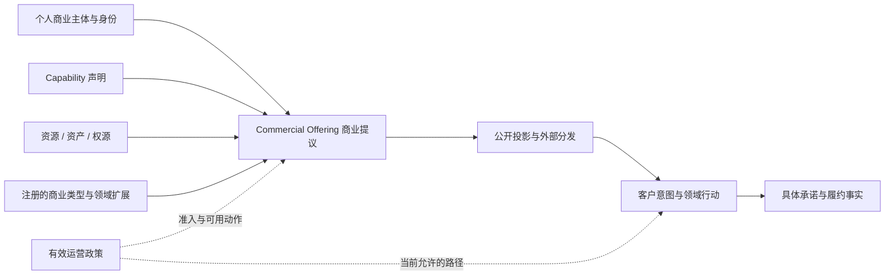

# PCI-ENG-020-C3-D — Thesis-Led Personal Commerce Abstraction Review

> 日期：2026-11-17。性质：只读产品与架构研究，待 Main Controller / Founder 审阅。  
> 基线：`2d99af0c0db8b7b626816e8f1e3d82143e68841f`。本报告不冻结新对象、关系基数、状态机、API 或数据库模型，也不授权实施。  
> 研究顺序：`PROJECT THESIS → GLOBAL COMMERCE ABSTRACTION → DOMAIN FIT → CURRENT CODE ALIGNMENT`。

## 1. 主结论与证据使用

**主推荐：以 Commercial Offering 为面向市场的供给核心，关联可组合的 Capability、资源和资产；由受控商业类型与有类型的领域扩展表达差异，由运营政策决定当前开放的类型、组合和生命周期动作。** 这是一套互补模型：Capability 提供价值来源，Offering 表达对外提议，领域模型实现真实约束，Policy 决定准入；不需要把 A、B、C 制造成三套互斥架构。

依据是三份基础文档的“个人商业资产 → 结构化供给 → 商品 → 交易与关系”，以及全局 Direction 已明确的六类 Offer、Architecture 已明确的 Offering 商业主对象。服务是其中一类，当前 `Capability → Service Template → Creator Offering` 是一个已落地路径，不能升格为所有商业模式的唯一入口。[D01 §1/3/5；D02 §1/6；D03 §2/4/7；D04 §10–12；D05 §7.3、D-16-03]

必须保留的决策缺口是：**全局 Offering 是否允许零 Capability 关联、资源/权利是否必须以 Capability 声明表示、最终供给 ownership 锚点和跨类型 Inventory 的关系基数**。D03 的组合示例没有都列出 Capability，D04 将资源和影响力纳入 Capability，而 D05 明确 Offering 至少关联一个 Capability。前两项不能被用来静默取消后一项。当前 Service 发布仍须至少一项能力；本报告不改变它。[D03:238–249,286–306；D04:303–350；D05:266–283；C01:215–237]

### 1.1 证据等级

| 标记          | 含义与可证明范围                                                        |
| ------------- | ----------------------------------------------------------------------- |
| `[文档明确]`  | 原文定义或有范围的批准；战略方向不等于当前实现授权                      |
| `[工程证据]`  | 当前 HEAD 的类型、合同、函数或持久化结构；只能证明实现事实              |
| `[历史/提案]` | 历史状态、Proposed ADR、Backlog、先前报告或测试记录；不能自行升级为批准 |
| `[推导建议]`  | 从文档与样本推导的推荐，须另行决策后实施                                |
| `[尚未确认]`  | 来源冲突、未冻结语义或没有运行/真实业务数据证据                         |

证据编号的**准确文件路径、代码位置及章节**见第 16 节。正文 `D03:145–181` 表示该文件的一基行号，区间终点包含在内。本文中的跨领域实例都是压力测试设例，不是五个已上线行业、客户访谈结果或新增产品合同。

### 1.2 完整阅读与版本定位

在仓库以 `rg --files --hidden` 定位三个精确文件名，各只发现一个工作区版本；不是用类似名称代替。已经先完整阅读 D01 全文 196 行、D02 全文 207 行、D03 全文 306 行，再阅读全局方向、架构、对象与授权记录，最后检查代码。三份文件均标记 `Frozen v1`，D01 明记 `North Star Document`。Git 中的历史版本不被当作另一份当前权威文件。

采用的准确来源分别是：

- [01_Project_Thesis.md](D:/codeSpace/PersonalCommerceInfrastructure/docs/01_Strategy/01_Project_Thesis.md:1)。
- [02_Vision_and_Endgame.md](D:/codeSpace/PersonalCommerceInfrastructure/docs/01_Strategy/02_Vision_and_Endgame.md:1)。
- [03_Core_Abstraction.md](D:/codeSpace/PersonalCommerceInfrastructure/docs/01_Strategy/03_Core_Abstraction.md:1)。

本任务明确仅允许新增报告，因此没有更新执行台账、PRD、Founder Decision 或 ADR；这项更具体的限制优先于一般变更单元的台账同步要求。

## 2. 三份基础文档逐项回答

### 2.1 D01 — Project Thesis：为什么需要这层基础设施

| 问题                         | 阅读结论、原文位置与证据边界                                                                                                                            |
| ---------------------------- | ------------------------------------------------------------------------------------------------------------------------------------------------------- |
| 1. 核心问题                  | 社交平台上已经发生的商业意图分散且非结构化，难以成为可管理供给与交易。§1、§2，9–89 行。`[文档明确]`                                                     |
| 2. 要改变什么                | 把身份、能力、时间、影响力、受众转成可发现、可交易、可经营的商业资产；不是替个人凭空创造需求。§1/3，38–48、91–106 行。`[文档明确]`                      |
| 3. 核心参与者                | Creator、Fan/Customer、Business；Creator 是独立商业主体，不限某个职业。§2.3/6/9，72–83、145–159、192–196 行。`[文档明确]`                               |
| 4. 核心产品对象              | 身份、商业供给/商品、库存、交易、履约、客户关系构成价值链；这是概念层次，不是六张表。§1/3/5，38–48、97–106、130–143 行。`[文档明确；表映射未定义]`      |
| 5. Capability 定义           | 提到个人能力及其资产化，未在本文给出正式 Capability 字段、对象基数或证照语义。§3/9，95–106、192–196 行。`[文档明确；细节尚未确认]`                      |
| 6. 商业活动/Offering/Product | 个人资产被组织成可交易商品，承接原有商业意图；不是任意个人介绍，也不只现场服务。§1/3/9，38–48、97–106、188–196 行。`[文档明确]`                         |
| 7. 个人与供给关系            | 商业身份与供给归属于持续经营的个人主体，既有受众成为初期流量来源。§2.3/5/6，72–83、130–159 行；具体 ownership schema 未定义。                           |
| 8. 应保持通用                | 身份、供给结构化、商业行动、履约与关系的连接，以及外部分发到商业入口。§3/5，91–106、130–143 行。`[文档明确]`                                            |
| 9. 允许领域差异              | 提供什么、何时何地、面向谁、客户如何行动均随供给而变；不绑定单一 Creator 垂直。§3/4.5，97–106、126–128 行。`[文档明确；扩展机制为推导]`                 |
| 10. 不属于基础抽象的内容     | Calendar 页面、票务产品、Link-in-Bio、初期 Marketplace、单个行业应用都不能替代 PCI 的整体定义。§4，110–128 行。这里不是宣布 Calendar 永远禁用。         |
| 11. 全局稳定原则             | 人是商业主体；供给须结构化；社交负责分发，PCI 承接商业；关系与履约可追踪。§2.3/3/5/9，72–106、130–143、192–196 行。`[文档明确]`                         |
| 12. 愿景而非当前授权         | §7 的七项假设明确有待验证，北极星是目标指标；完整交易、收入经营等长期描述不批准当前 Payment/CRM 等。161–186、196 行。`[文档明确；当前范围另受合同约束]` |

本文的独特贡献是**问题、价值和系统位置**。只从“创建服务表单”出发，会漏掉其真正要解决的“个人资产如何变成持续商业关系”。

### 2.2 D02 — Vision and Endgame：从切入口到终局

| 问题                         | 阅读结论、原文位置与证据边界                                                                                                                                                                     |
| ---------------------------- | ------------------------------------------------------------------------------------------------------------------------------------------------------------------------------------------------ |
| 1. 核心问题                  | 产品从哪里开始、最终成为什么；避免把入口或某一阶段当终局。§1/3，11–20、36–113 行。`[文档明确]`                                                                                                   |
| 2. 要改变什么                | 先形成独立商业身份，再扩展个人商业经营基础设施，减少对单一社交平台入口的依赖。§2/3/4，24–49、115–129 行。`[文档明确]`                                                                            |
| 3. 核心参与者                | 广义 Creator，与 Fan、Customer、Business 三类关系；例举用户用于说明切入口，不批准五个行业产品。§2/5/9，24–34、131–145、207 行。                                                                  |
| 4. 核心产品对象              | Identity 入口，随后 Product、Inventory、Transaction、Fulfillment、Relationship 等；长期 Creator Commerce Graph 包含 Capability/Product/Price/Transaction/Fulfillment。§3/6，38–113、151–175 行。 |
| 5. Capability 定义           | 是商业图谱及个人资产之一；没有在本文单独定义字段、认证或全局必填关联。§6/9，151–175、207 行。`[文档明确；结构尚未确认]`                                                                          |
| 6. 商业活动/Offering/Product | Creator Commerce 是从个人资产到商品、库存和交易的阶段，不等于所有商业都采取服务预约。§3，51–65 行；没有独立 CommercialOffering schema。                                                          |
| 7. 个人与供给关系            | 跨平台仍围绕同一个人商业身份累积供给、行动、履约及关系，而非每个平台另起一套商业主体。§4–6，117–175 行。`[文档明确；标识归属受后续 D09 修订]`                                                    |
| 8. 应保持通用                | 商业身份、库存及商业图谱为三类市场关系复用。§5/6，131–175 行。`[文档明确]`                                                                                                                       |
| 9. 允许领域差异              | 与粉丝、客户、企业的商业表达不同，供给及履约机制需容纳这种差异；本文没有冻结扩展协议。§3/5，51–113、133–145 行。`[文档明确＋推导建议]`                                                           |
| 10. 不属于基础抽象的内容     | 社交推荐、票务系统、ERP、金融及 B2B 等不能一次性堆成当前产品；社交流量与 PCI 商业层有职责区分。§4/8，117–129、190–203 行。                                                                       |
| 11. 全局稳定原则             | 切入口≠终局；共享商业图谱；依托外部流量；最小阶段应避免堵死后续路径。§1/4/6/8，11–20、117–129、151–175、190–203 行。`[文档明确]`                                                                 |
| 12. 愿景而非当前授权         | 五阶段包含 Creator OS、Discovery/Marketplace 和完整基础设施；113 行明确不是当前版本全部承诺。护城河仍是待验证假设。51–113、179–188、190–203 行。                                                 |

本文的独特贡献是**演化层次与时间边界**。不能因长期存在 Marketplace 或收入管理，就在本次实现；也不能因第一阶段只做身份，就永久限制全球供给模型为身份页。

### 2.3 D03 — Core Abstraction：资产如何组成商业提议

| 问题                         | 阅读结论、原文位置与证据边界                                                                                                                                 |
| ---------------------------- | ------------------------------------------------------------------------------------------------------------------------------------------------------------ |
| 1. 核心问题                  | 平台到底管理什么：个人商业资产，以及由资产形成的可交易库存。§1，8–23 行。`[文档明确]`                                                                        |
| 2. 要改变什么                | 将资产与限制组织为库存、包装为商品、由客户接受形成交易；能表达真实商业约束。§1/7，12–23、286–294 行。`[文档明确]`                                            |
| 3. 核心参与者                | 资产和商品的个人持有者，以及行动并形成关系的客户；不按职业建立孤立系统。§2.1/2.9/2.10/4，27–42、183–210、238–249 行。                                        |
| 4. 核心产品对象              | 明确列 Identity、Capability、Time、Influence、Audience、Location、Inventory、Product、Transaction、Relationship。§2，27–210 行；对象层次不自动等于聚合或表。 |
| 5. Capability 定义           | 个人能提供什么价值；和 Product 区分。§2.2，44–60 行。不能从技能例子推定资源/权利永远排除，后续 D04 又明确扩宽来源。                                          |
| 6. 商业活动/Offering/Product | Product 是面向买方包装的交易提议，组合资产、可用性、容量及条件。候选字段不是已确认数据库模型。§2.8，145–181 行。`[文档明确]`                                 |
| 7. 个人与供给关系            | 统一商业身份，一能力多商品；不同资产组合形成商品，交易回到个人与客户关系。§4/7，238–249、288–294 行。`[文档明确；全局基数仍见 §3]`                           |
| 8. 应保持通用                | 资产组合、库存约束、对外商品与交易/关系语义，共享 Commerce Primitive。§2.7/4/7，122–143、238–249、286–294 行。                                               |
| 9. 允许领域差异              | 时间服务、影响力出席、内容、会员、实物，以及同步/异步产能有不同组合。§2.3/2.7/4/5，62–75、122–143、238–266 行。                                              |
| 10. 不属于基础抽象的内容     | Calendar 是库存视图，Storefront 是组合展示；都不应统治全部领域或替代核心模型。§5/6，251–284 行。`[文档明确]`                                                 |
| 11. 全局稳定原则             | 七条原则包括统一身份、一能力多商品、商品可消耗库存、跨垂直复用、关系回归、Calendar 从属、Schema 表达真实约束。§7，288–294 行。`[文档明确]`                   |
| 12. 愿景而非当前授权         | 七类商品覆盖率、类别边界、Influence 独立性、库存统一、支付和取消状态共享都列为待验证问题；306 行要求实例、访谈和 MVP 数据。§8，296–306 行。                  |

本文的独特贡献是**可组合资产与真实约束**，已经明确包含非服务模式。它也保留未决问题，不能将“商业哲学”直接编译成统一数据库或万能状态机。

### 2.4 三者共同思想及非同义部分

三份文档共同要求：以个人商业主体为归属，以结构化供给承接现有需求，连接客户行动、交易/承诺、履约事实和持续关系；社会平台负责注意力和分发，PCI 不需成为流量中心。职业不是最高层对象类型，表单和 Calendar 不是商业本体。[D01:91–159；D02:117–175；D03:238–294]

D01 解释“为何做”，D02 约束“先做什么、不能一次做完”，D03 解释“管理什么及如何组合”。共同模型高于 VS-01，但共同模型也**没有**批准所有未来商业类型上线、所有库存共享同一锁模型、所有交易共享同一终态。把三者相加得到的应是演化方向，不是无边界功能清单。

## 3. 与其他权威文件的关系及冲突处理

| 来源与层级                                    | 对本研究的有效贡献                                                                                                                                                      | 不能据此声称什么                                                                                                                                |
| --------------------------------------------- | ----------------------------------------------------------------------------------------------------------------------------------------------------------------------- | ----------------------------------------------------------------------------------------------------------------------------------------------- |
| D04，Product Direction，Frozen v0.3           | §10 明确 Service/Goods/Program/Membership/Project/Right；§11 区分 Calendar/Availability/Inventory；§12 按类型区分承诺及履约。全局方向已收敛，六类类型不是本报告新发明。 | 不冻结 API、表或状态机（373 行）；VS-01 是切片，不是六类均已授权实现（114–145、617–627 行）。                                                   |
| D05，Product Architecture，Decision v1        | §5.2 能力与供给分离且至少一项能力；§7.3 / D-16-03 明确 Offering 是商业主对象；允许异步供给。                                                                            | 较早的 Event/Experience/Inquiry 等 Primitive 不与六类 Offer Type 自动一一对应；不能用旧 Creator Identity 叙述覆盖后续 Identity 决策。           |
| D06，Core Product Objects，Decision v1        | §4.3/4.4、§5 区分能力与供给，D-17-03 区分行动/交易/履约；DEV-082/083 修订同步受控 Catalog。                                                                             | 229 行旧“自由行业目录”不能越过 684–732 行的明确修订重新启用；Request 不等于 Buy。                                                               |
| D07，VS-01 与显式 Amendment                   | 是当前服务切片实现合同；FD-020-BD-01 保留履约确认；FD-020-C3-BD-01 限定 Appearance。                                                                                    | 当前 Create/Publish/Request、描述性 Availability 和履约码不成为全部未来 Offer 的硬性结构。                                                      |
| D08，Control Baseline，§6–8                   | 权威按范围而非文件修改时间；后续修订只替代点名冲突；代码/测试不能创造授权。                                                                                             | 某个旧文件中的 SUSPENDED/NOT_GRANTED 不能抹去后续有范围批准；后续批准也不能放大全局权限。                                                       |
| D09，Identity-owned C-number Decision         | 批准一个 Identity 拥有稳定 C-number；明确替代 Profile ownership。                                                                                                       | C-number 不等于密码、Token、Provider 资质认证或权利证明；不批准新的 Offering ownership 基数。                                                   |
| D10/D11，受控能力与数据库 Catalog 决策        | 平台控制支持的类别、风险、模板和有效政策，Creator 保留自身具体表达；有效 DB Catalog 替代旧静态运行依据。                                                                | 不是“代码永远只支持当前几类服务”，也不是允许 Admin 写任意可执行 Domain。                                                                        |
| D12–D15，ADR-003/004/005/007                  | 提供归属、Capability 分层、类型库存、Commitment 组合的研究材料。                                                                                                        | 文件头仍为 PROPOSED；ADR-007:36–44 内称 ADR-001..006 ACCEPTED，与头部和决策包存在状态张力。不能整批宣称获批，也不能否认后续独立 Identity 合同。 |
| D16 与 D08 的批准记录                         | Stage2 决策包是历史决策准备材料；Control 与 ledger 留存 STAGE2-DECISION-001..009 的有界纯 Domain 批准，后续 Identity 单元需分别按范围判断。                             | 不是全局 Offer/Inventory/Commitment runtime 重写批准；ADR-007:59 还明确排除该类重写。                                                           |
| D17，Development Backlog                      | ST5-O1/O3/O4/O5、I1、C1、F1 保留 ownership、Goods、课程/会员、Project/Right、跨类型库存与履约的待决策项。                                                               | Backlog 不是独立授权，不证明所有设计均“从未考虑”。                                                                                              |
| D18/D19/D20，技术决策、历史收敛复查、早期 MVP | 保留 Domain/Application→Contract→Adapter；历史 Request/Reservation/Contract 的复用及受控商业运行证据是现存事实；早期垂直 MVP 说明采样。                                 | Web 不是规则所有者；存在订单/支付代码不等于全局供给或真实资金获批，也不能用早期垂直限制全球用户。                                               |

**需要显式记录的张力。** D04 某些阶段状态段落与后续批准不同步（42–44、545–550、826 行以后），其旧 Profile C-number 归属已被 D09 点名替代；本报告按 D08 的窄范围 supersession 处理，不按“新文件覆盖旧文件”整份替换。D03 的七类商品待验证问题、D05 的 Primitive 分类和 D04 的六类 Offer Type 处在不同抽象轴；可以明确六类全局方向，但不能未经裁决宣布旧类别的映射、数据库迁移和所有资格规则已经冻结。

对于“零 Capability”问题，现有服务规则继续有效；对未来 Goods/Right，建议先说明供给究竟来自哪项能力/资源/权利以及证据，再由 Founder 决定是否仍要求 Capability 引用。D03:290 的“一商品消耗一种或多种库存”也不能未经领域实例验证，就变成每个非排他许可都要扣一单位库存的实现。

### 3.1 相邻全球材料的交叉核对

D21（04 North Star）进一步明确“个人是商业主体，不是库存”（§7.2，208–210行），五层共享语义不要求相同表/API/页面（§4，118–130行），不同商业动作不能都降级为聊天表单（§3.3，86–94行），VS-01只是窄切片（§5，132–161行）。这补强本报告主推荐，同时要求库存抽象只能针对个人可投入的资源/承诺，不能把人本身视为平台库存。

D22（05A）是Frozen Strategic Baseline v1，提供平台依赖与入口连续性的战略问题和用户采样（§4/5，291–425行），不是全球商业字段或五行业开放合同。其“不可封禁”及动态格式设想，与D23（06 Reference Research）明确“降低风险不是保证平台过滤豁免”（496行附近）、D09的稳定不可重分配引用存在需按范围分清的张力；本报告不选择实现动态换码，也不把外部平台行为假设当作已验证属性。D24（07 Reference Spec）仍标Proposed，公开引用/QR/凭据分离（21–51行）可作概念证据，其旧Profile归属由D09点名替代，旧runtime未授权状态也不能覆盖后续独立批准。

D25（59 Identity Anchor）是暂停时的Architecture Discovery，11–35行区分中立入口与后续商业；D26（28 Operating Closure）6–7、29–36行限定为研究并区分技术闭环与真实经营，129–156行区分Request/Reservation/Contract及实际履约观察。这些都支持保留现存执行模式并避免将模拟事实冒充真实商业，不为新全球模型提供自动实现授权。ADR-001/002/006/008的文件头也均仍为PROPOSED；是否某条后来单独批准仍须回到D08及对应合同，不能只看头部或ADR编号。

## 4. 核心概念辨析：共享语义不等于独立实体

表内“基础明确”仅指 D01–D03；D04 等后续定义另写。所建议的独立性指概念/责任边界，不指立即创建表、类或微服务。

| 概念                                   | 三份基础的定义程度、稳定性与领域范围                                                     | 当前对应及混淆风险                                                                                               | 推荐表达责任（均非实施冻结）                                                                                   |
| -------------------------------------- | ---------------------------------------------------------------------------------------- | ---------------------------------------------------------------------------------------------------------------- | -------------------------------------------------------------------------------------------------------------- |
| Person / Creator / Commercial Provider | D01:72–83,145–159；D02:207；D03:27–42 明确广义个人主体。稳定；不是仅内容创作者。         | 当前以 Creator Actor/creatorId 管理服务。职业标签≠商业类型≠权限。                                                | 共用主体与授权上下文；行业属性作领域资料；Policy 决定准入，不能以“技术人员”强制所有供给为 Service。            |
| Identity                               | D03 §2.1 明确归属锚点。稳定。                                                            | Canonical Identity/Commerce Profile 与 legacy CommerceIdentity 并存；C-number 是公开引用，非凭据。[D08/D09；C02] | 保留已有身份域和显式映射；供给最终 owner target 另决策，不自动合并 Identity/Profile/Account。                  |
| Capability                             | D03 §2.2 定义价值能力，§7 一能力多商品；全局稳定词汇。D04:305 含资源和影响力。           | Creator Capability 与 Platform Catalog Item不同；自述≠认证，类别≠持有人真实资产。[C02/C03]                       | 能独立于供给存续的声明/引用；作为可组合价值来源，不做所有商业的唯一流程根。零引用资格尚未确认。                |
| Skill / Knowledge                      | D03 能力实例与 D02:207 提及；未分别冻结独立对象。按领域需细化。                          | 当前 name/description 可表达技能，但无知识资源、课程或访问授权对象。                                             | 一般作为 Capability 内容；有独立版本、访问或归属生命周期时才讨论资源/内容对象。不能只因名称不同建两表。        |
| Resource / Asset                       | D03:8–23,122–143,238–249 明确商业资产；不只人力。全球概念，种类各异。                    | 当前 Catalog 文本不能证明库存拥有、IP 权利链或可交付文件。                                                       | 可组合供给来源；保有/授权/容量规则依种类；Policy 可要求凭证，不能用开关创造权利。                              |
| Commercial Offering                    | 基础通过 Product 表达相同商业角色；D04 Offer、D05 Offering 将其明确化。全局供给核心。    | C01 名为 Offering 但实现是 Service 切片，不能仅因类型名相同而视为全球完整。                                      | 稳定供给标识、归属、提议、类型与版本、约束和履约语义引用；不预定新聚合或统一状态机。                           |
| Product                                | D03 §2.8 明确定义为面向买方的交易提议，不是狭义实物。稳定。                              | 不能将通用 Product 与 Goods 混用，或仅因 Offer/Product 名字不同创建并行主对象。                                  | 建议在全局术语中对齐同一供给角色；具体类型及表示交给后续合同。是否保留多个术语须在词汇决策中明确。             |
| Service                                | D03:242 作为时间+能力实例；D04 明确六类之一。仅某些供给。                                | 当前 Offering、Availability、Request 为服务路径；不能把商品规格或许可条款压进服务描述。                          | 服务约束留在服务领域；时间、现场/远程、准备/交通等按业务需要表达。不是职业父类。                               |
| Content                                | D03:244–246,266 包含内容/数字内容，但未冻结 Content 聚合。                               | 外部链接可展示信息，不代表内容交付/访问权。                                                                      | 依承诺可为 Proof/Distribution、数字 Goods、Membership Access 或 Program 资料；不能由文件格式唯一决定商业类型。 |
| Technical Deliverable                  | 基础未明确定义独立类型；D04 Project 提供后续语义。领域概念。                             | ContractScope.deliverables 为文本且绑定 performance 字段；不是通用技术成果模型。[C11]                            | 定制成果属 Project；可重复出售成果可属 Goods；使用许可属 Right；仅诊断活动可属 Service。验收/权属需领域规则。  |
| License / Right                        | 基础提个人 IP，但没有许可合同结构；D04:316,371 明确 Right→Terms/Grant/Usage。            | 当前没有结构化许可范围/排他性/期限/Grant；文本“授权”不形成可校验授权。                                           | 区分资产或可授权权利、对外 Right Offer、成交后的具体 Grant；是否分聚合以生命周期/不变量决定。                  |
| Availability                           | D03 §2.3/2.7/5 有时间及供给条件；D04 明确可请求/承诺窗口。全球语义，表现不同。           | C01 当前只有 description；C10 单一容量时间段是另一具体机制。                                                     | 条件/窗口按类型表达；日期展示≠可用性承诺，不给所有供给强加预约。                                               |
| Inventory / Capacity / Calendar        | D03 §2.7/5 明确多资源库存、Calendar 投影；D04:332–358 区分三者。                         | 时间 Slot capacity=1≠实物库存/班级席位/异步产能；Appearance 日期不扣库存。                                       | 库存不变量按类型实现；共同归属、可追踪占用可复用。是否统一扣减原语待决策；Calendar 是 UI。                     |
| Delivery / Fulfillment                 | D01 §5、D02 §6 含履约，未冻结统一完成判据；D04 按六类区分。                              | 现有 Fulfillment Code 和 Paid-commerce Fulfillment 都存在，分别关联 Request/Order，不能混成一个事实。[C09/C12]   | 共同追溯“谁对什么承诺完成什么”，证据、验收和争议规则领域化；工具记录≠平台保证服务质量。                        |
| Customer Request                       | 基础有客户意图/Transaction；未定义现行 Request schema。D06/D07 将意图与确认区分。        | C08/C09 联系信息+消息；确认不是付款、发货、成果验收或许可授予。                                                  | 保留当前合同；未来意图可共享归属/追溯，但领域动作需独立授权，不能一律 Confirm 即成交或履约。                   |
| Transaction / Commitment               | D03 §2.9 交易为接受提议；D04 §12 给可追踪承诺，具体合同待定。                            | Request/Reservation/Contract/Order 是不同已存在对象；Proposed Commitment 不是已实施总状态机。                    | 可研究共同追踪接口/关系，不把历史对象硬并成一个状态字段。                                                      |
| Distribution                           | D01 §5、D02 §4 明确社交与商业分工；稳定。                                                | 当前 DistributionAsset generated/distributed；外链不证明获客/成交。[C04；D06:309–341]                            | 公开供给投影与渠道入口，保留生成/分发/行动来源区分；不代建社交或 Marketplace。                                 |
| Policy / Governance                    | 基础有战略边界和约束意识，没有运行 Policy schema；D10/D11 才冻结受控目录。全局横切责任。 | Catalog 的风险/状态/版本≠全部商业 Domain；四项后台可编辑字段≠未来责任上限。[C03/C06]                             | Policy 在已注册语义内选择范围、组合、审核及有界参数；代码校验其合法性，Domain 保有不变量。                     |

## 5. 五类样本的跨领域压力测试

以下均为 `[推导建议/样本]`；分类依据 D03:122–181,238–266 与 D04:303–373。不是新增业务授权，也不是每个提供者只能选一列或一类。

| 分析维度                   | 地陪                                                  | 培训讲师                                                          | 普通商家                                            | 技术人员                                                       | 知识产权提供者                                                   |
| -------------------------- | ----------------------------------------------------- | ----------------------------------------------------------------- | --------------------------------------------------- | -------------------------------------------------------------- | ---------------------------------------------------------------- |
| 1. 身份及业务属性          | 同一 Provider；语言、熟悉区域、现场协作经验           | 专长、教学对象、交付媒介                                          | 主体、货源与销售/交付责任                           | 专业方向、经验、可承担范围                                     | 权利人或有权转授权者；身份不能替代权利来源                       |
| 2. 能力来源                | 地方知识、语言、时间及协作资源                        | 知识、教学能力、课程内容                                          | 货源、实物/数字资产及经营能力，不限手工技能         | 技术知识、工具、诊断/实施经验、已有成果                        | IP 资产、使用/授权权、创作能力；不能全化为技能自述               |
| 3. 实际商业对象            | 陪同 Service；也可能固定路线 Program、数字攻略 Goods  | 单次授课 Service、班级 Program、课程包 Goods、持续访问 Membership | 实体/数字 Goods；附加安装才另涉及服务               | 诊断 Service、定制实施 Project、标准软件 Goods、软件许可 Right | Right 供给；创作委托可能是另一个 Project                         |
| 4. Offering 组成           | 服务范围+时间条件+路线/地点+参与者限制                | 学习内容+交付形式+受众+课时/访问条件                              | 商品/版本/规格+供应条件+交付方式                    | 问题范围+介入方式+成果边界+验收/使用条件                       | 标的权利+许可范围+期限+条件+授予机制                             |
| 5. 必要领域属性            | 边界、场所/区域、时长或协商方式，依具体提议           | 课程或服务定义；班级需席位/场次语义，下载包需内容版本             | 规格/数量单位/交付约束，必要性按商品类型            | 诊断范围或成果/验收条件；不能普遍必填现场日期                  | 授权标的、被许可使用范围、期限、排他/非排他等须明确其适用性      |
| 6. 可选属性                | 集合说明、推荐路线、交通提示                          | 预览、资料链接、讲师 Proof                                        | 图片、补充规格、外部信息                            | 案例、工具偏好、可公开样例                                     | 样张、作品说明、权利证明引用；不默认公开敏感证据                 |
| 7. 时间/地点/期限          | 现场窗口及区域；线上攻略不需现场                      | 直播地点/时间、异步访问期或期限，语义不同                         | 发货窗口/可供应期≠预约时段                          | 同步诊断时间或异步截止/里程碑                                  | License 使用期限/地域≠Provider 服务 Availability                 |
| 8. 商品/知识/技术/权利表达 | 陪同活动与数字路线内容可分别组织                      | 知识是能力来源；内容包是供给；访问权是不同承诺                    | 规格化货品，不伪装成“服务描述”                      | 能力≠服务≠成果；成果可能被复用销售或另行许可                   | 权利资产≠Right Offer≠具体 Grant；一段宣传文字无法替代三者        |
| 9. 可用性/供应             | 同步时间/参与人数；协商请求不必立即锁时段             | 班级席位、讲师时间、异步支持容量或数字访问                        | 数量、可售规格、供货条件；数量约束独立于 Calendar   | 可承担项目数/工时/交付窗口；非所有成果稀缺                     | 排他范围冲突或有界授权量；非排他许可不必消耗一单位实物库存       |
| 10. 商业约束/价格          | 按时长/范围或协商；具体计价未获本轮批准               | 按课程/班级/访问等；不通用套价格区间                              | 每单位/规格/数量条件；需独立合同后实现              | 诊断费、定制范围或许可条款依商业类型                           | 权利范围/期限/排他性影响条款；本次不设计收费交易                 |
| 11. Request/购买意图       | 询问日期、人数及需求的意图                            | 询课/报名/访问意图分别对待                                        | 询货与有数量/规格的购买意图不同                     | 诊断请求或项目需求/许可申请                                    | 申请特定用途的许可；不能只改 CTA 就完成合同                      |
| 12. Request 与成交         | Creator 接受意图≠已排期/已付款/已交付                 | 确认请求≠录取/取得内容访问或完成培训                              | 确认消息≠库存分配、Order 或交付                     | 确认咨询≠接受项目 Scope 或成果验收                             | Creator Confirm≠Grant；双方条款接受和法律效果须另定              |
| 13. 履约形式               | 现场陪同，或数字攻略交付（不同 Offer）                | 授课、出勤、内容交付、持续访问                                    | 发运/交接或数字交付                                 | 诊断说明、实施、阶段成果/验收                                  | 授予并维持约定使用权；使用及到期规则不是自动服务完成             |
| 14. 完成证明               | 双方确认/出席记录可作证据，不能保证质量               | 出勤≠学习效果；下载≠掌握知识                                      | 发运≠签收；签收≠合格；数字交付有不同证据            | 提交≠验收；采用双方约定标准及可追溯记录                        | Grant 记录≠实际合法使用证明；范围、接受版本及到期证据需定义      |
| 15. 外部分发               | 社交、旅行社区、直接链接                              | 社交内容、机构推荐、课程入口                                      | 店铺/社交/直接商品链接                              | 专业社区、作品集、直接协作入口                                 | 作品集、行业渠道、授权信息链接                                   |
| 16. 平台责任               | 表达范围、意图和确认工具；不自动担保现场安全/服务质量 | 表达授课/访问事实；不自动担保教学成果或资质                       | 记录规格/供给/行动；不能因可展示就承担供货/物流保证 | 记录 Scope/验收事实；不自动保证技术效果/交付 SLA               | 记录声明、条款及授权事实；不因提供工具即认证权属或担保法律有效性 |

### 5.1 真正共享的部分与不能共享的部分

共享的是“**谁以何种权源/能力，向谁提出什么商业提议，受哪些条件约束，客户采取了什么行动，形成何种承诺，结果如何追溯**”。共享商业身份、供给标识、归属、类型与语义版本、公开投影、行动来源和政策判断有依据。[D01 §3/5；D03 §2/7；D04 §10–12]

不能合理统一的是“所有供给必须有现场日期”“所有库存都是数量 1 的时间段”“所有 Request Confirm 都产生相同交易承诺”“所有履约都以扫码作为充分完成证据”“所有使用权都等于收到商品”。这些统一会抹掉实际不变量，而不是降低复杂度。[样本推导；C10/C11/C12 展示现有切片的特定假设]

### 5.2 混合提供者与反例检验

- 地陪同时出售数字路线包：同一 Identity，现场 Service 与数字 Goods 各自承诺；不能将售出文件等同于占用现场时间。
- 讲师同时有一对一指导、团体课程和持续资料访问：知识来源可复用，但时段、席位、访问期限不共用完成规则。
- 商家同时销售工具与安装支持：Goods 与 Service 可以有关联；本轮不能因“组合”就创建新的 Bundle、价格计算或统一库存产品。
- 技术人员销售诊断、定制插件和标准工具许可：诊断用 Service、定制成果用 Project、使用授权用 Right 的依据是**对外承诺**，不是职业。
- IP 提供者委托创作后另授商用权：Project 的交付/验收与 Right 的 Grant 可相关但不相互替代；不能默认为作品交付即转让全部权利。

这些反例说明“每行业一套系统”与“所有行业一个服务表单”都不足。跨行业复用要落在真实语义上，不落在职业名或页面名上。

## 6. 候选模型评估与主推荐的具体边界

### 6.1 A / B / C 是研究视角，不是必须三选一

| 研究视角                       | 能解释什么                                                                                                        | 单独采用的不足                                                                                                       | 在主推荐中的位置                                                                   |
| ------------------------------ | ----------------------------------------------------------------------------------------------------------------- | -------------------------------------------------------------------------------------------------------------------- | ---------------------------------------------------------------------------------- |
| A. Capability-Centric          | D03:289 支持一能力多商品；多能力可组成一个供给；D04:305 的广义 Capability 可包含知识、资源和影响力。              | 若把“先添加个人技能”变成通用入口，会把货源/IP 权源假装成技能；也不能从 Capability 推出数量、访问、Grant 或验收规则。 | 保留独立价值来源与可组合引用；不将其当唯一供给本体或资格认证。                     |
| B. Commercial Offering-Centric | D03 的 Product、D04 的 Offer、D05 的 Offering 都围绕对外商业提议；同一主体可有多类供给，行动/履约能找到明确对象。 | 只有一个通用对象加 description，仍不能表达各类型不变量；若所有字段都必填，会把服务假设移到全球核心。                 | **主轴**：用供给作为商业表达和追溯锚点，不等于所有数据一个聚合。                   |
| C. Domain-Extensible           | D03:249,291–294 要求跨垂直复用并保留真实约束，D04 已给六类及不同机制。                                            | 如果扩展只是任意 JSON 或 Policy 脚本，会失去校验、事务和状态语义；无限插件平台也缺乏当前需求依据。                   | **表达差异的机制**：注册类型与结构化扩展，Domain 实现规则，Policy 只开放已有能力。 |

主推荐可写作 **B 为供给主轴 + A 为价值来源 + C 为领域表达**。原文已形成较一致方向，无须另造“所有东西是能力”“所有东西是服务”“所有东西是 JSON”作为平行备选。[文档明确＋推导建议]

### 6.2 概念关系示意

箭头表示概念关联，**没有冻结引用数量、ownership target、对象创建先后或统一状态机**。当前 VS-01 的能力先行和 Confirm/Decline 保持原样；未来对某些供给直接创建的 UX，必须独立于“是否需要先登记来源”的数据决策讨论。

### 6.3 建议的稳定核心与类型化部分

| 责任           | 适合全球核心保留的语义                                                          | 不应强制为全球统一字段/行为                                                                             |
| -------------- | ------------------------------------------------------------------------------- | ------------------------------------------------------------------------------------------------------- |
| 身份与归属     | 稳定供给标识、明确提供者/owner/操作者及授权上下文                               | 不重新设计 Account/Identity/Profile，不把 C-number 当权限                                               |
| 对外提议       | What、标题/说明、明确商业类型、定义版本、关联来源/资源的可追溯性                | 不要求每种供给有现场日期、服务地点、商品 SKU 或许可期限                                                 |
| 商业条件       | 价格/条款/适用对象/供应条件的**语义位置或引用**；D04:320–329 已要求表达这些问题 | 不立即实现统一金额模型；不把 Appearance.pricingRule 文本转成可执行报价，不给全部供给相同必填 Price 字段 |
| 可供给性       | 可请求/可承诺条件、容量约束与履约期望的类型化接口或引用                         | 不把 description 当库存锁；不普遍要求扣减数量；不把 Calendar 作为所有模型入口                           |
| 生命周期与治理 | 区分作者供给生命周期、平台资格/政策结果、客户行动及后续履约；保留版本和判断来源 | 不将 paused 等政策状态写成客户交易终态，不共享一个“完成”布尔值                                          |
| 客户与分发     | 可公开投影、明确行动入口、来源与结果追溯                                        | 不普遍要求 Customer Account，也不自动建立 Buy、订阅或新 Request 类型                                    |

这是语义核心建议，不是字段合同。“共同需要回答一个问题”并不等于“每个类型必须有相同非空列”。类型扩展适合放入 Goods 的规格与交付单位、Program 的课程/班级语义、Project 的 Scope/成果/验收、Right 的 Terms/Grant 范围、Appearance 的活动描述等。价格、资源和生命周期是否独立成对象，应由版本、归属、事务与不变量证明，而非概念数目决定。

### 6.4 如何实现受控扩展而不做万能 JSON

建议未来每个获批类型/扩展有明确注册标识与语义版本、封闭字段 schema、适用条件、Domain 校验及合法动作、API 编解码、Persistence mapper、Creator 编辑器和 Public renderer，以及合同/领域/持久化/客户端验收。语义版本与 Catalog policyVersion 应能区分：改变许可语义不是简单政策开关。[推导建议；D18:3–36、C04/C13/C14 是现存分层样本]

运营可引用注册定义、选择适用组合、设置已编码允许范围内的字段约束或参数；未知类型、未知必需行为及未注册字段不能因 Admin 保存配置就执行。JSONB 可以存储**已注册、版本化、验证过**的值对象，C13 的 typed Appearance 就是实例；“JSONB”本身既不证明好抽象，也不等于被禁止的无类型万能 JSON。

不建议本轮先造 Dynamic Form Engine、通用规则语言、所有类型的空模块或六套独立产品系统。下一步应先选一个获批的最小扩展实例，定义语义和验收，再证明复用边界。

## 7. Code、Domain、Operational Policy 三层责任

| 层                              | 应负责                                                                                                                | 不应负责                                                                                             | 以样本检验边界                                                                                      |
| ------------------------------- | --------------------------------------------------------------------------------------------------------------------- | ---------------------------------------------------------------------------------------------------- | --------------------------------------------------------------------------------------------------- |
| Layer 1：Code Abstraction       | 稳定归属/标识与扩展契约；注册类型；编解码与结构校验；版本、错误与事务端口；类型化创建/查询/行动分派                   | 不按职业硬编码商业全部可能性；不接受任意配置变成新业务；不替产品决定新状态/法律效果                  | 增加另一个培训行业的同种 Program 应能复用类型；新增“许可排他冲突”却可能确实需要新规则代码           |
| Layer 2：Operational Policy     | 当前开放类型/领域/Provider 与来源组合、审核条件、发布与新请求许可、启停/退出、已注册字段的有界参数、有效版本与原因    | 不凭开关创造授权权利；不改变数量守恒/归属/Request终态；不绕过 Domain；不把发布开放当所有后续动作批准 | 同样代码可按政策开放一个已注册模板；暂停新请求不自动取消既有承诺，存量路径须明确                    |
| Layer 3：Product / Domain Rules | 共享归属/合法动作/不可篡改事实；类型特定的库存、防超卖、席位、访问期限、Scope验收、Grant范围与冲突；明确幂等/并发语义 | 不把每个行业文案固化为核心分支；不把全部状态机塞进一个无限聚合                                       | 运营可在批准范围配置席位上限，Domain 必须保证并发不超售；可配置许可可选期限，不能配置掉无权授权检查 |

三层是责任分离，不要求三套部署。判断顺序建议是：**已批准语义 → 代码支持且结构有效 → Domain 不变量成立 → 当前 Policy 允许 → 事务内执行与记录**；实际并发授权还需在写入时保持一致。前端预览只能指导输入，服务端最终判断不可省略。

新供给、既有 Draft、已发布但未形成承诺、已有 Request、已有承诺/历史结果应有分别定义的政策效果。例如停止新建与禁止发布/新请求可以不同；读历史、完成既有确认或履约不能默认跟着类别关闭而丢失。具体矩阵待产品批准，不在此发明“暂停即撤单”。

## 8. 当前代码对齐：在全局分析之后判断

### 8.1 现存工程对象与全局供给的差距

| 检查对象                       | 当前准确事实及位置                                                                                                                                                                       | 能力分类与全球解释                                                                                                                   |
| ------------------------------ | ---------------------------------------------------------------------------------------------------------------------------------------------------------------------------------------- | ------------------------------------------------------------------------------------------------------------------------------------ |
| Platform Capability Catalog    | C03:108–121 有 vertical/name/aliases/risk/releaseScope/version/status/开关；这是平台支持类别，不是某人资产台账。                                                                         | **当前有类别治理结构**；可描述多个行业，不能将当前服务 Catalog 视为全部全球能力或权利模型。                                          |
| Creator Capability             | C02:14–23、C13:23–32 为 creatorId/name/description/catalogItemId/catalogStatus/policyVersion。没有资质或资源权属结构。                                                                   | **理论上可文字表达**知识/技术/资源；**需要领域扩展**才能验证资产/授权/知识访问。不因当前名称狭窄判定一切非舞蹈不可表达。             |
| ServiceOfferingTemplate        | C03:123–136 每模板一个 capabilityCatalogItemId，requiredFields 为 string[]；没有全球 offerType、extension schema/handler。                                                               | **服务切片已支持**；不是全球唯一模板体系。配置字符串不等于存在字段执行器；当前 evaluator 不读取 requiredFields。[C03:228–429]        |
| Service Offering               | C01:27–50 固定能力引用、模板、标题/说明、描述性 Availability、Appearance、Request说明、状态/政策。发布缺项在215–237行。                                                                  | **当前服务可用语义**；无结构化 SKU/Grant/成果验收/课程访问。**需要类型化供给演化**；不是改一个行业标签就足够。                       |
| Create/Update/Publish Contract | C04:71–128 封闭对象，最多8项能力，一个可选模板，唯一 Appearance 扩展；Publish 返回 offering摘要+distributionAsset。                                                                      | **明确不支持**把任意商品/许可结构作为已校验字段传入该合同。无 offerType 分派；当前服务端共用该流程合理，但不能泛化为未来全部 Offer。 |
| Application 与 Policy          | C07:77–123 检查归属/调用Domain/重算政策/保存；174–201发布前缺项与政策；391–460读取当前快照；C03:355–365模板匹配所选能力之一。                                                            | **有可保留的分层与服务端权威判断**；政策判断仍服务专用，未注册跨类型规则。不是 Creator UI 决定最终资格。                             |
| Persistence                    | C13:34–71固定 service_offerings，Appearance为typed JSONB；C14:273–325保存完整聚合，含Creator归属检查。                                                                                   | **已支持该形状持久化**；不能从表名认定未来必须单表或分表，也不能绕开 Application 直接用缺失字段对象覆盖历史。                        |
| Customer Request               | C24:3–25状态draft/submitted/confirmed/declined；C08:54–61提交仅联系姓名、联系方式、消息。                                                                                                | **意图链已实现**；**明确不支持**以此现行合同校验SKU数量、课程报名、成果验收或许可条款接受。文字可讨论，不能宣称交易语义已支持。      |
| 当前履约码确认                 | C09:46–120检查格式、关联Request、Creator归属、confirmed状态、重复/过期及条件写入。C08:63–90结果含履约码。                                                                                | **现有授权能力必须保留**；不证明扫码就是各类Goods/Program/Right的充分履约。Request confirmed与Code fulfilled是不同状态轴。           |
| Reservation                    | C10:6–22为时间段，capacity固定1；31–47 Reservation必关联slot及服务快照；114–143确认关联Order。                                                                                           | **确有独立执行模式**，不是只有Request；但这不是通用数量/席位/非排他权利库存。复用应保留已有状态。                                    |
| Contract Commerce              | C11:7–18 Scope含performanceType/date/location/duration/headcount以及deliverables/price/cancellation/fulfillment；38–55关联Request/Offering。                                             | **确有范围版本与接受事实**，可为未来Project研究提供经验；强制演出字段仍限制通用技术成果与Right。不等于已实现通用许可合同。           |
| Paid-commerce                  | C12:40–75为PaidServiceOrder/OrderSnapshot/serviceTerms和Order相关Fulfillment；139–174必须唯一来源于Action/Reservation/Contract。                                                         | **确有交易与履约工程资产**；不等于全球供给目录或现实支付批准。本报告既不删除，也不借其扩大运行范围。                                 |
| 全球 Offer/Product 对象搜索    | 对 domain/modules/applications/contracts/database 搜索导出的 Offer/Product/Goods/Program/Membership/Right/License/CommercialOffering/CommerceCommitment 定义未命中；另逐读上述实际类型。 | **在所检路径未识别出可用全球供给聚合**。不是仅凭名称搜索证明全仓任何语义均不存在；Identity/Order等通用工程资产确实存在。             |
| Creator Form/Catalog           | C05:193–261先能力再模板，使用第一项能力筛模板；C16:4–46是手写Catalog DTO和5分钟缓存；C15:68–84固定Appearance门槛。                                                                       | **现有服务创建路径**；多选能力不等于任意组合已注册；其他类型创建既缺合同/Domain，也缺UI，不能统称“只缺表单”。                        |
| Admin Catalog UI               | C06:5–18、320–366编辑现有项的状态、风险、creatorSelectable、publishEnabled，另有草稿操作。                                                                                               | **当前控制面局部实现**，不是未来Admin责任天花板；也不代表能注册新商品语义、字段处理或Domain动作。                                    |

因此，当前代码的结构性限制不是“没有商家标签”，而是**固定服务供给形状、固定创建/发布条件、固定 Request 输入，以及缺少类型与扩展的贯通语义**。这些限制与当前切片授权相符，本报告不把未来能力缺口伪称为 VS-01 已验证缺陷。

### 8.2 按商业模式区分五类结论

| 供给设例            | 理论上可表达                                           | 明确不支持/需要领域扩展                                              | 是否只缺 UI/Policy，是否涉及核心                                            |
| ------------------- | ------------------------------------------------------ | -------------------------------------------------------------------- | --------------------------------------------------------------------------- |
| 地陪的陪同/协商服务 | 标题、能力、区域/时间描述、Request可表达一般意图       | 需要结构化路线或复杂占用时才进一步建模，不因职业不同就必须改核心     | 若现有服务语义足够且类型已注册，可能只是目录/政策及表达；是否开放仍待批准   |
| 讲师的单次指导      | 一般服务说明和Request可表达                            | Program席位、内容交付、Membership访问期限不是description能执行的规则 | 单次指导不必改核心；后三种超出当前结构，需类型/领域/API/UI联动              |
| 商家的规格化实物    | 可写商品文字与询问消息                                 | 无结构化规格/数量/库存分配/交付动作                                  | **不是只缺UI**；全局供给类型演化+Goods领域扩展，具体持久化未知              |
| 技术诊断/定制成果   | 诊断可用服务意图；成果可在文本讨论                     | Project Scope/版本/里程碑/验收，或可重复出售的软件/Right缺语义       | 诊断可复用；成果和授权需注册类型及领域规则，不能强填performanceType冒充支持 |
| IP许可              | 可公开描述意向和外部信息                               | 无权源、Terms、范围、期限、排他冲突、Grant等结构化关系               | **需要领域扩展及供给核心演化**；不是新增“授权”模板名即完成                  |
| 已存在 Appearance   | Contract/Domain/Persistence/Creator/Public均有具体实现 | 服务端未严格限定扩展适用性；见第11节                                 | 部分是现有适用性贯通问题；转为注册扩展须单独授权，不是缺一个全球引擎        |

“需要核心演化”在此指未来增加类型化供给/扩展承载契约，不预言必须重写当前 Offering 聚合、改表或迁移数据。“明确不支持”也限于**所要求的结构化规则及现行合同**，不是禁止用自然语言提出需求。

## 9. 重新回答 C3-C 的八个问题

上一份报告 P01 的运行事实仍可引用，但其 `Capability → Service Template → Creator Offering` 不作为全局最终模型。此处是范围校准，不修改原报告或历史提交。

| 问题                                                        | 直接回答                                                                                                           | 证据等级与依据                                                                                                                                                             |
| ----------------------------------------------------------- | ------------------------------------------------------------------------------------------------------------------ | -------------------------------------------------------------------------------------------------------------------------------------------------------------------------- |
| 1. 是否只是当前VS-01供给路径                                | **是。** 它组织受控服务供给，不定义全球所有商业。                                                                  | **源文档明确支持**：D04:114–145,303–373；D07:872–874。**工程证据支持**：C01/C03/C04。                                                                                      |
| 2. 能否自然承载商品、内容、技术产品、授权                   | **现行链不能充分承载这些模式的全部规则。** 描述文字可承载意向，通用字段可复用；Goods/访问/成果/Grant需要不同结构。 | **源文档明确支持**类型差异：D03:238–266、D04:309–371。**工程证据支持**现行限制：C04/C08/C10–C12。具体扩展设计为**推导建议**。                                              |
| 3. 是否需要更高全局Commercial Offering                      | **需要全球层语义，且文档已有Offer/Product/Offering角色。** 不必仅因名字再造平行主对象。                            | **源文档明确支持**：D03 §2.8、D04 §10、D05:550–563,712–716。承载契约如何落代码为**推导建议/尚未确认**。                                                                    |
| 4. Capability与Offering是否独立且关联                       | **应分清语义与存续责任，可建立关联。** Capability可无Offering；独立不等于两套完全无约束系统。                      | **源文档明确支持**：D03:44–60,289；D05:266–283。**工程证据支持**：C02/C01有各自对象与引用。未来聚合归属/基数**尚未确认**。                                                 |
| 5. Offering可否没有Capability                               | **不能据本研究直接批准。** 当前Service发布不允许；全球资产/权利供给是否可零引用须Founder裁决。                     | **源文档明确支持**当前至少1：D05:283。**工程证据支持**Draft空集与发布门禁不同：C04:115、C07:406–425、C01:215–237。D03组合遗漏与D04广义定义形成张力，全球规则**尚未确认**。 |
| 6. 一Capability可否形成多种商业类型                         | **是，语义上成立。** 例如知识形成指导、课程内容、许可；每种开放及履约另定。                                        | **源文档明确支持**一能力多商品：D03:289及D04六类型。跨类型复用方式为**推导建议**；当前代码多个Offering不证明多种类型已实现。                                               |
| 7. Template是否只是领域表单/规则载体                        | **是供给的具体配置/表达载体，不是全球商业本体。** 也可有多个模板共享同类扩展；不得每行业造新核心。                 | **源文档明确支持**Offering商业主对象：D05:712–716。**工程证据支持**C03模板依附能力类别且不拥有Creator供给生命周期。Template注册/适用规则形状为**推导建议**。               |
| 8. Policy是否应综合类型、领域、Provider资格、结构、生命周期 | **应综合判断，而非四个独立开关。** 前提是语义和结构已有注册，不能由Policy发明新Domain。                            | **源文档明确支持**平台治理及创作者表达：D10/D11。**工程证据支持**当前已有组合匹配/风险/有效版本：C03/C07。全球综合策略为**推导建议**，具体资格与存量效果**尚未确认**。     |

## 10. Admin / Creator / Shared API 职责关系

### 10.1 建议职责，不是本次扩建清单

| 参与方                   | 应有的产品/工程责任                                                                                                            | 明确边界                                                                                              |
| ------------------------ | ------------------------------------------------------------------------------------------------------------------------------ | ----------------------------------------------------------------------------------------------------- |
| Product/Domain治理       | 批准商业语义、对象关系、不变量、动作/事件、责任边界及验收；批准代码注册的新定义                                                | 不让运营页面绕过产品授权创造商业模式                                                                  |
| Admin政策控制面          | 管理**已注册且获批**商业类型、能力类别、领域扩展和Offering定义的开放关系；维护风险/审核/生命周期政策、有效版本、影响预览和历史 | “管理定义”是启用版本与受限参数，不是任意编辑schema/可执行脚本；当前四项能力值得保留但不应当作全球上限 |
| Creator表达面            | 依据有效政策获得当前可用类型/模板/字段组；声明真实供给与来源、编辑具体条款/描述、看到资格原因；按类型完成合适创建流程          | 不必所有类型相同表单；不由职业推断商业类型；资格拒绝不应抹掉历史数据；不自行计算最终发布授权          |
| Shared API / Application | 执行鉴权、归属、当前有效定义与政策读取、结构和Domain校验、事务/并发处理；返回明确允许动作、缺项和原因的合同（未来合同须另批）  | 客户端显示允许不等于写入允许；旧UI和陈旧政策版本不能绕过服务端检查                                    |
| BFF / Session            | Creator私有流量通过同源BFF；服务器持有凭据；保留Opaque HttpOnly Session、CSRF/Origin、Refresh CAS与可靠Logout                  | 不复用Operations身份；不让浏览器持Token或直连DB。本报告不改Auth。[C18/C19]                            |
| Persistence / Public投影 | 保存验证后的业务对象/版本和历史事实；公开只暴露应展示的供给信息                                                                | schema形状不反过来决定产品；公开投影不得泄漏资质材料、凭据或客户隐私                                  |

### 10.2 对创建路径与配置自由的直接回答

**是否必须先声明 Capability？** 当前服务保持必须有能力才能发布。全球 UX 可以研究“先选供给类型，再在流程内关联或声明必要来源”，无须强迫用户先离开创建页；但**直接创建的UX不等于允许零关联**。对于纯资产/权利供给是否还需Capability对象，见Founder决策F02。

**不同商业类型是否需要不同流程？** 需要按真实承诺表达差异；基础归属、供给说明、政策反馈、草稿保存模式可以复用，有语义差异的字段组/步骤用受控编辑器。新增同类行业主要依靠已注册定义与组件组合；新增全新行为仍须规则代码与验收，不能承诺“以后永远零代码”。

**如何得到动态选项而不形成两套规则？** 建议服务端从同一个有效注册定义与Policy计算可选组合、缺项/拒绝原因，客户端只负责呈现和输入辅助；每次写入/发布/新请求重新检查。客户端未知的必要扩展应停止该编辑并保留历史，不能静默忽略字段或给旧DTO加类型断言。[推导建议；当前手写DTO与5分钟缓存见C16，真实服务端判断见C07]

**哪些可配置、哪些必须注册？** 标签、帮助文案、已知枚举子集、允许的有界参数、组合与开关可在批准范围配置；字段类型、编解码、事务影响、状态转换、库存扣减、Grant与验收的业务含义必须在注册/Domain中定义。创作者在这些边界内保留描述、案例、具体条款和已允许的可选结构；表达自由不是任意注入未经支持的业务动作。

## 11. Appearance：作为已有领域扩展样本重新定位

### 11.1 已批准与已实现的含义

Appearance 是活动出席类供给的**可选结构化展示与现有Request上下文**，不是价格对象、Availability/库存、日历或许可。D07:841–886规定唯一已确认映射：`template-commercial-appearance → capability-commercial-appearance`，其 active/established/review 不因修订自动开放发布。

必需字段（仅当提供整个对象）：appearanceType、startsOn、locationDescription、buyerType、requestCallToAction；可选endsOn、pricingRule、upcomingTitle、externalUrl。类型枚举不赋予模板资格；endsOn不能早于startsOn。pricingRule是自由文本，buyerType是中性请求方类别，CTA只改变原Request入口文案。[D07:855–874；C01:10–24,141–174；C04:31–55]

C3-B1必须保留的更新语义：**省略appearance保留，提供完整对象整体替换，Create省略则没有**；null/空对象/不完整对象都不是清除。Domain在C01:90–98,114–138落实，Contract在C04:126–128注明，完整聚合经C14:273–325持久化。通用Repository不应自行猜测HTTP补丁语义；先由Application/Domain合成新对象，再保存。

C3-B2的前端在C15:68–84按精确Template/Capability gate，C05:72–105把不适用历史对象只读并在普通更新时省略，避免清除；公共展示及CTA走C17:98–104和AppearanceInfo。**这些现有代码和历史提交保留，不因本研究回滚。**

### 11.2 服务端适用性缺口的证据及可复核方式

`[工程证据：静态已确认缺少该门禁；本轮未执行HTTP复现]` C04 Create/Update允许Appearance，但没有模板条件；C07 Create/Update只检查能力归属、构建对象、评估通用政策。C03:167–168指定templateId时立即返回模板；355–365只检查模板与某项能力匹配，388–407处理scope/risk，没有检查“该模板允许Appearance”。所以**在普通模板及其合法能力均满足其它条件时，提供合法Appearance对象的输入没有专门适用性拒绝路径**。不能把Creator隐藏入口当作服务器边界。

隔离环境中可复核：为合成Creator选择一个当前合法普通Template及所属Capability；通过Creator BFF创建包含完整合法Appearance的Offering；检查响应、服务端Policy结果、保存与重新读取是否拒绝该扩展。对照相同输入省略Appearance，以及精确已确认活动模板。必须遵守现行review政策，不能为验证扩大开放。**本轮没有连接数据库、没有执行上述请求，因此不提供HTTP状态/持久化PASS或真实数据影响结论。** 这是前次P01所指出缺口的源代码复核，不虚构一轮新的运行证据。

### 11.3 若获批，最小迁移次序

1. 先冻结“注册扩展可表示什么”和历史保留规则，注册已有Appearance **原字段与语义**；Policy仅引用唯一已批准映射，不以appearanceType或名称模糊匹配自动推广。
2. 在服务器建立同一适用性判断，用于新建/显式新设或替换扩展、读取允许动作及Creator展示。现有policyVersion和扩展语义版本分别追溯；不在此直接选定API形状。
3. 区分增量写与历史保留：不适用历史对象仍可读，普通字段编辑省略时仍原样保留；不能用新门禁阻断所有历史编辑，也不能因保留历史就允许任何客户端新增越界对象。原样提交、替换或模板切换的具体兼容策略须产品明确。
4. Creator逐步使用服务端资格数据替代固定ID判定，但在合同/服务器一致且有回归证据前保留现行gate。未知/不兼容定义采取保留数据、限制编辑的方式，不丢字段。
5. 公共投影继续原展示和CTA；测试覆盖新建、完整替换、省略保留、模板切换、历史越界只读、Policy暂停/变更、旧客户端及并发更新。迁移初期不改表、不回填；如未来必须变存储，再另证必要性。

Appearance可以成为**注册领域扩展的首个样本**，而非所有领域字段组的统一父类。它目前只描述上下文，没有数量占用或Grant动作；不能据此认定所有未来扩展都是九个文本字段或都不需要独立Domain。

## 12. 历史兼容原则与有依赖顺序的演化建议

### 12.1 必须保护的工程资产和历史事实

保留当前 Identity 与 Creator/Operations 隔离、同源 Creator BFF、HttpOnly Opaque Cookie、PostgreSQL Session、服务端凭据加密、CSRF/Origin、Refresh CAS 以及已经修复的上游注销语义。报告没有重新运行安全验收，也不将静态阅读升级为新增安全PASS；这里只明确迁移不能破坏这些已要求的边界。[C18/C19；本任务明确限制]

保留现有Creator Capability、Offering ID/归属、Publish/Unpublish语义、Distribution入口、Customer Request、Confirm/Decline、Fulfillment Code/QR及独立履约确认；不改Confirmed/Declined或历史履约结果。不因全球术语统一就把Service/Request历史行重新分类为Goods/Right，也不通过批量回填“修正”未知来源数据。

未来兼容要求：旧客户端省略新扩展时保存既有值；不能用未知版本的默认值覆盖历史字段；更新合并语义由明确应用命令拥有，Repository保存已验证对象；读模型保留旧定义/版本的解释能力；政策变化不静默重写已成立事实。需要快照的条款应在对应承诺处明确冻结，不能默认由当前Offering实时文本替代。并发普通编辑与扩展编辑的丢失更新应在正式方案中定义冲突/版本语义，而非本轮改状态或表。[推导建议；C01/C14/C21提供当前兼容样本]

**未知数据边界：** 本轮没有读取生产、共享或本地业务数据库。无法判断历史Appearance、模板错配、无能力引用或权利数据的真实数量，也不能声称“历史数据未受影响”。能够证明的是本轮没有执行数据写入，且工作区原有文件字节得到保留。

### 12.2 建议路线图（均需独立授权）

| 顺序                      | 建议下一单元及目的                                                                                              | 前置依赖、验收边界与停止条件                                                                                         |
| ------------------------- | --------------------------------------------------------------------------------------------------------------- | -------------------------------------------------------------------------------------------------------------------- |
| R0 产品词汇与范围裁决     | 确认主推荐，对齐Product/Offer/Offering/Service，决定Capability/资产关联和owner锚点；只冻结必要语义              | Founder审阅本报告；不先建表或机械接受整批Proposed ADR；不批准全部六类运行                                            |
| R1 受控扩展最小合同       | 用已批准Appearance证明“注册语义/适用性/政策”的边界，设计Creator/API共享资格和旧客户端保留合同                   | R0中相关决策及F07/F08；不改Appearance业务含义，不造全局表单引擎；精确映射不清则停止绑定                              |
| R2 服务器闭环优先         | 按独立授权补齐现有Appearance适用性、增量写与历史保留判断，贯通Domain/Application/Contract/Persistence及政策版本 | 合同先行；隔离Fastify+真实PostgreSQL验证省略保留、完整替换、越界新增拒绝、历史只读和合法普通编辑、并发失败语义       |
| R3 Creator/Public消费一致 | Creator按服务器定义/资格组合现有字段组，Public投影和原Request CTA保持一致                                       | R2服务端权威规则；验证BFF、创建/编辑/刷新/公开页面/Request及Session/履约回归；不能只以组件Mock验收                   |
| R4 一种有差异的供给验证   | Founder再选一个能检验模型差异的具体Goods、Program、Project或Right实例，先写领域/产品合同与责任边界              | 明确授权哪一个实例；不能同时做五个行业；无真实约束/证据或语义未冻结则停在建模验证                                    |
| R5 从实例提炼共享核心     | 用两个真正不同模式验证类型核心、资源关系、动作追溯和库存接口；必要时提出最小兼容架构变更                        | API/Domain/Persistence/Browser证据；迁移单独证明必要性；复用已有Request/Reservation/Contract，而非一次替换历史状态机 |

下一阶段最值得做的是 **R0 后，以 Appearance 为现存最小实例制定受控扩展与适用性合同，再完成服务端到客户端的一致性**。这能验证抽象边界，又不提前实现新商业。若Founder优先需要另一类供给，应先完成其独立合同；本报告不替Founder选定新垂直、交易或价格产品。

## 13. 十二项战略结论的直接回答

| 问题                                      | 明确结论                                                                                                                                                                                     |
| ----------------------------------------- | -------------------------------------------------------------------------------------------------------------------------------------------------------------------------------------------- |
| 1. PCI真正抽象的核心                      | **以个人商业主体为归属，把能力/资产组织为结构化供给，并连接客户行动、承诺、履约与关系。** 不是Service表单或Calendar。[D01 §3/5；D03 §1/2/7]                                                  |
| 2. Capability是核心对象还是来源           | **是全球稳定概念，也是可组合商业价值来源；不是唯一的供给本体或必经独立页面。** 是否每个全球Offering都必须引用它仍须裁决，不能取消现行Service规则。[D03 §2.2/7；D04:305；D05:283]             |
| 3. CommercialOffering/Product/Service关系 | **Product（基础语义）、Offer、Offering指向相近的商业提议角色；Service是其中一种类型，Goods不是通用Product的同义词。** 统一词汇不要求新建三套主实体。[D03 §2.8；D04 §10；D05 §16]             |
| 4. 领域如何表达差异                       | **注册商业类型、结构化领域扩展和对应Domain行为**；模板承载具体表达/配置，Policy选择开放范围，不按职业各建孤岛。[D03:249,291–294；D04:318；推导建议]                                          |
| 5. 全球核心放哪些公共属性                 | **供给标识与归属、What/类型/版本、可追溯来源、商业条件与履约期望的语义位置、生命周期与政策分离、行动/分发追溯。** 不等于统一必填字段清单。[D04:320–329；§6.3推导]                            |
| 6. 扩展放哪些属性                         | **商品规格与交付单位、课程/访问语义、成果/验收、许可范围/期限、活动上下文等**；能改变状态/库存/权利的扩展须有Domain规则。[D04:309–371；五样本推导]                                           |
| 7. 哪些控制交给运营                       | **哪些已注册类型/领域/提供者组合目前开放，何时审核，哪些供给可新建/发布/接新请求，以及有界配置与生命周期影响。** 不靠逐行业代码开关。[D10/D11；全局推广为建议]                               |
| 8. 哪些留在Code/Domain                    | **结构与类型校验、归属授权、合法转换、数据/并发不变量、库存约束、Scope/验收和Grant语义。** 运营不能把它们配置掉。[D18；C07/C09/C10/C11；推导建议]                                            |
| 9. 值得保留的现有架构                     | **分层Application/Domain/Adapter、Contract、Creator BFF与Session隔离、当前政策版本机制、Offering/Distribution/Request分离、已有执行模式、Appearance省略保留。** 保留不等于证明全部生产就绪。 |
| 10. 当前抽象最大不足                      | **服务切片的固定结构和动作尚无贯通的类型化全球供给/扩展契约；扩展适用性在服务器与客户端不一致。** 不是缺职业标签，也不是没有任何Commerce工程资产。[C01/C03/C04/C08/C10–C16]                  |
| 11. 下一阶段最值得做的变更                | **先决策词汇/关联边界，再用已有Appearance建立受控扩展及服务端适用性的一致合同与验证。** 此后以一个另获批非同质模式检验全球抽象，避免全仓重构。[第12节；推导建议]                             |
| 12. 仍须Founder决定什么                   | **关联基数/来源语义、供给owner锚点、库存共享边界、领域动作法律与业务效果、政策存量效果、扩展注册治理及下一实例。** 第14节逐项列出；不替Founder冻结模型。                                     |

## 14. Founder 决策清单

| 编号（本报告议题，不是已登记FD/DEV） | 待裁决问题                                                                                         | 本报告建议与尚未确认内容                                                                                      |
| ------------------------------------ | -------------------------------------------------------------------------------------------------- | ------------------------------------------------------------------------------------------------------------- |
| F01 主模型与术语                     | 是否接受“Offering主轴+可组合来源+受控领域扩展+运营准入”？Product/Offer/Offering如何统一语义？      | 建议接受方向；六类Offer方向已有依据，不重新投票发明分类；代码命名与聚合仍待设计。                             |
| F02 Capability关系与创建入口         | 全球Offer是否必须关联Capability？资产/权利是否可直接作为来源？哪些类型可在创建流程内声明来源？     | 不以UI路径替代数据基数决定；当前Service至少1项保持；未来零引用无批准，需解决D03/D04/D05张力。                 |
| F03 资源/权利表达                    | 广义Capability是否足够，何时需要独立资源/资产/权源对象及声明证据？                                 | 建议按独立归属、版本、权利链和不变量判断；不把Catalog选择视为证明，不预设每个名词一张表。                     |
| F04 ownership与身份映射              | 新全球供给由Identity、CommerceProfile还是其他明确锚点持有？如何与legacy creatorId映射？            | 复用已批准身份合同，保持C-number归Identity；D12是提案依据，最终供给归属不得由本报告擅改。                     |
| F05 Availability/Inventory           | 哪些统一语义必须成立，哪些是Time/Quantity/Seat/产能/权利特有？是否所有Offer都引用可扣减Inventory？ | 保留方向中共享primitive，先用实例验证事务和数量语义；不重写Reservation，非排他许可不预设扣实物库存。          |
| F06 行动/承诺/履约                   | 各类型的Request、购买/报名/Scope接受/Grant如何形成承诺？完成证据和平台责任是什么？                 | 当前Confirm/Decline与履约码不变；逐类合同，不接受一Confirm覆盖全部法律/交付含义；不统一一个状态机。           |
| F07 Policy全球控制边界               | 类型/扩展/Provider组合、审核、暂停、退出、新旧供给动作分别如何管理？                               | 建议同一服务端定义与有效政策权威，保护历史；具体审核/资格与责任不由工程自行发明。                             |
| F08 Appearance增量/历史兼容          | 是否授权注册现有扩展并补服务器适用性？历史越界对象显式原样提交、替换、模板切换如何处理？           | 建议保留原数据、省略保留与只读；仅精确已批准映射可新增；迁移不扩范围，无删除入口。                            |
| F09 最小后续验证实例                 | Appearance之后选哪个真实差异实例、使用何种真实证据裁决全球结构？                                   | 建议一次一个实例；五样本不等于五行业批准，仍需访谈/用例数据，而非仅概念推演。                                 |
| F10 当前范围与责任                   | 新类型是否仅表达意图，还是进入购买/付款/交付/许可效果？平台承担何种责任？                          | 全球Price/Commerce语义不是本轮Payment授权；Payment/Settlement/Refund/Marketplace/CRM/自动履约等不得搭车实现。 |

这些编号只方便评审引用；本报告没有修改Founder Decisions、PRD、Backlog或ADR状态。

## 15. 验证、Git 与保全记录

### 15.1 本轮做了什么、没有什么运行证据

| 验证项                         | 结果与实际范围                                                                                                                                            |
| ------------------------------ | --------------------------------------------------------------------------------------------------------------------------------------------------------- |
| 三份基础文档                   | 完整逐行阅读：196/207/306行；精确文件名定位，各一个当前版本；已在第2节逐文档回答全部12问                                                                  |
| 权威关系与其他材料             | 阅读D04、架构/对象及相关批准/ADR/Backlog段落；按D08范围处理冲突；Proposed/历史/当前批准分别列明                                                           |
| 静态工程追踪                   | 从供给类型/合同→Application/Policy→Schema/Repository→Creator/Public/Admin，并读Request、Reservation、Contract、PaidServiceOrder实际形状；代码位置见第16节 |
| 既有测试源码                   | 检查C20–C23，能说明已有覆盖意图；**本轮未执行这些测试，不把历史通过计为本轮通过**                                                                         |
| 单元/集成/Typecheck/Lint/Build | 未运行。只新增Markdown，不改受这些门禁覆盖的代码；不需要以全仓重跑支撑概念研究                                                                            |
| Database/Browser/外部服务      | 未连接任何数据库，未启动浏览器或写业务对象；无新的端到端PASS、真实存量盘点、市场或法律有效性证据                                                          |
| 报告格式与引用                 | PASS：仅本报告Prettier写入/检查；59个本地链接与引用行号有效，51项来源已索引；三文档各12问、矩阵16维、C3-C八问及战略12问结构齐全；git diff --check通过     |
| 文件保全                       | 开始记录每个既有未跟踪文件SHA256，结束逐个对比；48/48一致，V1台账SHA256一致，HEAD/Parent/分支不变                                                         |

C21中PostgreSQL测试须设置独立`APPEARANCE_TEST_DATABASE_URL`，152行在缺依赖时跳过，并在140–145行以新连接重新读取。因此“存在测试文件”不能证明今天执行过真实PostgreSQL，也不能用Memory结果替代它。P01的历史测试数字未转录为本轮结果。

### 15.2 Git 开始与结束对照

| 项目                | 开始                                                               | 结束                                         |
| ------------------- | ------------------------------------------------------------------ | -------------------------------------------- |
| Branch              | `codex/pci-eng-015-b-r2-persistence-closure`                       | 相同                                         |
| HEAD                | `2d99af0c0db8b7b626816e8f1e3d82143e68841f`                         | 相同                                         |
| Parent              | `884c025d21e1b3668bb7014599b1afdacc332c24`                         | 相同                                         |
| HEAD Subject        | `feat: add scoped creator appearance management`                   | 相同；未新建Commit                           |
| Tracked changes     | 仅`docs/08_Execution/21_Prototype_Execution.md`，原V1未提交内容    | 相同；标准`git diff --numstat`为58新增/0删除 |
| V1台账SHA256        | `50ED743C022B03370D06F1E47B07F1B0BFCAD5F4FA4A7F4BD6B1CE93A1FBE76A` | 相同                                         |
| Staged              | 空                                                                 | 空                                           |
| Untracked实际文件数 | 48（逐文件而非Git目录折叠数）                                      | 49：原48全部保留+仅本报告                    |
| 本轮唯一新增        | 无                                                                 | 本报告；不把历史文件纳入新成果               |
| 历史/远端操作       | 无                                                                 | 无Reset、回滚、历史改写、Commit或Push        |

既有48文件由3份报告、2份018-C证据、9份018-F证据、12份019-A证据、22份B1-V1目录文件组成。下方保全清单仅用于证明原文件保留，**不是重新验收或纳入本任务成果**。

### 15.3 历史未跟踪文件哈希保全清单

以下为开始与结束一致的 SHA256。路径均相对于 `D:/codeSpace/PersonalCommerceInfrastructure/`；不将它们作为本轮测试成果。

展开 48 个既有文件的完整保全清单

| 既有文件                                                                                                    | SHA256（开始 = 结束）                                              | 对比 |
| ----------------------------------------------------------------------------------------------------------- | ------------------------------------------------------------------ | ---- |
| `docs/09_Engineering_Governance/PCI-ENG-020-B1-V1-Creator-Session-Browser-Verification.md`                  | `78F67309AF35F991E86966ADC8B5827085727EEC496326D8FF8A583D42866519` | 一致 |
| `docs/09_Engineering_Governance/PCI-ENG-020-C3-A-Service-Offering-Appearance-Product-Review.md`             | `69AE1CAAB35E4B39336435A165453388C52B1FC46746D14650D886A250326A71` | 一致 |
| `docs/09_Engineering_Governance/PCI-ENG-020-C3-C-Project-Wide-Capability-Service-Policy-Synchronization.md` | `044BF5EE53E4632A9A4E9211660FB8D4EF2E9C195458E7C8F933FD6F4F90F4BC` | 一致 |
| `docs/09_Engineering_Governance/evidence/PCI-ENG-018-C-browser-1794765242183.json`                          | `8931E17D3B75FB0EE22A1642F3D45A3979E9A44530689D7A30E1E1EB7192D891` | 一致 |
| `docs/09_Engineering_Governance/evidence/PCI-ENG-018-C-pci-018c-fe2a13caaa-postgres.json`                   | `20829DF2AD918DFB5F07D357B132D743D85DA5F19D63E244758F8E288FFFCB8F` | 一致 |
| `docs/09_Engineering_Governance/evidence/PCI-ENG-018-F-DIAG-pci-018br1-337a364339-postgres.json`            | `B47F260667607CA44FBD61EC5E43F454A846215D1581151CC4B5B159004E8D6F` | 一致 |
| `docs/09_Engineering_Governance/evidence/PCI-ENG-018-F-DIAG-pci-018br1-4a2ce985fd-postgres.json`            | `74663ADCAA4B44FAC682B52D13644D85C42D0F22650D0F3C04575849ED8B71BF` | 一致 |
| `docs/09_Engineering_Governance/evidence/PCI-ENG-018-F-browser-1794769509313.json`                          | `7C3DB0C3CEACDFC6A2F370957D195AD12D7D1E6D165373F1FE33213F2B94EAFE` | 一致 |
| `docs/09_Engineering_Governance/evidence/PCI-ENG-018-F-browser-1794773018211.json`                          | `5366813F2E12D7B67D93404FD446D05B4F992276FF8C45D7AB69A1FF44EB3E7F` | 一致 |
| `docs/09_Engineering_Governance/evidence/PCI-ENG-018-F-pci-018br1-05d01b93ed-postgres.json`                 | `832D876E067487D04D7AB7BA1B7A7E18852C233ADAB46BE10FBB1AB35DF61132` | 一致 |
| `docs/09_Engineering_Governance/evidence/PCI-ENG-018-F-pci-018br1-261a5b01e7-postgres.json`                 | `FA48E5B3E3AC14B0BFD39794912710550A86887C088AAEA54C24C7FCC880C82F` | 一致 |
| `docs/09_Engineering_Governance/evidence/PCI-ENG-018-F-pci-018br1-88325bb7ad-postgres.json`                 | `9F1C395A2235C9C5D6CC92F935B6527EB7EAC9BD6A22B76C600189AD49985AC5` | 一致 |
| `docs/09_Engineering_Governance/evidence/PCI-ENG-018-F-pci-018br1-95f451891e-postgres.json`                 | `15256F6DF66746480BBC7919098D2461066D93C470033267907AB46DF4FEB53F` | 一致 |
| `docs/09_Engineering_Governance/evidence/PCI-ENG-018-F-pci-018br1-bda4fc68a0-postgres.json`                 | `3069E59EEF912CDD939DFB549BD6E2C74ABBBF9EA6CDF1EE5CE135A71E5C5D4D` | 一致 |
| `docs/09_Engineering_Governance/evidence/PCI-ENG-019-A-browser-1794773709139.json`                          | `84834E98FB34277D5F4F1B5D40C99DF3AC4FE6DC930373B323285D24AF454BC7` | 一致 |
| `docs/09_Engineering_Governance/evidence/PCI-ENG-019-A-browser-1794774432903.json`                          | `85D7C9B8741FDCA5C073DD8B7C6015F3EE3767316D495DFD100BDC3822954F0B` | 一致 |
| `docs/09_Engineering_Governance/evidence/PCI-ENG-019-A-browser-1794774802255.json`                          | `07E20E9F9C57C3CA2C579B124C399D24B02054E76E17E52A3551DF5A3DF67F82` | 一致 |
| `docs/09_Engineering_Governance/evidence/PCI-ENG-019-A-browser-1794775162327.json`                          | `5B3010BE9463B706AC6629CFF34F1AEE1EA0AEA326A6893CAE4C219622C11B26` | 一致 |
| `docs/09_Engineering_Governance/evidence/PCI-ENG-019-A-pci-019a-2169684f96-postgres.json`                   | `FC12E0BCDDC93A6852E0B129AEC5A609F85BD8912BCDA39A9600AF56D35B09DE` | 一致 |
| `docs/09_Engineering_Governance/evidence/PCI-ENG-019-A-pci-019a-6732148954-postgres.json`                   | `56EF1BEDD8CD363226970E8094859F4A72BBA3034CC94ED3B68501B532548E02` | 一致 |
| `docs/09_Engineering_Governance/evidence/PCI-ENG-019-A-pci-019a-7c55830c05-postgres.json`                   | `32C3721E0F3B4C6AC39A47AA53419300552D80ABE5F550BD1B0D3E4591A431F1` | 一致 |
| `docs/09_Engineering_Governance/evidence/PCI-ENG-019-A-pci-019a-95d7b3691c-postgres.json`                   | `AB6E15D51A280FC280288ABF7A41BA8551D58D1928824AB13831614B89409D72` | 一致 |
| `docs/09_Engineering_Governance/evidence/PCI-ENG-019-A-pci-019a-aedbc1eeb5-postgres.json`                   | `167628D660946BA254B2F1B234C5E00EDD6AD846A1276A26D72BF46BE00473DD` | 一致 |
| `docs/09_Engineering_Governance/evidence/PCI-ENG-019-A-pci-019a-bfe0f3ad43-postgres.json`                   | `0C25FFB081A04438DA1E9E398A75255E8811F700A5DE78351A892567BBF6740E` | 一致 |
| `docs/09_Engineering_Governance/evidence/PCI-ENG-019-A-pci-019a-c719862fc4-postgres.json`                   | `DFEB3E2654EEDD4B0AB2ED4EF9CDD2BA62A50FA4704B104494F25597BCE8B032` | 一致 |
| `docs/09_Engineering_Governance/evidence/PCI-ENG-019-A-pci-019a-f3d731b8dc-postgres.json`                   | `79039858E28730630D8D0123648DEEFDFBA4EB1A3CB63C0EF4F14C140F189BEF` | 一致 |
| `docs/09_Engineering_Governance/evidence/PCI-ENG-020-B1-V1-20261116/01-authenticated-dashboard.png`         | `4B1FAC25B3B5CC45CB293D4AA59A4F9BB6A194B44462F4FBF4E90EB14D8063E9` | 一致 |
| `docs/09_Engineering_Governance/evidence/PCI-ENG-020-B1-V1-20261116/02-fulfillment-confirmed.png`           | `8225B11D3F22525E00A240F94952366113805A0E16ABC9098BECA786F537042B` | 一致 |
| `docs/09_Engineering_Governance/evidence/PCI-ENG-020-B1-V1-20261116/03-logout-login-screen.png`             | `9FB9D49BA48D8061E34355805096D33F48B71BD75FA2CDF17C41E0758023AFB0` | 一致 |
| `docs/09_Engineering_Governance/evidence/PCI-ENG-020-B1-V1-20261116/README.md`                              | `727543D8410D699971CC9A077DEEBEFE9C005A61A9AB9177DE7E604004637CD7` | 一致 |
| `docs/09_Engineering_Governance/evidence/PCI-ENG-020-B1-V1-20261116/baseline.json`                          | `50CAA610E0862CC7A1BDBB260FA56A623F95AE72EB51DF08EA5767DC98CBED25` | 一致 |
| `docs/09_Engineering_Governance/evidence/PCI-ENG-020-B1-V1-20261116/browser-context-storage.json`           | `FED0F22AE068AE460EEA9C8FB290DD023F9249CC98CF80712AE5FC38A4F839C6` | 一致 |
| `docs/09_Engineering_Governance/evidence/PCI-ENG-020-B1-V1-20261116/browser-fetch-audit.json`               | `769D589D914094EDA9BD916BCB561AFFDDCFC4C36591A9485053A187E5E1D6D6` | 一致 |
| `docs/09_Engineering_Governance/evidence/PCI-ENG-020-B1-V1-20261116/browser-observations.json`              | `6D81FB6EF1E0DACE40D747011C59BA1DD2E03FA1064AF522C2931166B3B9C8C9` | 一致 |
| `docs/09_Engineering_Governance/evidence/PCI-ENG-020-B1-V1-20261116/browser-probe.js.txt`                   | `BCB3296FB2A54C571956A6C3B1A25F428663A662861223B0187D3767A53B5C2E` | 一致 |
| `docs/09_Engineering_Governance/evidence/PCI-ENG-020-B1-V1-20261116/cleanup.json`                           | `F62A73D81004F1B74996442CC6E55CDE2B168FC71D8ECDF2C516E4FC4ED58D91` | 一致 |
| `docs/09_Engineering_Governance/evidence/PCI-ENG-020-B1-V1-20261116/db-events.jsonl`                        | `56FAF030C21E89BB34F2F3ED9D8942103736E9282F64F0D38500B3CBC4F5DD06` | 一致 |
| `docs/09_Engineering_Governance/evidence/PCI-ENG-020-B1-V1-20261116/db-verification-harness.mjs.txt`        | `21E18BCD68EBE39622731CCE513CDD48AA6A25DC5119AB002807E47E5C53233F` | 一致 |
| `docs/09_Engineering_Governance/evidence/PCI-ENG-020-B1-V1-20261116/fetch-audit.js.txt`                     | `29542C4EAAFD76AE7FE52BD30097B2F48855AC10732A29143573F60F3A978F4C` | 一致 |
| `docs/09_Engineering_Governance/evidence/PCI-ENG-020-B1-V1-20261116/git-final.json`                         | `0CAAAA0BFEB218BC685AA40E215EEFACBF36B629A163824D1328016C636F336E` | 一致 |
| `docs/09_Engineering_Governance/evidence/PCI-ENG-020-B1-V1-20261116/http-probes.jsonl`                      | `1B3E3BD85D11309233F6B720F00E0F78E7ECAAAC43C5D4524DFC1D0EC2E2645F` | 一致 |
| `docs/09_Engineering_Governance/evidence/PCI-ENG-020-B1-V1-20261116/http-verification-harness.mjs.txt`      | `1DE25F6A04DC94BF4E12E85BC0E5FD4F1C904D54810E991D46F977CC15BC1D7C` | 一致 |
| `docs/09_Engineering_Governance/evidence/PCI-ENG-020-B1-V1-20261116/manifest.json`                          | `D4476CDBDC99936B025D34E63356FEED364193D63251D5B7534A878B3D09A9DC` | 一致 |
| `docs/09_Engineering_Governance/evidence/PCI-ENG-020-B1-V1-20261116/network-responses.redacted.jsonl`       | `B703C9703CC9AA4F3E45152A7146C30E6BA80018DA4E31B229E5612D62D82CFF` | 一致 |
| `docs/09_Engineering_Governance/evidence/PCI-ENG-020-B1-V1-20261116/runtime-api.redacted.jsonl`             | `DF3E78CC3353333E4589B1D0776ABC52BF4F1364F1DB9E780FA53FAB72AC70D4` | 一致 |
| `docs/09_Engineering_Governance/evidence/PCI-ENG-020-B1-V1-20261116/runtime-web.redacted.log.txt`           | `D40B015E1EF02D6D6EE566A10CAE755F77A9E2D4019C3357748C171FF5BA305D` | 一致 |
| `docs/09_Engineering_Governance/evidence/PCI-ENG-020-B1-V1-20261116/token-leak-scan.json`                   | `1C7FDB9D469831C8CD55CE18EF90047D13568368919437C7651786C086FEF9A2` | 一致 |
| `docs/09_Engineering_Governance/evidence/PCI-ENG-020-B1-V1-20261116/validation.json`                        | `5CC5A5A688B06F9E6FC3E4C8F8AD47C2839BE59A424EF2FEDC48EC259ABD0EFA` | 一致 |

### 15.4 证据充分性与未知事项

文档和类型/函数阅读足以支撑“全局方向高于服务切片”“现行合同不能承载所列结构化差异”“原实现应保留”的研究结论；不足以证明五类市场需求已验证、真实历史数据完整、未来库存/权利模型已正确，或某一类型已获上线批准。尚缺真实供给样本/访谈、不同承诺与责任合同、跨类型库存案例及Founder对第14节的裁决。

## 16. 证据索引：精确来源与位置

所有链接指向本次工作区绝对路径；行号基于研究基线的实际文件。区间写在说明中，链接仅定位起始行，便于逐项复核。

### 16.1 产品、架构与治理文档

| ID  | 准确文件与定位                                                                                                                                                                                       | 章节、行号与证据性质                                                                                                                       |
| --- | ---------------------------------------------------------------------------------------------------------------------------------------------------------------------------------------------------- | ------------------------------------------------------------------------------------------------------------------------------------------ |
| D01 | [01_Project_Thesis.md](D:/codeSpace/PersonalCommerceInfrastructure/docs/01_Strategy/01_Project_Thesis.md:1)                                                                                          | Frozen v1，完整1–196；§1 9–48；§3 91–106；§4 110–128；§5 130–143；§6–9 145–196。主要思想依据                                               |
| D02 | [02_Vision_and_Endgame.md](D:/codeSpace/PersonalCommerceInfrastructure/docs/01_Strategy/02_Vision_and_Endgame.md:1)                                                                                  | Frozen v1，完整1–207；§1 11–20；§3 38–113；§4–6 117–175；§7–9 179–207。主要思想依据                                                        |
| D03 | [03_Core_Abstraction.md](D:/codeSpace/PersonalCommerceInfrastructure/docs/01_Strategy/03_Core_Abstraction.md:1)                                                                                      | Frozen v1，完整1–306；§2 27–210；§4 238–249；§5–6 251–284；§7–8 286–306。主要抽象依据                                                      |
| D04 | [05_Product_Direction](D:/codeSpace/PersonalCommerceInfrastructure/docs/01_Strategy/05_Personal_Commerce_Infrastructure_Product_Direction.md:303)                                                    | Frozen v0.3，§10–12 303–373；阶段切片114–145；治理/对象映射554–627；冻结与未来边界649–659,788–808。全球方向，不是完整实现授权              |
| D05 | [16_Product_Architecture.md](D:/codeSpace/PersonalCommerceInfrastructure/docs/07_Product_Architecture/16_Product_Architecture.md:248)                                                                | Decision v1；§5 248–337；Primitive 339–363；意图/确认/支付/交付382–415；扩展边界432–519；Offering主对象550–563,712–716                     |
| D06 | [17_Core_Product_Objects.md](D:/codeSpace/PersonalCommerceInfrastructure/docs/07_Product_Architecture/17_Core_Product_Objects.md:180)                                                                | Decision v1；能力/供给180–212；Inventory247–307；Distribution309–341；Request370–411；结果456–482；Offer锚点643–655；DEV082/083修订684–732 |
| D07 | [20_MVP_PRD_VS01.md](D:/codeSpace/PersonalCommerceInfrastructure/docs/07_Product_Architecture/20_MVP_PRD_VS01.md:775)                                                                                | 当前切片合同；FD-020-BD-01履约修订775–839；FD-020-C3-BD-01 Appearance修订841–886；不是全球Offer合同                                        |
| D08 | [25_Project_Control_Baseline.md](D:/codeSpace/PersonalCommerceInfrastructure/docs/08_Execution/25_Project_Control_Baseline.md:666)                                                                   | §6 权威与supersession 666–690；同步表692–705；历史决策登记708–718。结合后续有界授权，不将旧状态全文普遍化                                  |
| D09 | [29_Identity_Owned_Commerce_Reference_Decision.md](D:/codeSpace/PersonalCommerceInfrastructure/docs/07_Product_Architecture/29_Identity_Owned_Commerce_Reference_Decision.md:3)                      | Founder批准状态与日期3–5；Identity-owned C-number、替代关系7–26                                                                            |
| D10 | [34_Controlled_Capability_Service_Publishing_Decision.md](D:/codeSpace/PersonalCommerceInfrastructure/docs/07_Product_Architecture/34_Controlled_Capability_Service_Publishing_Decision.md:11)       | 决策11–29；类别/能力/模板48–66；治理与创作者边界92–124。有界服务产品方向                                                                   |
| D11 | [35_Database_Managed_Capability_Service_Catalog_Decision.md](D:/codeSpace/PersonalCommerceInfrastructure/docs/07_Product_Architecture/35_Database_Managed_Capability_Service_Catalog_Decision.md:10) | §1–3，10–54：有效数据库目录、状态、选用/发布开关与历史保护                                                                                 |
| D12 | [ADR-003_Ownership](D:/codeSpace/PersonalCommerceInfrastructure/docs/07_Product_Architecture/21_ADR_003_Commerce_Object_Ownership_and_Identity_Anchoring.md:3)                                       | PROPOSED；33–63供给归属/类型；131–176 Capability分层且不立即拆分。仅研究参考                                                               |
| D13 | [ADR-004_Inventory](D:/codeSpace/PersonalCommerceInfrastructure/docs/07_Product_Architecture/21_ADR_004_Availability_Inventory_Reservation_Boundary.md:3)                                            | PROPOSED；24–32区分概念；35–101 Time/Quantity/Seat与Calendar；不证明已实施                                                                 |
| D14 | [ADR-005_Commitment](D:/codeSpace/PersonalCommerceInfrastructure/docs/07_Product_Architecture/21_ADR_005_Commerce_Commitment_Composition_and_Lifecycle.md:3)                                         | PROPOSED；39–123 Commitment与现存模式的区别；未来状态不得替换当前状态机                                                                    |
| D15 | [ADR-007_Readiness](D:/codeSpace/PersonalCommerceInfrastructure/docs/07_Product_Architecture/21_ADR_007_Stage_2_Technical_Design_and_Implementation_Readiness.md:3)                                  | 头部PROPOSED/NOT_GRANTED；36–44内部ACCEPTED声明；59明确排除Offer/Inventory/Commitment重写。状态张力如第3节                                 |
| D16 | [22_Stage_2_Founder_Decision_Package.md](D:/codeSpace/PersonalCommerceInfrastructure/docs/07_Product_Architecture/22_Stage_2_Founder_Decision_Package.md:30)                                         | 30–38来源分层，ADRs为参考提案；不是当前批准的完整清单。实际有界批准另见D08:712–717和ledger:3175–3202                                       |
| D17 | [24_Development_Backlog.md](D:/codeSpace/PersonalCommerceInfrastructure/docs/08_Execution/24_Development_Backlog.md:991)                                                                             | Draft索引；49要求对账批准状态；991–1024 ST5供给/库存/Commitment/Fulfillment待决策，无独立授权                                              |
| D18 | [23_Technology_Architecture_Decision.md](D:/codeSpace/PersonalCommerceInfrastructure/docs/09_Engineering_Governance/23_Technology_Architecture_Decision.md:3)                                        | Decision v1；3–36：业务内核、合同与Adapter、Web参考客户端的边界                                                                            |
| D19 | [54_Commerce_Infrastructure_Convergence_Review.md](D:/codeSpace/PersonalCommerceInfrastructure/docs/09_Engineering_Governance/54_Commerce_Infrastructure_Convergence_Review.md:1)                    | 历史Controller Review，1–70结果和模式矩阵；120附近Appearance是展示元数据。保留现存工程资产，不视为本轮运行批准                             |
| D20 | [09_MVP_Product_Definition.md](D:/codeSpace/PersonalCommerceInfrastructure/docs/04_Product/09_MVP_Product_Definition.md:1)                                                                           | 历史MVP；1–37、108–116为初始切入/比较样本；不约束全部全球供给                                                                              |
| P01 | [C3-C既有研究报告](D:/codeSpace/PersonalCommerceInfrastructure/docs/09_Engineering_Governance/PCI-ENG-020-C3-C-Project-Wide-Capability-Service-Policy-Synchronization.md:69)                         | 历史未跟踪报告；§2–6当前能力/模板/政策事实，§4.1当前关联；本轮不改写，不将其链条升级为全球架构                                             |

台账批准记录定位：[21_Prototype_Execution.md](D:/codeSpace/PersonalCommerceInfrastructure/docs/08_Execution/21_Prototype_Execution.md:3175) 3175–3202，为历史Stage2决策有界记录；当前未提交V1内容原样保留。一般工程治理：[22_Engineering_Governance.md](D:/codeSpace/PersonalCommerceInfrastructure/docs/09_Engineering_Governance/22_Engineering_Governance.md:99)，99–129分层与边界，产品对象/表/代码不默认一一对应；本次具体只新增报告约束优先。

相邻全球材料补充索引：

| ID  | 准确文件与定位                                                                                                                                              | 证据范围                                                                                                       |
| --- | ----------------------------------------------------------------------------------------------------------------------------------------------------------- | -------------------------------------------------------------------------------------------------------------- |
| D21 | [04_North_Star_End_State.md](D:/codeSpace/PersonalCommerceInfrastructure/docs/01_Strategy/04_North_Star_End_State.md:118)                                   | Decision v1；86–94动作语义、118–161五层与VS-01切片、202–239原则与闸门；尤其208–210个人不是库存                 |
| D22 | [05A_Core_Problem_and_Anti_封禁_Strategy.md](D:/codeSpace/PersonalCommerceInfrastructure/docs/01_Strategy/05A_Core_Problem_and_Anti_封禁_Strategy.md:3)     | Frozen Strategic Baseline v1；275–289动态格式设想；291–425基础设施定位/用户采样；不是当前换码或行业实施授权    |
| D23 | [06_Commerce_Reference_Research.md](D:/codeSpace/PersonalCommerceInfrastructure/docs/01_Strategy/06_Commerce_Reference_Research.md:496)                     | Founder冻结的标识研究；3–8范围；496行降低兼容风险不保证过滤豁免；不提供本轮外部验证                            |
| D24 | [07_Commerce_Reference_Product_Spec.md](D:/codeSpace/PersonalCommerceInfrastructure/docs/01_Strategy/07_Commerce_Reference_Product_Spec.md:21)              | Proposed Product Specification；21–51引用/QR/凭据分离；48–49的旧Profile归属受D09明确替代                       |
| D25 | [59_Identity_Anchor_and_Commerce_ID.md](D:/codeSpace/PersonalCommerceInfrastructure/docs/09_Engineering_Governance/59_Identity_Anchor_and_Commerce_ID.md:3) | 历史Architecture Discovery；3–17未授权范围；19–35平台中立入口与后续商业；68–78 Profile方向不是本次供给归属裁决 |
| D26 | [28_Operating_Closure_Model.md](D:/codeSpace/PersonalCommerceInfrastructure/docs/07_Product_Architecture/28_Operating_Closure_Model.md:6)                   | 历史Operating-model discovery；6–7仅研究；29–36技术/真实运营区分；129–156三模式及履约事实边界                  |

### 16.2 当前代码、合同和测试源码

| ID  | 准确文件与定位                                                                                                                                                       | 可核查的位置与意义                                                                                                                        |
| --- | -------------------------------------------------------------------------------------------------------------------------------------------------------------------- | ----------------------------------------------------------------------------------------------------------------------------------------- |
| C01 | [modules/service-offering/offering.ts](D:/codeSpace/PersonalCommerceInfrastructure/modules/service-offering/offering.ts:4)                                           | 状态/Availability/Appearance4–24；Offering/Input27–50；Create63–82；Update保留85–138；日期校验141–174；缺项215–237；发布/撤回/归档244–269 |
| C02 | [commerce-identity.ts](D:/codeSpace/PersonalCommerceInfrastructure/modules/creator-commerce-identity/commerce-identity.ts:14)                                        | Capability14–23；CommerceIdentity25–30；能力关联归属70–85。legacy当前服务模型                                                             |
| C03 | [service-policy/catalog.ts](D:/codeSpace/PersonalCommerceInfrastructure/modules/service-policy/catalog.ts:108)                                                       | Catalog/Template108–136；模板查找158–183；Policy输入与规则228–429；不是全球动态扩展执行器                                                 |
| C04 | [service-offering-contracts.ts](D:/codeSpace/PersonalCommerceInfrastructure/contracts/api/v1/service-offering-contracts.ts:31)                                       | 封闭Appearance31–55；Distribution/Publish57–84；响应86–103；Create/Update113–128。精确输入/输出形状                                       |
| C05 | [creator/service-form.tsx](D:/codeSpace/PersonalCommerceInfrastructure/apps/web-v2/features/creator-onboarding/components/service-form.tsx:72)                       | 历史只读/回显/提交72–105；能力与模板选择193–261。Creator表达，不是服务器授权                                                              |
| C06 | [admin/catalog-policy-panel.tsx](D:/codeSpace/PersonalCommerceInfrastructure/apps/admin-web/components/catalog-policy-panel.tsx:5)                                   | Draft/Item5–18；草稿38–65；现有项开关/状态/风险320–366。当前UI边界                                                                        |
| C07 | [offering-use-cases.ts](D:/codeSpace/PersonalCommerceInfrastructure/applications/service-offering/offering-use-cases.ts:77)                                          | Create/Update77–123；发布缺项/政策174–201；保存归属391–427；有效快照与评估429–460                                                         |
| C08 | [customer-request-contracts.ts](D:/codeSpace/PersonalCommerceInfrastructure/contracts/api/v1/customer-request-contracts.ts:29)                                       | PublicOffering29–51；Submit54–61；结果/履约码63–90；固定Request上下文，不能伪作购买或Grant                                                |
| C09 | [confirm-fulfillment-use-case.ts](D:/codeSpace/PersonalCommerceInfrastructure/applications/fulfillment/confirm-fulfillment-use-case.ts:39)                           | 格式/Code匹配46–74；Creator/Request状态77–94；重复/过期及条件写96–120。独立于Creator决定的履约事实                                        |
| C10 | [reservation.ts](D:/codeSpace/PersonalCommerceInfrastructure/modules/reservation/reservation.ts:3)                                                                   | Slot与服务快照3–22；Reservation31–47；确认114–143；固定capacity=1                                                                         |
| C11 | [contract.ts](D:/codeSpace/PersonalCommerceInfrastructure/modules/contract-commerce/contract.ts:4)                                                                   | 状态/Scope4–18；版本/接受事实20–35；Contract38–55；不是通用IP许可结构                                                                     |
| C12 | [money-domain.ts](D:/codeSpace/PersonalCommerceInfrastructure/modules/paid-commerce/money-domain.ts:40)                                                              | OrderSnapshot/PaidServiceOrder40–57；Order履约68–75；创建及来源约束139–174。存在≠当前资金/全局供给授权                                    |
| C13 | [database/schema/creator-identity.ts](D:/codeSpace/PersonalCommerceInfrastructure/database/schema/creator-identity.ts:23)                                            | Capability23–32；Offering与typed Appearance34–71；Distribution73–79；Request94–103。仅结构证据，未查询DB                                  |
| C14 | [postgres-creator-identity-repositories.ts](D:/codeSpace/PersonalCommerceInfrastructure/adapters/persistence/postgres/postgres-creator-identity-repositories.ts:273) | Offering完整保存273–325；Appearance映射73，写入303/318；不自行实现HTTP省略语义                                                            |
| C15 | [service-offering-appearance.ts](D:/codeSpace/PersonalCommerceInfrastructure/apps/web-v2/lib/service-offering-appearance.ts:24)                                      | 表单24–63；精确资格68–84；编解码87–98；外链协议101–108                                                                                    |
| C16 | [use-service-catalog.ts](D:/codeSpace/PersonalCommerceInfrastructure/apps/web-v2/features/creator-onboarding/api/use-service-catalog.ts:4)                           | Catalog DTO4–32与当前Domain枚举/字段存在差异；BFF客户端读取35–46；不据泛型断言证明运行合同一致                                            |
| C17 | [public/s/page.tsx](D:/codeSpace/PersonalCommerceInfrastructure/apps/web-v2/app/%28public%29/s/%5BofferingId%5D/page.tsx:98)                                         | 98–104 ServiceDetailCard与原BookingForm/CTA；旧/public路由重定向至/s，不是另一套流程                                                      |
| C18 | [Creator BFF route.ts](D:/codeSpace/PersonalCommerceInfrastructure/apps/web-v2/app/api/%5B...path%5D/route.ts:376)                                                   | 376–420私有业务Session/Origin/CSRF/代理；150–169服务端Bearer；302–356上游注销路径。本轮不改安全语义                                       |
| C19 | [api/client.ts](D:/codeSpace/PersonalCommerceInfrastructure/apps/web-v2/lib/api/client.ts:7)                                                                         | 同源7–8；CSRF22–25,51–53；credentials same-origin60–65；浏览器不获取服务器Token                                                           |
| C20 | [offering-appearance-contract.test.ts](D:/codeSpace/PersonalCommerceInfrastructure/tests/contracts/offering-appearance-contract.test.ts:24)                          | 24行起可选对象/标题、伪价格等输入合同测试；只查源码，未运行                                                                               |
| C21 | [offering-appearance.integration.test.ts](D:/codeSpace/PersonalCommerceInfrastructure/tests/integration/offering-appearance.integration.test.ts:43)                  | DB隔离43–55；独立重读140–145；memory/postgres条件套件151–155；保留/替换155–224；日期400与非法输入229–272。只查源码                        |
| C22 | [offering.test.ts](D:/codeSpace/PersonalCommerceInfrastructure/modules/service-offering/offering.test.ts:126)                                                        | 126–210省略保留、整体替换、普通Offering；217–234日期校验。只查源码                                                                        |
| C23 | [service-form.test.tsx](D:/codeSpace/PersonalCommerceInfrastructure/apps/web-v2/features/creator-onboarding/components/service-form.test.tsx:101)                    | 101–206 scoped创建/回显/保留、切模板、越界历史只读；是组件Mock测试，不替代端到端                                                          |
| C24 | [commerce-action.ts](D:/codeSpace/PersonalCommerceInfrastructure/modules/customer-request/commerce-action.ts:3)                                                      | Action状态与Request字段3–25；提交77–82；不具有商品规格/许可条款接受结构                                                                   |

公共Appearance渲染补充：[appearance-info.tsx](D:/codeSpace/PersonalCommerceInfrastructure/apps/web-v2/components/commerce/appearance-info.tsx:15)，15–86显示标题、类型、日期、地点、请求方、定价说明、CTA和外链；[旧公开页重定向](D:/codeSpace/PersonalCommerceInfrastructure/apps/web-v2/app/%28public%29/public/%5BofferingId%5D/page.tsx:12)，12–14跳转；[FulfillmentCode](D:/codeSpace/PersonalCommerceInfrastructure/domain/fulfillment-code.ts:27)，27–56状态/生成、125–150有效性/完成。均为静态源码证据。

## 17. 交付边界与最终状态

本报告完成三份基础文档逐问分析、全球权威关系、概念辨析、五样本16维压力测试、主模型推荐、三层责任、代码适配分类、C3-C八问、Admin/Creator/API职责、Appearance重定位、兼容路线图和Founder决策清单。没有实施新架构、扩大产品范围或改动历史事实。

`PCI-ENG-020-C3-D = THESIS-LED PERSONAL COMMERCE ABSTRACTION REVIEW COMPLETED — AWAITING MAIN CONTROLLER / FOUNDER REVIEW`

该状态表示研究报告完成，**不表示新架构实施授权、生产就绪、生产部署或外部试点获批**。
