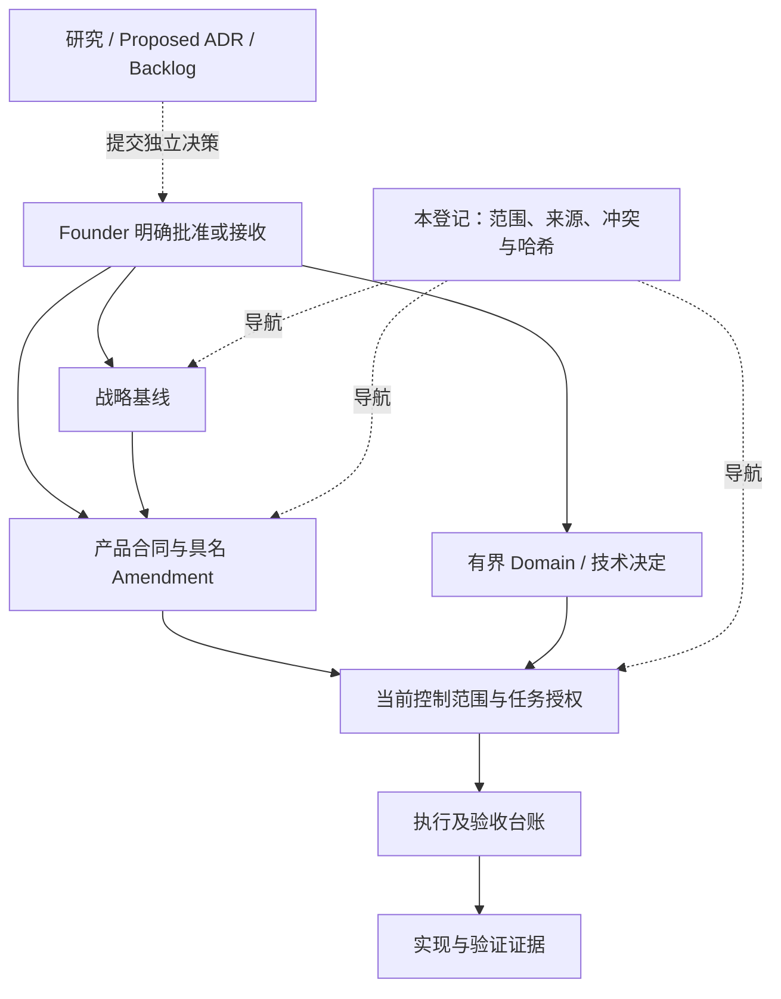

# PCI-ENG-020-C3-E — Project Documentation Baseline and Freeze Register

> 登记日期：2026-11-17（本轮任务环境日期；不是对历史批准日期的重建）。
> 状态：文档内容基线与权威关系已登记，**AWAITING MAIN CONTROLLER REVIEW**。
> 授权来源：Main Controller / Founder 的 PCI-ENG-020-C3-E 指令，尤其 §2.1、§3–§10。
> 本登记不取代 Founder Decision，不接受 Proposed 架构，不关闭 Resume Gate，不批准任何新实施。

## 1. 冻结对象、证据等级与覆盖方法

冻结对象是文件内容、批准来源、适用范围及解释关系；不是将所有文件升级为 Frozen，也不是冻结未来全球商业供给定义。开始时全部 225 份仓库 Markdown 均纳入附录 A，包括根目录、各层 AGENTS/README、战略、市场、商业、产品、验证、审计、架构、执行、治理、证据索引和原型说明。没有只选择 C3-D 引用的文件。

盘点方法为 `rg --files --hidden` 文件枚举、读取全部文件正文并提取权威/批准/替代语句，再对决定分类的正文、批准记录、冲突条款和相互引用进行聚焦核查。自动读取全文不等于人工逐行审阅约 9.4 万行，更不等于验证其中全部业务或外部事实。依赖清单记录原文引用；引用存在不等于被引用对象获批。文件缺少独立批准、版本或来源时明确标记 `PROVENANCE_REQUIRES_REVIEW`。

| Authority Class            | 本登记中的含义                                               | 执行限制                                                               |
| -------------------------- | ------------------------------------------------------------ | ---------------------------------------------------------------------- |
| FROZEN / ACCEPTED          | 可追溯的冻结战略、具名决定或正式接收成果，在列明范围内有效   | 通过独立批准修订，不覆盖原文；研究接收不等于实施批准                   |
| CURRENT CONTRACT           | 现行产品合同、具名有界领域合同或被现行治理明确采用的工程规则 | 仅约束对应产品切片/工程层，不扩张全球模型或执行授权                    |
| REFERENCE / HISTORICAL     | 历史执行、研究、交接、实现说明或来源未闭合的记录             | 保留原貌；不能独立授权实施；引用其中有单独批准的局部决定时须查决定索引 |
| PROPOSED / DRAFT / BACKLOG | 未接受 ADR、方案、决策准备或待办                             | 维持原状态；不因实现存在或测试通过升级                                 |

文件自身的 Status 与本登记的 Authority Class 是两个字段。一个文件可包含不同年代的条款，分类表示本次使用方式，不能抹去其原文 Frozen/Completed/Blocked/Proposed 声明。未核实的旧批准声明也保留原文，不因登记而确认为 Founder 批准。

### 1.1 Baseline Content Protection vs. Authority Class

225 份原始 Markdown 的路径与开始时 SHA-256 构成 C3-E 内容快照；Authority Class 表示权威等级与适用范围，不是统一的文件编辑权限状态。内容保护、权威分类与后续修订依据分别判断，不把全部 225 份文件视为永久不可编辑的 Frozen 文档。

原始内容不得静默覆盖或删除。合法修订须追溯修改原因、范围、批准或记录依据及修订历史，保留历史证据，并记录原始版本与新版本的关系。哈希变化本身不证明违规，须结合授权来源、实际差异和适用范围判断。

| Authority Class            | 后续修订原则                                                                   |
| -------------------------- | ------------------------------------------------------------------------------ |
| FROZEN / ACCEPTED          | 不直接覆盖已冻结原文；通过独立批准、修订或补充文件改变其当前效力，保留原始记录 |
| CURRENT CONTRACT           | 仅按明确 Founder Decision / Amendment 及有界授权修订，保留旧合同及替代范围     |
| REFERENCE / HISTORICAL     | 保留历史证据；必要时以独立说明或有版本的更正记录补充，不静默重写历史事实       |
| PROPOSED / DRAFT / BACKLOG | 可在正常受控工作中继续演进，保留适当版本和历史；内容更新不自动升级为已批准决定 |

本小节不重新分类附录 A，不改变现有权威层级。R1 的修订与逐文件验证记录见 [R1 审阅修订和证据核验报告](PCI-ENG-020-C3-E-R1-Review-Corrections-and-Evidence-Verification-Report.md)。

## 2. 当前权威层级与读取入口

沿用 [Project Control Baseline](../08_Execution/25_Project_Control_Baseline.md) §6:666–690：

1. Founder-approved Strategic Direction：战略方向。
2. Founder-approved Product Contracts 与显式 DEV / Founder Amendments：产品含义。
3. Accepted Domain Decisions：具名领域语义。
4. Accepted Technology Decisions：具名技术架构。
5. Project Control Baseline：当前控制模式和执行范围。
6. Prototype Execution：执行、偏差、验收及验证历史。
7. Project Handoff：历史暂停及 Resume Gate 证据。
8. Backlog：待办和计划，无独立授权。
9. Git / 代码：实现事实。
10. 测试：验证事实。

该顺序按批准状态与适用范围解释，不能机械地让一个不适用的高层文件覆盖专门获批修订。显式新决定只替代其指定的冲突条款；时间较新、已 Commit 或测试通过均不是批准证据。本登记是上述关系的索引，位于被索引决定之下。

### 2.1 五个层次不得合并

| 层次              | 当前来源                                                      | 有效含义                                                            | 不产生的含义                                  |
| ----------------- | ------------------------------------------------------------- | ------------------------------------------------------------------- | --------------------------------------------- |
| 全球战略          | Strategy 01–05，Control §1、§6                                | PCI 面向个人商业基础设施，社会平台分发流量                          | PCI 只做 Service；所有未来类型都已获实施授权  |
| 产品对象概念      | Architecture 16、Core Objects 17 及具名 Identity/Catalog 决定 | Offering、Capability 等既有概念，局部经过修订                       | 概念必然对应一张表；所有关系基数已全球冻结    |
| 当前产品切片      | VS-01 PRD 20 + 明确 Amendment                                 | 当前 Creator Service / Request、发布政策、履约确认、限定 Appearance | 全球商业类型的穷尽定义；Payments 等进入 VS-01 |
| 未来架构提案/研究 | ADR-001–008、C3-C、C3-D                                       | 提案、当前切片分析和研究依据                                        | 全部 ADR Accepted；研究建议已成为实施要求     |
| 工程事实          | 代码、Commit、测试、执行报告                                  | 当时实际实现和验证范围                                              | 产品授权、生产/外部试点准入、真实历史数据证明 |

### 2.2 战略文件逐项解释

| 文件                                                                        | 证据与当前范围                                                                                            | 保留的限制                                                                                                    |
| --------------------------------------------------------------------------- | --------------------------------------------------------------------------------------------------------- | ------------------------------------------------------------------------------------------------------------- |
| `docs/01_Strategy/01_Project_Thesis.md`                                     | 原文 Frozen v1 / North Star；C3-D原始Founder指令§1指定为权威思想依据，C3-E §5.1沿用；研究正文§2.1留存解释 | 全球个人商业方向；不是当前功能列表。独立历史批准件未提供，不能补造日期/FD                                     |
| `docs/01_Strategy/02_Vision_and_Endgame.md`                                 | Frozen v1；C3-E §5.1、C3-D §2.2                                                                           | 长期演化和终局；不能把“永不失效”解释为禁止 Founder 明确修订                                                   |
| `docs/01_Strategy/03_Core_Abstraction.md`                                   | Frozen v1；C3-E §5.1、C3-D §2.3                                                                           | 能力、资产、库存与商业供给的概念；零 Capability 等全球关系尚未裁决                                            |
| `docs/01_Strategy/04_North_Star_End_State.md`                               | Decision v1；Execution §14 STRAT-01:900；战略输入                                                         | 原文决策记录与独立 Founder 接受是两种证据；无单独批准件部分列来源待审，不据此执行终局                         |
| `docs/01_Strategy/05_Personal_Commerce_Infrastructure_Product_Direction.md` | v0.3；Control:16–19、696 明确采纳 Founder 确认的外部历史批准                                              | 全球方向有效；Control 同时说明无独立签署件、不是完整 Stage 2 授权；Profile 持 C 号等旧条款被 DEV-061 局部替代 |
| `docs/01_Strategy/05A_Core_Problem_and_Anti_封禁_Strategy.md`               | 自述 Frozen Strategic Baseline；反封禁动机与样本                                                          | 原文不构成不可屏蔽技术保证；动态编码建议不是当前 C 号格式合同。独立批准来源待审                               |
| 两份 `06_Commerce_Reference_*Research.md`                                   | PCI-RESEARCH-001 与 PCI-RESEARCH-002 是不同文件/编号；前者记录 Founder 冻结，后者为 Proposed Research     | 研究中的位数、码长和过滤结论不覆盖后续 18 位规范；真实外部平台兼容结论依证据等级                              |

## 3. Founder Decisions 与批准来源索引

本节不生成新的历史 FD。`DEV-###`、工程任务编号、研究编号和 Founder 决策编号不是可互换的命名空间。下表日期均取原文；“原始批准件未归档”意味着保留仓库中的批准转述，同时标记 `PROVENANCE_REQUIRES_REVIEW`，不伪造签署或批准时间。原始正文决策条目完整检索入口见附录 B。

### 3.1 战略、身份及产品批准

| 原编号                              | 原批准内容 / 日期                                                                 | 可核查来源                                                      | 当前有效范围、替代与排除                                                                                               |
| ----------------------------------- | --------------------------------------------------------------------------------- | --------------------------------------------------------------- | ---------------------------------------------------------------------------------------------------------------------- |
| Product Direction v0.3（无独立 FD） | Founder 确认历史战略方向；独立批准日 UNKNOWN                                      | Control:16–19、696                                              | 战略有效；不等于 Stage 2 全部批准                                                                                      |
| STAGE2-DECISION-001                 | Canonical Concepts Adoption；ledger 日期 2026-08-26，独立批准日期 UNKNOWN         | Decision Package 22:206；Execution:3180；Control:712            | 具名纯 Domain 范围；不接收整份 ADR                                                                                     |
| STAGE2-DECISION-002                 | 独立 ID namespace / 不替代                                                        | Decision Package 22:218；同上批准记录                           | 身份命名空间，不授权历史 ID 批量迁移                                                                                   |
| STAGE2-DECISION-003                 | 一个 owning Identity、1 Identity:N Profiles                                       | Decision Package 22:230；Execution:3187–3191                    | 不确定全球商业供给的 owner anchor                                                                                      |
| STAGE2-DECISION-004                 | 所有权/管理/生命周期/默认不可转移                                                 | Decision Package 22:242；Control:712                            | 不自动授权 Manager、delegation、transfer runtime                                                                       |
| STAGE2-DECISION-005                 | 多平台多外部账号                                                                  | Decision Package 22:254；Execution:3227                         | IDENTITY-002 纯 Domain；OAuth、外部认证不在范围                                                                        |
| STAGE2-DECISION-006                 | Active relationship 与历史保留                                                    | Decision Package 22:266；Execution:3227                         | IDENTITY-002；DEV-053 仅扩展自声明 composite command                                                                   |
| STAGE2-DECISION-007                 | Legacy Creator 兼容与确定性映射方向                                               | Decision Package 22:294；Control:712                            | 方向不等于迁移全量历史记录获批                                                                                         |
| STAGE2-DECISION-008                 | Relationship 术语分离                                                             | Decision Package 22:319；Control:712                            | 关系不等于平台认证                                                                                                     |
| STAGE2-DECISION-009                 | Reference 安全职责边界                                                            | Decision Package 22:331；Control:712                            | 不凭该决定授权 resolver/QR runtime；后续具名公共主页/分享另行适用                                                      |
| IDENTITY-001 / DEV-028              | Internal Identity + Profile；2026-08-26                                           | Execution:3172–3195；Control:713                                | 独立 ID、1:N 与生命周期；非全阶段批准                                                                                  |
| IDENTITY-002 / DEV-029              | External Account / Relationship；2026-08-26                                       | Execution:3219–3240；Control:714                                | 纯 Domain；自声明不等于验证                                                                                            |
| IDENTITY-003 / DEV-030              | 18 位 C 号与不可变关联；2026-08-26                                                | Execution:3302–3319；Control:715                                | 码格式保留；Profile ownership 被 DEV-061 的 Identity ownership 替代                                                    |
| DEV-053（无独立 FD）                | Self-declared Account + OWNER/PROPOSED Relationship composite command；2026-08-27 | Control:716；Execution §66；Decision Package 27 §12.3           | 仅自声明命令；无 OAuth、Manager、验证。旧行号漂移见 C3E-CF-20                                                          |
| DEV-061                             | Identity 持有终身稳定 C 号；2026-11-08                                            | Product Decision 29:3–5；Execution:7811；Control:717            | 仅替代 Profile 持码关系；不改变格式/容量，不授权任意 resolver                                                          |
| DEV-062 / DEV-063                   | C 号公共主页、选中 Profile；2026-11-08                                            | Product Decision 30；PRD:605 起；Execution:7865、7981           | 具名公开主页与信息选择；不是搜索/Marketplace/一般 Stage 3 批准                                                         |
| DEV-064                             | 主页版本与服务器时间窗口；2026-11-08                                              | Product Decision 31；Execution:8028；PRD 相应修订               | 不含 recurrence、访客任意选方案、Appearance 自动排期                                                                   |
| DEV-065                             | 工作台/资料界面边界；2026-11-09                                                   | Product Decision 32；Execution:8100                             | UI 结构；其禁止工作台展开 QR 的局部条款后被 DEV-066 替代                                                               |
| DEV-066                             | 稳定分享工具；2026-11-09                                                          | Product Decision 33:10–18；Execution:8157                       | 工作台可显著展示规范地址/二维码；不等于完成实际分发，不自动发 creator_distributed                                      |
| DEV-082                             | Controlled Capability Catalog / Template / Publishing；2026-11-10                 | Product Decision 34；PRD:695 起；Control:722                    | 平台受控目录、模板与政策门禁有效；整体产品验收仍 PARTIAL/NOT_ACCEPTED，不自动删去举报/申诉等要求                       |
| DEV-083                             | DB-managed Catalog / Policy Version；2026-11-11                                   | Product Decision 35；Control:723；Acceptance 120:291–322        | DB 有效政策为权威，JSON 为初始化/恢复快照；不新增商业类型；永久退役语义仍未闭合                                        |
| FD-020-BD-01                        | Fulfillment Workflow Retention & VS-01 Amendment；2026-11-16                      | 本会话 B2-R1 Founder 原指令；PRD:775–839；Execution:11095–11134 | 保留 Code/QR/独立履约确认；仅推翻 020-B2 退役及相冲突旧终点解释；不重写 Confirm/Decline 历史，不包含自动履约或交付保证 |
| FD-020-C3-BD-01                     | Scoped Service Offering Appearance / Option B；2026-11-16                         | 本会话 C3-B1、B2 原指令；PRD:841–886；Execution:11300–11357     | 可选描述性 Appearance，唯一已确认 Template/Capability 映射；省略保留、完整替换、无清除；不扩模板/价格/排期             |

### 3.2 Operations 与工程局部批准

| 原编号 / 批准                                      | 原始内容及日期证据                                                                   | 当前有效范围与替代                                                                                                                |
| -------------------------------------------------- | ------------------------------------------------------------------------------------ | --------------------------------------------------------------------------------------------------------------------------------- |
| PCI-ENG-012 Founder Direction（无独立 FD）         | Architecture 121:3–19；Execution:9156–9258；2026-11-12                               | web/api-mock 退休、Creator/Admin 独立应用、初始 Admin shell；后续 018 仅按具名范围扩展                                            |
| PCI-ENG-014_ARCHITECTURE / 015-A                   | Domain Contract 122:3–12；Control §5.5；015-A ACCEPTED                               | Operations 身份域与 Creator 隔离；不由 Domain 批准推导 auth runtime                                                               |
| 015-B / 016-B / 016-C1 / 016-C2 / 017-B 的具名接受 | Control §5.5–5.10；Execution 对应 E2 记录                                            | Principal/Credential/Session/terminal integrity 的限定工程验收；不等于当时已批准认证或全部生命周期 runtime                        |
| FD-C1-01                                           | 初次激活保持 Epoch；2026-11-13 的 C1-R1 指令转述                                     | Domain Contract 122:336–338；首次激活不同于恢复                                                                                   |
| FD-C1-02                                           | Principal/Account 各自三态 activation history                                        | 122:340–359；不能从 status/Epoch 推断历史，不能改写旧行                                                                           |
| FD-C1-03 / FD-C1-04                                | 禁止直接或间接返回 pending/invited，whitelist、Expected Status/Epoch、终态重复拒绝   | 122:368–386；Control §5.11；整组批准有效，03/04 的独立原始批准件未归档，不臆造两者进一步的细分归属                                |
| FD-C1-05                                           | 普通 Credential replacement 与独立未来 recovery 的边界                               | 122:412–420；普通替换要求 active parents、版本/Epoch CAS、撤销旧版本Session，不改变Epoch/history；privileged recovery仍需独立授权 |
| FD-UNKNOWN-01                                      | unknown activation history 限制；2026-11-13 记录                                     | Control:592–664；122 §5.6；仅替代 unknown-history 的相冲突局部，保留 FD-C1-01..05                                                 |
| FD-C2-1-R2-01                                      | 外部 DBA 临时 MAINTAIN + EXCLUSIVE backfill barrier；独立批准日期UNKNOWN，未补造     | Control:820–845；Runbook 126；仅该迁移权限/锁/回收方案，不授予 Runtime MAINTAIN，不改写历史失败证据                               |
| FD-018-B-BOOTSTRAP-01 / PCI-ENG-018-B-R1           | Founder 有界认证与首 Admin bootstrap；2026-11-14 记录                                | Runbook 130:3–5、67–109；Completion 129:10–24；0041 最小有界首激活，不是一般生命周期管理；生产 MFA Gate 仍在                      |
| PCI-ENG-018-E（无独立 FD）                         | 首内部账号 offering:read / request:read，保留 catalog:read / audit:read              | Execution:10577–10592；只读观察，不赋予 Creator 决定权或业务写入                                                                  |
| FD-018-D-01                                        | 既有目录 Policy Draft/Create/Update/Preview/Validate/Activate/Audit                  | Execution:10637–10661；只限既有条目的受控政策控制面，不推导新定义作者/映射编辑/人工 review/RBAC 权限                              |
| PCI-ENG-020-B1 / B1-V2 / C1 / C2 的当前接受        | 本会话 C1、C2、C3-A 原指令分别确认前置验收；Execution:11022、11192、11245；C2 report | Creator BFF/HttpOnly/服务端凭据、可靠上游注销、五项合同修复及核心 UX；历史报告“待验收”不再描述被明确接收的范围，仍非生产认证      |
| PCI-ENG-020-C3-B1 前置接受                         | 本会话 B2 授权、Execution:11351                                                      | B1 数据保留/合同对齐接受；B2 自身交付记录不能自行成为 B2 正式接受证据                                                             |

### 3.3 其他历史决定与不能升级的候选

| 编号族                                           | 可核查来源 / 原结论                                               | 当前处理                                                                                                                         |
| ------------------------------------------------ | ----------------------------------------------------------------- | -------------------------------------------------------------------------------------------------------------------------------- |
| D-08 / D-09 / D-10 / D-11 / D-12 / D-13 / D-15   | 各原文 Decision Record 与 Revisit Trigger；附录 B 逐条定位        | 保留市场/MVP/经济/GTM/验证/审计历史选择；缺独立 Founder 批准件处标来源待审。不能据此启动未授权类型、收费、实验或永久“开工许可证” |
| D-16 / D-17 / D-18 / D-19                        | Architecture 16–19 原始 Decision Record                           | 当前 VS-01 由 PRD20 收束；全球基数未决、DEV-061、DEV-082/083、FD-020-BD-01 等精确例外优先                                        |
| D-MCL-01 / D-MCL-GATE-01                         | Money Flow33；VS02 PRD35:16–44 记录 2026-08-14 最高产品负责人批准 | 后者只解除 Provider-neutral build 的旧临时门禁；不解除真实 Provider、真实资金/提现准入                                           |
| DEC-013-A / DEC-013-B                            | Lifecycle41:4–5、Execution:687；2026-08-17 Controller 批准        | 独立 Settlement failure、退款后 recovery 语义保留于历史 VS02；不是 VS01 资金能力授权                                             |
| DEV-023 / DEV-024 / DEV-025–026                  | Governance51–53；Execution:2322–2345、2427–2445、2511–2539        | 当时 Request/Reservation/Contract 本地切片；不等于当前恢复所有商业 Pattern 开发；Appearance 当前范围以 FD-020-C3-BD-01 为准      |
| PHASE5 / CLIENT-001 / CLIENT-002                 | Governance55–58 与 Execution §32–35                               | Web 收敛及历史 Golden Paths 保留；外部 Pilot 需独立激活；apps/app deferred                                                       |
| OV-001 授权 / calibration                        | Operating Closure28 §16:666–968、§17:969 起；Execution §73–75     | 一次性非钱实验合同有局部批准记录；实际 NOT_READY、STARTED=false。不是本次执行授权                                                |
| FD-01..10 / FD-Q01..08                           | Backlog24:978–987；C3-C:562–569                                   | 是待裁决问题编号，**不是已批准 Founder Decisions**                                                                               |
| Proposed package 的空白 APPROVE/MODIFY/REJECT 表 | Stage2 Package22:387–395 等                                       | 候选/表单不是签署，不用表单推翻后来有界批准，也不用后者接受整份包                                                                |

### 3.4 本次必须登记的 C3-D 接收与冻结

- 原始批准来源：**Founder 在本会话中直接批准接收 C3-D 为正式研究成果，并建议冻结 C3-D**。Founder approval in the current conversation; no separate FD identifier or independent signed approval artifact was supplied. 不补造独立批准日期。
- 执行承接与登记：**Founder 直接批准 → PCI-ENG-020-C3-E 指令 §2.1 承接执行 → Control Baseline §13 登记**。C3-E §2.1 不是原始批准本身；其外部附件路径及 SHA 仅证明执行指令来源。
- 成果：[C3-D 原报告](PCI-ENG-020-C3-D-Thesis-Led-Personal-Commerce-Abstraction-Review.md)。SHA-256：`705ACF07F1614A5EB43BD02D5926DB19D7945621F5847C78E6AC9450BC4768F0`。
- 正式接收范围：报告、证据索引、研究发现、记录的结论；内容冻结，不直接追加、覆盖或删除。
- 当前效力：`FROZEN / ACCEPTED — RESEARCH ONLY`。原报告开头“待审阅”及结尾交付状态是历史提交事实，不修改原文；外部接受记录控制其当前研究成果状态。
- 不包含：全球商业架构冻结、候选模型选择、关系基数/owner/Inventory/Commitment 决定、Schema、API、UI 或任何新实施授权。
- 同步位置：Control Baseline 新增 §13，作为其 §8 Historical Decision Register 的有界补充；Execution 追加本任务记录。C3-C 保持历史研究原貌，未因 C3-D 接收自动获批。

R1 解释范围：附录 A 及此前摘要中以 C3-E §2.1 表示 C3-D 接收依据的文字，均按上述承接链理解；不重写 225 项卡片或 C3-C / C3-D 原报告。Control §13 的原始来源误记仅作最小登记更正；原执行报告与其他既有治理追加文字保留，勘误见 R1 报告。

## 4. ADR 状态与后续局部批准

所有八份 ADR 文件头仍为 PROPOSED；本任务不改头、不删文件。以下是逐份正文与后续证据的交叉核对，不能只用一个头部状态解释全部条款。

| ADR / 精确文件（均在 `docs/07_Product_Architecture/`）                | 正文证据                                                  | 后续独立批准的部分                                                   | 仍未批准或不得推导                                         |
| --------------------------------------------------------------------- | --------------------------------------------------------- | -------------------------------------------------------------------- | ---------------------------------------------------------- |
| `21_ADR_001_Account_Actor_Identity_Commerce_Profile.md`               | :424、566 明言待批准                                      | STAGE2-001..004、IDENTITY-001 等身份/命名空间与 1:N 合同；Control §8 | 整份 Accepted、全局 Offering owner 迁移、Manager/Transfer  |
| `21_ADR_002_Current_Creator_Identity_Compatibility.md`                | :586、686 待批准；:575 迁移需独立批准                     | STAGE2-007 的兼容方向、具名兼容单元                                  | 全量 legacy data migration、所有旧 ID 直接替代             |
| `21_ADR_003_Commerce_Object_Ownership_and_Identity_Anchoring.md`      | :403 实施依赖；:475 不声称接受                            | 后续具名身份合同不能接受该文全部商业对象 ownership                   | 全球 Offering anchor、Capability 与商业资产 owner 的重写   |
| `21_ADR_004_Availability_Inventory_Reservation_Boundary.md`           | :544 不声称接受                                           | 历史 DEV-024 Reservation 切片有单独来源，不是该 ADR 全文接受         | 统一 Inventory 对象/状态机、Request 自动产生 Reservation   |
| `21_ADR_005_Commerce_Commitment_Composition_and_Lifecycle.md`         | :682 PROPOSED；Contract 仅为其讨论对象                    | DEV-025/026 的 Contract 本地切片不能反证通用 Commitment 已批准       | 全局 Commitment aggregate、统一取消/履约状态机             |
| `21_ADR_006_Stage_2_Commerce_Identity_and_Profile_Foundation.md`      | :735、824、872 均要求批准                                 | Stage2 决策及 IDENTITY-001..003 有界纯领域；后续 runtime 各自查授权  | 全部 Stage2、OAuth、验证、广泛 public runtime              |
| `21_ADR_007_Stage_2_Technical_Design_and_Implementation_Readiness.md` | :3 PROPOSED；:32 尚有条件；:39–44 却宣称001..006 ACCEPTED | 后续具名批准按 Control/Execution 精确范围取用                        | 正文这组 Accepted 声明无整份独立接受证据，不能沿引用链扩权 |
| `21_ADR_008_Stage_2_Pre_Authorization_Decision_Closure.md`            | :25、45 明言建议批准；:98 仍需 Founder；:373 不声称接受   | OWNER-only 等后续有界事实逐项核对，不能因实现而推导接受              | 七项整体批准、全阶段开工、通用角色权限扩张                 |

## 5. 当前合同与研究成果索引

| 合同 / 成果                                                              | 当前用途                                                | 限定与来源                                                                            |
| ------------------------------------------------------------------------ | ------------------------------------------------------- | ------------------------------------------------------------------------------------- |
| VS-01 PRD20                                                              | 当前 Creator 产品实现合同                               | 原始 FR/AT + 显式 DEV/Founder 修订；不能作为全球类型总定义                            |
| Architecture16 / Objects17 / Flow18 / Specification19                    | 当前切片的上游概念/流程/界面输入                        | PRD 收束；旧自由 Capability、Profile 持码、终点无履约等按下节局部替代                 |
| Product Decisions29–35                                                   | 具名 Identity/C号/Homepage/Workspace/Share/Catalog 合同 | 数据库目录真实验收与整体产品接受分开；不得扩大人工 review/Admin 作者权限              |
| Operations Contract122 / Persistence123 / Runbooks125–126 / Bootstrap130 | Operations 具名领域、持久化和有界 bootstrap 工程合同    | 历史 awaiting 与后续 E2 接受分开；认证 runtime 只按018具名单元；不能转成 Creator 依赖 |
| Engineering22/23、层 AGENTS、配套治理                                    | 变更单元、跨端核心、分层、偏差、外部真实性规则          | 工程规则不定义产品商业范围；旧目录拓扑按 ENG012 更新范围理解                          |
| VS02 PRD35 / Delta36 / Ports37 等                                        | 已记录的历史 Provider-neutral 合同和安全不变量          | 不废除历史语义，不授权本阶段新增支付/结算/退款；真实 Provider 未验证                  |
| PCI-RESEARCH-001                                                         | 文中明确 Founder Decision Frozen 的 Reference 研究      | 接受的是当时研究决定，不保证跨平台不可屏蔽、不覆盖后续码格式                          |
| C3-A                                                                     | Appearance 专项调查，历史证据                           | Option B 与 B1/B2 后续决定只解决具名部分；不是报告整份已正式接收的证据                |
| C3-C                                                                     | 现有 Capability/Service/Policy 切片同步研究             | 当前实现/合同/差距分析；不作为全球商业架构最终裁决；保持原文件 SHA                    |
| C3-D                                                                     | **正式接收并冻结的研究成果**                            | Founder 本会话批准，C3-E §2.1 承接（见§3.4）；候选模型和建议仍需新的 Founder Decision |
| 本 C3-E Register / Execution Report                                      | 文档基线、来源及保护证据                                | 待 Main Controller 审阅；不能自行完成本轮冻结验收                                     |

## 6. 精确 Supersession 登记

下列是解释关系，不是删除指令。原始文件和旧状态保留。未列明部分继续按其原批准范围有效。

| 被影响的原条款                                                           | 后续明确来源                                          | 替代范围                                                         | 不替代的内容                                               |
| ------------------------------------------------------------------------ | ----------------------------------------------------- | ---------------------------------------------------------------- | ---------------------------------------------------------- |
| Handoff22:18 SUSPENDED、独占 Restart SSOT；Direction05 的旧暂停/阶段文字 | Control25 §1–3、§6                                    | 当前控制模式改按 CONTROLLED_RECOVERY / NOT_FULLY_CLOSED          | 历史暂停、原 Resume Gate 和未完成条件                      |
| Reference Spec07:48–49 / IDENTITY-003 的 Profile 持 C号                  | DEV-061 / Product Decision29 / Control:715–717        | C号关联 Identity、一 Identity 一稳定 C号                         | canonical 格式、独立 ID、不可转让/复用、安全边界           |
| Core Objects17:229 等自由创建 Capability 的旧语义                        | DEV-082/083、17:684–732、PRD20:695–773                | 当前 Creator Capability 从受控目录/模板产生及发布政策            | 全球 Capability 概念本身、未授权类型不因此获批             |
| Decision32 禁止 Dashboard 展开 QR                                        | Decision33:10                                         | 稳定分享地址/二维码及复制/下载/分享可直接显示                    | 完整主页方案管理仍位于资料区；不改变实际分发事件           |
| PRD/Flow 的 Confirm/Decline 后不含履约边界；020-B2退役结论               | FD-020-BD-01、PRD:775–839                             | 恢复已有 Code/QR/Fulfillment Confirmation                        | Creator 决定终态、历史结果、业务及资金禁区                 |
| 旧 Appearance upcomingTitle 必填、省略字段导致删除及伪价格模型           | FD-020-C3-BD-01、PRD:841–886、B1/B2具名授权           | upcomingTitle 可选、省略保留、完整替换、限定 Creator/Public 体验 | 无清除、无价格计算、无排期/模板扩张；不改 Request Contract |
| C1 五个 policy-pending 占位                                              | FD-C1-01..05、122 §5.5、Control §5.11                 | 对应 activation/Epoch/history/whitelist 条款                     | 原执行和测试历史；不自动实现 SQL transaction runtime       |
| unknown history 的旧允许性解释                                           | FD-UNKNOWN-01、122 §5.6                               | unknown 的激活/恢复限制                                          | 不替代其余已批准 whitelist / FD-C1组                       |
| 0040 旧阻塞/锁方案、旧 SQL hash                                          | FD-C2-1-R2-01、Control §12、Runbook126                | 具名 MAINTAIN授权/EXCLUSIVE barrier及精确新hash                  | 原失败证据、已提交历史；不扩 Runtime 权限                  |
| ENG012 初始 Admin shell-only                                             | 018-B/R1、FD-018-B-BOOTSTRAP-01、018-C/E/D/F 具名记录 | 相应 Human Runtime、观察、政策控制具名范围                       | 不是全部 Admin 功能或一般 lifecycle/RBAC/review 作者权限   |
| 旧 Creator 浏览器 Token / direct Bearer 模式；B1/V1 的注销成功语义       | 020-B1、B1-V2、当前 C2 前置接受声明                   | 同源 BFF、HttpOnly opaque Session、可靠上游撤销、失败可重试      | Creator/Operations 隔离、CAS、CSRF/Origin、AES 服务端保护  |
| C3-D 原报告历史提交时“待审阅”                                            | Founder 本会话批准 → C3-E §2.1 承接（见§3.4）       | 当前研究成果正式接收并冻结                                       | 不修改原报告、不接受推荐架构、不批准实施                   |
| D-MCL-01 早期不得建立 Provider-neutral 对象的临时门禁                    | D-MCL-GATE-01、VS02 PRD35:42–44                       | 历史 VS02 Provider-neutral build                                 | 不授权真实 Provider、真实资金、当前阶段 Money 扩张         |

## 7. 冲突与歧义登记册

本节 ID 是**本轮冲突定位号**，不是历史 Founder Decision。类型：A=状态/记录错误；B=真实内容冲突；C=历史状态与后续决定的替代范围不清；D=产品未决；E=实现与合同差异。研究中的代码发现保持其原证据等级；本轮不重新运行数据库/Browser，不把静态线索变成实测缺陷。

### 7.1 证据路径别名（适用于§2–7）

表中简称均按下列唯一精确路径解析；冒号后为开始基线行号。§标题用于稳定定位，原文行号不会因本轮追加而移动。同编号但不同目录的文档不可互换。

| 简称                   | Exact Path                                                                                                  |
| ---------------------- | ----------------------------------------------------------------------------------------------------------- |
| Control25              | `docs/08_Execution/25_Project_Control_Baseline.md`                                                          |
| Execution / Ledger     | `docs/08_Execution/21_Prototype_Execution.md`                                                               |
| Handoff22              | `docs/08_Execution/22_Project_Handoff.md`                                                                   |
| Backlog24              | `docs/08_Execution/24_Development_Backlog.md`                                                               |
| README（未加docs前缀） | `README.md`                                                                                                 |
| docs/README            | `docs/README.md`                                                                                            |
| Admin AGENTS           | `apps/admin-web/AGENTS.md`                                                                                  |
| Direction05            | `docs/01_Strategy/05_Personal_Commerce_Infrastructure_Product_Direction.md`                                 |
| 05A                    | `docs/01_Strategy/05A_Core_Problem_and_Anti_封禁_Strategy.md`                                               |
| ReferenceSpec07        | `docs/01_Strategy/07_Commerce_Reference_Product_Spec.md`                                                    |
| ReferenceResearch001   | `docs/01_Strategy/06_Commerce_Reference_Research.md`                                                        |
| CoreAbstraction03      | `docs/01_Strategy/03_Core_Abstraction.md`                                                                   |
| Architecture16         | `docs/07_Product_Architecture/16_Product_Architecture.md`                                                   |
| CoreObjects17          | `docs/07_Product_Architecture/17_Core_Product_Objects.md`                                                   |
| Flow18                 | `docs/07_Product_Architecture/18_MVP_Product_Flow.md`                                                       |
| Specification19        | `docs/07_Product_Architecture/19_MVP_Product_Specification.md`                                              |
| PRD20                  | `docs/07_Product_Architecture/20_MVP_PRD_VS01.md`                                                           |
| Stage2Package22        | `docs/07_Product_Architecture/22_Stage_2_Founder_Decision_Package.md`                                       |
| RuntimePackage23       | `docs/07_Product_Architecture/23_Stage_2_Runtime_Entry_Decision_Package.md`                                 |
| SurfacePackage24       | `docs/07_Product_Architecture/24_Private_Product_Surface_Decision_Package.md`                               |
| PrivatePackage25       | `docs/07_Product_Architecture/25_Account_Identity_Binding_and_Private_Surface_Decision_Package.md`          |
| ClosurePackage26       | `docs/07_Product_Architecture/26_Private_Product_Closure_Decision_Package.md`                               |
| Package27              | `docs/07_Product_Architecture/27_Private_Self_Service_MVP_Decision_Package.md`                              |
| OperatingClosure28     | `docs/07_Product_Architecture/28_Operating_Closure_Model.md`                                                |
| Decision29             | `docs/07_Product_Architecture/29_Identity_Owned_Commerce_Reference_Decision.md`                             |
| Decision30             | `docs/07_Product_Architecture/30_Public_Commerce_Homepage_Decision.md`                                      |
| Decision31             | `docs/07_Product_Architecture/31_Time_Scheduled_Public_Homepages_Decision.md`                               |
| Decision32             | `docs/07_Product_Architecture/32_Creator_Workspace_Profile_Surface_Decision.md`                             |
| Decision33             | `docs/07_Product_Architecture/33_Stable_Sharing_Tool_Surface_Decision.md`                                   |
| Decision34             | `docs/07_Product_Architecture/34_Controlled_Capability_Service_Publishing_Decision.md`                      |
| Decision35             | `docs/07_Product_Architecture/35_Database_Managed_Capability_Service_Catalog_Decision.md`                   |
| Acceptance120          | `docs/09_Engineering_Governance/120_Controlled_Catalog_Acceptance.md`                                       |
| Architecture121        | `docs/09_Engineering_Governance/121_Operations_Admin_Web_Architecture.md`                                   |
| DomainContract122      | `docs/09_Engineering_Governance/122_Operations_Identity_Domain_Contract.md`                                 |
| Persistence123         | `docs/09_Engineering_Governance/123_Operations_Identity_Persistence_Baseline.md`                            |
| Runbook126             | `docs/09_Engineering_Governance/126_Operations_Activation_History_Migration_Runbook.md`                     |
| Completion129          | `docs/09_Engineering_Governance/129_Operations_Admin_Runtime_Completion.md`                                 |
| Bootstrap130           | `docs/09_Engineering_Governance/130_Operations_Initial_Admin_Bootstrap.md`                                  |
| MarketTaxonomy         | `docs/02_Market/04_Creator_Commerce_Taxonomy.md`                                                            |
| VerticalTaxonomy       | `docs/02_Market/05_Creator_Vertical_Taxonomy.md`                                                            |
| OpportunityMatrix07    | `docs/02_Market/07_Creator_Commerce_Opportunity_Matrix.md`                                                  |
| Business10             | `docs/03_Business/10_Business_Model_and_Unit_Economics.md`                                                  |
| Business11             | `docs/03_Business/11_GTM_Strategy.md`                                                                       |
| ValidationLog          | `docs/05_Validation/Experiment_Log.md`                                                                      |
| VS02PRD35              | `docs/09_Engineering_Governance/35_VS02_Paid_Service_PRD.md`                                                |
| MoneyFlow33            | `docs/09_Engineering_Governance/33_Money_Flow_Decision.md`                                                  |
| Lifecycle41            | `docs/09_Engineering_Governance/41_VS02E_Commercial_Lifecycle_Hardening.md`                                 |
| retired test README    | `tests/historical/retired-reference-client/README.md`                                                       |
| D-R3 evidence          | `docs/09_Engineering_Governance/evidence/PCI-ENG-018-D-R3-index.md`                                         |
| ADR001                 | `docs/07_Product_Architecture/21_ADR_001_Account_Actor_Identity_Commerce_Profile.md`                        |
| ADR002                 | `docs/07_Product_Architecture/21_ADR_002_Current_Creator_Identity_Compatibility.md`                         |
| ADR003                 | `docs/07_Product_Architecture/21_ADR_003_Commerce_Object_Ownership_and_Identity_Anchoring.md`               |
| ADR004                 | `docs/07_Product_Architecture/21_ADR_004_Availability_Inventory_Reservation_Boundary.md`                    |
| ADR005                 | `docs/07_Product_Architecture/21_ADR_005_Commerce_Commitment_Composition_and_Lifecycle.md`                  |
| ADR006                 | `docs/07_Product_Architecture/21_ADR_006_Stage_2_Commerce_Identity_and_Profile_Foundation.md`               |
| ADR007                 | `docs/07_Product_Architecture/21_ADR_007_Stage_2_Technical_Design_and_Implementation_Readiness.md`          |
| ADR008                 | `docs/07_Product_Architecture/21_ADR_008_Stage_2_Pre_Authorization_Decision_Closure.md`                     |
| Governance51           | `docs/09_Engineering_Governance/51_VS02L01_Cosplayer_Convention_Appearance_Request.md`                      |
| Governance52           | `docs/09_Engineering_Governance/52_VS02L02_Photographer_Session_Reservation_Design.md`                      |
| Governance53           | `docs/09_Engineering_Governance/53_VS02L03_Commercial_Appearance_Contract_Design.md`                        |
| Governance55           | `docs/09_Engineering_Governance/55_Phase5_Real_Creator_Pilot_Execution.md`                                  |
| Governance56           | `docs/09_Engineering_Governance/56_Phase5_External_Pilot_Activation_Gate.md`                                |
| Governance57           | `docs/09_Engineering_Governance/57_Client_Surface_Strategy.md`                                              |
| Governance58           | `docs/09_Engineering_Governance/58_CLIENT002_Commerce_Golden_Path_Closure.md`                               |
| Governance71           | `docs/09_Engineering_Governance/71_Web_V2_Implementation_Plan.md`                                           |
| Governance80           | `docs/09_Engineering_Governance/80_Web_V2_Project_Complete_Summary.md`                                      |
| Governance89           | `docs/09_Engineering_Governance/89_Phase6_Day5_Production_Ready.md`                                         |
| Governance90           | `docs/09_Engineering_Governance/90_Phase6_Final_Completion.md`                                              |
| Governance99           | `docs/09_Engineering_Governance/99_Week1_Day5_Completion.md`                                                |
| Governance100          | `docs/09_Engineering_Governance/100_Week2_Part1_Frontend_Auth.md`                                           |
| Governance102          | `docs/09_Engineering_Governance/102_Week3_Deployment_Guide.md`                                              |
| C3-A                   | `docs/09_Engineering_Governance/PCI-ENG-020-C3-A-Service-Offering-Appearance-Product-Review.md`             |
| C3-B1                  | `docs/09_Engineering_Governance/PCI-ENG-020-C3-B1-Appearance-Data-Preservation-Contract-Alignment.md`       |
| C3-B2                  | `docs/09_Engineering_Governance/PCI-ENG-020-C3-B2-Scoped-Creator-Appearance-Management.md`                  |
| C3-C                   | `docs/09_Engineering_Governance/PCI-ENG-020-C3-C-Project-Wide-Capability-Service-Policy-Synchronization.md` |
| C3-D                   | `docs/09_Engineering_Governance/PCI-ENG-020-C3-D-Thesis-Led-Personal-Commerce-Abstraction-Review.md`        |
| B1-V1                  | `docs/09_Engineering_Governance/PCI-ENG-020-B1-V1-Creator-Session-Browser-Verification.md`                  |
| B1-V2                  | `docs/09_Engineering_Governance/PCI-ENG-020-B1-V2-Upstream-Logout-Revocation-Closure.md`                    |

### 7.2 冲突条目

| Conflict ID / 类型 | 双方证据（精确文件见附录 A，行号为开始基线）                                                                                                   | 影响及当前权威依据                                                                   | 是否解决 / 是否需 Founder；后续 Codex 约束                                                         |
| ------------------ | ---------------------------------------------------------------------------------------------------------------------------------------------- | ------------------------------------------------------------------------------------ | -------------------------------------------------------------------------------------------------- |
| C3E-CF-01 / A,C    | Handoff22:3、18；docs/README:6、277–278；Control25:35–48、666–690                                                                              | 历史独占 Restart / SUSPENDED 与当前恢复混用                                          | 已有 Control 解决当前模式；不需新产品决定。不得按旧入口暂停全部合法具名单元或宣布完整 Resume       |
| C3E-CF-02 / A,C    | Control25:130–150、703–704；README:53；Domain122 与 Completion129:22–24                                                                        | “Auth/Session 未实现”与后续018 Human Runtime                                         | 具名018范围已有授权；整体018最终接受来源仍须逐项查。不得宣称全部 Operations/生产已验收             |
| C3E-CF-03 / A,C    | docs/README:30–37；Admin AGENTS:3–7；Architecture121:54；Execution:10577、10637                                                                | Admin shell-only 与后续只读/政策面                                                   | 仅具名扩展替代 shell-only；不放弃身份隔离，不自行开展后台扩建                                      |
| C3E-CF-04 / B,C    | Flow18原终点；PRD20:775–839；Execution:11059、11095；CHANGELOG:42；Control:738                                                                 | 旧不含/未批准/未完成 Fulfillment 与正式保留修订                                      | FD-020-BD-01 已解决产品保留；工程缺口逐项验证。禁止再退役或将 Confirm 等同履约                     |
| C3E-CF-05 / B,C    | Reference Spec07:48–49；Execution:3313–3315；Decision29；Control:715–717                                                                       | Profile 与 Identity 谁持 C号                                                         | DEV-061 已解决持码对象；保留其他格式/安全规则，不改历史商业 owner                                  |
| C3E-CF-06 / B,C    | CoreObjects17:229、684–732；Decision34/35；PRD20:695–773                                                                                       | 自由能力 vs 受控目录与模板                                                           | DEV-082/083 局部解决当前切片；不得推导全球 Capability 都是同一 Catalog row                         |
| C3E-CF-07 / A,B    | ADR007:3、32、39–44；ADR001:566、002:686、006:872                                                                                              | Proposed 文件中声称001..006 Accepted                                                 | 无全份接受证据；局部 Stage2批准有效。需主控补来源，禁止沿该声明升级八份 ADR                        |
| C3E-CF-08 / C      | Stage2 Package22:387–395；Execution:3180、3227、3310；Control:712                                                                              | 空白决策表 vs 后续具名批准                                                           | 以有界批准为准，原决策包保留；独立签署日期未知。不把全部后来条款都判未批准                         |
| C3E-CF-09 / C      | Private Package25 头部 APPROVED/Architecture Decision Preparation；Package27:518、611、700、757；Control §3、§8                                | 决策准备、后追加接受与当前执行范围混杂                                               | 逐项查DEV/明确接受；没有全包批准证明则不升级。需要主控补全独立来源，不因此开放所有私有表面         |
| C3E-CF-10 / D      | Direction05:303–373；Architecture16:266–283、339–363；C3-D §4、§14                                                                             | 六类 Offer、Primitive、Capability、Resource/Asset/Right、Inventory/Commitment 轴关系 | **未裁决**；需 Founder。本轮不建立一一映射、零能力基数或统一状态机                                 |
| C3E-CF-11 / D      | CoreAbstraction03；Architecture16:266–283；C3-D:403–418                                                                                        | Offering 是否必须 Capability、全球 owner anchor                                      | 未裁决；当前 VS01规则继续；不得把研究建议或当前Schema当答案                                        |
| C3E-CF-12 / D      | ADR004/005；Direction05六类型；C3-D §5–6、§14                                                                                                  | Inventory/rights/commitment 的共享与类型差异                                         | 未裁决；不得预建通用Inventory/Commitment表或新IP授权流程                                           |
| C3E-CF-13 / B,C    | Decision32；Decision33:10–18                                                                                                                   | Dashboard QR 展示位置                                                                | DEV-066 明确替代一条限制，已解决；不能将32整份作废，不自动发分发事件                               |
| C3E-CF-14 / B,E    | C3-A §2–5；PRD20:841–886；B1 report §2；B2 report                                                                                              | Appearance误当价格/普通更新丢失 vs OptionB                                           | B1已获前置接受，B2有界实现；不重新展开价格字段，不宣称真实全部历史数据已核验                       |
| C3E-CF-15 / D,E    | PRD20:850–853；C3-C:396–414；C3-D:333–359                                                                                                      | 精确适用ID与服务端适用性缺口                                                         | 前端ID限定有授权；服务端缺口为研究静态发现。修复/配置归属需独立任务；不得扩模板                    |
| C3E-CF-16 / E      | C3-C:349–386；Decision34/35；Acceptance120:293                                                                                                 | requiredFields/DTO筛选/多能力匹配消费与合同不齐                                      | 尚未闭合；不以代码现状重写产品。实施需独立主控授权，非本次文档修复                                 |
| C3E-CF-17 / D,E    | Decision35:24；Acceptance120:291；C3-C:445–453                                                                                                 | retired永久性与一般状态更新                                                          | 未解决；Founder需裁决ID/版本作用域和恢复边界。禁止自行允许恢复或批量改历史                         |
| C3E-CF-18 / D,E    | C3-C:415–444、491–508；Decision35                                                                                                              | 公开主页/详情政策门禁、auto_approved、版本与导入                                     | 原研究证据保留；需区分明确合同缺陷与尚未决定策略，独立授权处理；不凭本登记改代码/有效版本          |
| C3E-CF-19 / E      | Decision34；Acceptance120:291–322；C3-C:454–462                                                                                                | 人工 review/举报/申诉要求与闭环缺失                                                  | 整体验收仍未闭合；目录管理权不等于人工审核权，不能通过新增后台自行解决                             |
| C3E-CF-20 / A,C    | Control25:716–723 引用旧 ledger:4466、7654、7824、7878、7949、8690、8732；当前对应标题分别在Execution:4615、7811、7981、8028、8100、8842、8886 | 追加/插入导致行号漂移，可能定位到错误决定                                            | 当前以精确文件+标题/原ID检索，不假定旧行号仍准确；不因此否认原批准。后续最小索引修正待主控         |
| C3E-CF-21 / A,C    | B1-V1 report:55及缺陷章节；B1-V2 report；Execution:11192；本会话C2前置接受                                                                     | V1浏览器证据接受与安全验收失败、V2已修复接受易混                                     | 本会话明确解决缺陷接受；V1保留为历史。不得只凭V1 PASS声称旧注销安全，也不把V2容量/崩溃窗口说已验证 |
| C3E-CF-22 / A,C    | Governance80:6、102:4、89/90“生产就绪”；Control:35–48；当前任务安全边界                                                                        | 早期技术完成标题 vs 生产/试点授权                                                    | 当前Control/任务禁止已解决执行边界；无生产接受。不得使用旧完成报告启动部署                         |
| C3E-CF-23 / B,C    | Governance71旧保留web；Architecture121:10–19；retired test README                                                                              | 旧Web/API-mock与活动应用拓扑                                                         | ENG012具名退休决定已解决；不得复活旧应用或把历史测试作为新Creator完整验收                          |
| C3E-CF-24 / B,C    | Governance99/100旧浏览器token方式、README旧启动示例；Execution:11024–11036、11194–11207                                                        | direct Bearer/浏览器Token持久化与当前BFF安全边界                                     | B1/V2及当前授权明确解决；旧指南仅历史，不恢复Token，Creator不依赖Operations                        |
| C3E-CF-25 / B,D    | 05A反封禁/动态形式；ReferenceResearch001:496；Reference规范18位记录                                                                            | “不可封禁”主张与可验证风险降低/稳定格式                                              | 稳定公开标识规则有效；不存在平台过滤豁免证明。不得变更码格式或承诺外部可达性；新形式需决定         |
| C3E-CF-26 / C      | C3-C:331–339、509–517；C3-D:295–308；C3-E §2.1、§5.2                                                                                           | C3-C切片链误当全球商业架构                                                           | 本指令明确层次；保留原研究，不升级为全球最终模型                                                   |
| C3E-CF-27 / C,D    | C3-D:196–245、373–418；C3-E §2.1–2.2                                                                                                           | 接受研究与批准候选架构/路线图混淆                                                    | **研究接受已解决；模型仍未裁决**。后续另文/新决定，不直接改C3-D或开始供给设计                      |
| C3E-CF-28 / C,D    | Backlog24:3、8、978–987；Execution §7；Control:677–690                                                                                         | FD候选编号/Backlog与正式决定混淆                                                     | 未批准候选继续Proposed；不得把FD-01..10/FD-Q变成Founder同意                                        |
| C3E-CF-29 / C      | VS02PRD35:18、42–44；Control35–48；VS01 PRD20非目标                                                                                            | 历史合法VS02实现与本阶段排除Money误读                                                | 保留历史合同及安全不变量，不扩大当前实施；不宣称历史VS02从未合法，也不将其加入VS01                 |
| C3E-CF-30 / C      | OperatingClosure28:701–716、969–1021；Execution §73–75；Control currentmode                                                                    | OV001实验批准 vs readiness/实际执行                                                  | NOT_READY/STARTED=false 继续；本次不部署/连接DB/启动实验；无需为本登记执行外部验证                 |
| C3E-CF-31 / C,E    | Completion129:424–465；D-R3 evidence；C3-C:463–481、697–710                                                                                    | 018-D“全Browser通过/Preview不变”与不同Repository/审计证据                            | 原Browser与持久化证据不能拼成同一真实政策闭环。主控需独立闭合；本轮不重写旧证据或宣称验收          |
| C3E-CF-32 / A,C    | docs/README:182、197、277–286；Control:697、738                                                                                                | 导航漏后续修订、旧接受状态/下一步                                                    | 本登记新增入口，原摘要保留历史；只按具名接受和Amendment使用，不从摘要推断权限                      |
| C3E-CF-33 / A      | docs路径两份06、两份Execution22/23、Governance35、原文无独立ID文件                                                                             | 数字前缀相同或标题缺失易混文档                                                       | 附录用精确路径+SHA，不新造历史ID；无标题/版本/批准来源明确待审                                     |
| C3E-CF-34 / D      | MarketTaxonomy/VerticalTaxonomy；OpportunityMatrix07:68；Business10/11；ValidationLog                                                          | 分类、收入/市场假设与实证的边界                                                      | 未验证市场/法律资格/收费问题仍未决；分类表不等于Catalog发布或商业授权                              |

“已解决”表示已有解释依据；不表示所有旧文件已更正、工程缺口已修复或 Main Controller 已接受本轮成果。附录 A 的通用来源待审项也属于已登记的证据限制，不能因未逐项产生一个 Conflict ID 而升级权威。

## 8. 尚未裁决事项与当前可执行边界

待 Founder / Main Controller 裁决：全球商业供给定义；六类 Offer 与Capability/Resource/Asset/Right的关系；零 Capability 和 owner anchor；Inventory/Commitment 的共享边界；有限扩展与策略作者权限；retired 的永久/版本语义；新选/存量/公开/新 Request 的政策动作；独立审核/举报/申诉闭环；Catalog版本/导入历史；研究发现的实测闭合；缺失的批准原件与逐编号来源。

这些是待决问题，**本轮没有选择方案**。当前仅具名已授权单元在原范围内有效。`CONTROLLED_RECOVERY`、`FORMAL_RESUME_GATE=NOT_FULLY_CLOSED`、完整 Stage2/Stage3 未授权、`REAL_MONEY_ENABLED=false`、apps/app deferred 保持。Creator Web优先；Admin按Creator实际流程需要；web/api-mock退休。保留Creator BFF/HttpOnly/服务端Session/上游撤销/CSRF/Origin/身份隔离、Fulfillment/QR、已成立Confirm/Decline及Appearance数据兼容规则。

本轮只做文档登记与最小治理同步，不改业务、API、Domain、Application、Schema/Migration、UI，不连接生产/共享/一次性数据库，不部署、不试点、不操作资金、不 Commit/Push。

## 9. 冻结后强制规则

### 9.1 启动新任务

1. 先读本登记、Control Baseline及任务相关Founder Decision。
2. 读取对应当前PRD/具名产品合同；战略、授权、提案、实现分开。
3. 检查冲突ID及精确替代范围；不能只依赖最近研究或当前代码。
4. 先保存Git/工作区/关键证据基线，不覆盖其他任务文件。
5. 来源缺失标记 `PROVENANCE_REQUIRES_REVIEW`；不可把“Completed”“Frozen”或Commit当批准。

### 9.2 遇到冲突

暂停有争议范围的设计/实施，引用双方精确位置；能由已有具名决定解决时仅按其范围执行；不能确定则提交 Main Controller / Founder。不得选择更符合代码的一方，不把产品未决问题伪装成文档修正。

### 9.3 修改冻结文件

创建独立Founder Decision/Amendment/补充文件，列原条款、新旧含义、替代范围、兼容性与批准依据；保留历史/证据，在本登记追加关系。效力由明确批准决定，工程师/Codex/Commit/测试不能改变产品含义。C3-C与C3-D不在本轮修改；后续质疑C3-D亦须独立引用文件。

### 9.4 本轮之后的顺序

Main Controller审查本登记 → 核实C3-D正式接收冻结记录 → 处理影响全局研究的重大歧义 → Founder/Main Controller正式确认文档基线 → 才开始 `PCI GLOBAL COMMERCIAL SUPPLY DEFINITION`。本登记不提前开展其架构设计。

## 10. 内容哈希口径与附录读取

附录 A 是**开始时225份原文件的内容基线**。SHA均按文件原始字节计算；对本轮获准追加治理说明的4份文件，附录仍保留修改前SHA，修改后SHA及精确保全验证见独立 [Execution and Verification Report](PCI-ENG-020-C3-E-Execution-and-Verification-Report.md)。未改原文的221份应保持SHA一致。C3-C、C3-D及全部49个原未跟踪文件均逐个复核。

附录不为新建登记册计算自身哈希，避免自引用；交付后可对两个新文件独立计算。文档清单中的ID只采原文明示编号；方括号序号是本次清单行号，不是历史ID。每项“未查明”就是未知，不能由读取者补成批准。

## 附录 A. 全部225份原Markdown文档登记

<!-- C3E_INVENTORY_START -->

### A001. Auth Adapter 工程规则

| 字段                       | 登记                                                                                       |
| -------------------------- | ------------------------------------------------------------------------------------------ |
| Document ID                | 无独立Document ID                                                                          |
| Title                      | Auth Adapter 工程规则（原文第1行）                                                         |
| Exact Path                 | `adapters/auth/AGENTS.md`                                                                  |
| Version / Date             | 未记录；PROVENANCE_REQUIRES_REVIEW；未记录的版本/批准日期保持未知，不以Git/mtime补足       |
| Document Status            | 未记录；PROVENANCE_REQUIRES_REVIEW；首部声明，后续分段状态按§3–7和原文解释                 |
| Authority Class            | CURRENT CONTRACT                                                                           |
| Approval Evidence          | 当前任务提供的Root AGENTS及仓库层级约束；工程指令不替代Founder产品批准                     |
| Applicable Scope           | 所在目录工程约束、分层、安全及验证；Admin shell-only历史句仅按后续具名授权解释；正文分节： |
| Supersedes / Superseded By | Creator安全边界按020-B1/V2；旧浏览器Token/忽略注销响应不可复用                             |
| Dependencies               | 未明示可定位文档依赖；仍受Root AGENTS/Engineering22及Control25约束；不补造依赖             |
| Git State                  | committed（开始；交付变化见Execution Report）                                              |
| SHA-256                    | `716F65703BA308E544C133BA04D5D1BDB647CDE9FB75F9696F22C31D541BCF2C`（开始字节基线）         |
| Known Conflict             | 来源/版本/状态未完整归档部分 PROVENANCE_REQUIRES_REVIEW；不由本条升级批准或验证水平        |

### A002. Auth Adapter

| 字段                       | 登记                                                                                                                            |
| -------------------------- | ------------------------------------------------------------------------------------------------------------------------------- |
| Document ID                | 无独立Document ID                                                                                                               |
| Title                      | Auth Adapter（原文第1行）                                                                                                       |
| Exact Path                 | `adapters/auth/README.md`                                                                                                       |
| Version / Date             | 未记录；PROVENANCE_REQUIRES_REVIEW；未记录的版本/批准日期保持未知，不以Git/mtime补足                                            |
| Document Status            | 未记录；PROVENANCE_REQUIRES_REVIEW；首部声明，后续分段状态按§3–7和原文解释                                                      |
| Authority Class            | REFERENCE / HISTORICAL                                                                                                          |
| Approval Evidence          | 未查到可独立确认的Founder接受/实施批准原件；原文完成、Frozen或测试声明仅作历史证据。PROVENANCE_REQUIRES_REVIEW                  |
| Applicable Scope           | 本文件所述 Auth Adapter；仅作有范围的历史/工程/研究资料，不单独授权实施；正文分节：边界                                         |
| Supersedes / Superseded By | ENG012 shell-only仅由018具名扩展，不授权一般Admin建设；Creator安全边界按020-B1/V2；旧浏览器Token/忽略注销响应不可复用           |
| Dependencies               | 未明示可定位文档依赖；仍受Root AGENTS/Engineering22及Control25约束；不补造依赖                                                  |
| Git State                  | committed（开始；交付变化见Execution Report）                                                                                   |
| SHA-256                    | `3615486EC3F2981F7589A4E36F7597B3D3CA03F4568DBE2EB316DE10F0648C7C`（开始字节基线）                                              |
| Known Conflict             | C3E-CF-01、C3E-CF-20、C3E-CF-28、C3E-CF-32；来源/版本/状态未完整归档部分 PROVENANCE_REQUIRES_REVIEW；不由本条升级批准或验证水平 |

### A003. In-memory Adapters

| 字段                       | 登记                                                                                                                            |
| -------------------------- | ------------------------------------------------------------------------------------------------------------------------------- |
| Document ID                | 无独立Document ID                                                                                                               |
| Title                      | In-memory Adapters（原文第1行）                                                                                                 |
| Exact Path                 | `adapters/in-memory/README.md`                                                                                                  |
| Version / Date             | 未记录；PROVENANCE_REQUIRES_REVIEW；未记录的版本/批准日期保持未知，不以Git/mtime补足                                            |
| Document Status            | 未记录；PROVENANCE_REQUIRES_REVIEW；首部声明，后续分段状态按§3–7和原文解释                                                      |
| Authority Class            | REFERENCE / HISTORICAL                                                                                                          |
| Approval Evidence          | 未查到可独立确认的Founder接受/实施批准原件；原文完成、Frozen或测试声明仅作历史证据。PROVENANCE_REQUIRES_REVIEW                  |
| Applicable Scope           | 本文件所述 In-memory Adapters；仅作有范围的历史/工程/研究资料，不单独授权实施；正文分节：                                       |
| Supersedes / Superseded By | ENG012 shell-only仅由018具名扩展，不授权一般Admin建设                                                                           |
| Dependencies               | 未明示可定位文档依赖；仍受Root AGENTS/Engineering22及Control25约束；不补造依赖                                                  |
| Git State                  | committed（开始；交付变化见Execution Report）                                                                                   |
| SHA-256                    | `CB81C6B382B066F01909F6CB7F92864E6E2DB433F20E02355E6ED49BD80FEC76`（开始字节基线）                                              |
| Known Conflict             | C3E-CF-01、C3E-CF-20、C3E-CF-28、C3E-CF-32；来源/版本/状态未完整归档部分 PROVENANCE_REQUIRES_REVIEW；不由本条升级批准或验证水平 |

### A004. 工程治理规则

| 字段                       | 登记                                                                                                                           |
| -------------------------- | ------------------------------------------------------------------------------------------------------------------------------ |
| Document ID                | 无独立Document ID                                                                                                              |
| Title                      | 工程治理规则（原文第1行）                                                                                                      |
| Exact Path                 | `AGENTS.md`                                                                                                                    |
| Version / Date             | 未记录；PROVENANCE_REQUIRES_REVIEW；未记录的版本/批准日期保持未知，不以Git/mtime补足                                           |
| Document Status            | 未记录；PROVENANCE_REQUIRES_REVIEW；首部声明，后续分段状态按§3–7和原文解释                                                     |
| Authority Class            | CURRENT CONTRACT                                                                                                               |
| Approval Evidence          | 当前任务提供的Root AGENTS及仓库层级约束；工程指令不替代Founder产品批准                                                         |
| Applicable Scope           | 所在目录工程约束、分层、安全及验证；Admin shell-only历史句仅按后续具名授权解释；正文分节：变更单元 / 产品与工程边界 / 验证要求 |
| Supersedes / Superseded By | 未核实明确全份替代；不推定新旧整份作废；局部决定按§3–6                                                                         |
| Dependencies               | `docs/09_Engineering_Governance/22_Engineering_Governance.md`；`docs/08_Execution/21_Prototype_Execution.md`                   |
| Git State                  | committed（开始；交付变化见Execution Report）                                                                                  |
| SHA-256                    | `AB0FC07FA5FFFFD63BB1DEB4C31843ADA5D7E874AF9C66B22860C4BB1368E4CC`（开始字节基线）                                             |
| Known Conflict             | 来源/版本/状态未完整归档部分 PROVENANCE_REQUIRES_REVIEW；不由本条升级批准或验证水平                                            |

### A005. Application Layer Rules

| 字段                       | 登记                                                                                       |
| -------------------------- | ------------------------------------------------------------------------------------------ |
| Document ID                | 无独立Document ID                                                                          |
| Title                      | Application Layer Rules（原文第1行）                                                       |
| Exact Path                 | `applications/AGENTS.md`                                                                   |
| Version / Date             | 未记录；PROVENANCE_REQUIRES_REVIEW；未记录的版本/批准日期保持未知，不以Git/mtime补足       |
| Document Status            | 未记录；PROVENANCE_REQUIRES_REVIEW；首部声明，后续分段状态按§3–7和原文解释                 |
| Authority Class            | CURRENT CONTRACT                                                                           |
| Approval Evidence          | 当前任务提供的Root AGENTS及仓库层级约束；工程指令不替代Founder产品批准                     |
| Applicable Scope           | 所在目录工程约束、分层、安全及验证；Admin shell-only历史句仅按后续具名授权解释；正文分节： |
| Supersedes / Superseded By | 未核实明确全份替代；不推定新旧整份作废；局部决定按§3–6                                     |
| Dependencies               | 未明示可定位文档依赖；仍受Root AGENTS/Engineering22及Control25约束；不补造依赖             |
| Git State                  | committed（开始；交付变化见Execution Report）                                              |
| SHA-256                    | `FE925ED337C0A9BF643A8C8FC160F82A436754D8D27C0CE2FE8CED2723293993`（开始字节基线）         |
| Known Conflict             | 来源/版本/状态未完整归档部分 PROVENANCE_REQUIRES_REVIEW；不由本条升级批准或验证水平        |

### A006. Application Layer

| 字段                       | 登记                                                                                                                            |
| -------------------------- | ------------------------------------------------------------------------------------------------------------------------------- |
| Document ID                | 无独立Document ID                                                                                                               |
| Title                      | Application Layer（原文第1行）                                                                                                  |
| Exact Path                 | `applications/README.md`                                                                                                        |
| Version / Date             | 未记录；PROVENANCE_REQUIRES_REVIEW；未记录的版本/批准日期保持未知，不以Git/mtime补足                                            |
| Document Status            | 未记录；PROVENANCE_REQUIRES_REVIEW；首部声明，后续分段状态按§3–7和原文解释                                                      |
| Authority Class            | REFERENCE / HISTORICAL                                                                                                          |
| Approval Evidence          | 未查到可独立确认的Founder接受/实施批准原件；原文完成、Frozen或测试声明仅作历史证据。PROVENANCE_REQUIRES_REVIEW                  |
| Applicable Scope           | 本文件所述 Application Layer；仅作有范围的历史/工程/研究资料，不单独授权实施；正文分节：                                        |
| Supersedes / Superseded By | ENG012 shell-only仅由018具名扩展，不授权一般Admin建设                                                                           |
| Dependencies               | 未明示可定位文档依赖；仍受Root AGENTS/Engineering22及Control25约束；不补造依赖                                                  |
| Git State                  | committed（开始；交付变化见Execution Report）                                                                                   |
| SHA-256                    | `D45EF786605DFD73AC5A83D7C7E93BEEFEFF1A71F21C468DDEB86B402B7CD0C3`（开始字节基线）                                              |
| Known Conflict             | C3E-CF-01、C3E-CF-20、C3E-CF-28、C3E-CF-32；来源/版本/状态未完整归档部分 PROVENANCE_REQUIRES_REVIEW；不由本条升级批准或验证水平 |

### A007. Operations Admin Web

| 字段                       | 登记                                                                                                                            |
| -------------------------- | ------------------------------------------------------------------------------------------------------------------------------- |
| Document ID                | 无独立Document ID                                                                                                               |
| Title                      | Operations Admin Web（原文第1行）                                                                                               |
| Exact Path                 | `apps/admin-web/AGENTS.md`                                                                                                      |
| Version / Date             | 未记录；PROVENANCE_REQUIRES_REVIEW；未记录的版本/批准日期保持未知，不以Git/mtime补足                                            |
| Document Status            | 未记录；PROVENANCE_REQUIRES_REVIEW；首部声明，后续分段状态按§3–7和原文解释                                                      |
| Authority Class            | CURRENT CONTRACT                                                                                                                |
| Approval Evidence          | 当前任务提供的Root AGENTS及仓库层级约束；工程指令不替代Founder产品批准                                                          |
| Applicable Scope           | 所在目录工程约束、分层、安全及验证；Admin shell-only历史句仅按后续具名授权解释；正文分节：This is NOT the Next.js you know      |
| Supersedes / Superseded By | ENG012 shell-only仅由018具名扩展，不授权一般Admin建设                                                                           |
| Dependencies               | 未明示可定位文档依赖；仍受Root AGENTS/Engineering22及Control25约束；不补造依赖                                                  |
| Git State                  | committed（开始；交付变化见Execution Report）                                                                                   |
| SHA-256                    | `7515A4F48D66463D1AD1FAB8FB9D4F00B8F100B82D17AB6BE291EEF50E697E09`（开始字节基线）                                              |
| Known Conflict             | C3E-CF-02、C3E-CF-03、C3E-CF-07、C3E-CF-31；来源/版本/状态未完整归档部分 PROVENANCE_REQUIRES_REVIEW；不由本条升级批准或验证水平 |

### A008. API Runtime Rules

| 字段                       | 登记                                                                                       |
| -------------------------- | ------------------------------------------------------------------------------------------ |
| Document ID                | 无独立Document ID                                                                          |
| Title                      | API Runtime Rules（原文第1行）                                                             |
| Exact Path                 | `apps/api/AGENTS.md`                                                                       |
| Version / Date             | 未记录；PROVENANCE_REQUIRES_REVIEW；未记录的版本/批准日期保持未知，不以Git/mtime补足       |
| Document Status            | 未记录；PROVENANCE_REQUIRES_REVIEW；首部声明，后续分段状态按§3–7和原文解释                 |
| Authority Class            | CURRENT CONTRACT                                                                           |
| Approval Evidence          | 当前任务提供的Root AGENTS及仓库层级约束；工程指令不替代Founder产品批准                     |
| Applicable Scope           | 所在目录工程约束、分层、安全及验证；Admin shell-only历史句仅按后续具名授权解释；正文分节： |
| Supersedes / Superseded By | 未核实明确全份替代；不推定新旧整份作废；局部决定按§3–6                                     |
| Dependencies               | 未明示可定位文档依赖；仍受Root AGENTS/Engineering22及Control25约束；不补造依赖             |
| Git State                  | committed（开始；交付变化见Execution Report）                                              |
| SHA-256                    | `45A1CA6C942FD051637E30DE5B9F2074A4CD7543F1D8B7FE2365C93702DC1F13`（开始字节基线）         |
| Known Conflict             | 来源/版本/状态未完整归档部分 PROVENANCE_REQUIRES_REVIEW；不由本条升级批准或验证水平        |

### A009. API Runtime

| 字段                       | 登记                                                                                                                            |
| -------------------------- | ------------------------------------------------------------------------------------------------------------------------------- |
| Document ID                | 无独立Document ID                                                                                                               |
| Title                      | API Runtime（原文第1行）                                                                                                        |
| Exact Path                 | `apps/api/README.md`                                                                                                            |
| Version / Date             | 未记录；PROVENANCE_REQUIRES_REVIEW；未记录的版本/批准日期保持未知，不以Git/mtime补足                                            |
| Document Status            | 未记录；PROVENANCE_REQUIRES_REVIEW；首部声明，后续分段状态按§3–7和原文解释                                                      |
| Authority Class            | REFERENCE / HISTORICAL                                                                                                          |
| Approval Evidence          | 未查到可独立确认的Founder接受/实施批准原件；原文完成、Frozen或测试声明仅作历史证据。PROVENANCE_REQUIRES_REVIEW                  |
| Applicable Scope           | 本文件所述 API Runtime；仅作有范围的历史/工程/研究资料，不单独授权实施；正文分节：                                              |
| Supersedes / Superseded By | ENG012 shell-only仅由018具名扩展，不授权一般Admin建设                                                                           |
| Dependencies               | 未明示可定位文档依赖；仍受Root AGENTS/Engineering22及Control25约束；不补造依赖                                                  |
| Git State                  | committed（开始；交付变化见Execution Report）                                                                                   |
| SHA-256                    | `E7BFDE65304524FC9AAEF12EA583C447ED9AC61706749270D097E396653D690E`（开始字节基线）                                              |
| Known Conflict             | C3E-CF-01、C3E-CF-20、C3E-CF-28、C3E-CF-32；来源/版本/状态未完整归档部分 PROVENANCE_REQUIRES_REVIEW；不由本条升级批准或验证水平 |

### A010. 未声明正式标题（PROVENANCE_REQUIRES_REVIEW）

| 字段                       | 登记                                                                                                                       |
| -------------------------- | -------------------------------------------------------------------------------------------------------------------------- |
| Document ID                | 无独立Document ID                                                                                                          |
| Title                      | 未声明正式标题（PROVENANCE_REQUIRES_REVIEW）（原文第1行）                                                                  |
| Exact Path                 | `apps/web-v2/AGENTS.md`                                                                                                    |
| Version / Date             | 未记录；PROVENANCE_REQUIRES_REVIEW；未记录的版本/批准日期保持未知，不以Git/mtime补足                                       |
| Document Status            | 未记录；PROVENANCE_REQUIRES_REVIEW；首部声明，后续分段状态按§3–7和原文解释                                                 |
| Authority Class            | CURRENT CONTRACT                                                                                                           |
| Approval Evidence          | 当前任务提供的Root AGENTS及仓库层级约束；工程指令不替代Founder产品批准                                                     |
| Applicable Scope           | 所在目录工程约束、分层、安全及验证；Admin shell-only历史句仅按后续具名授权解释；正文分节：This is NOT the Next.js you know |
| Supersedes / Superseded By | 未核实明确全份替代；不推定新旧整份作废；局部决定按§3–6                                                                     |
| Dependencies               | 未明示可定位文档依赖；仍受Root AGENTS/Engineering22及Control25约束；不补造依赖                                             |
| Git State                  | committed（开始；交付变化见Execution Report）                                                                              |
| SHA-256                    | `063098F6CB31BB44C6F8FBEA25B3876DE7EE1E5F7D00A50DBAB506F6415EB7F0`（开始字节基线）                                         |
| Known Conflict             | 来源/版本/状态未完整归档部分 PROVENANCE_REQUIRES_REVIEW；不由本条升级批准或验证水平                                        |

### A011. 未声明正式标题（PROVENANCE_REQUIRES_REVIEW）

| 字段                       | 登记                                                                                                                                                               |
| -------------------------- | ------------------------------------------------------------------------------------------------------------------------------------------------------------------ |
| Document ID                | 无独立Document ID                                                                                                                                                  |
| Title                      | 未声明正式标题（PROVENANCE_REQUIRES_REVIEW）（原文第1行）                                                                                                          |
| Exact Path                 | `apps/web-v2/README.md`                                                                                                                                            |
| Version / Date             | 未记录；PROVENANCE_REQUIRES_REVIEW；未记录的版本/批准日期保持未知，不以Git/mtime补足                                                                               |
| Document Status            | 未记录；PROVENANCE_REQUIRES_REVIEW；首部声明，后续分段状态按§3–7和原文解释                                                                                         |
| Authority Class            | REFERENCE / HISTORICAL                                                                                                                                             |
| Approval Evidence          | 未查到可独立确认的Founder接受/实施批准原件；原文完成、Frozen或测试声明仅作历史证据。PROVENANCE_REQUIRES_REVIEW                                                     |
| Applicable Scope           | 本文件所述 未声明正式标题（PROVENANCE_REQUIRES_REVIEW）；仅作有范围的历史/工程/研究资料，不单独授权实施；正文分节：Getting Started / Learn More / Deploy on Vercel |
| Supersedes / Superseded By | ENG012 shell-only仅由018具名扩展，不授权一般Admin建设                                                                                                              |
| Dependencies               | 未明示可定位文档依赖；仍受Root AGENTS/Engineering22及Control25约束；不补造依赖                                                                                     |
| Git State                  | committed（开始；交付变化见Execution Report）                                                                                                                      |
| SHA-256                    | `60B55FF7DF79AF72590F9524208E46642BC32BDC175CDAD41349681C0E2F958F`（开始字节基线）                                                                                 |
| Known Conflict             | C3E-CF-01、C3E-CF-20、C3E-CF-28、C3E-CF-32；来源/版本/状态未完整归档部分 PROVENANCE_REQUIRES_REVIEW；不由本条升级批准或验证水平                                    |

### A012. Changelog

| 字段                       | 登记                                                                                                                            |
| -------------------------- | ------------------------------------------------------------------------------------------------------------------------------- |
| Document ID                | 无独立Document ID                                                                                                               |
| Title                      | Changelog（原文第1行）                                                                                                          |
| Exact Path                 | `CHANGELOG.md`                                                                                                                  |
| Version / Date             | 未记录；PROVENANCE_REQUIRES_REVIEW；未记录的版本/批准日期保持未知，不以Git/mtime补足                                            |
| Document Status            | 未记录；PROVENANCE_REQUIRES_REVIEW；首部声明，后续分段状态按§3–7和原文解释                                                      |
| Authority Class            | REFERENCE / HISTORICAL                                                                                                          |
| Approval Evidence          | 未查到可独立确认的Founder接受/实施批准原件；原文完成、Frozen或测试声明仅作历史证据。PROVENANCE_REQUIRES_REVIEW                  |
| Applicable Scope           | 本文件所述 Changelog；仅作有范围的历史/工程/研究资料，不单独授权实施；正文分节：0.2.0 — 2026-11-11 / 0.1.0 — 2026-08-12         |
| Supersedes / Superseded By | FD-020-BD-01局部修订无履约终点/退役解释；Confirm/Decline历史保留                                                                |
| Dependencies               | 未明示可定位文档依赖；仍受Root AGENTS/Engineering22及Control25约束；不补造依赖                                                  |
| Git State                  | committed（开始；交付变化见Execution Report）                                                                                   |
| SHA-256                    | `62EB33EA426979493B10B5BBA87CFAA8CBDE3E4DB45882F6A18F3E155A2F5679`（开始字节基线）                                              |
| Known Conflict             | C3E-CF-04、C3E-CF-22、C3E-CF-33、C3E-CF-34；来源/版本/状态未完整归档部分 PROVENANCE_REQUIRES_REVIEW；不由本条升级批准或验证水平 |

### A013. Contract Layer Rules

| 字段                       | 登记                                                                                       |
| -------------------------- | ------------------------------------------------------------------------------------------ |
| Document ID                | 无独立Document ID                                                                          |
| Title                      | Contract Layer Rules（原文第1行）                                                          |
| Exact Path                 | `contracts/AGENTS.md`                                                                      |
| Version / Date             | 未记录；PROVENANCE_REQUIRES_REVIEW；未记录的版本/批准日期保持未知，不以Git/mtime补足       |
| Document Status            | 未记录；PROVENANCE_REQUIRES_REVIEW；首部声明，后续分段状态按§3–7和原文解释                 |
| Authority Class            | CURRENT CONTRACT                                                                           |
| Approval Evidence          | 当前任务提供的Root AGENTS及仓库层级约束；工程指令不替代Founder产品批准                     |
| Applicable Scope           | 所在目录工程约束、分层、安全及验证；Admin shell-only历史句仅按后续具名授权解释；正文分节： |
| Supersedes / Superseded By | 未核实明确全份替代；不推定新旧整份作废；局部决定按§3–6                                     |
| Dependencies               | 未明示可定位文档依赖；仍受Root AGENTS/Engineering22及Control25约束；不补造依赖             |
| Git State                  | committed（开始；交付变化见Execution Report）                                              |
| SHA-256                    | `623C1E33B39B470AC46960D80980CE76B9CF35AD5E99750C34BA97AF736F5CC9`（开始字节基线）         |
| Known Conflict             | 来源/版本/状态未完整归档部分 PROVENANCE_REQUIRES_REVIEW；不由本条升级批准或验证水平        |

### A014. Cross-client Contracts

| 字段                       | 登记                                                                                                                            |
| -------------------------- | ------------------------------------------------------------------------------------------------------------------------------- |
| Document ID                | 无独立Document ID                                                                                                               |
| Title                      | Cross-client Contracts（原文第1行）                                                                                             |
| Exact Path                 | `contracts/README.md`                                                                                                           |
| Version / Date             | 未记录；PROVENANCE_REQUIRES_REVIEW；未记录的版本/批准日期保持未知，不以Git/mtime补足                                            |
| Document Status            | 未记录；PROVENANCE_REQUIRES_REVIEW；首部声明，后续分段状态按§3–7和原文解释                                                      |
| Authority Class            | REFERENCE / HISTORICAL                                                                                                          |
| Approval Evidence          | 未查到可独立确认的Founder接受/实施批准原件；原文完成、Frozen或测试声明仅作历史证据。PROVENANCE_REQUIRES_REVIEW                  |
| Applicable Scope           | 本文件所述 Cross-client Contracts；仅作有范围的历史/工程/研究资料，不单独授权实施；正文分节：                                   |
| Supersedes / Superseded By | ENG012 shell-only仅由018具名扩展，不授权一般Admin建设                                                                           |
| Dependencies               | 未明示可定位文档依赖；仍受Root AGENTS/Engineering22及Control25约束；不补造依赖                                                  |
| Git State                  | committed（开始；交付变化见Execution Report）                                                                                   |
| SHA-256                    | `C44D90AFB23905C78638066B4CBC41961923860706D0AEEEF298D6629740CDA2`（开始字节基线）                                              |
| Known Conflict             | C3E-CF-01、C3E-CF-20、C3E-CF-28、C3E-CF-32；来源/版本/状态未完整归档部分 PROVENANCE_REQUIRES_REVIEW；不由本条升级批准或验证水平 |

### A015. Database Governance Rules

| 字段                       | 登记                                                                                       |
| -------------------------- | ------------------------------------------------------------------------------------------ |
| Document ID                | 无独立Document ID                                                                          |
| Title                      | Database Governance Rules（原文第1行）                                                     |
| Exact Path                 | `database/AGENTS.md`                                                                       |
| Version / Date             | 未记录；PROVENANCE_REQUIRES_REVIEW；未记录的版本/批准日期保持未知，不以Git/mtime补足       |
| Document Status            | 未记录；PROVENANCE_REQUIRES_REVIEW；首部声明，后续分段状态按§3–7和原文解释                 |
| Authority Class            | CURRENT CONTRACT                                                                           |
| Approval Evidence          | 当前任务提供的Root AGENTS及仓库层级约束；工程指令不替代Founder产品批准                     |
| Applicable Scope           | 所在目录工程约束、分层、安全及验证；Admin shell-only历史句仅按后续具名授权解释；正文分节： |
| Supersedes / Superseded By | 未核实明确全份替代；不推定新旧整份作废；局部决定按§3–6                                     |
| Dependencies               | 未明示可定位文档依赖；仍受Root AGENTS/Engineering22及Control25约束；不补造依赖             |
| Git State                  | committed（开始；交付变化见Execution Report）                                              |
| SHA-256                    | `B3F0CCE70AB4F11E38B4FA09BFC19A2452B69C946D9A901E9A55A968F1EAD3B4`（开始字节基线）         |
| Known Conflict             | 来源/版本/状态未完整归档部分 PROVENANCE_REQUIRES_REVIEW；不由本条升级批准或验证水平        |

### A016. Historical Database Assets

| 字段                       | 登记                                                                                                                            |
| -------------------------- | ------------------------------------------------------------------------------------------------------------------------------- |
| Document ID                | 无独立Document ID                                                                                                               |
| Title                      | Historical Database Assets（原文第1行）                                                                                         |
| Exact Path                 | `database/archive/README.md`                                                                                                    |
| Version / Date             | 未记录；PROVENANCE_REQUIRES_REVIEW；未记录的版本/批准日期保持未知，不以Git/mtime补足                                            |
| Document Status            | 未记录；PROVENANCE_REQUIRES_REVIEW；首部声明，后续分段状态按§3–7和原文解释                                                      |
| Authority Class            | REFERENCE / HISTORICAL                                                                                                          |
| Approval Evidence          | 未查到可独立确认的Founder接受/实施批准原件；原文完成、Frozen或测试声明仅作历史证据。PROVENANCE_REQUIRES_REVIEW                  |
| Applicable Scope           | 本文件所述 Historical Database Assets；仅作有范围的历史/工程/研究资料，不单独授权实施；正文分节：                               |
| Supersedes / Superseded By | ENG012 shell-only仅由018具名扩展，不授权一般Admin建设                                                                           |
| Dependencies               | 未明示可定位文档依赖；仍受Root AGENTS/Engineering22及Control25约束；不补造依赖                                                  |
| Git State                  | committed（开始；交付变化见Execution Report）                                                                                   |
| SHA-256                    | `3FC14CD3339FF5F7FD5AFC55BB5CEAD0ABDB0A57CA134C2ACF7BC78A3A652DA2`（开始字节基线）                                              |
| Known Conflict             | C3E-CF-01、C3E-CF-20、C3E-CF-28、C3E-CF-32；来源/版本/状态未完整归档部分 PROVENANCE_REQUIRES_REVIEW；不由本条升级批准或验证水平 |

### A017. Database Assets

| 字段                       | 登记                                                                                                                            |
| -------------------------- | ------------------------------------------------------------------------------------------------------------------------------- |
| Document ID                | 无独立Document ID                                                                                                               |
| Title                      | Database Assets（原文第1行）                                                                                                    |
| Exact Path                 | `database/README.md`                                                                                                            |
| Version / Date             | 未记录；PROVENANCE_REQUIRES_REVIEW；未记录的版本/批准日期保持未知，不以Git/mtime补足                                            |
| Document Status            | 未记录；PROVENANCE_REQUIRES_REVIEW；首部声明，后续分段状态按§3–7和原文解释                                                      |
| Authority Class            | REFERENCE / HISTORICAL                                                                                                          |
| Approval Evidence          | 未查到可独立确认的Founder接受/实施批准原件；原文完成、Frozen或测试声明仅作历史证据。PROVENANCE_REQUIRES_REVIEW                  |
| Applicable Scope           | 本文件所述 Database Assets；仅作有范围的历史/工程/研究资料，不单独授权实施；正文分节：Migration 规则                            |
| Supersedes / Superseded By | ENG012 shell-only仅由018具名扩展，不授权一般Admin建设                                                                           |
| Dependencies               | 未明示可定位文档依赖；仍受Root AGENTS/Engineering22及Control25约束；不补造依赖                                                  |
| Git State                  | committed（开始；交付变化见Execution Report）                                                                                   |
| SHA-256                    | `AA0156A71B4705806274D8DBF07FF4BAAFF81CE7A2D0D8E994C4AE4A4907C830`（开始字节基线）                                              |
| Known Conflict             | C3E-CF-01、C3E-CF-20、C3E-CF-28、C3E-CF-32；来源/版本/状态未完整归档部分 PROVENANCE_REQUIRES_REVIEW；不由本条升级批准或验证水平 |

### A018. Capability and Service Catalog Seed

| 字段                       | 登记                                                                                                                            |
| -------------------------- | ------------------------------------------------------------------------------------------------------------------------------- |
| Document ID                | 无独立Document ID                                                                                                               |
| Title                      | Capability and Service Catalog Seed（原文第1行）                                                                                |
| Exact Path                 | `database/seeds/README.md`                                                                                                      |
| Version / Date             | 未记录；PROVENANCE_REQUIRES_REVIEW；未记录的版本/批准日期保持未知，不以Git/mtime补足                                            |
| Document Status            | 未记录；PROVENANCE_REQUIRES_REVIEW；首部声明，后续分段状态按§3–7和原文解释                                                      |
| Authority Class            | REFERENCE / HISTORICAL                                                                                                          |
| Approval Evidence          | 未查到可独立确认的Founder接受/实施批准原件；原文完成、Frozen或测试声明仅作历史证据。PROVENANCE_REQUIRES_REVIEW                  |
| Applicable Scope           | 本文件所述 Capability and Service Catalog Seed；仅作有范围的历史/工程/研究资料，不单独授权实施；正文分节：                      |
| Supersedes / Superseded By | ENG012 shell-only仅由018具名扩展，不授权一般Admin建设                                                                           |
| Dependencies               | 未明示可定位文档依赖；仍受Root AGENTS/Engineering22及Control25约束；不补造依赖                                                  |
| Git State                  | committed（开始；交付变化见Execution Report）                                                                                   |
| SHA-256                    | `5809DF51B32764811D85F1E5515FCA3D78FE3E879A3836C695066C8154D07963`（开始字节基线）                                              |
| Known Conflict             | C3E-CF-01、C3E-CF-20、C3E-CF-28、C3E-CF-32；来源/版本/状态未完整归档部分 PROVENANCE_REQUIRES_REVIEW；不由本条升级批准或验证水平 |

### A019. 01 — Project Thesis

| 字段                       | 登记                                                                                                                                                                                                         |
| -------------------------- | ------------------------------------------------------------------------------------------------------------------------------------------------------------------------------------------------------------ |
| Document ID                | 原文标题编号 01；未声明独立Document ID                                                                                                                                                                       |
| Title                      | 01 — Project Thesis（原文第1行）                                                                                                                                                                             |
| Exact Path                 | `docs/01_Strategy/01_Project_Thesis.md`                                                                                                                                                                      |
| Version / Date             | 3: 状态：Frozen v1 ；未记录的版本/批准日期保持未知，不以Git/mtime补足                                                                                                                                        |
| Document Status            | 3: 状态：Frozen v1 ；首部声明，后续分段状态按§3–7和原文解释                                                                                                                                                  |
| Authority Class            | FROZEN / ACCEPTED                                                                                                                                                                                            |
| Approval Evidence          | C3-D原始Founder指令§1指定为权威思想/产品抽象依据，C3-E §5.1沿用战略基线；原文Frozen v1；独立历史批准件/日期未归档部分 PROVENANCE_REQUIRES_REVIEW                                                             |
| Applicable Scope           | 全球个人商业基础设施战略与概念；不是Service-only或全部终局功能实施授权；正文分节：1. 项目命题 / 2. 我们发现了什么 / 3. 我们要建设什么 / 4. 项目不是什么 / 5. 核心价值链 / 6. 核心客户 / ……（其余见完整原文） |
| Supersedes / Superseded By | 未核实明确全份替代；不推定新旧整份作废；局部决定按§3–6                                                                                                                                                       |
| Dependencies               | 未明示可定位文档依赖；仍受Root AGENTS/Engineering22及Control25约束；不补造依赖                                                                                                                               |
| Git State                  | committed（开始；交付变化见Execution Report）                                                                                                                                                                |
| SHA-256                    | `6FB7E866A275B64A810A565E39345487BCC8093B3F849E668DBA65B7ABA24EF0`（开始字节基线）                                                                                                                           |
| Known Conflict             | C3E-CF-10、C3E-CF-11、C3E-CF-12、C3E-CF-25、C3E-CF-34；来源/版本/状态未完整归档部分 PROVENANCE_REQUIRES_REVIEW；不由本条升级批准或验证水平                                                                   |

### A020. 02 — Vision & Endgame

| 字段                       | 登记                                                                                                                                                                                                                                    |
| -------------------------- | --------------------------------------------------------------------------------------------------------------------------------------------------------------------------------------------------------------------------------------- |
| Document ID                | 原文标题编号 02；未声明独立Document ID                                                                                                                                                                                                  |
| Title                      | 02 — Vision & Endgame（原文第1行）                                                                                                                                                                                                      |
| Exact Path                 | `docs/01_Strategy/02_Vision_and_Endgame.md`                                                                                                                                                                                             |
| Version / Date             | 3: 状态：Frozen v1 ；未记录的版本/批准日期保持未知，不以Git/mtime补足                                                                                                                                                                   |
| Document Status            | 3: 状态：Frozen v1 ；首部声明，后续分段状态按§3–7和原文解释                                                                                                                                                                             |
| Authority Class            | FROZEN / ACCEPTED                                                                                                                                                                                                                       |
| Approval Evidence          | C3-D原始Founder指令§1指定为权威思想/产品抽象依据，C3-E §5.1沿用战略基线；原文Frozen v1；独立历史批准件/日期未归档部分 PROVENANCE_REQUIRES_REVIEW                                                                                        |
| Applicable Scope           | 全球个人商业基础设施战略与概念；不是Service-only或全部终局功能实施授权；正文分节：1. 层级关系 / 2. 为什么从被封禁的 Creator 开始 / 3. 产品演化路径 / 4. 最终产品位置 / 5. 终局中的三类市场关系 / 6. 长期核心资产 / ……（其余见完整原文） |
| Supersedes / Superseded By | 未核实明确全份替代；不推定新旧整份作废；局部决定按§3–6                                                                                                                                                                                  |
| Dependencies               | 未明示可定位文档依赖；仍受Root AGENTS/Engineering22及Control25约束；不补造依赖                                                                                                                                                          |
| Git State                  | committed（开始；交付变化见Execution Report）                                                                                                                                                                                           |
| SHA-256                    | `57C363F0B1467428DCF9162B0FE544AACA46FCFF3B8B9E7C3C01771C0FD89426`（开始字节基线）                                                                                                                                                      |
| Known Conflict             | C3E-CF-10、C3E-CF-11、C3E-CF-12、C3E-CF-25、C3E-CF-34；来源/版本/状态未完整归档部分 PROVENANCE_REQUIRES_REVIEW；不由本条升级批准或验证水平                                                                                              |

### A021. 03 — Core Abstraction

| 字段                       | 登记                                                                                                                                                                                                                                     |
| -------------------------- | ---------------------------------------------------------------------------------------------------------------------------------------------------------------------------------------------------------------------------------------- |
| Document ID                | 原文标题编号 03；未声明独立Document ID                                                                                                                                                                                                   |
| Title                      | 03 — Core Abstraction（原文第1行）                                                                                                                                                                                                       |
| Exact Path                 | `docs/01_Strategy/03_Core_Abstraction.md`                                                                                                                                                                                                |
| Version / Date             | 3: 状态：Frozen v1 ；未记录的版本/批准日期保持未知，不以Git/mtime补足                                                                                                                                                                    |
| Document Status            | 3: 状态：Frozen v1 ；首部声明，后续分段状态按§3–7和原文解释                                                                                                                                                                              |
| Authority Class            | FROZEN / ACCEPTED                                                                                                                                                                                                                        |
| Approval Evidence          | C3-D原始Founder指令§1指定为权威思想/产品抽象依据，C3-E §5.1沿用战略基线；原文Frozen v1；独立历史批准件/日期未归档部分 PROVENANCE_REQUIRES_REVIEW                                                                                         |
| Applicable Scope           | 全球个人商业基础设施战略与概念；不是Service-only或全部终局功能实施授权；正文分节：1. 核心答案 / 2. 核心领域对象 / 3. 从资产到收入 / 4. 商品是资产组合的结果 / 5. Calendar 的正确位置 / 6. Creator Page 的正确位置 / ……（其余见完整原文） |
| Supersedes / Superseded By | 未核实明确全份替代；不推定新旧整份作废；局部决定按§3–6                                                                                                                                                                                   |
| Dependencies               | 未明示可定位文档依赖；仍受Root AGENTS/Engineering22及Control25约束；不补造依赖                                                                                                                                                           |
| Git State                  | committed（开始；交付变化见Execution Report）                                                                                                                                                                                            |
| SHA-256                    | `39D3D3F26C58DE840CACDA8AFCFAAC4652267563DD325841E48D6EAC095E49C1`（开始字节基线）                                                                                                                                                       |
| Known Conflict             | C3E-CF-10、C3E-CF-11、C3E-CF-12、C3E-CF-25、C3E-CF-34；来源/版本/状态未完整归档部分 PROVENANCE_REQUIRES_REVIEW；不由本条升级批准或验证水平                                                                                               |

### A022. 04 — North Star & End State

| 字段                       | 登记                                                                                                                                                                                                                                                                                                            |
| -------------------------- | --------------------------------------------------------------------------------------------------------------------------------------------------------------------------------------------------------------------------------------------------------------------------------------------------------------- |
| Document ID                | 原文标题编号 04；未声明独立Document ID                                                                                                                                                                                                                                                                          |
| Title                      | 04 — North Star & End State（原文第1行）                                                                                                                                                                                                                                                                        |
| Exact Path                 | `docs/01_Strategy/04_North_Star_End_State.md`                                                                                                                                                                                                                                                                   |
| Version / Date             | 3: 状态：Decision v1；未记录的版本/批准日期保持未知，不以Git/mtime补足                                                                                                                                                                                                                                          |
| Document Status            | 3: 状态：Decision v1；首部声明，后续分段状态按§3–7和原文解释                                                                                                                                                                                                                                                    |
| Authority Class            | REFERENCE / HISTORICAL                                                                                                                                                                                                                                                                                          |
| Approval Evidence          | 未查到可独立确认的Founder接受/实施批准原件；原文完成、Frozen或测试声明仅作历史证据。PROVENANCE_REQUIRES_REVIEW                                                                                                                                                                                                  |
| Applicable Scope           | 本文件所述 04 — North Star & End State；仅作有范围的历史/工程/研究资料，不单独授权实施；正文分节：1. 为什么需要这份文档 / 2. 北极星命题 / 3. 终局状态：什么必须成为事实 / 4. 产品终局模型 / 5. 从 MVP 到终局的关系 / 6. 北极星衡量框架 / ……（其余见完整原文）                                                   |
| Supersedes / Superseded By | 未核实明确全份替代；不推定新旧整份作废；局部决定按§3–6                                                                                                                                                                                                                                                          |
| Dependencies               | `docs/01_Strategy/01_Project_Thesis.md`；`docs/01_Strategy/02_Vision_and_Endgame.md`；`docs/01_Strategy/03_Core_Abstraction.md`；`docs/01_Strategy/05_Personal_Commerce_Infrastructure_Product_Direction.md`；`docs/04_Product/09_MVP_Product_Definition.md`；`docs/07_Product_Architecture/20_MVP_PRD_VS01.md` |
| Git State                  | committed（开始；交付变化见Execution Report）                                                                                                                                                                                                                                                                   |
| SHA-256                    | `78CF7DC34BA39E72C1B87C95E5428779D1ED42178095B4A6B77181C62A3D0F9F`（开始字节基线）                                                                                                                                                                                                                              |
| Known Conflict             | C3E-CF-10、C3E-CF-11、C3E-CF-12、C3E-CF-25、C3E-CF-34；来源/版本/状态未完整归档部分 PROVENANCE_REQUIRES_REVIEW；不由本条升级批准或验证水平                                                                                                                                                                      |

### A023. 05 — Personal Commerce Infrastructure Product Direction

| 字段                       | 登记                                                                                                                                                                                                                                                                                                                                                                                                                                                                                                       |
| -------------------------- | ---------------------------------------------------------------------------------------------------------------------------------------------------------------------------------------------------------------------------------------------------------------------------------------------------------------------------------------------------------------------------------------------------------------------------------------------------------------------------------------------------------- |
| Document ID                | 原文标题编号 05；未声明独立Document ID                                                                                                                                                                                                                                                                                                                                                                                                                                                                     |
| Title                      | 05 — Personal Commerce Infrastructure Product Direction（原文第1行）                                                                                                                                                                                                                                                                                                                                                                                                                                       |
| Exact Path                 | `docs/01_Strategy/05_Personal_Commerce_Infrastructure_Product_Direction.md`                                                                                                                                                                                                                                                                                                                                                                                                                                |
| Version / Date             | 8: **最后更新**：2026-11-06；未记录的版本/批准日期保持未知，不以Git/mtime补足                                                                                                                                                                                                                                                                                                                                                                                                                              |
| Document Status            | 3: **状态**：Frozen Product Direction v0.3 — Formally Aligned；首部声明，后续分段状态按§3–7和原文解释                                                                                                                                                                                                                                                                                                                                                                                                      |
| Authority Class            | FROZEN / ACCEPTED                                                                                                                                                                                                                                                                                                                                                                                                                                                                                          |
| Approval Evidence          | Control25:16–19、696明确采纳Founder确认的v0.3外部历史批准；独立签署件缺失 PROVENANCE_REQUIRES_REVIEW                                                                                                                                                                                                                                                                                                                                                                                                       |
| Applicable Scope           | 全球方向v0.3；Stage2仅具名有界批准；Profile持码旧局部按DEV-061解释；正文分节：1. Authority & Scope / 2. Product Definition / 3. Product Positioning / 4. First User & Product Wedge / 5. Structural Problem / 6. Commerce Identity Model / ……（其余见完整原文）                                                                                                                                                                                                                                            |
| Supersedes / Superseded By | §6控制模式替代；旧暂停/Restart/路线图不覆盖Control具名授权                                                                                                                                                                                                                                                                                                                                                                                                                                                 |
| Dependencies               | `docs/01_Strategy/05A_Core_Problem_and_Anti_封禁_Strategy.md`；`docs/01_Strategy/01_Project_Thesis.md`；`docs/01_Strategy/02_Vision_and_Endgame.md`；`docs/01_Strategy/03_Core_Abstraction.md`；`docs/01_Strategy/04_North_Star_End_State.md`；`docs/07_Product_Architecture/20_MVP_PRD_VS01.md`；`docs/08_Execution/22_Project_Handoff.md`；`docs/01_Strategy/06_Commerce_Reference_Research.md`；`docs/01_Strategy/07_Commerce_Reference_Product_Spec.md`；`docs/08_Execution/21_Prototype_Execution.md` |
| Git State                  | committed（开始；交付变化见Execution Report）                                                                                                                                                                                                                                                                                                                                                                                                                                                              |
| SHA-256                    | `9ED5C464C91B77B147AD414F40CCA9F779400970E631262176B981F08A118272`（开始字节基线）                                                                                                                                                                                                                                                                                                                                                                                                                         |
| Known Conflict             | C3E-CF-01、C3E-CF-20、C3E-CF-28、C3E-CF-32、C3E-CF-10、C3E-CF-11、C3E-CF-12、C3E-CF-25、C3E-CF-34；来源/版本/状态未完整归档部分 PROVENANCE_REQUIRES_REVIEW；不由本条升级批准或验证水平                                                                                                                                                                                                                                                                                                                     |

### A024. 05A — Core Problem and Anti-封禁 Strategy

| 字段                       | 登记                                                                                                                                                                                                                                                                                                  |
| -------------------------- | ----------------------------------------------------------------------------------------------------------------------------------------------------------------------------------------------------------------------------------------------------------------------------------------------------- |
| Document ID                | 原文标题编号 05A；未声明独立Document ID                                                                                                                                                                                                                                                               |
| Title                      | 05A — Core Problem and Anti-封禁 Strategy（原文第1行）                                                                                                                                                                                                                                                |
| Exact Path                 | `docs/01_Strategy/05A_Core_Problem_and_Anti_封禁_Strategy.md`                                                                                                                                                                                                                                         |
| Version / Date             | 6: **最后更新**：2026-11-06；未记录的版本/批准日期保持未知，不以Git/mtime补足                                                                                                                                                                                                                         |
| Document Status            | 3: **状态**：Frozen Strategic Baseline v1；首部声明，后续分段状态按§3–7和原文解释                                                                                                                                                                                                                     |
| Authority Class            | REFERENCE / HISTORICAL                                                                                                                                                                                                                                                                                |
| Approval Evidence          | 未查到可独立确认的Founder接受/实施批准原件；原文完成、Frozen或测试声明仅作历史证据。PROVENANCE_REQUIRES_REVIEW                                                                                                                                                                                        |
| Applicable Scope           | 本文件所述 05A — Core Problem and Anti-封禁 Strategy；仅作有范围的历史/工程/研究资料，不单独授权实施；正文分节：1. The Platform封禁 Problem / 2. PCI 的反封禁策略 / 3. Why This Works Now / 4. Strategic Positioning / 5. First User Selection Rationale / 6. Success Criteria / ……（其余见完整原文） |
| Supersedes / Superseded By | 未核实明确全份替代；不推定新旧整份作废；局部决定按§3–6                                                                                                                                                                                                                                                |
| Dependencies               | `docs/01_Strategy/05_Personal_Commerce_Infrastructure_Product_Direction.md`                                                                                                                                                                                                                           |
| Git State                  | committed（开始；交付变化见Execution Report）                                                                                                                                                                                                                                                         |
| SHA-256                    | `5C1D05DC2FD00296C705A37A367F48226EC005667BB5B497F485750874F96C5B`（开始字节基线）                                                                                                                                                                                                                    |
| Known Conflict             | C3E-CF-10、C3E-CF-11、C3E-CF-12、C3E-CF-25、C3E-CF-34；来源/版本/状态未完整归档部分 PROVENANCE_REQUIRES_REVIEW；不由本条升级批准或验证水平                                                                                                                                                            |

### A025. 06 — Commerce Reference 平台过滤兼容性研究

| 字段                       | 登记                                                                                                                                                                                                      |
| -------------------------- | --------------------------------------------------------------------------------------------------------------------------------------------------------------------------------------------------------- |
| Document ID                | **研究编号**：`PCI-RESEARCH-002`                                                                                                                                                                          |
| Title                      | 06 — Commerce Reference 平台过滤兼容性研究（原文第1行）                                                                                                                                                   |
| Exact Path                 | `docs/01_Strategy/06_Commerce_Reference_Platform_Compatibility_Research.md`                                                                                                                               |
| Version / Date             | 5: **查询日期**：2026-08-26；未记录的版本/批准日期保持未知，不以Git/mtime补足                                                                                                                             |
| Document Status            | 3: **状态**：`PROPOSED RESEARCH`（拟议研究）；首部声明，后续分段状态按§3–7和原文解释                                                                                                                      |
| Authority Class            | PROPOSED / DRAFT / BACKLOG                                                                                                                                                                                |
| Approval Evidence          | 未查到可独立确认的Founder接受/实施批准原件；原文完成、Frozen或测试声明仅作历史证据。PROVENANCE_REQUIRES_REVIEW                                                                                            |
| Applicable Scope           | Proposed Research，兼容性研究不自动改变稳定公开标识；正文分节：1. 研究目标与已批准基线 / 2. 关键结论摘要 / 3. 平台政策研究 / 4. 风险信号分层 / 5. 测试字符串比较 / 6. 语义碰撞分析 / ……（其余见完整原文） |
| Supersedes / Superseded By | DEV-061只替代Profile持C号；STAGE2纯领域批准不等于全包接受                                                                                                                                                 |
| Dependencies               | 未明示可定位文档依赖；仍受Root AGENTS/Engineering22及Control25约束；不补造依赖                                                                                                                            |
| Git State                  | committed（开始；交付变化见Execution Report）                                                                                                                                                             |
| SHA-256                    | `0B21CAA7872F47E88B399860FE623F1C2C2CFA9F39019DAC2403A61FF7F75906`（开始字节基线）                                                                                                                        |
| Known Conflict             | C3E-CF-05、C3E-CF-25、C3E-CF-10、C3E-CF-11、C3E-CF-12、C3E-CF-34；来源/版本/状态未完整归档部分 PROVENANCE_REQUIRES_REVIEW；不由本条升级批准或验证水平                                                     |

### A026. 06 — Commerce Reference 跨平台传播研究

| 字段                       | 登记                                                                                                                                                                                                                     |
| -------------------------- | ------------------------------------------------------------------------------------------------------------------------------------------------------------------------------------------------------------------------ |
| Document ID                | **研究编号**：`PCI-RESEARCH-001`                                                                                                                                                                                         |
| Title                      | 06 — Commerce Reference 跨平台传播研究（原文第1行）                                                                                                                                                                      |
| Exact Path                 | `docs/01_Strategy/06_Commerce_Reference_Research.md`                                                                                                                                                                     |
| Version / Date             | 5: **查询日期**：2026-08-26；未记录的版本/批准日期保持未知，不以Git/mtime补足                                                                                                                                            |
| Document Status            | 3: **状态**：FOUNDER DECISION FROZEN（Founder 决策已冻结）；首部声明，后续分段状态按§3–7和原文解释                                                                                                                       |
| Authority Class            | FROZEN / ACCEPTED                                                                                                                                                                                                        |
| Approval Evidence          | 原文PCI-RESEARCH-001 / FOUNDER DECISION FROZEN；Execution §39留存；独立原批准件未归档部分 PROVENANCE_REQUIRES_REVIEW                                                                                                     |
| Applicable Scope           | Reference研究及当时决定；非平台不可屏蔽保证，后续规范格式优先；正文分节：1. 研究问题 / 2. 现有 PCI 方向审计 / 3. 外部平台研究 / 4. URL 独立性与传播场景 / 5. 候选编码家族 / 6. 容量与生日碰撞分析 / ……（其余见完整原文） |
| Supersedes / Superseded By | DEV-061只替代Profile持C号；STAGE2纯领域批准不等于全包接受                                                                                                                                                                |
| Dependencies               | 未明示可定位文档依赖；仍受Root AGENTS/Engineering22及Control25约束；不补造依赖                                                                                                                                           |
| Git State                  | committed（开始；交付变化见Execution Report）                                                                                                                                                                            |
| SHA-256                    | `18E44C26070B0C9CFB54890C4D37ACD2D94A41F97883E44AF516FA0B89963810`（开始字节基线）                                                                                                                                       |
| Known Conflict             | C3E-CF-05、C3E-CF-25、C3E-CF-10、C3E-CF-11、C3E-CF-12、C3E-CF-34；来源/版本/状态未完整归档部分 PROVENANCE_REQUIRES_REVIEW；不由本条升级批准或验证水平                                                                    |

### A027. 07 — Commerce Reference 产品规范

| 字段                       | 登记                                                                                                                                                                                                                                      |
| -------------------------- | ----------------------------------------------------------------------------------------------------------------------------------------------------------------------------------------------------------------------------------------- |
| Document ID                | **决策编号**：`PCI-REFERENCE-002`                                                                                                                                                                                                         |
| Title                      | 07 — Commerce Reference 产品规范（原文第1行）                                                                                                                                                                                             |
| Exact Path                 | `docs/01_Strategy/07_Commerce_Reference_Product_Spec.md`                                                                                                                                                                                  |
| Version / Date             | 5: **日期**：2026-08-26；未记录的版本/批准日期保持未知，不以Git/mtime补足                                                                                                                                                                 |
| Document Status            | 3: **状态**：PROPOSED PRODUCT SPECIFICATION（基于 Founder 已批准的标识方向）；首部声明，后续分段状态按§3–7和原文解释                                                                                                                      |
| Authority Class            | PROPOSED / DRAFT / BACKLOG                                                                                                                                                                                                                |
| Approval Evidence          | 未查到可独立确认的Founder接受/实施批准原件；原文完成、Frozen或测试声明仅作历史证据。PROVENANCE_REQUIRES_REVIEW                                                                                                                            |
| Applicable Scope           | Proposed Product Spec；后续C号/主页具名批准只替代具体条款；正文分节：1. 目的与核心边界 / 2. 语义、归属与公开性 / 3. 规范形式（Canonical Contract） / 4. 容量与唯一性 / 5. 未来生成与分配契约 / 6. 输入与规范化政策 / ……（其余见完整原文） |
| Supersedes / Superseded By | DEV-061只替代Profile持C号；STAGE2纯领域批准不等于全包接受                                                                                                                                                                                 |
| Dependencies               | 未明示可定位文档依赖；仍受Root AGENTS/Engineering22及Control25约束；不补造依赖                                                                                                                                                            |
| Git State                  | committed（开始；交付变化见Execution Report）                                                                                                                                                                                             |
| SHA-256                    | `EB0E8526FDA1E4B3AB3B484A11AF51B31B765A31A2BD55E5CCB0BE3DC0AC482A`（开始字节基线）                                                                                                                                                        |
| Known Conflict             | C3E-CF-05、C3E-CF-25、C3E-CF-10、C3E-CF-11、C3E-CF-12、C3E-CF-34；来源/版本/状态未完整归档部分 PROVENANCE_REQUIRES_REVIEW；不由本条升级批准或验证水平                                                                                     |

### A028. PCI 认证系统 API 文档

| 字段                       | 登记                                                                                                                                                                                     |
| -------------------------- | ---------------------------------------------------------------------------------------------------------------------------------------------------------------------------------------- |
| Document ID                | 无独立Document ID                                                                                                                                                                        |
| Title                      | PCI 认证系统 API 文档（原文第1行）                                                                                                                                                       |
| Exact Path                 | `docs/02_API/01_Auth_API_Reference.md`                                                                                                                                                   |
| Version / Date             | 未记录；PROVENANCE_REQUIRES_REVIEW；未记录的版本/批准日期保持未知，不以Git/mtime补足                                                                                                     |
| Document Status            | 未记录；PROVENANCE_REQUIRES_REVIEW；首部声明，后续分段状态按§3–7和原文解释                                                                                                               |
| Authority Class            | REFERENCE / HISTORICAL                                                                                                                                                                   |
| Approval Evidence          | 未查到可独立确认的Founder接受/实施批准原件；原文完成、Frozen或测试声明仅作历史证据。PROVENANCE_REQUIRES_REVIEW                                                                           |
| Applicable Scope           | 本文件所述 PCI 认证系统 API 文档；仅作有范围的历史/工程/研究资料，不单独授权实施；正文分节：概述 / 核心概念 / API 端点 / 认证头使用 / 错误代码参考 / 前端集成指南 / ……（其余见完整原文） |
| Supersedes / Superseded By | DEV-061只替代Profile持C号；STAGE2纯领域批准不等于全包接受；Creator安全边界按020-B1/V2；旧浏览器Token/忽略注销响应不可复用                                                                |
| Dependencies               | 未明示可定位文档依赖；仍受Root AGENTS/Engineering22及Control25约束；不补造依赖                                                                                                           |
| Git State                  | committed（开始；交付变化见Execution Report）                                                                                                                                            |
| SHA-256                    | `1573B7158C14A4968491364225147ECBA399935A64A97C033EBE53BD6C2B5DAC`（开始字节基线）                                                                                                       |
| Known Conflict             | 来源/版本/状态未完整归档部分 PROVENANCE_REQUIRES_REVIEW；不由本条升级批准或验证水平                                                                                                      |

### A029. 04 — Creator Commerce Taxonomy

| 字段                       | 登记                                                                                                                                                                                                                                                             |
| -------------------------- | ---------------------------------------------------------------------------------------------------------------------------------------------------------------------------------------------------------------------------------------------------------------- |
| Document ID                | 原文标题编号 04；未声明独立Document ID                                                                                                                                                                                                                           |
| Title                      | 04 — Creator Commerce Taxonomy（原文第1行）                                                                                                                                                                                                                      |
| Exact Path                 | `docs/02_Market/04_Creator_Commerce_Taxonomy.md`                                                                                                                                                                                                                 |
| Version / Date             | 3: 状态：Frozen v1 ；未记录的版本/批准日期保持未知，不以Git/mtime补足                                                                                                                                                                                            |
| Document Status            | 3: 状态：Frozen v1 ；首部声明，后续分段状态按§3–7和原文解释                                                                                                                                                                                                      |
| Authority Class            | REFERENCE / HISTORICAL                                                                                                                                                                                                                                           |
| Approval Evidence          | 未查到可独立确认的Founder接受/实施批准原件；原文完成、Frozen或测试声明仅作历史证据。PROVENANCE_REQUIRES_REVIEW                                                                                                                                                   |
| Applicable Scope           | 本文件所述 04 — Creator Commerce Taxonomy；仅作有范围的历史/工程/研究资料，不单独授权实施；正文分节：1. 分类原则 / 2. 总览 / 3. Event｜事件型商品 / 4. Experience｜体验型商品 / 5. Service｜技能型商品 / 6. Performance｜演出与出席型商品 / ……（其余见完整原文） |
| Supersedes / Superseded By | 未核实明确全份替代；不推定新旧整份作废；局部决定按§3–6                                                                                                                                                                                                           |
| Dependencies               | 未明示可定位文档依赖；仍受Root AGENTS/Engineering22及Control25约束；不补造依赖                                                                                                                                                                                   |
| Git State                  | committed（开始；交付变化见Execution Report）                                                                                                                                                                                                                    |
| SHA-256                    | `40C57FAC9FAC662E3BEA3C2AAB68F2C2468DAFB72B75003B8C4A44BB00BB57EC`（开始字节基线）                                                                                                                                                                               |
| Known Conflict             | C3E-CF-10、C3E-CF-11、C3E-CF-12、C3E-CF-25、C3E-CF-34；来源/版本/状态未完整归档部分 PROVENANCE_REQUIRES_REVIEW；不由本条升级批准或验证水平                                                                                                                       |

### A030. 05 — Creator Vertical Taxonomy

| 字段                       | 登记                                                                                                                                                                                                                                                                         |
| -------------------------- | ---------------------------------------------------------------------------------------------------------------------------------------------------------------------------------------------------------------------------------------------------------------------------- |
| Document ID                | 原文标题编号 05；未声明独立Document ID                                                                                                                                                                                                                                       |
| Title                      | 05 — Creator Vertical Taxonomy（原文第1行）                                                                                                                                                                                                                                  |
| Exact Path                 | `docs/02_Market/05_Creator_Vertical_Taxonomy.md`                                                                                                                                                                                                                             |
| Version / Date             | 3: 状态：Frozen v1 ；未记录的版本/批准日期保持未知，不以Git/mtime补足                                                                                                                                                                                                        |
| Document Status            | 3: 状态：Frozen v1 ；首部声明，后续分段状态按§3–7和原文解释                                                                                                                                                                                                                  |
| Authority Class            | REFERENCE / HISTORICAL                                                                                                                                                                                                                                                       |
| Approval Evidence          | 未查到可独立确认的Founder接受/实施批准原件；原文完成、Frozen或测试声明仅作历史证据。PROVENANCE_REQUIRES_REVIEW                                                                                                                                                               |
| Applicable Scope           | 本文件所述 05 — Creator Vertical Taxonomy；仅作有范围的历史/工程/研究资料，不单独授权实施；正文分节：1. 分类原则 / 2. Performance Creator / 3. Beauty & Aesthetic Creator / 4. Knowledge & Skill Creator / 5. Lifestyle Creator / 6. Fan / IP Creator / ……（其余见完整原文） |
| Supersedes / Superseded By | 未核实明确全份替代；不推定新旧整份作废；局部决定按§3–6                                                                                                                                                                                                                       |
| Dependencies               | 未明示可定位文档依赖；仍受Root AGENTS/Engineering22及Control25约束；不补造依赖                                                                                                                                                                                               |
| Git State                  | committed（开始；交付变化见Execution Report）                                                                                                                                                                                                                                |
| SHA-256                    | `52484FAF10D3502FDCE7449F4ABF5FEFF9BC60755CAA3932D428B22674BE3EF2`（开始字节基线）                                                                                                                                                                                           |
| Known Conflict             | C3E-CF-10、C3E-CF-11、C3E-CF-12、C3E-CF-25、C3E-CF-34；来源/版本/状态未完整归档部分 PROVENANCE_REQUIRES_REVIEW；不由本条升级批准或验证水平                                                                                                                                   |

### A031. 07 — Creator Commerce Opportunity Matrix

| 字段                       | 登记                                                                                                                                                                                                                                  |
| -------------------------- | ------------------------------------------------------------------------------------------------------------------------------------------------------------------------------------------------------------------------------------- |
| Document ID                | 原文标题编号 07；未声明独立Document ID                                                                                                                                                                                                |
| Title                      | 07 — Creator Commerce Opportunity Matrix（原文第1行）                                                                                                                                                                                 |
| Exact Path                 | `docs/02_Market/07_Creator_Commerce_Opportunity_Matrix.md`                                                                                                                                                                            |
| Version / Date             | 3: 状态：Decision v1 ；4: 评估日期：2026-08-11 ；未记录的版本/批准日期保持未知，不以Git/mtime补足                                                                                                                                     |
| Document Status            | 3: 状态：Decision v1 ；首部声明，后续分段状态按§3–7和原文解释                                                                                                                                                                         |
| Authority Class            | REFERENCE / HISTORICAL                                                                                                                                                                                                                |
| Approval Evidence          | 未查到可独立确认的Founder接受/实施批准原件；原文完成、Frozen或测试声明仅作历史证据。PROVENANCE_REQUIRES_REVIEW                                                                                                                        |
| Applicable Scope           | 本文件所述 07 — Creator Commerce Opportunity Matrix；仅作有范围的历史/工程/研究资料，不单独授权实施；正文分节：1. 执行摘要 / 2. 本文档如何使用 / 3. 候选范围 / 4. 评分方法 / 5. 外部代理信号 / 6. 加权评分结果 / ……（其余见完整原文） |
| Supersedes / Superseded By | 未核实明确全份替代；不推定新旧整份作废；局部决定按§3–6                                                                                                                                                                                |
| Dependencies               | 未明示可定位文档依赖；仍受Root AGENTS/Engineering22及Control25约束；不补造依赖                                                                                                                                                        |
| Git State                  | committed（开始；交付变化见Execution Report）                                                                                                                                                                                         |
| SHA-256                    | `DC0372DE774BD01FE992FF0CE6105B77F8304C1D08E70476535899B97BF0D8D3`（开始字节基线）                                                                                                                                                    |
| Known Conflict             | C3E-CF-10、C3E-CF-11、C3E-CF-12、C3E-CF-25、C3E-CF-34；来源/版本/状态未完整归档部分 PROVENANCE_REQUIRES_REVIEW；不由本条升级批准或验证水平                                                                                            |

### A032. 附近服务市场：中国大陆法律边界初步研究

| 字段                       | 登记                                                                                                                                                               |
| -------------------------- | ------------------------------------------------------------------------------------------------------------------------------------------------------------------ |
| Document ID                | 无独立Document ID                                                                                                                                                  |
| Title                      | 附近服务市场：中国大陆法律边界初步研究（原文第1行）                                                                                                                |
| Exact Path                 | `docs/02_Market/08_Nearby_Service_Market_Legal_Boundaries.md`                                                                                                      |
| Version / Date             | 未记录；PROVENANCE_REQUIRES_REVIEW；未记录的版本/批准日期保持未知，不以Git/mtime补足                                                                               |
| Document Status            | 未记录；PROVENANCE_REQUIRES_REVIEW；首部声明，后续分段状态按§3–7和原文解释                                                                                         |
| Authority Class            | REFERENCE / HISTORICAL                                                                                                                                             |
| Approval Evidence          | 未查到可独立确认的Founder接受/实施批准原件；原文完成、Frozen或测试声明仅作历史证据。PROVENANCE_REQUIRES_REVIEW                                                     |
| Applicable Scope           | 本文件所述 附近服务市场：中国大陆法律边界初步研究；仅作有范围的历史/工程/研究资料，不单独授权实施；正文分节：核心判断 / 产品功能与义务触发 / 注意的限定 / 官方来源 |
| Supersedes / Superseded By | 未核实明确全份替代；不推定新旧整份作废；局部决定按§3–6                                                                                                             |
| Dependencies               | 未明示可定位文档依赖；仍受Root AGENTS/Engineering22及Control25约束；不补造依赖                                                                                     |
| Git State                  | committed（开始；交付变化见Execution Report）                                                                                                                      |
| SHA-256                    | `FFF660A44AB426DDFBCAB2DA9263C8A4DFA899A6B768EFCBFE057728C43C6CC8`（开始字节基线）                                                                                 |
| Known Conflict             | 来源/版本/状态未完整归档部分 PROVENANCE_REQUIRES_REVIEW；不由本条升级批准或验证水平                                                                                |

### A033. 50 — Creator Commerce Vertical Expansion Strategy

| 字段                       | 登记                                                                                                                                                                                                                                                                                                                                                             |
| -------------------------- | ---------------------------------------------------------------------------------------------------------------------------------------------------------------------------------------------------------------------------------------------------------------------------------------------------------------------------------------------------------------- |
| Document ID                | 原文标题编号 50；未声明独立Document ID                                                                                                                                                                                                                                                                                                                           |
| Title                      | 50 — Creator Commerce Vertical Expansion Strategy（原文第1行）                                                                                                                                                                                                                                                                                                   |
| Exact Path                 | `docs/02_Market/50_Creator_Commerce_Vertical_Expansion_Strategy.md`                                                                                                                                                                                                                                                                                              |
| Version / Date             | 4: **Decision Date**: 2026-08-17；未记录的版本/批准日期保持未知，不以Git/mtime补足                                                                                                                                                                                                                                                                               |
| Document Status            | 3: **Status**: Decision Preparation — Founder Decision Required；首部声明，后续分段状态按§3–7和原文解释                                                                                                                                                                                                                                                          |
| Authority Class            | PROPOSED / DRAFT / BACKLOG                                                                                                                                                                                                                                                                                                                                       |
| Approval Evidence          | 未查到可独立确认的Founder接受/实施批准原件；原文完成、Frozen或测试声明仅作历史证据。PROVENANCE_REQUIRES_REVIEW                                                                                                                                                                                                                                                   |
| Applicable Scope           | 本文件所述 50 — Creator Commerce Vertical Expansion Strategy；仅作有范围的历史/工程/研究资料，不单独授权实施；正文分节：1. Executive Summary / 2. Analysis Method / 3. Candidate Universe / 4. Vertical × Commerce Pattern Matrix / 5. 100-Point Opportunity Matrix / 6. Verticalization Risk / ……（其余见完整原文）                                             |
| Supersedes / Superseded By | 未核实明确全份替代；不推定新旧整份作废；局部决定按§3–6                                                                                                                                                                                                                                                                                                           |
| Dependencies               | `docs/09_Engineering_Governance/35_VS02_Paid_Service_PRD.md`；`docs/09_Engineering_Governance/34_Commerce_Pattern_Settlement_and_Wallet_Model.md`；`docs/08_Execution/21_Prototype_Execution.md`；`docs/02_Market/04_Creator_Commerce_Taxonomy.md`；`docs/02_Market/05_Creator_Vertical_Taxonomy.md`；`docs/02_Market/07_Creator_Commerce_Opportunity_Matrix.md` |
| Git State                  | committed（开始；交付变化见Execution Report）                                                                                                                                                                                                                                                                                                                    |
| SHA-256                    | `9BC3D12B195F653A6A04683C2F0A3B52FF0F2AFE8CB35E96B7FC235496B5D0E6`（开始字节基线）                                                                                                                                                                                                                                                                               |
| Known Conflict             | C3E-CF-10、C3E-CF-11、C3E-CF-12、C3E-CF-25、C3E-CF-34；来源/版本/状态未完整归档部分 PROVENANCE_REQUIRES_REVIEW；不由本条升级批准或验证水平                                                                                                                                                                                                                       |

### A034. 10 — Business Model & Unit Economics

| 字段                       | 登记                                                                                                                                                                                                                                                                                  |
| -------------------------- | ------------------------------------------------------------------------------------------------------------------------------------------------------------------------------------------------------------------------------------------------------------------------------------- |
| Document ID                | 原文标题编号 10；未声明独立Document ID                                                                                                                                                                                                                                                |
| Title                      | 10 — Business Model & Unit Economics（原文第1行）                                                                                                                                                                                                                                     |
| Exact Path                 | `docs/03_Business/10_Business_Model_and_Unit_Economics.md`                                                                                                                                                                                                                            |
| Version / Date             | 3: 状态：Decision v1 + Economic Assumptions v1 ；4: 决策日期：2026-08-11 ；未记录的版本/批准日期保持未知，不以Git/mtime补足                                                                                                                                                           |
| Document Status            | 3: 状态：Decision v1 + Economic Assumptions v1 ；首部声明，后续分段状态按§3–7和原文解释                                                                                                                                                                                               |
| Authority Class            | REFERENCE / HISTORICAL                                                                                                                                                                                                                                                                |
| Approval Evidence          | 未查到可独立确认的Founder接受/实施批准原件；原文完成、Frozen或测试声明仅作历史证据。PROVENANCE_REQUIRES_REVIEW                                                                                                                                                                        |
| Applicable Scope           | 本文件所述 10 — Business Model & Unit Economics；仅作有范围的历史/工程/研究资料，不单独授权实施；正文分节：1. Purpose / 2. Business Model Thesis / 3. Monetization Principles / 4. Who Pays / 5. Commerce Monetization Matrix / 6. Transaction Take Rate Model / ……（其余见完整原文） |
| Supersedes / Superseded By | 未核实明确全份替代；不推定新旧整份作废；局部决定按§3–6                                                                                                                                                                                                                                |
| Dependencies               | 未明示可定位文档依赖；仍受Root AGENTS/Engineering22及Control25约束；不补造依赖                                                                                                                                                                                                        |
| Git State                  | committed（开始；交付变化见Execution Report）                                                                                                                                                                                                                                         |
| SHA-256                    | `B9A9FD5B722C29BD36065F6A3A1DB6EF2735943C9A3FD507672742929DF10A8E`（开始字节基线）                                                                                                                                                                                                    |
| Known Conflict             | C3E-CF-10、C3E-CF-11、C3E-CF-12、C3E-CF-25、C3E-CF-34；来源/版本/状态未完整归档部分 PROVENANCE_REQUIRES_REVIEW；不由本条升级批准或验证水平                                                                                                                                            |

### A035. 11 — Go-to-Market Strategy

| 字段                       | 登记                                                                                                                                                                                                                                        |
| -------------------------- | ------------------------------------------------------------------------------------------------------------------------------------------------------------------------------------------------------------------------------------------- |
| Document ID                | 原文标题编号 11；未声明独立Document ID                                                                                                                                                                                                      |
| Title                      | 11 — Go-to-Market Strategy（原文第1行）                                                                                                                                                                                                     |
| Exact Path                 | `docs/03_Business/11_GTM_Strategy.md`                                                                                                                                                                                                       |
| Version / Date             | 3: 状态：Decision v1 + GTM Assumptions v1 ；4: 决策日期：2026-08-11 ；未记录的版本/批准日期保持未知，不以Git/mtime补足                                                                                                                      |
| Document Status            | 3: 状态：Decision v1 + GTM Assumptions v1 ；首部声明，后续分段状态按§3–7和原文解释                                                                                                                                                          |
| Authority Class            | REFERENCE / HISTORICAL                                                                                                                                                                                                                      |
| Approval Evidence          | 未查到可独立确认的Founder接受/实施批准原件；原文完成、Frozen或测试声明仅作历史证据。PROVENANCE_REQUIRES_REVIEW                                                                                                                              |
| Applicable Scope           | 本文件所述 11 — Go-to-Market Strategy；仅作有范围的历史/工程/研究资料，不单独授权实施；正文分节：1. Purpose / 2. GTM Thesis / 3. GTM North Star / 4. Initial Market Entry / 5. Creator ICP / 6. Creator Segmentation / ……（其余见完整原文） |
| Supersedes / Superseded By | 未核实明确全份替代；不推定新旧整份作废；局部决定按§3–6                                                                                                                                                                                      |
| Dependencies               | 未明示可定位文档依赖；仍受Root AGENTS/Engineering22及Control25约束；不补造依赖                                                                                                                                                              |
| Git State                  | committed（开始；交付变化见Execution Report）                                                                                                                                                                                               |
| SHA-256                    | `3972A9ABD552730DB43E165EC73FE44CCCD0F7AED4A97D8A29BFA35E89D99B30`（开始字节基线）                                                                                                                                                          |
| Known Conflict             | C3E-CF-10、C3E-CF-11、C3E-CF-12、C3E-CF-25、C3E-CF-34；来源/版本/状态未完整归档部分 PROVENANCE_REQUIRES_REVIEW；不由本条升级批准或验证水平                                                                                                  |

### A036. 06 — MVP Thesis

| 字段                       | 登记                                                                                                                                                                                                                           |
| -------------------------- | ------------------------------------------------------------------------------------------------------------------------------------------------------------------------------------------------------------------------------ |
| Document ID                | 原文标题编号 06；未声明独立Document ID                                                                                                                                                                                         |
| Title                      | 06 — MVP Thesis（原文第1行）                                                                                                                                                                                                   |
| Exact Path                 | `docs/04_Product/06_MVP_Thesis.md`                                                                                                                                                                                             |
| Version / Date             | 3: 状态：Frozen v1 ；未记录的版本/批准日期保持未知，不以Git/mtime补足                                                                                                                                                          |
| Document Status            | 3: 状态：Frozen v1 ；首部声明，后续分段状态按§3–7和原文解释                                                                                                                                                                    |
| Authority Class            | REFERENCE / HISTORICAL                                                                                                                                                                                                         |
| Approval Evidence          | 未查到可独立确认的Founder接受/实施批准原件；原文完成、Frozen或测试声明仅作历史证据。PROVENANCE_REQUIRES_REVIEW                                                                                                                 |
| Applicable Scope           | 本文件所述 06 — MVP Thesis；仅作有范围的历史/工程/研究资料，不单独授权实施；正文分节：1. MVP 定义 / 2. MVP 核心假设 / 3. MVP 不验证什么 / 4. 第一阶段用户与流量 / 5. MVP 产品主干 / 6. 候选最小功能范围 / ……（其余见完整原文） |
| Supersedes / Superseded By | 未核实明确全份替代；不推定新旧整份作废；局部决定按§3–6                                                                                                                                                                         |
| Dependencies               | 未明示可定位文档依赖；仍受Root AGENTS/Engineering22及Control25约束；不补造依赖                                                                                                                                                 |
| Git State                  | committed（开始；交付变化见Execution Report）                                                                                                                                                                                  |
| SHA-256                    | `25F61A7BFE9587DF5D684EEF8135E1F8304D64BF961C6EFCEB046E7CAEF177A7`（开始字节基线）                                                                                                                                             |
| Known Conflict             | 来源/版本/状态未完整归档部分 PROVENANCE_REQUIRES_REVIEW；不由本条升级批准或验证水平                                                                                                                                            |

### A037. 08 — MVP Wedge Strategy

| 字段                       | 登记                                                                                                                                                                                                                                                                        |
| -------------------------- | --------------------------------------------------------------------------------------------------------------------------------------------------------------------------------------------------------------------------------------------------------------------------- |
| Document ID                | 原文标题编号 08；未声明独立Document ID                                                                                                                                                                                                                                      |
| Title                      | 08 — MVP Wedge Strategy（原文第1行）                                                                                                                                                                                                                                        |
| Exact Path                 | `docs/04_Product/08_MVP_Wedge_Strategy.md`                                                                                                                                                                                                                                  |
| Version / Date             | 3: 状态：Decision v1 ；4: 决策日期：2026-08-11 ；未记录的版本/批准日期保持未知，不以Git/mtime补足                                                                                                                                                                           |
| Document Status            | 3: 状态：Decision v1 ；首部声明，后续分段状态按§3–7和原文解释                                                                                                                                                                                                               |
| Authority Class            | REFERENCE / HISTORICAL                                                                                                                                                                                                                                                      |
| Approval Evidence          | 未查到可独立确认的Founder接受/实施批准原件；原文完成、Frozen或测试声明仅作历史证据。PROVENANCE_REQUIRES_REVIEW                                                                                                                                                              |
| Applicable Scope           | 本文件所述 08 — MVP Wedge Strategy；仅作有范围的历史/工程/研究资料，不单独授权实施；正文分节：1. Purpose / 2. Current Strategic Position / 3. Wedge Selection Principle / 4. Why Dancer / 5. Why Not Cosplayer First / 6. Why Not Photographer First / ……（其余见完整原文） |
| Supersedes / Superseded By | 未核实明确全份替代；不推定新旧整份作废；局部决定按§3–6                                                                                                                                                                                                                      |
| Dependencies               | 未明示可定位文档依赖；仍受Root AGENTS/Engineering22及Control25约束；不补造依赖                                                                                                                                                                                              |
| Git State                  | committed（开始；交付变化见Execution Report）                                                                                                                                                                                                                               |
| SHA-256                    | `CACF3FC1E846EC09D6B53603617ED567C8B83C5702ACAAAB2950EA3B1B27C3B4`（开始字节基线）                                                                                                                                                                                          |
| Known Conflict             | C3E-CF-10、C3E-CF-11、C3E-CF-12、C3E-CF-25、C3E-CF-34；来源/版本/状态未完整归档部分 PROVENANCE_REQUIRES_REVIEW；不由本条升级批准或验证水平                                                                                                                                  |

### A038. 09 — MVP Product Definition

| 字段                       | 登记                                                                                                                                                                                                                                             |
| -------------------------- | ------------------------------------------------------------------------------------------------------------------------------------------------------------------------------------------------------------------------------------------------ |
| Document ID                | 原文标题编号 09；未声明独立Document ID                                                                                                                                                                                                           |
| Title                      | 09 — MVP Product Definition（原文第1行）                                                                                                                                                                                                         |
| Exact Path                 | `docs/04_Product/09_MVP_Product_Definition.md`                                                                                                                                                                                                   |
| Version / Date             | 3: 状态：Decision v1 ；4: 决策日期：2026-08-11 ；未记录的版本/批准日期保持未知，不以Git/mtime补足                                                                                                                                                |
| Document Status            | 3: 状态：Decision v1 ；首部声明，后续分段状态按§3–7和原文解释                                                                                                                                                                                    |
| Authority Class            | REFERENCE / HISTORICAL                                                                                                                                                                                                                           |
| Approval Evidence          | 未查到可独立确认的Founder接受/实施批准原件；原文完成、Frozen或测试声明仅作历史证据。PROVENANCE_REQUIRES_REVIEW                                                                                                                                   |
| Applicable Scope           | 本文件所述 09 — MVP Product Definition；仅作有范围的历史/工程/研究资料，不单独授权实施；正文分节：1. Purpose / 2. Product Statement / 3. MVP Users / 4. User Value / 5. Product Surfaces / 6. Creator Commercial Identity / ……（其余见完整原文） |
| Supersedes / Superseded By | 未核实明确全份替代；不推定新旧整份作废；局部决定按§3–6                                                                                                                                                                                           |
| Dependencies               | 未明示可定位文档依赖；仍受Root AGENTS/Engineering22及Control25约束；不补造依赖                                                                                                                                                                   |
| Git State                  | committed（开始；交付变化见Execution Report）                                                                                                                                                                                                    |
| SHA-256                    | `F93912E6959503659A51CEC44272BD74EE2B1A91A19AD8A004A6F20A447C6887`（开始字节基线）                                                                                                                                                               |
| Known Conflict             | 来源/版本/状态未完整归档部分 PROVENANCE_REQUIRES_REVIEW；不由本条升级批准或验证水平                                                                                                                                                              |

### A039. 12 — PMF & Validation Framework

| 字段                       | 登记                                                                                                                                                                                                                                                         |
| -------------------------- | ------------------------------------------------------------------------------------------------------------------------------------------------------------------------------------------------------------------------------------------------------------ |
| Document ID                | 原文标题编号 12；未声明独立Document ID                                                                                                                                                                                                                       |
| Title                      | 12 — PMF & Validation Framework（原文第1行）                                                                                                                                                                                                                 |
| Exact Path                 | `docs/05_Validation/12_PMF_and_Validation_Framework.md`                                                                                                                                                                                                      |
| Version / Date             | 3: 状态：Decision v1 + Validation Framework v1 ；4: 决策日期：2026-08-11 ；未记录的版本/批准日期保持未知，不以Git/mtime补足                                                                                                                                  |
| Document Status            | 3: 状态：Decision v1 + Validation Framework v1 ；首部声明，后续分段状态按§3–7和原文解释                                                                                                                                                                      |
| Authority Class            | REFERENCE / HISTORICAL                                                                                                                                                                                                                                       |
| Approval Evidence          | 未查到可独立确认的Founder接受/实施批准原件；原文完成、Frozen或测试声明仅作历史证据。PROVENANCE_REQUIRES_REVIEW                                                                                                                                               |
| Applicable Scope           | 本文件所述 12 — PMF & Validation Framework；仅作有范围的历史/工程/研究资料，不单独授权实施；正文分节：1. PMF Thesis / 2. PMF Definition / 3. Three-sided PMF Model / 4. Creator Workflow PMF / 5. Evidence Hierarchy / 6. PMF Metrics / ……（其余见完整原文） |
| Supersedes / Superseded By | 未核实明确全份替代；不推定新旧整份作废；局部决定按§3–6                                                                                                                                                                                                       |
| Dependencies               | 未明示可定位文档依赖；仍受Root AGENTS/Engineering22及Control25约束；不补造依赖                                                                                                                                                                               |
| Git State                  | committed（开始；交付变化见Execution Report）                                                                                                                                                                                                                |
| SHA-256                    | `981AE9E834B64DE3034F4852E7ED5D3FAA4719D08AA79AC82ACF36E80D98F795`（开始字节基线）                                                                                                                                                                           |
| Known Conflict             | 来源/版本/状态未完整归档部分 PROVENANCE_REQUIRES_REVIEW；不由本条升级批准或验证水平                                                                                                                                                                          |

### A040. Experiment Log

| 字段                       | 登记                                                                                                                                                                                                                                            |
| -------------------------- | ----------------------------------------------------------------------------------------------------------------------------------------------------------------------------------------------------------------------------------------------- |
| Document ID                | 无独立Document ID                                                                                                                                                                                                                               |
| Title                      | Experiment Log（原文第1行）                                                                                                                                                                                                                     |
| Exact Path                 | `docs/05_Validation/Experiment_Log.md`                                                                                                                                                                                                          |
| Version / Date             | 4: 创建日期：2026-08-11 ；未记录的版本/批准日期保持未知，不以Git/mtime补足                                                                                                                                                                      |
| Document Status            | 3: 状态：Living Document ；首部声明，后续分段状态按§3–7和原文解释                                                                                                                                                                               |
| Authority Class            | REFERENCE / HISTORICAL                                                                                                                                                                                                                          |
| Approval Evidence          | 未查到可独立确认的Founder接受/实施批准原件；原文完成、Frozen或测试声明仅作历史证据。PROVENANCE_REQUIRES_REVIEW                                                                                                                                  |
| Applicable Scope           | 本文件所述 Experiment Log；仅作有范围的历史/工程/研究资料，不单独授权实施；正文分节：1. Purpose / 2. Status / 3. Evidence Strength / 4. Experiment Template / 5. Master Register / 6. Recommended First Experiment Stack / ……（其余见完整原文） |
| Supersedes / Superseded By | 未核实明确全份替代；不推定新旧整份作废；局部决定按§3–6                                                                                                                                                                                          |
| Dependencies               | 未明示可定位文档依赖；仍受Root AGENTS/Engineering22及Control25约束；不补造依赖                                                                                                                                                                  |
| Git State                  | committed（开始；交付变化见Execution Report）                                                                                                                                                                                                   |
| SHA-256                    | `E4FCE9207D32B6184C3105250C039AE7FBCBF43A707E35491C45760037A291E9`（开始字节基线）                                                                                                                                                              |
| Known Conflict             | 来源/版本/状态未完整归档部分 PROVENANCE_REQUIRES_REVIEW；不由本条升级批准或验证水平                                                                                                                                                             |

### A041. 13 — Document Audit & Consistency Review

| 字段                       | 登记                                                                                                                                                                                                                                                                                             |
| -------------------------- | ------------------------------------------------------------------------------------------------------------------------------------------------------------------------------------------------------------------------------------------------------------------------------------------------ |
| Document ID                | 原文标题编号 13；未声明独立Document ID                                                                                                                                                                                                                                                           |
| Title                      | 13 — Document Audit & Consistency Review（原文第1行）                                                                                                                                                                                                                                            |
| Exact Path                 | `docs/06_Audit/13_Document_Audit_and_Consistency_Review.md`                                                                                                                                                                                                                                      |
| Version / Date             | 3: 状态：Decision v1 ；4: 审计日期：2026-08-11 ；未记录的版本/批准日期保持未知，不以Git/mtime补足                                                                                                                                                                                                |
| Document Status            | 3: 状态：Decision v1 ；首部声明，后续分段状态按§3–7和原文解释                                                                                                                                                                                                                                    |
| Authority Class            | REFERENCE / HISTORICAL                                                                                                                                                                                                                                                                           |
| Approval Evidence          | 未查到可独立确认的Founder接受/实施批准原件；原文完成、Frozen或测试声明仅作历史证据。PROVENANCE_REQUIRES_REVIEW                                                                                                                                                                                   |
| Applicable Scope           | 本文件所述 13 — Document Audit & Consistency Review；仅作有范围的历史/工程/研究资料，不单独授权实施；正文分节：1. Audit Scope / 2. Executive Summary / 3. Core Thesis Chain Audit / 4. Cross-document Decision Matrix / 5. Finding Details / 6. Assumption Leakage Review / ……（其余见完整原文） |
| Supersedes / Superseded By | 未核实明确全份替代；不推定新旧整份作废；局部决定按§3–6                                                                                                                                                                                                                                           |
| Dependencies               | 未明示可定位文档依赖；仍受Root AGENTS/Engineering22及Control25约束；不补造依赖                                                                                                                                                                                                                   |
| Git State                  | committed（开始；交付变化见Execution Report）                                                                                                                                                                                                                                                    |
| SHA-256                    | `B33D078A34F244C028FBFBF83DB229A601F7CC12D23284289B4CE57ECE4AB380`（开始字节基线）                                                                                                                                                                                                               |
| Known Conflict             | 来源/版本/状态未完整归档部分 PROVENANCE_REQUIRES_REVIEW；不由本条升级批准或验证水平                                                                                                                                                                                                              |

### A042. 15 — MVP Build Readiness

| 字段                       | 登记                                                                                                                                                                                                                                                                           |
| -------------------------- | ------------------------------------------------------------------------------------------------------------------------------------------------------------------------------------------------------------------------------------------------------------------------------ |
| Document ID                | 原文标题编号 15；未声明独立Document ID                                                                                                                                                                                                                                         |
| Title                      | 15 — MVP Build Readiness（原文第1行）                                                                                                                                                                                                                                          |
| Exact Path                 | `docs/06_Audit/15_MVP_Build_Readiness.md`                                                                                                                                                                                                                                      |
| Version / Date             | 3: 状态：Decision v1 ；4: 决策日期：2026-08-11 ；未记录的版本/批准日期保持未知，不以Git/mtime补足                                                                                                                                                                              |
| Document Status            | 3: 状态：Decision v1 ；首部声明，后续分段状态按§3–7和原文解释                                                                                                                                                                                                                  |
| Authority Class            | REFERENCE / HISTORICAL                                                                                                                                                                                                                                                         |
| Approval Evidence          | 未查到可独立确认的Founder接受/实施批准原件；原文完成、Frozen或测试声明仅作历史证据。PROVENANCE_REQUIRES_REVIEW                                                                                                                                                                 |
| Applicable Scope           | 本文件所述 15 — MVP Build Readiness；仅作有范围的历史/工程/研究资料，不单独授权实施；正文分节：1. Purpose / 2. Build Readiness Decision / 3. Current Frozen Decisions / 4. Build Blockers / 5. Blocker Resolution Requirements / 6. Cohort 0 Definition / ……（其余见完整原文） |
| Supersedes / Superseded By | 未核实明确全份替代；不推定新旧整份作废；局部决定按§3–6                                                                                                                                                                                                                         |
| Dependencies               | 未明示可定位文档依赖；仍受Root AGENTS/Engineering22及Control25约束；不补造依赖                                                                                                                                                                                                 |
| Git State                  | committed（开始；交付变化见Execution Report）                                                                                                                                                                                                                                  |
| SHA-256                    | `EACF74D7809268BC4A9531930779A3483F59756A378F94430FBABE37FFD18ECA`（开始字节基线）                                                                                                                                                                                             |
| Known Conflict             | 来源/版本/状态未完整归档部分 PROVENANCE_REQUIRES_REVIEW；不由本条升级批准或验证水平                                                                                                                                                                                            |

### A043. 16 — Product Architecture

| 字段                       | 登记                                                                                                                                                                                                                                                                                    |
| -------------------------- | --------------------------------------------------------------------------------------------------------------------------------------------------------------------------------------------------------------------------------------------------------------------------------------- |
| Document ID                | 原文标题编号 16；未声明独立Document ID                                                                                                                                                                                                                                                  |
| Title                      | 16 — Product Architecture（原文第1行）                                                                                                                                                                                                                                                  |
| Exact Path                 | `docs/07_Product_Architecture/16_Product_Architecture.md`                                                                                                                                                                                                                               |
| Version / Date             | 3: 状态：Decision v1 ；4: 决策日期：2026-08-11 ；未记录的版本/批准日期保持未知，不以Git/mtime补足                                                                                                                                                                                       |
| Document Status            | 3: 状态：Decision v1 ；首部声明，后续分段状态按§3–7和原文解释                                                                                                                                                                                                                           |
| Authority Class            | CURRENT CONTRACT                                                                                                                                                                                                                                                                        |
| Approval Evidence          | PRD20:10–13及Execution:51–57采用上游产品文件；Root AGENTS采用PRD20；现行切片含显式修订，不代表全球所有条款获实现批准                                                                                                                                                                    |
| Applicable Scope           | VS-01 Creator Service/Request产品切片及其概念、流程、界面；本登记§6精确例外优先；正文分节：1. Purpose / 2. Product Architecture Thesis / 3. Five-layer Product Architecture / 4. Architecture Map / 5. Core Object Relationships / 6. Product Architecture Rules / ……（其余见完整原文） |
| Supersedes / Superseded By | 未核实明确全份替代；不推定新旧整份作废；局部决定按§3–6                                                                                                                                                                                                                                  |
| Dependencies               | 未明示可定位文档依赖；仍受Root AGENTS/Engineering22及Control25约束；不补造依赖                                                                                                                                                                                                          |
| Git State                  | committed（开始；交付变化见Execution Report）                                                                                                                                                                                                                                           |
| SHA-256                    | `7C9F227606DB31EDD800CF4BAA474D3E909F0664EC88C36500AFC5056123A61F`（开始字节基线）                                                                                                                                                                                                      |
| Known Conflict             | C3E-CF-10、C3E-CF-11、C3E-CF-12、C3E-CF-25、C3E-CF-34；不由本条升级批准或验证水平                                                                                                                                                                                                       |

### A044. 17 — Core Product Objects

| 字段                       | 登记                                                                                                                                                                                                                                                                                          |
| -------------------------- | --------------------------------------------------------------------------------------------------------------------------------------------------------------------------------------------------------------------------------------------------------------------------------------------- |
| Document ID                | 原文标题编号 17；未声明独立Document ID                                                                                                                                                                                                                                                        |
| Title                      | 17 — Core Product Objects（原文第1行）                                                                                                                                                                                                                                                        |
| Exact Path                 | `docs/07_Product_Architecture/17_Core_Product_Objects.md`                                                                                                                                                                                                                                     |
| Version / Date             | 3: 状态：Decision v1 ；4: 决策日期：2026-08-11 ；未记录的版本/批准日期保持未知，不以Git/mtime补足                                                                                                                                                                                             |
| Document Status            | 3: 状态：Decision v1 ；首部声明，后续分段状态按§3–7和原文解释                                                                                                                                                                                                                                 |
| Authority Class            | CURRENT CONTRACT                                                                                                                                                                                                                                                                              |
| Approval Evidence          | PRD20:10–13及Execution:51–57采用上游产品文件；Root AGENTS采用PRD20；现行切片含显式修订，不代表全球所有条款获实现批准                                                                                                                                                                          |
| Applicable Scope           | VS-01 Creator Service/Request产品切片及其概念、流程、界面；本登记§6精确例外优先；正文分节：1. Purpose / 2. Object Model Thesis / 3. Object / State / Event Distinction / 4. Core Object Catalog / 5. Object Relationship Rules / 6. Object, State and Event Boundaries / ……（其余见完整原文） |
| Supersedes / Superseded By | DEV-061只替代Profile持C号；STAGE2纯领域批准不等于全包接受；DEV-082/083仅替代自由目录/政策存储条款；不取消未完成产品要求                                                                                                                                                                       |
| Dependencies               | `docs/07_Product_Architecture/34_Controlled_Capability_Service_Publishing_Decision.md`                                                                                                                                                                                                        |
| Git State                  | committed（开始；交付变化见Execution Report）                                                                                                                                                                                                                                                 |
| SHA-256                    | `0D3E1559955DEEC14F841FF0DD12DB3EFEC0E324759840015D38915EBBE33CB9`（开始字节基线）                                                                                                                                                                                                            |
| Known Conflict             | C3E-CF-06、C3E-CF-16、C3E-CF-17、C3E-CF-18、C3E-CF-19、C3E-CF-10、C3E-CF-11、C3E-CF-12、C3E-CF-25、C3E-CF-34；不由本条升级批准或验证水平                                                                                                                                                      |

### A045. 18 — MVP Product Flow

| 字段                       | 登记                                                                                                                                                                                                                                                             |
| -------------------------- | ---------------------------------------------------------------------------------------------------------------------------------------------------------------------------------------------------------------------------------------------------------------- |
| Document ID                | 原文标题编号 18；未声明独立Document ID                                                                                                                                                                                                                           |
| Title                      | 18 — MVP Product Flow（原文第1行）                                                                                                                                                                                                                               |
| Exact Path                 | `docs/07_Product_Architecture/18_MVP_Product_Flow.md`                                                                                                                                                                                                            |
| Version / Date             | 3: 状态：Decision v1 ；4: 决策日期：2026-08-11 ；未记录的版本/批准日期保持未知，不以Git/mtime补足                                                                                                                                                                |
| Document Status            | 3: 状态：Decision v1 ；首部声明，后续分段状态按§3–7和原文解释                                                                                                                                                                                                    |
| Authority Class            | CURRENT CONTRACT                                                                                                                                                                                                                                                 |
| Approval Evidence          | PRD20:10–13及Execution:51–57采用上游产品文件；Root AGENTS采用PRD20；现行切片含显式修订，不代表全球所有条款获实现批准                                                                                                                                             |
| Applicable Scope           | VS-01 Creator Service/Request产品切片及其概念、流程、界面；本登记§6精确例外优先；正文分节：1. Purpose / 2. Flow Thesis / 3. Scope and Stop Boundary / 4. Actors and Responsibilities / 5. Canonical User Flow / 6. Canonical Action Table / ……（其余见完整原文） |
| Supersedes / Superseded By | FD-020-BD-01局部修订无履约终点/退役解释；Confirm/Decline历史保留                                                                                                                                                                                                 |
| Dependencies               | `docs/07_Product_Architecture/34_Controlled_Capability_Service_Publishing_Decision.md`                                                                                                                                                                           |
| Git State                  | committed（开始；交付变化见Execution Report）                                                                                                                                                                                                                    |
| SHA-256                    | `4F7FD1A21786E16C6D54B8C3F7405A03EDCA7BF8BE7766ECD9BCDB69D368C34E`（开始字节基线）                                                                                                                                                                               |
| Known Conflict             | C3E-CF-04、C3E-CF-10、C3E-CF-11、C3E-CF-12、C3E-CF-25、C3E-CF-34；不由本条升级批准或验证水平                                                                                                                                                                     |

### A046. 19 — MVP Product Specification

| 字段                       | 登记                                                                                                                                                                                                                                                                           |
| -------------------------- | ------------------------------------------------------------------------------------------------------------------------------------------------------------------------------------------------------------------------------------------------------------------------------ |
| Document ID                | 原文标题编号 19；未声明独立Document ID                                                                                                                                                                                                                                         |
| Title                      | 19 — MVP Product Specification（原文第1行）                                                                                                                                                                                                                                    |
| Exact Path                 | `docs/07_Product_Architecture/19_MVP_Product_Specification.md`                                                                                                                                                                                                                 |
| Version / Date             | 3: 状态：Decision v1 ；4: 决策日期：2026-08-11 ；未记录的版本/批准日期保持未知，不以Git/mtime补足                                                                                                                                                                              |
| Document Status            | 3: 状态：Decision v1 ；首部声明，后续分段状态按§3–7和原文解释                                                                                                                                                                                                                  |
| Authority Class            | CURRENT CONTRACT                                                                                                                                                                                                                                                               |
| Approval Evidence          | PRD20:10–13及Execution:51–57采用上游产品文件；Root AGENTS采用PRD20；现行切片含显式修订，不代表全球所有条款获实现批准                                                                                                                                                           |
| Applicable Scope           | VS-01 Creator Service/Request产品切片及其概念、流程、界面；本登记§6精确例外优先；正文分节：1. Purpose / 2. Specification Principles / 3. Product Surface Map / 4. Screen and Surface Specification / 5. Action Specification / 6. State-aware UI Matrix / ……（其余见完整原文） |
| Supersedes / Superseded By | 未核实明确全份替代；不推定新旧整份作废；局部决定按§3–6                                                                                                                                                                                                                         |
| Dependencies               | `docs/07_Product_Architecture/34_Controlled_Capability_Service_Publishing_Decision.md`                                                                                                                                                                                         |
| Git State                  | committed（开始；交付变化见Execution Report）                                                                                                                                                                                                                                  |
| SHA-256                    | `83F87279D3C9B547D042752E92362CE9C6334EBE0FCDA4CC9E27CD1AB4272212`（开始字节基线）                                                                                                                                                                                             |
| Known Conflict             | C3E-CF-10、C3E-CF-11、C3E-CF-12、C3E-CF-25、C3E-CF-34；不由本条升级批准或验证水平                                                                                                                                                                                              |

### A047. 20 — MVP PRD: VS-01

| 字段                       | 登记                                                                                                                                                                                                                                                                                                                                                                                                                                                                                                                                                                                                                                                     |
| -------------------------- | -------------------------------------------------------------------------------------------------------------------------------------------------------------------------------------------------------------------------------------------------------------------------------------------------------------------------------------------------------------------------------------------------------------------------------------------------------------------------------------------------------------------------------------------------------------------------------------------------------------------------------------------------------- |
| Document ID                | 原文标题编号 20；未声明独立Document ID                                                                                                                                                                                                                                                                                                                                                                                                                                                                                                                                                                                                                   |
| Title                      | 20 — MVP PRD: VS-01（原文第1行）                                                                                                                                                                                                                                                                                                                                                                                                                                                                                                                                                                                                                         |
| Exact Path                 | `docs/07_Product_Architecture/20_MVP_PRD_VS01.md`                                                                                                                                                                                                                                                                                                                                                                                                                                                                                                                                                                                                        |
| Version / Date             | 5: **Version**：VS-01 — Dancer Private Lesson Request；未记录的版本/批准日期保持未知，不以Git/mtime补足                                                                                                                                                                                                                                                                                                                                                                                                                                                                                                                                                  |
| Document Status            | 3: **Status**：Frozen；首部声明，后续分段状态按§3–7和原文解释                                                                                                                                                                                                                                                                                                                                                                                                                                                                                                                                                                                            |
| Authority Class            | CURRENT CONTRACT                                                                                                                                                                                                                                                                                                                                                                                                                                                                                                                                                                                                                                         |
| Approval Evidence          | PRD20:10–13及Execution:51–57采用上游产品文件；Root AGENTS采用PRD20；现行切片含显式修订，不代表全球所有条款获实现批准                                                                                                                                                                                                                                                                                                                                                                                                                                                                                                                                     |
| Applicable Scope           | VS-01 Creator Service/Request产品切片及其概念、流程、界面；本登记§6精确例外优先；正文分节：1. PRD Status / 2. Product Objective / 3. Scope / 4. User and Permission Model / 5. Product Object Requirements / 6. Canonical Flow and State Transitions / ……（其余见完整原文）                                                                                                                                                                                                                                                                                                                                                                              |
| Supersedes / Superseded By | DEV-082/083仅替代自由目录/政策存储条款；不取消未完成产品要求；FD-020-BD-01局部修订无履约终点/退役解释；Confirm/Decline历史保留；FD-020-C3-BD-01限定可选描述语义与更新保留；B2仅授权限定UI                                                                                                                                                                                                                                                                                                                                                                                                                                                                |
| Dependencies               | `docs/01_Strategy/05_Personal_Commerce_Infrastructure_Product_Direction.md`；`docs/07_Product_Architecture/17_Core_Product_Objects.md`；`docs/07_Product_Architecture/18_MVP_Product_Flow.md`；`docs/07_Product_Architecture/19_MVP_Product_Specification.md`；`docs/07_Product_Architecture/30_Public_Commerce_Homepage_Decision.md`；`docs/08_Execution/21_Prototype_Execution.md`；`docs/07_Product_Architecture/31_Time_Scheduled_Public_Homepages_Decision.md`；`docs/09_Engineering_Governance/114_Time_Scheduled_Public_Homepages_Implementation_Plan.md`；`docs/07_Product_Architecture/34_Controlled_Capability_Service_Publishing_Decision.md` |
| Git State                  | committed（开始；交付变化见Execution Report）                                                                                                                                                                                                                                                                                                                                                                                                                                                                                                                                                                                                            |
| SHA-256                    | `6343047E45770AC08461618FC7337B1E5F5612BC85C62B0E4C089FFA25AF402E`（开始字节基线）                                                                                                                                                                                                                                                                                                                                                                                                                                                                                                                                                                       |
| Known Conflict             | C3E-CF-04、C3E-CF-10、C3E-CF-11、C3E-CF-12、C3E-CF-25、C3E-CF-34、C3E-CF-14、C3E-CF-15；不由本条升级批准或验证水平                                                                                                                                                                                                                                                                                                                                                                                                                                                                                                                                       |

### A048. ADR-001 — Account / Actor / Identity / Commerce Profile Boundary

| 字段                       | 登记                                                                                                                                                                                                                                      |
| -------------------------- | ----------------------------------------------------------------------------------------------------------------------------------------------------------------------------------------------------------------------------------------- |
| Document ID                | ADR-001                                                                                                                                                                                                                                   |
| Title                      | ADR-001 — Account / Actor / Identity / Commerce Profile Boundary（原文第1行）                                                                                                                                                             |
| Exact Path                 | `docs/07_Product_Architecture/21_ADR_001_Account_Actor_Identity_Commerce_Profile.md`                                                                                                                                                      |
| Version / Date             | 未记录；PROVENANCE_REQUIRES_REVIEW；未记录的版本/批准日期保持未知，不以Git/mtime补足                                                                                                                                                      |
| Document Status            | 3: **状态**：PROPOSED ；首部声明，后续分段状态按§3–7和原文解释                                                                                                                                                                            |
| Authority Class            | PROPOSED / DRAFT / BACKLOG                                                                                                                                                                                                                |
| Approval Evidence          | 原文Proposed/not authorized正文及本登记§4交叉核对；后续局部批准见Control §8/STAGE2/IDENTITY具名单元，不接受整份ADR                                                                                                                        |
| Applicable Scope           | 对应ADR候选架构；具名身份合同局部有效，未接受的全球商业对象关系不实施；正文分节：1. Context / 2. Definitions / 3. Lifecycle / 4. Ownership and Transfer / 5. Current Prototype Mapping / 6. Compatibility Strategy / ……（其余见完整原文） |
| Supersedes / Superseded By | DEV-061只替代Profile持C号；STAGE2纯领域批准不等于全包接受                                                                                                                                                                                 |
| Dependencies               | `docs/01_Strategy/05_Personal_Commerce_Infrastructure_Product_Direction.md`                                                                                                                                                               |
| Git State                  | committed（开始；交付变化见Execution Report）                                                                                                                                                                                             |
| SHA-256                    | `B0D1AB856A5F128B6B4FD5FE5EF68C2DDAB8F5D35EA7F2C6BB900AF7A888B51E`（开始字节基线）                                                                                                                                                        |
| Known Conflict             | C3E-CF-07、C3E-CF-08、C3E-CF-10、C3E-CF-11、C3E-CF-12、C3E-CF-25、C3E-CF-34；来源/版本/状态未完整归档部分 PROVENANCE_REQUIRES_REVIEW；不由本条升级批准或验证水平                                                                          |

### A049. ADR-002 — Current Creator Identity Compatibility

| 字段                       | 登记                                                                                                                                                                                                                                                                     |
| -------------------------- | ------------------------------------------------------------------------------------------------------------------------------------------------------------------------------------------------------------------------------------------------------------------------ |
| Document ID                | ADR-002                                                                                                                                                                                                                                                                  |
| Title                      | ADR-002 — Current Creator Identity Compatibility（原文第1行）                                                                                                                                                                                                            |
| Exact Path                 | `docs/07_Product_Architecture/21_ADR_002_Current_Creator_Identity_Compatibility.md`                                                                                                                                                                                      |
| Version / Date             | 未记录；PROVENANCE_REQUIRES_REVIEW；未记录的版本/批准日期保持未知，不以Git/mtime补足                                                                                                                                                                                     |
| Document Status            | 3: **状态**：PROPOSED ；首部声明，后续分段状态按§3–7和原文解释                                                                                                                                                                                                           |
| Authority Class            | PROPOSED / DRAFT / BACKLOG                                                                                                                                                                                                                                               |
| Approval Evidence          | 原文Proposed/not authorized正文及本登记§4交叉核对；后续局部批准见Control §8/STAGE2/IDENTITY具名单元，不接受整份ADR                                                                                                                                                       |
| Applicable Scope           | 对应ADR候选架构；具名身份合同局部有效，未接受的全球商业对象关系不实施；正文分节：1. Context / 2. Current Model Audit / 3. Historical Dependency Matrix / 4. Compatibility Strategy Comparison / 5. Recommended Strategy / 6. `creatorId` Decision / ……（其余见完整原文） |
| Supersedes / Superseded By | DEV-061只替代Profile持C号；STAGE2纯领域批准不等于全包接受                                                                                                                                                                                                                |
| Dependencies               | `docs/07_Product_Architecture/21_ADR_001_Account_Actor_Identity_Commerce_Profile.md`；`docs/01_Strategy/05_Personal_Commerce_Infrastructure_Product_Direction.md`                                                                                                        |
| Git State                  | committed（开始；交付变化见Execution Report）                                                                                                                                                                                                                            |
| SHA-256                    | `2ACD8BAA6B08C1DAB21F78B0D5FEE96CAEBF52ECC5B5CFDF78943348101EE678`（开始字节基线）                                                                                                                                                                                       |
| Known Conflict             | C3E-CF-07、C3E-CF-08、C3E-CF-10、C3E-CF-11、C3E-CF-12、C3E-CF-25、C3E-CF-34；来源/版本/状态未完整归档部分 PROVENANCE_REQUIRES_REVIEW；不由本条升级批准或验证水平                                                                                                         |

### A050. ADR-003 — Commerce Object Ownership and Identity Anchoring

| 字段                       | 登记                                                                                                                                                                                                                                                  |
| -------------------------- | ----------------------------------------------------------------------------------------------------------------------------------------------------------------------------------------------------------------------------------------------------- |
| Document ID                | ADR-003                                                                                                                                                                                                                                               |
| Title                      | ADR-003 — Commerce Object Ownership and Identity Anchoring（原文第1行）                                                                                                                                                                               |
| Exact Path                 | `docs/07_Product_Architecture/21_ADR_003_Commerce_Object_Ownership_and_Identity_Anchoring.md`                                                                                                                                                         |
| Version / Date             | 未记录；PROVENANCE_REQUIRES_REVIEW；未记录的版本/批准日期保持未知，不以Git/mtime补足                                                                                                                                                                  |
| Document Status            | 3: **状态**：PROPOSED ；首部声明，后续分段状态按§3–7和原文解释                                                                                                                                                                                        |
| Authority Class            | PROPOSED / DRAFT / BACKLOG                                                                                                                                                                                                                            |
| Approval Evidence          | 原文Proposed/not authorized正文及本登记§4交叉核对；后续局部批准见Control §8/STAGE2/IDENTITY具名单元，不接受整份ADR                                                                                                                                    |
| Applicable Scope           | 对应ADR候选架构；具名身份合同局部有效，未接受的全球商业对象关系不实施；正文分节：1. Context and Scope / 2. Vocabulary / 3. Core Decision / 4. Ownership Matrix / 5. Identity-level Objects / 6. Commerce Profile-level Objects / ……（其余见完整原文） |
| Supersedes / Superseded By | 未核实明确全份替代；不推定新旧整份作废；局部决定按§3–6                                                                                                                                                                                                |
| Dependencies               | 未明示可定位文档依赖；仍受Root AGENTS/Engineering22及Control25约束；不补造依赖                                                                                                                                                                        |
| Git State                  | committed（开始；交付变化见Execution Report）                                                                                                                                                                                                         |
| SHA-256                    | `2DB5839AE4E601392AE73A9D5269FAB0121B2BE5A074EB4059B7357CB35E0176`（开始字节基线）                                                                                                                                                                    |
| Known Conflict             | C3E-CF-07、C3E-CF-08、C3E-CF-10、C3E-CF-11、C3E-CF-12、C3E-CF-25、C3E-CF-34；来源/版本/状态未完整归档部分 PROVENANCE_REQUIRES_REVIEW；不由本条升级批准或验证水平                                                                                      |

### A051. ADR-004 — Availability, Inventory and Reservation Boundary

| 字段                       | 登记                                                                                                                                                                                                                        |
| -------------------------- | --------------------------------------------------------------------------------------------------------------------------------------------------------------------------------------------------------------------------- |
| Document ID                | ADR-004                                                                                                                                                                                                                     |
| Title                      | ADR-004 — Availability, Inventory and Reservation Boundary（原文第1行）                                                                                                                                                     |
| Exact Path                 | `docs/07_Product_Architecture/21_ADR_004_Availability_Inventory_Reservation_Boundary.md`                                                                                                                                    |
| Version / Date             | 未记录；PROVENANCE_REQUIRES_REVIEW；未记录的版本/批准日期保持未知，不以Git/mtime补足                                                                                                                                        |
| Document Status            | 3: **状态**：PROPOSED ；首部声明，后续分段状态按§3–7和原文解释                                                                                                                                                              |
| Authority Class            | PROPOSED / DRAFT / BACKLOG                                                                                                                                                                                                  |
| Approval Evidence          | 原文Proposed/not authorized正文及本登记§4交叉核对；后续局部批准见Control §8/STAGE2/IDENTITY具名单元，不接受整份ADR                                                                                                          |
| Applicable Scope           | 对应ADR候选架构；具名身份合同局部有效，未接受的全球商业对象关系不实施；正文分节：1. Context and Scope / 2. Definitions / 3. Calendar Boundary / 4. Availability / 5. Inventory / 6. Shared Inventory / ……（其余见完整原文） |
| Supersedes / Superseded By | 未核实明确全份替代；不推定新旧整份作废；局部决定按§3–6                                                                                                                                                                      |
| Dependencies               | 未明示可定位文档依赖；仍受Root AGENTS/Engineering22及Control25约束；不补造依赖                                                                                                                                              |
| Git State                  | committed（开始；交付变化见Execution Report）                                                                                                                                                                               |
| SHA-256                    | `92FE98CE9D324751C24CFB803908B5ED6DFE339D6F3448354558F7369B395610`（开始字节基线）                                                                                                                                          |
| Known Conflict             | C3E-CF-07、C3E-CF-08、C3E-CF-10、C3E-CF-11、C3E-CF-12、C3E-CF-25、C3E-CF-34；来源/版本/状态未完整归档部分 PROVENANCE_REQUIRES_REVIEW；不由本条升级批准或验证水平                                                            |

### A052. ADR-005 — Commerce Commitment Composition and Lifecycle

| 字段                       | 登记                                                                                                                                                                                                                                                                                       |
| -------------------------- | ------------------------------------------------------------------------------------------------------------------------------------------------------------------------------------------------------------------------------------------------------------------------------------------ |
| Document ID                | ADR-005                                                                                                                                                                                                                                                                                    |
| Title                      | ADR-005 — Commerce Commitment Composition and Lifecycle（原文第1行）                                                                                                                                                                                                                       |
| Exact Path                 | `docs/07_Product_Architecture/21_ADR_005_Commerce_Commitment_Composition_and_Lifecycle.md`                                                                                                                                                                                                 |
| Version / Date             | 未记录；PROVENANCE_REQUIRES_REVIEW；未记录的版本/批准日期保持未知，不以Git/mtime补足                                                                                                                                                                                                       |
| Document Status            | 3: **状态**：PROPOSED ；首部声明，后续分段状态按§3–7和原文解释                                                                                                                                                                                                                             |
| Authority Class            | PROPOSED / DRAFT / BACKLOG                                                                                                                                                                                                                                                                 |
| Approval Evidence          | 原文Proposed/not authorized正文及本登记§4交叉核对；后续局部批准见Control §8/STAGE2/IDENTITY具名单元，不接受整份ADR                                                                                                                                                                         |
| Applicable Scope           | 对应ADR候选架构；具名身份合同局部有效，未接受的全球商业对象关系不实施；正文分节：1. Context and Scope / 2. Commerce Commitment Definition / 3. Parties and Cardinality / 4. Request Lifecycle / 5. Commitment Lifecycle / 6. Composition Options and Recommendation / ……（其余见完整原文） |
| Supersedes / Superseded By | 未核实明确全份替代；不推定新旧整份作废；局部决定按§3–6                                                                                                                                                                                                                                     |
| Dependencies               | 未明示可定位文档依赖；仍受Root AGENTS/Engineering22及Control25约束；不补造依赖                                                                                                                                                                                                             |
| Git State                  | committed（开始；交付变化见Execution Report）                                                                                                                                                                                                                                              |
| SHA-256                    | `A2784D2C8196661A6F59707FD3634AB2792E518048A207B00B3EDC431E95CA95`（开始字节基线）                                                                                                                                                                                                         |
| Known Conflict             | C3E-CF-07、C3E-CF-08、C3E-CF-10、C3E-CF-11、C3E-CF-12、C3E-CF-25、C3E-CF-34；来源/版本/状态未完整归档部分 PROVENANCE_REQUIRES_REVIEW；不由本条升级批准或验证水平                                                                                                                           |

### A053. ADR-006 — Stage 2 Commerce Identity and Profile Foundation

| 字段                       | 登记                                                                                                                                                                                                                                                                                |
| -------------------------- | ----------------------------------------------------------------------------------------------------------------------------------------------------------------------------------------------------------------------------------------------------------------------------------- |
| Document ID                | ADR-006                                                                                                                                                                                                                                                                             |
| Title                      | ADR-006 — Stage 2 Commerce Identity and Profile Foundation（原文第1行）                                                                                                                                                                                                             |
| Exact Path                 | `docs/07_Product_Architecture/21_ADR_006_Stage_2_Commerce_Identity_and_Profile_Foundation.md`                                                                                                                                                                                       |
| Version / Date             | 未记录；PROVENANCE_REQUIRES_REVIEW；未记录的版本/批准日期保持未知，不以Git/mtime补足                                                                                                                                                                                                |
| Document Status            | 3: **状态**：PROPOSED ；首部声明，后续分段状态按§3–7和原文解释                                                                                                                                                                                                                      |
| Authority Class            | PROPOSED / DRAFT / BACKLOG                                                                                                                                                                                                                                                          |
| Approval Evidence          | 原文Proposed/not authorized正文及本登记§4交叉核对；后续局部批准见Control §8/STAGE2/IDENTITY具名单元，不接受整份ADR                                                                                                                                                                  |
| Applicable Scope           | 对应ADR候选架构；具名身份合同局部有效，未接受的全球商业对象关系不实施；正文分节：1. Purpose / 2. Stage 2 Product Purpose / 3. Stage 2 Must-Have / 4. Stage 2 Should Not Implement / 5. Offer / Availability Interaction / 6. Commerce Commitment Interaction / ……（其余见完整原文） |
| Supersedes / Superseded By | DEV-061只替代Profile持C号；STAGE2纯领域批准不等于全包接受                                                                                                                                                                                                                           |
| Dependencies               | 未明示可定位文档依赖；仍受Root AGENTS/Engineering22及Control25约束；不补造依赖                                                                                                                                                                                                      |
| Git State                  | committed（开始；交付变化见Execution Report）                                                                                                                                                                                                                                       |
| SHA-256                    | `31BD63D159953B8A4880215D71D63C7167AB656ABB946D88E4798C96C7A78EFF`（开始字节基线）                                                                                                                                                                                                  |
| Known Conflict             | C3E-CF-07、C3E-CF-08、C3E-CF-10、C3E-CF-11、C3E-CF-12、C3E-CF-09、C3E-CF-25、C3E-CF-34；来源/版本/状态未完整归档部分 PROVENANCE_REQUIRES_REVIEW；不由本条升级批准或验证水平                                                                                                         |

### A054. ADR-007 — Stage 2 Technical Design and Implementation Readiness

| 字段                       | 登记                                                                                                                                                                                                                                                                                         |
| -------------------------- | -------------------------------------------------------------------------------------------------------------------------------------------------------------------------------------------------------------------------------------------------------------------------------------------- |
| Document ID                | ADR-007                                                                                                                                                                                                                                                                                      |
| Title                      | ADR-007 — Stage 2 Technical Design and Implementation Readiness（原文第1行）                                                                                                                                                                                                                 |
| Exact Path                 | `docs/07_Product_Architecture/21_ADR_007_Stage_2_Technical_Design_and_Implementation_Readiness.md`                                                                                                                                                                                           |
| Version / Date             | 未记录；PROVENANCE_REQUIRES_REVIEW；未记录的版本/批准日期保持未知，不以Git/mtime补足                                                                                                                                                                                                         |
| Document Status            | 3: **状态**：PROPOSED；7: **当前项目状态**：`PROJECT_STATUS = SUSPENDED`；首部声明，后续分段状态按§3–7和原文解释                                                                                                                                                                             |
| Authority Class            | PROPOSED / DRAFT / BACKLOG                                                                                                                                                                                                                                                                   |
| Approval Evidence          | 原文Proposed/not authorized正文及本登记§4交叉核对；后续局部批准见Control §8/STAGE2/IDENTITY具名单元，不接受整份ADR                                                                                                                                                                           |
| Applicable Scope           | 对应ADR候选架构；具名身份合同局部有效，未接受的全球商业对象关系不实施；正文分节：1. Result / 2. Authority and Non-goals / 3. Current Prototype Baseline / 4. Identity Technical Model / 5. Commerce Profile Technical Model / 6. Account–Identity Authorization Model / ……（其余见完整原文） |
| Supersedes / Superseded By | 未核实明确全份替代；不推定新旧整份作废；局部决定按§3–6                                                                                                                                                                                                                                       |
| Dependencies               | `docs/08_Execution/21_Prototype_Execution.md`                                                                                                                                                                                                                                                |
| Git State                  | committed（开始；交付变化见Execution Report）                                                                                                                                                                                                                                                |
| SHA-256                    | `E911359184874B75FBF5C168D921A02B382697E11338BB07F13734F6B2CE9A90`（开始字节基线）                                                                                                                                                                                                           |
| Known Conflict             | C3E-CF-07、C3E-CF-08、C3E-CF-10、C3E-CF-11、C3E-CF-12、C3E-CF-09、C3E-CF-25、C3E-CF-34；来源/版本/状态未完整归档部分 PROVENANCE_REQUIRES_REVIEW；不由本条升级批准或验证水平                                                                                                                  |

### A055. ADR-008 — Stage 2 Pre-Authorization Decision Closure

| 字段                       | 登记                                                                                                                                                                                                                                                                                          |
| -------------------------- | --------------------------------------------------------------------------------------------------------------------------------------------------------------------------------------------------------------------------------------------------------------------------------------------- |
| Document ID                | ADR-008                                                                                                                                                                                                                                                                                       |
| Title                      | ADR-008 — Stage 2 Pre-Authorization Decision Closure（原文第1行）                                                                                                                                                                                                                             |
| Exact Path                 | `docs/07_Product_Architecture/21_ADR_008_Stage_2_Pre_Authorization_Decision_Closure.md`                                                                                                                                                                                                       |
| Version / Date             | 未记录；PROVENANCE_REQUIRES_REVIEW；未记录的版本/批准日期保持未知，不以Git/mtime补足                                                                                                                                                                                                          |
| Document Status            | 3: **状态**：PROPOSED；8: **当前项目状态**：`PROJECT_STATUS = SUSPENDED`；首部声明，后续分段状态按§3–7和原文解释                                                                                                                                                                              |
| Authority Class            | PROPOSED / DRAFT / BACKLOG                                                                                                                                                                                                                                                                    |
| Approval Evidence          | 原文Proposed/not authorized正文及本登记§4交叉核对；后续局部批准见Control §8/STAGE2/IDENTITY具名单元，不接受整份ADR                                                                                                                                                                            |
| Applicable Scope           | 对应ADR候选架构；具名身份合同局部有效，未接受的全球商业对象关系不实施；正文分节：1. Result / 2. Audit Conclusion / 3. Decision 1 — Authority / 4. Decision 2 — Identity Suspension / 5. Decision 3 — Identity Archive / 6. Decision 4 — Account to Multiple Identities / ……（其余见完整原文） |
| Supersedes / Superseded By | Creator安全边界按020-B1/V2；旧浏览器Token/忽略注销响应不可复用                                                                                                                                                                                                                                |
| Dependencies               | 未明示可定位文档依赖；仍受Root AGENTS/Engineering22及Control25约束；不补造依赖                                                                                                                                                                                                                |
| Git State                  | committed（开始；交付变化见Execution Report）                                                                                                                                                                                                                                                 |
| SHA-256                    | `8EB3B8DDB415439011F96278438CA4FB0EC9F90FB08484F636DD09553C31BE8D`（开始字节基线）                                                                                                                                                                                                            |
| Known Conflict             | C3E-CF-07、C3E-CF-08、C3E-CF-10、C3E-CF-11、C3E-CF-12、C3E-CF-09、C3E-CF-25、C3E-CF-34；来源/版本/状态未完整归档部分 PROVENANCE_REQUIRES_REVIEW；不由本条升级批准或验证水平                                                                                                                   |

### A056. 22 — Stage 2 Founder Decision Package

| 字段                       | 登记                                                                                                                                                                                                                                               |
| -------------------------- | -------------------------------------------------------------------------------------------------------------------------------------------------------------------------------------------------------------------------------------------------- |
| Document ID                | **决策包编号**：`PCI-STAGE2-ENTRY-001`                                                                                                                                                                                                             |
| Title                      | 22 — Stage 2 Founder Decision Package（原文第1行）                                                                                                                                                                                                 |
| Exact Path                 | `docs/07_Product_Architecture/22_Stage_2_Founder_Decision_Package.md`                                                                                                                                                                              |
| Version / Date             | 5: **日期**：2026-08-26；未记录的版本/批准日期保持未知，不以Git/mtime补足                                                                                                                                                                          |
| Document Status            | 3: **状态**：`READY_FOR_FOUNDER_DECISION`；首部声明，后续分段状态按§3–7和原文解释                                                                                                                                                                  |
| Authority Class            | PROPOSED / DRAFT / BACKLOG                                                                                                                                                                                                                         |
| Approval Evidence          | 原文决策准备/待批准表单；后续具名批准仅见本登记§3，原始包整体接受未核实                                                                                                                                                                            |
| Applicable Scope           | 具名决策准备包；不能从后续有界单元推导全包获批；正文分节：1. 目的、输入与非授权边界 / 2. 已冻结事实与本包决策范围 / 3. Canonical Relationship Map / 4. ID Namespace Matrix / 5. Lifecycle Matrix / 6. Founder Decision List / ……（其余见完整原文） |
| Supersedes / Superseded By | 未核实明确全份替代；不推定新旧整份作废；局部决定按§3–6                                                                                                                                                                                             |
| Dependencies               | 未明示可定位文档依赖；仍受Root AGENTS/Engineering22及Control25约束；不补造依赖                                                                                                                                                                     |
| Git State                  | committed（开始；交付变化见Execution Report）                                                                                                                                                                                                      |
| SHA-256                    | `7CBF3CA4DE8767506E577554221B498DE3382A23FD068D0F3B1880E2F30AC9D4`（开始字节基线）                                                                                                                                                                 |
| Known Conflict             | C3E-CF-08、C3E-CF-09、C3E-CF-10、C3E-CF-11、C3E-CF-12、C3E-CF-25、C3E-CF-34；不由本条升级批准或验证水平                                                                                                                                            |

### A057. 23 — Stage 2 Runtime Entry Decision Package

| 字段                       | 登记                                                                                                                                                                                                                                                                                      |
| -------------------------- | ----------------------------------------------------------------------------------------------------------------------------------------------------------------------------------------------------------------------------------------------------------------------------------------- |
| Document ID                | **决策包编号**：`PCI-STAGE2-RUNTIME-ENTRY-001`                                                                                                                                                                                                                                            |
| Title                      | 23 — Stage 2 Runtime Entry Decision Package（原文第1行）                                                                                                                                                                                                                                  |
| Exact Path                 | `docs/07_Product_Architecture/23_Stage_2_Runtime_Entry_Decision_Package.md`                                                                                                                                                                                                               |
| Version / Date             | 7: **日期**：2026-08-26；未记录的版本/批准日期保持未知，不以Git/mtime补足                                                                                                                                                                                                                 |
| Document Status            | 3: **状态**：`READY_FOR_FOUNDER_DECISION`；首部声明，后续分段状态按§3–7和原文解释                                                                                                                                                                                                         |
| Authority Class            | PROPOSED / DRAFT / BACKLOG                                                                                                                                                                                                                                                                |
| Approval Evidence          | 原文决策准备/待批准表单；后续具名批准仅见本登记§3，原始包整体接受未核实                                                                                                                                                                                                                   |
| Applicable Scope           | 具名决策准备包；不能从后续有界单元推导全包获批；正文分节：1. Purpose and Authority / 2. Canonical Foundation and Principles / 3. Durable Classification Matrix / 4. Recommended Persistence Boundary / 5. Transaction Boundaries / 6. ID Generation Responsibility / ……（其余见完整原文） |
| Supersedes / Superseded By | 未核实明确全份替代；不推定新旧整份作废；局部决定按§3–6                                                                                                                                                                                                                                    |
| Dependencies               | `docs/07_Product_Architecture/24_Private_Product_Surface_Decision_Package.md`                                                                                                                                                                                                             |
| Git State                  | committed（开始；交付变化见Execution Report）                                                                                                                                                                                                                                             |
| SHA-256                    | `A47188EFB8E29F9B5F6ED4F6BBE467106855F9D230C85772E1D09F0117EC618D`（开始字节基线）                                                                                                                                                                                                        |
| Known Conflict             | C3E-CF-08、C3E-CF-09、C3E-CF-10、C3E-CF-11、C3E-CF-12、C3E-CF-25、C3E-CF-34；不由本条升级批准或验证水平                                                                                                                                                                                   |

### A058. 24 — Private Product Surface Decision Package

| 字段                       | 登记                                                                                                                                                                                                                                                                                                      |
| -------------------------- | --------------------------------------------------------------------------------------------------------------------------------------------------------------------------------------------------------------------------------------------------------------------------------------------------------- |
| Document ID                | **决策包编号**：`PCI-STAGE2-NEXT-SURFACE-001`                                                                                                                                                                                                                                                             |
| Title                      | 24 — Private Product Surface Decision Package（原文第1行）                                                                                                                                                                                                                                                |
| Exact Path                 | `docs/07_Product_Architecture/24_Private_Product_Surface_Decision_Package.md`                                                                                                                                                                                                                             |
| Version / Date             | 5: **日期**：2026-08-27；未记录的版本/批准日期保持未知，不以Git/mtime补足                                                                                                                                                                                                                                 |
| Document Status            | 3: **状态**：`READY_FOR_FOUNDER_DECISION`；首部声明，后续分段状态按§3–7和原文解释                                                                                                                                                                                                                         |
| Authority Class            | PROPOSED / DRAFT / BACKLOG                                                                                                                                                                                                                                                                                |
| Approval Evidence          | 原文决策准备/待批准表单；后续具名批准仅见本登记§3，原始包整体接受未核实                                                                                                                                                                                                                                   |
| Applicable Scope           | 具名决策准备包；不能从后续有界单元推导全包获批；正文分节：1. Purpose and Non-Authorization Boundary / 2. Confirmed Foundation Boundary / 3. Surface Boundary / 4. Candidate Private Product Surfaces / 5. Account–Identity Authentication Boundary / 6. Explicit Non-Authorization / ……（其余见完整原文） |
| Supersedes / Superseded By | 未核实明确全份替代；不推定新旧整份作废；局部决定按§3–6                                                                                                                                                                                                                                                    |
| Dependencies               | 未明示可定位文档依赖；仍受Root AGENTS/Engineering22及Control25约束；不补造依赖                                                                                                                                                                                                                            |
| Git State                  | committed（开始；交付变化见Execution Report）                                                                                                                                                                                                                                                             |
| SHA-256                    | `EDBDEB088F0B31D092F89DFD1C7C37B8C273E4B0FD26B86CB51EE7D97A8D3EA5`（开始字节基线）                                                                                                                                                                                                                        |
| Known Conflict             | C3E-CF-08、C3E-CF-09、C3E-CF-10、C3E-CF-11、C3E-CF-12、C3E-CF-25、C3E-CF-34；不由本条升级批准或验证水平                                                                                                                                                                                                   |

### A059. 25 — Account–Identity Binding and Private Product Surface Decision Package

| 字段                       | 登记                                                                                                                                                                                                                                                                                                                                                                                      |
| -------------------------- | ----------------------------------------------------------------------------------------------------------------------------------------------------------------------------------------------------------------------------------------------------------------------------------------------------------------------------------------------------------------------------------------- |
| Document ID                | **Decision Package**: `PRIVATE-SURFACE-ENTRY-001`                                                                                                                                                                                                                                                                                                                                         |
| Title                      | 25 — Account–Identity Binding and Private Product Surface Decision Package（原文第1行）                                                                                                                                                                                                                                                                                                   |
| Exact Path                 | `docs/07_Product_Architecture/25_Account_Identity_Binding_and_Private_Surface_Decision_Package.md`                                                                                                                                                                                                                                                                                        |
| Version / Date             | 5: **Date**: 2026-08-27；未记录的版本/批准日期保持未知，不以Git/mtime补足                                                                                                                                                                                                                                                                                                                 |
| Document Status            | 3: **Status**: `APPROVED`; `SURFACE-001 = IMPLEMENTED`；首部声明，后续分段状态按§3–7和原文解释                                                                                                                                                                                                                                                                                            |
| Authority Class            | REFERENCE / HISTORICAL                                                                                                                                                                                                                                                                                                                                                                    |
| Approval Evidence          | 原文APPROVED/SURFACE-001与准备性质并存；Execution DEV-043/044/045；Control具名范围；独立全包批准来源 PROVENANCE_REQUIRES_REVIEW                                                                                                                                                                                                                                                           |
| Applicable Scope           | 本文件所述 25 — Account–Identity Binding and Private Product Surface Decision Package；仅作有范围的历史/工程/研究资料，不单独授权实施；正文分节：1. Purpose and Hard Stop / 2. Current SSOT and Frozen Vocabulary / 3. Account–Identity Binding Recommendation / 4. Private Product Surface Architecture / 5. Authorization Matrix / 6. Mutable / Immutable Matrix / ……（其余见完整原文） |
| Supersedes / Superseded By | 未核实明确全份替代；不推定新旧整份作废；局部决定按§3–6                                                                                                                                                                                                                                                                                                                                    |
| Dependencies               | 未明示可定位文档依赖；仍受Root AGENTS/Engineering22及Control25约束；不补造依赖                                                                                                                                                                                                                                                                                                            |
| Git State                  | committed（开始；交付变化见Execution Report）                                                                                                                                                                                                                                                                                                                                             |
| SHA-256                    | `1E460FD9A543642BB49DFD24AEE5B4719170F83B05F1C96A9050935734810EA5`（开始字节基线）                                                                                                                                                                                                                                                                                                        |
| Known Conflict             | C3E-CF-08、C3E-CF-09、C3E-CF-10、C3E-CF-11、C3E-CF-12、C3E-CF-25、C3E-CF-34；来源/版本/状态未完整归档部分 PROVENANCE_REQUIRES_REVIEW；不由本条升级批准或验证水平                                                                                                                                                                                                                          |

### A060. 26 — Private Product Closure / MVP Readiness Decision Package

| 字段                       | 登记                                                                                                                                                                                                                                                                                                              |
| -------------------------- | ----------------------------------------------------------------------------------------------------------------------------------------------------------------------------------------------------------------------------------------------------------------------------------------------------------------- |
| Document ID                | **审计编号**：`PRIVATE-PRODUCT-CLOSURE-001`                                                                                                                                                                                                                                                                       |
| Title                      | 26 — Private Product Closure / MVP Readiness Decision Package（原文第1行）                                                                                                                                                                                                                                        |
| Exact Path                 | `docs/07_Product_Architecture/26_Private_Product_Closure_Decision_Package.md`                                                                                                                                                                                                                                     |
| Version / Date             | 4: **日期**：2026-08-27；未记录的版本/批准日期保持未知，不以Git/mtime补足                                                                                                                                                                                                                                         |
| Document Status            | 未记录；PROVENANCE_REQUIRES_REVIEW；首部声明，后续分段状态按§3–7和原文解释                                                                                                                                                                                                                                        |
| Authority Class            | REFERENCE / HISTORICAL                                                                                                                                                                                                                                                                                            |
| Approval Evidence          | 未查到可独立确认的Founder接受/实施批准原件；原文完成、Frozen或测试声明仅作历史证据。PROVENANCE_REQUIRES_REVIEW                                                                                                                                                                                                    |
| Applicable Scope           | 本文件所述 26 — Private Product Closure / MVP Readiness Decision Package；仅作有范围的历史/工程/研究资料，不单独授权实施；正文分节：1. Result / 2. Scope and Non-Expansion / 3. Canonical User Graph / 4. Surface Audit / 5. MVP User Journey Audit / 6. UX and Product Gap Classification / ……（其余见完整原文） |
| Supersedes / Superseded By | 未核实明确全份替代；不推定新旧整份作废；局部决定按§3–6                                                                                                                                                                                                                                                            |
| Dependencies               | 未明示可定位文档依赖；仍受Root AGENTS/Engineering22及Control25约束；不补造依赖                                                                                                                                                                                                                                    |
| Git State                  | committed（开始；交付变化见Execution Report）                                                                                                                                                                                                                                                                     |
| SHA-256                    | `CB7A59AC511B7A15AA15D12721B3BD140374B01BEDC4F4960D0312A294DAD7BC`（开始字节基线）                                                                                                                                                                                                                                |
| Known Conflict             | C3E-CF-08、C3E-CF-09、C3E-CF-10、C3E-CF-11、C3E-CF-12、C3E-CF-25、C3E-CF-34；来源/版本/状态未完整归档部分 PROVENANCE_REQUIRES_REVIEW；不由本条升级批准或验证水平                                                                                                                                                  |

### A061. 27 — Private Self-Service MVP Decision Package

| 字段                       | 登记                                                                                                                                                                                                                                                                                                                                                                                               |
| -------------------------- | -------------------------------------------------------------------------------------------------------------------------------------------------------------------------------------------------------------------------------------------------------------------------------------------------------------------------------------------------------------------------------------------------- |
| Document ID                | **Decision package**: `PRIVATE-MVP-SELF-SERVICE-001`                                                                                                                                                                                                                                                                                                                                               |
| Title                      | 27 — Private Self-Service MVP Decision Package（原文第1行）                                                                                                                                                                                                                                                                                                                                        |
| Exact Path                 | `docs/07_Product_Architecture/27_Private_Self_Service_MVP_Decision_Package.md`                                                                                                                                                                                                                                                                                                                     |
| Version / Date             | 4: **Date**: 2026-08-27；未记录的版本/批准日期保持未知，不以Git/mtime补足                                                                                                                                                                                                                                                                                                                          |
| Document Status            | 6: **Status**: `READY FOR FOUNDER IMPLEMENTATION DECISION`；首部声明，后续分段状态按§3–7和原文解释                                                                                                                                                                                                                                                                                                 |
| Authority Class            | REFERENCE / HISTORICAL                                                                                                                                                                                                                                                                                                                                                                             |
| Approval Evidence          | 原文§12、后续接受003/004及Execution DEV-050..054；局部composite command由Control:716确认；非整包全部实施授权                                                                                                                                                                                                                                                                                       |
| Applicable Scope           | 本文件所述 27 — Private Self-Service MVP Decision Package；仅作有范围的历史/工程/研究资料，不单独授权实施；正文分节：1. Decision Result / 2. Non-Negotiable Semantic Separation / 3. MVP Definition and Two Delivery Levels / 4. Account-to-Identity Onboarding Policy / 5. Commerce Profile and C号 Self-Service Policy / 6. External Platform Account Self-Service Policy / ……（其余见完整原文） |
| Supersedes / Superseded By | 未核实明确全份替代；不推定新旧整份作废；局部决定按§3–6                                                                                                                                                                                                                                                                                                                                             |
| Dependencies               | 未明示可定位文档依赖；仍受Root AGENTS/Engineering22及Control25约束；不补造依赖                                                                                                                                                                                                                                                                                                                     |
| Git State                  | committed（开始；交付变化见Execution Report）                                                                                                                                                                                                                                                                                                                                                      |
| SHA-256                    | `19EC89C7D34BDB88BB9BE0FE17C118DD6A148F6A22C8D30E2D16599298E28448`（开始字节基线）                                                                                                                                                                                                                                                                                                                 |
| Known Conflict             | C3E-CF-08、C3E-CF-09、C3E-CF-10、C3E-CF-11、C3E-CF-12、C3E-CF-25、C3E-CF-34；不由本条升级批准或验证水平                                                                                                                                                                                                                                                                                            |

### A062. PCI Operating Closure Model

| 字段                       | 登记                                                                                                                                                                                                                                                                                                                                                                     |
| -------------------------- | ------------------------------------------------------------------------------------------------------------------------------------------------------------------------------------------------------------------------------------------------------------------------------------------------------------------------------------------------------------------------ |
| Document ID                | **Task**: `PCI-OPERATING-CLOSURE-001`                                                                                                                                                                                                                                                                                                                                    |
| Title                      | PCI Operating Closure Model（原文第1行）                                                                                                                                                                                                                                                                                                                                 |
| Exact Path                 | `docs/07_Product_Architecture/28_Operating_Closure_Model.md`                                                                                                                                                                                                                                                                                                             |
| Version / Date             | 4: **Date**: 2026-08-28；未记录的版本/批准日期保持未知，不以Git/mtime补足                                                                                                                                                                                                                                                                                                |
| Document Status            | 未记录；PROVENANCE_REQUIRES_REVIEW；首部声明，后续分段状态按§3–7和原文解释                                                                                                                                                                                                                                                                                               |
| Authority Class            | REFERENCE / HISTORICAL                                                                                                                                                                                                                                                                                                                                                   |
| Approval Evidence          | 未查到可独立确认的Founder接受/实施批准原件；原文完成、Frozen或测试声明仅作历史证据。PROVENANCE_REQUIRES_REVIEW                                                                                                                                                                                                                                                           |
| Applicable Scope           | 本文件所述 PCI Operating Closure Model；仅作有范围的历史/工程/研究资料，不单独授权实施；正文分节：1. Authoritative State and Decision / 2. Operating Loop / 3. Actor and Authority Model / 4. Customer Entry and Commerce Commitment / 5. Fulfillment, Completion, and Commerce Facts / 6. Relationship, Reputation, Repeat, and Value Allocation / ……（其余见完整原文） |
| Supersedes / Superseded By | 未核实明确全份替代；不推定新旧整份作废；局部决定按§3–6                                                                                                                                                                                                                                                                                                                   |
| Dependencies               | 未明示可定位文档依赖；仍受Root AGENTS/Engineering22及Control25约束；不补造依赖                                                                                                                                                                                                                                                                                           |
| Git State                  | committed（开始；交付变化见Execution Report）                                                                                                                                                                                                                                                                                                                            |
| SHA-256                    | `385474288D8B1F71A44AED88BA9EEE0C00C3A8504A8CDF70D5D55AD32E9C1322`（开始字节基线）                                                                                                                                                                                                                                                                                       |
| Known Conflict             | C3E-CF-10、C3E-CF-11、C3E-CF-12、C3E-CF-25、C3E-CF-34、C3E-CF-29、C3E-CF-30；来源/版本/状态未完整归档部分 PROVENANCE_REQUIRES_REVIEW；不由本条升级批准或验证水平                                                                                                                                                                                                         |

### A063. 29 — Identity 持有 C 号的产品决策

| 字段                       | 登记                                                                                                                                                  |
| -------------------------- | ----------------------------------------------------------------------------------------------------------------------------------------------------- |
| Document ID                | 变更单元：DEV-061 / IDENTITY-OWNED-COMMERCE-REFERENCE                                                                                                 |
| Title                      | 29 — Identity 持有 C 号的产品决策（原文第1行）                                                                                                        |
| Exact Path                 | `docs/07_Product_Architecture/29_Identity_Owned_Commerce_Reference_Decision.md`                                                                       |
| Version / Date             | 5: 决策日期：2026-11-08；未记录的版本/批准日期保持未知，不以Git/mtime补足                                                                             |
| Document Status            | 3: 状态：Founder 已批准；本地实施和迁移已验证，其他环境须独立迁移；首部声明，后续分段状态按§3–7和原文解释                                             |
| Authority Class            | CURRENT CONTRACT                                                                                                                                      |
| Approval Evidence          | 原文DEV-061/062/064/065/066/082/083；Control §8（DEV-066另见Decision33:10）；PRD修订；独立原批准件未附部分 PROVENANCE_REQUIRES_REVIEW                 |
| Applicable Scope           | 本文件具名产品决定；不扩全球类型、全部Stage2、一般Admin权限或真实资金；正文分节：决策 / 冲突处理 / 数据库与接口切换方案 / 注册接入方案                |
| Supersedes / Superseded By | DEV-061只替代Profile持C号；STAGE2纯领域批准不等于全包接受                                                                                             |
| Dependencies               | 未明示可定位文档依赖；仍受Root AGENTS/Engineering22及Control25约束；不补造依赖                                                                        |
| Git State                  | committed（开始；交付变化见Execution Report）                                                                                                         |
| SHA-256                    | `A5AAA131537AC39E95B247062ED484C0E1427421F97EC53538395F9358713B2F`（开始字节基线）                                                                    |
| Known Conflict             | C3E-CF-05、C3E-CF-25、C3E-CF-10、C3E-CF-11、C3E-CF-12、C3E-CF-34；来源/版本/状态未完整归档部分 PROVENANCE_REQUIRES_REVIEW；不由本条升级批准或验证水平 |

### A064. 30 — C 号公开商业主页产品决策

| 字段                       | 登记                                                                                                                                                                                                                                                                                                    |
| -------------------------- | ------------------------------------------------------------------------------------------------------------------------------------------------------------------------------------------------------------------------------------------------------------------------------------------------------- |
| Document ID                | 变更单元：DEV-062 / PUBLIC-COMMERCE-HOMEPAGE                                                                                                                                                                                                                                                            |
| Title                      | 30 — C 号公开商业主页产品决策（原文第1行）                                                                                                                                                                                                                                                              |
| Exact Path                 | `docs/07_Product_Architecture/30_Public_Commerce_Homepage_Decision.md`                                                                                                                                                                                                                                  |
| Version / Date             | 5: 日期：2026-11-08；未记录的版本/批准日期保持未知，不以Git/mtime补足                                                                                                                                                                                                                                   |
| Document Status            | 3: 状态：Founder 已确认产品方向并授权确定发布和事件细则；DEV-062 PRD 修订已登记；首部声明，后续分段状态按§3–7和原文解释                                                                                                                                                                                 |
| Authority Class            | CURRENT CONTRACT                                                                                                                                                                                                                                                                                        |
| Approval Evidence          | 原文DEV-061/062/064/065/066/082/083；Control §8（DEV-066另见Decision33:10）；PRD修订；独立原批准件未附部分 PROVENANCE_REQUIRES_REVIEW                                                                                                                                                                   |
| Applicable Scope           | 本文件具名产品决定；不扩全球类型、全部Stage2、一般Admin权限或真实资金；正文分节：1. 产品问题与目标 / 2. 创作者与访客流程 / 3. 身份与信任边界 / 4. 已确认的范围和不变量 / 5. 发布状态与规范事件 / 6. 后续时间切换扩展                                                                                    |
| Supersedes / Superseded By | 未核实明确全份替代；不推定新旧整份作废；局部决定按§3–6                                                                                                                                                                                                                                                  |
| Dependencies               | `docs/07_Product_Architecture/29_Identity_Owned_Commerce_Reference_Decision.md`；`docs/07_Product_Architecture/20_MVP_PRD_VS01.md`；`docs/09_Engineering_Governance/113_Public_Commerce_Homepage_Implementation_Plan.md`；`docs/07_Product_Architecture/31_Time_Scheduled_Public_Homepages_Decision.md` |
| Git State                  | committed（开始；交付变化见Execution Report）                                                                                                                                                                                                                                                           |
| SHA-256                    | `7768048B441FE292599FDBE7B0BC583B97BD54689D5997BA94C01446259208F5`（开始字节基线）                                                                                                                                                                                                                      |
| Known Conflict             | C3E-CF-10、C3E-CF-11、C3E-CF-12、C3E-CF-25、C3E-CF-34；来源/版本/状态未完整归档部分 PROVENANCE_REQUIRES_REVIEW；不由本条升级批准或验证水平                                                                                                                                                              |

### A065. 31 — 按日期和时间切换公开商业主页产品决策

| 字段                       | 登记                                                                                                                                                                                                                                                 |
| -------------------------- | ---------------------------------------------------------------------------------------------------------------------------------------------------------------------------------------------------------------------------------------------------- |
| Document ID                | 变更单元：DEV-064 / TIME-SCHEDULED-PUBLIC-HOMEPAGES                                                                                                                                                                                                  |
| Title                      | 31 — 按日期和时间切换公开商业主页产品决策（原文第1行）                                                                                                                                                                                               |
| Exact Path                 | `docs/07_Product_Architecture/31_Time_Scheduled_Public_Homepages_Decision.md`                                                                                                                                                                        |
| Version / Date             | 5: 日期：2026-11-08；7: 实施计划：[114 — 按日期和时间切换公开商业主页实施计划](../09_Engineering_Governance/114_Time_Scheduled_Public_Homepages_Implementation_Plan.md)；未记录的版本/批准日期保持未知，不以Git/mtime补足                            |
| Document Status            | 3: 状态：产品规则已登记；DEV-064 已完成本地实现与自动化验收；首部声明，后续分段状态按§3–7和原文解释                                                                                                                                                  |
| Authority Class            | CURRENT CONTRACT                                                                                                                                                                                                                                     |
| Approval Evidence          | 原文DEV-061/062/064/065/066/082/083；Control §8（DEV-066另见Decision33:10）；PRD修订；独立原批准件未附部分 PROVENANCE_REQUIRES_REVIEW                                                                                                                |
| Applicable Scope           | 本文件具名产品决定；不扩全球类型、全部Stage2、一般Admin权限或真实资金；正文分节：1. 决策结论 / 2. 对象和公开解析 / 3. 状态和时间窗口 / 4. 创作者和访客行为 / 5. 兼容和规范事件 / 6. 安全和边界                                                       |
| Supersedes / Superseded By | 未核实明确全份替代；不推定新旧整份作废；局部决定按§3–6                                                                                                                                                                                               |
| Dependencies               | `docs/07_Product_Architecture/30_Public_Commerce_Homepage_Decision.md`；`docs/07_Product_Architecture/29_Identity_Owned_Commerce_Reference_Decision.md`；`docs/09_Engineering_Governance/114_Time_Scheduled_Public_Homepages_Implementation_Plan.md` |
| Git State                  | committed（开始；交付变化见Execution Report）                                                                                                                                                                                                        |
| SHA-256                    | `EB8E7B40027B5308A3C5F72DA9CA61F6D12C2BBCC6C8B81F981EC27BCC0C303D`（开始字节基线）                                                                                                                                                                   |
| Known Conflict             | C3E-CF-10、C3E-CF-11、C3E-CF-12、C3E-CF-25、C3E-CF-34；来源/版本/状态未完整归档部分 PROVENANCE_REQUIRES_REVIEW；不由本条升级批准或验证水平                                                                                                           |

### A066. 32 — Creator 工作台与个人资料界面结构决策

| 字段                       | 登记                                                                                                                                                                                                                                                                                                        |
| -------------------------- | ----------------------------------------------------------------------------------------------------------------------------------------------------------------------------------------------------------------------------------------------------------------------------------------------------------- |
| Document ID                | 变更单元：DEV-065 / CREATOR-WORKSPACE-PROFILE-SURFACE                                                                                                                                                                                                                                                       |
| Title                      | 32 — Creator 工作台与个人资料界面结构决策（原文第1行）                                                                                                                                                                                                                                                      |
| Exact Path                 | `docs/07_Product_Architecture/32_Creator_Workspace_Profile_Surface_Decision.md`                                                                                                                                                                                                                             |
| Version / Date             | 5: 日期：2026-11-09；6: 上游：[30 — C 号公开商业主页产品决策](../07_Product_Architecture/30_Public_Commerce_Homepage_Decision.md)、[31 — 按日期和时间切换公开商业主页产品决策](../07_Product_Architecture/31_Time_Scheduled_Public_Homepages_Decision.md)；未记录的版本/批准日期保持未知，不以Git/mtime补足 |
| Document Status            | 3: 状态：Founder 已批准界面重构方向；已按实施计划落地并完成本地验收；首部声明，后续分段状态按§3–7和原文解释                                                                                                                                                                                                 |
| Authority Class            | CURRENT CONTRACT                                                                                                                                                                                                                                                                                            |
| Approval Evidence          | 原文DEV-061/062/064/065/066/082/083；Control §8（DEV-066另见Decision33:10）；PRD修订；独立原批准件未附部分 PROVENANCE_REQUIRES_REVIEW                                                                                                                                                                       |
| Applicable Scope           | 本文件具名产品决定；不扩全球类型、全部Stage2、一般Admin权限或真实资金；正文分节：1. 决策范围 / 2. 决策结论 / 3. 不变量和兼容边界 / 4. 状态呈现规则 / 5. 交互原则 / 6. 明确不做 / ……（其余见完整原文）                                                                                                       |
| Supersedes / Superseded By | DEV-066替代Decision32禁止工作台展开QR的一条限制                                                                                                                                                                                                                                                             |
| Dependencies               | `docs/07_Product_Architecture/30_Public_Commerce_Homepage_Decision.md`；`docs/07_Product_Architecture/31_Time_Scheduled_Public_Homepages_Decision.md`；`docs/09_Engineering_Governance/115_Creator_Workspace_Profile_Surface_Implementation_Plan.md`                                                        |
| Git State                  | committed（开始；交付变化见Execution Report）                                                                                                                                                                                                                                                               |
| SHA-256                    | `034C1268DD2BA337FC41DED7C49199C53D1418D1195B50C32DD87CFF4068ABE0`（开始字节基线）                                                                                                                                                                                                                          |
| Known Conflict             | C3E-CF-10、C3E-CF-11、C3E-CF-12、C3E-CF-25、C3E-CF-34、C3E-CF-13；来源/版本/状态未完整归档部分 PROVENANCE_REQUIRES_REVIEW；不由本条升级批准或验证水平                                                                                                                                                       |

### A067. 33 — 稳定分享工具界面决策

| 字段                       | 登记                                                                                                                                                                    |
| -------------------------- | ----------------------------------------------------------------------------------------------------------------------------------------------------------------------- |
| Document ID                | 变更单元：DEV-066 / STABLE-SHARING-TOOL-SURFACE                                                                                                                         |
| Title                      | 33 — 稳定分享工具界面决策（原文第1行）                                                                                                                                  |
| Exact Path                 | `docs/07_Product_Architecture/33_Stable_Sharing_Tool_Surface_Decision.md`                                                                                               |
| Version / Date             | 3: 日期：2026-11-09；未记录的版本/批准日期保持未知，不以Git/mtime补足                                                                                                   |
| Document Status            | 未记录；PROVENANCE_REQUIRES_REVIEW；首部声明，后续分段状态按§3–7和原文解释                                                                                              |
| Authority Class            | CURRENT CONTRACT                                                                                                                                                        |
| Approval Evidence          | 原文DEV-061/062/064/065/066/082/083；Control §8（DEV-066另见Decision33:10）；PRD修订；独立原批准件未附部分 PROVENANCE_REQUIRES_REVIEW                                   |
| Applicable Scope           | 本文件具名产品决定；不扩全球类型、全部Stage2、一般Admin权限或真实资金；正文分节：决策 / 合同与验证                                                                      |
| Supersedes / Superseded By | DEV-066替代Decision32禁止工作台展开QR的一条限制                                                                                                                         |
| Dependencies               | `docs/07_Product_Architecture/32_Creator_Workspace_Profile_Surface_Decision.md`；`docs/09_Engineering_Governance/116_Web_V2_Responsive_Redesign_Implementation_Plan.md` |
| Git State                  | committed（开始；交付变化见Execution Report）                                                                                                                           |
| SHA-256                    | `E65DBB14724C59570A5AC294AB9B39262BCE0F1FC34340CB967F6AB6403F130D`（开始字节基线）                                                                                      |
| Known Conflict             | C3E-CF-10、C3E-CF-11、C3E-CF-12、C3E-CF-25、C3E-CF-34、C3E-CF-13；来源/版本/状态未完整归档部分 PROVENANCE_REQUIRES_REVIEW；不由本条升级批准或验证水平                   |

### A068. 34 — 受控能力目录与服务发布决策

| 字段                       | 登记                                                                                                                                                                                                                    |
| -------------------------- | ----------------------------------------------------------------------------------------------------------------------------------------------------------------------------------------------------------------------- |
| Document ID                | 变更单元：DEV-082 / CONTROLLED-CAPABILITY-AND-SERVICE-PUBLISHING                                                                                                                                                        |
| Title                      | 34 — 受控能力目录与服务发布决策（原文第1行）                                                                                                                                                                            |
| Exact Path                 | `docs/07_Product_Architecture/34_Controlled_Capability_Service_Publishing_Decision.md`                                                                                                                                  |
| Version / Date             | 3: 日期：2026-11-10 ；未记录的版本/批准日期保持未知，不以Git/mtime补足                                                                                                                                                  |
| Document Status            | 5: 状态：Founder 已批准产品方向；实现已完成，产品验收待确认；首部声明，后续分段状态按§3–7和原文解释                                                                                                                     |
| Authority Class            | CURRENT CONTRACT                                                                                                                                                                                                        |
| Approval Evidence          | 原文DEV-061/062/064/065/066/082/083；Control §8（DEV-066另见Decision33:10）；PRD修订；独立原批准件未附部分 PROVENANCE_REQUIRES_REVIEW                                                                                   |
| Applicable Scope           | 本文件具名产品决定；不扩全球类型、全部Stage2、一般Admin权限或真实资金；正文分节：1. 决策摘要 / 2. 背景与问题 / 3. 核心原则 / 4. 目录和模板模型 / 5. 风险分级与发布门禁 / 6. 创建、审核和运营流程 / ……（其余见完整原文） |
| Supersedes / Superseded By | DEV-082/083仅替代自由目录/政策存储条款；不取消未完成产品要求                                                                                                                                                            |
| Dependencies               | `docs/07_Product_Architecture/20_MVP_PRD_VS01.md`；`docs/08_Execution/21_Prototype_Execution.md`                                                                                                                        |
| Git State                  | committed（开始；交付变化见Execution Report）                                                                                                                                                                           |
| SHA-256                    | `C4D70C5B97D626BF91E7193FDFF925AED004AA4156BDF1D3DDBB4301C00FA0DF`（开始字节基线）                                                                                                                                      |
| Known Conflict             | C3E-CF-06、C3E-CF-16、C3E-CF-17、C3E-CF-18、C3E-CF-19、C3E-CF-10、C3E-CF-11、C3E-CF-12、C3E-CF-25、C3E-CF-34；来源/版本/状态未完整归档部分 PROVENANCE_REQUIRES_REVIEW；不由本条升级批准或验证水平                       |

### A069. 35 — 数据库管理的能力与服务目录决策

| 字段                       | 登记                                                                                                                                                                                              |
| -------------------------- | ------------------------------------------------------------------------------------------------------------------------------------------------------------------------------------------------- |
| Document ID                | 变更单元：DEV-083 / DATABASE-MANAGED-CAPABILITY-AND-SERVICE-CATALOG                                                                                                                               |
| Title                      | 35 — 数据库管理的能力与服务目录决策（原文第1行）                                                                                                                                                  |
| Exact Path                 | `docs/07_Product_Architecture/35_Database_Managed_Capability_Service_Catalog_Decision.md`                                                                                                         |
| Version / Date             | 3: 日期：2026-11-11 ；未记录的版本/批准日期保持未知，不以Git/mtime补足                                                                                                                            |
| Document Status            | 5: 状态：Founder 已批准；实现完成，聚焦验证待记录 ；首部声明，后续分段状态按§3–7和原文解释                                                                                                        |
| Authority Class            | CURRENT CONTRACT                                                                                                                                                                                  |
| Approval Evidence          | 原文DEV-061/062/064/065/066/082/083；Control §8（DEV-066另见Decision33:10）；PRD修订；独立原批准件未附部分 PROVENANCE_REQUIRES_REVIEW                                                             |
| Applicable Scope           | 本文件具名产品决定；不扩全球类型、全部Stage2、一般Admin权限或真实资金；正文分节：1. 决策 / 2. 生命周期 / 3. 权限与审计 / 4. 数据与导入 / 5. 验收边界                                              |
| Supersedes / Superseded By | DEV-082/083仅替代自由目录/政策存储条款；不取消未完成产品要求                                                                                                                                      |
| Dependencies               | `docs/07_Product_Architecture/34_Controlled_Capability_Service_Publishing_Decision.md`                                                                                                            |
| Git State                  | committed（开始；交付变化见Execution Report）                                                                                                                                                     |
| SHA-256                    | `E398B0603A6C21374BD8F39A838A485C84F2CF6E652422D51A9670F91A10DA2D`（开始字节基线）                                                                                                                |
| Known Conflict             | C3E-CF-06、C3E-CF-16、C3E-CF-17、C3E-CF-18、C3E-CF-19、C3E-CF-10、C3E-CF-11、C3E-CF-12、C3E-CF-25、C3E-CF-34；来源/版本/状态未完整归档部分 PROVENANCE_REQUIRES_REVIEW；不由本条升级批准或验证水平 |

### A070. 21 — Prototype Execution

| 字段                       | 登记                                                                                                                                                                                                                                                                                                                                                                                                                                                                                                                                                                                                                                                                                                                                                                                                                                                                                                                                                                                                                                                                                                                                                                                                                                                                                                                                                                                                                                                                                                                                                                                                                                                                                                                                                                                                                                                                                                                                                                                                                                                                                                                                                                                                                                                                                                                                                                                                                                                                                                                                                                                                                                                                                                                                                                                                                                                                                                                                                                                                                                                                                                                                                                                                                                                                                                                                                                                                                                                                                                                                                                                                                                                                                                                                                                                                                                                                                                                                                                                                                                                                                                                                                                                                                                                                                                                                                                                                                                                                                                                                             |
| -------------------------- | ------------------------------------------------------------------------------------------------------------------------------------------------------------------------------------------------------------------------------------------------------------------------------------------------------------------------------------------------------------------------------------------------------------------------------------------------------------------------------------------------------------------------------------------------------------------------------------------------------------------------------------------------------------------------------------------------------------------------------------------------------------------------------------------------------------------------------------------------------------------------------------------------------------------------------------------------------------------------------------------------------------------------------------------------------------------------------------------------------------------------------------------------------------------------------------------------------------------------------------------------------------------------------------------------------------------------------------------------------------------------------------------------------------------------------------------------------------------------------------------------------------------------------------------------------------------------------------------------------------------------------------------------------------------------------------------------------------------------------------------------------------------------------------------------------------------------------------------------------------------------------------------------------------------------------------------------------------------------------------------------------------------------------------------------------------------------------------------------------------------------------------------------------------------------------------------------------------------------------------------------------------------------------------------------------------------------------------------------------------------------------------------------------------------------------------------------------------------------------------------------------------------------------------------------------------------------------------------------------------------------------------------------------------------------------------------------------------------------------------------------------------------------------------------------------------------------------------------------------------------------------------------------------------------------------------------------------------------------------------------------------------------------------------------------------------------------------------------------------------------------------------------------------------------------------------------------------------------------------------------------------------------------------------------------------------------------------------------------------------------------------------------------------------------------------------------------------------------------------------------------------------------------------------------------------------------------------------------------------------------------------------------------------------------------------------------------------------------------------------------------------------------------------------------------------------------------------------------------------------------------------------------------------------------------------------------------------------------------------------------------------------------------------------------------------------------------------------------------------------------------------------------------------------------------------------------------------------------------------------------------------------------------------------------------------------------------------------------------------------------------------------------------------------------------------------------------------------------------------------------------------------------------------------------------ |
| Document ID                | 原文标题编号 21；未声明独立Document ID                                                                                                                                                                                                                                                                                                                                                                                                                                                                                                                                                                                                                                                                                                                                                                                                                                                                                                                                                                                                                                                                                                                                                                                                                                                                                                                                                                                                                                                                                                                                                                                                                                                                                                                                                                                                                                                                                                                                                                                                                                                                                                                                                                                                                                                                                                                                                                                                                                                                                                                                                                                                                                                                                                                                                                                                                                                                                                                                                                                                                                                                                                                                                                                                                                                                                                                                                                                                                                                                                                                                                                                                                                                                                                                                                                                                                                                                                                                                                                                                                                                                                                                                                                                                                                                                                                                                                                                                                                                                                                           |
| Title                      | 21 — Prototype Execution（原文第1行）                                                                                                                                                                                                                                                                                                                                                                                                                                                                                                                                                                                                                                                                                                                                                                                                                                                                                                                                                                                                                                                                                                                                                                                                                                                                                                                                                                                                                                                                                                                                                                                                                                                                                                                                                                                                                                                                                                                                                                                                                                                                                                                                                                                                                                                                                                                                                                                                                                                                                                                                                                                                                                                                                                                                                                                                                                                                                                                                                                                                                                                                                                                                                                                                                                                                                                                                                                                                                                                                                                                                                                                                                                                                                                                                                                                                                                                                                                                                                                                                                                                                                                                                                                                                                                                                                                                                                                                                                                                                                                            |
| Exact Path                 | `docs/08_Execution/21_Prototype_Execution.md`                                                                                                                                                                                                                                                                                                                                                                                                                                                                                                                                                                                                                                                                                                                                                                                                                                                                                                                                                                                                                                                                                                                                                                                                                                                                                                                                                                                                                                                                                                                                                                                                                                                                                                                                                                                                                                                                                                                                                                                                                                                                                                                                                                                                                                                                                                                                                                                                                                                                                                                                                                                                                                                                                                                                                                                                                                                                                                                                                                                                                                                                                                                                                                                                                                                                                                                                                                                                                                                                                                                                                                                                                                                                                                                                                                                                                                                                                                                                                                                                                                                                                                                                                                                                                                                                                                                                                                                                                                                                                                    |
| Version / Date             | 11: **Last Updated**：2026-11-16；未记录的版本/批准日期保持未知，不以Git/mtime补足                                                                                                                                                                                                                                                                                                                                                                                                                                                                                                                                                                                                                                                                                                                                                                                                                                                                                                                                                                                                                                                                                                                                                                                                                                                                                                                                                                                                                                                                                                                                                                                                                                                                                                                                                                                                                                                                                                                                                                                                                                                                                                                                                                                                                                                                                                                                                                                                                                                                                                                                                                                                                                                                                                                                                                                                                                                                                                                                                                                                                                                                                                                                                                                                                                                                                                                                                                                                                                                                                                                                                                                                                                                                                                                                                                                                                                                                                                                                                                                                                                                                                                                                                                                                                                                                                                                                                                                                                                                               |
| Document Status            | 3: **Status**：VS-02D Engineering Readiness READY；首部声明，后续分段状态按§3–7和原文解释                                                                                                                                                                                                                                                                                                                                                                                                                                                                                                                                                                                                                                                                                                                                                                                                                                                                                                                                                                                                                                                                                                                                                                                                                                                                                                                                                                                                                                                                                                                                                                                                                                                                                                                                                                                                                                                                                                                                                                                                                                                                                                                                                                                                                                                                                                                                                                                                                                                                                                                                                                                                                                                                                                                                                                                                                                                                                                                                                                                                                                                                                                                                                                                                                                                                                                                                                                                                                                                                                                                                                                                                                                                                                                                                                                                                                                                                                                                                                                                                                                                                                                                                                                                                                                                                                                                                                                                                                                                        |
| Authority Class            | REFERENCE / HISTORICAL                                                                                                                                                                                                                                                                                                                                                                                                                                                                                                                                                                                                                                                                                                                                                                                                                                                                                                                                                                                                                                                                                                                                                                                                                                                                                                                                                                                                                                                                                                                                                                                                                                                                                                                                                                                                                                                                                                                                                                                                                                                                                                                                                                                                                                                                                                                                                                                                                                                                                                                                                                                                                                                                                                                                                                                                                                                                                                                                                                                                                                                                                                                                                                                                                                                                                                                                                                                                                                                                                                                                                                                                                                                                                                                                                                                                                                                                                                                                                                                                                                                                                                                                                                                                                                                                                                                                                                                                                                                                                                                           |
| Approval Evidence          | 未查到可独立确认的Founder接受/实施批准原件；原文完成、Frozen或测试声明仅作历史证据。PROVENANCE_REQUIRES_REVIEW                                                                                                                                                                                                                                                                                                                                                                                                                                                                                                                                                                                                                                                                                                                                                                                                                                                                                                                                                                                                                                                                                                                                                                                                                                                                                                                                                                                                                                                                                                                                                                                                                                                                                                                                                                                                                                                                                                                                                                                                                                                                                                                                                                                                                                                                                                                                                                                                                                                                                                                                                                                                                                                                                                                                                                                                                                                                                                                                                                                                                                                                                                                                                                                                                                                                                                                                                                                                                                                                                                                                                                                                                                                                                                                                                                                                                                                                                                                                                                                                                                                                                                                                                                                                                                                                                                                                                                                                                                   |
| Applicable Scope           | 本文件所述 21 — Prototype Execution；仅作有范围的历史/工程/研究资料，不单独授权实施；正文分节：1. Purpose / 2. Source of Truth and Execution Boundary / 3. Build Status / 4. Milestones / 5. PRD Traceability / 6. Implementation Status / ……（其余见完整原文）                                                                                                                                                                                                                                                                                                                                                                                                                                                                                                                                                                                                                                                                                                                                                                                                                                                                                                                                                                                                                                                                                                                                                                                                                                                                                                                                                                                                                                                                                                                                                                                                                                                                                                                                                                                                                                                                                                                                                                                                                                                                                                                                                                                                                                                                                                                                                                                                                                                                                                                                                                                                                                                                                                                                                                                                                                                                                                                                                                                                                                                                                                                                                                                                                                                                                                                                                                                                                                                                                                                                                                                                                                                                                                                                                                                                                                                                                                                                                                                                                                                                                                                                                                                                                                                                                  |
| Supersedes / Superseded By | FD-C1组/FD-UNKNOWN/FD-C2-1-R2/0041各自局部生效，不全份替代；Creator安全边界按020-B1/V2；旧浏览器Token/忽略注销响应不可复用                                                                                                                                                                                                                                                                                                                                                                                                                                                                                                                                                                                                                                                                                                                                                                                                                                                                                                                                                                                                                                                                                                                                                                                                                                                                                                                                                                                                                                                                                                                                                                                                                                                                                                                                                                                                                                                                                                                                                                                                                                                                                                                                                                                                                                                                                                                                                                                                                                                                                                                                                                                                                                                                                                                                                                                                                                                                                                                                                                                                                                                                                                                                                                                                                                                                                                                                                                                                                                                                                                                                                                                                                                                                                                                                                                                                                                                                                                                                                                                                                                                                                                                                                                                                                                                                                                                                                                                                                       |
| Dependencies               | `docs/07_Product_Architecture/20_MVP_PRD_VS01.md`；`docs/07_Product_Architecture/17_Core_Product_Objects.md`；`docs/07_Product_Architecture/18_MVP_Product_Flow.md`；`docs/07_Product_Architecture/19_MVP_Product_Specification.md`；`docs/08_Execution/24_Development_Backlog.md`；`docs/07_Product_Architecture/29_Identity_Owned_Commerce_Reference_Decision.md`；`docs/07_Product_Architecture/30_Public_Commerce_Homepage_Decision.md`；`docs/09_Engineering_Governance/113_Public_Commerce_Homepage_Implementation_Plan.md`；`docs/07_Product_Architecture/31_Time_Scheduled_Public_Homepages_Decision.md`；`docs/09_Engineering_Governance/114_Time_Scheduled_Public_Homepages_Implementation_Plan.md`；`docs/07_Product_Architecture/32_Creator_Workspace_Profile_Surface_Decision.md`；`docs/09_Engineering_Governance/115_Creator_Workspace_Profile_Surface_Implementation_Plan.md`；`docs/09_Engineering_Governance/116_Web_V2_Responsive_Redesign_Implementation_Plan.md`；`docs/07_Product_Architecture/33_Stable_Sharing_Tool_Surface_Decision.md`；`docs/07_Product_Architecture/34_Controlled_Capability_Service_Publishing_Decision.md`；`docs/07_Product_Architecture/35_Database_Managed_Capability_Service_Catalog_Decision.md`；`docs/09_Engineering_Governance/117_TypeScript_Quality_Baseline.md`；`docs/09_Engineering_Governance/118_Active_Test_TypeScript_Baseline.md`；`docs/09_Engineering_Governance/119_PostgreSQL_Integration_Test_Baseline.md`；`docs/09_Engineering_Governance/120_Controlled_Catalog_Acceptance.md`；`docs/09_Engineering_Governance/evidence/PCI-ENG-018-E-index.md`；`docs/01_Strategy/04_North_Star_End_State.md`；`docs/README.md`；`docs/09_Engineering_Governance/25_User_Facing_Language_Governance.md`；`docs/09_Engineering_Governance/26_DS01A_Design_Taste_Exploration.md`；`docs/09_Engineering_Governance/29_DS01D_Web_Reference_Design_System_Implementation.md`；`docs/09_Engineering_Governance/27_DS01B_Cross_Platform_Design_Token_Contract.md`；`docs/09_Engineering_Governance/31_Commercialization_Readiness_Cutline.md`；`docs/09_Engineering_Governance/32_Minimum_Commercial_Loop.md`；`docs/09_Engineering_Governance/33_Money_Flow_Decision.md`；`docs/09_Engineering_Governance/34_Commerce_Pattern_Settlement_and_Wallet_Model.md`；`docs/09_Engineering_Governance/44_VS02H_Commercial_Pilot_Operations_Readiness.md`；`docs/08_Execution/22_Project_Handoff.md`；`docs/09_Engineering_Governance/59_Identity_Anchor_and_Commerce_ID.md`；`docs/01_Strategy/06_Commerce_Reference_Research.md`；`docs/01_Strategy/06_Commerce_Reference_Platform_Compatibility_Research.md`；`docs/01_Strategy/05_Personal_Commerce_Infrastructure_Product_Direction.md`；`docs/08_Execution/21_Prototype_Execution.md`；`docs/Provisioning/PostgreSQL_Integration_Environment.md`；`docs/08_Execution/23_Controlled_External_Pilot_Readiness_Review.md`；`docs/07_Product_Architecture/28_Operating_Closure_Model.md`；`docs/09_Engineering_Governance/111_Request_Tracing_Implementation_Plan.md`；`docs/09_Engineering_Governance/116_Web_V2_Route_Inventory.md`；`docs/09_Engineering_Governance/124_Operations_Isolated_Role_Test_Baseline.md`；`docs/09_Engineering_Governance/129_Operations_Admin_Runtime_Completion.md`；`docs/09_Engineering_Governance/evidence/PCI-ENG-018-B-R1-index.md`；`docs/09_Engineering_Governance/evidence/PCI-ENG-018-D-R1-index.md`；`docs/09_Engineering_Governance/evidence/PCI-ENG-018-D-R2-index.md`；`docs/09_Engineering_Governance/evidence/PCI-ENG-018-D-R3-index.md`；`docs/09_Engineering_Governance/evidence/PCI-ENG-018-F-ISSUE-01-index.md`；`docs/09_Engineering_Governance/evidence/PCI-ENG-019-A-index.md`；`docs/09_Engineering_Governance/evidence/PCI-ENG-020-B1-V1-20261116/README.md`；`docs/09_Engineering_Governance/PCI-ENG-020-B1-V1-Creator-Session-Browser-Verification.md`；`docs/09_Engineering_Governance/PCI-ENG-020-B1-V2-Upstream-Logout-Revocation-Closure.md`；`docs/09_Engineering_Governance/evidence/PCI-ENG-020-B1-V2-20261116/README.md`；`docs/09_Engineering_Governance/PCI-ENG-020-C2-Creator-Core-Workflow-UX-Improvement.md`；`docs/09_Engineering_Governance/evidence/PCI-ENG-020-C2-20261116/README.md`；`docs/09_Engineering_Governance/PCI-ENG-020-C3-B1-Appearance-Data-Preservation-Contract-Alignment.md`；`docs/09_Engineering_Governance/evidence/PCI-ENG-020-C3-B1-20261116/README.md`；`docs/09_Engineering_Governance/PCI-ENG-020-C3-B2-Scoped-Creator-Appearance-Management.md` |
| Git State                  | modified（开始；交付变化见Execution Report）                                                                                                                                                                                                                                                                                                                                                                                                                                                                                                                                                                                                                                                                                                                                                                                                                                                                                                                                                                                                                                                                                                                                                                                                                                                                                                                                                                                                                                                                                                                                                                                                                                                                                                                                                                                                                                                                                                                                                                                                                                                                                                                                                                                                                                                                                                                                                                                                                                                                                                                                                                                                                                                                                                                                                                                                                                                                                                                                                                                                                                                                                                                                                                                                                                                                                                                                                                                                                                                                                                                                                                                                                                                                                                                                                                                                                                                                                                                                                                                                                                                                                                                                                                                                                                                                                                                                                                                                                                                                                                     |
| SHA-256                    | `50ED743C022B03370D06F1E47B07F1B0BFCAD5F4FA4A7F4BD6B1CE93A1FBE76A`（开始字节基线）                                                                                                                                                                                                                                                                                                                                                                                                                                                                                                                                                                                                                                                                                                                                                                                                                                                                                                                                                                                                                                                                                                                                                                                                                                                                                                                                                                                                                                                                                                                                                                                                                                                                                                                                                                                                                                                                                                                                                                                                                                                                                                                                                                                                                                                                                                                                                                                                                                                                                                                                                                                                                                                                                                                                                                                                                                                                                                                                                                                                                                                                                                                                                                                                                                                                                                                                                                                                                                                                                                                                                                                                                                                                                                                                                                                                                                                                                                                                                                                                                                                                                                                                                                                                                                                                                                                                                                                                                                                               |
| Known Conflict             | C3E-CF-20、C3E-CF-21、C3E-CF-32；来源/版本/状态未完整归档部分 PROVENANCE_REQUIRES_REVIEW；不由本条升级批准或验证水平                                                                                                                                                                                                                                                                                                                                                                                                                                                                                                                                                                                                                                                                                                                                                                                                                                                                                                                                                                                                                                                                                                                                                                                                                                                                                                                                                                                                                                                                                                                                                                                                                                                                                                                                                                                                                                                                                                                                                                                                                                                                                                                                                                                                                                                                                                                                                                                                                                                                                                                                                                                                                                                                                                                                                                                                                                                                                                                                                                                                                                                                                                                                                                                                                                                                                                                                                                                                                                                                                                                                                                                                                                                                                                                                                                                                                                                                                                                                                                                                                                                                                                                                                                                                                                                                                                                                                                                                                             |

### A071. Commercialization Readiness Execution Plan

| 字段                       | 登记                                                                                                                                                                                                                               |
| -------------------------- | ---------------------------------------------------------------------------------------------------------------------------------------------------------------------------------------------------------------------------------- |
| Document ID                | 无独立Document ID                                                                                                                                                                                                                  |
| Title                      | Commercialization Readiness Execution Plan（原文第1行）                                                                                                                                                                            |
| Exact Path                 | `docs/08_Execution/22_Commercialization_Readiness_Execution.md`                                                                                                                                                                    |
| Version / Date             | 6: 建立日期：2026-08-13 ；未记录的版本/批准日期保持未知，不以Git/mtime补足                                                                                                                                                         |
| Document Status            | 4: 状态：Completed — local deployment acceptance ；首部声明，后续分段状态按§3–7和原文解释                                                                                                                                          |
| Authority Class            | REFERENCE / HISTORICAL                                                                                                                                                                                                             |
| Approval Evidence          | 未查到可独立确认的Founder接受/实施批准原件；原文完成、Frozen或测试声明仅作历史证据。PROVENANCE_REQUIRES_REVIEW                                                                                                                     |
| Applicable Scope           | 本文件所述 Commercialization Readiness Execution Plan；仅作有范围的历史/工程/研究资料，不单独授权实施；正文分节：1. 阶段目的 / 2. 执行原则 / 3. 工作流与依赖 / 4. 任务清单 / 5. 阶段门禁 / 6. Deferred 清单 / ……（其余见完整原文） |
| Supersedes / Superseded By | 未核实明确全份替代；不推定新旧整份作废；局部决定按§3–6                                                                                                                                                                             |
| Dependencies               | `docs/09_Engineering_Governance/31_Commercialization_Readiness_Cutline.md`                                                                                                                                                         |
| Git State                  | committed（开始；交付变化见Execution Report）                                                                                                                                                                                      |
| SHA-256                    | `49C4EC3ECBBA888B1BC82FE52537D0969E167BB5772FB101144F4E37D991CC85`（开始字节基线）                                                                                                                                                 |
| Known Conflict             | 来源/版本/状态未完整归档部分 PROVENANCE_REQUIRES_REVIEW；不由本条升级批准或验证水平                                                                                                                                                |

### A072. Project Handoff — PersonalCommerceInfrastructure

| 字段                       | 登记                                                                                                                                                                                                                                                                                                     |
| -------------------------- | -------------------------------------------------------------------------------------------------------------------------------------------------------------------------------------------------------------------------------------------------------------------------------------------------------- |
| Document ID                | 无独立Document ID                                                                                                                                                                                                                                                                                        |
| Title                      | Project Handoff — PersonalCommerceInfrastructure（原文第1行）                                                                                                                                                                                                                                            |
| Exact Path                 | `docs/08_Execution/22_Project_Handoff.md`                                                                                                                                                                                                                                                                |
| Version / Date             | 4: **Effective date**: 2026-08-18；5: **Architecture update**: `PROJECT-SUSPEND-002` — Identity Anchor / Commerce ID / External Platform Binding；未记录的版本/批准日期保持未知，不以Git/mtime补足                                                                                                       |
| Document Status            | 未记录；PROVENANCE_REQUIRES_REVIEW；首部声明，后续分段状态按§3–7和原文解释                                                                                                                                                                                                                               |
| Authority Class            | REFERENCE / HISTORICAL                                                                                                                                                                                                                                                                                   |
| Approval Evidence          | 未查到可独立确认的Founder接受/实施批准原件；原文完成、Frozen或测试声明仅作历史证据。PROVENANCE_REQUIRES_REVIEW                                                                                                                                                                                           |
| Applicable Scope           | 本文件所述 Project Handoff — PersonalCommerceInfrastructure；仅作有范围的历史/工程/研究资料，不单独授权实施；正文分节：1. Project Identity / 2. Suspend Point / 3. Current Product Definition / 4. Completed Stages / 5. Engineering Baseline / 6. Stable Architecture Boundaries / ……（其余见完整原文） |
| Supersedes / Superseded By | §6控制模式替代；旧暂停/Restart/路线图不覆盖Control具名授权                                                                                                                                                                                                                                               |
| Dependencies               | `docs/08_Execution/25_Project_Control_Baseline.md`；`docs/08_Execution/24_Development_Backlog.md`；`docs/09_Engineering_Governance/59_Identity_Anchor_and_Commerce_ID.md`                                                                                                                                |
| Git State                  | committed（开始；交付变化见Execution Report）                                                                                                                                                                                                                                                            |
| SHA-256                    | `4F21F56DAB372E483CD4815F51342753DCFA851C23D9B2A9DA535D2693262C5A`（开始字节基线）                                                                                                                                                                                                                       |
| Known Conflict             | C3E-CF-01、C3E-CF-20、C3E-CF-28、C3E-CF-32；来源/版本/状态未完整归档部分 PROVENANCE_REQUIRES_REVIEW；不由本条升级批准或验证水平                                                                                                                                                                          |

### A073. 2026-08-15 项目收尾与明日交接

| 字段                       | 登记                                                                                                                                                                                                                                                                                                                                                            |
| -------------------------- | --------------------------------------------------------------------------------------------------------------------------------------------------------------------------------------------------------------------------------------------------------------------------------------------------------------------------------------------------------------- |
| Document ID                | 原文标题编号 2026；未声明独立Document ID                                                                                                                                                                                                                                                                                                                        |
| Title                      | 2026-08-15 项目收尾与明日交接（原文第1行）                                                                                                                                                                                                                                                                                                                      |
| Exact Path                 | `docs/08_Execution/23_2026-08-15_Handoff.md`                                                                                                                                                                                                                                                                                                                    |
| Version / Date             | 3: **2026-08-16 Superseding Verification Update**：`EXEC-002` 已恢复当前验证基线。；未记录的版本/批准日期保持未知，不以Git/mtime补足                                                                                                                                                                                                                            |
| Document Status            | 未记录；PROVENANCE_REQUIRES_REVIEW；首部声明，后续分段状态按§3–7和原文解释                                                                                                                                                                                                                                                                                      |
| Authority Class            | REFERENCE / HISTORICAL                                                                                                                                                                                                                                                                                                                                          |
| Approval Evidence          | 未查到可独立确认的Founder接受/实施批准原件；原文完成、Frozen或测试声明仅作历史证据。PROVENANCE_REQUIRES_REVIEW                                                                                                                                                                                                                                                  |
| Applicable Scope           | 本文件所述 2026-08-15 项目收尾与明日交接；仅作有范围的历史/工程/研究资料，不单独授权实施；正文分节：1. 今日状态 / 2. 今日完成 / 3. 当前硬阻塞 / 4. 明日第一任务 / 5. 关键文档 / 6. 今日验证证据 / ……（其余见完整原文）                                                                                                                                          |
| Supersedes / Superseded By | §6控制模式替代；旧暂停/Restart/路线图不覆盖Control具名授权                                                                                                                                                                                                                                                                                                      |
| Dependencies               | `docs/08_Execution/21_Prototype_Execution.md`；`docs/09_Engineering_Governance/35A_Provider_Qualification_Dossier.md`；`docs/09_Engineering_Governance/37_VS02B_Provider_Integration_Readiness.md`；`docs/09_Engineering_Governance/38_VS02C_Provider_Adapter_Qualification.md`；`docs/09_Engineering_Governance/39_VS02D_Controlled_Real_Money_Integration.md` |
| Git State                  | committed（开始；交付变化见Execution Report）                                                                                                                                                                                                                                                                                                                   |
| SHA-256                    | `B962DF372E25D8B327E6A450EC6350DE57EE14EA97814C701703511C066D43F3`（开始字节基线）                                                                                                                                                                                                                                                                              |
| Known Conflict             | C3E-CF-01、C3E-CF-20、C3E-CF-28、C3E-CF-32；来源/版本/状态未完整归档部分 PROVENANCE_REQUIRES_REVIEW；不由本条升级批准或验证水平                                                                                                                                                                                                                                 |

### A074. PCI-Controlled External Pilot Readiness Review

| 字段                       | 登记                                                                                                                                                                                                                                                                                                             |
| -------------------------- | ---------------------------------------------------------------------------------------------------------------------------------------------------------------------------------------------------------------------------------------------------------------------------------------------------------------- |
| Document ID                | **Task**: `PCI-CONTROLLED-EXTERNAL-PILOT-READINESS-001`                                                                                                                                                                                                                                                          |
| Title                      | PCI-Controlled External Pilot Readiness Review（原文第1行）                                                                                                                                                                                                                                                      |
| Exact Path                 | `docs/08_Execution/23_Controlled_External_Pilot_Readiness_Review.md`                                                                                                                                                                                                                                             |
| Version / Date             | 4: **Review Date**: 2026-08-28；未记录的版本/批准日期保持未知，不以Git/mtime补足                                                                                                                                                                                                                                 |
| Document Status            | 未记录；PROVENANCE_REQUIRES_REVIEW；首部声明，后续分段状态按§3–7和原文解释                                                                                                                                                                                                                                       |
| Authority Class            | REFERENCE / HISTORICAL                                                                                                                                                                                                                                                                                           |
| Approval Evidence          | 未查到可独立确认的Founder接受/实施批准原件；原文完成、Frozen或测试声明仅作历史证据。PROVENANCE_REQUIRES_REVIEW                                                                                                                                                                                                   |
| Applicable Scope           | 本文件所述 PCI-Controlled External Pilot Readiness Review；仅作有范围的历史/工程/研究资料，不单独授权实施；正文分节：1. Decision Summary / 2. State Separation / 3. Minimum Pilot Scope / 4. Real Creator Golden Path / 5. Evidence Matrix / 6. Product, Operations, and Environment Gaps / ……（其余见完整原文） |
| Supersedes / Superseded By | 未核实明确全份替代；不推定新旧整份作废；局部决定按§3–6                                                                                                                                                                                                                                                           |
| Dependencies               | 未明示可定位文档依赖；仍受Root AGENTS/Engineering22及Control25约束；不补造依赖                                                                                                                                                                                                                                   |
| Git State                  | committed（开始；交付变化见Execution Report）                                                                                                                                                                                                                                                                    |
| SHA-256                    | `5AFD42EB8F5FD159DBF7D1B1DC75EFFDC0D49F1F34188B06F78D0ACEB1BCC4D3`（开始字节基线）                                                                                                                                                                                                                               |
| Known Conflict             | C3E-CF-29、C3E-CF-30；来源/版本/状态未完整归档部分 PROVENANCE_REQUIRES_REVIEW；不由本条升级批准或验证水平                                                                                                                                                                                                        |

### A075. 24 — 项目开发任务总清单

| 字段                       | 登记                                                                                                                                                                                                                                                                                                                                                                                                                                                                                                                                                                                                                                                                                                                                                                                                                                                                                                                                                                                                                                                                                                                                                                                                                                                                                                                                                                                                                                                                                                                                                                                                                                                                                                                                                                                                                                                                                                                                                                                                                                                                                                                                                                                                                                                                                                                                                                                                                                                                                                                                                                                                                                                                                                                                                                                                                                                                                                                                                                                                                                                                                                                                                                                                                                                                                                                                                                                                                                                                                                                                                                                                                                                                                                                                                                                                                                                                                                                                                                                                                                                                                                                                                                                                                                                                                                                                                                                                                                                                                                                                                                                                                                                                                                                                                                              |
| -------------------------- | --------------------------------------------------------------------------------------------------------------------------------------------------------------------------------------------------------------------------------------------------------------------------------------------------------------------------------------------------------------------------------------------------------------------------------------------------------------------------------------------------------------------------------------------------------------------------------------------------------------------------------------------------------------------------------------------------------------------------------------------------------------------------------------------------------------------------------------------------------------------------------------------------------------------------------------------------------------------------------------------------------------------------------------------------------------------------------------------------------------------------------------------------------------------------------------------------------------------------------------------------------------------------------------------------------------------------------------------------------------------------------------------------------------------------------------------------------------------------------------------------------------------------------------------------------------------------------------------------------------------------------------------------------------------------------------------------------------------------------------------------------------------------------------------------------------------------------------------------------------------------------------------------------------------------------------------------------------------------------------------------------------------------------------------------------------------------------------------------------------------------------------------------------------------------------------------------------------------------------------------------------------------------------------------------------------------------------------------------------------------------------------------------------------------------------------------------------------------------------------------------------------------------------------------------------------------------------------------------------------------------------------------------------------------------------------------------------------------------------------------------------------------------------------------------------------------------------------------------------------------------------------------------------------------------------------------------------------------------------------------------------------------------------------------------------------------------------------------------------------------------------------------------------------------------------------------------------------------------------------------------------------------------------------------------------------------------------------------------------------------------------------------------------------------------------------------------------------------------------------------------------------------------------------------------------------------------------------------------------------------------------------------------------------------------------------------------------------------------------------------------------------------------------------------------------------------------------------------------------------------------------------------------------------------------------------------------------------------------------------------------------------------------------------------------------------------------------------------------------------------------------------------------------------------------------------------------------------------------------------------------------------------------------------------------------------------------------------------------------------------------------------------------------------------------------------------------------------------------------------------------------------------------------------------------------------------------------------------------------------------------------------------------------------------------------------------------------------------------------------------------------------------------------- |
| Document ID                | 原文标题编号 24；未声明独立Document ID                                                                                                                                                                                                                                                                                                                                                                                                                                                                                                                                                                                                                                                                                                                                                                                                                                                                                                                                                                                                                                                                                                                                                                                                                                                                                                                                                                                                                                                                                                                                                                                                                                                                                                                                                                                                                                                                                                                                                                                                                                                                                                                                                                                                                                                                                                                                                                                                                                                                                                                                                                                                                                                                                                                                                                                                                                                                                                                                                                                                                                                                                                                                                                                                                                                                                                                                                                                                                                                                                                                                                                                                                                                                                                                                                                                                                                                                                                                                                                                                                                                                                                                                                                                                                                                                                                                                                                                                                                                                                                                                                                                                                                                                                                                                            |
| Title                      | 24 — 项目开发任务总清单（原文第1行）                                                                                                                                                                                                                                                                                                                                                                                                                                                                                                                                                                                                                                                                                                                                                                                                                                                                                                                                                                                                                                                                                                                                                                                                                                                                                                                                                                                                                                                                                                                                                                                                                                                                                                                                                                                                                                                                                                                                                                                                                                                                                                                                                                                                                                                                                                                                                                                                                                                                                                                                                                                                                                                                                                                                                                                                                                                                                                                                                                                                                                                                                                                                                                                                                                                                                                                                                                                                                                                                                                                                                                                                                                                                                                                                                                                                                                                                                                                                                                                                                                                                                                                                                                                                                                                                                                                                                                                                                                                                                                                                                                                                                                                                                                                                              |
| Exact Path                 | `docs/08_Execution/24_Development_Backlog.md`                                                                                                                                                                                                                                                                                                                                                                                                                                                                                                                                                                                                                                                                                                                                                                                                                                                                                                                                                                                                                                                                                                                                                                                                                                                                                                                                                                                                                                                                                                                                                                                                                                                                                                                                                                                                                                                                                                                                                                                                                                                                                                                                                                                                                                                                                                                                                                                                                                                                                                                                                                                                                                                                                                                                                                                                                                                                                                                                                                                                                                                                                                                                                                                                                                                                                                                                                                                                                                                                                                                                                                                                                                                                                                                                                                                                                                                                                                                                                                                                                                                                                                                                                                                                                                                                                                                                                                                                                                                                                                                                                                                                                                                                                                                                     |
| Version / Date             | 7: **盘点日期**：2026-10-09；未记录的版本/批准日期保持未知，不以Git/mtime补足                                                                                                                                                                                                                                                                                                                                                                                                                                                                                                                                                                                                                                                                                                                                                                                                                                                                                                                                                                                                                                                                                                                                                                                                                                                                                                                                                                                                                                                                                                                                                                                                                                                                                                                                                                                                                                                                                                                                                                                                                                                                                                                                                                                                                                                                                                                                                                                                                                                                                                                                                                                                                                                                                                                                                                                                                                                                                                                                                                                                                                                                                                                                                                                                                                                                                                                                                                                                                                                                                                                                                                                                                                                                                                                                                                                                                                                                                                                                                                                                                                                                                                                                                                                                                                                                                                                                                                                                                                                                                                                                                                                                                                                                                                     |
| Document Status            | 3: **清单状态**：`草案，待 Founder / Main Control 接受`；5: **当前项目状态**：`SUSPENDED`；首部声明，后续分段状态按§3–7和原文解释                                                                                                                                                                                                                                                                                                                                                                                                                                                                                                                                                                                                                                                                                                                                                                                                                                                                                                                                                                                                                                                                                                                                                                                                                                                                                                                                                                                                                                                                                                                                                                                                                                                                                                                                                                                                                                                                                                                                                                                                                                                                                                                                                                                                                                                                                                                                                                                                                                                                                                                                                                                                                                                                                                                                                                                                                                                                                                                                                                                                                                                                                                                                                                                                                                                                                                                                                                                                                                                                                                                                                                                                                                                                                                                                                                                                                                                                                                                                                                                                                                                                                                                                                                                                                                                                                                                                                                                                                                                                                                                                                                                                                                                 |
| Authority Class            | PROPOSED / DRAFT / BACKLOG                                                                                                                                                                                                                                                                                                                                                                                                                                                                                                                                                                                                                                                                                                                                                                                                                                                                                                                                                                                                                                                                                                                                                                                                                                                                                                                                                                                                                                                                                                                                                                                                                                                                                                                                                                                                                                                                                                                                                                                                                                                                                                                                                                                                                                                                                                                                                                                                                                                                                                                                                                                                                                                                                                                                                                                                                                                                                                                                                                                                                                                                                                                                                                                                                                                                                                                                                                                                                                                                                                                                                                                                                                                                                                                                                                                                                                                                                                                                                                                                                                                                                                                                                                                                                                                                                                                                                                                                                                                                                                                                                                                                                                                                                                                                                        |
| Approval Evidence          | 原文:3、8明言草案/无独立授权；Control:677–690                                                                                                                                                                                                                                                                                                                                                                                                                                                                                                                                                                                                                                                                                                                                                                                                                                                                                                                                                                                                                                                                                                                                                                                                                                                                                                                                                                                                                                                                                                                                                                                                                                                                                                                                                                                                                                                                                                                                                                                                                                                                                                                                                                                                                                                                                                                                                                                                                                                                                                                                                                                                                                                                                                                                                                                                                                                                                                                                                                                                                                                                                                                                                                                                                                                                                                                                                                                                                                                                                                                                                                                                                                                                                                                                                                                                                                                                                                                                                                                                                                                                                                                                                                                                                                                                                                                                                                                                                                                                                                                                                                                                                                                                                                                                     |
| Applicable Scope           | 任务/待裁决问题索引，无独立实施授权；正文分节：1. 清单目的与覆盖范围 / 2. 状态与授权规则 / 3. 当前全局状态 / 4. 项目工作流总览 / 5. 第一顺位：RESUME-001 重返审查包 / 6. 已完成能力清单：VS-01 与 VS-02 / ……（其余见完整原文）                                                                                                                                                                                                                                                                                                                                                                                                                                                                                                                                                                                                                                                                                                                                                                                                                                                                                                                                                                                                                                                                                                                                                                                                                                                                                                                                                                                                                                                                                                                                                                                                                                                                                                                                                                                                                                                                                                                                                                                                                                                                                                                                                                                                                                                                                                                                                                                                                                                                                                                                                                                                                                                                                                                                                                                                                                                                                                                                                                                                                                                                                                                                                                                                                                                                                                                                                                                                                                                                                                                                                                                                                                                                                                                                                                                                                                                                                                                                                                                                                                                                                                                                                                                                                                                                                                                                                                                                                                                                                                                                                    |
| Supersedes / Superseded By | §6控制模式替代；旧暂停/Restart/路线图不覆盖Control具名授权                                                                                                                                                                                                                                                                                                                                                                                                                                                                                                                                                                                                                                                                                                                                                                                                                                                                                                                                                                                                                                                                                                                                                                                                                                                                                                                                                                                                                                                                                                                                                                                                                                                                                                                                                                                                                                                                                                                                                                                                                                                                                                                                                                                                                                                                                                                                                                                                                                                                                                                                                                                                                                                                                                                                                                                                                                                                                                                                                                                                                                                                                                                                                                                                                                                                                                                                                                                                                                                                                                                                                                                                                                                                                                                                                                                                                                                                                                                                                                                                                                                                                                                                                                                                                                                                                                                                                                                                                                                                                                                                                                                                                                                                                                                        |
| Dependencies               | `docs/07_Product_Architecture/20_MVP_PRD_VS01.md`；`docs/08_Execution/22_Project_Handoff.md`；`docs/08_Execution/21_Prototype_Execution.md`；`docs/08_Execution/PCI-STAGE-2-EXECUTION-RECONCILIATION.md`；`docs/08_Execution/23_Controlled_External_Pilot_Readiness_Review.md`；`docs/08_Execution/22_Commercialization_Readiness_Execution.md`；`docs/09_Engineering_Governance/22_Engineering_Governance.md`；`docs/01_Strategy/05_Personal_Commerce_Infrastructure_Product_Direction.md`；`docs/01_Strategy/07_Commerce_Reference_Product_Spec.md`；`docs/07_Product_Architecture/21_ADR_001_Account_Actor_Identity_Commerce_Profile.md`；`docs/07_Product_Architecture/21_ADR_002_Current_Creator_Identity_Compatibility.md`；`docs/07_Product_Architecture/21_ADR_003_Commerce_Object_Ownership_and_Identity_Anchoring.md`；`docs/07_Product_Architecture/21_ADR_004_Availability_Inventory_Reservation_Boundary.md`；`docs/07_Product_Architecture/21_ADR_005_Commerce_Commitment_Composition_and_Lifecycle.md`；`docs/07_Product_Architecture/21_ADR_006_Stage_2_Commerce_Identity_and_Profile_Foundation.md`；`docs/07_Product_Architecture/21_ADR_007_Stage_2_Technical_Design_and_Implementation_Readiness.md`；`docs/07_Product_Architecture/21_ADR_008_Stage_2_Pre_Authorization_Decision_Closure.md`；`docs/07_Product_Architecture/22_Stage_2_Founder_Decision_Package.md`；`docs/07_Product_Architecture/23_Stage_2_Runtime_Entry_Decision_Package.md`；`docs/07_Product_Architecture/24_Private_Product_Surface_Decision_Package.md`；`docs/07_Product_Architecture/25_Account_Identity_Binding_and_Private_Surface_Decision_Package.md`；`docs/07_Product_Architecture/26_Private_Product_Closure_Decision_Package.md`；`docs/07_Product_Architecture/27_Private_Self_Service_MVP_Decision_Package.md`；`docs/07_Product_Architecture/28_Operating_Closure_Model.md`；`docs/09_Engineering_Governance/59_Identity_Anchor_and_Commerce_ID.md`；`docs/09_Engineering_Governance/31_Commercialization_Readiness_Cutline.md`；`docs/09_Engineering_Governance/57_Client_Surface_Strategy.md`；`docs/02_Market/50_Creator_Commerce_Vertical_Expansion_Strategy.md`；`docs/09_Engineering_Governance/54_Commerce_Infrastructure_Convergence_Review.md`；`docs/03_Business/10_Business_Model_and_Unit_Economics.md`；`docs/03_Business/11_GTM_Strategy.md`；`docs/05_Validation/12_PMF_and_Validation_Framework.md`；`docs/05_Validation/Experiment_Log.md`；`docs/09_Engineering_Governance/29_DS01D_Web_Reference_Design_System_Implementation.md`；`docs/09_Engineering_Governance/24_Technology_Architecture_Implementation_Plan.md`；`docs/09_Engineering_Governance/30_M9_Deployment_and_Operations_Runbook.md`；`docs/09_Engineering_Governance/26_DS01A_Design_Taste_Exploration.md`；`docs/09_Engineering_Governance/27_DS01B_Cross_Platform_Design_Token_Contract.md`；`docs/09_Engineering_Governance/28_DS01C_Token_Value_and_Accessibility_Calibration.md`；`docs/09_Engineering_Governance/32_Minimum_Commercial_Loop.md`；`docs/09_Engineering_Governance/33_Money_Flow_Decision.md`；`docs/09_Engineering_Governance/35A_Provider_Qualification_Dossier.md`；`docs/09_Engineering_Governance/35_VS02_Paid_Service_PRD.md`；`docs/09_Engineering_Governance/47_VS02K_Real_Creator_Pilot_Non_Money.md`；`docs/09_Engineering_Governance/48_VS02K_EXT_READY_Controlled_External_Pilot_Environment.md`；`docs/09_Engineering_Governance/49_VS02K_EXT02_External_Pilot_Deployment_Package.md`；`docs/09_Engineering_Governance/55_Phase5_Real_Creator_Pilot_Execution.md`；`docs/09_Engineering_Governance/56_Phase5_External_Pilot_Activation_Gate.md`；`docs/09_Engineering_Governance/51_VS02L01_Cosplayer_Convention_Appearance_Request.md`；`docs/09_Engineering_Governance/58_CLIENT002_Commerce_Golden_Path_Closure.md`；`docs/README.md`；`docs/01_Strategy/01_Project_Thesis.md`；`docs/01_Strategy/06_Commerce_Reference_Platform_Compatibility_Research.md`；`docs/02_Market/04_Creator_Commerce_Taxonomy.md`；`docs/04_Product/06_MVP_Thesis.md`；`docs/04_Product/09_MVP_Product_Definition.md`；`docs/06_Audit/13_Document_Audit_and_Consistency_Review.md`；`docs/06_Audit/15_MVP_Build_Readiness.md`；`docs/07_Product_Architecture/16_Product_Architecture.md`；`docs/08_Execution/23_2026-08-15_Handoff.md`；`docs/08_Execution/PCI-HARDEN-001_RESULT.md`；`docs/08_Execution/24_Development_Backlog.md`；`docs/09_Engineering_Governance/23_Technology_Architecture_Decision.md`；`docs/09_Engineering_Governance/25_User_Facing_Language_Governance.md`；`docs/09_Engineering_Governance/40_VS02E_Local_Commercial_Simulation.md`；`docs/Provisioning/PostgreSQL_Integration_Environment.md`；`docs/04_Product/08_MVP_Wedge_Strategy.md` |
| Git State                  | committed（开始；交付变化见Execution Report）                                                                                                                                                                                                                                                                                                                                                                                                                                                                                                                                                                                                                                                                                                                                                                                                                                                                                                                                                                                                                                                                                                                                                                                                                                                                                                                                                                                                                                                                                                                                                                                                                                                                                                                                                                                                                                                                                                                                                                                                                                                                                                                                                                                                                                                                                                                                                                                                                                                                                                                                                                                                                                                                                                                                                                                                                                                                                                                                                                                                                                                                                                                                                                                                                                                                                                                                                                                                                                                                                                                                                                                                                                                                                                                                                                                                                                                                                                                                                                                                                                                                                                                                                                                                                                                                                                                                                                                                                                                                                                                                                                                                                                                                                                                                     |
| SHA-256                    | `044FF936DF7EB4F8D306EF31414F6C598E5DA41FCC3DEC08A243CE90CAF524D4`（开始字节基线）                                                                                                                                                                                                                                                                                                                                                                                                                                                                                                                                                                                                                                                                                                                                                                                                                                                                                                                                                                                                                                                                                                                                                                                                                                                                                                                                                                                                                                                                                                                                                                                                                                                                                                                                                                                                                                                                                                                                                                                                                                                                                                                                                                                                                                                                                                                                                                                                                                                                                                                                                                                                                                                                                                                                                                                                                                                                                                                                                                                                                                                                                                                                                                                                                                                                                                                                                                                                                                                                                                                                                                                                                                                                                                                                                                                                                                                                                                                                                                                                                                                                                                                                                                                                                                                                                                                                                                                                                                                                                                                                                                                                                                                                                                |
| Known Conflict             | C3E-CF-01、C3E-CF-20、C3E-CF-28、C3E-CF-32；不由本条升级批准或验证水平                                                                                                                                                                                                                                                                                                                                                                                                                                                                                                                                                                                                                                                                                                                                                                                                                                                                                                                                                                                                                                                                                                                                                                                                                                                                                                                                                                                                                                                                                                                                                                                                                                                                                                                                                                                                                                                                                                                                                                                                                                                                                                                                                                                                                                                                                                                                                                                                                                                                                                                                                                                                                                                                                                                                                                                                                                                                                                                                                                                                                                                                                                                                                                                                                                                                                                                                                                                                                                                                                                                                                                                                                                                                                                                                                                                                                                                                                                                                                                                                                                                                                                                                                                                                                                                                                                                                                                                                                                                                                                                                                                                                                                                                                                            |

### A076. 25 - Project Control Baseline

| 字段                       | 登记                                                                                                                                                                                                                                                                                                                                                                                                                                                                                                                                                         |
| -------------------------- | ------------------------------------------------------------------------------------------------------------------------------------------------------------------------------------------------------------------------------------------------------------------------------------------------------------------------------------------------------------------------------------------------------------------------------------------------------------------------------------------------------------------------------------------------------------ |
| Document ID                | 原文标题编号 25；未声明独立Document ID                                                                                                                                                                                                                                                                                                                                                                                                                                                                                                                       |
| Title                      | 25 - Project Control Baseline（原文第1行）                                                                                                                                                                                                                                                                                                                                                                                                                                                                                                                   |
| Exact Path                 | `docs/08_Execution/25_Project_Control_Baseline.md`                                                                                                                                                                                                                                                                                                                                                                                                                                                                                                           |
| Version / Date             | 4: **Effective date**: 2026-11-12；5: **Acceptance ledger update**: 2026-11-13 — PCI-ENG-017-B-E2；未记录的版本/批准日期保持未知，不以Git/mtime补足                                                                                                                                                                                                                                                                                                                                                                                                          |
| Document Status            | 3: **Status**: CURRENT CONTROL BASELINE；首部声明，后续分段状态按§3–7和原文解释                                                                                                                                                                                                                                                                                                                                                                                                                                                                              |
| Authority Class            | CURRENT CONTRACT                                                                                                                                                                                                                                                                                                                                                                                                                                                                                                                                             |
| Approval Evidence          | Main Controller现行控制基线；C3-E §5明确要求沿用；§6批准/范围/来源规则                                                                                                                                                                                                                                                                                                                                                                                                                                                                                       |
| Applicable Scope           | CONTROLLED_RECOVERY、NOT_FULLY_CLOSED、具名单元、权威顺序；旧摘要见冲突册，保持整体模式；正文分节：1. Current Project Definition / 2. Adopted Control State / 3. Product Authorization Boundary / 4. Named Approved Change Units / 5. Capability Reality Matrix / 6. Authority and Supersession Rules / ……（其余见完整原文）                                                                                                                                                                                                                                 |
| Supersedes / Superseded By | FD-C1组/FD-UNKNOWN/FD-C2-1-R2/0041各自局部生效，不全份替代                                                                                                                                                                                                                                                                                                                                                                                                                                                                                                   |
| Dependencies               | `docs/01_Strategy/05_Personal_Commerce_Infrastructure_Product_Direction.md`；`docs/07_Product_Architecture/20_MVP_PRD_VS01.md`；`docs/08_Execution/22_Project_Handoff.md`；`docs/09_Engineering_Governance/119_PostgreSQL_Integration_Test_Baseline.md`；`docs/09_Engineering_Governance/120_Controlled_Catalog_Acceptance.md`；`docs/09_Engineering_Governance/121_Operations_Admin_Web_Architecture.md`；`docs/09_Engineering_Governance/123_Operations_Identity_Persistence_Baseline.md`；`docs/08_Execution/21_Prototype_Execution.md`；`docs/README.md` |
| Git State                  | committed（开始；交付变化见Execution Report）                                                                                                                                                                                                                                                                                                                                                                                                                                                                                                                |
| SHA-256                    | `9B81E0A0A1D30AC29574FCCDAC46950427DCB55A3B272F09EA7C909477DDAFD8`（开始字节基线）                                                                                                                                                                                                                                                                                                                                                                                                                                                                           |
| Known Conflict             | C3E-CF-20、C3E-CF-21、C3E-CF-32；不由本条升级批准或验证水平                                                                                                                                                                                                                                                                                                                                                                                                                                                                                                  |

### A077. PCI-HARDEN-001 RESULT

| 字段                       | 登记                                                                                                                                                                                                                                   |
| -------------------------- | -------------------------------------------------------------------------------------------------------------------------------------------------------------------------------------------------------------------------------------- |
| Document ID                | 无独立Document ID                                                                                                                                                                                                                      |
| Title                      | PCI-HARDEN-001 RESULT（原文第1行）                                                                                                                                                                                                     |
| Exact Path                 | `docs/08_Execution/PCI-HARDEN-001_RESULT.md`                                                                                                                                                                                           |
| Version / Date             | 3: Audit date: 2026-08-26 ；未记录的版本/批准日期保持未知，不以Git/mtime补足                                                                                                                                                           |
| Document Status            | 未记录；PROVENANCE_REQUIRES_REVIEW；首部声明，后续分段状态按§3–7和原文解释                                                                                                                                                             |
| Authority Class            | REFERENCE / HISTORICAL                                                                                                                                                                                                                 |
| Approval Evidence          | 未查到可独立确认的Founder接受/实施批准原件；原文完成、Frozen或测试声明仅作历史证据。PROVENANCE_REQUIRES_REVIEW                                                                                                                         |
| Applicable Scope           | 本文件所述 PCI-HARDEN-001 RESULT；仅作有范围的历史/工程/研究资料，不单独授权实施；正文分节：Stage 2 Code Audit / Security Audit / Persistence Audit / Migration Audit / Transaction Audit / Compatibility Audit / ……（其余见完整原文） |
| Supersedes / Superseded By | 未核实明确全份替代；不推定新旧整份作废；局部决定按§3–6                                                                                                                                                                                 |
| Dependencies               | 未明示可定位文档依赖；仍受Root AGENTS/Engineering22及Control25约束；不补造依赖                                                                                                                                                         |
| Git State                  | committed（开始；交付变化见Execution Report）                                                                                                                                                                                          |
| SHA-256                    | `B46BBFAB7155BEBE1345AE4A2BF1012EFF65442F5CC6AF1BED0771BB0A4D146F`（开始字节基线）                                                                                                                                                     |
| Known Conflict             | 来源/版本/状态未完整归档部分 PROVENANCE_REQUIRES_REVIEW；不由本条升级批准或验证水平                                                                                                                                                    |

### A078. PCI Stage 2 Execution Reconciliation

| 字段                       | 登记                                                                                                                                                                                  |
| -------------------------- | ------------------------------------------------------------------------------------------------------------------------------------------------------------------------------------- |
| Document ID                | 无独立Document ID                                                                                                                                                                     |
| Title                      | PCI Stage 2 Execution Reconciliation（原文第1行）                                                                                                                                     |
| Exact Path                 | `docs/08_Execution/PCI-STAGE-2-EXECUTION-RECONCILIATION.md`                                                                                                                           |
| Version / Date             | 未记录；PROVENANCE_REQUIRES_REVIEW；未记录的版本/批准日期保持未知，不以Git/mtime补足                                                                                                  |
| Document Status            | 未记录；PROVENANCE_REQUIRES_REVIEW；首部声明，后续分段状态按§3–7和原文解释                                                                                                            |
| Authority Class            | PROPOSED / DRAFT / BACKLOG                                                                                                                                                            |
| Approval Evidence          | 原文:3–4 PROPOSED/NOT AUTHORITATIVE；Control:689、702                                                                                                                                 |
| Applicable Scope           | Stage2对账提案，不取代正式批准；正文分节：Reconciliation Basis / Stage 2 Reconciliation / Aggregate Validation Evidence / Working Tree and Commit Reconciliation / Acceptance Request |
| Supersedes / Superseded By | 未核实明确全份替代；不推定新旧整份作废；局部决定按§3–6                                                                                                                                |
| Dependencies               | `docs/08_Execution/21_Prototype_Execution.md`                                                                                                                                         |
| Git State                  | committed（开始；交付变化见Execution Report）                                                                                                                                         |
| SHA-256                    | `741E5E80ED4D46603695F6AEF60D61DB563998EB53D257D383168871DE3B4E0B`（开始字节基线）                                                                                                    |
| Known Conflict             | 来源/版本/状态未完整归档部分 PROVENANCE_REQUIRES_REVIEW；不由本条升级批准或验证水平                                                                                                   |

### A079. Week 2 Part 1 完成总结 - 前端认证系统实现

| 字段                       | 登记                                                                                                                                                                                                                                 |
| -------------------------- | ------------------------------------------------------------------------------------------------------------------------------------------------------------------------------------------------------------------------------------ |
| Document ID                | 无独立Document ID                                                                                                                                                                                                                    |
| Title                      | Week 2 Part 1 完成总结 - 前端认证系统实现（原文第1行）                                                                                                                                                                               |
| Exact Path                 | `docs/09_Engineering_Governance/100_Week2_Part1_Frontend_Auth.md`                                                                                                                                                                    |
| Version / Date             | 3: **日期**: 2026-11-07 ；未记录的版本/批准日期保持未知，不以Git/mtime补足                                                                                                                                                           |
| Document Status            | 5: **状态**: ✅ **完成** ；首部声明，后续分段状态按§3–7和原文解释                                                                                                                                                                    |
| Authority Class            | REFERENCE / HISTORICAL                                                                                                                                                                                                               |
| Approval Evidence          | 未查到可独立确认的Founder接受/实施批准原件；原文完成、Frozen或测试声明仅作历史证据。PROVENANCE_REQUIRES_REVIEW                                                                                                                       |
| Applicable Scope           | 本文件所述 Week 2 Part 1 完成总结 - 前端认证系统实现；仅作有范围的历史/工程/研究资料，不单独授权实施；正文分节：📋 任务完成情况 / 📊 代码统计 / 🎯 设计语言对齐 / 🔄 完整认证流程 / 🌟 关键特性 / 📈 进度总结 / ……（其余见完整原文） |
| Supersedes / Superseded By | Creator安全边界按020-B1/V2；旧浏览器Token/忽略注销响应不可复用                                                                                                                                                                       |
| Dependencies               | 未明示可定位文档依赖；仍受Root AGENTS/Engineering22及Control25约束；不补造依赖                                                                                                                                                       |
| Git State                  | committed（开始；交付变化见Execution Report）                                                                                                                                                                                        |
| SHA-256                    | `99B247531D6CFA35E5500FEB4BC979C85802ED92CB75509004FF619423733A82`（开始字节基线）                                                                                                                                                   |
| Known Conflict             | C3E-CF-22、C3E-CF-24；来源/版本/状态未完整归档部分 PROVENANCE_REQUIRES_REVIEW；不由本条升级批准或验证水平                                                                                                                            |

### A080. Week 2 Part 2 完成总结 - API 拦截器 + 邮件服务 + E2E 测试

| 字段                       | 登记                                                                                                                                                                                                                                                                           |
| -------------------------- | ------------------------------------------------------------------------------------------------------------------------------------------------------------------------------------------------------------------------------------------------------------------------------ |
| Document ID                | 无独立Document ID                                                                                                                                                                                                                                                              |
| Title                      | Week 2 Part 2 完成总结 - API 拦截器 + 邮件服务 + E2E 测试（原文第1行）                                                                                                                                                                                                         |
| Exact Path                 | `docs/09_Engineering_Governance/101_Week2_Part2_Integration_Complete.md`                                                                                                                                                                                                       |
| Version / Date             | 3: **日期**: 2026-11-07 ；未记录的版本/批准日期保持未知，不以Git/mtime补足                                                                                                                                                                                                     |
| Document Status            | 5: **状态**: ✅ **完成** ；首部声明，后续分段状态按§3–7和原文解释                                                                                                                                                                                                              |
| Authority Class            | REFERENCE / HISTORICAL                                                                                                                                                                                                                                                         |
| Approval Evidence          | 未查到可独立确认的Founder接受/实施批准原件；原文完成、Frozen或测试声明仅作历史证据。PROVENANCE_REQUIRES_REVIEW                                                                                                                                                                 |
| Applicable Scope           | 本文件所述 Week 2 Part 2 完成总结 - API 拦截器 + 邮件服务 + E2E 测试；仅作有范围的历史/工程/研究资料，不单独授权实施；正文分节：📋 任务完成情况 / 📊 代码统计 / 🔄 API 拦截器工作流程 / 📧 邮件服务工作流程 / 🧪 测试执行结果 / 🎯 完整认证系统集成架构 / ……（其余见完整原文） |
| Supersedes / Superseded By | Creator安全边界按020-B1/V2；旧浏览器Token/忽略注销响应不可复用                                                                                                                                                                                                                 |
| Dependencies               | 未明示可定位文档依赖；仍受Root AGENTS/Engineering22及Control25约束；不补造依赖                                                                                                                                                                                                 |
| Git State                  | committed（开始；交付变化见Execution Report）                                                                                                                                                                                                                                  |
| SHA-256                    | `5D388CD02D32053165D88DB285A72132132F4CC47DD42D62430EAF7AE8369C9E`（开始字节基线）                                                                                                                                                                                             |
| Known Conflict             | C3E-CF-22、C3E-CF-24；来源/版本/状态未完整归档部分 PROVENANCE_REQUIRES_REVIEW；不由本条升级批准或验证水平                                                                                                                                                                      |

### A081. PCI 认证系统 - 完整部署指南

| 字段                       | 登记                                                                                                                                                                                        |
| -------------------------- | ------------------------------------------------------------------------------------------------------------------------------------------------------------------------------------------- |
| Document ID                | 无独立Document ID                                                                                                                                                                           |
| Title                      | PCI 认证系统 - 完整部署指南（原文第1行）                                                                                                                                                    |
| Exact Path                 | `docs/09_Engineering_Governance/102_Week3_Deployment_Guide.md`                                                                                                                              |
| Version / Date             | 3: **版本**: 1.0 ；5: **最后更新**: 2026-11-07；未记录的版本/批准日期保持未知，不以Git/mtime补足                                                                                            |
| Document Status            | 4: **状态**: 生产就绪 ✅ ；首部声明，后续分段状态按§3–7和原文解释                                                                                                                           |
| Authority Class            | REFERENCE / HISTORICAL                                                                                                                                                                      |
| Approval Evidence          | 未查到可独立确认的Founder接受/实施批准原件；原文完成、Frozen或测试声明仅作历史证据。PROVENANCE_REQUIRES_REVIEW                                                                              |
| Applicable Scope           | 本文件所述 PCI 认证系统 - 完整部署指南；仅作有范围的历史/工程/研究资料，不单独授权实施；正文分节：📋 目录 / 系统架构 / 前置要求 / 本地开发环境 / 生产部署 / 环境配置 / ……（其余见完整原文） |
| Supersedes / Superseded By | Creator安全边界按020-B1/V2；旧浏览器Token/忽略注销响应不可复用                                                                                                                              |
| Dependencies               | 未明示可定位文档依赖；仍受Root AGENTS/Engineering22及Control25约束；不补造依赖                                                                                                              |
| Git State                  | committed（开始；交付变化见Execution Report）                                                                                                                                               |
| SHA-256                    | `9BFB09343AFAFEB24BEBA3C1AFAABF797DD3B6D0A43A99B58FBD4230A8CB3EFC`（开始字节基线）                                                                                                          |
| Known Conflict             | C3E-CF-22、C3E-CF-24；来源/版本/状态未完整归档部分 PROVENANCE_REQUIRES_REVIEW；不由本条升级批准或验证水平                                                                                   |

### A082. Week 3 - 优化、安全、文档、测试 - 完成总结

| 字段                       | 登记                                                                                                                                                                                                                                                                         |
| -------------------------- | ---------------------------------------------------------------------------------------------------------------------------------------------------------------------------------------------------------------------------------------------------------------------------- |
| Document ID                | 无独立Document ID                                                                                                                                                                                                                                                            |
| Title                      | Week 3 - 优化、安全、文档、测试 - 完成总结（原文第1行）                                                                                                                                                                                                                      |
| Exact Path                 | `docs/09_Engineering_Governance/103_Week3_Final_Completion.md`                                                                                                                                                                                                               |
| Version / Date             | 3: **日期**: 2026-11-07 ；未记录的版本/批准日期保持未知，不以Git/mtime补足                                                                                                                                                                                                   |
| Document Status            | 5: **状态**: ✅ **完成** ；首部声明，后续分段状态按§3–7和原文解释                                                                                                                                                                                                            |
| Authority Class            | REFERENCE / HISTORICAL                                                                                                                                                                                                                                                       |
| Approval Evidence          | 未查到可独立确认的Founder接受/实施批准原件；原文完成、Frozen或测试声明仅作历史证据。PROVENANCE_REQUIRES_REVIEW                                                                                                                                                               |
| Applicable Scope           | 本文件所述 Week 3 - 优化、安全、文档、测试 - 完成总结；仅作有范围的历史/工程/研究资料，不单独授权实施；正文分节：📊 Week 3 交付成果 / 📈 完整 Week 3 统计 / 🎯 完整认证系统生产就绪评分 / 🚀 生产部署就绪检查 / 📊 最终交付物清单 / ⏱️ 总体工作量统计 / ……（其余见完整原文） |
| Supersedes / Superseded By | Creator安全边界按020-B1/V2；旧浏览器Token/忽略注销响应不可复用                                                                                                                                                                                                               |
| Dependencies               | `docs/09_Engineering_Governance/102_Week3_Deployment_Guide.md`                                                                                                                                                                                                               |
| Git State                  | committed（开始；交付变化见Execution Report）                                                                                                                                                                                                                                |
| SHA-256                    | `12087DB93F34DA145EFCF879EADE94170679F0680D51F625292933FC64EF7FFA`（开始字节基线）                                                                                                                                                                                           |
| Known Conflict             | C3E-CF-22、C3E-CF-24；来源/版本/状态未完整归档部分 PROVENANCE_REQUIRES_REVIEW；不由本条升级批准或验证水平                                                                                                                                                                    |

### A083. PCI 认证系统 - 本地手工验收指南

| 字段                       | 登记                                                                                                                                                                                                                                   |
| -------------------------- | -------------------------------------------------------------------------------------------------------------------------------------------------------------------------------------------------------------------------------------- |
| Document ID                | 无独立Document ID                                                                                                                                                                                                                      |
| Title                      | PCI 认证系统 - 本地手工验收指南（原文第1行）                                                                                                                                                                                           |
| Exact Path                 | `docs/09_Engineering_Governance/104_Local_Acceptance_Testing_Guide.md`                                                                                                                                                                 |
| Version / Date             | 3: **日期**: 2026-11-07 ；未记录的版本/批准日期保持未知，不以Git/mtime补足                                                                                                                                                             |
| Document Status            | 4: **状态**: 准备本地验收 ；首部声明，后续分段状态按§3–7和原文解释                                                                                                                                                                     |
| Authority Class            | REFERENCE / HISTORICAL                                                                                                                                                                                                                 |
| Approval Evidence          | 未查到可独立确认的Founder接受/实施批准原件；原文完成、Frozen或测试声明仅作历史证据。PROVENANCE_REQUIRES_REVIEW                                                                                                                         |
| Applicable Scope           | 本文件所述 PCI 认证系统 - 本地手工验收指南；仅作有范围的历史/工程/研究资料，不单独授权实施；正文分节：📋 本地部署状态 / 🚀 本地启动步骤 / ✅ 手工验收检查清单 / 🧪 自动化测试验收 / 🔍 数据库验证 / 📊 性能验收 / ……（其余见完整原文） |
| Supersedes / Superseded By | 未核实明确全份替代；不推定新旧整份作废；局部决定按§3–6                                                                                                                                                                                 |
| Dependencies               | 未明示可定位文档依赖；仍受Root AGENTS/Engineering22及Control25约束；不补造依赖                                                                                                                                                         |
| Git State                  | committed（开始；交付变化见Execution Report）                                                                                                                                                                                          |
| SHA-256                    | `1F123984778BB2D4E6928A9971EDE109CAC24CB3AEE9BFE5BE62034DED25B700`（开始字节基线）                                                                                                                                                     |
| Known Conflict             | 来源/版本/状态未完整归档部分 PROVENANCE_REQUIRES_REVIEW；不由本条升级批准或验证水平                                                                                                                                                    |

### A084. PCI 认证系统 - 本地手工验收 - 快速开始

| 字段                       | 登记                                                                                                                                                                                                                                           |
| -------------------------- | ---------------------------------------------------------------------------------------------------------------------------------------------------------------------------------------------------------------------------------------------- |
| Document ID                | 无独立Document ID                                                                                                                                                                                                                              |
| Title                      | PCI 认证系统 - 本地手工验收 - 快速开始（原文第1行）                                                                                                                                                                                            |
| Exact Path                 | `docs/09_Engineering_Governance/105_Local_Quick_Start.md`                                                                                                                                                                                      |
| Version / Date             | 3: **日期**: 2026-11-07 ；未记录的版本/批准日期保持未知，不以Git/mtime补足                                                                                                                                                                     |
| Document Status            | 4: **状态**: 本地环境已准备 ；首部声明，后续分段状态按§3–7和原文解释                                                                                                                                                                           |
| Authority Class            | REFERENCE / HISTORICAL                                                                                                                                                                                                                         |
| Approval Evidence          | 未查到可独立确认的Founder接受/实施批准原件；原文完成、Frozen或测试声明仅作历史证据。PROVENANCE_REQUIRES_REVIEW                                                                                                                                 |
| Applicable Scope           | 本文件所述 PCI 认证系统 - 本地手工验收 - 快速开始；仅作有范围的历史/工程/研究资料，不单独授权实施；正文分节：🚀 快速启动 (3 步) / ✅ 验收检查清单 / 🧪 自动化测试验收 / 📊 性能基准测试 / 📝 验收结果记录 / 🛠️ 故障排查 / ……（其余见完整原文） |
| Supersedes / Superseded By | 未核实明确全份替代；不推定新旧整份作废；局部决定按§3–6                                                                                                                                                                                         |
| Dependencies               | `docs/09_Engineering_Governance/102_Week3_Deployment_Guide.md`；`docs/09_Engineering_Governance/104_Local_Acceptance_Testing_Guide.md`                                                                                                         |
| Git State                  | committed（开始；交付变化见Execution Report）                                                                                                                                                                                                  |
| SHA-256                    | `F3B469D040577809C2680FFC229AD21686F214C9495F91F178410A0D8025F028`（开始字节基线）                                                                                                                                                             |
| Known Conflict             | 来源/版本/状态未完整归档部分 PROVENANCE_REQUIRES_REVIEW；不由本条升级批准或验证水平                                                                                                                                                            |

### A085. 本地模拟 API 数据库列名修复

| 字段                       | 登记                                                                                                                                                                                               |
| -------------------------- | -------------------------------------------------------------------------------------------------------------------------------------------------------------------------------------------------- |
| Document ID                | 无独立Document ID                                                                                                                                                                                  |
| Title                      | 本地模拟 API 数据库列名修复（原文第1行）                                                                                                                                                           |
| Exact Path                 | `docs/09_Engineering_Governance/106_LocalMockAPI_FixedColumnNames.md`                                                                                                                              |
| Version / Date             | 未记录；PROVENANCE_REQUIRES_REVIEW；未记录的版本/批准日期保持未知，不以Git/mtime补足                                                                                                               |
| Document Status            | 未记录；PROVENANCE_REQUIRES_REVIEW；首部声明，后续分段状态按§3–7和原文解释                                                                                                                         |
| Authority Class            | REFERENCE / HISTORICAL                                                                                                                                                                             |
| Approval Evidence          | 未查到可独立确认的Founder接受/实施批准原件；原文完成、Frozen或测试声明仅作历史证据。PROVENANCE_REQUIRES_REVIEW                                                                                     |
| Applicable Scope           | 本文件所述 本地模拟 API 数据库列名修复；仅作有范围的历史/工程/研究资料，不单独授权实施；正文分节：问题 / 错误信息 / 修复步骤 / 数据库表结构 / 验证修复 / 完整的修复检查清单 / ……（其余见完整原文） |
| Supersedes / Superseded By | 未核实明确全份替代；不推定新旧整份作废；局部决定按§3–6                                                                                                                                             |
| Dependencies               | 未明示可定位文档依赖；仍受Root AGENTS/Engineering22及Control25约束；不补造依赖                                                                                                                     |
| Git State                  | committed（开始；交付变化见Execution Report）                                                                                                                                                      |
| SHA-256                    | `F785AC636CEA5EB28F246D145257F1501C080D187A8EA01FCC2A6DCF99D7FC94`（开始字节基线）                                                                                                                 |
| Known Conflict             | 来源/版本/状态未完整归档部分 PROVENANCE_REQUIRES_REVIEW；不由本条升级批准或验证水平                                                                                                                |

### A086. PCI 认证系统 - Week 3 本地验收完成总结

| 字段                       | 登记                                                                                                                                                                                                                                        |
| -------------------------- | ------------------------------------------------------------------------------------------------------------------------------------------------------------------------------------------------------------------------------------------- |
| Document ID                | 无独立Document ID                                                                                                                                                                                                                           |
| Title                      | PCI 认证系统 - Week 3 本地验收完成总结（原文第1行）                                                                                                                                                                                         |
| Exact Path                 | `docs/09_Engineering_Governance/107_Week3_Acceptance_Final.md`                                                                                                                                                                              |
| Version / Date             | 未记录；PROVENANCE_REQUIRES_REVIEW；未记录的版本/批准日期保持未知，不以Git/mtime补足                                                                                                                                                        |
| Document Status            | 未记录；PROVENANCE_REQUIRES_REVIEW；首部声明，后续分段状态按§3–7和原文解释                                                                                                                                                                  |
| Authority Class            | REFERENCE / HISTORICAL                                                                                                                                                                                                                      |
| Approval Evidence          | 未查到可独立确认的Founder接受/实施批准原件；原文完成、Frozen或测试声明仅作历史证据。PROVENANCE_REQUIRES_REVIEW                                                                                                                              |
| Applicable Scope           | 本文件所述 PCI 认证系统 - Week 3 本地验收完成总结；仅作有范围的历史/工程/研究资料，不单独授权实施；正文分节：✅ 交付成果 / 🚀 本地验收访问 / 📋 已准备好的测试账户 / ⚠️ 已知问题 / 📋 本地验收清单 / 📊 最终交付统计 / ……（其余见完整原文） |
| Supersedes / Superseded By | Creator安全边界按020-B1/V2；旧浏览器Token/忽略注销响应不可复用                                                                                                                                                                              |
| Dependencies               | 未明示可定位文档依赖；仍受Root AGENTS/Engineering22及Control25约束；不补造依赖                                                                                                                                                              |
| Git State                  | committed（开始；交付变化见Execution Report）                                                                                                                                                                                               |
| SHA-256                    | `6B2512E3C06C78CFEE17B4AF7178E3832E43BBD0427FDD32B900AD08391104CF`（开始字节基线）                                                                                                                                                          |
| Known Conflict             | C3E-CF-22、C3E-CF-24；来源/版本/状态未完整归档部分 PROVENANCE_REQUIRES_REVIEW；不由本条升级批准或验证水平                                                                                                                                   |

### A087. PCI 认证系统 - Week 3 最终交付总结

| 字段                       | 登记                                                                                                                                                                                                                                                  |
| -------------------------- | ----------------------------------------------------------------------------------------------------------------------------------------------------------------------------------------------------------------------------------------------------- |
| Document ID                | 无独立Document ID                                                                                                                                                                                                                                     |
| Title                      | PCI 认证系统 - Week 3 最终交付总结（原文第1行）                                                                                                                                                                                                       |
| Exact Path                 | `docs/09_Engineering_Governance/108_Week3_Final_Delivery_Summary.md`                                                                                                                                                                                  |
| Version / Date             | 3: **交付日期**: 2026-11-07 ；未记录的版本/批准日期保持未知，不以Git/mtime补足                                                                                                                                                                        |
| Document Status            | 5: **交付状态**: ✅ 代码 100% 完成 \| ⏳ 后端调试需继续；首部声明，后续分段状态按§3–7和原文解释                                                                                                                                                       |
| Authority Class            | REFERENCE / HISTORICAL                                                                                                                                                                                                                                |
| Approval Evidence          | 未查到可独立确认的Founder接受/实施批准原件；原文完成、Frozen或测试声明仅作历史证据。PROVENANCE_REQUIRES_REVIEW                                                                                                                                        |
| Applicable Scope           | 本文件所述 PCI 认证系统 - Week 3 最终交付总结；仅作有范围的历史/工程/研究资料，不单独授权实施；正文分节：✅ 最终交付成果 / 📊 交付统计 / 🎯 当前可用的本地验收功能 / 🚀 本地验收步骤 / ⚠️ 已知问题与解决方案 / 📁 关键文件位置 / ……（其余见完整原文） |
| Supersedes / Superseded By | Creator安全边界按020-B1/V2；旧浏览器Token/忽略注销响应不可复用                                                                                                                                                                                        |
| Dependencies               | 未明示可定位文档依赖；仍受Root AGENTS/Engineering22及Control25约束；不补造依赖                                                                                                                                                                        |
| Git State                  | committed（开始；交付变化见Execution Report）                                                                                                                                                                                                         |
| SHA-256                    | `1505D3188E41DC55C3EBA4A6E44945C6488F13A57AD0F93B808EC4F03A8CA174`（开始字节基线）                                                                                                                                                                    |
| Known Conflict             | C3E-CF-22、C3E-CF-24；来源/版本/状态未完整归档部分 PROVENANCE_REQUIRES_REVIEW；不由本条升级批准或验证水平                                                                                                                                             |

### A088. 后端 API 调试指南

| 字段                       | 登记                                                                                                                                              |
| -------------------------- | ------------------------------------------------------------------------------------------------------------------------------------------------- |
| Document ID                | 无独立Document ID                                                                                                                                 |
| Title                      | 后端 API 调试指南（原文第1行）                                                                                                                    |
| Exact Path                 | `docs/09_Engineering_Governance/109_Backend_Debug_Guide.md`                                                                                       |
| Version / Date             | 未记录；PROVENANCE_REQUIRES_REVIEW；未记录的版本/批准日期保持未知，不以Git/mtime补足                                                              |
| Document Status            | 未记录；PROVENANCE_REQUIRES_REVIEW；首部声明，后续分段状态按§3–7和原文解释                                                                        |
| Authority Class            | REFERENCE / HISTORICAL                                                                                                                            |
| Approval Evidence          | 未查到可独立确认的Founder接受/实施批准原件；原文完成、Frozen或测试声明仅作历史证据。PROVENANCE_REQUIRES_REVIEW                                    |
| Applicable Scope           | 本文件所述 后端 API 调试指南；仅作有范围的历史/工程/研究资料，不单独授权实施；正文分节：问题概述 / 立即需要的调试步骤 / 预期修复时间 / 推荐下一步 |
| Supersedes / Superseded By | 未核实明确全份替代；不推定新旧整份作废；局部决定按§3–6                                                                                            |
| Dependencies               | 未明示可定位文档依赖；仍受Root AGENTS/Engineering22及Control25约束；不补造依赖                                                                    |
| Git State                  | committed（开始；交付变化见Execution Report）                                                                                                     |
| SHA-256                    | `59ABFF2215BEF189586AFD289E392C779E6BA99B96D3114D62A533874AF2791E`（开始字节基线）                                                                |
| Known Conflict             | 来源/版本/状态未完整归档部分 PROVENANCE_REQUIRES_REVIEW；不由本条升级批准或验证水平                                                               |

### A089. PCI 认证系统 Week 3 - 最终交付状态报告

| 字段                       | 登记                                                                                                                                                                                                                                               |
| -------------------------- | -------------------------------------------------------------------------------------------------------------------------------------------------------------------------------------------------------------------------------------------------- |
| Document ID                | 无独立Document ID                                                                                                                                                                                                                                  |
| Title                      | PCI 认证系统 Week 3 - 最终交付状态报告（原文第1行）                                                                                                                                                                                                |
| Exact Path                 | `docs/09_Engineering_Governance/110_FINAL_STATUS.md`                                                                                                                                                                                               |
| Version / Date             | 未记录；PROVENANCE_REQUIRES_REVIEW；未记录的版本/批准日期保持未知，不以Git/mtime补足                                                                                                                                                               |
| Document Status            | 未记录；PROVENANCE_REQUIRES_REVIEW；首部声明，后续分段状态按§3–7和原文解释                                                                                                                                                                         |
| Authority Class            | REFERENCE / HISTORICAL                                                                                                                                                                                                                             |
| Approval Evidence          | 未查到可独立确认的Founder接受/实施批准原件；原文完成、Frozen或测试声明仅作历史证据。PROVENANCE_REQUIRES_REVIEW                                                                                                                                     |
| Applicable Scope           | 本文件所述 PCI 认证系统 Week 3 - 最终交付状态报告；仅作有范围的历史/工程/研究资料，不单独授权实施；正文分节：✅ 完整交付成果 / 📊 当前状态 / 🎯 立即可进行的验证 / ⚠️ 后端 API 调试指南 / 🚀 推荐行动计划 / 📈 项目成果统计 / ……（其余见完整原文） |
| Supersedes / Superseded By | 未核实明确全份替代；不推定新旧整份作废；局部决定按§3–6                                                                                                                                                                                             |
| Dependencies               | `docs/09_Engineering_Governance/109_Backend_Debug_Guide.md`                                                                                                                                                                                        |
| Git State                  | committed（开始；交付变化见Execution Report）                                                                                                                                                                                                      |
| SHA-256                    | `68C28F727F3B79496D78F2DF2A8C95EAD5C3CE497131D9D229D5ECCDAE8E14CD`（开始字节基线）                                                                                                                                                                 |
| Known Conflict             | 来源/版本/状态未完整归档部分 PROVENANCE_REQUIRES_REVIEW；不由本条升级批准或验证水平                                                                                                                                                                |

### A090. 111 — 请求链路追踪实施计划

| 字段                       | 登记                                                                                                                                                                                                                                                                 |
| -------------------------- | -------------------------------------------------------------------------------------------------------------------------------------------------------------------------------------------------------------------------------------------------------------------- |
| Document ID                | 原文标题编号 111；未声明独立Document ID                                                                                                                                                                                                                              |
| Title                      | 111 — 请求链路追踪实施计划（原文第1行）                                                                                                                                                                                                                              |
| Exact Path                 | `docs/09_Engineering_Governance/111_Request_Tracing_Implementation_Plan.md`                                                                                                                                                                                          |
| Version / Date             | 7: **日期**：2026-11-08；未记录的版本/批准日期保持未知，不以Git/mtime补足                                                                                                                                                                                            |
| Document Status            | 3: **状态**：实施中 — 本地端到端链路已验证，生产与部分验收待完成；首部声明，后续分段状态按§3–7和原文解释                                                                                                                                                             |
| Authority Class            | REFERENCE / HISTORICAL                                                                                                                                                                                                                                               |
| Approval Evidence          | 未查到可独立确认的Founder接受/实施批准原件；原文完成、Frozen或测试声明仅作历史证据。PROVENANCE_REQUIRES_REVIEW                                                                                                                                                       |
| Applicable Scope           | 本文件所述 111 — 请求链路追踪实施计划；仅作有范围的历史/工程/研究资料，不单独授权实施；正文分节：1. 目标与边界 / 2. 当前代码基线 / 3. 目标架构与标识 / 4. 实施任务 / 5. 配置与依赖 / 6. 分阶段验收 / ……（其余见完整原文）                                            |
| Supersedes / Superseded By | 未核实明确全份替代；不推定新旧整份作废；局部决定按§3–6                                                                                                                                                                                                               |
| Dependencies               | `docs/09_Engineering_Governance/22_Engineering_Governance.md`；`docs/09_Engineering_Governance/24_Technology_Architecture_Implementation_Plan.md`；`docs/08_Execution/21_Prototype_Execution.md`；`docs/09_Engineering_Governance/112_Request_Tracing_Operations.md` |
| Git State                  | committed（开始；交付变化见Execution Report）                                                                                                                                                                                                                        |
| SHA-256                    | `28AC9FEDCC56C1489B4BC0ED2A4386C0944D8CFF14637F4BD361B81F73999B05`（开始字节基线）                                                                                                                                                                                   |
| Known Conflict             | 来源/版本/状态未完整归档部分 PROVENANCE_REQUIRES_REVIEW；不由本条升级批准或验证水平                                                                                                                                                                                  |

### A091. 请求追踪本地运行手册

| 字段                       | 登记                                                                                                                                                                                                |
| -------------------------- | --------------------------------------------------------------------------------------------------------------------------------------------------------------------------------------------------- |
| Document ID                | 无独立Document ID                                                                                                                                                                                   |
| Title                      | 请求追踪本地运行手册（原文第1行）                                                                                                                                                                   |
| Exact Path                 | `docs/09_Engineering_Governance/112_Request_Tracing_Operations.md`                                                                                                                                  |
| Version / Date             | 未记录；PROVENANCE_REQUIRES_REVIEW；未记录的版本/批准日期保持未知，不以Git/mtime补足                                                                                                                |
| Document Status            | 未记录；PROVENANCE_REQUIRES_REVIEW；首部声明，后续分段状态按§3–7和原文解释                                                                                                                          |
| Authority Class            | REFERENCE / HISTORICAL                                                                                                                                                                              |
| Approval Evidence          | 未查到可独立确认的Founder接受/实施批准原件；原文完成、Frozen或测试声明仅作历史证据。PROVENANCE_REQUIRES_REVIEW                                                                                      |
| Applicable Scope           | 本文件所述 请求追踪本地运行手册；仅作有范围的历史/工程/研究资料，不单独授权实施；正文分节：启动 / 当前调用边界 / 隔离浏览器验收 / 数据库故障验收 / 隔离部署演练 / 故障与回退 / ……（其余见完整原文） |
| Supersedes / Superseded By | 未核实明确全份替代；不推定新旧整份作废；局部决定按§3–6                                                                                                                                              |
| Dependencies               | 未明示可定位文档依赖；仍受Root AGENTS/Engineering22及Control25约束；不补造依赖                                                                                                                      |
| Git State                  | committed（开始；交付变化见Execution Report）                                                                                                                                                       |
| SHA-256                    | `1C12033CD81BC7D10286B59B865450677762E687F3CCF11AD9EA85069243C006`（开始字节基线）                                                                                                                  |
| Known Conflict             | C3E-CF-02、C3E-CF-03、C3E-CF-07、C3E-CF-31；来源/版本/状态未完整归档部分 PROVENANCE_REQUIRES_REVIEW；不由本条升级批准或验证水平                                                                     |

### A092. 113 — C 号公开商业主页实施计划

| 字段                       | 登记                                                                                                                                                                                                             |
| -------------------------- | ---------------------------------------------------------------------------------------------------------------------------------------------------------------------------------------------------------------- |
| Document ID                | 原文标题编号 113；未声明独立Document ID                                                                                                                                                                          |
| Title                      | 113 — C 号公开商业主页实施计划（原文第1行）                                                                                                                                                                      |
| Exact Path                 | `docs/09_Engineering_Governance/113_Public_Commerce_Homepage_Implementation_Plan.md`                                                                                                                             |
| Version / Date             | 7: 日期：2026-11-08；未记录的版本/批准日期保持未知，不以Git/mtime补足                                                                                                                                            |
| Document Status            | 3: 状态：本地实现及分层验证已进行；完整验收和生产条件仍有未闭合项，见第 5 节与执行台账；首部声明，后续分段状态按§3–7和原文解释                                                                                   |
| Authority Class            | REFERENCE / HISTORICAL                                                                                                                                                                                           |
| Approval Evidence          | 未查到可独立确认的Founder接受/实施批准原件；原文完成、Frozen或测试声明仅作历史证据。PROVENANCE_REQUIRES_REVIEW                                                                                                   |
| Applicable Scope           | 本文件所述 113 — C 号公开商业主页实施计划；仅作有范围的历史/工程/研究资料，不单独授权实施；正文分节：1. 目标、约束与现状 / 2. 合同与实施门禁 / 3. 分阶段交付 / 4. 完成标准 / 5. 实施盘点和运行交接（2026-11-08） |
| Supersedes / Superseded By | 未核实明确全份替代；不推定新旧整份作废；局部决定按§3–6                                                                                                                                                           |
| Dependencies               | `docs/07_Product_Architecture/30_Public_Commerce_Homepage_Decision.md`；`docs/08_Execution/21_Prototype_Execution.md`；`docs/07_Product_Architecture/20_MVP_PRD_VS01.md`                                         |
| Git State                  | committed（开始；交付变化见Execution Report）                                                                                                                                                                    |
| SHA-256                    | `B90B6277D662483E1AC266A4EA998375706AA2FBECA1CBDC7CE7845D5A943F60`（开始字节基线）                                                                                                                               |
| Known Conflict             | 来源/版本/状态未完整归档部分 PROVENANCE_REQUIRES_REVIEW；不由本条升级批准或验证水平                                                                                                                              |

### A093. 114 — 按日期和时间切换公开商业主页实施计划

| 字段                       | 登记                                                                                                                                                                                                                                                          |
| -------------------------- | ------------------------------------------------------------------------------------------------------------------------------------------------------------------------------------------------------------------------------------------------------------- |
| Document ID                | 原文标题编号 114；未声明独立Document ID                                                                                                                                                                                                                       |
| Title                      | 114 — 按日期和时间切换公开商业主页实施计划（原文第1行）                                                                                                                                                                                                       |
| Exact Path                 | `docs/09_Engineering_Governance/114_Time_Scheduled_Public_Homepages_Implementation_Plan.md`                                                                                                                                                                   |
| Version / Date             | 4: 产品决策：[31 — 按日期和时间切换公开商业主页](../07_Product_Architecture/31_Time_Scheduled_Public_Homepages_Decision.md)；8: 日期：2026-11-08；未记录的版本/批准日期保持未知，不以Git/mtime补足                                                            |
| Document Status            | 3: 状态：已实现；本地自动化验收通过（生产验收未进行）；首部声明，后续分段状态按§3–7和原文解释                                                                                                                                                                 |
| Authority Class            | REFERENCE / HISTORICAL                                                                                                                                                                                                                                        |
| Approval Evidence          | 未查到可独立确认的Founder接受/实施批准原件；原文完成、Frozen或测试声明仅作历史证据。PROVENANCE_REQUIRES_REVIEW                                                                                                                                                |
| Applicable Scope           | 本文件所述 114 — 按日期和时间切换公开商业主页实施计划；仅作有范围的历史/工程/研究资料，不单独授权实施；正文分节：1. 目标和不变量 / 2. 范围与非目标 / 3. 领域模型和状态 / 4. 数据库、迁移和回退 / 5. API 和应用层 / 6. 工作台和公开页面 / ……（其余见完整原文） |
| Supersedes / Superseded By | 未核实明确全份替代；不推定新旧整份作废；局部决定按§3–6                                                                                                                                                                                                        |
| Dependencies               | `docs/07_Product_Architecture/31_Time_Scheduled_Public_Homepages_Decision.md`；`docs/09_Engineering_Governance/113_Public_Commerce_Homepage_Implementation_Plan.md`                                                                                           |
| Git State                  | committed（开始；交付变化见Execution Report）                                                                                                                                                                                                                 |
| SHA-256                    | `8462B146B2B88C638269A330F0B9286E7788B2653E64925DB12CB8DAE62BB06A`（开始字节基线）                                                                                                                                                                            |
| Known Conflict             | 来源/版本/状态未完整归档部分 PROVENANCE_REQUIRES_REVIEW；不由本条升级批准或验证水平                                                                                                                                                                           |

### A094. 115 — Creator 工作台与个人资料界面重构实施计划

| 字段                       | 登记                                                                                                                                                                                                                                                                                            |
| -------------------------- | ----------------------------------------------------------------------------------------------------------------------------------------------------------------------------------------------------------------------------------------------------------------------------------------------- |
| Document ID                | 原文标题编号 115；未声明独立Document ID                                                                                                                                                                                                                                                         |
| Title                      | 115 — Creator 工作台与个人资料界面重构实施计划（原文第1行）                                                                                                                                                                                                                                     |
| Exact Path                 | `docs/09_Engineering_Governance/115_Creator_Workspace_Profile_Surface_Implementation_Plan.md`                                                                                                                                                                                                   |
| Version / Date             | 6: 依赖决策：[30 — C 号公开商业主页](../07_Product_Architecture/30_Public_Commerce_Homepage_Decision.md)、[31 — 按日期和时间切换公开商业主页](../07_Product_Architecture/31_Time_Scheduled_Public_Homepages_Decision.md)；8: 日期：2026-11-09；未记录的版本/批准日期保持未知，不以Git/mtime补足 |
| Document Status            | 3: 状态：已实施；本地验收完成；首部声明，后续分段状态按§3–7和原文解释                                                                                                                                                                                                                           |
| Authority Class            | REFERENCE / HISTORICAL                                                                                                                                                                                                                                                                          |
| Approval Evidence          | 未查到可独立确认的Founder接受/实施批准原件；原文完成、Frozen或测试声明仅作历史证据。PROVENANCE_REQUIRES_REVIEW                                                                                                                                                                                  |
| Applicable Scope           | 本文件所述 115 — Creator 工作台与个人资料界面重构实施计划；仅作有范围的历史/工程/研究资料，不单独授权实施；正文分节：1. 目标 / 2. 必须保持的不变量 / 3. 现状盘点和目标边界 / 4. 分阶段实施 / 5. 受影响文件和边界 / 6. 回退和风险 / ……（其余见完整原文）                                         |
| Supersedes / Superseded By | 未核实明确全份替代；不推定新旧整份作废；局部决定按§3–6                                                                                                                                                                                                                                          |
| Dependencies               | `docs/07_Product_Architecture/32_Creator_Workspace_Profile_Surface_Decision.md`；`docs/07_Product_Architecture/30_Public_Commerce_Homepage_Decision.md`；`docs/07_Product_Architecture/31_Time_Scheduled_Public_Homepages_Decision.md`；`docs/08_Execution/21_Prototype_Execution.md`           |
| Git State                  | committed（开始；交付变化见Execution Report）                                                                                                                                                                                                                                                   |
| SHA-256                    | `A479BF2A48715D5769009FE909C2D80C42FE723B13AA5F761DFDAF43702B8A4F`（开始字节基线）                                                                                                                                                                                                              |
| Known Conflict             | 来源/版本/状态未完整归档部分 PROVENANCE_REQUIRES_REVIEW；不由本条升级批准或验证水平                                                                                                                                                                                                             |

### A095. 116 — Web V2 移动优先界面替换实施计划

| 字段                       | 登记                                                                                                                                                                                                                                                                                          |
| -------------------------- | --------------------------------------------------------------------------------------------------------------------------------------------------------------------------------------------------------------------------------------------------------------------------------------------- |
| Document ID                | 原文标题编号 116；未声明独立Document ID                                                                                                                                                                                                                                                       |
| Title                      | 116 — Web V2 移动优先界面替换实施计划（原文第1行）                                                                                                                                                                                                                                            |
| Exact Path                 | `docs/09_Engineering_Governance/116_Web_V2_Responsive_Redesign_Implementation_Plan.md`                                                                                                                                                                                                        |
| Version / Date             | 4: 日期：2026-11-09；未记录的版本/批准日期保持未知，不以Git/mtime补足                                                                                                                                                                                                                         |
| Document Status            | 3: 状态：本地功能实现完成；原计划整体验收暂缓，各阶段证据以本表和执行台账为准；首部声明，后续分段状态按§3–7和原文解释                                                                                                                                                                         |
| Authority Class            | REFERENCE / HISTORICAL                                                                                                                                                                                                                                                                        |
| Approval Evidence          | 未查到可独立确认的Founder接受/实施批准原件；原文完成、Frozen或测试声明仅作历史证据。PROVENANCE_REQUIRES_REVIEW                                                                                                                                                                                |
| Applicable Scope           | 本文件所述 116 — Web V2 移动优先界面替换实施计划；仅作有范围的历史/工程/研究资料，不单独授权实施；正文分节：1. 目标和完成边界 / 2. 输入、优先级和现状 / 3. 产品和工程不变量 / 4. 路由与功能覆盖矩阵 / 5. 分阶段实施 / 6. 分享工具专项合同 / ……（其余见完整原文）                              |
| Supersedes / Superseded By | 未核实明确全份替代；不推定新旧整份作废；局部决定按§3–6                                                                                                                                                                                                                                        |
| Dependencies               | `docs/07_Product_Architecture/32_Creator_Workspace_Profile_Surface_Decision.md`；`docs/09_Engineering_Governance/115_Creator_Workspace_Profile_Surface_Implementation_Plan.md`；`docs/08_Execution/21_Prototype_Execution.md`；`docs/09_Engineering_Governance/116_Web_V2_Route_Inventory.md` |
| Git State                  | committed（开始；交付变化见Execution Report）                                                                                                                                                                                                                                                 |
| SHA-256                    | `933630370C9E0E9BFFB1615B8CFE2FE40A3E7F2B012C4668C755469C4E6D5601`（开始字节基线）                                                                                                                                                                                                            |
| Known Conflict             | 来源/版本/状态未完整归档部分 PROVENANCE_REQUIRES_REVIEW；不由本条升级批准或验证水平                                                                                                                                                                                                           |

### A096. 116 Web V2 路由与验证清单

| 字段                       | 登记                                                                                                                                          |
| -------------------------- | --------------------------------------------------------------------------------------------------------------------------------------------- |
| Document ID                | 无独立Document ID                                                                                                                             |
| Title                      | 116 Web V2 路由与验证清单（原文第1行）                                                                                                        |
| Exact Path                 | `docs/09_Engineering_Governance/116_Web_V2_Route_Inventory.md`                                                                                |
| Version / Date             | 未记录；PROVENANCE_REQUIRES_REVIEW；未记录的版本/批准日期保持未知，不以Git/mtime补足                                                          |
| Document Status            | 3: 状态：实施中，2026-11-10。此清单记录源码归属和验证缺口，不代表功能或阶段验收通过。；首部声明，后续分段状态按§3–7和原文解释                 |
| Authority Class            | REFERENCE / HISTORICAL                                                                                                                        |
| Approval Evidence          | 未查到可独立确认的Founder接受/实施批准原件；原文完成、Frozen或测试声明仅作历史证据。PROVENANCE_REQUIRES_REVIEW                                |
| Applicable Scope           | 本文件所述 116 Web V2 路由与验证清单；仅作有范围的历史/工程/研究资料，不单独授权实施；正文分节：公共状态和验收 / VS-01 验收追溯（2026-11-10） |
| Supersedes / Superseded By | 未核实明确全份替代；不推定新旧整份作废；局部决定按§3–6                                                                                        |
| Dependencies               | 未明示可定位文档依赖；仍受Root AGENTS/Engineering22及Control25约束；不补造依赖                                                                |
| Git State                  | committed（开始；交付变化见Execution Report）                                                                                                 |
| SHA-256                    | `0E6F088B5B9BA7582A6B9E8995C84FBE2080E2F6FAE509969BD4F5C9CC754FEE`（开始字节基线）                                                            |
| Known Conflict             | 来源/版本/状态未完整归档部分 PROVENANCE_REQUIRES_REVIEW；不由本条升级批准或验证水平                                                           |

### A097. 117 - Active Runtime TypeScript Quality Baseline

| 字段                       | 登记                                                                                                                                                                                                                                                                                                                                            |
| -------------------------- | ----------------------------------------------------------------------------------------------------------------------------------------------------------------------------------------------------------------------------------------------------------------------------------------------------------------------------------------------- |
| Document ID                | Task: PCI-ENG-006                                                                                                                                                                                                                                                                                                                               |
| Title                      | 117 - Active Runtime TypeScript Quality Baseline（原文第1行）                                                                                                                                                                                                                                                                                   |
| Exact Path                 | `docs/09_Engineering_Governance/117_TypeScript_Quality_Baseline.md`                                                                                                                                                                                                                                                                             |
| Version / Date             | 4: Date: 2026-11-12；未记录的版本/批准日期保持未知，不以Git/mtime补足                                                                                                                                                                                                                                                                           |
| Document Status            | 7: Result: active production and Web V2 test types PASS; original root and root test gates FAIL.；首部声明，后续分段状态按§3–7和原文解释                                                                                                                                                                                                        |
| Authority Class            | REFERENCE / HISTORICAL                                                                                                                                                                                                                                                                                                                          |
| Approval Evidence          | 未查到可独立确认的Founder接受/实施批准原件；原文完成、Frozen或测试声明仅作历史证据。PROVENANCE_REQUIRES_REVIEW                                                                                                                                                                                                                                  |
| Applicable Scope           | 本文件所述 117 - Active Runtime TypeScript Quality Baseline；仅作有范围的历史/工程/研究资料，不单独授权实施；正文分节：1. Authority and scope / 2. Verified engineering surface / 3. Quality-gate contract / 4. Initial measurements and error classification / 5. Repairs and verification rationale / 6. Test evidence / ……（其余见完整原文） |
| Supersedes / Superseded By | 未核实明确全份替代；不推定新旧整份作废；局部决定按§3–6                                                                                                                                                                                                                                                                                          |
| Dependencies               | `docs/08_Execution/25_Project_Control_Baseline.md`                                                                                                                                                                                                                                                                                              |
| Git State                  | committed（开始；交付变化见Execution Report）                                                                                                                                                                                                                                                                                                   |
| SHA-256                    | `0174415921F6707058FE714ECE5D5D7737234A23A8C9C9E9B231C54EBB4D5440`（开始字节基线）                                                                                                                                                                                                                                                              |
| Known Conflict             | 来源/版本/状态未完整归档部分 PROVENANCE_REQUIRES_REVIEW；不由本条升级批准或验证水平                                                                                                                                                                                                                                                             |

### A098. 118 - Active Test TypeScript Verification Baseline

| 字段                       | 登记                                                                                                                                                                                                                                                                                                                                                                                     |
| -------------------------- | ---------------------------------------------------------------------------------------------------------------------------------------------------------------------------------------------------------------------------------------------------------------------------------------------------------------------------------------------------------------------------------------- |
| Document ID                | Task: PCI-ENG-007                                                                                                                                                                                                                                                                                                                                                                        |
| Title                      | 118 - Active Test TypeScript Verification Baseline（原文第1行）                                                                                                                                                                                                                                                                                                                          |
| Exact Path                 | `docs/09_Engineering_Governance/118_Active_Test_TypeScript_Baseline.md`                                                                                                                                                                                                                                                                                                                  |
| Version / Date             | 4: Date: 2026-11-12；未记录的版本/批准日期保持未知，不以Git/mtime补足                                                                                                                                                                                                                                                                                                                    |
| Document Status            | 未记录；PROVENANCE_REQUIRES_REVIEW；首部声明，后续分段状态按§3–7和原文解释                                                                                                                                                                                                                                                                                                               |
| Authority Class            | REFERENCE / HISTORICAL                                                                                                                                                                                                                                                                                                                                                                   |
| Approval Evidence          | 未查到可独立确认的Founder接受/实施批准原件；原文完成、Frozen或测试声明仅作历史证据。PROVENANCE_REQUIRES_REVIEW                                                                                                                                                                                                                                                                           |
| Applicable Scope           | 本文件所述 118 - Active Test TypeScript Verification Baseline；仅作有范围的历史/工程/研究资料，不单独授权实施；正文分节：1. Checkpoint and authority / 2. Initial diagnostic accounting / 3. Test ownership and precise gate rules / 4. Test infrastructure and fixture repairs / 5. Additional production type-contract defect / 6. Final gates and verification / ……（其余见完整原文） |
| Supersedes / Superseded By | 未核实明确全份替代；不推定新旧整份作废；局部决定按§3–6                                                                                                                                                                                                                                                                                                                                   |
| Dependencies               | 未明示可定位文档依赖；仍受Root AGENTS/Engineering22及Control25约束；不补造依赖                                                                                                                                                                                                                                                                                                           |
| Git State                  | committed（开始；交付变化见Execution Report）                                                                                                                                                                                                                                                                                                                                            |
| SHA-256                    | `D961C600D6C4A39CB43FDBD301A9275A412C9F9766BEDDFDAE0AADA6D262305A`（开始字节基线）                                                                                                                                                                                                                                                                                                       |
| Known Conflict             | 来源/版本/状态未完整归档部分 PROVENANCE_REQUIRES_REVIEW；不由本条升级批准或验证水平                                                                                                                                                                                                                                                                                                      |

### A099. 119 - Disposable PostgreSQL Integration Test Baseline

| 字段                       | 登记                                                                                                                                                                                                                                                                                                                                                                                  |
| -------------------------- | ------------------------------------------------------------------------------------------------------------------------------------------------------------------------------------------------------------------------------------------------------------------------------------------------------------------------------------------------------------------------------------- |
| Document ID                | Task: PCI-ENG-008                                                                                                                                                                                                                                                                                                                                                                     |
| Title                      | 119 - Disposable PostgreSQL Integration Test Baseline（原文第1行）                                                                                                                                                                                                                                                                                                                    |
| Exact Path                 | `docs/09_Engineering_Governance/119_PostgreSQL_Integration_Test_Baseline.md`                                                                                                                                                                                                                                                                                                          |
| Version / Date             | 4: Date: 2026-11-12 (Asia/Shanghai)；未记录的版本/批准日期保持未知，不以Git/mtime补足                                                                                                                                                                                                                                                                                                 |
| Document Status            | 6: Result: PARTIAL - 12/13 original database cases PASS, 1 FAIL, 0 SKIPPED.；首部声明，后续分段状态按§3–7和原文解释                                                                                                                                                                                                                                                                   |
| Authority Class            | REFERENCE / HISTORICAL                                                                                                                                                                                                                                                                                                                                                                |
| Approval Evidence          | 未查到可独立确认的Founder接受/实施批准原件；原文完成、Frozen或测试声明仅作历史证据。PROVENANCE_REQUIRES_REVIEW                                                                                                                                                                                                                                                                        |
| Applicable Scope           | 本文件所述 119 - Disposable PostgreSQL Integration Test Baseline；仅作有范围的历史/工程/研究资料，不单独授权实施；正文分节：1. Authority and scope / 2. Podman and PostgreSQL inspection / 3. Disposable architecture and environment isolation / 4. Existing migration initialization / 5. Original 13 skipped cases / 6. Execution results and repeatability / ……（其余见完整原文） |
| Supersedes / Superseded By | 未核实明确全份替代；不推定新旧整份作废；局部决定按§3–6                                                                                                                                                                                                                                                                                                                                |
| Dependencies               | 未明示可定位文档依赖；仍受Root AGENTS/Engineering22及Control25约束；不补造依赖                                                                                                                                                                                                                                                                                                        |
| Git State                  | committed（开始；交付变化见Execution Report）                                                                                                                                                                                                                                                                                                                                         |
| SHA-256                    | `91F500B03E5D11DDA19C00EA4749EDC888EBB27543B944969403DABAD75A54E4`（开始字节基线）                                                                                                                                                                                                                                                                                                    |
| Known Conflict             | 来源/版本/状态未完整归档部分 PROVENANCE_REQUIRES_REVIEW；不由本条升级批准或验证水平                                                                                                                                                                                                                                                                                                   |

### A100. 120 — Controlled Catalog Database & Admin Lifecycle Acceptance

| 字段                       | 登记                                                                                                                                                                                                                                                                                                                                                        |
| -------------------------- | ----------------------------------------------------------------------------------------------------------------------------------------------------------------------------------------------------------------------------------------------------------------------------------------------------------------------------------------------------------- |
| Document ID                | Task: PCI-ENG-010; date: 2026-11-12 (Asia/Shanghai).                                                                                                                                                                                                                                                                                                        |
| Title                      | 120 — Controlled Catalog Database & Admin Lifecycle Acceptance（原文第1行）                                                                                                                                                                                                                                                                                 |
| Exact Path                 | `docs/09_Engineering_Governance/120_Controlled_Catalog_Acceptance.md`                                                                                                                                                                                                                                                                                       |
| Version / Date             | 3: Task: PCI-ENG-010; date: 2026-11-12 (Asia/Shanghai).；未记录的版本/批准日期保持未知，不以Git/mtime补足                                                                                                                                                                                                                                                   |
| Document Status            | 未记录；PROVENANCE_REQUIRES_REVIEW；首部声明，后续分段状态按§3–7和原文解释                                                                                                                                                                                                                                                                                  |
| Authority Class            | REFERENCE / HISTORICAL                                                                                                                                                                                                                                                                                                                                      |
| Approval Evidence          | 未查到可独立确认的Founder接受/实施批准原件；原文完成、Frozen或测试声明仅作历史证据。PROVENANCE_REQUIRES_REVIEW                                                                                                                                                                                                                                              |
| Applicable Scope           | 本文件所述 120 — Controlled Catalog Database & Admin Lifecycle Acceptance；仅作有范围的历史/工程/研究资料，不单独授权实施；正文分节：0. Executive Summary / 1. DEV-082/083 Contract Inventory / 2. Actual Catalog Architecture / 3. Full Clean Migration Results / 4. Catalog Upgrade Migration Results / 5. Migration Repeatability / ……（其余见完整原文） |
| Supersedes / Superseded By | 未核实明确全份替代；不推定新旧整份作废；局部决定按§3–6                                                                                                                                                                                                                                                                                                      |
| Dependencies               | `docs/07_Product_Architecture/34_Controlled_Capability_Service_Publishing_Decision.md`；`docs/07_Product_Architecture/35_Database_Managed_Capability_Service_Catalog_Decision.md`；`docs/07_Product_Architecture/20_MVP_PRD_VS01.md`                                                                                                                        |
| Git State                  | committed（开始；交付变化见Execution Report）                                                                                                                                                                                                                                                                                                               |
| SHA-256                    | `2C9EEE1D61B084850242719B856DE88FE08D121F4FE325094846D994F53F8DE2`（开始字节基线）                                                                                                                                                                                                                                                                          |
| Known Conflict             | C3E-CF-06、C3E-CF-16、C3E-CF-17、C3E-CF-18、C3E-CF-19；来源/版本/状态未完整归档部分 PROVENANCE_REQUIRES_REVIEW；不由本条升级批准或验证水平                                                                                                                                                                                                                  |

### A101. 121 — Operations Admin Web Architecture

| 字段                       | 登记                                                                                                                                                                                                                                                                                                                                                                                                      |
| -------------------------- | --------------------------------------------------------------------------------------------------------------------------------------------------------------------------------------------------------------------------------------------------------------------------------------------------------------------------------------------------------------------------------------------------------- |
| Document ID                | Date: 2026-11-12. Change unit: PCI-ENG-012.                                                                                                                                                                                                                                                                                                                                                               |
| Title                      | 121 — Operations Admin Web Architecture（原文第1行）                                                                                                                                                                                                                                                                                                                                                      |
| Exact Path                 | `docs/09_Engineering_Governance/121_Operations_Admin_Web_Architecture.md`                                                                                                                                                                                                                                                                                                                                 |
| Version / Date             | 3: Date: 2026-11-12. Change unit: PCI-ENG-012.；未记录的版本/批准日期保持未知，不以Git/mtime补足                                                                                                                                                                                                                                                                                                          |
| Document Status            | 未记录；PROVENANCE_REQUIRES_REVIEW；首部声明，后续分段状态按§3–7和原文解释                                                                                                                                                                                                                                                                                                                                |
| Authority Class            | REFERENCE / HISTORICAL                                                                                                                                                                                                                                                                                                                                                                                    |
| Approval Evidence          | 未查到可独立确认的Founder接受/实施批准原件；原文完成、Frozen或测试声明仅作历史证据。PROVENANCE_REQUIRES_REVIEW                                                                                                                                                                                                                                                                                            |
| Applicable Scope           | 本文件所述 121 — Operations Admin Web Architecture；仅作有范围的历史/工程/研究资料，不单独授权实施；正文分节：1. Adopted topology and authority / 2. Shared API and frontend boundaries / 3. Authentication and authorization responsibilities / 4. Approved initial implementation / 5. Future Catalog integration and unresolved review authority / 6. Reproducible verification / ……（其余见完整原文） |
| Supersedes / Superseded By | ENG012 shell-only仅由018具名扩展，不授权一般Admin建设                                                                                                                                                                                                                                                                                                                                                     |
| Dependencies               | `tests/historical/retired-reference-client/README.md`                                                                                                                                                                                                                                                                                                                                                     |
| Git State                  | committed（开始；交付变化见Execution Report）                                                                                                                                                                                                                                                                                                                                                             |
| SHA-256                    | `77F9968880A110C167D1C7DD84B81C89834E13992EAC7286EE5965CE7B24A6D9`（开始字节基线）                                                                                                                                                                                                                                                                                                                        |
| Known Conflict             | C3E-CF-02、C3E-CF-03、C3E-CF-07、C3E-CF-31、C3E-CF-23；来源/版本/状态未完整归档部分 PROVENANCE_REQUIRES_REVIEW；不由本条升级批准或验证水平                                                                                                                                                                                                                                                                |

### A102. 122 - Operations Identity Domain Contract

| 字段                       | 登记                                                                                                                                                                                                                                                                                                                                                                                                                                                                                                                                                                                                                       |
| -------------------------- | -------------------------------------------------------------------------------------------------------------------------------------------------------------------------------------------------------------------------------------------------------------------------------------------------------------------------------------------------------------------------------------------------------------------------------------------------------------------------------------------------------------------------------------------------------------------------------------------------------------------------- |
| Document ID                | 原文标题编号 122；未声明独立Document ID                                                                                                                                                                                                                                                                                                                                                                                                                                                                                                                                                                                    |
| Title                      | 122 - Operations Identity Domain Contract（原文第1行）                                                                                                                                                                                                                                                                                                                                                                                                                                                                                                                                                                     |
| Exact Path                 | `docs/09_Engineering_Governance/122_Operations_Identity_Domain_Contract.md`                                                                                                                                                                                                                                                                                                                                                                                                                                                                                                                                                |
| Version / Date             | 7: **Effective date:** 2026-11-12；9: **Acceptance ledger update:** 2026-11-13 — PCI-ENG-017-B-E2；10: **Terminal integrity acceptance:** `PCI-ENG-017-B = ACCEPTED`; `PCI-ENG-017-B-E2 = ACCEPTED` (UPDATE/DELETE only)；12: **Lifecycle contract update:** 2026-11-13 — C1 ACCEPTED; FD-C1-01–05 APPROVED; C1-R1 IMPLEMENTATION COMPLETED / AWAITING MAIN CONTROLLER REVIEW；13: **Current lifecycle acceptance:** 2026-11-13 — C1-R1 ACCEPTED by Main Controller; see section 5.5.1. The preceding lifecycle update records the historical implementation submission.；未记录的版本/批准日期保持未知，不以Git/mtime补足 |
| Document Status            | 未记录；PROVENANCE_REQUIRES_REVIEW；首部声明，后续分段状态按§3–7和原文解释                                                                                                                                                                                                                                                                                                                                                                                                                                                                                                                                                 |
| Authority Class            | CURRENT CONTRACT                                                                                                                                                                                                                                                                                                                                                                                                                                                                                                                                                                                                           |
| Approval Evidence          | Control §5.5–5.12/§8；原文接受与Founder局部修订（FD-C1、FD-UNKNOWN）；后续018/0041仅具名范围                                                                                                                                                                                                                                                                                                                                                                                                                                                                                                                               |
| Applicable Scope           | Operations独立身份/Principal/Credential/Session/lifecycle有界合同与持久化；非Creator依赖或通用runtime批准；正文分节：1. Adopted architecture / 2. Canonical Session boundary / 3. Implemented module / 4. Domain invariants / 5. Verification evidence / 5.1 Accepted credential persistence follow-on / ……（其余见完整原文）                                                                                                                                                                                                                                                                                              |
| Supersedes / Superseded By | FD-C1组/FD-UNKNOWN/FD-C2-1-R2/0041各自局部生效，不全份替代                                                                                                                                                                                                                                                                                                                                                                                                                                                                                                                                                                 |
| Dependencies               | `docs/09_Engineering_Governance/123_Operations_Identity_Persistence_Baseline.md`                                                                                                                                                                                                                                                                                                                                                                                                                                                                                                                                           |
| Git State                  | committed（开始；交付变化见Execution Report）                                                                                                                                                                                                                                                                                                                                                                                                                                                                                                                                                                              |
| SHA-256                    | `F876DB907455033C790280DDA35D95F9DD1D4204E1B8A3015AC55080C7B892E5`（开始字节基线）                                                                                                                                                                                                                                                                                                                                                                                                                                                                                                                                         |
| Known Conflict             | C3E-CF-02、C3E-CF-03、C3E-CF-07、C3E-CF-31；来源/版本/状态未完整归档部分 PROVENANCE_REQUIRES_REVIEW；不由本条升级批准或验证水平                                                                                                                                                                                                                                                                                                                                                                                                                                                                                            |

### A103. 123 - Operations Identity Persistence Baseline

| 字段                       | 登记                                                                                                                                                                                                                                                                                                                                                                                                                                           |
| -------------------------- | ---------------------------------------------------------------------------------------------------------------------------------------------------------------------------------------------------------------------------------------------------------------------------------------------------------------------------------------------------------------------------------------------------------------------------------------------- |
| Document ID                | **Task:** `PCI-ENG-015-B`                                                                                                                                                                                                                                                                                                                                                                                                                      |
| Title                      | 123 - Operations Identity Persistence Baseline（原文第1行）                                                                                                                                                                                                                                                                                                                                                                                    |
| Exact Path                 | `docs/09_Engineering_Governance/123_Operations_Identity_Persistence_Baseline.md`                                                                                                                                                                                                                                                                                                                                                               |
| Version / Date             | 7: **Effective date:** 2026-11-12；8: **Acceptance ledger update:** 2026-11-13 — PCI-ENG-017-B-E2；9: **Terminal integrity acceptance:** `PCI-ENG-017-B = ACCEPTED`; `PCI-ENG-017-B-E2 = ACCEPTED` (UPDATE/DELETE only)；11: **Lifecycle contract update:** 2026-11-13 — C1 ACCEPTED; Founder decisions incorporated in C1-R1 awaiting review; lifecycle/history persistence NOT IMPLEMENTED；未记录的版本/批准日期保持未知，不以Git/mtime补足 |
| Document Status            | 未记录；PROVENANCE_REQUIRES_REVIEW；首部声明，后续分段状态按§3–7和原文解释                                                                                                                                                                                                                                                                                                                                                                     |
| Authority Class            | CURRENT CONTRACT                                                                                                                                                                                                                                                                                                                                                                                                                               |
| Approval Evidence          | Control §5.5–5.12/§8；原文接受与Founder局部修订（FD-C1、FD-UNKNOWN）；后续018/0041仅具名范围                                                                                                                                                                                                                                                                                                                                                   |
| Applicable Scope           | Operations独立身份/Principal/Credential/Session/lifecycle有界合同与持久化；非Creator依赖或通用runtime批准；正文分节：1. Persisted boundary / 2. Application ports and adapters / 3. Verification evidence / 3.1 PCI-ENG-016-B Credential persistence acceptance / 3.2 PCI-ENG-016-C1 Session contract and Port acceptance, without persistence / 3.3 PCI-ENG-016-C2 Session Persistence acceptance and C2-E2 closure / ……（其余见完整原文）    |
| Supersedes / Superseded By | FD-C1组/FD-UNKNOWN/FD-C2-1-R2/0041各自局部生效，不全份替代                                                                                                                                                                                                                                                                                                                                                                                     |
| Dependencies               | `docs/09_Engineering_Governance/122_Operations_Identity_Domain_Contract.md`                                                                                                                                                                                                                                                                                                                                                                    |
| Git State                  | committed（开始；交付变化见Execution Report）                                                                                                                                                                                                                                                                                                                                                                                                  |
| SHA-256                    | `555B58C017DDCD6B877878BFD07F3010656ACDB8784AF73F7F8F09128AB25089`（开始字节基线）                                                                                                                                                                                                                                                                                                                                                             |
| Known Conflict             | C3E-CF-02、C3E-CF-03、C3E-CF-07、C3E-CF-31；来源/版本/状态未完整归档部分 PROVENANCE_REQUIRES_REVIEW；不由本条升级批准或验证水平                                                                                                                                                                                                                                                                                                                |

### A104. PCI-ENG-017-C3-1P - Isolated Operations Role Test Baseline

| 字段                       | 登记                                                                                                                                                                                        |
| -------------------------- | ------------------------------------------------------------------------------------------------------------------------------------------------------------------------------------------- |
| Document ID                | 无独立Document ID                                                                                                                                                                           |
| Title                      | PCI-ENG-017-C3-1P - Isolated Operations Role Test Baseline（原文第1行）                                                                                                                     |
| Exact Path                 | `docs/09_Engineering_Governance/124_Operations_Isolated_Role_Test_Baseline.md`                                                                                                              |
| Version / Date             | 未记录；PROVENANCE_REQUIRES_REVIEW；未记录的版本/批准日期保持未知，不以Git/mtime补足                                                                                                        |
| Document Status            | 未记录；PROVENANCE_REQUIRES_REVIEW；首部声明，后续分段状态按§3–7和原文解释                                                                                                                  |
| Authority Class            | REFERENCE / HISTORICAL                                                                                                                                                                      |
| Approval Evidence          | 未查到可独立确认的Founder接受/实施批准原件；原文完成、Frozen或测试声明仅作历史证据。PROVENANCE_REQUIRES_REVIEW                                                                              |
| Applicable Scope           | 本文件所述 PCI-ENG-017-C3-1P - Isolated Operations Role Test Baseline；仅作有范围的历史/工程/研究资料，不单独授权实施；正文分节：Reusable tooling / Sanitized execution evidence / Boundary |
| Supersedes / Superseded By | 未核实明确全份替代；不推定新旧整份作废；局部决定按§3–6                                                                                                                                      |
| Dependencies               | 未明示可定位文档依赖；仍受Root AGENTS/Engineering22及Control25约束；不补造依赖                                                                                                              |
| Git State                  | committed（开始；交付变化见Execution Report）                                                                                                                                               |
| SHA-256                    | `ADB1E0EBA349421EBABD3AA2EF40B7045AB6745D676910F10558BB76237034A2`（开始字节基线）                                                                                                          |
| Known Conflict             | C3E-CF-02、C3E-CF-03、C3E-CF-07、C3E-CF-31；来源/版本/状态未完整归档部分 PROVENANCE_REQUIRES_REVIEW；不由本条升级批准或验证水平                                                             |

### A105. 125 - Operations Migration Bootstrap Baseline

| 字段                       | 登记                                                                                                                                                                                                                                                                                                                                            |
| -------------------------- | ----------------------------------------------------------------------------------------------------------------------------------------------------------------------------------------------------------------------------------------------------------------------------------------------------------------------------------------------- |
| Document ID                | 原文标题编号 125；未声明独立Document ID                                                                                                                                                                                                                                                                                                         |
| Title                      | 125 - Operations Migration Bootstrap Baseline（原文第1行）                                                                                                                                                                                                                                                                                      |
| Exact Path                 | `docs/09_Engineering_Governance/125_Operations_Migration_Bootstrap_Baseline.md`                                                                                                                                                                                                                                                                 |
| Version / Date             | 4: Date: 2026-11-13；未记录的版本/批准日期保持未知，不以Git/mtime补足                                                                                                                                                                                                                                                                           |
| Document Status            | 3: Status: PCI-ENG-017-C2-1P-R1 implementation completed - awaiting Main Controller review；首部声明，后续分段状态按§3–7和原文解释                                                                                                                                                                                                              |
| Authority Class            | REFERENCE / HISTORICAL                                                                                                                                                                                                                                                                                                                          |
| Approval Evidence          | 未查到可独立确认的Founder接受/实施批准原件；原文完成、Frozen或测试声明仅作历史证据。PROVENANCE_REQUIRES_REVIEW                                                                                                                                                                                                                                  |
| Applicable Scope           | 本文件所述 125 - Operations Migration Bootstrap Baseline；仅作有范围的历史/工程/研究资料，不单独授权实施；正文分节：1. Scope and control state / 2. Roles and provisioning boundary / 3. Journal contract and Bootstrap behavior / 4. Role-context wrapper / 5. Verification evidence / 6. Static checks and limitations / ……（其余见完整原文） |
| Supersedes / Superseded By | FD-C1组/FD-UNKNOWN/FD-C2-1-R2/0041各自局部生效，不全份替代                                                                                                                                                                                                                                                                                      |
| Dependencies               | 未明示可定位文档依赖；仍受Root AGENTS/Engineering22及Control25约束；不补造依赖                                                                                                                                                                                                                                                                  |
| Git State                  | committed（开始；交付变化见Execution Report）                                                                                                                                                                                                                                                                                                   |
| SHA-256                    | `F73AFFA6D028B6710DBF158A151C305D060C9736DCE46CF8ED7AAE080CED4CCE`（开始字节基线）                                                                                                                                                                                                                                                              |
| Known Conflict             | C3E-CF-02、C3E-CF-03、C3E-CF-07、C3E-CF-31；来源/版本/状态未完整归档部分 PROVENANCE_REQUIRES_REVIEW；不由本条升级批准或验证水平                                                                                                                                                                                                                 |

### A106. 126 - Operations Activation History Migration Runbook

| 字段                       | 登记                                                                                                                                                                                                                                                                                        |
| -------------------------- | ------------------------------------------------------------------------------------------------------------------------------------------------------------------------------------------------------------------------------------------------------------------------------------------- |
| Document ID                | 原文标题编号 126；未声明独立Document ID                                                                                                                                                                                                                                                     |
| Title                      | 126 - Operations Activation History Migration Runbook（原文第1行）                                                                                                                                                                                                                          |
| Exact Path                 | `docs/09_Engineering_Governance/126_Operations_Activation_History_Migration_Runbook.md`                                                                                                                                                                                                     |
| Version / Date             | 未记录；PROVENANCE_REQUIRES_REVIEW；未记录的版本/批准日期保持未知，不以Git/mtime补足                                                                                                                                                                                                        |
| Document Status            | 3: Status: REV1 implementation runbook - awaiting Main Controller review；首部声明，后续分段状态按§3–7和原文解释                                                                                                                                                                            |
| Authority Class            | CURRENT CONTRACT                                                                                                                                                                                                                                                                            |
| Approval Evidence          | FD-C2-1-R2-01/Control:820–845；原文保留awaiting-review工程状态                                                                                                                                                                                                                              |
| Applicable Scope           | 具名迁移DBA临时权限/锁/回收runbook；不得本轮执行或扩Runtime权限；正文分节：Fixed identities and objects / Phase A - authorization preflight / Phase B - temporary grant / Phase C - Migration execution / Phase D - revoke and close / Failure states and stop rules / ……（其余见完整原文） |
| Supersedes / Superseded By | FD-C1组/FD-UNKNOWN/FD-C2-1-R2/0041各自局部生效，不全份替代                                                                                                                                                                                                                                  |
| Dependencies               | 未明示可定位文档依赖；仍受Root AGENTS/Engineering22及Control25约束；不补造依赖                                                                                                                                                                                                              |
| Git State                  | committed（开始；交付变化见Execution Report）                                                                                                                                                                                                                                               |
| SHA-256                    | `2C1EFBA11E02A682798D98267466A2025EFE8B57CF225CA3243FDB93C85265FD`（开始字节基线）                                                                                                                                                                                                          |
| Known Conflict             | C3E-CF-02、C3E-CF-03、C3E-CF-07、C3E-CF-31；来源/版本/状态未完整归档部分 PROVENANCE_REQUIRES_REVIEW；不由本条升级批准或验证水平                                                                                                                                                             |

### A107. PCI-ENG-018-A — Admin Web Completion Roadmap

| 字段                       | 登记                                                                                                                                                                                                                                                                                                                                                                                                                                                                                                                                                                                                               |
| -------------------------- | ------------------------------------------------------------------------------------------------------------------------------------------------------------------------------------------------------------------------------------------------------------------------------------------------------------------------------------------------------------------------------------------------------------------------------------------------------------------------------------------------------------------------------------------------------------------------------------------------------------------ |
| Document ID                | PCI-ENG-018-A                                                                                                                                                                                                                                                                                                                                                                                                                                                                                                                                                                                                      |
| Title                      | PCI-ENG-018-A — Admin Web Completion Roadmap（原文第1行）                                                                                                                                                                                                                                                                                                                                                                                                                                                                                                                                                          |
| Exact Path                 | `docs/09_Engineering_Governance/127_Admin_Web_Completion_Roadmap.md`                                                                                                                                                                                                                                                                                                                                                                                                                                                                                                                                               |
| Version / Date             | 5: Date: 2026-11-14. This document is a read-only capability baseline and delivery plan.；未记录的版本/批准日期保持未知，不以Git/mtime补足                                                                                                                                                                                                                                                                                                                                                                                                                                                                         |
| Document Status            | 3: Status: `PCI-ENG-018-A-R1 = EVIDENCE-BACKED ADMIN WEB ROADMAP COMPLETED — AWAITING MAIN CONTROLLER REVIEW`；首部声明，后续分段状态按§3–7和原文解释                                                                                                                                                                                                                                                                                                                                                                                                                                                              |
| Authority Class            | REFERENCE / HISTORICAL                                                                                                                                                                                                                                                                                                                                                                                                                                                                                                                                                                                             |
| Approval Evidence          | 未查到可独立确认的Founder接受/实施批准原件；原文完成、Frozen或测试声明仅作历史证据。PROVENANCE_REQUIRES_REVIEW                                                                                                                                                                                                                                                                                                                                                                                                                                                                                                     |
| Applicable Scope           | 本文件所述 PCI-ENG-018-A — Admin Web Completion Roadmap；仅作有范围的历史/工程/研究资料，不单独授权实施；正文分节：1. Founder Priority / 2. Product Position / 3. Current Topology / 4. Frontend Baseline / 5. Shared API Capability Matrix / 6. Operations Identity, Session and Credential Baseline / ……（其余见完整原文）                                                                                                                                                                                                                                                                                       |
| Supersedes / Superseded By | 未核实明确全份替代；不推定新旧整份作废；局部决定按§3–6                                                                                                                                                                                                                                                                                                                                                                                                                                                                                                                                                             |
| Dependencies               | `docs/09_Engineering_Governance/129_Operations_Admin_Runtime_Completion.md`；`docs/09_Engineering_Governance/evidence/PCI-ENG-018-B-R1-index.md`；`docs/09_Engineering_Governance/128_Operations_Admin_Runtime_Runbook.md`；`docs/09_Engineering_Governance/130_Operations_Initial_Admin_Bootstrap.md`；`docs/09_Engineering_Governance/evidence/PCI-ENG-018-E-index.md`；`docs/09_Engineering_Governance/121_Operations_Admin_Web_Architecture.md`；`docs/09_Engineering_Governance/122_Operations_Identity_Domain_Contract.md`；`docs/09_Engineering_Governance/123_Operations_Identity_Persistence_Baseline.md` |
| Git State                  | committed（开始；交付变化见Execution Report）                                                                                                                                                                                                                                                                                                                                                                                                                                                                                                                                                                      |
| SHA-256                    | `4F0730A502316754C729D91A78FDCC7E9DC267FE14C24C8EB3F44F618DE17408`（开始字节基线）                                                                                                                                                                                                                                                                                                                                                                                                                                                                                                                                 |
| Known Conflict             | 来源/版本/状态未完整归档部分 PROVENANCE_REQUIRES_REVIEW；不由本条升级批准或验证水平                                                                                                                                                                                                                                                                                                                                                                                                                                                                                                                                |

### A108. Operations Admin Runtime Runbook

| 字段                       | 登记                                                                                                                                                                                                                                                                                                                  |
| -------------------------- | --------------------------------------------------------------------------------------------------------------------------------------------------------------------------------------------------------------------------------------------------------------------------------------------------------------------- |
| Document ID                | 无独立Document ID                                                                                                                                                                                                                                                                                                     |
| Title                      | Operations Admin Runtime Runbook（原文第1行）                                                                                                                                                                                                                                                                         |
| Exact Path                 | `docs/09_Engineering_Governance/128_Operations_Admin_Runtime_Runbook.md`                                                                                                                                                                                                                                              |
| Version / Date             | 未记录；PROVENANCE_REQUIRES_REVIEW；未记录的版本/批准日期保持未知，不以Git/mtime补足                                                                                                                                                                                                                                  |
| Document Status            | 未记录；PROVENANCE_REQUIRES_REVIEW；首部声明，后续分段状态按§3–7和原文解释                                                                                                                                                                                                                                            |
| Authority Class            | REFERENCE / HISTORICAL                                                                                                                                                                                                                                                                                                |
| Approval Evidence          | 未查到可独立确认的Founder接受/实施批准原件；原文完成、Frozen或测试声明仅作历史证据。PROVENANCE_REQUIRES_REVIEW                                                                                                                                                                                                        |
| Applicable Scope           | 本文件所述 Operations Admin Runtime Runbook；仅作有范围的历史/工程/研究资料，不单独授权实施；正文分节：1. Prepare an isolated validation database / 2. Initialize the first account in an interactive terminal / 3. Start local API and Admin Web / 4. Validate login, Session and logout / 5. Stop and clean up      |
| Supersedes / Superseded By | 未核实明确全份替代；不推定新旧整份作废；局部决定按§3–6                                                                                                                                                                                                                                                                |
| Dependencies               | `docs/09_Engineering_Governance/129_Operations_Admin_Runtime_Completion.md`；`docs/09_Engineering_Governance/126_Operations_Activation_History_Migration_Runbook.md`；`docs/09_Engineering_Governance/evidence/PCI-ENG-018-B-R1-index.md`；`docs/09_Engineering_Governance/130_Operations_Initial_Admin_Bootstrap.md` |
| Git State                  | committed（开始；交付变化见Execution Report）                                                                                                                                                                                                                                                                         |
| SHA-256                    | `D1A1F87F374572C76C5E9E42A083DD9875612D93D19CF98F56B6C8535A823A95`（开始字节基线）                                                                                                                                                                                                                                    |
| Known Conflict             | C3E-CF-02、C3E-CF-03、C3E-CF-07、C3E-CF-31；来源/版本/状态未完整归档部分 PROVENANCE_REQUIRES_REVIEW；不由本条升级批准或验证水平                                                                                                                                                                                       |

### A109. PCI-ENG-018-B-R1 — Operations Admin Runtime Blocker Resolution

| 字段                       | 登记                                                                                                                                                                                                                                                                                                                                                                                                                                                                                                                                                                                                                                          |
| -------------------------- | --------------------------------------------------------------------------------------------------------------------------------------------------------------------------------------------------------------------------------------------------------------------------------------------------------------------------------------------------------------------------------------------------------------------------------------------------------------------------------------------------------------------------------------------------------------------------------------------------------------------------------------------- |
| Document ID                | PCI-ENG-018-B-R1                                                                                                                                                                                                                                                                                                                                                                                                                                                                                                                                                                                                                              |
| Title                      | PCI-ENG-018-B-R1 — Operations Admin Runtime Blocker Resolution（原文第1行）                                                                                                                                                                                                                                                                                                                                                                                                                                                                                                                                                                   |
| Exact Path                 | `docs/09_Engineering_Governance/129_Operations_Admin_Runtime_Completion.md`                                                                                                                                                                                                                                                                                                                                                                                                                                                                                                                                                                   |
| Version / Date             | 未记录；PROVENANCE_REQUIRES_REVIEW；未记录的版本/批准日期保持未知，不以Git/mtime补足                                                                                                                                                                                                                                                                                                                                                                                                                                                                                                                                                          |
| Document Status            | 3: Current status: `OPERATIONS ADMIN RUNTIME BLOCKERS RESOLVED — AWAITING MAIN CONTROLLER ACCEPTANCE`.；首部声明，后续分段状态按§3–7和原文解释                                                                                                                                                                                                                                                                                                                                                                                                                                                                                                |
| Authority Class            | REFERENCE / HISTORICAL                                                                                                                                                                                                                                                                                                                                                                                                                                                                                                                                                                                                                        |
| Approval Evidence          | 未查到可独立确认的Founder接受/实施批准原件；原文完成、Frozen或测试声明仅作历史证据。PROVENANCE_REQUIRES_REVIEW                                                                                                                                                                                                                                                                                                                                                                                                                                                                                                                                |
| Applicable Scope           | 本文件所述 PCI-ENG-018-B-R1 — Operations Admin Runtime Blocker Resolution；仅作有范围的历史/工程/研究资料，不单独授权实施；正文分节：1. Authority, baseline and scope / 2. Exact 23514 cause and the authorized 0041 decision / 3. Actual atomic bootstrap and Audit representation / 4. Wrapper, owner and Runtime permission closure / 5. Logout and real browser acceptance / 6. Final verification and provenance / ……（其余见完整原文）                                                                                                                                                                                                  |
| Supersedes / Superseded By | ENG012 shell-only仅由018具名扩展，不授权一般Admin建设                                                                                                                                                                                                                                                                                                                                                                                                                                                                                                                                                                                         |
| Dependencies               | `docs/09_Engineering_Governance/evidence/PCI-ENG-018-B-R1-index.md`；`docs/09_Engineering_Governance/evidence/PCI-ENG-018-B-blocker-evidence.json`；`docs/09_Engineering_Governance/130_Operations_Initial_Admin_Bootstrap.md`；`docs/09_Engineering_Governance/evidence/PCI-ENG-018-B-R1-browser-1794663410698.json`；`docs/09_Engineering_Governance/evidence/PCI-ENG-018-B-R1-browser-final-process.json`；`docs/09_Engineering_Governance/evidence/PCI-ENG-018-B-R1-pci-018br1-2e18ebc6a8.json`；`docs/09_Engineering_Governance/evidence/PCI-ENG-018-D-R2-index.md`；`docs/09_Engineering_Governance/evidence/PCI-ENG-018-D-R3-index.md` |
| Git State                  | committed（开始；交付变化见Execution Report）                                                                                                                                                                                                                                                                                                                                                                                                                                                                                                                                                                                                 |
| SHA-256                    | `1F956AD992FA049975B2D8DFD1234B614417CFBFDB7B989ACF4A4CB3086FC497`（开始字节基线）                                                                                                                                                                                                                                                                                                                                                                                                                                                                                                                                                            |
| Known Conflict             | C3E-CF-02、C3E-CF-03、C3E-CF-07、C3E-CF-31；来源/版本/状态未完整归档部分 PROVENANCE_REQUIRES_REVIEW；不由本条升级批准或验证水平                                                                                                                                                                                                                                                                                                                                                                                                                                                                                                               |

### A110. 130 — Operations Initial Admin Bootstrap

| 字段                       | 登记                                                                                                                                                                                                                                                             |
| -------------------------- | ---------------------------------------------------------------------------------------------------------------------------------------------------------------------------------------------------------------------------------------------------------------- |
| Document ID                | 原文标题编号 130；未声明独立Document ID                                                                                                                                                                                                                          |
| Title                      | 130 — Operations Initial Admin Bootstrap（原文第1行）                                                                                                                                                                                                            |
| Exact Path                 | `docs/09_Engineering_Governance/130_Operations_Initial_Admin_Bootstrap.md`                                                                                                                                                                                       |
| Version / Date             | 未记录；PROVENANCE_REQUIRES_REVIEW；未记录的版本/批准日期保持未知，不以Git/mtime补足                                                                                                                                                                             |
| Document Status            | 4: Status: bounded implementation verified in Disposable PostgreSQL 17.10; awaiting acceptance.；首部声明，后续分段状态按§3–7和原文解释                                                                                                                          |
| Authority Class            | CURRENT CONTRACT                                                                                                                                                                                                                                                 |
| Approval Evidence          | FD-018-B-BOOTSTRAP-01/PCI-ENG-018-B-R1；原文:3–5；工程最终接受另查                                                                                                                                                                                               |
| Applicable Scope           | 一次性有界首Admin初始化合同，非通用生命周期/RBAC/生产操作批准；正文分节：Necessity and immutable baseline / Fixed installation phases and ownership / Security Definer boundary / One transaction, four Audits, no Session / Runtime ACL and validation boundary |
| Supersedes / Superseded By | FD-C1组/FD-UNKNOWN/FD-C2-1-R2/0041各自局部生效，不全份替代                                                                                                                                                                                                       |
| Dependencies               | `docs/09_Engineering_Governance/129_Operations_Admin_Runtime_Completion.md`；`docs/09_Engineering_Governance/evidence/PCI-ENG-018-B-R1-index.md`；`docs/09_Engineering_Governance/128_Operations_Admin_Runtime_Runbook.md`                                       |
| Git State                  | committed（开始；交付变化见Execution Report）                                                                                                                                                                                                                    |
| SHA-256                    | `6ABF669BA2B61AFF7521922C8282F3F9CF9728CDD07FB535C5EC8609A0B3351E`（开始字节基线）                                                                                                                                                                               |
| Known Conflict             | C3E-CF-02、C3E-CF-03、C3E-CF-07、C3E-CF-31；来源/版本/状态未完整归档部分 PROVENANCE_REQUIRES_REVIEW；不由本条升级批准或验证水平                                                                                                                                  |

### A111. 22 — 工程治理

| 字段                       | 登记                                                                                                                                                                                                                                                                                                                                                                                                                               |
| -------------------------- | ---------------------------------------------------------------------------------------------------------------------------------------------------------------------------------------------------------------------------------------------------------------------------------------------------------------------------------------------------------------------------------------------------------------------------------- |
| Document ID                | 原文标题编号 22；未声明独立Document ID                                                                                                                                                                                                                                                                                                                                                                                             |
| Title                      | 22 — 工程治理（原文第1行）                                                                                                                                                                                                                                                                                                                                                                                                         |
| Exact Path                 | `docs/09_Engineering_Governance/22_Engineering_Governance.md`                                                                                                                                                                                                                                                                                                                                                                      |
| Version / Date             | 3: **状态**：Decision v1 — M2 基础实现已通过门禁；10: **最后更新**：2026-08-11；未记录的版本/批准日期保持未知，不以Git/mtime补足                                                                                                                                                                                                                                                                                                   |
| Document Status            | 3: **状态**：Decision v1 — M2 基础实现已通过门禁；首部声明，后续分段状态按§3–7和原文解释                                                                                                                                                                                                                                                                                                                                           |
| Authority Class            | CURRENT CONTRACT                                                                                                                                                                                                                                                                                                                                                                                                                   |
| Approval Evidence          | Root AGENTS明确采用Engineering22；Engineering22引用配套规则；技术规则不产生商业实施授权                                                                                                                                                                                                                                                                                                                                            |
| Applicable Scope           | 工程变更单元、跨端分层、命名、文案、密钥、外部真实性；不得修改产品含义；正文分节：1. 目的 / 2. 工程状态 / 3. 事实源映射 / 4. 仓库与架构治理 / 5. 产品 → 领域 → 代码 → 测试 → 验收追溯 / 6. 领域模型治理 / ……（其余见完整原文）                                                                                                                                                                                                     |
| Supersedes / Superseded By | 未核实明确全份替代；不推定新旧整份作废；局部决定按§3–6                                                                                                                                                                                                                                                                                                                                                                             |
| Dependencies               | `docs/01_Strategy/05_Personal_Commerce_Infrastructure_Product_Direction.md`；`docs/07_Product_Architecture/20_MVP_PRD_VS01.md`；`docs/08_Execution/21_Prototype_Execution.md`；`docs/09_Engineering_Governance/architecture-and-directory.md`；`docs/09_Engineering_Governance/code-style-and-naming.md`；`docs/09_Engineering_Governance/configuration-and-secrets.md`；`docs/09_Engineering_Governance/external-dependencies.md` |
| Git State                  | committed（开始；交付变化见Execution Report）                                                                                                                                                                                                                                                                                                                                                                                      |
| SHA-256                    | `7D69A117B91187C2486B23249190CAAA81695834866219DED2F9C5C286135343`（开始字节基线）                                                                                                                                                                                                                                                                                                                                                 |
| Known Conflict             | 不由本条升级批准或验证水平                                                                                                                                                                                                                                                                                                                                                                                                         |

### A112. 23 — 技术架构决策

| 字段                       | 登记                                                                                                                                                                                                                            |
| -------------------------- | ------------------------------------------------------------------------------------------------------------------------------------------------------------------------------------------------------------------------------- |
| Document ID                | 原文标题编号 23；未声明独立Document ID                                                                                                                                                                                          |
| Title                      | 23 — 技术架构决策（原文第1行）                                                                                                                                                                                                  |
| Exact Path                 | `docs/09_Engineering_Governance/23_Technology_Architecture_Decision.md`                                                                                                                                                         |
| Version / Date             | 3: **状态**：Decision v1 ；9: **最后更新**：2026-08-11；未记录的版本/批准日期保持未知，不以Git/mtime补足                                                                                                                        |
| Document Status            | 3: **状态**：Decision v1 ；首部声明，后续分段状态按§3–7和原文解释                                                                                                                                                               |
| Authority Class            | CURRENT CONTRACT                                                                                                                                                                                                                |
| Approval Evidence          | Root AGENTS明确采用Engineering22；Engineering22引用配套规则；技术规则不产生商业实施授权                                                                                                                                         |
| Applicable Scope           | 工程变更单元、跨端分层、命名、文案、密钥、外部真实性；不得修改产品含义；正文分节：1. 决策摘要 / 2. 架构决策 / 3. 推荐工程结构 / 4. 技术栈基线 / 5. 分层依赖规则 / 6. 跨端一致性约束 / ……（其余见完整原文）                      |
| Supersedes / Superseded By | 未核实明确全份替代；不推定新旧整份作废；局部决定按§3–6                                                                                                                                                                          |
| Dependencies               | `docs/07_Product_Architecture/20_MVP_PRD_VS01.md`；`docs/09_Engineering_Governance/22_Engineering_Governance.md`；`docs/08_Execution/21_Prototype_Execution.md`；`docs/09_Engineering_Governance/architecture-and-directory.md` |
| Git State                  | committed（开始；交付变化见Execution Report）                                                                                                                                                                                   |
| SHA-256                    | `2C6363CC9A0E46CEC56DD1C42EB75BA155BEA6D7A512776952ED54EDB204C1FE`（开始字节基线）                                                                                                                                              |
| Known Conflict             | 不由本条升级批准或验证水平                                                                                                                                                                                                      |

### A113. 24 — 技术架构落地规划

| 字段                       | 登记                                                                                                                                                                                                                                     |
| -------------------------- | ---------------------------------------------------------------------------------------------------------------------------------------------------------------------------------------------------------------------------------------- |
| Document ID                | 原文标题编号 24；未声明独立Document ID                                                                                                                                                                                                   |
| Title                      | 24 — 技术架构落地规划（原文第1行）                                                                                                                                                                                                       |
| Exact Path                 | `docs/09_Engineering_Governance/24_Technology_Architecture_Implementation_Plan.md`                                                                                                                                                       |
| Version / Date             | 8: **最后更新**：2026-08-11；未记录的版本/批准日期保持未知，不以Git/mtime补足                                                                                                                                                            |
| Document Status            | 3: **状态**：Execution Plan v4 — CU-TA-01–CU-TA-07、ENG-008、M2 与 M3 已完成 ；首部声明，后续分段状态按§3–7和原文解释                                                                                                                    |
| Authority Class            | REFERENCE / HISTORICAL                                                                                                                                                                                                                   |
| Approval Evidence          | 未查到可独立确认的Founder接受/实施批准原件；原文完成、Frozen或测试声明仅作历史证据。PROVENANCE_REQUIRES_REVIEW                                                                                                                           |
| Applicable Scope           | 本文件所述 24 — 技术架构落地规划；仅作有范围的历史/工程/研究资料，不单独授权实施；正文分节：1. 目的 / 2. 当前工程基线 / 3. 目标架构 / 4. 开源组件策略 / 5. 应用层规划 / 6. API 契约规划 / ……（其余见完整原文）                           |
| Supersedes / Superseded By | 未核实明确全份替代；不推定新旧整份作废；局部决定按§3–6                                                                                                                                                                                   |
| Dependencies               | `docs/07_Product_Architecture/20_MVP_PRD_VS01.md`；`docs/08_Execution/21_Prototype_Execution.md`；`docs/09_Engineering_Governance/22_Engineering_Governance.md`；`docs/09_Engineering_Governance/23_Technology_Architecture_Decision.md` |
| Git State                  | committed（开始；交付变化见Execution Report）                                                                                                                                                                                            |
| SHA-256                    | `553E7B025CB2D146DFA3DE9641A0FC02491D4B1F715C27983705B9BA8E65BD3D`（开始字节基线）                                                                                                                                                       |
| Known Conflict             | 来源/版本/状态未完整归档部分 PROVENANCE_REQUIRES_REVIEW；不由本条升级批准或验证水平                                                                                                                                                      |

### A114. 25 — 用户界面语言治理

| 字段                       | 登记                                                                                                                                                                   |
| -------------------------- | ---------------------------------------------------------------------------------------------------------------------------------------------------------------------- |
| Document ID                | 原文标题编号 25；未声明独立Document ID                                                                                                                                 |
| Title                      | 25 — 用户界面语言治理（原文第1行）                                                                                                                                     |
| Exact Path                 | `docs/09_Engineering_Governance/25_User_Facing_Language_Governance.md`                                                                                                 |
| Version / Date             | 5: **最后更新**：2026-08-12；未记录的版本/批准日期保持未知，不以Git/mtime补足                                                                                          |
| Document Status            | 3: **状态**：UI-LANG-01 已建立 ；首部声明，后续分段状态按§3–7和原文解释                                                                                                |
| Authority Class            | CURRENT CONTRACT                                                                                                                                                       |
| Approval Evidence          | Root AGENTS明确采用Engineering22；Engineering22引用配套规则；技术规则不产生商业实施授权                                                                                |
| Applicable Scope           | 工程变更单元、跨端分层、命名、文案、密钥、外部真实性；不得修改产品含义；正文分节：1. 目的 / 2. 语言边界 / 3. 强制规则 / 4. 强制门禁 / 5. UI-LANG-01 结果 / 6. 验收标准 |
| Supersedes / Superseded By | 未核实明确全份替代；不推定新旧整份作废；局部决定按§3–6                                                                                                                 |
| Dependencies               | 未明示可定位文档依赖；仍受Root AGENTS/Engineering22及Control25约束；不补造依赖                                                                                         |
| Git State                  | committed（开始；交付变化见Execution Report）                                                                                                                          |
| SHA-256                    | `3016F20D88D0E21B29E702F11FA6581224EFDD5D8B140D898D5BBFC60B680E15`（开始字节基线）                                                                                     |
| Known Conflict             | 不由本条升级批准或验证水平                                                                                                                                             |

### A115. 26 — DS-01A 设计品味探索

| 字段                       | 登记                                                                                                                                                                                                                  |
| -------------------------- | --------------------------------------------------------------------------------------------------------------------------------------------------------------------------------------------------------------------- |
| Document ID                | 原文标题编号 26；未声明独立Document ID                                                                                                                                                                                |
| Title                      | 26 — DS-01A 设计品味探索（原文第1行）                                                                                                                                                                                 |
| Exact Path                 | `docs/09_Engineering_Governance/26_DS01A_Design_Taste_Exploration.md`                                                                                                                                                 |
| Version / Date             | 7: **最后更新**：2026-08-12；未记录的版本/批准日期保持未知，不以Git/mtime补足                                                                                                                                         |
| Document Status            | 3: **状态**：DS-01A Complete / 仅设计探索，未冻结 Token ；首部声明，后续分段状态按§3–7和原文解释                                                                                                                      |
| Authority Class            | REFERENCE / HISTORICAL                                                                                                                                                                                                |
| Approval Evidence          | 未查到可独立确认的Founder接受/实施批准原件；原文完成、Frozen或测试声明仅作历史证据。PROVENANCE_REQUIRES_REVIEW                                                                                                        |
| Applicable Scope           | 本文件所述 26 — DS-01A 设计品味探索；仅作有范围的历史/工程/研究资料，不单独授权实施；正文分节：1. 文档目的 / 2. 设计读取 / 3. 三个设计旋钮 / 4. 核心视觉原则 / 5. 视觉方向 / 6. 交互与动效方向 / ……（其余见完整原文） |
| Supersedes / Superseded By | 未核实明确全份替代；不推定新旧整份作废；局部决定按§3–6                                                                                                                                                                |
| Dependencies               | 未明示可定位文档依赖；仍受Root AGENTS/Engineering22及Control25约束；不补造依赖                                                                                                                                        |
| Git State                  | committed（开始；交付变化见Execution Report）                                                                                                                                                                         |
| SHA-256                    | `FB8669145B8379959EA2CD7C96D079A8C8B2DA7F9E1894DF68ECABCC407111C0`（开始字节基线）                                                                                                                                    |
| Known Conflict             | 来源/版本/状态未完整归档部分 PROVENANCE_REQUIRES_REVIEW；不由本条升级批准或验证水平                                                                                                                                   |

### A116. 27 — DS-01B 跨端 Design Token 语义契约

| 字段                       | 登记                                                                                                                                                                                                                                                                                 |
| -------------------------- | ------------------------------------------------------------------------------------------------------------------------------------------------------------------------------------------------------------------------------------------------------------------------------------ |
| Document ID                | 原文标题编号 27；未声明独立Document ID                                                                                                                                                                                                                                               |
| Title                      | 27 — DS-01B 跨端 Design Token 语义契约（原文第1行）                                                                                                                                                                                                                                  |
| Exact Path                 | `docs/09_Engineering_Governance/27_DS01B_Cross_Platform_Design_Token_Contract.md`                                                                                                                                                                                                    |
| Version / Date             | 7: **最后更新**：2026-08-11；未记录的版本/批准日期保持未知，不以Git/mtime补足                                                                                                                                                                                                        |
| Document Status            | 3: **状态**：DS-01B Complete / 语义与命名已冻结，具体值和平台实现未冻结 ；首部声明，后续分段状态按§3–7和原文解释                                                                                                                                                                     |
| Authority Class            | REFERENCE / HISTORICAL                                                                                                                                                                                                                                                               |
| Approval Evidence          | 未查到可独立确认的Founder接受/实施批准原件；原文完成、Frozen或测试声明仅作历史证据。PROVENANCE_REQUIRES_REVIEW                                                                                                                                                                       |
| Applicable Scope           | 本文件所述 27 — DS-01B 跨端 Design Token 语义契约；仅作有范围的历史/工程/研究资料，不单独授权实施；正文分节：1. 目的与边界 / 2. 跨端设计事实模型 / 3. Token 命名契约 / 4. Color Semantics / 5. Typography Semantics / 6. Spacing、Radius 与 Surface Semantics / ……（其余见完整原文） |
| Supersedes / Superseded By | 未核实明确全份替代；不推定新旧整份作废；局部决定按§3–6                                                                                                                                                                                                                               |
| Dependencies               | `docs/09_Engineering_Governance/26_DS01A_Design_Taste_Exploration.md`；`docs/09_Engineering_Governance/23_Technology_Architecture_Decision.md`；`docs/09_Engineering_Governance/25_User_Facing_Language_Governance.md`                                                               |
| Git State                  | committed（开始；交付变化见Execution Report）                                                                                                                                                                                                                                        |
| SHA-256                    | `4608D001B8474301D6988E25F9D4FE890EB1BE1A7956C77EDAA34C9D0222F43E`（开始字节基线）                                                                                                                                                                                                   |
| Known Conflict             | 来源/版本/状态未完整归档部分 PROVENANCE_REQUIRES_REVIEW；不由本条升级批准或验证水平                                                                                                                                                                                                  |

### A117. 28 — DS-01C Token Value 与 Accessibility Calibration

| 字段                       | 登记                                                                                                                                                                                                                                       |
| -------------------------- | ------------------------------------------------------------------------------------------------------------------------------------------------------------------------------------------------------------------------------------------ |
| Document ID                | 原文标题编号 28；未声明独立Document ID                                                                                                                                                                                                     |
| Title                      | 28 — DS-01C Token Value 与 Accessibility Calibration（原文第1行）                                                                                                                                                                          |
| Exact Path                 | `docs/09_Engineering_Governance/28_DS01C_Token_Value_and_Accessibility_Calibration.md`                                                                                                                                                     |
| Version / Date             | 7: **最后更新**：2026-08-11；未记录的版本/批准日期保持未知，不以Git/mtime补足                                                                                                                                                              |
| Document Status            | 3: **状态**：DS-01C Complete / Primitive Values 已冻结并通过自动校验 ；首部声明，后续分段状态按§3–7和原文解释                                                                                                                              |
| Authority Class            | REFERENCE / HISTORICAL                                                                                                                                                                                                                     |
| Approval Evidence          | 未查到可独立确认的Founder接受/实施批准原件；原文完成、Frozen或测试声明仅作历史证据。PROVENANCE_REQUIRES_REVIEW                                                                                                                             |
| Applicable Scope           | 本文件所述 28 — DS-01C Token Value 与 Accessibility Calibration；仅作有范围的历史/工程/研究资料，不单独授权实施；正文分节：1. 目的 / 2. 设计取值决策 / 3. Token Source of Truth / 4. 自动校验 / 5. DS-01C 冻结结论 / 6. 进入 DS-01D 的条件 |
| Supersedes / Superseded By | 未核实明确全份替代；不推定新旧整份作废；局部决定按§3–6                                                                                                                                                                                     |
| Dependencies               | `docs/09_Engineering_Governance/27_DS01B_Cross_Platform_Design_Token_Contract.md`；`docs/09_Engineering_Governance/26_DS01A_Design_Taste_Exploration.md`                                                                                   |
| Git State                  | committed（开始；交付变化见Execution Report）                                                                                                                                                                                              |
| SHA-256                    | `E17548D5AA431C3477FCD1FC3A704F763822C94A14892802D04133847EE8BE38`（开始字节基线）                                                                                                                                                         |
| Known Conflict             | 来源/版本/状态未完整归档部分 PROVENANCE_REQUIRES_REVIEW；不由本条升级批准或验证水平                                                                                                                                                        |

### A118. DS-01D — Web Reference Design System Implementation

| 字段                       | 登记                                                                                                                                                                                                                                                    |
| -------------------------- | ------------------------------------------------------------------------------------------------------------------------------------------------------------------------------------------------------------------------------------------------------- |
| Document ID                | 无独立Document ID                                                                                                                                                                                                                                       |
| Title                      | DS-01D — Web Reference Design System Implementation（原文第1行）                                                                                                                                                                                        |
| Exact Path                 | `docs/09_Engineering_Governance/29_DS01D_Web_Reference_Design_System_Implementation.md`                                                                                                                                                                 |
| Version / Date             | 未记录；PROVENANCE_REQUIRES_REVIEW；未记录的版本/批准日期保持未知，不以Git/mtime补足                                                                                                                                                                    |
| Document Status            | 未记录；PROVENANCE_REQUIRES_REVIEW；首部声明，后续分段状态按§3–7和原文解释                                                                                                                                                                              |
| Authority Class            | REFERENCE / HISTORICAL                                                                                                                                                                                                                                  |
| Approval Evidence          | 未查到可独立确认的Founder接受/实施批准原件；原文完成、Frozen或测试声明仅作历史证据。PROVENANCE_REQUIRES_REVIEW                                                                                                                                          |
| Applicable Scope           | 本文件所述 DS-01D — Web Reference Design System Implementation；仅作有范围的历史/工程/研究资料，不单独授权实施；正文分节：1. 目的与范围 / 2. 上游事实源 / 3. Web Token Adapter / 4. 组件清单 / 5. 业务表面边界 / 6. 可访问性实现 / ……（其余见完整原文） |
| Supersedes / Superseded By | DEV-061只替代Profile持C号；STAGE2纯领域批准不等于全包接受                                                                                                                                                                                               |
| Dependencies               | 未明示可定位文档依赖；仍受Root AGENTS/Engineering22及Control25约束；不补造依赖                                                                                                                                                                          |
| Git State                  | committed（开始；交付变化见Execution Report）                                                                                                                                                                                                           |
| SHA-256                    | `333D43B8E5B0B5748D3233A8F81BC2DF729D48A5359D01A5C027A9F1F7EDBA36`（开始字节基线）                                                                                                                                                                      |
| Known Conflict             | 来源/版本/状态未完整归档部分 PROVENANCE_REQUIRES_REVIEW；不由本条升级批准或验证水平                                                                                                                                                                     |

### A119. 30 — M9 Deployment and Operations Runbook

| 字段                       | 登记                                                                                                                                                                                                                                       |
| -------------------------- | ------------------------------------------------------------------------------------------------------------------------------------------------------------------------------------------------------------------------------------------ |
| Document ID                | 原文标题编号 30；未声明独立Document ID                                                                                                                                                                                                     |
| Title                      | 30 — M9 Deployment and Operations Runbook（原文第1行）                                                                                                                                                                                     |
| Exact Path                 | `docs/09_Engineering_Governance/30_M9_Deployment_and_Operations_Runbook.md`                                                                                                                                                                |
| Version / Date             | 未记录；PROVENANCE_REQUIRES_REVIEW；未记录的版本/批准日期保持未知，不以Git/mtime补足                                                                                                                                                       |
| Document Status            | 3: **Status**：Implementation ；首部声明，后续分段状态按§3–7和原文解释                                                                                                                                                                     |
| Authority Class            | REFERENCE / HISTORICAL                                                                                                                                                                                                                     |
| Approval Evidence          | 未查到可独立确认的Founder接受/实施批准原件；原文完成、Frozen或测试声明仅作历史证据。PROVENANCE_REQUIRES_REVIEW                                                                                                                             |
| Applicable Scope           | 本文件所述 30 — M9 Deployment and Operations Runbook；仅作有范围的历史/工程/研究资料，不单独授权实施；正文分节：1. Build / 2. Production-like Startup / 3. Smoke / 4. Backup / 5. Restore / 6. Application Rollback / ……（其余见完整原文） |
| Supersedes / Superseded By | 未核实明确全份替代；不推定新旧整份作废；局部决定按§3–6                                                                                                                                                                                     |
| Dependencies               | 未明示可定位文档依赖；仍受Root AGENTS/Engineering22及Control25约束；不补造依赖                                                                                                                                                             |
| Git State                  | committed（开始；交付变化见Execution Report）                                                                                                                                                                                              |
| SHA-256                    | `1BA6BFB50B9CBB14A77989B74509E23DD3D48629A327172D722878D8C7DD9EEA`（开始字节基线）                                                                                                                                                         |
| Known Conflict             | C3E-CF-02、C3E-CF-03、C3E-CF-07、C3E-CF-31；来源/版本/状态未完整归档部分 PROVENANCE_REQUIRES_REVIEW；不由本条升级批准或验证水平                                                                                                            |

### A120. Commercialization Readiness / Real Product Cutline

| 字段                       | 登记                                                                                                                                                                                                                              |
| -------------------------- | --------------------------------------------------------------------------------------------------------------------------------------------------------------------------------------------------------------------------------- |
| Document ID                | 无独立Document ID                                                                                                                                                                                                                 |
| Title                      | Commercialization Readiness / Real Product Cutline（原文第1行）                                                                                                                                                                   |
| Exact Path                 | `docs/09_Engineering_Governance/31_Commercialization_Readiness_Cutline.md`                                                                                                                                                        |
| Version / Date             | 5: 建立日期：2026-08-13 ；6: 完成日期：2026-08-14；未记录的版本/批准日期保持未知，不以Git/mtime补足                                                                                                                               |
| Document Status            | 3: 状态：Completed — Technical Cutline Ready under approved local acceptance ；首部声明，后续分段状态按§3–7和原文解释                                                                                                             |
| Authority Class            | REFERENCE / HISTORICAL                                                                                                                                                                                                            |
| Approval Evidence          | 未查到可独立确认的Founder接受/实施批准原件；原文完成、Frozen或测试声明仅作历史证据。PROVENANCE_REQUIRES_REVIEW                                                                                                                    |
| Applicable Scope           | 本文件所述 Commercialization Readiness / Real Product Cutline；仅作有范围的历史/工程/研究资料，不单独授权实施；正文分节：1. 目的 / 2. 五个 Workstream / 3. 执行优先级 / 4. Cutline Definition of Done / 5. 约束 / 6. 阶段完成总结 |
| Supersedes / Superseded By | 未核实明确全份替代；不推定新旧整份作废；局部决定按§3–6                                                                                                                                                                            |
| Dependencies               | `docs/08_Execution/22_Commercialization_Readiness_Execution.md`                                                                                                                                                                   |
| Git State                  | committed（开始；交付变化见Execution Report）                                                                                                                                                                                     |
| SHA-256                    | `483397EF53491B5A3947536FABA945FD79D2F34749636C889022E783D415E52F`（开始字节基线）                                                                                                                                                |
| Known Conflict             | 来源/版本/状态未完整归档部分 PROVENANCE_REQUIRES_REVIEW；不由本条升级批准或验证水平                                                                                                                                               |

### A121. 32 — Minimum Commercial Loop

| 字段                       | 登记                                                                                                                                                                                                                                                                  |
| -------------------------- | --------------------------------------------------------------------------------------------------------------------------------------------------------------------------------------------------------------------------------------------------------------------- |
| Document ID                | 原文标题编号 32；未声明独立Document ID                                                                                                                                                                                                                                |
| Title                      | 32 — Minimum Commercial Loop（原文第1行）                                                                                                                                                                                                                             |
| Exact Path                 | `docs/09_Engineering_Governance/32_Minimum_Commercial_Loop.md`                                                                                                                                                                                                        |
| Version / Date             | 6: **建立日期**：2026-08-14 ；未记录的版本/批准日期保持未知，不以Git/mtime补足                                                                                                                                                                                        |
| Document Status            | 3: **状态**：Frozen Phase Contract ；8: **实现状态**：Not Started — D-MCL-01 approval, VS-02 PRD and governance delta required；首部声明，后续分段状态按§3–7和原文解释                                                                                                |
| Authority Class            | REFERENCE / HISTORICAL                                                                                                                                                                                                                                                |
| Approval Evidence          | 未查到可独立确认的Founder接受/实施批准原件；原文完成、Frozen或测试声明仅作历史证据。PROVENANCE_REQUIRES_REVIEW                                                                                                                                                        |
| Applicable Scope           | 本文件所述 32 — Minimum Commercial Loop；仅作有范围的历史/工程/研究资料，不单独授权实施；正文分节：1. 阶段目标 / 2. 阶段 North Star / 3. 产品范围 / 4. 新增产品对象 / 5. Provider Qualification External Constraint Track / 6. 五个 Workstream / ……（其余见完整原文） |
| Supersedes / Superseded By | 未核实明确全份替代；不推定新旧整份作废；局部决定按§3–6                                                                                                                                                                                                                |
| Dependencies               | `docs/09_Engineering_Governance/33_Money_Flow_Decision.md`                                                                                                                                                                                                            |
| Git State                  | committed（开始；交付变化见Execution Report）                                                                                                                                                                                                                         |
| SHA-256                    | `9551A52D62EBF2A27A76F317C0F3E2944B671F1B44065F127B15E1F3EBBD7BC6`（开始字节基线）                                                                                                                                                                                    |
| Known Conflict             | 来源/版本/状态未完整归档部分 PROVENANCE_REQUIRES_REVIEW；不由本条升级批准或验证水平                                                                                                                                                                                   |

### A122. 33 — Money Flow Decision

| 字段                       | 登记                                                                                                                                                                                                                                                                                   |
| -------------------------- | -------------------------------------------------------------------------------------------------------------------------------------------------------------------------------------------------------------------------------------------------------------------------------------- |
| Document ID                | **Decision ID**：D-MCL-01                                                                                                                                                                                                                                                              |
| Title                      | 33 — Money Flow Decision（原文第1行）                                                                                                                                                                                                                                                  |
| Exact Path                 | `docs/09_Engineering_Governance/33_Money_Flow_Decision.md`                                                                                                                                                                                                                             |
| Version / Date             | 6: **建立日期**：2026-08-14 ；未记录的版本/批准日期保持未知，不以Git/mtime补足                                                                                                                                                                                                         |
| Document Status            | 4: **状态**：External Constraint Track Active; Provider-specific Adapter Decision Pending ；8: **实现状态**：Blocked until decision approval；首部声明，后续分段状态按§3–7和原文解释                                                                                                   |
| Authority Class            | REFERENCE / HISTORICAL                                                                                                                                                                                                                                                                 |
| Approval Evidence          | 未查到可独立确认的Founder接受/实施批准原件；原文完成、Frozen或测试声明仅作历史证据。PROVENANCE_REQUIRES_REVIEW                                                                                                                                                                         |
| Applicable Scope           | 本文件所述 33 — Money Flow Decision；仅作有范围的历史/工程/研究资料，不单独授权实施；正文分节：1. Decision Question / 2. Decision Principles / 3. Candidate Models / 4. Comparative View / 5. Required Facts Before Decision / 6. D-MCL-01 Decision Input Sheet / ……（其余见完整原文） |
| Supersedes / Superseded By | 未核实明确全份替代；不推定新旧整份作废；局部决定按§3–6                                                                                                                                                                                                                                 |
| Dependencies               | `docs/09_Engineering_Governance/35_China_Creator_Settlement_Infrastructure_Map.md`；`docs/09_Engineering_Governance/35A_Provider_Qualification_Dossier.md`                                                                                                                             |
| Git State                  | committed（开始；交付变化见Execution Report）                                                                                                                                                                                                                                          |
| SHA-256                    | `7DD51FCE8858E4D577E46AF3ECCAB43751566B9CBD0CB1D908CB8902A745E8A4`（开始字节基线）                                                                                                                                                                                                     |
| Known Conflict             | 来源/版本/状态未完整归档部分 PROVENANCE_REQUIRES_REVIEW；不由本条升级批准或验证水平                                                                                                                                                                                                    |

### A123. 34 — Commerce Pattern, Settlement and Wallet Model

| 字段                       | 登记                                                                                                                                                                                                                                                                                          |
| -------------------------- | --------------------------------------------------------------------------------------------------------------------------------------------------------------------------------------------------------------------------------------------------------------------------------------------- |
| Document ID                | 原文标题编号 34；未声明独立Document ID                                                                                                                                                                                                                                                        |
| Title                      | 34 — Commerce Pattern, Settlement and Wallet Model（原文第1行）                                                                                                                                                                                                                               |
| Exact Path                 | `docs/09_Engineering_Governance/34_Commerce_Pattern_Settlement_and_Wallet_Model.md`                                                                                                                                                                                                           |
| Version / Date             | 5: **建立日期**：2026-08-14 ；未记录的版本/批准日期保持未知，不以Git/mtime补足                                                                                                                                                                                                                |
| Document Status            | 3: **状态**：Frozen Product Model — No Implementation Authority ；8: **实现状态**：Prohibited until D-MCL-01 and downstream contracts are approved；首部声明，后续分段状态按§3–7和原文解释                                                                                                    |
| Authority Class            | REFERENCE / HISTORICAL                                                                                                                                                                                                                                                                        |
| Approval Evidence          | 未查到可独立确认的Founder接受/实施批准原件；原文完成、Frozen或测试声明仅作历史证据。PROVENANCE_REQUIRES_REVIEW                                                                                                                                                                                |
| Applicable Scope           | 本文件所述 34 — Commerce Pattern, Settlement and Wallet Model；仅作有范围的历史/工程/研究资料，不单独授权实施；正文分节：1. 目的 / 2. 核心判断 / 3. Commerce Pattern Registry / 4. Shared Commerce Objects / 5. Settlement Model / 6. Creator Wallet / Earnings Ledger / ……（其余见完整原文） |
| Supersedes / Superseded By | 未核实明确全份替代；不推定新旧整份作废；局部决定按§3–6                                                                                                                                                                                                                                        |
| Dependencies               | 未明示可定位文档依赖；仍受Root AGENTS/Engineering22及Control25约束；不补造依赖                                                                                                                                                                                                                |
| Git State                  | committed（开始；交付变化见Execution Report）                                                                                                                                                                                                                                                 |
| SHA-256                    | `704CEB6C8C5F020F5E7BF1F1E6783823533E87586047BA7CE62E7104B08E38A6`（开始字节基线）                                                                                                                                                                                                            |
| Known Conflict             | 来源/版本/状态未完整归档部分 PROVENANCE_REQUIRES_REVIEW；不由本条升级批准或验证水平                                                                                                                                                                                                           |

### A124. 35 — China Creator Settlement Infrastructure Map

| 字段                       | 登记                                                                                                                                                                                                                                                                                          |
| -------------------------- | --------------------------------------------------------------------------------------------------------------------------------------------------------------------------------------------------------------------------------------------------------------------------------------------- |
| Document ID                | 原文标题编号 35；未声明独立Document ID                                                                                                                                                                                                                                                        |
| Title                      | 35 — China Creator Settlement Infrastructure Map（原文第1行）                                                                                                                                                                                                                                 |
| Exact Path                 | `docs/09_Engineering_Governance/35_China_Creator_Settlement_Infrastructure_Map.md`                                                                                                                                                                                                            |
| Version / Date             | 4: **建立日期**：2026-08-14 ；未记录的版本/批准日期保持未知，不以Git/mtime补足                                                                                                                                                                                                                |
| Document Status            | 3: **研究状态**：Gate 0A Expansion — Evidence Mapped; D-MCL-01 Still Pending ；首部声明，后续分段状态按§3–7和原文解释                                                                                                                                                                         |
| Authority Class            | REFERENCE / HISTORICAL                                                                                                                                                                                                                                                                        |
| Approval Evidence          | 未查到可独立确认的Founder接受/实施批准原件；原文完成、Frozen或测试声明仅作历史证据。PROVENANCE_REQUIRES_REVIEW                                                                                                                                                                                |
| Applicable Scope           | 本文件所述 35 — China Creator Settlement Infrastructure Map；仅作有范围的历史/工程/研究资料，不单独授权实施；正文分节：1. Research Question / 2. Core Finding / 3. Verified Reference — 巨量星图 / 4. Reference Architecture Map / 5. Role Map / 6. Impact on D-MCL-01 / ……（其余见完整原文） |
| Supersedes / Superseded By | 未核实明确全份替代；不推定新旧整份作废；局部决定按§3–6                                                                                                                                                                                                                                        |
| Dependencies               | 未明示可定位文档依赖；仍受Root AGENTS/Engineering22及Control25约束；不补造依赖                                                                                                                                                                                                                |
| Git State                  | committed（开始；交付变化见Execution Report）                                                                                                                                                                                                                                                 |
| SHA-256                    | `C808D341B27F31947380FAA8018163A373C37F7093447FC8DE4F652B017681B0`（开始字节基线）                                                                                                                                                                                                            |
| Known Conflict             | 来源/版本/状态未完整归档部分 PROVENANCE_REQUIRES_REVIEW；不由本条升级批准或验证水平                                                                                                                                                                                                           |

### A125. 35 — VS-02 Paid Service PRD

| 字段                       | 登记                                                                                                                                                                                                                                                                                       |
| -------------------------- | ------------------------------------------------------------------------------------------------------------------------------------------------------------------------------------------------------------------------------------------------------------------------------------------ |
| Document ID                | 原文标题编号 35；未声明独立Document ID                                                                                                                                                                                                                                                     |
| Title                      | 35 — VS-02 Paid Service PRD（原文第1行）                                                                                                                                                                                                                                                   |
| Exact Path                 | `docs/09_Engineering_Governance/35_VS02_Paid_Service_PRD.md`                                                                                                                                                                                                                               |
| Version / Date             | 5: **Version**：VS-02 — Paid Service + Earnings ；未记录的版本/批准日期保持未知，不以Git/mtime补足                                                                                                                                                                                         |
| Document Status            | 3: **Status**：Frozen ；首部声明，后续分段状态按§3–7和原文解释                                                                                                                                                                                                                             |
| Authority Class            | CURRENT CONTRACT                                                                                                                                                                                                                                                                           |
| Approval Evidence          | VS02 PRD35:16–44记录D-MCL-GATE-01最高产品负责人2026-08-14批准；Execution DEV-006..007；当前Control限制新执行                                                                                                                                                                               |
| Applicable Scope           | 历史获批Provider-neutral VS02合同及安全不变量保留；不进入VS01，不授权本阶段Money开发、真实Provider/资金/Pilot；正文分节：1. PRD Status / 2. Product Objective / 3. Scope / 4. User and Permission Model / 5. Product Object Requirements / 6. Orthogonal Lifecycles / ……（其余见完整原文） |
| Supersedes / Superseded By | 未核实明确全份替代；不推定新旧整份作废；局部决定按§3–6                                                                                                                                                                                                                                     |
| Dependencies               | 未明示可定位文档依赖；仍受Root AGENTS/Engineering22及Control25约束；不补造依赖                                                                                                                                                                                                             |
| Git State                  | committed（开始；交付变化见Execution Report）                                                                                                                                                                                                                                              |
| SHA-256                    | `54DFCBC8797A0B5AFDFEC8F6FC22C198E3A747CB5B39B08064365ED4B639A53D`（开始字节基线）                                                                                                                                                                                                         |
| Known Conflict             | C3E-CF-29、C3E-CF-30；不由本条升级批准或验证水平                                                                                                                                                                                                                                           |

### A126. 35A — Provider Qualification Dossier

| 字段                       | 登记                                                                                                                                                                                                                                                                                                                           |
| -------------------------- | ------------------------------------------------------------------------------------------------------------------------------------------------------------------------------------------------------------------------------------------------------------------------------------------------------------------------------ |
| Document ID                | 原文标题编号 35A；未声明独立Document ID                                                                                                                                                                                                                                                                                        |
| Title                      | 35A — Provider Qualification Dossier（原文第1行）                                                                                                                                                                                                                                                                              |
| Exact Path                 | `docs/09_Engineering_Governance/35A_Provider_Qualification_Dossier.md`                                                                                                                                                                                                                                                         |
| Version / Date             | 5: **建立日期**：2026-08-14 ；未记录的版本/批准日期保持未知，不以Git/mtime补足                                                                                                                                                                                                                                                 |
| Document Status            | 4: **状态**：Active — does not block VS-02 productization or Provider-neutral build ；首部声明，后续分段状态按§3–7和原文解释                                                                                                                                                                                                   |
| Authority Class            | REFERENCE / HISTORICAL                                                                                                                                                                                                                                                                                                         |
| Approval Evidence          | 未查到可独立确认的Founder接受/实施批准原件；原文完成、Frozen或测试声明仅作历史证据。PROVENANCE_REQUIRES_REVIEW                                                                                                                                                                                                                 |
| Applicable Scope           | 本文件所述 35A — Provider Qualification Dossier；仅作有范围的历史/工程/研究资料，不单独授权实施；正文分节：1. Gate Question / 2. Three Qualification Gates / 3. Qualification Status / 4. Provider Decision Order / 5. Required Provider Confirmation Package / 6. Provider Qualification Outreach Pack / ……（其余见完整原文） |
| Supersedes / Superseded By | 未核实明确全份替代；不推定新旧整份作废；局部决定按§3–6                                                                                                                                                                                                                                                                         |
| Dependencies               | 未明示可定位文档依赖；仍受Root AGENTS/Engineering22及Control25约束；不补造依赖                                                                                                                                                                                                                                                 |
| Git State                  | committed（开始；交付变化见Execution Report）                                                                                                                                                                                                                                                                                  |
| SHA-256                    | `3EF1E2810F1EE9962CBA3AB3E6D11E8F38710333F326EAF7421B68B3A9AB19A2`（开始字节基线）                                                                                                                                                                                                                                             |
| Known Conflict             | 来源/版本/状态未完整归档部分 PROVENANCE_REQUIRES_REVIEW；不由本条升级批准或验证水平                                                                                                                                                                                                                                            |

### A127. 36 — Engineering Governance Delta: VS-01 → VS-02

| 字段                       | 登记                                                                                                                                                                                                                                                                                                                           |
| -------------------------- | ------------------------------------------------------------------------------------------------------------------------------------------------------------------------------------------------------------------------------------------------------------------------------------------------------------------------------ |
| Document ID                | 原文标题编号 36；未声明独立Document ID                                                                                                                                                                                                                                                                                         |
| Title                      | 36 — Engineering Governance Delta: VS-01 → VS-02（原文第1行）                                                                                                                                                                                                                                                                  |
| Exact Path                 | `docs/09_Engineering_Governance/36_Engineering_Governance_Delta.md`                                                                                                                                                                                                                                                            |
| Version / Date             | 未记录；PROVENANCE_REQUIRES_REVIEW；未记录的版本/批准日期保持未知，不以Git/mtime补足                                                                                                                                                                                                                                           |
| Document Status            | 3: **Status**：Frozen ；首部声明，后续分段状态按§3–7和原文解释                                                                                                                                                                                                                                                                 |
| Authority Class            | CURRENT CONTRACT                                                                                                                                                                                                                                                                                                               |
| Approval Evidence          | VS02 PRD35:16–44记录D-MCL-GATE-01最高产品负责人2026-08-14批准；Execution DEV-006..007；当前Control限制新执行                                                                                                                                                                                                                   |
| Applicable Scope           | 历史获批Provider-neutral VS02合同及安全不变量保留；不进入VS01，不授权本阶段Money开发、真实Provider/资金/Pilot；正文分节：1. Purpose / 2. Scope and Change Classification / 3. Domain Boundaries / 4. Money and State Invariants / 5. Precision, Currency and Time / 6. Event, Webhook and Replay Safety / ……（其余见完整原文） |
| Supersedes / Superseded By | 未核实明确全份替代；不推定新旧整份作废；局部决定按§3–6                                                                                                                                                                                                                                                                         |
| Dependencies               | 未明示可定位文档依赖；仍受Root AGENTS/Engineering22及Control25约束；不补造依赖                                                                                                                                                                                                                                                 |
| Git State                  | committed（开始；交付变化见Execution Report）                                                                                                                                                                                                                                                                                  |
| SHA-256                    | `DE56A075656C527539DC39D399A416450B9219761E2E1EB67C85DAFDF6D71546`（开始字节基线）                                                                                                                                                                                                                                             |
| Known Conflict             | 来源/版本/状态未完整归档部分 PROVENANCE_REQUIRES_REVIEW；不由本条升级批准或验证水平                                                                                                                                                                                                                                            |

### A128. 37 — VS-02B Provider Integration Readiness

| 字段                       | 登记                                                                                                                                                                                                                                                                                                                                              |
| -------------------------- | ------------------------------------------------------------------------------------------------------------------------------------------------------------------------------------------------------------------------------------------------------------------------------------------------------------------------------------------------- |
| Document ID                | 原文标题编号 37；未声明独立Document ID                                                                                                                                                                                                                                                                                                            |
| Title                      | 37 — VS-02B Provider Integration Readiness（原文第1行）                                                                                                                                                                                                                                                                                           |
| Exact Path                 | `docs/09_Engineering_Governance/37_VS02B_Provider_Integration_Readiness.md`                                                                                                                                                                                                                                                                       |
| Version / Date             | 未记录；PROVENANCE_REQUIRES_REVIEW；未记录的版本/批准日期保持未知，不以Git/mtime补足                                                                                                                                                                                                                                                              |
| Document Status            | 3: **Status**: Frozen ；首部声明，后续分段状态按§3–7和原文解释                                                                                                                                                                                                                                                                                    |
| Authority Class            | CURRENT CONTRACT                                                                                                                                                                                                                                                                                                                                  |
| Approval Evidence          | VS02 PRD35:16–44记录D-MCL-GATE-01最高产品负责人2026-08-14批准；Execution DEV-006..007；当前Control限制新执行                                                                                                                                                                                                                                      |
| Applicable Scope           | 历史获批Provider-neutral VS02合同及安全不变量保留；不进入VS01，不授权本阶段Money开发、真实Provider/资金/Pilot；正文分节：1. Purpose and Scope / 2. Provider-neutral Boundary / 3. Provider Fact and Event Normalization / 4. Idempotency, Replay and Conflict / 5. Amount and Currency Invariants / 6. Capability Registry / ……（其余见完整原文） |
| Supersedes / Superseded By | 未核实明确全份替代；不推定新旧整份作废；局部决定按§3–6                                                                                                                                                                                                                                                                                            |
| Dependencies               | 未明示可定位文档依赖；仍受Root AGENTS/Engineering22及Control25约束；不补造依赖                                                                                                                                                                                                                                                                    |
| Git State                  | committed（开始；交付变化见Execution Report）                                                                                                                                                                                                                                                                                                     |
| SHA-256                    | `7D7ED502329E96FFE134D981D2791D711F0EC136258B4E3A6896CC53BD222A41`（开始字节基线）                                                                                                                                                                                                                                                                |
| Known Conflict             | C3E-CF-29、C3E-CF-30；来源/版本/状态未完整归档部分 PROVENANCE_REQUIRES_REVIEW；不由本条升级批准或验证水平                                                                                                                                                                                                                                         |

### A129. 38 — VS-02C Provider Adapter Qualification

| 字段                       | 登记                                                                                                                                                                                                                                                                                                                                |
| -------------------------- | ----------------------------------------------------------------------------------------------------------------------------------------------------------------------------------------------------------------------------------------------------------------------------------------------------------------------------------- |
| Document ID                | 原文标题编号 38；未声明独立Document ID                                                                                                                                                                                                                                                                                              |
| Title                      | 38 — VS-02C Provider Adapter Qualification（原文第1行）                                                                                                                                                                                                                                                                             |
| Exact Path                 | `docs/09_Engineering_Governance/38_VS02C_Provider_Adapter_Qualification.md`                                                                                                                                                                                                                                                         |
| Version / Date             | 未记录；PROVENANCE_REQUIRES_REVIEW；未记录的版本/批准日期保持未知，不以Git/mtime补足                                                                                                                                                                                                                                                |
| Document Status            | 3: **Status**: Frozen — Engineering qualification complete; external controlled-integration；首部声明，后续分段状态按§3–7和原文解释                                                                                                                                                                                                 |
| Authority Class            | REFERENCE / HISTORICAL                                                                                                                                                                                                                                                                                                              |
| Approval Evidence          | 未查到可独立确认的Founder接受/实施批准原件；原文完成、Frozen或测试声明仅作历史证据。PROVENANCE_REQUIRES_REVIEW                                                                                                                                                                                                                      |
| Applicable Scope           | 本文件所述 38 — VS-02C Provider Adapter Qualification；仅作有范围的历史/工程/研究资料，不单独授权实施；正文分节：1. Purpose / 2. Primary Provider Candidate / 3. Capability Evidence and Applicability Matrix / 4. Adapter Boundary / 5. Sandbox / Test Contract / 6. Provider Event and Error Normalization / ……（其余见完整原文） |
| Supersedes / Superseded By | 未核实明确全份替代；不推定新旧整份作废；局部决定按§3–6                                                                                                                                                                                                                                                                              |
| Dependencies               | 未明示可定位文档依赖；仍受Root AGENTS/Engineering22及Control25约束；不补造依赖                                                                                                                                                                                                                                                      |
| Git State                  | committed（开始；交付变化见Execution Report）                                                                                                                                                                                                                                                                                       |
| SHA-256                    | `9C5D0E2EE39DEAE8A0E04D3E565A417113FB20C7DF16892D49BDDC7D3C31D335`（开始字节基线）                                                                                                                                                                                                                                                  |
| Known Conflict             | C3E-CF-29、C3E-CF-30；来源/版本/状态未完整归档部分 PROVENANCE_REQUIRES_REVIEW；不由本条升级批准或验证水平                                                                                                                                                                                                                           |

### A130. 39 — VS-02D Controlled Real-money Integration

| 字段                       | 登记                                                                                                                                                                                                                                                                                                                                       |
| -------------------------- | ------------------------------------------------------------------------------------------------------------------------------------------------------------------------------------------------------------------------------------------------------------------------------------------------------------------------------------------ |
| Document ID                | 原文标题编号 39；未声明独立Document ID                                                                                                                                                                                                                                                                                                     |
| Title                      | 39 — VS-02D Controlled Real-money Integration（原文第1行）                                                                                                                                                                                                                                                                                 |
| Exact Path                 | `docs/09_Engineering_Governance/39_VS02D_Controlled_Real_Money_Integration.md`                                                                                                                                                                                                                                                             |
| Version / Date             | 未记录；PROVENANCE_REQUIRES_REVIEW；未记录的版本/批准日期保持未知，不以Git/mtime补足                                                                                                                                                                                                                                                       |
| Document Status            | 3: **Status**: Blocked — Live Integration Readiness is not established ；首部声明，后续分段状态按§3–7和原文解释                                                                                                                                                                                                                            |
| Authority Class            | REFERENCE / HISTORICAL                                                                                                                                                                                                                                                                                                                     |
| Approval Evidence          | 未查到可独立确认的Founder接受/实施批准原件；原文完成、Frozen或测试声明仅作历史证据。PROVENANCE_REQUIRES_REVIEW                                                                                                                                                                                                                             |
| Applicable Scope           | 本文件所述 39 — VS-02D Controlled Real-money Integration；仅作有范围的历史/工程/研究资料，不单独授权实施；正文分节：1. Purpose / 2. Fixed First-transaction Boundary / 3. Current No-Go Decision / 4. Live Integration Readiness Gate / 5. Money Integrity Requirements / 6. First-transaction Go / No-Go Checklist / ……（其余见完整原文） |
| Supersedes / Superseded By | 未核实明确全份替代；不推定新旧整份作废；局部决定按§3–6                                                                                                                                                                                                                                                                                     |
| Dependencies               | 未明示可定位文档依赖；仍受Root AGENTS/Engineering22及Control25约束；不补造依赖                                                                                                                                                                                                                                                             |
| Git State                  | committed（开始；交付变化见Execution Report）                                                                                                                                                                                                                                                                                              |
| SHA-256                    | `14FF4A9FC194A2ED394DBD2E535C081FA8DE87EF3F5A16014EB3E21C36501ED3`（开始字节基线）                                                                                                                                                                                                                                                         |
| Known Conflict             | C3E-CF-29、C3E-CF-30；来源/版本/状态未完整归档部分 PROVENANCE_REQUIRES_REVIEW；不由本条升级批准或验证水平                                                                                                                                                                                                                                  |

### A131. 39A — VS-02D Controlled Real-Money Activation Readiness

| 字段                       | 登记                                                                                                                                                                                                                                                                                                                                                         |
| -------------------------- | ------------------------------------------------------------------------------------------------------------------------------------------------------------------------------------------------------------------------------------------------------------------------------------------------------------------------------------------------------------ |
| Document ID                | 原文标题编号 39A；未声明独立Document ID                                                                                                                                                                                                                                                                                                                      |
| Title                      | 39A — VS-02D Controlled Real-Money Activation Readiness（原文第1行）                                                                                                                                                                                                                                                                                         |
| Exact Path                 | `docs/09_Engineering_Governance/39A_VS02D_Controlled_Real_Money_Activation_Readiness.md`                                                                                                                                                                                                                                                                     |
| Version / Date             | 4: **Decision Date**: 2026-08-16；未记录的版本/批准日期保持未知，不以Git/mtime补足                                                                                                                                                                                                                                                                           |
| Document Status            | 3: **Status**: Frozen — Engineering Readiness READY；首部声明，后续分段状态按§3–7和原文解释                                                                                                                                                                                                                                                                  |
| Authority Class            | REFERENCE / HISTORICAL                                                                                                                                                                                                                                                                                                                                       |
| Approval Evidence          | 未查到可独立确认的Founder接受/实施批准原件；原文完成、Frozen或测试声明仅作历史证据。PROVENANCE_REQUIRES_REVIEW                                                                                                                                                                                                                                               |
| Applicable Scope           | 本文件所述 39A — VS-02D Controlled Real-Money Activation Readiness；仅作有范围的历史/工程/研究资料，不单独授权实施；正文分节：1. Decision Boundary / 2. Runtime Environments / 3. Real-Money Kill Switch / 4. Provider Production Configuration Boundary / 5. Webhook Runtime Boundary / 6. Payment, Settlement and Withdrawal Guards / ……（其余见完整原文） |
| Supersedes / Superseded By | 未核实明确全份替代；不推定新旧整份作废；局部决定按§3–6                                                                                                                                                                                                                                                                                                       |
| Dependencies               | 未明示可定位文档依赖；仍受Root AGENTS/Engineering22及Control25约束；不补造依赖                                                                                                                                                                                                                                                                               |
| Git State                  | committed（开始；交付变化见Execution Report）                                                                                                                                                                                                                                                                                                                |
| SHA-256                    | `1DD7B6CBCB6719640C4ECEDC1A1CB985BB7913DBF1F9DC1DB2C3272D699242FB`（开始字节基线）                                                                                                                                                                                                                                                                           |
| Known Conflict             | C3E-CF-29、C3E-CF-30；来源/版本/状态未完整归档部分 PROVENANCE_REQUIRES_REVIEW；不由本条升级批准或验证水平                                                                                                                                                                                                                                                    |

### A132. 40 — VS-02E Local Commercial Simulation

| 字段                       | 登记                                                                                                                                                                                                                                                                                                                                       |
| -------------------------- | ------------------------------------------------------------------------------------------------------------------------------------------------------------------------------------------------------------------------------------------------------------------------------------------------------------------------------------------ |
| Document ID                | 原文标题编号 40；未声明独立Document ID                                                                                                                                                                                                                                                                                                     |
| Title                      | 40 — VS-02E Local Commercial Simulation（原文第1行）                                                                                                                                                                                                                                                                                       |
| Exact Path                 | `docs/09_Engineering_Governance/40_VS02E_Local_Commercial_Simulation.md`                                                                                                                                                                                                                                                                   |
| Version / Date             | 4: **Decision Date**: 2026-08-16；未记录的版本/批准日期保持未知，不以Git/mtime补足                                                                                                                                                                                                                                                         |
| Document Status            | 3: **Status**: Frozen — Complete；6: **Real-money Status**: Disabled — No Real Money Evidence；首部声明，后续分段状态按§3–7和原文解释                                                                                                                                                                                                      |
| Authority Class            | REFERENCE / HISTORICAL                                                                                                                                                                                                                                                                                                                     |
| Approval Evidence          | 未查到可独立确认的Founder接受/实施批准原件；原文完成、Frozen或测试声明仅作历史证据。PROVENANCE_REQUIRES_REVIEW                                                                                                                                                                                                                             |
| Applicable Scope           | 本文件所述 40 — VS-02E Local Commercial Simulation；仅作有范围的历史/工程/研究资料，不单独授权实施；正文分节：1. Decision Boundary / 2. Simulation Fact Classification / 3. Simulation Environments and Controls / 4. Scenarios and Fault Injection / 5. Simulation Fee Profile / 6. Application and Money Boundary / ……（其余见完整原文） |
| Supersedes / Superseded By | 未核实明确全份替代；不推定新旧整份作废；局部决定按§3–6                                                                                                                                                                                                                                                                                     |
| Dependencies               | 未明示可定位文档依赖；仍受Root AGENTS/Engineering22及Control25约束；不补造依赖                                                                                                                                                                                                                                                             |
| Git State                  | committed（开始；交付变化见Execution Report）                                                                                                                                                                                                                                                                                              |
| SHA-256                    | `B1DF1A7703EC917F548B6515BD5C5B09D11254420DBC06E1FA4D860DF101E096`（开始字节基线）                                                                                                                                                                                                                                                         |
| Known Conflict             | C3E-CF-29、C3E-CF-30；来源/版本/状态未完整归档部分 PROVENANCE_REQUIRES_REVIEW；不由本条升级批准或验证水平                                                                                                                                                                                                                                  |

### A133. 41 — VS-02E Commercial Lifecycle Hardening

| 字段                       | 登记                                                                                                                                                                                                                                                                             |
| -------------------------- | -------------------------------------------------------------------------------------------------------------------------------------------------------------------------------------------------------------------------------------------------------------------------------- |
| Document ID                | 原文标题编号 41；未声明独立Document ID                                                                                                                                                                                                                                           |
| Title                      | 41 — VS-02E Commercial Lifecycle Hardening（原文第1行）                                                                                                                                                                                                                          |
| Exact Path                 | `docs/09_Engineering_Governance/41_VS02E_Commercial_Lifecycle_Hardening.md`                                                                                                                                                                                                      |
| Version / Date             | 5: **Decision Date**: 2026-08-17；未记录的版本/批准日期保持未知，不以Git/mtime补足                                                                                                                                                                                               |
| Document Status            | 3: **Status**: Completed — Model Consistent；7: **Real-money Status**: Disabled — No Real Money Evidence；首部声明，后续分段状态按§3–7和原文解释                                                                                                                                 |
| Authority Class            | REFERENCE / HISTORICAL                                                                                                                                                                                                                                                           |
| Approval Evidence          | 未查到可独立确认的Founder接受/实施批准原件；原文完成、Frozen或测试声明仅作历史证据。PROVENANCE_REQUIRES_REVIEW                                                                                                                                                                   |
| Applicable Scope           | 本文件所述 41 — VS-02E Commercial Lifecycle Hardening；仅作有范围的历史/工程/研究资料，不单独授权实施；正文分节：1. Frozen Decision / 2. Applied Model / 3. Implementation / 4. Accounting Invariants / 5. CNY 399 Simulation Trace / 6. Canonical Events / ……（其余见完整原文） |
| Supersedes / Superseded By | 未核实明确全份替代；不推定新旧整份作废；局部决定按§3–6                                                                                                                                                                                                                           |
| Dependencies               | 未明示可定位文档依赖；仍受Root AGENTS/Engineering22及Control25约束；不补造依赖                                                                                                                                                                                                   |
| Git State                  | committed（开始；交付变化见Execution Report）                                                                                                                                                                                                                                    |
| SHA-256                    | `695F25A044EDE0A1F79D10FB445FA53D3EB64C373DAD67EF79A39C33D4E0CB41`（开始字节基线）                                                                                                                                                                                               |
| Known Conflict             | C3E-CF-29、C3E-CF-30；来源/版本/状态未完整归档部分 PROVENANCE_REQUIRES_REVIEW；不由本条升级批准或验证水平                                                                                                                                                                        |

### A134. 42 — VS-02F Local Paid Commerce Productization

| 字段                       | 登记                                                                                                                                                                                                                                                                                          |
| -------------------------- | --------------------------------------------------------------------------------------------------------------------------------------------------------------------------------------------------------------------------------------------------------------------------------------------- |
| Document ID                | 原文标题编号 42；未声明独立Document ID                                                                                                                                                                                                                                                        |
| Title                      | 42 — VS-02F Local Paid Commerce Productization（原文第1行）                                                                                                                                                                                                                                   |
| Exact Path                 | `docs/09_Engineering_Governance/42_VS02F_Local_Paid_Commerce_Productization.md`                                                                                                                                                                                                               |
| Version / Date             | 4: **Decision Date**: 2026-08-17；未记录的版本/批准日期保持未知，不以Git/mtime补足                                                                                                                                                                                                            |
| Document Status            | 3: **Status**: Completed；6: **Real-money Status**: Disabled — Simulation Only / No Real Money Evidence；首部声明，后续分段状态按§3–7和原文解释                                                                                                                                               |
| Authority Class            | REFERENCE / HISTORICAL                                                                                                                                                                                                                                                                        |
| Approval Evidence          | 未查到可独立确认的Founder接受/实施批准原件；原文完成、Frozen或测试声明仅作历史证据。PROVENANCE_REQUIRES_REVIEW                                                                                                                                                                                |
| Applicable Scope           | 本文件所述 42 — VS-02F Local Paid Commerce Productization；仅作有范围的历史/工程/研究资料，不单独授权实施；正文分节：1. Objective / 2. Frozen Product Surfaces / 3. Payment Retry and Expiry / 4. Simulation Boundary / 5. Preserved Contracts / 6. Explicit Non-goals / ……（其余见完整原文） |
| Supersedes / Superseded By | 未核实明确全份替代；不推定新旧整份作废；局部决定按§3–6                                                                                                                                                                                                                                        |
| Dependencies               | `docs/08_Execution/21_Prototype_Execution.md`                                                                                                                                                                                                                                                 |
| Git State                  | committed（开始；交付变化见Execution Report）                                                                                                                                                                                                                                                 |
| SHA-256                    | `3A34FACFBF73DF9AFE3296A2BD4935FDF976B17427DBD5585DD0E5ED0EA81026`（开始字节基线）                                                                                                                                                                                                            |
| Known Conflict             | C3E-CF-29、C3E-CF-30；来源/版本/状态未完整归档部分 PROVENANCE_REQUIRES_REVIEW；不由本条升级批准或验证水平                                                                                                                                                                                     |

### A135. 43 — VS-02G Official Provider Sandbox Integration

| 字段                       | 登记                                                                                                                                                                                                                                                                                                                            |
| -------------------------- | ------------------------------------------------------------------------------------------------------------------------------------------------------------------------------------------------------------------------------------------------------------------------------------------------------------------------------- |
| Document ID                | 原文标题编号 43；未声明独立Document ID                                                                                                                                                                                                                                                                                          |
| Title                      | 43 — VS-02G Official Provider Sandbox Integration（原文第1行）                                                                                                                                                                                                                                                                  |
| Exact Path                 | `docs/09_Engineering_Governance/43_VS02G_Official_Provider_Sandbox_Integration.md`                                                                                                                                                                                                                                              |
| Version / Date             | 4: **Decision Date**: 2026-08-17；5: **Primary Provider Candidate**: WeChat Pay — Conditional；未记录的版本/批准日期保持未知，不以Git/mtime补足                                                                                                                                                                                 |
| Document Status            | 3: **Status**: Conditional — Adapter Boundary Complete / Official Sandbox External Blocked；6: **Real-money Status**: Disabled — No Real Money Evidence；首部声明，后续分段状态按§3–7和原文解释                                                                                                                                 |
| Authority Class            | REFERENCE / HISTORICAL                                                                                                                                                                                                                                                                                                          |
| Approval Evidence          | 未查到可独立确认的Founder接受/实施批准原件；原文完成、Frozen或测试声明仅作历史证据。PROVENANCE_REQUIRES_REVIEW                                                                                                                                                                                                                  |
| Applicable Scope           | 本文件所述 43 — VS-02G Official Provider Sandbox Integration；仅作有范围的历史/工程/研究资料，不单独授权实施；正文分节：1. Objective / 2. Three Distinct Provider Environments / 3. Official Sandbox Configuration Contract / 4. Adapter Boundary / 5. Capability Matrix / 6. Official Evidence Reviewed / ……（其余见完整原文） |
| Supersedes / Superseded By | 未核实明确全份替代；不推定新旧整份作废；局部决定按§3–6                                                                                                                                                                                                                                                                          |
| Dependencies               | 未明示可定位文档依赖；仍受Root AGENTS/Engineering22及Control25约束；不补造依赖                                                                                                                                                                                                                                                  |
| Git State                  | committed（开始；交付变化见Execution Report）                                                                                                                                                                                                                                                                                   |
| SHA-256                    | `800E29748D8D3F6BB987668BD6505B6AA04FDAD7E248518A7CD4FDA1291C564D`（开始字节基线）                                                                                                                                                                                                                                              |
| Known Conflict             | C3E-CF-29、C3E-CF-30；来源/版本/状态未完整归档部分 PROVENANCE_REQUIRES_REVIEW；不由本条升级批准或验证水平                                                                                                                                                                                                                       |

### A136. 44 — VS-02H Commercial Pilot Operations Readiness

| 字段                       | 登记                                                                                                                                                                                                                                                                                                                                      |
| -------------------------- | ----------------------------------------------------------------------------------------------------------------------------------------------------------------------------------------------------------------------------------------------------------------------------------------------------------------------------------------- |
| Document ID                | 原文标题编号 44；未声明独立Document ID                                                                                                                                                                                                                                                                                                    |
| Title                      | 44 — VS-02H Commercial Pilot Operations Readiness（原文第1行）                                                                                                                                                                                                                                                                            |
| Exact Path                 | `docs/09_Engineering_Governance/44_VS02H_Commercial_Pilot_Operations_Readiness.md`                                                                                                                                                                                                                                                        |
| Version / Date             | 4: **Decision Date**: 2026-08-17；未记录的版本/批准日期保持未知，不以Git/mtime补足                                                                                                                                                                                                                                                        |
| Document Status            | 3: **Status**: Completed；6: **Money Status**: Simulation Only / No Real Money Evidence；首部声明，后续分段状态按§3–7和原文解释                                                                                                                                                                                                           |
| Authority Class            | REFERENCE / HISTORICAL                                                                                                                                                                                                                                                                                                                    |
| Approval Evidence          | 未查到可独立确认的Founder接受/实施批准原件；原文完成、Frozen或测试声明仅作历史证据。PROVENANCE_REQUIRES_REVIEW                                                                                                                                                                                                                            |
| Applicable Scope           | 本文件所述 44 — VS-02H Commercial Pilot Operations Readiness；仅作有范围的历史/工程/研究资料，不单独授权实施；正文分节：1. Objective and Pilot Scope / 2. Operations Role and Permission Boundary / 3. Operations Workspace / 4. Reconciliation Model / 5. Controlled Action Boundary / 6. Operations Action Audit / ……（其余见完整原文） |
| Supersedes / Superseded By | 未核实明确全份替代；不推定新旧整份作废；局部决定按§3–6                                                                                                                                                                                                                                                                                    |
| Dependencies               | `docs/08_Execution/21_Prototype_Execution.md`                                                                                                                                                                                                                                                                                             |
| Git State                  | committed（开始；交付变化见Execution Report）                                                                                                                                                                                                                                                                                             |
| SHA-256                    | `BBBF0FAD66DCA36C320E0CBD16EF69BA644CDDC402D4F6D7DADD1B1160A428CC`（开始字节基线）                                                                                                                                                                                                                                                        |
| Known Conflict             | C3E-CF-02、C3E-CF-03、C3E-CF-07、C3E-CF-31、C3E-CF-29、C3E-CF-30；来源/版本/状态未完整归档部分 PROVENANCE_REQUIRES_REVIEW；不由本条升级批准或验证水平                                                                                                                                                                                     |

### A137. 45 — VS-02I First Commerce Pilot Preparation

| 字段                       | 登记                                                                                                                                                                                                                                                                                                                             |
| -------------------------- | -------------------------------------------------------------------------------------------------------------------------------------------------------------------------------------------------------------------------------------------------------------------------------------------------------------------------------- |
| Document ID                | 原文标题编号 45；未声明独立Document ID                                                                                                                                                                                                                                                                                           |
| Title                      | 45 — VS-02I First Commerce Pilot Preparation（原文第1行）                                                                                                                                                                                                                                                                        |
| Exact Path                 | `docs/09_Engineering_Governance/45_VS02I_First_Commerce_Pilot_Preparation.md`                                                                                                                                                                                                                                                    |
| Version / Date             | 4: **Decision Date**: 2026-08-17；未记录的版本/批准日期保持未知，不以Git/mtime补足                                                                                                                                                                                                                                               |
| Document Status            | 3: **Status**: Preparation；5: **Result**: Founder Activation Ready；6: **Real Commerce Status**: Not Real Commerce Ready；首部声明，后续分段状态按§3–7和原文解释                                                                                                                                                                |
| Authority Class            | REFERENCE / HISTORICAL                                                                                                                                                                                                                                                                                                           |
| Approval Evidence          | 未查到可独立确认的Founder接受/实施批准原件；原文完成、Frozen或测试声明仅作历史证据。PROVENANCE_REQUIRES_REVIEW                                                                                                                                                                                                                   |
| Applicable Scope           | 本文件所述 45 — VS-02I First Commerce Pilot Preparation；仅作有范围的历史/工程/研究资料，不单独授权实施；正文分节：1. Boundary / 2. Frozen Pilot Transaction Template / 3. Centralized Business Configuration / 4. Founder Go / No-Go Package / 5. First Transaction Runbook v2 / 6. Hard Stop Conditions / ……（其余见完整原文） |
| Supersedes / Superseded By | 未核实明确全份替代；不推定新旧整份作废；局部决定按§3–6                                                                                                                                                                                                                                                                           |
| Dependencies               | `docs/08_Execution/21_Prototype_Execution.md`                                                                                                                                                                                                                                                                                    |
| Git State                  | committed（开始；交付变化见Execution Report）                                                                                                                                                                                                                                                                                    |
| SHA-256                    | `2098A53136073524BE5C3F79DF694CFA09EC7D8BFC0175B46EFB84AC0B18908A`（开始字节基线）                                                                                                                                                                                                                                               |
| Known Conflict             | C3E-CF-29、C3E-CF-30；来源/版本/状态未完整归档部分 PROVENANCE_REQUIRES_REVIEW；不由本条升级批准或验证水平                                                                                                                                                                                                                        |

### A138. 46 — VS-02J Founder Real-Money Activation Review

| 字段                       | 登记                                                                                                                                                                                                                                                                                                                   |
| -------------------------- | ---------------------------------------------------------------------------------------------------------------------------------------------------------------------------------------------------------------------------------------------------------------------------------------------------------------------- |
| Document ID                | 原文标题编号 46；未声明独立Document ID                                                                                                                                                                                                                                                                                 |
| Title                      | 46 — VS-02J Founder Real-Money Activation Review（原文第1行）                                                                                                                                                                                                                                                          |
| Exact Path                 | `docs/09_Engineering_Governance/46_VS02J_Founder_Real_Money_Activation_Review.md`                                                                                                                                                                                                                                      |
| Version / Date             | 4: **Decision Date**: 2026-08-17；未记录的版本/批准日期保持未知，不以Git/mtime补足                                                                                                                                                                                                                                     |
| Document Status            | 3: **Status**: Controller Review；首部声明，后续分段状态按§3–7和原文解释                                                                                                                                                                                                                                               |
| Authority Class            | REFERENCE / HISTORICAL                                                                                                                                                                                                                                                                                                 |
| Approval Evidence          | 未查到可独立确认的Founder接受/实施批准原件；原文完成、Frozen或测试声明仅作历史证据。PROVENANCE_REQUIRES_REVIEW                                                                                                                                                                                                         |
| Applicable Scope           | 本文件所述 46 — VS-02J Founder Real-Money Activation Review；仅作有范围的历史/工程/研究资料，不单独授权实施；正文分节：1. Purpose and Boundary / 2. Current State Summary / 3. Founder Activation Matrix / 4. Final Decision States / 5. Hard Stop Conditions / 6. Fixed First Transaction Case / ……（其余见完整原文） |
| Supersedes / Superseded By | 未核实明确全份替代；不推定新旧整份作废；局部决定按§3–6                                                                                                                                                                                                                                                                 |
| Dependencies               | `docs/08_Execution/21_Prototype_Execution.md`                                                                                                                                                                                                                                                                          |
| Git State                  | committed（开始；交付变化见Execution Report）                                                                                                                                                                                                                                                                          |
| SHA-256                    | `4EEE2DBF4A69BE91D3FBC9842736A3A0582056F2CF9BE73963E0FA3000322549`（开始字节基线）                                                                                                                                                                                                                                     |
| Known Conflict             | C3E-CF-29、C3E-CF-30；来源/版本/状态未完整归档部分 PROVENANCE_REQUIRES_REVIEW；不由本条升级批准或验证水平                                                                                                                                                                                                              |

### A139. 47 — VS-02K Real Creator Pilot / Non-Money

| 字段                       | 登记                                                                                                                                                                                                                                                                                                                        |
| -------------------------- | --------------------------------------------------------------------------------------------------------------------------------------------------------------------------------------------------------------------------------------------------------------------------------------------------------------------------- |
| Document ID                | 原文标题编号 47；未声明独立Document ID                                                                                                                                                                                                                                                                                      |
| Title                      | 47 — VS-02K Real Creator Pilot / Non-Money（原文第1行）                                                                                                                                                                                                                                                                     |
| Exact Path                 | `docs/09_Engineering_Governance/47_VS02K_Real_Creator_Pilot_Non_Money.md`                                                                                                                                                                                                                                                   |
| Version / Date             | 4: **Decision Date**: 2026-08-17；未记录的版本/批准日期保持未知，不以Git/mtime补足                                                                                                                                                                                                                                          |
| Document Status            | 3: **Status**: Execution Preparation；5: **Result**: Real Creator Pilot Ready — External Execution Required；首部声明，后续分段状态按§3–7和原文解释                                                                                                                                                                         |
| Authority Class            | REFERENCE / HISTORICAL                                                                                                                                                                                                                                                                                                      |
| Approval Evidence          | 未查到可独立确认的Founder接受/实施批准原件；原文完成、Frozen或测试声明仅作历史证据。PROVENANCE_REQUIRES_REVIEW                                                                                                                                                                                                              |
| Applicable Scope           | 本文件所述 47 — VS-02K Real Creator Pilot / Non-Money；仅作有范围的历史/工程/研究资料，不单独授权实施；正文分节：1. Boundary / 2. Pilot Scope / 3. Environment and Access Requirements / 4. Real Creator Identity Rules / 5. Creator-Authored Product Content / 6. Distribution and Customer Request / ……（其余见完整原文） |
| Supersedes / Superseded By | 未核实明确全份替代；不推定新旧整份作废；局部决定按§3–6                                                                                                                                                                                                                                                                      |
| Dependencies               | 未明示可定位文档依赖；仍受Root AGENTS/Engineering22及Control25约束；不补造依赖                                                                                                                                                                                                                                              |
| Git State                  | committed（开始；交付变化见Execution Report）                                                                                                                                                                                                                                                                               |
| SHA-256                    | `D7A9B7662A4EFB65C07595FAA4BF669F60672B0A0B06ED47BBFACA8A04DFC372`（开始字节基线）                                                                                                                                                                                                                                          |
| Known Conflict             | C3E-CF-29、C3E-CF-30；来源/版本/状态未完整归档部分 PROVENANCE_REQUIRES_REVIEW；不由本条升级批准或验证水平                                                                                                                                                                                                                   |

### A140. 48 — VS-02K-EXT-READY Controlled External Pilot Environment

| 字段                       | 登记                                                                                                                                                                                                                                                                                                                                     |
| -------------------------- | ---------------------------------------------------------------------------------------------------------------------------------------------------------------------------------------------------------------------------------------------------------------------------------------------------------------------------------------- |
| Document ID                | **Change Unit**: `DEV-020`                                                                                                                                                                                                                                                                                                               |
| Title                      | 48 — VS-02K-EXT-READY Controlled External Pilot Environment（原文第1行）                                                                                                                                                                                                                                                                 |
| Exact Path                 | `docs/09_Engineering_Governance/48_VS02K_EXT_READY_Controlled_External_Pilot_Environment.md`                                                                                                                                                                                                                                             |
| Version / Date             | 4: **Decision Date**: 2026-08-17；未记录的版本/批准日期保持未知，不以Git/mtime补足                                                                                                                                                                                                                                                       |
| Document Status            | 3: **Status**: Blocked — External Deployment Gap；首部声明，后续分段状态按§3–7和原文解释                                                                                                                                                                                                                                                 |
| Authority Class            | REFERENCE / HISTORICAL                                                                                                                                                                                                                                                                                                                   |
| Approval Evidence          | 未查到可独立确认的Founder接受/实施批准原件；原文完成、Frozen或测试声明仅作历史证据。PROVENANCE_REQUIRES_REVIEW                                                                                                                                                                                                                           |
| Applicable Scope           | 本文件所述 48 — VS-02K-EXT-READY Controlled External Pilot Environment；仅作有范围的历史/工程/研究资料，不单独授权实施；正文分节：1. Purpose and Boundary / 2. Environment Contract / 3. Required External Setup / 4. Authentication and Session Boundary / 5. Data Isolation Contract / 6. Money Safety Contract / ……（其余见完整原文） |
| Supersedes / Superseded By | 未核实明确全份替代；不推定新旧整份作废；局部决定按§3–6                                                                                                                                                                                                                                                                                   |
| Dependencies               | 未明示可定位文档依赖；仍受Root AGENTS/Engineering22及Control25约束；不补造依赖                                                                                                                                                                                                                                                           |
| Git State                  | committed（开始；交付变化见Execution Report）                                                                                                                                                                                                                                                                                            |
| SHA-256                    | `FCF0829EBDD141769DDFC840625CACC1810BFEBB87B9A552EEED5B39EB5080DA`（开始字节基线）                                                                                                                                                                                                                                                       |
| Known Conflict             | C3E-CF-29、C3E-CF-30；来源/版本/状态未完整归档部分 PROVENANCE_REQUIRES_REVIEW；不由本条升级批准或验证水平                                                                                                                                                                                                                                |

### A141. 49 — VS-02K-EXT-02 External Pilot Deployment Package

| 字段                       | 登记                                                                                                                                                                                                                                                                                                                       |
| -------------------------- | -------------------------------------------------------------------------------------------------------------------------------------------------------------------------------------------------------------------------------------------------------------------------------------------------------------------------- |
| Document ID                | **Change Unit**: `DEV-021`                                                                                                                                                                                                                                                                                                 |
| Title                      | 49 — VS-02K-EXT-02 External Pilot Deployment Package（原文第1行）                                                                                                                                                                                                                                                          |
| Exact Path                 | `docs/09_Engineering_Governance/49_VS02K_EXT02_External_Pilot_Deployment_Package.md`                                                                                                                                                                                                                                       |
| Version / Date             | 未记录；PROVENANCE_REQUIRES_REVIEW；未记录的版本/批准日期保持未知，不以Git/mtime补足                                                                                                                                                                                                                                       |
| Document Status            | 3: **Status**: Engineering Package In Progress；首部声明，后续分段状态按§3–7和原文解释                                                                                                                                                                                                                                     |
| Authority Class            | REFERENCE / HISTORICAL                                                                                                                                                                                                                                                                                                     |
| Approval Evidence          | 未查到可独立确认的Founder接受/实施批准原件；原文完成、Frozen或测试声明仅作历史证据。PROVENANCE_REQUIRES_REVIEW                                                                                                                                                                                                             |
| Applicable Scope           | 本文件所述 49 — VS-02K-EXT-02 External Pilot Deployment Package；仅作有范围的历史/工程/研究资料，不单独授权实施；正文分节：1. Boundary / 2. Environment Architecture / 3. Environment Variable Manifest / 4. Database Isolation Contract / 5. Auth Isolation Contract / 6. HTTPS and Proxy Contract / ……（其余见完整原文） |
| Supersedes / Superseded By | 未核实明确全份替代；不推定新旧整份作废；局部决定按§3–6                                                                                                                                                                                                                                                                     |
| Dependencies               | 未明示可定位文档依赖；仍受Root AGENTS/Engineering22及Control25约束；不补造依赖                                                                                                                                                                                                                                             |
| Git State                  | committed（开始；交付变化见Execution Report）                                                                                                                                                                                                                                                                              |
| SHA-256                    | `DAFBAF67E2BD95B9C0357890156A93970AA284FED20F6C46531C510E65EA5A17`（开始字节基线）                                                                                                                                                                                                                                         |
| Known Conflict             | C3E-CF-29、C3E-CF-30；来源/版本/状态未完整归档部分 PROVENANCE_REQUIRES_REVIEW；不由本条升级批准或验证水平                                                                                                                                                                                                                  |

### A142. 51 — VS-02L01 Cosplayer Convention Appearance Request

| 字段                       | 登记                                                                                                                                                                                                                                                                                                   |
| -------------------------- | ------------------------------------------------------------------------------------------------------------------------------------------------------------------------------------------------------------------------------------------------------------------------------------------------------ |
| Document ID                | **Change Unit**: `DEV-023`                                                                                                                                                                                                                                                                             |
| Title                      | 51 — VS-02L01 Cosplayer Convention Appearance Request（原文第1行）                                                                                                                                                                                                                                     |
| Exact Path                 | `docs/09_Engineering_Governance/51_VS02L01_Cosplayer_Convention_Appearance_Request.md`                                                                                                                                                                                                                 |
| Version / Date             | 4: **Decision Date**: 2026-08-17；未记录的版本/批准日期保持未知，不以Git/mtime补足                                                                                                                                                                                                                     |
| Document Status            | 3: **Status**: Founder Approved — Implementation Authorized；首部声明，后续分段状态按§3–7和原文解释                                                                                                                                                                                                    |
| Authority Class            | REFERENCE / HISTORICAL                                                                                                                                                                                                                                                                                 |
| Approval Evidence          | 原文Founder Approved声明及Execution DEV-023/024/025/026对应批准/执行条款；独立原批准件未归档部分 PROVENANCE_REQUIRES_REVIEW                                                                                                                                                                            |
| Applicable Scope           | 历史获批本地Request/Reservation/Contract切片及对应原始决定；当前新执行仍需具名授权；Appearance按FD-020-C3-BD-01限定；正文分节：1. Purpose / 2. Frozen Commercial Definition / 3. Reuse Decision / 4. Upcoming Projection / 5. Scope Guard / 6. Request and Fulfillment Boundary / ……（其余见完整原文） |
| Supersedes / Superseded By | FD-020-C3-BD-01限定可选描述语义与更新保留；B2仅授权限定UI                                                                                                                                                                                                                                              |
| Dependencies               | 未明示可定位文档依赖；仍受Root AGENTS/Engineering22及Control25约束；不补造依赖                                                                                                                                                                                                                         |
| Git State                  | committed（开始；交付变化见Execution Report）                                                                                                                                                                                                                                                          |
| SHA-256                    | `E43253FFF6F8E1D817ABCC026046DA2A498E243315C444C78C4FC05D221E338B`（开始字节基线）                                                                                                                                                                                                                     |
| Known Conflict             | C3E-CF-14、C3E-CF-15、C3E-CF-29、C3E-CF-30；来源/版本/状态未完整归档部分 PROVENANCE_REQUIRES_REVIEW；不由本条升级批准或验证水平                                                                                                                                                                        |

### A143. 52 — VS-02L02 Photographer Session Reservation Design

| 字段                       | 登记                                                                                                                                                                                                                                                                                                                                                                       |
| -------------------------- | -------------------------------------------------------------------------------------------------------------------------------------------------------------------------------------------------------------------------------------------------------------------------------------------------------------------------------------------------------------------------- |
| Document ID                | **Change Unit**: `DEV-024` — Closed                                                                                                                                                                                                                                                                                                                                        |
| Title                      | 52 — VS-02L02 Photographer Session Reservation Design（原文第1行）                                                                                                                                                                                                                                                                                                         |
| Exact Path                 | `docs/09_Engineering_Governance/52_VS02L02_Photographer_Session_Reservation_Design.md`                                                                                                                                                                                                                                                                                     |
| Version / Date             | 4: **Decision Date**: 2026-08-17；未记录的版本/批准日期保持未知，不以Git/mtime补足                                                                                                                                                                                                                                                                                         |
| Document Status            | 3: **Status**: Founder Approved — Implementation Complete；首部声明，后续分段状态按§3–7和原文解释                                                                                                                                                                                                                                                                          |
| Authority Class            | REFERENCE / HISTORICAL                                                                                                                                                                                                                                                                                                                                                     |
| Approval Evidence          | 原文Founder Approved声明及Execution DEV-023/024/025/026对应批准/执行条款；独立原批准件未归档部分 PROVENANCE_REQUIRES_REVIEW                                                                                                                                                                                                                                                |
| Applicable Scope           | 历史获批本地Request/Reservation/Contract切片及对应原始决定；当前新执行仍需具名授权；Appearance按FD-020-C3-BD-01限定；正文分节：1. Purpose and Decision Boundary / 2. Existing Core Fact Base / 3. Reservation Commerce Definition / 4. Lifecycle Model Comparison / 5. Reservation Object Decision Preparation / 6. Availability and Slot Semantics / ……（其余见完整原文） |
| Supersedes / Superseded By | 未核实明确全份替代；不推定新旧整份作废；局部决定按§3–6                                                                                                                                                                                                                                                                                                                     |
| Dependencies               | 未明示可定位文档依赖；仍受Root AGENTS/Engineering22及Control25约束；不补造依赖                                                                                                                                                                                                                                                                                             |
| Git State                  | committed（开始；交付变化见Execution Report）                                                                                                                                                                                                                                                                                                                              |
| SHA-256                    | `07D8A13A9EFFE67370227DC81B46B8DAD84EEFF1E31F0FA06232C9806BC9D80B`（开始字节基线）                                                                                                                                                                                                                                                                                         |
| Known Conflict             | C3E-CF-29、C3E-CF-30；来源/版本/状态未完整归档部分 PROVENANCE_REQUIRES_REVIEW；不由本条升级批准或验证水平                                                                                                                                                                                                                                                                  |

### A144. 53 — VS-02L03 Commercial Appearance Contract Design

| 字段                       | 登记                                                                                                                                                                                                                                                                                                                                                      |
| -------------------------- | --------------------------------------------------------------------------------------------------------------------------------------------------------------------------------------------------------------------------------------------------------------------------------------------------------------------------------------------------------- |
| Document ID                | **Implementation Change Unit**: `DEV-026` — Closed                                                                                                                                                                                                                                                                                                        |
| Title                      | 53 — VS-02L03 Commercial Appearance Contract Design（原文第1行）                                                                                                                                                                                                                                                                                          |
| Exact Path                 | `docs/09_Engineering_Governance/53_VS02L03_Commercial_Appearance_Contract_Design.md`                                                                                                                                                                                                                                                                      |
| Version / Date             | 4: **Decision Date**: 2026-08-17；未记录的版本/批准日期保持未知，不以Git/mtime补足                                                                                                                                                                                                                                                                        |
| Document Status            | 3: **Status**: Founder Approved — Build Authorized；首部声明，后续分段状态按§3–7和原文解释                                                                                                                                                                                                                                                                |
| Authority Class            | REFERENCE / HISTORICAL                                                                                                                                                                                                                                                                                                                                    |
| Approval Evidence          | 原文Founder Approved声明及Execution DEV-023/024/025/026对应批准/执行条款；独立原批准件未归档部分 PROVENANCE_REQUIRES_REVIEW                                                                                                                                                                                                                               |
| Applicable Scope           | 历史获批本地Request/Reservation/Contract切片及对应原始决定；当前新执行仍需具名授权；Appearance按FD-020-C3-BD-01限定；正文分节：1. Purpose and Decision Boundary / 2. Minimum Business Scenario / 3. Why Contract Commerce Is Not Request Commerce / 4. Candidate Contract Models / 5. Contract Object Boundary / 6. Scope Snapshot / ……（其余见完整原文） |
| Supersedes / Superseded By | FD-020-C3-BD-01限定可选描述语义与更新保留；B2仅授权限定UI                                                                                                                                                                                                                                                                                                 |
| Dependencies               | 未明示可定位文档依赖；仍受Root AGENTS/Engineering22及Control25约束；不补造依赖                                                                                                                                                                                                                                                                            |
| Git State                  | committed（开始；交付变化见Execution Report）                                                                                                                                                                                                                                                                                                             |
| SHA-256                    | `4CC2345B5B3EE26937EDC09C117C88A32D754A77E5D23877CA9CE4450EC7E227`（开始字节基线）                                                                                                                                                                                                                                                                        |
| Known Conflict             | C3E-CF-14、C3E-CF-15、C3E-CF-29、C3E-CF-30；来源/版本/状态未完整归档部分 PROVENANCE_REQUIRES_REVIEW；不由本条升级批准或验证水平                                                                                                                                                                                                                           |

### A145. 54 — Commerce Infrastructure Convergence Review

| 字段                       | 登记                                                                                                                                                                                                                                                                                                                                                             |
| -------------------------- | ---------------------------------------------------------------------------------------------------------------------------------------------------------------------------------------------------------------------------------------------------------------------------------------------------------------------------------------------------------------- |
| Document ID                | 原文标题编号 54；未声明独立Document ID                                                                                                                                                                                                                                                                                                                           |
| Title                      | 54 — Commerce Infrastructure Convergence Review（原文第1行）                                                                                                                                                                                                                                                                                                     |
| Exact Path                 | `docs/09_Engineering_Governance/54_Commerce_Infrastructure_Convergence_Review.md`                                                                                                                                                                                                                                                                                |
| Version / Date             | 4: **Review Date**: 2026-08-17；未记录的版本/批准日期保持未知，不以Git/mtime补足                                                                                                                                                                                                                                                                                 |
| Document Status            | 3: **Status**: Controller Review；首部声明，后续分段状态按§3–7和原文解释                                                                                                                                                                                                                                                                                         |
| Authority Class            | REFERENCE / HISTORICAL                                                                                                                                                                                                                                                                                                                                           |
| Approval Evidence          | 未查到可独立确认的Founder接受/实施批准原件；原文完成、Frozen或测试声明仅作历史证据。PROVENANCE_REQUIRES_REVIEW                                                                                                                                                                                                                                                   |
| Applicable Scope           | 本文件所述 54 — Commerce Infrastructure Convergence Review；仅作有范围的历史/工程/研究资料，不单独授权实施；正文分节：1. Executive Summary / 2. Review Scope and Evidence Boundary / 3. Three Pattern × Core Capability Matrix / 4. Money Core Reuse Audit / 5. Generic Operations Reuse Audit / 6. Vertical-Neutral Core Pollution Audit / ……（其余见完整原文） |
| Supersedes / Superseded By | 未核实明确全份替代；不推定新旧整份作废；局部决定按§3–6                                                                                                                                                                                                                                                                                                           |
| Dependencies               | 未明示可定位文档依赖；仍受Root AGENTS/Engineering22及Control25约束；不补造依赖                                                                                                                                                                                                                                                                                   |
| Git State                  | committed（开始；交付变化见Execution Report）                                                                                                                                                                                                                                                                                                                    |
| SHA-256                    | `F445F37C54D19C948E9147543132BE039E5D5267196C8D205DEC8568EAB63AF9`（开始字节基线）                                                                                                                                                                                                                                                                               |
| Known Conflict             | 来源/版本/状态未完整归档部分 PROVENANCE_REQUIRES_REVIEW；不由本条升级批准或验证水平                                                                                                                                                                                                                                                                              |

### A146. 55 — Phase 5 Real Creator Pilot Execution

| 字段                       | 登记                                                                                                                                                                                                                                                                                                                                    |
| -------------------------- | --------------------------------------------------------------------------------------------------------------------------------------------------------------------------------------------------------------------------------------------------------------------------------------------------------------------------------------- |
| Document ID                | 原文标题编号 55；未声明独立Document ID                                                                                                                                                                                                                                                                                                  |
| Title                      | 55 — Phase 5 Real Creator Pilot Execution（原文第1行）                                                                                                                                                                                                                                                                                  |
| Exact Path                 | `docs/09_Engineering_Governance/55_Phase5_Real_Creator_Pilot_Execution.md`                                                                                                                                                                                                                                                              |
| Version / Date             | 4: **Decision Date**: 2026-08-18；未记录的版本/批准日期保持未知，不以Git/mtime补足                                                                                                                                                                                                                                                      |
| Document Status            | 3: **Status**: Controller Approved — Execution Preparation；首部声明，后续分段状态按§3–7和原文解释                                                                                                                                                                                                                                      |
| Authority Class            | REFERENCE / HISTORICAL                                                                                                                                                                                                                                                                                                                  |
| Approval Evidence          | 未查到可独立确认的Founder接受/实施批准原件；原文完成、Frozen或测试声明仅作历史证据。PROVENANCE_REQUIRES_REVIEW                                                                                                                                                                                                                          |
| Applicable Scope           | 本文件所述 55 — Phase 5 Real Creator Pilot Execution；仅作有范围的历史/工程/研究资料，不单独授权实施；正文分节：1. Purpose and Execution Boundary / 2. Fixed Phase 5 Scope / 3. Pattern-Specific Pilot Paths / 4. Controlled Pilot Environment Contract / 5. Pilot Data Boundary / 6. Creator Onboarding Package / ……（其余见完整原文） |
| Supersedes / Superseded By | 未核实明确全份替代；不推定新旧整份作废；局部决定按§3–6                                                                                                                                                                                                                                                                                  |
| Dependencies               | 未明示可定位文档依赖；仍受Root AGENTS/Engineering22及Control25约束；不补造依赖                                                                                                                                                                                                                                                          |
| Git State                  | committed（开始；交付变化见Execution Report）                                                                                                                                                                                                                                                                                           |
| SHA-256                    | `C4C48DBF299093A777249B95861A8E8259AB8991DBA34548C7376AB15BA6667A`（开始字节基线）                                                                                                                                                                                                                                                      |
| Known Conflict             | C3E-CF-29、C3E-CF-30；来源/版本/状态未完整归档部分 PROVENANCE_REQUIRES_REVIEW；不由本条升级批准或验证水平                                                                                                                                                                                                                               |

### A147. 56 — Phase 5 External Pilot Activation Gate

| 字段                       | 登记                                                                                                                                                                                                                                                                                                                                                    |
| -------------------------- | ------------------------------------------------------------------------------------------------------------------------------------------------------------------------------------------------------------------------------------------------------------------------------------------------------------------------------------------------------- |
| Document ID                | 原文标题编号 56；未声明独立Document ID                                                                                                                                                                                                                                                                                                                  |
| Title                      | 56 — Phase 5 External Pilot Activation Gate（原文第1行）                                                                                                                                                                                                                                                                                                |
| Exact Path                 | `docs/09_Engineering_Governance/56_Phase5_External_Pilot_Activation_Gate.md`                                                                                                                                                                                                                                                                            |
| Version / Date             | 4: **Decision Date**: 2026-08-18；未记录的版本/批准日期保持未知，不以Git/mtime补足                                                                                                                                                                                                                                                                      |
| Document Status            | 3: **Status**: Execution Gate — Founder Activation Required；首部声明，后续分段状态按§3–7和原文解释                                                                                                                                                                                                                                                     |
| Authority Class            | REFERENCE / HISTORICAL                                                                                                                                                                                                                                                                                                                                  |
| Approval Evidence          | 未查到可独立确认的Founder接受/实施批准原件；原文完成、Frozen或测试声明仅作历史证据。PROVENANCE_REQUIRES_REVIEW                                                                                                                                                                                                                                          |
| Applicable Scope           | 本文件所述 56 — Phase 5 External Pilot Activation Gate；仅作有范围的历史/工程/研究资料，不单独授权实施；正文分节：1. Purpose and Boundary / 2. Single Pilot Activation State Machine / 3. Final Machine-Executable Preflight / 4. Founder-Only Activation Control / 5. Pilot Cohort Registry / 6. Pilot Session Evidence Capture / ……（其余见完整原文） |
| Supersedes / Superseded By | 未核实明确全份替代；不推定新旧整份作废；局部决定按§3–6                                                                                                                                                                                                                                                                                                  |
| Dependencies               | 未明示可定位文档依赖；仍受Root AGENTS/Engineering22及Control25约束；不补造依赖                                                                                                                                                                                                                                                                          |
| Git State                  | committed（开始；交付变化见Execution Report）                                                                                                                                                                                                                                                                                                           |
| SHA-256                    | `74C25CE744C5EE9586AC7B219BB0C62C3418B1293C6A8EBECC9CF37D68146A31`（开始字节基线）                                                                                                                                                                                                                                                                      |
| Known Conflict             | C3E-CF-29、C3E-CF-30；来源/版本/状态未完整归档部分 PROVENANCE_REQUIRES_REVIEW；不由本条升级批准或验证水平                                                                                                                                                                                                                                               |

### A148. 57 — Client Surface Strategy

| 字段                       | 登记                                                                                                                                                                                                                                                            |
| -------------------------- | --------------------------------------------------------------------------------------------------------------------------------------------------------------------------------------------------------------------------------------------------------------- |
| Document ID                | **Change Unit**: `CLIENT-001`                                                                                                                                                                                                                                   |
| Title                      | 57 — Client Surface Strategy（原文第1行）                                                                                                                                                                                                                       |
| Exact Path                 | `docs/09_Engineering_Governance/57_Client_Surface_Strategy.md`                                                                                                                                                                                                  |
| Version / Date             | 4: **Decision Date**: 2026-08-18；未记录的版本/批准日期保持未知，不以Git/mtime补足                                                                                                                                                                              |
| Document Status            | 3: **Status**: Founder Approved — Web Convergence / App Deferred；首部声明，后续分段状态按§3–7和原文解释                                                                                                                                                        |
| Authority Class            | REFERENCE / HISTORICAL                                                                                                                                                                                                                                          |
| Approval Evidence          | 原文Founder Approved Web Convergence/App Deferred；Execution §34；当前Control继续apps/app deferred；原批准件缺失部分 PROVENANCE_REQUIRES_REVIEW                                                                                                                 |
| Applicable Scope           | 历史Web收敛/App延期方向；旧应用拓扑按ENG012局部替代；正文分节：1. Product Surface Decision / 2. Surface Roles / 3. Generic Pattern Surfaces / 4. Creator Commerce Desk / 5. Customer Surface and Pattern Router / 6. Mobile Web Contract / ……（其余见完整原文） |
| Supersedes / Superseded By | 未核实明确全份替代；不推定新旧整份作废；局部决定按§3–6                                                                                                                                                                                                          |
| Dependencies               | 未明示可定位文档依赖；仍受Root AGENTS/Engineering22及Control25约束；不补造依赖                                                                                                                                                                                  |
| Git State                  | committed（开始；交付变化见Execution Report）                                                                                                                                                                                                                   |
| SHA-256                    | `8A8CD588F191AF18B216DFDD62DBB88C164BEC1624E7C557E4B2B39A905B5A72`（开始字节基线）                                                                                                                                                                              |
| Known Conflict             | C3E-CF-10、C3E-CF-11、C3E-CF-12、C3E-CF-25、C3E-CF-34；来源/版本/状态未完整归档部分 PROVENANCE_REQUIRES_REVIEW；不由本条升级批准或验证水平                                                                                                                      |

### A149. 58 — CLIENT-002 Commerce Golden Path Closure

| 字段                       | 登记                                                                                                                                                                                                                                                                                                                                 |
| -------------------------- | ------------------------------------------------------------------------------------------------------------------------------------------------------------------------------------------------------------------------------------------------------------------------------------------------------------------------------------ |
| Document ID                | **Change Unit**: `CLIENT-002`                                                                                                                                                                                                                                                                                                        |
| Title                      | 58 — CLIENT-002 Commerce Golden Path Closure（原文第1行）                                                                                                                                                                                                                                                                            |
| Exact Path                 | `docs/09_Engineering_Governance/58_CLIENT002_Commerce_Golden_Path_Closure.md`                                                                                                                                                                                                                                                        |
| Version / Date             | 未记录；PROVENANCE_REQUIRES_REVIEW；未记录的版本/批准日期保持未知，不以Git/mtime补足                                                                                                                                                                                                                                                 |
| Document Status            | 3: **Status**: Complete；首部声明，后续分段状态按§3–7和原文解释                                                                                                                                                                                                                                                                      |
| Authority Class            | REFERENCE / HISTORICAL                                                                                                                                                                                                                                                                                                               |
| Approval Evidence          | 未查到可独立确认的Founder接受/实施批准原件；原文完成、Frozen或测试声明仅作历史证据。PROVENANCE_REQUIRES_REVIEW                                                                                                                                                                                                                       |
| Applicable Scope           | 本文件所述 58 — CLIENT-002 Commerce Golden Path Closure；仅作有范围的历史/工程/研究资料，不单独授权实施；正文分节：1. Audit Conclusion / 2. Commerce Golden Path Matrix / 3. Completion Semantics / 4. Customer Action Router Boundary / 5. Creator Commerce Desk Boundary / 6. Event and Projection Boundary / ……（其余见完整原文） |
| Supersedes / Superseded By | 未核实明确全份替代；不推定新旧整份作废；局部决定按§3–6                                                                                                                                                                                                                                                                               |
| Dependencies               | 未明示可定位文档依赖；仍受Root AGENTS/Engineering22及Control25约束；不补造依赖                                                                                                                                                                                                                                                       |
| Git State                  | committed（开始；交付变化见Execution Report）                                                                                                                                                                                                                                                                                        |
| SHA-256                    | `B5D766B9733534FE77AA622A670E136E143AD77B03B6CF845C190DA0D247437F`（开始字节基线）                                                                                                                                                                                                                                                   |
| Known Conflict             | 来源/版本/状态未完整归档部分 PROVENANCE_REQUIRES_REVIEW；不由本条升级批准或验证水平                                                                                                                                                                                                                                                  |

### A150. 59 — Identity Anchor and Commerce ID

| 字段                       | 登记                                                                                                                                                                                                                                                                                     |
| -------------------------- | ---------------------------------------------------------------------------------------------------------------------------------------------------------------------------------------------------------------------------------------------------------------------------------------- |
| Document ID                | **Change Unit**: `PROJECT-SUSPEND-002`；**Next Resume Task**: `RESUME-001 — Identity & External Platform Binding Foundation`                                                                                                                                                             |
| Title                      | 59 — Identity Anchor and Commerce ID（原文第1行）                                                                                                                                                                                                                                        |
| Exact Path                 | `docs/09_Engineering_Governance/59_Identity_Anchor_and_Commerce_ID.md`                                                                                                                                                                                                                   |
| Version / Date             | 未记录；PROVENANCE_REQUIRES_REVIEW；未记录的版本/批准日期保持未知，不以Git/mtime补足                                                                                                                                                                                                     |
| Document Status            | 3: **Status**: Architecture Discovery — Suspended / No Implementation Authorization；首部声明，后续分段状态按§3–7和原文解释                                                                                                                                                              |
| Authority Class            | REFERENCE / HISTORICAL                                                                                                                                                                                                                                                                   |
| Approval Evidence          | 未查到可独立确认的Founder接受/实施批准原件；原文完成、Frozen或测试声明仅作历史证据。PROVENANCE_REQUIRES_REVIEW                                                                                                                                                                           |
| Applicable Scope           | 本文件所述 59 — Identity Anchor and Commerce ID；仅作有范围的历史/工程/研究资料，不单独授权实施；正文分节：1. Purpose / 2. Product Positioning / 3. Identity Infrastructure Boundary / 4. Commerce ID / C号 Contract / 5. Public Commerce Entry / 6. Resume Scope / ……（其余见完整原文） |
| Supersedes / Superseded By | DEV-061只替代Profile持C号；STAGE2纯领域批准不等于全包接受                                                                                                                                                                                                                                |
| Dependencies               | `docs/08_Execution/22_Project_Handoff.md`                                                                                                                                                                                                                                                |
| Git State                  | committed（开始；交付变化见Execution Report）                                                                                                                                                                                                                                            |
| SHA-256                    | `D94C41237F1DF10ACD37936F1ED6C49627396945DAA1847EB243815802EA043C`（开始字节基线）                                                                                                                                                                                                       |
| Known Conflict             | C3E-CF-05、C3E-CF-25；来源/版本/状态未完整归档部分 PROVENANCE_REQUIRES_REVIEW；不由本条升级批准或验证水平                                                                                                                                                                                |

### A151. 60 — Technical Debt Remediation Plan

| 字段                       | 登记                                                                                                                                                                                                                                                                                                                                                     |
| -------------------------- | -------------------------------------------------------------------------------------------------------------------------------------------------------------------------------------------------------------------------------------------------------------------------------------------------------------------------------------------------------- |
| Document ID                | 原文标题编号 60；未声明独立Document ID                                                                                                                                                                                                                                                                                                                   |
| Title                      | 60 — Technical Debt Remediation Plan（原文第1行）                                                                                                                                                                                                                                                                                                        |
| Exact Path                 | `docs/09_Engineering_Governance/60_Technical_Debt_Remediation_Plan.md`                                                                                                                                                                                                                                                                                   |
| Version / Date             | 3: **状态**：Decision v1 ；9: **最后更新**：2026-11-06；未记录的版本/批准日期保持未知，不以Git/mtime补足                                                                                                                                                                                                                                                 |
| Document Status            | 3: **状态**：Decision v1 ；首部声明，后续分段状态按§3–7和原文解释                                                                                                                                                                                                                                                                                        |
| Authority Class            | REFERENCE / HISTORICAL                                                                                                                                                                                                                                                                                                                                   |
| Approval Evidence          | 未查到可独立确认的Founder接受/实施批准原件；原文完成、Frozen或测试声明仅作历史证据。PROVENANCE_REQUIRES_REVIEW                                                                                                                                                                                                                                           |
| Applicable Scope           | 本文件所述 60 — Technical Debt Remediation Plan；仅作有范围的历史/工程/研究资料，不单独授权实施；正文分节：1. 背景与目的 / 2. Technical Debt 清单与优先级 / 3. Technical Debt 详细分析与修复方案 / 4. 实施计划 / 5. 后续行动 / 6. 决策记录                                                                                                               |
| Supersedes / Superseded By | 未核实明确全份替代；不推定新旧整份作废；局部决定按§3–6                                                                                                                                                                                                                                                                                                   |
| Dependencies               | `docs/09_Engineering_Governance/22_Engineering_Governance.md`；`docs/08_Execution/21_Prototype_Execution.md`；`docs/09_Engineering_Governance/token\|password\|email\|phone\|secret [原引用未定位/PROVENANCE_REQUIRES_REVIEW]`；`docs/09_Engineering_Governance/external-dependencies.md`；`docs/09_Engineering_Governance/configuration-and-secrets.md` |
| Git State                  | committed（开始；交付变化见Execution Report）                                                                                                                                                                                                                                                                                                            |
| SHA-256                    | `7D42EF46F5431E05C74EE6730B1234140BBC6D91D72C2B6BAD881F1D947D24DC`（开始字节基线）                                                                                                                                                                                                                                                                       |
| Known Conflict             | 来源/版本/状态未完整归档部分 PROVENANCE_REQUIRES_REVIEW；不由本条升级批准或验证水平                                                                                                                                                                                                                                                                      |

### A152. TD Phase 1 执行日志

| 字段                       | 登记                                                                                                                                                                                                                                     |
| -------------------------- | ---------------------------------------------------------------------------------------------------------------------------------------------------------------------------------------------------------------------------------------- |
| Document ID                | 无独立Document ID                                                                                                                                                                                                                        |
| Title                      | TD Phase 1 执行日志（原文第1行）                                                                                                                                                                                                         |
| Exact Path                 | `docs/09_Engineering_Governance/61_TD_Phase1_Execution_Log.md`                                                                                                                                                                           |
| Version / Date             | 未记录；PROVENANCE_REQUIRES_REVIEW；未记录的版本/批准日期保持未知，不以Git/mtime补足                                                                                                                                                     |
| Document Status            | 未记录；PROVENANCE_REQUIRES_REVIEW；首部声明，后续分段状态按§3–7和原文解释                                                                                                                                                               |
| Authority Class            | REFERENCE / HISTORICAL                                                                                                                                                                                                                   |
| Approval Evidence          | 未查到可独立确认的Founder接受/实施批准原件；原文完成、Frozen或测试声明仅作历史证据。PROVENANCE_REQUIRES_REVIEW                                                                                                                           |
| Applicable Scope           | 本文件所述 TD Phase 1 执行日志；仅作有范围的历史/工程/研究资料，不单独授权实施；正文分节：执行摘要 / TD-001：测试失败修复 / TD-002：C号 生成算法实现 / TD-003：API 速率限制 / TD-009：C号 碰撞处理 / Phase 1 总结 / ……（其余见完整原文） |
| Supersedes / Superseded By | 未核实明确全份替代；不推定新旧整份作废；局部决定按§3–6                                                                                                                                                                                   |
| Dependencies               | `docs/09_Engineering_Governance/60_Technical_Debt_Remediation_Plan.md`；`docs/09_Engineering_Governance/external-dependencies.md`                                                                                                        |
| Git State                  | committed（开始；交付变化见Execution Report）                                                                                                                                                                                            |
| SHA-256                    | `0C2B2179013DD012300870AAD988580742BD5386F33098CFC417769DB3F6F882`（开始字节基线）                                                                                                                                                       |
| Known Conflict             | 来源/版本/状态未完整归档部分 PROVENANCE_REQUIRES_REVIEW；不由本条升级批准或验证水平                                                                                                                                                      |

### A153. TD Phase 2 执行日志

| 字段                       | 登记                                                                                                                                                                                                                                     |
| -------------------------- | ---------------------------------------------------------------------------------------------------------------------------------------------------------------------------------------------------------------------------------------- |
| Document ID                | 无独立Document ID                                                                                                                                                                                                                        |
| Title                      | TD Phase 2 执行日志（原文第1行）                                                                                                                                                                                                         |
| Exact Path                 | `docs/09_Engineering_Governance/62_TD_Phase2_Execution_Log.md`                                                                                                                                                                           |
| Version / Date             | 未记录；PROVENANCE_REQUIRES_REVIEW；未记录的版本/批准日期保持未知，不以Git/mtime补足                                                                                                                                                     |
| Document Status            | 26: **当前状态**：；首部声明，后续分段状态按§3–7和原文解释                                                                                                                                                                               |
| Authority Class            | REFERENCE / HISTORICAL                                                                                                                                                                                                                   |
| Approval Evidence          | 未查到可独立确认的Founder接受/实施批准原件；原文完成、Frozen或测试声明仅作历史证据。PROVENANCE_REQUIRES_REVIEW                                                                                                                           |
| Applicable Scope           | 本文件所述 TD Phase 2 执行日志；仅作有范围的历史/工程/研究资料，不单独授权实施；正文分节：执行摘要 / TD-004：Webhook 签名验证 / TD-005：幂等性实施 / TD-006：日志脱敏 / Phase 2 总结 / Phase 1 + Phase 2 累计成果 / ……（其余见完整原文） |
| Supersedes / Superseded By | 未核实明确全份替代；不推定新旧整份作废；局部决定按§3–6                                                                                                                                                                                   |
| Dependencies               | `docs/09_Engineering_Governance/60_Technical_Debt_Remediation_Plan.md`；`docs/09_Engineering_Governance/61_TD_Phase1_Execution_Log.md`                                                                                                   |
| Git State                  | committed（开始；交付变化见Execution Report）                                                                                                                                                                                            |
| SHA-256                    | `06B601642D315ACD3C6F1170429B3E2A2F1BCAAEC115B67D36E2DCA0EFE6A4C7`（开始字节基线）                                                                                                                                                       |
| Known Conflict             | 来源/版本/状态未完整归档部分 PROVENANCE_REQUIRES_REVIEW；不由本条升级批准或验证水平                                                                                                                                                      |

### A154. TD Phase 3 执行日志

| 字段                       | 登记                                                                                                                                                                                                                                                 |
| -------------------------- | ---------------------------------------------------------------------------------------------------------------------------------------------------------------------------------------------------------------------------------------------------- |
| Document ID                | 无独立Document ID                                                                                                                                                                                                                                    |
| Title                      | TD Phase 3 执行日志（原文第1行）                                                                                                                                                                                                                     |
| Exact Path                 | `docs/09_Engineering_Governance/63_TD_Phase3_Execution_Log.md`                                                                                                                                                                                       |
| Version / Date             | 未记录；PROVENANCE_REQUIRES_REVIEW；未记录的版本/批准日期保持未知，不以Git/mtime补足                                                                                                                                                                 |
| Document Status            | 26: **当前状态**：；首部声明，后续分段状态按§3–7和原文解释                                                                                                                                                                                           |
| Authority Class            | REFERENCE / HISTORICAL                                                                                                                                                                                                                               |
| Approval Evidence          | 未查到可独立确认的Founder接受/实施批准原件；原文完成、Frozen或测试声明仅作历史证据。PROVENANCE_REQUIRES_REVIEW                                                                                                                                       |
| Applicable Scope           | 本文件所述 TD Phase 3 执行日志；仅作有范围的历史/工程/研究资料，不单独授权实施；正文分节：执行摘要 / TD-007：错误处理细化 / TD-008：性能监控埋点 / TD-010：事务边界标注 / Phase 3 总结 / Phase 1 + Phase 2 + Phase 3 累计成果 / ……（其余见完整原文） |
| Supersedes / Superseded By | 未核实明确全份替代；不推定新旧整份作废；局部决定按§3–6                                                                                                                                                                                               |
| Dependencies               | `docs/09_Engineering_Governance/60_Technical_Debt_Remediation_Plan.md`；`docs/09_Engineering_Governance/61_TD_Phase1_Execution_Log.md`；`docs/09_Engineering_Governance/62_TD_Phase2_Execution_Log.md`                                               |
| Git State                  | committed（开始；交付变化见Execution Report）                                                                                                                                                                                                        |
| SHA-256                    | `F612299CE935D5E068DCD0B95685054FBF0BBB0B1693FF49D55A31ABB36ABBB9`（开始字节基线）                                                                                                                                                                   |
| Known Conflict             | 来源/版本/状态未完整归档部分 PROVENANCE_REQUIRES_REVIEW；不由本条升级批准或验证水平                                                                                                                                                                  |

### A155. Personal Commerce Infrastructure 技术方案评审（第二轮）

| 字段                       | 登记                                                                                                                                                                                                                                                                 |
| -------------------------- | -------------------------------------------------------------------------------------------------------------------------------------------------------------------------------------------------------------------------------------------------------------------- |
| Document ID                | 无独立Document ID                                                                                                                                                                                                                                                    |
| Title                      | Personal Commerce Infrastructure 技术方案评审（第二轮）（原文第1行）                                                                                                                                                                                                 |
| Exact Path                 | `docs/09_Engineering_Governance/64_Technical_Review_Round_2.md`                                                                                                                                                                                                      |
| Version / Date             | 3: **评审日期**：2026-11-06 ；未记录的版本/批准日期保持未知，不以Git/mtime补足                                                                                                                                                                                       |
| Document Status            | 未记录；PROVENANCE_REQUIRES_REVIEW；首部声明，后续分段状态按§3–7和原文解释                                                                                                                                                                                           |
| Authority Class            | REFERENCE / HISTORICAL                                                                                                                                                                                                                                               |
| Approval Evidence          | 未查到可独立确认的Founder接受/实施批准原件；原文完成、Frozen或测试声明仅作历史证据。PROVENANCE_REQUIRES_REVIEW                                                                                                                                                       |
| Applicable Scope           | 本文件所述 Personal Commerce Infrastructure 技术方案评审（第二轮）；仅作有范围的历史/工程/研究资料，不单独授权实施；正文分节：评审摘要 / 一、架构设计评审 / 二、工程质量评审 / 三、当前技术栈评审 / 四、当前发现的问题与建议 / 五、总结与评级 / ……（其余见完整原文） |
| Supersedes / Superseded By | 未核实明确全份替代；不推定新旧整份作废；局部决定按§3–6                                                                                                                                                                                                               |
| Dependencies               | 未明示可定位文档依赖；仍受Root AGENTS/Engineering22及Control25约束；不补造依赖                                                                                                                                                                                       |
| Git State                  | committed（开始；交付变化见Execution Report）                                                                                                                                                                                                                        |
| SHA-256                    | `F66B71CA94417915B664E61C43712DD5D744D947BFC2D496CBF67BC88F74189C`（开始字节基线）                                                                                                                                                                                   |
| Known Conflict             | 来源/版本/状态未完整归档部分 PROVENANCE_REQUIRES_REVIEW；不由本条升级批准或验证水平                                                                                                                                                                                  |

### A156. Web 前端重构设计与履约码功能

| 字段                       | 登记                                                                                                                                                                                                                                              |
| -------------------------- | ------------------------------------------------------------------------------------------------------------------------------------------------------------------------------------------------------------------------------------------------- |
| Document ID                | 无独立Document ID                                                                                                                                                                                                                                 |
| Title                      | Web 前端重构设计与履约码功能（原文第1行）                                                                                                                                                                                                         |
| Exact Path                 | `docs/09_Engineering_Governance/65_Web_Frontend_Design_and_Fulfillment_Code.md`                                                                                                                                                                   |
| Version / Date             | 3: **日期**：2026-11-06 ；未记录的版本/批准日期保持未知，不以Git/mtime补足                                                                                                                                                                        |
| Document Status            | 5: **状态**：设计文档（待批准后实施）；首部声明，后续分段状态按§3–7和原文解释                                                                                                                                                                     |
| Authority Class            | PROPOSED / DRAFT / BACKLOG                                                                                                                                                                                                                        |
| Approval Evidence          | 未查到可独立确认的Founder接受/实施批准原件；原文完成、Frozen或测试声明仅作历史证据。PROVENANCE_REQUIRES_REVIEW                                                                                                                                    |
| Applicable Scope           | 本文件所述 Web 前端重构设计与履约码功能；仅作有范围的历史/工程/研究资料，不单独授权实施；正文分节：一、API 字段验证结果 / 二、履约码功能设计 / 三、Web 前端实施清单 / 四、决策确认清单 / 五、前后端工作分工 / 六、时间估算 / ……（其余见完整原文） |
| Supersedes / Superseded By | FD-020-BD-01局部修订无履约终点/退役解释；Confirm/Decline历史保留                                                                                                                                                                                  |
| Dependencies               | 未明示可定位文档依赖；仍受Root AGENTS/Engineering22及Control25约束；不补造依赖                                                                                                                                                                    |
| Git State                  | committed（开始；交付变化见Execution Report）                                                                                                                                                                                                     |
| SHA-256                    | `496546AFDD6B4EB7D0A208A788EE693B1EDCD5E237B5C9342BAD5D31410E1E6E`（开始字节基线）                                                                                                                                                                |
| Known Conflict             | C3E-CF-04；来源/版本/状态未完整归档部分 PROVENANCE_REQUIRES_REVIEW；不由本条升级批准或验证水平                                                                                                                                                    |

### A157. 履约码功能实施计划

| 字段                       | 登记                                                                                                                                 |
| -------------------------- | ------------------------------------------------------------------------------------------------------------------------------------ |
| Document ID                | 无独立Document ID                                                                                                                    |
| Title                      | 履约码功能实施计划（原文第1行）                                                                                                      |
| Exact Path                 | `docs/09_Engineering_Governance/66_Implementation_Plan_Fulfillment_Code.md`                                                          |
| Version / Date             | 未记录；PROVENANCE_REQUIRES_REVIEW；未记录的版本/批准日期保持未知，不以Git/mtime补足                                                 |
| Document Status            | 未记录；PROVENANCE_REQUIRES_REVIEW；首部声明，后续分段状态按§3–7和原文解释                                                           |
| Authority Class            | REFERENCE / HISTORICAL                                                                                                               |
| Approval Evidence          | 未查到可独立确认的Founder接受/实施批准原件；原文完成、Frozen或测试声明仅作历史证据。PROVENANCE_REQUIRES_REVIEW                       |
| Applicable Scope           | 本文件所述 履约码功能实施计划；仅作有范围的历史/工程/研究资料，不单独授权实施；正文分节：📋 工作分解结构 / 🎯 实施顺序 / 📦 依赖检查 |
| Supersedes / Superseded By | FD-020-BD-01局部修订无履约终点/退役解释；Confirm/Decline历史保留                                                                     |
| Dependencies               | 未明示可定位文档依赖；仍受Root AGENTS/Engineering22及Control25约束；不补造依赖                                                       |
| Git State                  | committed（开始；交付变化见Execution Report）                                                                                        |
| SHA-256                    | `25A1A02E1E0DE833B7708E8CCFB6E563876D34B7536BD32E9BEC3B9DDFE8FB09`（开始字节基线）                                                   |
| Known Conflict             | C3E-CF-04；来源/版本/状态未完整归档部分 PROVENANCE_REQUIRES_REVIEW；不由本条升级批准或验证水平                                       |

### A158. 履约码功能实施进度报告

| 字段                       | 登记                                                                                                                                                                                                                                                                                                 |
| -------------------------- | ---------------------------------------------------------------------------------------------------------------------------------------------------------------------------------------------------------------------------------------------------------------------------------------------------- |
| Document ID                | 无独立Document ID                                                                                                                                                                                                                                                                                    |
| Title                      | 履约码功能实施进度报告（原文第1行）                                                                                                                                                                                                                                                                  |
| Exact Path                 | `docs/09_Engineering_Governance/67_Fulfillment_Code_Progress_Report.md`                                                                                                                                                                                                                              |
| Version / Date             | 3: **日期**：2026-11-06 ；未记录的版本/批准日期保持未知，不以Git/mtime补足                                                                                                                                                                                                                           |
| Document Status            | 4: **状态**：后端基础设施完成 ✅ ；首部声明，后续分段状态按§3–7和原文解释                                                                                                                                                                                                                            |
| Authority Class            | REFERENCE / HISTORICAL                                                                                                                                                                                                                                                                               |
| Approval Evidence          | 未查到可独立确认的Founder接受/实施批准原件；原文完成、Frozen或测试声明仅作历史证据。PROVENANCE_REQUIRES_REVIEW                                                                                                                                                                                       |
| Applicable Scope           | 本文件所述 履约码功能实施进度报告；仅作有范围的历史/工程/研究资料，不单独授权实施；正文分节：✅ 已完成工作（Phase 1：后端基础设施） / 📋 剩余工作（Phase 2：API 集成） / 📋 剩余工作（Phase 3：QR 码生成） / 📋 剩余工作（Phase 4：Web 前端） / 🎯 下一步行动 / 📊 工作量统计 / ……（其余见完整原文） |
| Supersedes / Superseded By | FD-020-BD-01局部修订无履约终点/退役解释；Confirm/Decline历史保留                                                                                                                                                                                                                                     |
| Dependencies               | 未明示可定位文档依赖；仍受Root AGENTS/Engineering22及Control25约束；不补造依赖                                                                                                                                                                                                                       |
| Git State                  | committed（开始；交付变化见Execution Report）                                                                                                                                                                                                                                                        |
| SHA-256                    | `323396AB775C313405F904F3105ACA5314920EC6E78E6025C51198FD15D3E661`（开始字节基线）                                                                                                                                                                                                                   |
| Known Conflict             | C3E-CF-04；来源/版本/状态未完整归档部分 PROVENANCE_REQUIRES_REVIEW；不由本条升级批准或验证水平                                                                                                                                                                                                       |

### A159. 履约码功能实施完成报告

| 字段                       | 登记                                                                                                                                                                                                                                                                                                                                                                                                 |
| -------------------------- | ---------------------------------------------------------------------------------------------------------------------------------------------------------------------------------------------------------------------------------------------------------------------------------------------------------------------------------------------------------------------------------------------------- |
| Document ID                | 无独立Document ID                                                                                                                                                                                                                                                                                                                                                                                    |
| Title                      | 履约码功能实施完成报告（原文第1行）                                                                                                                                                                                                                                                                                                                                                                  |
| Exact Path                 | `docs/09_Engineering_Governance/68_Fulfillment_Code_Implementation_Report.md`                                                                                                                                                                                                                                                                                                                        |
| Version / Date             | 4: **实施日期**: 2026-11-06 ；未记录的版本/批准日期保持未知，不以Git/mtime补足                                                                                                                                                                                                                                                                                                                       |
| Document Status            | 未记录；PROVENANCE_REQUIRES_REVIEW；首部声明，后续分段状态按§3–7和原文解释                                                                                                                                                                                                                                                                                                                           |
| Authority Class            | REFERENCE / HISTORICAL                                                                                                                                                                                                                                                                                                                                                                               |
| Approval Evidence          | 未查到可独立确认的Founder接受/实施批准原件；原文完成、Frozen或测试声明仅作历史证据。PROVENANCE_REQUIRES_REVIEW                                                                                                                                                                                                                                                                                       |
| Applicable Scope           | 本文件所述 履约码功能实施完成报告；仅作有范围的历史/工程/研究资料，不单独授权实施；正文分节：一、实施概述 / 二、已实现功能清单（全栈完整） / 三、测试结果 / 四、工程质量指标 / 五、已登记偏差 / 六、技术债务 / ……（其余见完整原文）                                                                                                                                                                  |
| Supersedes / Superseded By | FD-020-BD-01局部修订无履约终点/退役解释；Confirm/Decline历史保留                                                                                                                                                                                                                                                                                                                                     |
| Dependencies               | `docs/09_Engineering_Governance/65_Web_Frontend_Design_and_Fulfillment_Code.md`；`docs/09_Engineering_Governance/68_Fulfillment_Code_Implementation_Report.md`；`docs/09_Engineering_Governance/69_Fulfillment_Code_Phase4_Frontend_Report.md`；`docs/09_Engineering_Governance/67_Fulfillment_Code_Progress_Report.md`；`docs/09_Engineering_Governance/66_Implementation_Plan_Fulfillment_Code.md` |
| Git State                  | committed（开始；交付变化见Execution Report）                                                                                                                                                                                                                                                                                                                                                        |
| SHA-256                    | `8C40529E2CCF21B143A47622A91E5CA8FDA24E825CBF4EFF928AE805E5981237`（开始字节基线）                                                                                                                                                                                                                                                                                                                   |
| Known Conflict             | C3E-CF-04；来源/版本/状态未完整归档部分 PROVENANCE_REQUIRES_REVIEW；不由本条升级批准或验证水平                                                                                                                                                                                                                                                                                                       |

### A160. 履约码功能 Phase 4（Web 前端）实施完成报告

| 字段                       | 登记                                                                                                                                                                                                                                                      |
| -------------------------- | --------------------------------------------------------------------------------------------------------------------------------------------------------------------------------------------------------------------------------------------------------- |
| Document ID                | 无独立Document ID                                                                                                                                                                                                                                         |
| Title                      | 履约码功能 Phase 4（Web 前端）实施完成报告（原文第1行）                                                                                                                                                                                                   |
| Exact Path                 | `docs/09_Engineering_Governance/69_Fulfillment_Code_Phase4_Frontend_Report.md`                                                                                                                                                                            |
| Version / Date             | 4: **实施日期**: 2026-11-06 ；未记录的版本/批准日期保持未知，不以Git/mtime补足                                                                                                                                                                            |
| Document Status            | 未记录；PROVENANCE_REQUIRES_REVIEW；首部声明，后续分段状态按§3–7和原文解释                                                                                                                                                                                |
| Authority Class            | REFERENCE / HISTORICAL                                                                                                                                                                                                                                    |
| Approval Evidence          | 未查到可独立确认的Founder接受/实施批准原件；原文完成、Frozen或测试声明仅作历史证据。PROVENANCE_REQUIRES_REVIEW                                                                                                                                            |
| Applicable Scope           | 本文件所述 履约码功能 Phase 4（Web 前端）实施完成报告；仅作有范围的历史/工程/研究资料，不单独授权实施；正文分节：一、实施概述 / 二、Phase 4 实现功能清单 / 三、用户流程验证 / 四、技术亮点 / 五、质量指标 / 六、已知限制与未来优化 / ……（其余见完整原文） |
| Supersedes / Superseded By | FD-020-BD-01局部修订无履约终点/退役解释；Confirm/Decline历史保留                                                                                                                                                                                          |
| Dependencies               | 未明示可定位文档依赖；仍受Root AGENTS/Engineering22及Control25约束；不补造依赖                                                                                                                                                                            |
| Git State                  | committed（开始；交付变化见Execution Report）                                                                                                                                                                                                             |
| SHA-256                    | `EC31CF98388387B03009B4889A82D877035463BA5FB5946A350EB7046B89DEAF`（开始字节基线）                                                                                                                                                                        |
| Known Conflict             | C3E-CF-04；来源/版本/状态未完整归档部分 PROVENANCE_REQUIRES_REVIEW；不由本条升级批准或验证水平                                                                                                                                                            |

### A161. Web 前端全面重构方案

| 字段                       | 登记                                                                                                                                                                                                                            |
| -------------------------- | ------------------------------------------------------------------------------------------------------------------------------------------------------------------------------------------------------------------------------- |
| Document ID                | 无独立Document ID                                                                                                                                                                                                               |
| Title                      | Web 前端全面重构方案（原文第1行）                                                                                                                                                                                               |
| Exact Path                 | `docs/09_Engineering_Governance/70_Web_Frontend_Complete_Refactor_Proposal.md`                                                                                                                                                  |
| Version / Date             | 4: **文档日期**: 2026-11-06 ；未记录的版本/批准日期保持未知，不以Git/mtime补足                                                                                                                                                  |
| Document Status            | 5: **状态**: 方案讨论中 ；首部声明，后续分段状态按§3–7和原文解释                                                                                                                                                                |
| Authority Class            | PROPOSED / DRAFT / BACKLOG                                                                                                                                                                                                      |
| Approval Evidence          | 未查到可独立确认的Founder接受/实施批准原件；原文完成、Frozen或测试声明仅作历史证据。PROVENANCE_REQUIRES_REVIEW                                                                                                                  |
| Applicable Scope           | 本文件所述 Web 前端全面重构方案；仅作有范围的历史/工程/研究资料，不单独授权实施；正文分节：一、现状分析与问题诊断 / 二、重构目标与原则 / 三、重构方案 / 四、实施计划 / 五、风险评估 / 六、需要确认的决策 / ……（其余见完整原文） |
| Supersedes / Superseded By | 未核实明确全份替代；不推定新旧整份作废；局部决定按§3–6                                                                                                                                                                          |
| Dependencies               | 未明示可定位文档依赖；仍受Root AGENTS/Engineering22及Control25约束；不补造依赖                                                                                                                                                  |
| Git State                  | committed（开始；交付变化见Execution Report）                                                                                                                                                                                   |
| SHA-256                    | `F718355325B4FD009C3FBCDD6030DA2E41867513F957C81B135E4D021744E6B4`（开始字节基线）                                                                                                                                              |
| Known Conflict             | 来源/版本/状态未完整归档部分 PROVENANCE_REQUIRES_REVIEW；不由本条升级批准或验证水平                                                                                                                                             |

### A162. Web V2 全量重写实施计划

| 字段                       | 登记                                                                                                                                                                                                                                 |
| -------------------------- | ------------------------------------------------------------------------------------------------------------------------------------------------------------------------------------------------------------------------------------ |
| Document ID                | 无独立Document ID                                                                                                                                                                                                                    |
| Title                      | Web V2 全量重写实施计划（原文第1行）                                                                                                                                                                                                 |
| Exact Path                 | `docs/09_Engineering_Governance/71_Web_V2_Implementation_Plan.md`                                                                                                                                                                    |
| Version / Date             | 4: **文档日期**: 2026-11-06 ；未记录的版本/批准日期保持未知，不以Git/mtime补足                                                                                                                                                       |
| Document Status            | 5: **状态**: 已确认，等待实施 ；首部声明，后续分段状态按§3–7和原文解释                                                                                                                                                               |
| Authority Class            | REFERENCE / HISTORICAL                                                                                                                                                                                                               |
| Approval Evidence          | 未查到可独立确认的Founder接受/实施批准原件；原文完成、Frozen或测试声明仅作历史证据。PROVENANCE_REQUIRES_REVIEW                                                                                                                       |
| Applicable Scope           | 本文件所述 Web V2 全量重写实施计划；仅作有范围的历史/工程/研究资料，不单独授权实施；正文分节：一、项目决策（已确认） / 二、新项目架构 / 三、实施计划（14-18 天） / 四、质量标准 / 五、风险管理 / 六、成功标准 / ……（其余见完整原文） |
| Supersedes / Superseded By | 未核实明确全份替代；不推定新旧整份作废；局部决定按§3–6                                                                                                                                                                               |
| Dependencies               | 未明示可定位文档依赖；仍受Root AGENTS/Engineering22及Control25约束；不补造依赖                                                                                                                                                       |
| Git State                  | committed（开始；交付变化见Execution Report）                                                                                                                                                                                        |
| SHA-256                    | `0F780B244A23EF8C6DCB2F97412E4177379C54812C3DC1E9A24089490D1B5412`（开始字节基线）                                                                                                                                                   |
| Known Conflict             | C3E-CF-23；来源/版本/状态未完整归档部分 PROVENANCE_REQUIRES_REVIEW；不由本条升级批准或验证水平                                                                                                                                       |

### A163. Phase 0 完成报告 - Web V2 项目初始化

| 字段                       | 登记                                                                                                                                                                                                                                                         |
| -------------------------- | ------------------------------------------------------------------------------------------------------------------------------------------------------------------------------------------------------------------------------------------------------------ |
| Document ID                | 无独立Document ID                                                                                                                                                                                                                                            |
| Title                      | Phase 0 完成报告 - Web V2 项目初始化（原文第1行）                                                                                                                                                                                                            |
| Exact Path                 | `docs/09_Engineering_Governance/72_Web_V2_Phase0_Completion_Report.md`                                                                                                                                                                                       |
| Version / Date             | 3: **日期**: 2026-11-06 ；未记录的版本/批准日期保持未知，不以Git/mtime补足                                                                                                                                                                                   |
| Document Status            | 5: **状态**: ✅ 完成 ；首部声明，后续分段状态按§3–7和原文解释                                                                                                                                                                                                |
| Authority Class            | REFERENCE / HISTORICAL                                                                                                                                                                                                                                       |
| Approval Evidence          | 未查到可独立确认的Founder接受/实施批准原件；原文完成、Frozen或测试声明仅作历史证据。PROVENANCE_REQUIRES_REVIEW                                                                                                                                               |
| Applicable Scope           | 本文件所述 Phase 0 完成报告 - Web V2 项目初始化；仅作有范围的历史/工程/研究资料，不单独授权实施；正文分节：一、完成清单 / 二、技术栈总结 / 三、关键决策记录 / 四、与旧项目的对比 / 五、已知问题与注意事项 / 六、下一步工作（Phase 1） / ……（其余见完整原文） |
| Supersedes / Superseded By | 未核实明确全份替代；不推定新旧整份作废；局部决定按§3–6                                                                                                                                                                                                       |
| Dependencies               | 未明示可定位文档依赖；仍受Root AGENTS/Engineering22及Control25约束；不补造依赖                                                                                                                                                                               |
| Git State                  | committed（开始；交付变化见Execution Report）                                                                                                                                                                                                                |
| SHA-256                    | `CF11776441AB19DB27BDC8471134091DF7A81DBE7CF65C2E48E1D85DE2F339E9`（开始字节基线）                                                                                                                                                                           |
| Known Conflict             | 来源/版本/状态未完整归档部分 PROVENANCE_REQUIRES_REVIEW；不由本条升级批准或验证水平                                                                                                                                                                          |

### A164. Phase 1 完成报告 - Creator Profile 页面

| 字段                       | 登记                                                                                                                                                                                                                                   |
| -------------------------- | -------------------------------------------------------------------------------------------------------------------------------------------------------------------------------------------------------------------------------------- |
| Document ID                | 无独立Document ID                                                                                                                                                                                                                      |
| Title                      | Phase 1 完成报告 - Creator Profile 页面（原文第1行）                                                                                                                                                                                   |
| Exact Path                 | `docs/09_Engineering_Governance/73_Web_V2_Phase1_Completion_Report.md`                                                                                                                                                                 |
| Version / Date             | 3: **日期**: 2026-11-06 ；未记录的版本/批准日期保持未知，不以Git/mtime补足                                                                                                                                                             |
| Document Status            | 5: **状态**: ✅ 完成 ；首部声明，后续分段状态按§3–7和原文解释                                                                                                                                                                          |
| Authority Class            | REFERENCE / HISTORICAL                                                                                                                                                                                                                 |
| Approval Evidence          | 未查到可独立确认的Founder接受/实施批准原件；原文完成、Frozen或测试声明仅作历史证据。PROVENANCE_REQUIRES_REVIEW                                                                                                                         |
| Applicable Scope           | 本文件所述 Phase 1 完成报告 - Creator Profile 页面；仅作有范围的历史/工程/研究资料，不单独授权实施；正文分节：一、完成清单 / 二、技术亮点 / 三、数据流图 / 四、已知限制与未来工作 / 五、测试验证 / 六、文件清单 / ……（其余见完整原文） |
| Supersedes / Superseded By | 未核实明确全份替代；不推定新旧整份作废；局部决定按§3–6                                                                                                                                                                                 |
| Dependencies               | 未明示可定位文档依赖；仍受Root AGENTS/Engineering22及Control25约束；不补造依赖                                                                                                                                                         |
| Git State                  | committed（开始；交付变化见Execution Report）                                                                                                                                                                                          |
| SHA-256                    | `11EA79E2D3463AEA8088885DB77E950AA63459ECED8FF4D03DDC478278976747`（开始字节基线）                                                                                                                                                     |
| Known Conflict             | 来源/版本/状态未完整归档部分 PROVENANCE_REQUIRES_REVIEW；不由本条升级批准或验证水平                                                                                                                                                    |

### A165. Phase 2 完成报告 - 服务详情 + 预约表单

| 字段                       | 登记                                                                                                                                                                                                                                  |
| -------------------------- | ------------------------------------------------------------------------------------------------------------------------------------------------------------------------------------------------------------------------------------- |
| Document ID                | 无独立Document ID                                                                                                                                                                                                                     |
| Title                      | Phase 2 完成报告 - 服务详情 + 预约表单（原文第1行）                                                                                                                                                                                   |
| Exact Path                 | `docs/09_Engineering_Governance/74_Web_V2_Phase2_Completion_Report.md`                                                                                                                                                                |
| Version / Date             | 3: **日期**: 2026-11-06 ；未记录的版本/批准日期保持未知，不以Git/mtime补足                                                                                                                                                            |
| Document Status            | 5: **状态**: ✅ 完成 ；首部声明，后续分段状态按§3–7和原文解释                                                                                                                                                                         |
| Authority Class            | REFERENCE / HISTORICAL                                                                                                                                                                                                                |
| Approval Evidence          | 未查到可独立确认的Founder接受/实施批准原件；原文完成、Frozen或测试声明仅作历史证据。PROVENANCE_REQUIRES_REVIEW                                                                                                                        |
| Applicable Scope           | 本文件所述 Phase 2 完成报告 - 服务详情 + 预约表单；仅作有范围的历史/工程/研究资料，不单独授权实施；正文分节：一、完成清单 / 二、用户流程 / 三、技术亮点 / 四、数据流图 / 五、已知限制与未来工作 / 六、测试验证 / ……（其余见完整原文） |
| Supersedes / Superseded By | 未核实明确全份替代；不推定新旧整份作废；局部决定按§3–6                                                                                                                                                                                |
| Dependencies               | 未明示可定位文档依赖；仍受Root AGENTS/Engineering22及Control25约束；不补造依赖                                                                                                                                                        |
| Git State                  | committed（开始；交付变化见Execution Report）                                                                                                                                                                                         |
| SHA-256                    | `BEFA555BC69AAA0438AED12CCFB79193C384DE5997173994D46F0D440E60BD1B`（开始字节基线）                                                                                                                                                    |
| Known Conflict             | 来源/版本/状态未完整归档部分 PROVENANCE_REQUIRES_REVIEW；不由本条升级批准或验证水平                                                                                                                                                   |

### A166. Phase 3 完成报告 - 订单结果页

| 字段                       | 登记                                                                                                                                                                                                                                      |
| -------------------------- | ----------------------------------------------------------------------------------------------------------------------------------------------------------------------------------------------------------------------------------------- |
| Document ID                | 无独立Document ID                                                                                                                                                                                                                         |
| Title                      | Phase 3 完成报告 - 订单结果页（原文第1行）                                                                                                                                                                                                |
| Exact Path                 | `docs/09_Engineering_Governance/75_Web_V2_Phase3_Completion_Report.md`                                                                                                                                                                    |
| Version / Date             | 3: **日期**: 2026-11-06 ；未记录的版本/批准日期保持未知，不以Git/mtime补足                                                                                                                                                                |
| Document Status            | 5: **状态**: ✅ 完成 ；首部声明，后续分段状态按§3–7和原文解释                                                                                                                                                                             |
| Authority Class            | REFERENCE / HISTORICAL                                                                                                                                                                                                                    |
| Approval Evidence          | 未查到可独立确认的Founder接受/实施批准原件；原文完成、Frozen或测试声明仅作历史证据。PROVENANCE_REQUIRES_REVIEW                                                                                                                            |
| Applicable Scope           | 本文件所述 Phase 3 完成报告 - 订单结果页；仅作有范围的历史/工程/研究资料，不单独授权实施；正文分节：一、完成清单 / 二、用户流程（P0 完整闭环） / 三、技术亮点 / 四、数据流图 / 五、状态机 / 六、已知限制与未来工作 / ……（其余见完整原文） |
| Supersedes / Superseded By | 未核实明确全份替代；不推定新旧整份作废；局部决定按§3–6                                                                                                                                                                                    |
| Dependencies               | 未明示可定位文档依赖；仍受Root AGENTS/Engineering22及Control25约束；不补造依赖                                                                                                                                                            |
| Git State                  | committed（开始；交付变化见Execution Report）                                                                                                                                                                                             |
| SHA-256                    | `7D6BE0343202BFE2F8EEAA187EB56773D17C5BE6172B23A51F42E12FCC4A49B2`（开始字节基线）                                                                                                                                                        |
| Known Conflict             | 来源/版本/状态未完整归档部分 PROVENANCE_REQUIRES_REVIEW；不由本条升级批准或验证水平                                                                                                                                                       |

### A167. Phase 4 完成报告 - Creator 仪表板 + 预约管理

| 字段                       | 登记                                                                                                                                                                                                                                            |
| -------------------------- | ----------------------------------------------------------------------------------------------------------------------------------------------------------------------------------------------------------------------------------------------- |
| Document ID                | 无独立Document ID                                                                                                                                                                                                                               |
| Title                      | Phase 4 完成报告 - Creator 仪表板 + 预约管理（原文第1行）                                                                                                                                                                                       |
| Exact Path                 | `docs/09_Engineering_Governance/76_Web_V2_Phase4_Completion_Report.md`                                                                                                                                                                          |
| Version / Date             | 3: **日期**: 2026-11-06 ；未记录的版本/批准日期保持未知，不以Git/mtime补足                                                                                                                                                                      |
| Document Status            | 5: **状态**: ✅ 完成 ；首部声明，后续分段状态按§3–7和原文解释                                                                                                                                                                                   |
| Authority Class            | REFERENCE / HISTORICAL                                                                                                                                                                                                                          |
| Approval Evidence          | 未查到可独立确认的Founder接受/实施批准原件；原文完成、Frozen或测试声明仅作历史证据。PROVENANCE_REQUIRES_REVIEW                                                                                                                                  |
| Applicable Scope           | 本文件所述 Phase 4 完成报告 - Creator 仪表板 + 预约管理；仅作有范围的历史/工程/研究资料，不单独授权实施；正文分节：一、完成清单 / 二、用户流程（Creator 端） / 三、API 集成 / 四、缓存策略 / 五、技术亮点 / 六、数据流图 / ……（其余见完整原文） |
| Supersedes / Superseded By | 未核实明确全份替代；不推定新旧整份作废；局部决定按§3–6                                                                                                                                                                                          |
| Dependencies               | 未明示可定位文档依赖；仍受Root AGENTS/Engineering22及Control25约束；不补造依赖                                                                                                                                                                  |
| Git State                  | committed（开始；交付变化见Execution Report）                                                                                                                                                                                                   |
| SHA-256                    | `F26FD97A40FE5A2DEB64928021B9AAE31CC97F5BE2C384CF414973602EF76555`（开始字节基线）                                                                                                                                                              |
| Known Conflict             | 来源/版本/状态未完整归档部分 PROVENANCE_REQUIRES_REVIEW；不由本条升级批准或验证水平                                                                                                                                                             |

### A168. Personal Commerce Web V2 - Phase 0-4 完成总结

| 字段                       | 登记                                                                                                                                                                                                                                                  |
| -------------------------- | ----------------------------------------------------------------------------------------------------------------------------------------------------------------------------------------------------------------------------------------------------- |
| Document ID                | 无独立Document ID                                                                                                                                                                                                                                     |
| Title                      | Personal Commerce Web V2 - Phase 0-4 完成总结（原文第1行）                                                                                                                                                                                            |
| Exact Path                 | `docs/09_Engineering_Governance/77_Web_V2_Phase0-4_Summary.md`                                                                                                                                                                                        |
| Version / Date             | 4: **日期**: 2026-11-06 ；未记录的版本/批准日期保持未知，不以Git/mtime补足                                                                                                                                                                            |
| Document Status            | 6: **状态**: ✅ Phase 0-4 完全完成（P0 核心流程全闭环） ；首部声明，后续分段状态按§3–7和原文解释                                                                                                                                                      |
| Authority Class            | REFERENCE / HISTORICAL                                                                                                                                                                                                                                |
| Approval Evidence          | 未查到可独立确认的Founder接受/实施批准原件；原文完成、Frozen或测试声明仅作历史证据。PROVENANCE_REQUIRES_REVIEW                                                                                                                                        |
| Applicable Scope           | 本文件所述 Personal Commerce Web V2 - Phase 0-4 完成总结；仅作有范围的历史/工程/研究资料，不单独授权实施；正文分节：一、整体成果 / 二、完整应用架构 / 三、技术栈总览 / 四、功能模块详解 / 五、核心技术亮点 / 六、后端 API 集成 / ……（其余见完整原文） |
| Supersedes / Superseded By | 未核实明确全份替代；不推定新旧整份作废；局部决定按§3–6                                                                                                                                                                                                |
| Dependencies               | 未明示可定位文档依赖；仍受Root AGENTS/Engineering22及Control25约束；不补造依赖                                                                                                                                                                        |
| Git State                  | committed（开始；交付变化见Execution Report）                                                                                                                                                                                                         |
| SHA-256                    | `DBFDDD73D2DC8CBEA5DBD4851F374506B0A6C58E287B7AB7B10CA1CABB339BC2`（开始字节基线）                                                                                                                                                                    |
| Known Conflict             | 来源/版本/状态未完整归档部分 PROVENANCE_REQUIRES_REVIEW；不由本条升级批准或验证水平                                                                                                                                                                   |

### A169. Personal Commerce Web V2 - 快速参考指南

| 字段                       | 登记                                                                                                                                                                                                                                                                                                                                                                                                                                   |
| -------------------------- | -------------------------------------------------------------------------------------------------------------------------------------------------------------------------------------------------------------------------------------------------------------------------------------------------------------------------------------------------------------------------------------------------------------------------------------- |
| Document ID                | 无独立Document ID                                                                                                                                                                                                                                                                                                                                                                                                                      |
| Title                      | Personal Commerce Web V2 - 快速参考指南（原文第1行）                                                                                                                                                                                                                                                                                                                                                                                   |
| Exact Path                 | `docs/09_Engineering_Governance/78_Web_V2_Quick_Reference.md`                                                                                                                                                                                                                                                                                                                                                                          |
| Version / Date             | 未记录；PROVENANCE_REQUIRES_REVIEW；未记录的版本/批准日期保持未知，不以Git/mtime补足                                                                                                                                                                                                                                                                                                                                                   |
| Document Status            | 未记录；PROVENANCE_REQUIRES_REVIEW；首部声明，后续分段状态按§3–7和原文解释                                                                                                                                                                                                                                                                                                                                                             |
| Authority Class            | REFERENCE / HISTORICAL                                                                                                                                                                                                                                                                                                                                                                                                                 |
| Approval Evidence          | 未查到可独立确认的Founder接受/实施批准原件；原文完成、Frozen或测试声明仅作历史证据。PROVENANCE_REQUIRES_REVIEW                                                                                                                                                                                                                                                                                                                         |
| Applicable Scope           | 本文件所述 Personal Commerce Web V2 - 快速参考指南；仅作有范围的历史/工程/研究资料，不单独授权实施；正文分节：📋 项目信息 / 🚀 快速启动 / 🌐 应用路由 / 🔧 常用命令 / 🧪 测试场景 / 🔌 API 集成清单 / ……（其余见完整原文）                                                                                                                                                                                                             |
| Supersedes / Superseded By | DEV-061只替代Profile持C号；STAGE2纯领域批准不等于全包接受                                                                                                                                                                                                                                                                                                                                                                              |
| Dependencies               | `docs/09_Engineering_Governance/72_Web_V2_Phase0_Completion_Report.md`；`docs/09_Engineering_Governance/73_Web_V2_Phase1_Completion_Report.md`；`docs/09_Engineering_Governance/74_Web_V2_Phase2_Completion_Report.md`；`docs/09_Engineering_Governance/75_Web_V2_Phase3_Completion_Report.md`；`docs/09_Engineering_Governance/76_Web_V2_Phase4_Completion_Report.md`；`docs/09_Engineering_Governance/77_Web_V2_Phase0-4_Summary.md` |
| Git State                  | committed（开始；交付变化见Execution Report）                                                                                                                                                                                                                                                                                                                                                                                          |
| SHA-256                    | `EE61676FE68D82A17B4ED4807036F76E219DD04B1DBAD71261B6D851C34892F2`（开始字节基线）                                                                                                                                                                                                                                                                                                                                                     |
| Known Conflict             | 来源/版本/状态未完整归档部分 PROVENANCE_REQUIRES_REVIEW；不由本条升级批准或验证水平                                                                                                                                                                                                                                                                                                                                                    |

### A170. Phase 5 完成报告 - 完整测试 & 性能优化

| 字段                       | 登记                                                                                                                                                                                                                                                  |
| -------------------------- | ----------------------------------------------------------------------------------------------------------------------------------------------------------------------------------------------------------------------------------------------------- |
| Document ID                | 无独立Document ID                                                                                                                                                                                                                                     |
| Title                      | Phase 5 完成报告 - 完整测试 & 性能优化（原文第1行）                                                                                                                                                                                                   |
| Exact Path                 | `docs/09_Engineering_Governance/79_Web_V2_Phase5_Testing_Report.md`                                                                                                                                                                                   |
| Version / Date             | 3: **日期**: 2026-11-06 ；未记录的版本/批准日期保持未知，不以Git/mtime补足                                                                                                                                                                            |
| Document Status            | 5: **状态**: ✅ 完成 ；首部声明，后续分段状态按§3–7和原文解释                                                                                                                                                                                         |
| Authority Class            | REFERENCE / HISTORICAL                                                                                                                                                                                                                                |
| Approval Evidence          | 未查到可独立确认的Founder接受/实施批准原件；原文完成、Frozen或测试声明仅作历史证据。PROVENANCE_REQUIRES_REVIEW                                                                                                                                        |
| Applicable Scope           | 本文件所述 Phase 5 完成报告 - 完整测试 & 性能优化；仅作有范围的历史/工程/研究资料，不单独授权实施；正文分节：一、测试框架搭建 / 二、单元测试覆盖 / 三、E2E 测试覆盖 / 四、测试命令 / 五、测试属性集成 / 六、CI/CD 集成（建议） / ……（其余见完整原文） |
| Supersedes / Superseded By | 未核实明确全份替代；不推定新旧整份作废；局部决定按§3–6                                                                                                                                                                                                |
| Dependencies               | 未明示可定位文档依赖；仍受Root AGENTS/Engineering22及Control25约束；不补造依赖                                                                                                                                                                        |
| Git State                  | committed（开始；交付变化见Execution Report）                                                                                                                                                                                                         |
| SHA-256                    | `5EFAF118A53426B21DB4148481220ADE806CEE6A611C5A9D094DB23FF085DF81`（开始字节基线）                                                                                                                                                                    |
| Known Conflict             | 来源/版本/状态未完整归档部分 PROVENANCE_REQUIRES_REVIEW；不由本条升级批准或验证水平                                                                                                                                                                   |

### A171. Personal Commerce Web V2 - 完整项目总结（Phase 0-5）

| 字段                       | 登记                                                                                                                                                                                                                                                       |
| -------------------------- | ---------------------------------------------------------------------------------------------------------------------------------------------------------------------------------------------------------------------------------------------------------- |
| Document ID                | 无独立Document ID                                                                                                                                                                                                                                          |
| Title                      | Personal Commerce Web V2 - 完整项目总结（Phase 0-5）（原文第1行）                                                                                                                                                                                          |
| Exact Path                 | `docs/09_Engineering_Governance/80_Web_V2_Project_Complete_Summary.md`                                                                                                                                                                                     |
| Version / Date             | 未记录；PROVENANCE_REQUIRES_REVIEW；未记录的版本/批准日期保持未知，不以Git/mtime补足                                                                                                                                                                       |
| Document Status            | 6: **项目状态**: ✅ **生产就绪** ；首部声明，后续分段状态按§3–7和原文解释                                                                                                                                                                                  |
| Authority Class            | REFERENCE / HISTORICAL                                                                                                                                                                                                                                     |
| Approval Evidence          | 未查到可独立确认的Founder接受/实施批准原件；原文完成、Frozen或测试声明仅作历史证据。PROVENANCE_REQUIRES_REVIEW                                                                                                                                             |
| Applicable Scope           | 本文件所述 Personal Commerce Web V2 - 完整项目总结（Phase 0-5）；仅作有范围的历史/工程/研究资料，不单独授权实施；正文分节：🎯 项目成果总览 / 🚀 完成的 5 个 Phase / 🎨 完整应用架构 / 💡 核心功能亮点 / 🔧 技术栈详解 / 📈 性能指标 / ……（其余见完整原文） |
| Supersedes / Superseded By | 未核实明确全份替代；不推定新旧整份作废；局部决定按§3–6                                                                                                                                                                                                     |
| Dependencies               | 未明示可定位文档依赖；仍受Root AGENTS/Engineering22及Control25约束；不补造依赖                                                                                                                                                                             |
| Git State                  | committed（开始；交付变化见Execution Report）                                                                                                                                                                                                              |
| SHA-256                    | `5A70C8B4072F5009368C3C9F2374A430C770EBAF8BFFA741268908144C0D8F63`（开始字节基线）                                                                                                                                                                         |
| Known Conflict             | C3E-CF-22、C3E-CF-24；来源/版本/状态未完整归档部分 PROVENANCE_REQUIRES_REVIEW；不由本条升级批准或验证水平                                                                                                                                                  |

### A172. Creator 生命周期闭包分析（深度评审）

| 字段                       | 登记                                                                                                                                                                                                                                                    |
| -------------------------- | ------------------------------------------------------------------------------------------------------------------------------------------------------------------------------------------------------------------------------------------------------- |
| Document ID                | 无独立Document ID                                                                                                                                                                                                                                       |
| Title                      | Creator 生命周期闭包分析（深度评审）（原文第1行）                                                                                                                                                                                                       |
| Exact Path                 | `docs/09_Engineering_Governance/81_Creator_Lifecycle_Closure_Analysis.md`                                                                                                                                                                               |
| Version / Date             | 3: **分析日期**: 2026-11-06 ；未记录的版本/批准日期保持未知，不以Git/mtime补足                                                                                                                                                                          |
| Document Status            | 未记录；PROVENANCE_REQUIRES_REVIEW；首部声明，后续分段状态按§3–7和原文解释                                                                                                                                                                              |
| Authority Class            | REFERENCE / HISTORICAL                                                                                                                                                                                                                                  |
| Approval Evidence          | 未查到可独立确认的Founder接受/实施批准原件；原文完成、Frozen或测试声明仅作历史证据。PROVENANCE_REQUIRES_REVIEW                                                                                                                                          |
| Applicable Scope           | 本文件所述 Creator 生命周期闭包分析（深度评审）；仅作有范围的历史/工程/研究资料，不单独授权实施；正文分节：🎯 分析框架 / 📋 深度分析 / 🔴 关键发现：**闭环中的缺口** / 🎯 生命周期完整性评估 / 🔍 根本问题分析 / 📊 闭环评估总表 / ……（其余见完整原文） |
| Supersedes / Superseded By | 未核实明确全份替代；不推定新旧整份作废；局部决定按§3–6                                                                                                                                                                                                  |
| Dependencies               | 未明示可定位文档依赖；仍受Root AGENTS/Engineering22及Control25约束；不补造依赖                                                                                                                                                                          |
| Git State                  | committed（开始；交付变化见Execution Report）                                                                                                                                                                                                           |
| SHA-256                    | `9A2049D1554D85661C9B1C991D9D6CD971D6EBB33EBCFB56DF6CE273B785CF47`（开始字节基线）                                                                                                                                                                      |
| Known Conflict             | 来源/版本/状态未完整归档部分 PROVENANCE_REQUIRES_REVIEW；不由本条升级批准或验证水平                                                                                                                                                                     |

### A173. Creator 初始化流程实现计划 (Phase 6)

| 字段                       | 登记                                                                                                                                                                                                                                |
| -------------------------- | ----------------------------------------------------------------------------------------------------------------------------------------------------------------------------------------------------------------------------------- |
| Document ID                | 无独立Document ID                                                                                                                                                                                                                   |
| Title                      | Creator 初始化流程实现计划 (Phase 6)（原文第1行）                                                                                                                                                                                   |
| Exact Path                 | `docs/09_Engineering_Governance/82_Creator_Onboarding_Phase6_Plan.md`                                                                                                                                                               |
| Version / Date             | 未记录；PROVENANCE_REQUIRES_REVIEW；未记录的版本/批准日期保持未知，不以Git/mtime补足                                                                                                                                                |
| Document Status            | 未记录；PROVENANCE_REQUIRES_REVIEW；首部声明，后续分段状态按§3–7和原文解释                                                                                                                                                          |
| Authority Class            | REFERENCE / HISTORICAL                                                                                                                                                                                                              |
| Approval Evidence          | 未查到可独立确认的Founder接受/实施批准原件；原文完成、Frozen或测试声明仅作历史证据。PROVENANCE_REQUIRES_REVIEW                                                                                                                      |
| Applicable Scope           | 本文件所述 Creator 初始化流程实现计划 (Phase 6)；仅作有范围的历史/工程/研究资料，不单独授权实施；正文分节：📐 前端架构设计 / 🔑 核心实现流程 / 📝 实现优先级 / 🎨 设计语言对标 / 🔐 认证设计 / 📊 预计代码量 / ……（其余见完整原文） |
| Supersedes / Superseded By | 未核实明确全份替代；不推定新旧整份作废；局部决定按§3–6                                                                                                                                                                              |
| Dependencies               | 未明示可定位文档依赖；仍受Root AGENTS/Engineering22及Control25约束；不补造依赖                                                                                                                                                      |
| Git State                  | committed（开始；交付变化见Execution Report）                                                                                                                                                                                       |
| SHA-256                    | `0CF8D8B77C4328E94333EF281548765EC968ED46AD75ED9C6ACE1B37BFAD5E1E`（开始字节基线）                                                                                                                                                  |
| Known Conflict             | 来源/版本/状态未完整归档部分 PROVENANCE_REQUIRES_REVIEW；不由本条升级批准或验证水平                                                                                                                                                 |

### A174. Phase 6 Day 1 完成总结 - Creator 初始化流程基础架构

| 字段                       | 登记                                                                                                                                                                                                                  |
| -------------------------- | --------------------------------------------------------------------------------------------------------------------------------------------------------------------------------------------------------------------- |
| Document ID                | 无独立Document ID                                                                                                                                                                                                     |
| Title                      | Phase 6 Day 1 完成总结 - Creator 初始化流程基础架构（原文第1行）                                                                                                                                                      |
| Exact Path                 | `docs/09_Engineering_Governance/83_Phase6_Day1_Completion.md`                                                                                                                                                         |
| Version / Date             | 3: **日期**: 2026-11-06 ；未记录的版本/批准日期保持未知，不以Git/mtime补足                                                                                                                                            |
| Document Status            | 7: **构建状态**: ✅ 完全通过 ；首部声明，后续分段状态按§3–7和原文解释                                                                                                                                                 |
| Authority Class            | REFERENCE / HISTORICAL                                                                                                                                                                                                |
| Approval Evidence          | 未查到可独立确认的Founder接受/实施批准原件；原文完成、Frozen或测试声明仅作历史证据。PROVENANCE_REQUIRES_REVIEW                                                                                                        |
| Applicable Scope           | 本文件所述 Phase 6 Day 1 完成总结 - Creator 初始化流程基础架构；仅作有范围的历史/工程/研究资料，不单独授权实施；正文分节：📊 Day 1 完成内容 / 🔧 技术实现细节 / ✅ 质量检查 / 📈 代码统计 / 🚀 Day 2 计划 / 📝 下一步 |
| Supersedes / Superseded By | 未核实明确全份替代；不推定新旧整份作废；局部决定按§3–6                                                                                                                                                                |
| Dependencies               | 未明示可定位文档依赖；仍受Root AGENTS/Engineering22及Control25约束；不补造依赖                                                                                                                                        |
| Git State                  | committed（开始；交付变化见Execution Report）                                                                                                                                                                         |
| SHA-256                    | `EC865C45567668A1857AEC8153C5B896EE4DA3128C2E562D5BD2093182D6B704`（开始字节基线）                                                                                                                                    |
| Known Conflict             | 来源/版本/状态未完整归档部分 PROVENANCE_REQUIRES_REVIEW；不由本条升级批准或验证水平                                                                                                                                   |

### A175. Phase 6 Day 2 完成总结 - Capabilities 编辑 + Services 发布流程

| 字段                       | 登记                                                                                                                                                                                                                                                             |
| -------------------------- | ---------------------------------------------------------------------------------------------------------------------------------------------------------------------------------------------------------------------------------------------------------------- |
| Document ID                | 无独立Document ID                                                                                                                                                                                                                                                |
| Title                      | Phase 6 Day 2 完成总结 - Capabilities 编辑 + Services 发布流程（原文第1行）                                                                                                                                                                                      |
| Exact Path                 | `docs/09_Engineering_Governance/84_Phase6_Day2_Completion.md`                                                                                                                                                                                                    |
| Version / Date             | 3: **日期**: 2026-11-06 ；未记录的版本/批准日期保持未知，不以Git/mtime补足                                                                                                                                                                                       |
| Document Status            | 9: **构建状态**: ✅ 完全通过 ；首部声明，后续分段状态按§3–7和原文解释                                                                                                                                                                                            |
| Authority Class            | REFERENCE / HISTORICAL                                                                                                                                                                                                                                           |
| Approval Evidence          | 未查到可独立确认的Founder接受/实施批准原件；原文完成、Frozen或测试声明仅作历史证据。PROVENANCE_REQUIRES_REVIEW                                                                                                                                                   |
| Applicable Scope           | 本文件所述 Phase 6 Day 2 完成总结 - Capabilities 编辑 + Services 发布流程；仅作有范围的历史/工程/研究资料，不单独授权实施；正文分节：📊 Day 2 完成内容 / ✅ 质量检查 / 📈 代码统计 / 🎯 System 验收标准检查 / 🚀 技术亮点 / 📝 Day 3 计划 / ……（其余见完整原文） |
| Supersedes / Superseded By | 未核实明确全份替代；不推定新旧整份作废；局部决定按§3–6                                                                                                                                                                                                           |
| Dependencies               | 未明示可定位文档依赖；仍受Root AGENTS/Engineering22及Control25约束；不补造依赖                                                                                                                                                                                   |
| Git State                  | committed（开始；交付变化见Execution Report）                                                                                                                                                                                                                    |
| SHA-256                    | `C26294CDBEFFD91677C4F470D539F03DB5DF1FAE02C6E8FD4F3D6F32CFD59AD7`（开始字节基线）                                                                                                                                                                               |
| Known Conflict             | 来源/版本/状态未完整归档部分 PROVENANCE_REQUIRES_REVIEW；不由本条升级批准或验证水平                                                                                                                                                                              |

### A176. Phase 6 Day 3 完成总结 - Services 列表优化 + 性能提升

| 字段                       | 登记                                                                                                                                                                                                                                                                        |
| -------------------------- | --------------------------------------------------------------------------------------------------------------------------------------------------------------------------------------------------------------------------------------------------------------------------- |
| Document ID                | 无独立Document ID                                                                                                                                                                                                                                                           |
| Title                      | Phase 6 Day 3 完成总结 - Services 列表优化 + 性能提升（原文第1行）                                                                                                                                                                                                          |
| Exact Path                 | `docs/09_Engineering_Governance/85_Phase6_Day3_Completion.md`                                                                                                                                                                                                               |
| Version / Date             | 3: **日期**: 2026-11-06 ；未记录的版本/批准日期保持未知，不以Git/mtime补足                                                                                                                                                                                                  |
| Document Status            | 8: **构建状态**: ✅ 完全通过 ；首部声明，后续分段状态按§3–7和原文解释                                                                                                                                                                                                       |
| Authority Class            | REFERENCE / HISTORICAL                                                                                                                                                                                                                                                      |
| Approval Evidence          | 未查到可独立确认的Founder接受/实施批准原件；原文完成、Frozen或测试声明仅作历史证据。PROVENANCE_REQUIRES_REVIEW                                                                                                                                                              |
| Applicable Scope           | 本文件所述 Phase 6 Day 3 完成总结 - Services 列表优化 + 性能提升；仅作有范围的历史/工程/研究资料，不单独授权实施；正文分节：📊 Day 3 完成内容 / 📋 代码质量指标 / 🎯 Services 完整生命周期检查 / 📊 性能对比 / 🚀 Day 4 计划 / 📈 Day 1-3 完成度统计 / ……（其余见完整原文） |
| Supersedes / Superseded By | 未核实明确全份替代；不推定新旧整份作废；局部决定按§3–6                                                                                                                                                                                                                      |
| Dependencies               | 未明示可定位文档依赖；仍受Root AGENTS/Engineering22及Control25约束；不补造依赖                                                                                                                                                                                              |
| Git State                  | committed（开始；交付变化见Execution Report）                                                                                                                                                                                                                               |
| SHA-256                    | `7602A61A62AE0A3EC8AA7FA79A416854C4E0FE23A0FED752D701C4B9F27AFC64`（开始字节基线）                                                                                                                                                                                          |
| Known Conflict             | 来源/版本/状态未完整归档部分 PROVENANCE_REQUIRES_REVIEW；不由本条升级批准或验证水平                                                                                                                                                                                         |

### A177. Phase 6 Day 4 - 完整工作流验证计划

| 字段                       | 登记                                                                                                                                                                                 |
| -------------------------- | ------------------------------------------------------------------------------------------------------------------------------------------------------------------------------------ |
| Document ID                | 无独立Document ID                                                                                                                                                                    |
| Title                      | Phase 6 Day 4 - 完整工作流验证计划（原文第1行）                                                                                                                                      |
| Exact Path                 | `docs/09_Engineering_Governance/86_Phase6_Day4_Workflow_Verification.md`                                                                                                             |
| Version / Date             | 未记录；PROVENANCE_REQUIRES_REVIEW；未记录的版本/批准日期保持未知，不以Git/mtime补足                                                                                                 |
| Document Status            | 未记录；PROVENANCE_REQUIRES_REVIEW；首部声明，后续分段状态按§3–7和原文解释                                                                                                           |
| Authority Class            | REFERENCE / HISTORICAL                                                                                                                                                               |
| Approval Evidence          | 未查到可独立确认的Founder接受/实施批准原件；原文完成、Frozen或测试声明仅作历史证据。PROVENANCE_REQUIRES_REVIEW                                                                       |
| Applicable Scope           | 本文件所述 Phase 6 Day 4 - 完整工作流验证计划；仅作有范围的历史/工程/研究资料，不单独授权实施；正文分节：📋 测试清单 / 🔍 验证方法 / 📊 预期结果 / 📝 记录和报告 / 🚀 Day 4 完成标志 |
| Supersedes / Superseded By | 未核实明确全份替代；不推定新旧整份作废；局部决定按§3–6                                                                                                                               |
| Dependencies               | 未明示可定位文档依赖；仍受Root AGENTS/Engineering22及Control25约束；不补造依赖                                                                                                       |
| Git State                  | committed（开始；交付变化见Execution Report）                                                                                                                                        |
| SHA-256                    | `3E0C4B2668587727AA4E308D1DF5E2533BD1AD62C1BEF4901458503526B0AC6F`（开始字节基线）                                                                                                   |
| Known Conflict             | 来源/版本/状态未完整归档部分 PROVENANCE_REQUIRES_REVIEW；不由本条升级批准或验证水平                                                                                                  |

### A178. Phase 6 Day 4 - 完整工作流验证实施指南

| 字段                       | 登记                                                                                                                                                                                       |
| -------------------------- | ------------------------------------------------------------------------------------------------------------------------------------------------------------------------------------------ |
| Document ID                | 无独立Document ID                                                                                                                                                                          |
| Title                      | Phase 6 Day 4 - 完整工作流验证实施指南（原文第1行）                                                                                                                                        |
| Exact Path                 | `docs/09_Engineering_Governance/87_Phase6_Day4_Implementation_Guide.md`                                                                                                                    |
| Version / Date             | 未记录；PROVENANCE_REQUIRES_REVIEW；未记录的版本/批准日期保持未知，不以Git/mtime补足                                                                                                       |
| Document Status            | 未记录；PROVENANCE_REQUIRES_REVIEW；首部声明，后续分段状态按§3–7和原文解释                                                                                                                 |
| Authority Class            | REFERENCE / HISTORICAL                                                                                                                                                                     |
| Approval Evidence          | 未查到可独立确认的Founder接受/实施批准原件；原文完成、Frozen或测试声明仅作历史证据。PROVENANCE_REQUIRES_REVIEW                                                                             |
| Applicable Scope           | 本文件所述 Phase 6 Day 4 - 完整工作流验证实施指南；仅作有范围的历史/工程/研究资料，不单独授权实施；正文分节：🎯 Day 4 三个关键验证 / 🔧 故障排查 / 📊 测试检查清单 / 📝 Day 4 完成报告模板 |
| Supersedes / Superseded By | 未核实明确全份替代；不推定新旧整份作废；局部决定按§3–6                                                                                                                                     |
| Dependencies               | 未明示可定位文档依赖；仍受Root AGENTS/Engineering22及Control25约束；不补造依赖                                                                                                             |
| Git State                  | committed（开始；交付变化见Execution Report）                                                                                                                                              |
| SHA-256                    | `1B834EA099CFBF2A20773B4DEB28AA8D09FAA5C18622F1C93F0132DE8AB82174`（开始字节基线）                                                                                                         |
| Known Conflict             | 来源/版本/状态未完整归档部分 PROVENANCE_REQUIRES_REVIEW；不由本条升级批准或验证水平                                                                                                        |

### A179. Phase 6 Day 4 完成总结 - 完整工作流验证框架

| 字段                       | 登记                                                                                                                                                                                                                                                       |
| -------------------------- | ---------------------------------------------------------------------------------------------------------------------------------------------------------------------------------------------------------------------------------------------------------- |
| Document ID                | 无独立Document ID                                                                                                                                                                                                                                          |
| Title                      | Phase 6 Day 4 完成总结 - 完整工作流验证框架（原文第1行）                                                                                                                                                                                                   |
| Exact Path                 | `docs/09_Engineering_Governance/88_Phase6_Day4_Completion.md`                                                                                                                                                                                              |
| Version / Date             | 3: **日期**: 2026-11-06 ；未记录的版本/批准日期保持未知，不以Git/mtime补足                                                                                                                                                                                 |
| Document Status            | 8: **构建状态**: ✅ 完全通过 ；首部声明，后续分段状态按§3–7和原文解释                                                                                                                                                                                      |
| Authority Class            | REFERENCE / HISTORICAL                                                                                                                                                                                                                                     |
| Approval Evidence          | 未查到可独立确认的Founder接受/实施批准原件；原文完成、Frozen或测试声明仅作历史证据。PROVENANCE_REQUIRES_REVIEW                                                                                                                                             |
| Applicable Scope           | 本文件所述 Phase 6 Day 4 完成总结 - 完整工作流验证框架；仅作有范围的历史/工程/研究资料，不单独授权实施；正文分节：📊 Day 4 交付内容 / 🎯 系统架构验收清单 / 📈 测试覆盖情况 / 🚀 Day 5 准备 / 💡 关键技术验证 / 📊 Day 1-4 项目进度 / ……（其余见完整原文） |
| Supersedes / Superseded By | 未核实明确全份替代；不推定新旧整份作废；局部决定按§3–6                                                                                                                                                                                                     |
| Dependencies               | `docs/09_Engineering_Governance/86_Phase6_Day4_Workflow_Verification.md`；`docs/09_Engineering_Governance/87_Phase6_Day4_Implementation_Guide.md`                                                                                                          |
| Git State                  | committed（开始；交付变化见Execution Report）                                                                                                                                                                                                              |
| SHA-256                    | `4CF681AF7FBA78AF3E070423F58E374D365D0E7D53039AB7A8B50158CB261505`（开始字节基线）                                                                                                                                                                         |
| Known Conflict             | 来源/版本/状态未完整归档部分 PROVENANCE_REQUIRES_REVIEW；不由本条升级批准或验证水平                                                                                                                                                                        |

### A180. Phase 6 Day 5 - 生产就绪 + 离线支持

| 字段                       | 登记                                                                                                                                                                                      |
| -------------------------- | ----------------------------------------------------------------------------------------------------------------------------------------------------------------------------------------- |
| Document ID                | 无独立Document ID                                                                                                                                                                         |
| Title                      | Phase 6 Day 5 - 生产就绪 + 离线支持（原文第1行）                                                                                                                                          |
| Exact Path                 | `docs/09_Engineering_Governance/89_Phase6_Day5_Production_Ready.md`                                                                                                                       |
| Version / Date             | 未记录；PROVENANCE_REQUIRES_REVIEW；未记录的版本/批准日期保持未知，不以Git/mtime补足                                                                                                      |
| Document Status            | 未记录；PROVENANCE_REQUIRES_REVIEW；首部声明，后续分段状态按§3–7和原文解释                                                                                                                |
| Authority Class            | REFERENCE / HISTORICAL                                                                                                                                                                    |
| Approval Evidence          | 未查到可独立确认的Founder接受/实施批准原件；原文完成、Frozen或测试声明仅作历史证据。PROVENANCE_REQUIRES_REVIEW                                                                            |
| Applicable Scope           | 本文件所述 Phase 6 Day 5 - 生产就绪 + 离线支持；仅作有范围的历史/工程/研究资料，不单独授权实施；正文分节：🎯 Day 5 三大核心任务 / 📋 Day 5 完成清单 / 🚀 完成标准 / 📊 Phase 6 全阶段总结 |
| Supersedes / Superseded By | 未核实明确全份替代；不推定新旧整份作废；局部决定按§3–6                                                                                                                                    |
| Dependencies               | 未明示可定位文档依赖；仍受Root AGENTS/Engineering22及Control25约束；不补造依赖                                                                                                            |
| Git State                  | committed（开始；交付变化见Execution Report）                                                                                                                                             |
| SHA-256                    | `953952F700DBD08B6195F96EFFDFF3E9A78067BCA034A8197F26D0CB6E48C8C0`（开始字节基线）                                                                                                        |
| Known Conflict             | C3E-CF-22、C3E-CF-24；来源/版本/状态未完整归档部分 PROVENANCE_REQUIRES_REVIEW；不由本条升级批准或验证水平                                                                                 |

### A181. Phase 6 Day 5 完成总结 - 生产就绪 + 离线支持

| 字段                       | 登记                                                                                                                                                                                                                                                                        |
| -------------------------- | --------------------------------------------------------------------------------------------------------------------------------------------------------------------------------------------------------------------------------------------------------------------------- |
| Document ID                | 无独立Document ID                                                                                                                                                                                                                                                           |
| Title                      | Phase 6 Day 5 完成总结 - 生产就绪 + 离线支持（原文第1行）                                                                                                                                                                                                                   |
| Exact Path                 | `docs/09_Engineering_Governance/90_Phase6_Final_Completion.md`                                                                                                                                                                                                              |
| Version / Date             | 3: **日期**: 2026-11-06 ；未记录的版本/批准日期保持未知，不以Git/mtime补足                                                                                                                                                                                                  |
| Document Status            | 8: **构建状态**: ✅ 完全通过 ；首部声明，后续分段状态按§3–7和原文解释                                                                                                                                                                                                       |
| Authority Class            | REFERENCE / HISTORICAL                                                                                                                                                                                                                                                      |
| Approval Evidence          | 未查到可独立确认的Founder接受/实施批准原件；原文完成、Frozen或测试声明仅作历史证据。PROVENANCE_REQUIRES_REVIEW                                                                                                                                                              |
| Applicable Scope           | 本文件所述 Phase 6 Day 5 完成总结 - 生产就绪 + 离线支持；仅作有范围的历史/工程/研究资料，不单独授权实施；正文分节：🎉 Phase 6 全阶段完成总结 / 🌐 Day 5 离线支持完整实现 / 📋 生产部署清单 / 🚀 生产部署步骤 / 📊 Phase 6 完整统计 / 🎯 系统架构总结 / ……（其余见完整原文） |
| Supersedes / Superseded By | 未核实明确全份替代；不推定新旧整份作废；局部决定按§3–6                                                                                                                                                                                                                      |
| Dependencies               | 未明示可定位文档依赖；仍受Root AGENTS/Engineering22及Control25约束；不补造依赖                                                                                                                                                                                              |
| Git State                  | committed（开始；交付变化见Execution Report）                                                                                                                                                                                                                               |
| SHA-256                    | `89A9077C6E588269B17280E32CB866F345F5BE899844A6D4211B079714B3F22C`（开始字节基线）                                                                                                                                                                                          |
| Known Conflict             | 来源/版本/状态未完整归档部分 PROVENANCE_REQUIRES_REVIEW；不由本条升级批准或验证水平                                                                                                                                                                                         |

### A182. PCI 用户体系闭环分析 - 注册、登陆、找回、更新

| 字段                       | 登记                                                                                                                                                                                                                                                                         |
| -------------------------- | ---------------------------------------------------------------------------------------------------------------------------------------------------------------------------------------------------------------------------------------------------------------------------- |
| Document ID                | 无独立Document ID                                                                                                                                                                                                                                                            |
| Title                      | PCI 用户体系闭环分析 - 注册、登陆、找回、更新（原文第1行）                                                                                                                                                                                                                   |
| Exact Path                 | `docs/09_Engineering_Governance/91_User_Auth_System_Closure_Analysis.md`                                                                                                                                                                                                     |
| Version / Date             | 3: **分析日期**: 2026-11-07 ；未记录的版本/批准日期保持未知，不以Git/mtime补足                                                                                                                                                                                               |
| Document Status            | 未记录；PROVENANCE_REQUIRES_REVIEW；首部声明，后续分段状态按§3–7和原文解释                                                                                                                                                                                                   |
| Authority Class            | REFERENCE / HISTORICAL                                                                                                                                                                                                                                                       |
| Approval Evidence          | 未查到可独立确认的Founder接受/实施批准原件；原文完成、Frozen或测试声明仅作历史证据。PROVENANCE_REQUIRES_REVIEW                                                                                                                                                               |
| Applicable Scope           | 本文件所述 PCI 用户体系闭环分析 - 注册、登陆、找回、更新；仅作有范围的历史/工程/研究资料，不单独授权实施；正文分节：🔴 关键发现：用户体系严重不闭环 / 📋 详细分析 / 📊 闭环检查表 / 🔍 系统架构现状 / 💡 根本原因分析 / 🎯 要使用户体系闭环需要的工作 / ……（其余见完整原文） |
| Supersedes / Superseded By | Creator安全边界按020-B1/V2；旧浏览器Token/忽略注销响应不可复用                                                                                                                                                                                                               |
| Dependencies               | 未明示可定位文档依赖；仍受Root AGENTS/Engineering22及Control25约束；不补造依赖                                                                                                                                                                                               |
| Git State                  | committed（开始；交付变化见Execution Report）                                                                                                                                                                                                                                |
| SHA-256                    | `1F1BAE1C7B227E348DBEEA4F79523A2114DB2B06DA05C215B9651ED7442A61CD`（开始字节基线）                                                                                                                                                                                           |
| Known Conflict             | C3E-CF-22、C3E-CF-24；来源/版本/状态未完整归档部分 PROVENANCE_REQUIRES_REVIEW；不由本条升级批准或验证水平                                                                                                                                                                    |

### A183. 用户体系闭环分析 - 快速参考

| 字段                       | 登记                                                                                                                                                                                                                     |
| -------------------------- | ------------------------------------------------------------------------------------------------------------------------------------------------------------------------------------------------------------------------ |
| Document ID                | 无独立Document ID                                                                                                                                                                                                        |
| Title                      | 用户体系闭环分析 - 快速参考（原文第1行）                                                                                                                                                                                 |
| Exact Path                 | `docs/09_Engineering_Governance/92_Auth_System_Closure_Quick_Reference.md`                                                                                                                                               |
| Version / Date             | 3: **生成日期**: 2026-11-07 ；未记录的版本/批准日期保持未知，不以Git/mtime补足                                                                                                                                           |
| Document Status            | 未记录；PROVENANCE_REQUIRES_REVIEW；首部声明，后续分段状态按§3–7和原文解释                                                                                                                                               |
| Authority Class            | REFERENCE / HISTORICAL                                                                                                                                                                                                   |
| Approval Evidence          | 未查到可独立确认的Founder接受/实施批准原件；原文完成、Frozen或测试声明仅作历史证据。PROVENANCE_REQUIRES_REVIEW                                                                                                           |
| Applicable Scope           | 本文件所述 用户体系闭环分析 - 快速参考；仅作有范围的历史/工程/研究资料，不单独授权实施；正文分节：📊 功能完整性一览 / 🔴 关键问题 / 🎯 根本原因 / 📋 立即行动项 / ✨ 推荐解决方案 / 📈 改进时间表 / ……（其余见完整原文） |
| Supersedes / Superseded By | DEV-061只替代Profile持C号；STAGE2纯领域批准不等于全包接受；Creator安全边界按020-B1/V2；旧浏览器Token/忽略注销响应不可复用                                                                                                |
| Dependencies               | `docs/09_Engineering_Governance/docs/91_User_Auth_System_Closure_Analysis.md [原引用未定位/PROVENANCE_REQUIRES_REVIEW]`                                                                                                  |
| Git State                  | committed（开始；交付变化见Execution Report）                                                                                                                                                                            |
| SHA-256                    | `403A852B958E0D52164B29566BF1F5CA6AB772B5B9737472747DDC3C7DFD3681`（开始字节基线）                                                                                                                                       |
| Known Conflict             | C3E-CF-22、C3E-CF-24；来源/版本/状态未完整归档部分 PROVENANCE_REQUIRES_REVIEW；不由本条升级批准或验证水平                                                                                                                |

### A184. 认证系统设计决策：为什么选择方案 B（自建 API）

| 字段                       | 登记                                                                                                                                                                                                                                                                |
| -------------------------- | ------------------------------------------------------------------------------------------------------------------------------------------------------------------------------------------------------------------------------------------------------------------- |
| Document ID                | 无独立Document ID                                                                                                                                                                                                                                                   |
| Title                      | 认证系统设计决策：为什么选择方案 B（自建 API）（原文第1行）                                                                                                                                                                                                         |
| Exact Path                 | `docs/09_Engineering_Governance/93_Auth_System_Design_Decision.md`                                                                                                                                                                                                  |
| Version / Date             | 3: **日期**: 2026-11-07 ；未记录的版本/批准日期保持未知，不以Git/mtime补足                                                                                                                                                                                          |
| Document Status            | 未记录；PROVENANCE_REQUIRES_REVIEW；首部声明，后续分段状态按§3–7和原文解释                                                                                                                                                                                          |
| Authority Class            | REFERENCE / HISTORICAL                                                                                                                                                                                                                                              |
| Approval Evidence          | 未查到可独立确认的Founder接受/实施批准原件；原文完成、Frozen或测试声明仅作历史证据。PROVENANCE_REQUIRES_REVIEW                                                                                                                                                      |
| Applicable Scope           | 本文件所述 认证系统设计决策：为什么选择方案 B（自建 API）；仅作有范围的历史/工程/研究资料，不单独授权实施；正文分节：📌 决策摘要 / 🎯 为什么自建 API 是正确选择 / 📊 完整的方案对比 / 🚀 自建认证 API 实施方案 / 📈 预期成果 / 🎯 最后的说明 / ……（其余见完整原文） |
| Supersedes / Superseded By | Creator安全边界按020-B1/V2；旧浏览器Token/忽略注销响应不可复用                                                                                                                                                                                                      |
| Dependencies               | `docs/09_Engineering_Governance/docs/91_User_Auth_System_Closure_Analysis.md [原引用未定位/PROVENANCE_REQUIRES_REVIEW]`；`docs/09_Engineering_Governance/docs/92_Auth_System_Closure_Quick_Reference.md [原引用未定位/PROVENANCE_REQUIRES_REVIEW]`                  |
| Git State                  | committed（开始；交付变化见Execution Report）                                                                                                                                                                                                                       |
| SHA-256                    | `5D1ACA5233C39941A06A4C799C7850D1B65AAC4F782E63157B49BF35955A6E55`（开始字节基线）                                                                                                                                                                                  |
| Known Conflict             | C3E-CF-22、C3E-CF-24；来源/版本/状态未完整归档部分 PROVENANCE_REQUIRES_REVIEW；不由本条升级批准或验证水平                                                                                                                                                           |

### A185. 自建认证 API - 详细行动计划

| 字段                       | 登记                                                                                                                                                                                                                               |
| -------------------------- | ---------------------------------------------------------------------------------------------------------------------------------------------------------------------------------------------------------------------------------- |
| Document ID                | 无独立Document ID                                                                                                                                                                                                                  |
| Title                      | 自建认证 API - 详细行动计划（原文第1行）                                                                                                                                                                                           |
| Exact Path                 | `docs/09_Engineering_Governance/94_Auth_Implementation_Action_Plan.md`                                                                                                                                                             |
| Version / Date             | 6: **开始日期**: 建议本周启动；未记录的版本/批准日期保持未知，不以Git/mtime补足                                                                                                                                                    |
| Document Status            | 未记录；PROVENANCE_REQUIRES_REVIEW；首部声明，后续分段状态按§3–7和原文解释                                                                                                                                                         |
| Authority Class            | REFERENCE / HISTORICAL                                                                                                                                                                                                             |
| Approval Evidence          | 未查到可独立确认的Founder接受/实施批准原件；原文完成、Frozen或测试声明仅作历史证据。PROVENANCE_REQUIRES_REVIEW                                                                                                                     |
| Applicable Scope           | 本文件所述 自建认证 API - 详细行动计划；仅作有范围的历史/工程/研究资料，不单独授权实施；正文分节：📊 工作量分解 / 🎯 Week 1 - 后端任务分解 / 🎯 Week 2 - 前后端并行 / 📈 Week 3 - 优化、安全、文档 / ✅ 完成检查清单 / 📞 参考资源 |
| Supersedes / Superseded By | Creator安全边界按020-B1/V2；旧浏览器Token/忽略注销响应不可复用                                                                                                                                                                     |
| Dependencies               | `docs/09_Engineering_Governance/docs/93_Auth_System_Design_Decision.md [原引用未定位/PROVENANCE_REQUIRES_REVIEW]`                                                                                                                  |
| Git State                  | committed（开始；交付变化见Execution Report）                                                                                                                                                                                      |
| SHA-256                    | `C6886C19B66A0450B1139AA508FFFD7B2D5D42BD72022A3BA8CE14B3671E77F7`（开始字节基线）                                                                                                                                                 |
| Known Conflict             | C3E-CF-22、C3E-CF-24；来源/版本/状态未完整归档部分 PROVENANCE_REQUIRES_REVIEW；不由本条升级批准或验证水平                                                                                                                          |

### A186. Week 1 Day 1 完成总结 - API 合约 + 数据库迁移

| 字段                       | 登记                                                                                                                                                                                                  |
| -------------------------- | ----------------------------------------------------------------------------------------------------------------------------------------------------------------------------------------------------- |
| Document ID                | 无独立Document ID                                                                                                                                                                                     |
| Title                      | Week 1 Day 1 完成总结 - API 合约 + 数据库迁移（原文第1行）                                                                                                                                            |
| Exact Path                 | `docs/09_Engineering_Governance/95_Week1_Day1_Completion.md`                                                                                                                                          |
| Version / Date             | 3: **日期**: 2026-11-07 ；未记录的版本/批准日期保持未知，不以Git/mtime补足                                                                                                                            |
| Document Status            | 5: **状态**: ✅ 完成 ；首部声明，后续分段状态按§3–7和原文解释                                                                                                                                         |
| Authority Class            | REFERENCE / HISTORICAL                                                                                                                                                                                |
| Approval Evidence          | 未查到可独立确认的Founder接受/实施批准原件；原文完成、Frozen或测试声明仅作历史证据。PROVENANCE_REQUIRES_REVIEW                                                                                        |
| Applicable Scope           | 本文件所述 Week 1 Day 1 完成总结 - API 合约 + 数据库迁移；仅作有范围的历史/工程/研究资料，不单独授权实施；正文分节：📋 任务完成情况 / 🔍 设计决策 / ✅ 验收标准 / 🚀 下一步 (Day 2-3) / 📊 工作量统计 |
| Supersedes / Superseded By | Creator安全边界按020-B1/V2；旧浏览器Token/忽略注销响应不可复用                                                                                                                                        |
| Dependencies               | 未明示可定位文档依赖；仍受Root AGENTS/Engineering22及Control25约束；不补造依赖                                                                                                                        |
| Git State                  | committed（开始；交付变化见Execution Report）                                                                                                                                                         |
| SHA-256                    | `CBEF486A9907782CB0A6823521BFC76DEFECFF08A0EE74C4C477FFDCBE397CB4`（开始字节基线）                                                                                                                    |
| Known Conflict             | C3E-CF-22、C3E-CF-24；来源/版本/状态未完整归档部分 PROVENANCE_REQUIRES_REVIEW；不由本条升级批准或验证水平                                                                                             |

### A187. Week 1 Day 2 完成总结 - Token 服务 + API 端点 + 单元测试

| 字段                       | 登记                                                                                                                                                                                                                                                              |
| -------------------------- | ----------------------------------------------------------------------------------------------------------------------------------------------------------------------------------------------------------------------------------------------------------------- |
| Document ID                | 无独立Document ID                                                                                                                                                                                                                                                 |
| Title                      | Week 1 Day 2 完成总结 - Token 服务 + API 端点 + 单元测试（原文第1行）                                                                                                                                                                                             |
| Exact Path                 | `docs/09_Engineering_Governance/96_Week1_Day2_Completion.md`                                                                                                                                                                                                      |
| Version / Date             | 3: **日期**: 2026-11-07 ；未记录的版本/批准日期保持未知，不以Git/mtime补足                                                                                                                                                                                        |
| Document Status            | 5: **状态**: ✅ 完成 ；首部声明，后续分段状态按§3–7和原文解释                                                                                                                                                                                                     |
| Authority Class            | REFERENCE / HISTORICAL                                                                                                                                                                                                                                            |
| Approval Evidence          | 未查到可独立确认的Founder接受/实施批准原件；原文完成、Frozen或测试声明仅作历史证据。PROVENANCE_REQUIRES_REVIEW                                                                                                                                                    |
| Applicable Scope           | 本文件所述 Week 1 Day 2 完成总结 - Token 服务 + API 端点 + 单元测试；仅作有范围的历史/工程/研究资料，不单独授权实施；正文分节：📋 任务完成情况 / 🎯 设计决策 / ✅ 验收标准 / 📊 代码统计 / 🔍 代码质量指标 / 🚀 下一步 (Day 3: Token 管理) / ……（其余见完整原文） |
| Supersedes / Superseded By | Creator安全边界按020-B1/V2；旧浏览器Token/忽略注销响应不可复用                                                                                                                                                                                                    |
| Dependencies               | 未明示可定位文档依赖；仍受Root AGENTS/Engineering22及Control25约束；不补造依赖                                                                                                                                                                                    |
| Git State                  | committed（开始；交付变化见Execution Report）                                                                                                                                                                                                                     |
| SHA-256                    | `835616AA7417952EACFC1A5163A7DE35538D2EF93E5F1611E3A7545E5DBBA8CF`（开始字节基线）                                                                                                                                                                                |
| Known Conflict             | C3E-CF-22、C3E-CF-24；来源/版本/状态未完整归档部分 PROVENANCE_REQUIRES_REVIEW；不由本条升级批准或验证水平                                                                                                                                                         |

### A188. Week 1 Day 3 完成总结 - Token 管理 + 认证中间件 + 集成测试

| 字段                       | 登记                                                                                                                                                                                                                                                        |
| -------------------------- | ----------------------------------------------------------------------------------------------------------------------------------------------------------------------------------------------------------------------------------------------------------- |
| Document ID                | 无独立Document ID                                                                                                                                                                                                                                           |
| Title                      | Week 1 Day 3 完成总结 - Token 管理 + 认证中间件 + 集成测试（原文第1行）                                                                                                                                                                                     |
| Exact Path                 | `docs/09_Engineering_Governance/97_Week1_Day3_Completion.md`                                                                                                                                                                                                |
| Version / Date             | 3: **日期**: 2026-11-07 ；未记录的版本/批准日期保持未知，不以Git/mtime补足                                                                                                                                                                                  |
| Document Status            | 5: **状态**: ✅ 完成 ；首部声明，后续分段状态按§3–7和原文解释                                                                                                                                                                                               |
| Authority Class            | REFERENCE / HISTORICAL                                                                                                                                                                                                                                      |
| Approval Evidence          | 未查到可独立确认的Founder接受/实施批准原件；原文完成、Frozen或测试声明仅作历史证据。PROVENANCE_REQUIRES_REVIEW                                                                                                                                              |
| Applicable Scope           | 本文件所述 Week 1 Day 3 完成总结 - Token 管理 + 认证中间件 + 集成测试；仅作有范围的历史/工程/研究资料，不单独授权实施；正文分节：📋 任务完成情况 / 📊 完整测试统计 / 🎯 功能完整性检查 / 📈 进度统计 / 💻 代码统计 / 🔑 关键设计决策 / ……（其余见完整原文） |
| Supersedes / Superseded By | Creator安全边界按020-B1/V2；旧浏览器Token/忽略注销响应不可复用                                                                                                                                                                                              |
| Dependencies               | 未明示可定位文档依赖；仍受Root AGENTS/Engineering22及Control25约束；不补造依赖                                                                                                                                                                              |
| Git State                  | committed（开始；交付变化见Execution Report）                                                                                                                                                                                                               |
| SHA-256                    | `55BD1A5E4B2C8FFD2BC627BAABEAFE37AFDA2FB448DFFA406F9DA4EC0CAAC6D2`（开始字节基线）                                                                                                                                                                          |
| Known Conflict             | C3E-CF-22、C3E-CF-24；来源/版本/状态未完整归档部分 PROVENANCE_REQUIRES_REVIEW；不由本条升级批准或验证水平                                                                                                                                                   |

### A189. Week 1 Day 4 完成总结 - 密码重置完整流程

| 字段                       | 登记                                                                                                                                                                                                                                      |
| -------------------------- | ----------------------------------------------------------------------------------------------------------------------------------------------------------------------------------------------------------------------------------------- |
| Document ID                | 无独立Document ID                                                                                                                                                                                                                         |
| Title                      | Week 1 Day 4 完成总结 - 密码重置完整流程（原文第1行）                                                                                                                                                                                     |
| Exact Path                 | `docs/09_Engineering_Governance/98_Week1_Day4_Completion.md`                                                                                                                                                                              |
| Version / Date             | 3: **日期**: 2026-11-07 ；未记录的版本/批准日期保持未知，不以Git/mtime补足                                                                                                                                                                |
| Document Status            | 5: **状态**: ✅ 完成 ；首部声明，后续分段状态按§3–7和原文解释                                                                                                                                                                             |
| Authority Class            | REFERENCE / HISTORICAL                                                                                                                                                                                                                    |
| Approval Evidence          | 未查到可独立确认的Founder接受/实施批准原件；原文完成、Frozen或测试声明仅作历史证据。PROVENANCE_REQUIRES_REVIEW                                                                                                                            |
| Applicable Scope           | 本文件所述 Week 1 Day 4 完成总结 - 密码重置完整流程；仅作有范围的历史/工程/研究资料，不单独授权实施；正文分节：📋 任务完成情况 / 📊 完整测试统计 / 🎯 用户体系闭环度 / 💾 代码统计 / 🔑 关键设计决策 / ✅ 安全验证 / ……（其余见完整原文） |
| Supersedes / Superseded By | Creator安全边界按020-B1/V2；旧浏览器Token/忽略注销响应不可复用                                                                                                                                                                            |
| Dependencies               | 未明示可定位文档依赖；仍受Root AGENTS/Engineering22及Control25约束；不补造依赖                                                                                                                                                            |
| Git State                  | committed（开始；交付变化见Execution Report）                                                                                                                                                                                             |
| SHA-256                    | `BB486F3BBCC98BF94A9DD081C1205591638C351A0795FD2820B24659F0BA9E4A`（开始字节基线）                                                                                                                                                        |
| Known Conflict             | C3E-CF-22、C3E-CF-24；来源/版本/状态未完整归档部分 PROVENANCE_REQUIRES_REVIEW；不由本条升级批准或验证水平                                                                                                                                 |

### A190. Week 1 Day 5 完成总结 - 前端集成 + 完整文档 + 100% 闭环

| 字段                       | 登记                                                                                                                                                                                                                                                                                                                                                         |
| -------------------------- | ------------------------------------------------------------------------------------------------------------------------------------------------------------------------------------------------------------------------------------------------------------------------------------------------------------------------------------------------------------ |
| Document ID                | 无独立Document ID                                                                                                                                                                                                                                                                                                                                            |
| Title                      | Week 1 Day 5 完成总结 - 前端集成 + 完整文档 + 100% 闭环（原文第1行）                                                                                                                                                                                                                                                                                         |
| Exact Path                 | `docs/09_Engineering_Governance/99_Week1_Day5_Completion.md`                                                                                                                                                                                                                                                                                                 |
| Version / Date             | 3: **日期**: 2026-11-07 ；未记录的版本/批准日期保持未知，不以Git/mtime补足                                                                                                                                                                                                                                                                                   |
| Document Status            | 5: **状态**: ✅ **完成！100% 闭环** 🎉 ；首部声明，后续分段状态按§3–7和原文解释                                                                                                                                                                                                                                                                              |
| Authority Class            | REFERENCE / HISTORICAL                                                                                                                                                                                                                                                                                                                                       |
| Approval Evidence          | 未查到可独立确认的Founder接受/实施批准原件；原文完成、Frozen或测试声明仅作历史证据。PROVENANCE_REQUIRES_REVIEW                                                                                                                                                                                                                                               |
| Applicable Scope           | 本文件所述 Week 1 Day 5 完成总结 - 前端集成 + 完整文档 + 100% 闭环；仅作有范围的历史/工程/研究资料，不单独授权实施；正文分节：📋 任务完成情况 / 📊 Week 1 Day 1-5 完整总结 / 🎯 最终进度 / 📈 完整测试统计 / 🎓 技术成就 / 🚀 生产部署检查表 / ……（其余见完整原文）                                                                                          |
| Supersedes / Superseded By | Creator安全边界按020-B1/V2；旧浏览器Token/忽略注销响应不可复用                                                                                                                                                                                                                                                                                               |
| Dependencies               | `docs/02_API/01_Auth_API_Reference.md`；`docs/09_Engineering_Governance/95_Week1_Day1_Completion.md`；`docs/09_Engineering_Governance/96_Week1_Day2_Completion.md`；`docs/09_Engineering_Governance/97_Week1_Day3_Completion.md`；`docs/09_Engineering_Governance/98_Week1_Day4_Completion.md`；`docs/09_Engineering_Governance/99_Week1_Day5_Completion.md` |
| Git State                  | committed（开始；交付变化见Execution Report）                                                                                                                                                                                                                                                                                                                |
| SHA-256                    | `AA4949464978AF47D895CEDF3BC5574AFF72AA85261ECC6F706A325FB95B8508`（开始字节基线）                                                                                                                                                                                                                                                                           |
| Known Conflict             | C3E-CF-22、C3E-CF-24；来源/版本/状态未完整归档部分 PROVENANCE_REQUIRES_REVIEW；不由本条升级批准或验证水平                                                                                                                                                                                                                                                    |

### A191. 架构与目录治理

| 字段                       | 登记                                                                                                                                          |
| -------------------------- | --------------------------------------------------------------------------------------------------------------------------------------------- |
| Document ID                | 无独立Document ID                                                                                                                             |
| Title                      | 架构与目录治理（原文第1行）                                                                                                                   |
| Exact Path                 | `docs/09_Engineering_Governance/architecture-and-directory.md`                                                                                |
| Version / Date             | 3: **状态**：Decision v1 ；未记录的版本/批准日期保持未知，不以Git/mtime补足                                                                   |
| Document Status            | 3: **状态**：Decision v1 ；首部声明，后续分段状态按§3–7和原文解释                                                                             |
| Authority Class            | CURRENT CONTRACT                                                                                                                              |
| Approval Evidence          | Root AGENTS明确采用Engineering22；Engineering22引用配套规则；技术规则不产生商业实施授权                                                       |
| Applicable Scope           | 工程变更单元、跨端分层、命名、文案、密钥、外部真实性；不得修改产品含义；正文分节：架构边界 / 当前仓库决策 / 边界规则 / VS-01 初始业务能力映射 |
| Supersedes / Superseded By | 未核实明确全份替代；不推定新旧整份作废；局部决定按§3–6                                                                                        |
| Dependencies               | 未明示可定位文档依赖；仍受Root AGENTS/Engineering22及Control25约束；不补造依赖                                                                |
| Git State                  | committed（开始；交付变化见Execution Report）                                                                                                 |
| SHA-256                    | `ADDC2C872FC234A0301E2C6E8BA664A20DA7D3A913E5D34807145984C8DEBB50`（开始字节基线）                                                            |
| Known Conflict             | 不由本条升级批准或验证水平                                                                                                                    |

### A192. 代码风格与命名治理

| 字段                       | 登记                                                                                                                                                                                              |
| -------------------------- | ------------------------------------------------------------------------------------------------------------------------------------------------------------------------------------------------- |
| Document ID                | 无独立Document ID                                                                                                                                                                                 |
| Title                      | 代码风格与命名治理（原文第1行）                                                                                                                                                                   |
| Exact Path                 | `docs/09_Engineering_Governance/code-style-and-naming.md`                                                                                                                                         |
| Version / Date             | 3: **状态**：Decision v1 ；未记录的版本/批准日期保持未知，不以Git/mtime补足                                                                                                                       |
| Document Status            | 3: **状态**：Decision v1 ；首部声明，后续分段状态按§3–7和原文解释                                                                                                                                 |
| Authority Class            | CURRENT CONTRACT                                                                                                                                                                                  |
| Approval Evidence          | Root AGENTS明确采用Engineering22；Engineering22引用配套规则；技术规则不产生商业实施授权                                                                                                           |
| Applicable Scope           | 工程变更单元、跨端分层、命名、文案、密钥、外部真实性；不得修改产品含义；正文分节：权威来源 / 格式化规则 / 通用命名原则 / 业务模块命名 / 命令、查询与事件 / Port 与 Adapter / ……（其余见完整原文） |
| Supersedes / Superseded By | 未核实明确全份替代；不推定新旧整份作废；局部决定按§3–6                                                                                                                                            |
| Dependencies               | 未明示可定位文档依赖；仍受Root AGENTS/Engineering22及Control25约束；不补造依赖                                                                                                                    |
| Git State                  | committed（开始；交付变化见Execution Report）                                                                                                                                                     |
| SHA-256                    | `448860223C3FD8A558790C2E9C450FDDB75D483AF27762D13118447CC9422B18`（开始字节基线）                                                                                                                |
| Known Conflict             | 不由本条升级批准或验证水平                                                                                                                                                                        |

### A193. 配置与密钥治理

| 字段                       | 登记                                                                                                                                                                                                     |
| -------------------------- | -------------------------------------------------------------------------------------------------------------------------------------------------------------------------------------------------------- |
| Document ID                | 无独立Document ID                                                                                                                                                                                        |
| Title                      | 配置与密钥治理（原文第1行）                                                                                                                                                                              |
| Exact Path                 | `docs/09_Engineering_Governance/configuration-and-secrets.md`                                                                                                                                            |
| Version / Date             | 3: **状态**：Decision v1 ；未记录的版本/批准日期保持未知，不以Git/mtime补足                                                                                                                              |
| Document Status            | 3: **状态**：Decision v1 ；首部声明，后续分段状态按§3–7和原文解释                                                                                                                                        |
| Authority Class            | CURRENT CONTRACT                                                                                                                                                                                         |
| Approval Evidence          | Root AGENTS明确采用Engineering22；Engineering22引用配套规则；技术规则不产生商业实施授权                                                                                                                  |
| Applicable Scope           | 工程变更单元、跨端分层、命名、文案、密钥、外部真实性；不得修改产品含义；正文分节：配置边界 / 规则 / PII 处理 / 最低运行纪律 / 当前 API 配置 / Creator BFF upstream logout revocation (PCI-ENG-020-B1-V2) |
| Supersedes / Superseded By | 未核实明确全份替代；不推定新旧整份作废；局部决定按§3–6                                                                                                                                                   |
| Dependencies               | 未明示可定位文档依赖；仍受Root AGENTS/Engineering22及Control25约束；不补造依赖                                                                                                                           |
| Git State                  | committed（开始；交付变化见Execution Report）                                                                                                                                                            |
| SHA-256                    | `6816041F40FE6DB7FDF656C81C76C3C57EB3D33C703A5B8943434E44814DA51C`（开始字节基线）                                                                                                                       |
| Known Conflict             | 不由本条升级批准或验证水平                                                                                                                                                                               |

### A194. PCI-ENG-018-B-R1 — Acceptance Evidence Index

| 字段                       | 登记                                                                                                                                                                                                                                                                                                                                                                                                                                                                                                                                                                                                                                                                                                                                                                                                                                                                                                                                                                                                                                                                                                                                                                                                                                                                                                                                                                                                                                                                                                                                                                                                                                                                                                                                                                                                                                                                                                                                                                                                                                                                                                                                                                                                                                                                                                                                                                                                                                                                                                                                                                                                                                                                                                                                                                                                                                                                                                                                                                                                                                                                                                                                                                                                                                                                                                                                                                                          |
| -------------------------- | --------------------------------------------------------------------------------------------------------------------------------------------------------------------------------------------------------------------------------------------------------------------------------------------------------------------------------------------------------------------------------------------------------------------------------------------------------------------------------------------------------------------------------------------------------------------------------------------------------------------------------------------------------------------------------------------------------------------------------------------------------------------------------------------------------------------------------------------------------------------------------------------------------------------------------------------------------------------------------------------------------------------------------------------------------------------------------------------------------------------------------------------------------------------------------------------------------------------------------------------------------------------------------------------------------------------------------------------------------------------------------------------------------------------------------------------------------------------------------------------------------------------------------------------------------------------------------------------------------------------------------------------------------------------------------------------------------------------------------------------------------------------------------------------------------------------------------------------------------------------------------------------------------------------------------------------------------------------------------------------------------------------------------------------------------------------------------------------------------------------------------------------------------------------------------------------------------------------------------------------------------------------------------------------------------------------------------------------------------------------------------------------------------------------------------------------------------------------------------------------------------------------------------------------------------------------------------------------------------------------------------------------------------------------------------------------------------------------------------------------------------------------------------------------------------------------------------------------------------------------------------------------------------------------------------------------------------------------------------------------------------------------------------------------------------------------------------------------------------------------------------------------------------------------------------------------------------------------------------------------------------------------------------------------------------------------------------------------------------------------------------------------- |
| Document ID                | PCI-ENG-018-B-R1                                                                                                                                                                                                                                                                                                                                                                                                                                                                                                                                                                                                                                                                                                                                                                                                                                                                                                                                                                                                                                                                                                                                                                                                                                                                                                                                                                                                                                                                                                                                                                                                                                                                                                                                                                                                                                                                                                                                                                                                                                                                                                                                                                                                                                                                                                                                                                                                                                                                                                                                                                                                                                                                                                                                                                                                                                                                                                                                                                                                                                                                                                                                                                                                                                                                                                                                                                              |
| Title                      | PCI-ENG-018-B-R1 — Acceptance Evidence Index（原文第1行）                                                                                                                                                                                                                                                                                                                                                                                                                                                                                                                                                                                                                                                                                                                                                                                                                                                                                                                                                                                                                                                                                                                                                                                                                                                                                                                                                                                                                                                                                                                                                                                                                                                                                                                                                                                                                                                                                                                                                                                                                                                                                                                                                                                                                                                                                                                                                                                                                                                                                                                                                                                                                                                                                                                                                                                                                                                                                                                                                                                                                                                                                                                                                                                                                                                                                                                                     |
| Exact Path                 | `docs/09_Engineering_Governance/evidence/PCI-ENG-018-B-R1-index.md`                                                                                                                                                                                                                                                                                                                                                                                                                                                                                                                                                                                                                                                                                                                                                                                                                                                                                                                                                                                                                                                                                                                                                                                                                                                                                                                                                                                                                                                                                                                                                                                                                                                                                                                                                                                                                                                                                                                                                                                                                                                                                                                                                                                                                                                                                                                                                                                                                                                                                                                                                                                                                                                                                                                                                                                                                                                                                                                                                                                                                                                                                                                                                                                                                                                                                                                           |
| Version / Date             | 未记录；PROVENANCE_REQUIRES_REVIEW；未记录的版本/批准日期保持未知，不以Git/mtime补足                                                                                                                                                                                                                                                                                                                                                                                                                                                                                                                                                                                                                                                                                                                                                                                                                                                                                                                                                                                                                                                                                                                                                                                                                                                                                                                                                                                                                                                                                                                                                                                                                                                                                                                                                                                                                                                                                                                                                                                                                                                                                                                                                                                                                                                                                                                                                                                                                                                                                                                                                                                                                                                                                                                                                                                                                                                                                                                                                                                                                                                                                                                                                                                                                                                                                                          |
| Document Status            | 3: Status: **OPERATIONS ADMIN RUNTIME BLOCKERS RESOLVED — AWAITING MAIN CONTROLLER ACCEPTANCE**.；首部声明，后续分段状态按§3–7和原文解释                                                                                                                                                                                                                                                                                                                                                                                                                                                                                                                                                                                                                                                                                                                                                                                                                                                                                                                                                                                                                                                                                                                                                                                                                                                                                                                                                                                                                                                                                                                                                                                                                                                                                                                                                                                                                                                                                                                                                                                                                                                                                                                                                                                                                                                                                                                                                                                                                                                                                                                                                                                                                                                                                                                                                                                                                                                                                                                                                                                                                                                                                                                                                                                                                                                      |
| Authority Class            | REFERENCE / HISTORICAL                                                                                                                                                                                                                                                                                                                                                                                                                                                                                                                                                                                                                                                                                                                                                                                                                                                                                                                                                                                                                                                                                                                                                                                                                                                                                                                                                                                                                                                                                                                                                                                                                                                                                                                                                                                                                                                                                                                                                                                                                                                                                                                                                                                                                                                                                                                                                                                                                                                                                                                                                                                                                                                                                                                                                                                                                                                                                                                                                                                                                                                                                                                                                                                                                                                                                                                                                                        |
| Approval Evidence          | 未查到可独立确认的Founder接受/实施批准原件；原文完成、Frozen或测试声明仅作历史证据。PROVENANCE_REQUIRES_REVIEW                                                                                                                                                                                                                                                                                                                                                                                                                                                                                                                                                                                                                                                                                                                                                                                                                                                                                                                                                                                                                                                                                                                                                                                                                                                                                                                                                                                                                                                                                                                                                                                                                                                                                                                                                                                                                                                                                                                                                                                                                                                                                                                                                                                                                                                                                                                                                                                                                                                                                                                                                                                                                                                                                                                                                                                                                                                                                                                                                                                                                                                                                                                                                                                                                                                                                |
| Applicable Scope           | 本文件所述 PCI-ENG-018-B-R1 — Acceptance Evidence Index；仅作有范围的历史/工程/研究资料，不单独授权实施；正文分节：Final focused verification / Open verification results / PostgreSQL, wrapper and cleanup / Named focused tests / Retained artifact ledger / Complete reviewed change inventory                                                                                                                                                                                                                                                                                                                                                                                                                                                                                                                                                                                                                                                                                                                                                                                                                                                                                                                                                                                                                                                                                                                                                                                                                                                                                                                                                                                                                                                                                                                                                                                                                                                                                                                                                                                                                                                                                                                                                                                                                                                                                                                                                                                                                                                                                                                                                                                                                                                                                                                                                                                                                                                                                                                                                                                                                                                                                                                                                                                                                                                                                             |
| Supersedes / Superseded By | 未核实明确全份替代；不推定新旧整份作废；局部决定按§3–6                                                                                                                                                                                                                                                                                                                                                                                                                                                                                                                                                                                                                                                                                                                                                                                                                                                                                                                                                                                                                                                                                                                                                                                                                                                                                                                                                                                                                                                                                                                                                                                                                                                                                                                                                                                                                                                                                                                                                                                                                                                                                                                                                                                                                                                                                                                                                                                                                                                                                                                                                                                                                                                                                                                                                                                                                                                                                                                                                                                                                                                                                                                                                                                                                                                                                                                                        |
| Dependencies               | `docs/09_Engineering_Governance/evidence/PCI-ENG-018-B-R1-manifest.json`；`docs/09_Engineering_Governance/evidence/PCI-ENG-018-B-R1-unit-final.json`；`docs/09_Engineering_Governance/evidence/PCI-ENG-018-B-R1-quality-final.json`；`docs/09_Engineering_Governance/evidence/PCI-ENG-018-B-R1-admin-final.json`；`docs/09_Engineering_Governance/evidence/PCI-ENG-018-B-R1-postgres-final.json`；`docs/09_Engineering_Governance/evidence/PCI-ENG-018-B-R1-postgres-final-process.json`；`docs/09_Engineering_Governance/evidence/PCI-ENG-018-B-R1-pci-018br1-2e18ebc6a8.json`；`docs/09_Engineering_Governance/evidence/PCI-ENG-018-B-R1-browser-1794663410698.json`；`docs/09_Engineering_Governance/evidence/PCI-ENG-018-B-R1-browser-final-process.json`；`docs/09_Engineering_Governance/evidence/PCI-ENG-018-B-R1-pci-018br1-d478d8ccd0.json`；`docs/09_Engineering_Governance/evidence/PCI-ENG-018-B-R1-quality-checks.json`；`docs/09_Engineering_Governance/evidence/PCI-ENG-018-B-R1-full-suite.json`；`docs/09_Engineering_Governance/evidence/PCI-ENG-018-B-R1-full-lint-final.json`；`docs/09_Engineering_Governance/evidence/PCI-ENG-018-B-R1-attempt-01.json`；`docs/09_Engineering_Governance/evidence/PCI-ENG-018-B-R1-browser-1794661518491.json`；`docs/09_Engineering_Governance/evidence/PCI-ENG-018-B-R1-browser-1794661701895.json`；`docs/09_Engineering_Governance/evidence/PCI-ENG-018-B-R1-browser-1794662074034.json`；`docs/09_Engineering_Governance/evidence/PCI-ENG-018-B-R1-browser-final-process-missing-driver.json`；`docs/09_Engineering_Governance/evidence/PCI-ENG-018-B-R1-evidence.json`；`docs/09_Engineering_Governance/evidence/PCI-ENG-018-B-R1-pci-018br1-9552358f66.json`；`docs/09_Engineering_Governance/evidence/PCI-ENG-018-B-R1-pci-018br1-bb374ea1e8.json`；`docs/09_Engineering_Governance/evidence/PCI-ENG-018-B-R1-pci-018br1-beca8bc60a.json`；`docs/09_Engineering_Governance/evidence/PCI-ENG-018-B-R1-pci-018br1-c8e26b877b.json`；`docs/09_Engineering_Governance/evidence/PCI-ENG-018-B-R1-pci-018br1-cfad15ea5f.json`；`docs/09_Engineering_Governance/evidence/PCI-ENG-018-B-R1-pci-018br1-d7c46ee969.json`；`docs/09_Engineering_Governance/evidence/PCI-ENG-018-B-R1-pci-018br1-deff895ecb.json`；`docs/09_Engineering_Governance/evidence/PCI-ENG-018-B-R1-pci-018br1-f6268648ed.json`；`docs/09_Engineering_Governance/evidence/PCI-ENG-018-B-R1-postgres-attempt-03.json`；`docs/09_Engineering_Governance/evidence/PCI-ENG-018-B-R1-postgres-attempt-04.json`；`docs/09_Engineering_Governance/evidence/PCI-ENG-018-B-R1-postgres-attempt-05.json`；`docs/09_Engineering_Governance/evidence/PCI-ENG-018-B-R1-postgres-attempt-06.json`；`docs/09_Engineering_Governance/evidence/PCI-ENG-018-B-R1-postgres-attempt-07.json`；`docs/09_Engineering_Governance/evidence/PCI-ENG-018-B-R1-unit-results.json`；`docs/09_Engineering_Governance/evidence/PCI-ENG-018-B-blocker-evidence.json`；`docs/08_Execution/21_Prototype_Execution.md`；`docs/09_Engineering_Governance/127_Admin_Web_Completion_Roadmap.md`；`docs/09_Engineering_Governance/128_Operations_Admin_Runtime_Runbook.md`；`docs/09_Engineering_Governance/129_Operations_Admin_Runtime_Completion.md`；`docs/09_Engineering_Governance/130_Operations_Initial_Admin_Bootstrap.md`；`docs/09_Engineering_Governance/evidence/PCI-ENG-018-B-R1-index.md` |
| Git State                  | committed（开始；交付变化见Execution Report）                                                                                                                                                                                                                                                                                                                                                                                                                                                                                                                                                                                                                                                                                                                                                                                                                                                                                                                                                                                                                                                                                                                                                                                                                                                                                                                                                                                                                                                                                                                                                                                                                                                                                                                                                                                                                                                                                                                                                                                                                                                                                                                                                                                                                                                                                                                                                                                                                                                                                                                                                                                                                                                                                                                                                                                                                                                                                                                                                                                                                                                                                                                                                                                                                                                                                                                                                 |
| SHA-256                    | `86919B22115CA840946F72651019A4B14898BD578C4B6C12B312DFD690025761`（开始字节基线）                                                                                                                                                                                                                                                                                                                                                                                                                                                                                                                                                                                                                                                                                                                                                                                                                                                                                                                                                                                                                                                                                                                                                                                                                                                                                                                                                                                                                                                                                                                                                                                                                                                                                                                                                                                                                                                                                                                                                                                                                                                                                                                                                                                                                                                                                                                                                                                                                                                                                                                                                                                                                                                                                                                                                                                                                                                                                                                                                                                                                                                                                                                                                                                                                                                                                                            |
| Known Conflict             | 来源/版本/状态未完整归档部分 PROVENANCE_REQUIRES_REVIEW；不由本条升级批准或验证水平                                                                                                                                                                                                                                                                                                                                                                                                                                                                                                                                                                                                                                                                                                                                                                                                                                                                                                                                                                                                                                                                                                                                                                                                                                                                                                                                                                                                                                                                                                                                                                                                                                                                                                                                                                                                                                                                                                                                                                                                                                                                                                                                                                                                                                                                                                                                                                                                                                                                                                                                                                                                                                                                                                                                                                                                                                                                                                                                                                                                                                                                                                                                                                                                                                                                                                           |

### A195. PCI-ENG-018-D-R1 Evidence Index

| 字段                       | 登记                                                                                                                                                                                                                                                                                |
| -------------------------- | ----------------------------------------------------------------------------------------------------------------------------------------------------------------------------------------------------------------------------------------------------------------------------------- |
| Document ID                | 无独立Document ID                                                                                                                                                                                                                                                                   |
| Title                      | PCI-ENG-018-D-R1 Evidence Index（原文第1行）                                                                                                                                                                                                                                        |
| Exact Path                 | `docs/09_Engineering_Governance/evidence/PCI-ENG-018-D-R1-index.md`                                                                                                                                                                                                                 |
| Version / Date             | 未记录；PROVENANCE_REQUIRES_REVIEW；未记录的版本/批准日期保持未知，不以Git/mtime补足                                                                                                                                                                                                |
| Document Status            | 3: Status: `BLOCKED - MAIN CONTROLLER REVIEW REQUIRED`；首部声明，后续分段状态按§3–7和原文解释                                                                                                                                                                                      |
| Authority Class            | REFERENCE / HISTORICAL                                                                                                                                                                                                                                                              |
| Approval Evidence          | 未查到可独立确认的Founder接受/实施批准原件；原文完成、Frozen或测试声明仅作历史证据。PROVENANCE_REQUIRES_REVIEW                                                                                                                                                                      |
| Applicable Scope           | 本文件所述 PCI-ENG-018-D-R1 Evidence Index；仅作有范围的历史/工程/研究资料，不单独授权实施；正文分节：Git baseline / PostgreSQL evidence / Browser evidence / Login response contract defect / Legacy Static Operations Token audit / Focused quality result / ……（其余见完整原文） |
| Supersedes / Superseded By | 未核实明确全份替代；不推定新旧整份作废；局部决定按§3–6                                                                                                                                                                                                                              |
| Dependencies               | 未明示可定位文档依赖；仍受Root AGENTS/Engineering22及Control25约束；不补造依赖                                                                                                                                                                                                      |
| Git State                  | committed（开始；交付变化见Execution Report）                                                                                                                                                                                                                                       |
| SHA-256                    | `3CD589F8DBC2D29BD91353D9C6F4ED6C84B92A75166B152956B904E06A2C98F9`（开始字节基线）                                                                                                                                                                                                  |
| Known Conflict             | 来源/版本/状态未完整归档部分 PROVENANCE_REQUIRES_REVIEW；不由本条升级批准或验证水平                                                                                                                                                                                                 |

### A196. PCI-ENG-018-D-R2 Evidence Index

| 字段                       | 登记                                                                                                                                                                                                                                                       |
| -------------------------- | ---------------------------------------------------------------------------------------------------------------------------------------------------------------------------------------------------------------------------------------------------------- |
| Document ID                | 无独立Document ID                                                                                                                                                                                                                                          |
| Title                      | PCI-ENG-018-D-R2 Evidence Index（原文第1行）                                                                                                                                                                                                               |
| Exact Path                 | `docs/09_Engineering_Governance/evidence/PCI-ENG-018-D-R2-index.md`                                                                                                                                                                                        |
| Version / Date             | 未记录；PROVENANCE_REQUIRES_REVIEW；未记录的版本/批准日期保持未知，不以Git/mtime补足                                                                                                                                                                       |
| Document Status            | 3: Status: `PCI-ENG-018-D-R2 = BLOCKED — MAIN CONTROLLER REVIEW REQUIRED`；首部声明，后续分段状态按§3–7和原文解释                                                                                                                                          |
| Authority Class            | REFERENCE / HISTORICAL                                                                                                                                                                                                                                     |
| Approval Evidence          | 未查到可独立确认的Founder接受/实施批准原件；原文完成、Frozen或测试声明仅作历史证据。PROVENANCE_REQUIRES_REVIEW                                                                                                                                             |
| Applicable Scope           | 本文件所述 PCI-ENG-018-D-R2 Evidence Index；仅作有范围的历史/工程/研究资料，不单独授权实施；正文分节：Baseline and Scope / Permission Contract Evidence / Legacy Route Evidence / Browser and PostgreSQL Provenance / Focused Quality Results / Boundaries |
| Supersedes / Superseded By | 未核实明确全份替代；不推定新旧整份作废；局部决定按§3–6                                                                                                                                                                                                     |
| Dependencies               | 未明示可定位文档依赖；仍受Root AGENTS/Engineering22及Control25约束；不补造依赖                                                                                                                                                                             |
| Git State                  | committed（开始；交付变化见Execution Report）                                                                                                                                                                                                              |
| SHA-256                    | `4C7AF30FF6F25CA38CD7C822DF7F7ACADA4B42EBB45F0DA7DB42804D037E10ED`（开始字节基线）                                                                                                                                                                         |
| Known Conflict             | 来源/版本/状态未完整归档部分 PROVENANCE_REQUIRES_REVIEW；不由本条升级批准或验证水平                                                                                                                                                                        |

### A197. PCI-ENG-018-D-R3 Evidence Index

| 字段                       | 登记                                                                                                                                                                                                                                                |
| -------------------------- | --------------------------------------------------------------------------------------------------------------------------------------------------------------------------------------------------------------------------------------------------- |
| Document ID                | 无独立Document ID                                                                                                                                                                                                                                   |
| Title                      | PCI-ENG-018-D-R3 Evidence Index（原文第1行）                                                                                                                                                                                                        |
| Exact Path                 | `docs/09_Engineering_Governance/evidence/PCI-ENG-018-D-R3-index.md`                                                                                                                                                                                 |
| Version / Date             | 未记录；PROVENANCE_REQUIRES_REVIEW；未记录的版本/批准日期保持未知，不以Git/mtime补足                                                                                                                                                                |
| Document Status            | 3: Status: `PCI-ENG-018-D-R3 = POLICY PREVIEW FIXED & FULL BROWSER FLOW PASSED — AWAITING MAIN CONTROLLER ACCEPTANCE`；首部声明，后续分段状态按§3–7和原文解释                                                                                       |
| Authority Class            | REFERENCE / HISTORICAL                                                                                                                                                                                                                              |
| Approval Evidence          | 未查到可独立确认的Founder接受/实施批准原件；原文完成、Frozen或测试声明仅作历史证据。PROVENANCE_REQUIRES_REVIEW                                                                                                                                      |
| Applicable Scope           | 本文件所述 PCI-ENG-018-D-R3 Evidence Index；仅作有范围的历史/工程/研究资料，不单独授权实施；正文分节：Baseline and Worktree / Root Cause and Fix / Focused Tests and Quality / Browser Evidence / PostgreSQL Provenance / Boundaries and Open Items |
| Supersedes / Superseded By | 未核实明确全份替代；不推定新旧整份作废；局部决定按§3–6                                                                                                                                                                                              |
| Dependencies               | 未明示可定位文档依赖；仍受Root AGENTS/Engineering22及Control25约束；不补造依赖                                                                                                                                                                      |
| Git State                  | committed（开始；交付变化见Execution Report）                                                                                                                                                                                                       |
| SHA-256                    | `569B1FDA92A1902C31AF34FC8A32B2120D1BE52F9E44172552A1E43972F5A37B`（开始字节基线）                                                                                                                                                                  |
| Known Conflict             | 来源/版本/状态未完整归档部分 PROVENANCE_REQUIRES_REVIEW；不由本条升级批准或验证水平                                                                                                                                                                 |

### A198. PCI-ENG-018-E — Offering & Customer Request Flow Visibility

| 字段                       | 登记                                                                                                                                                                                                                                                                                                                                        |
| -------------------------- | ------------------------------------------------------------------------------------------------------------------------------------------------------------------------------------------------------------------------------------------------------------------------------------------------------------------------------------------- |
| Document ID                | PCI-ENG-018-E                                                                                                                                                                                                                                                                                                                               |
| Title                      | PCI-ENG-018-E — Offering & Customer Request Flow Visibility（原文第1行）                                                                                                                                                                                                                                                                    |
| Exact Path                 | `docs/09_Engineering_Governance/evidence/PCI-ENG-018-E-index.md`                                                                                                                                                                                                                                                                            |
| Version / Date             | 未记录；PROVENANCE_REQUIRES_REVIEW；未记录的版本/批准日期保持未知，不以Git/mtime补足                                                                                                                                                                                                                                                        |
| Document Status            | 3: Status: **COMPLETED — AWAITING MAIN CONTROLLER ACCEPTANCE**.；首部声明，后续分段状态按§3–7和原文解释                                                                                                                                                                                                                                     |
| Authority Class            | REFERENCE / HISTORICAL                                                                                                                                                                                                                                                                                                                      |
| Approval Evidence          | 未查到可独立确认的Founder接受/实施批准原件；原文完成、Frozen或测试声明仅作历史证据。PROVENANCE_REQUIRES_REVIEW                                                                                                                                                                                                                              |
| Applicable Scope           | 本文件所述 PCI-ENG-018-E — Offering & Customer Request Flow Visibility；仅作有范围的历史/工程/研究资料，不单独授权实施；正文分节：Repository baseline / Source inspection and delivered scope / Permission and data boundaries / Final verification and raw evidence / PostgreSQL provenance / Remaining limitations / ……（其余见完整原文） |
| Supersedes / Superseded By | 未核实明确全份替代；不推定新旧整份作废；局部决定按§3–6                                                                                                                                                                                                                                                                                      |
| Dependencies               | 未明示可定位文档依赖；仍受Root AGENTS/Engineering22及Control25约束；不补造依赖                                                                                                                                                                                                                                                              |
| Git State                  | committed（开始；交付变化见Execution Report）                                                                                                                                                                                                                                                                                               |
| SHA-256                    | `59985D1A752D81E954B550A379B09F5CF3957D988BCAB2F8D78A50F747E800DE`（开始字节基线）                                                                                                                                                                                                                                                          |
| Known Conflict             | 来源/版本/状态未完整归档部分 PROVENANCE_REQUIRES_REVIEW；不由本条升级批准或验证水平                                                                                                                                                                                                                                                         |

### A199. PCI-ENG-018-F Evidence Index

| 字段                       | 登记                                                                                                           |
| -------------------------- | -------------------------------------------------------------------------------------------------------------- |
| Document ID                | 无独立Document ID                                                                                              |
| Title                      | PCI-ENG-018-F Evidence Index（原文第1行）                                                                      |
| Exact Path                 | `docs/09_Engineering_Governance/evidence/PCI-ENG-018-F-index.md`                                               |
| Version / Date             | 未记录；PROVENANCE_REQUIRES_REVIEW；未记录的版本/批准日期保持未知，不以Git/mtime补足                           |
| Document Status            | 未记录；PROVENANCE_REQUIRES_REVIEW；首部声明，后续分段状态按§3–7和原文解释                                     |
| Authority Class            | REFERENCE / HISTORICAL                                                                                         |
| Approval Evidence          | 未查到可独立确认的Founder接受/实施批准原件；原文完成、Frozen或测试声明仅作历史证据。PROVENANCE_REQUIRES_REVIEW |
| Applicable Scope           | 本文件所述 PCI-ENG-018-F Evidence Index；仅作有范围的历史/工程/研究资料，不单独授权实施；正文分节：            |
| Supersedes / Superseded By | 未核实明确全份替代；不推定新旧整份作废；局部决定按§3–6                                                         |
| Dependencies               | 未明示可定位文档依赖；仍受Root AGENTS/Engineering22及Control25约束；不补造依赖                                 |
| Git State                  | committed（开始；交付变化见Execution Report）                                                                  |
| SHA-256                    | `84E0FFFC79FED2BE96BCD0AA2342DCE21CF476CACB79332198E54699A38C493E`（开始字节基线）                             |
| Known Conflict             | 来源/版本/状态未完整归档部分 PROVENANCE_REQUIRES_REVIEW；不由本条升级批准或验证水平                            |

### A200. PCI-ENG-018-F-ISSUE-01 Evidence Index

| 字段                       | 登记                                                                                                                                        |
| -------------------------- | ------------------------------------------------------------------------------------------------------------------------------------------- |
| Document ID                | 无独立Document ID                                                                                                                           |
| Title                      | PCI-ENG-018-F-ISSUE-01 Evidence Index（原文第1行）                                                                                          |
| Exact Path                 | `docs/09_Engineering_Governance/evidence/PCI-ENG-018-F-ISSUE-01-index.md`                                                                   |
| Version / Date             | 未记录；PROVENANCE_REQUIRES_REVIEW；未记录的版本/批准日期保持未知，不以Git/mtime补足                                                        |
| Document Status            | 3: Status: `PCI-ENG-018-F-ISSUE-01 = ACCEPTED`；首部声明，后续分段状态按§3–7和原文解释                                                      |
| Authority Class            | REFERENCE / HISTORICAL                                                                                                                      |
| Approval Evidence          | 未查到可独立确认的Founder接受/实施批准原件；原文完成、Frozen或测试声明仅作历史证据。PROVENANCE_REQUIRES_REVIEW                              |
| Applicable Scope           | 本文件所述 PCI-ENG-018-F-ISSUE-01 Evidence Index；仅作有范围的历史/工程/研究资料，不单独授权实施；正文分节：Root Cause / Fix / Verification |
| Supersedes / Superseded By | 未核实明确全份替代；不推定新旧整份作废；局部决定按§3–6                                                                                      |
| Dependencies               | 未明示可定位文档依赖；仍受Root AGENTS/Engineering22及Control25约束；不补造依赖                                                              |
| Git State                  | committed（开始；交付变化见Execution Report）                                                                                               |
| SHA-256                    | `23D2FBFD6F392178FD151DD6262131856B453C3AE01CF40163BC3EEEAFB16CB5`（开始字节基线）                                                          |
| Known Conflict             | 来源/版本/状态未完整归档部分 PROVENANCE_REQUIRES_REVIEW；不由本条升级批准或验证水平                                                         |

### A201. PCI-ENG-019-A Evidence Index

| 字段                       | 登记                                                                                                                                                                                     |
| -------------------------- | ---------------------------------------------------------------------------------------------------------------------------------------------------------------------------------------- |
| Document ID                | 无独立Document ID                                                                                                                                                                        |
| Title                      | PCI-ENG-019-A Evidence Index（原文第1行）                                                                                                                                                |
| Exact Path                 | `docs/09_Engineering_Governance/evidence/PCI-ENG-019-A-index.md`                                                                                                                         |
| Version / Date             | 未记录；PROVENANCE_REQUIRES_REVIEW；未记录的版本/批准日期保持未知，不以Git/mtime补足                                                                                                     |
| Document Status            | 3: Status: `PCI-ENG-019-A = IMPLEMENTED — AWAITING MAIN CONTROLLER ACCEPTANCE`；首部声明，后续分段状态按§3–7和原文解释                                                                   |
| Authority Class            | REFERENCE / HISTORICAL                                                                                                                                                                   |
| Approval Evidence          | 未查到可独立确认的Founder接受/实施批准原件；原文完成、Frozen或测试声明仅作历史证据。PROVENANCE_REQUIRES_REVIEW                                                                           |
| Applicable Scope           | 本文件所述 PCI-ENG-019-A Evidence Index；仅作有范围的历史/工程/研究资料，不单独授权实施；正文分节：Rule Definitions / Implementation Evidence / Verification / Boundaries and Open Items |
| Supersedes / Superseded By | 未核实明确全份替代；不推定新旧整份作废；局部决定按§3–6                                                                                                                                   |
| Dependencies               | 未明示可定位文档依赖；仍受Root AGENTS/Engineering22及Control25约束；不补造依赖                                                                                                           |
| Git State                  | committed（开始；交付变化见Execution Report）                                                                                                                                            |
| SHA-256                    | `CAD6A94920C74F56797820CD03AAD5DE747D27EAE5452CF8742675817928E904`（开始字节基线）                                                                                                       |
| Known Conflict             | 来源/版本/状态未完整归档部分 PROVENANCE_REQUIRES_REVIEW；不由本条升级批准或验证水平                                                                                                      |

### A202. PCI-ENG-020-B1-V1 — Evidence Index

| 字段                       | 登记                                                                                                                             |
| -------------------------- | -------------------------------------------------------------------------------------------------------------------------------- |
| Document ID                | PCI-ENG-020-B1-V1                                                                                                                |
| Title                      | PCI-ENG-020-B1-V1 — Evidence Index（原文第1行）                                                                                  |
| Exact Path                 | `docs/09_Engineering_Governance/evidence/PCI-ENG-020-B1-V1-20261116/README.md`                                                   |
| Version / Date             | 未记录；PROVENANCE_REQUIRES_REVIEW；未记录的版本/批准日期保持未知，不以Git/mtime补足                                             |
| Document Status            | 未记录；PROVENANCE_REQUIRES_REVIEW；首部声明，后续分段状态按§3–7和原文解释                                                       |
| Authority Class            | REFERENCE / HISTORICAL                                                                                                           |
| Approval Evidence          | 未查到可独立确认的Founder接受/实施批准原件；原文完成、Frozen或测试声明仅作历史证据。PROVENANCE_REQUIRES_REVIEW                   |
| Applicable Scope           | 本文件所述 PCI-ENG-020-B1-V1 — Evidence Index；仅作有范围的历史/工程/研究资料，不单独授权实施；正文分节：关键证据定位 / 解释限制 |
| Supersedes / Superseded By | ENG012 shell-only仅由018具名扩展，不授权一般Admin建设                                                                            |
| Dependencies               | `docs/09_Engineering_Governance/PCI-ENG-020-B1-V1-Creator-Session-Browser-Verification.md`                                       |
| Git State                  | untracked（开始；交付变化见Execution Report）                                                                                    |
| SHA-256                    | `727543D8410D699971CC9A077DEEBEFE9C005A61A9AB9177DE7E604004637CD7`（开始字节基线）                                               |
| Known Conflict             | C3E-CF-01、C3E-CF-20、C3E-CF-28、C3E-CF-32；来源/版本/状态未完整归档部分 PROVENANCE_REQUIRES_REVIEW；不由本条升级批准或验证水平  |

### A203. PCI-ENG-020-B1-V2 — Evidence index

| 字段                       | 登记                                                                                                                                         |
| -------------------------- | -------------------------------------------------------------------------------------------------------------------------------------------- |
| Document ID                | PCI-ENG-020-B1-V2                                                                                                                            |
| Title                      | PCI-ENG-020-B1-V2 — Evidence index（原文第1行）                                                                                              |
| Exact Path                 | `docs/09_Engineering_Governance/evidence/PCI-ENG-020-B1-V2-20261116/README.md`                                                               |
| Version / Date             | 3: Date: 2026-11-16. The [report](PCI-ENG-020-B1-V2-Upstream-Logout-Revocation-Closure.md)；未记录的版本/批准日期保持未知，不以Git/mtime补足 |
| Document Status            | 未记录；PROVENANCE_REQUIRES_REVIEW；首部声明，后续分段状态按§3–7和原文解释                                                                   |
| Authority Class            | REFERENCE / HISTORICAL                                                                                                                       |
| Approval Evidence          | 未查到可独立确认的Founder接受/实施批准原件；原文完成、Frozen或测试声明仅作历史证据。PROVENANCE_REQUIRES_REVIEW                               |
| Applicable Scope           | 本文件所述 PCI-ENG-020-B1-V2 — Evidence index；仅作有范围的历史/工程/研究资料，不单独授权实施；正文分节：Runtime evidence / Automated checks |
| Supersedes / Superseded By | ENG012 shell-only仅由018具名扩展，不授权一般Admin建设                                                                                        |
| Dependencies               | `docs/09_Engineering_Governance/PCI-ENG-020-B1-V2-Upstream-Logout-Revocation-Closure.md`                                                     |
| Git State                  | committed（开始；交付变化见Execution Report）                                                                                                |
| SHA-256                    | `6330DC32E0663578CC325182B5B02526979935B2F949C9E45BF07C784137EA6C`（开始字节基线）                                                           |
| Known Conflict             | C3E-CF-01、C3E-CF-20、C3E-CF-28、C3E-CF-32；来源/版本/状态未完整归档部分 PROVENANCE_REQUIRES_REVIEW；不由本条升级批准或验证水平              |

### A204. PCI-ENG-020-C2 Evidence Index

| 字段                       | 登记                                                                                                                                                                                                                                                                                                                                                                                                                                                                                                                                                                                                                                                                                                                                                                                                                                                                                                                                                                                                                                                                                                                                                                                                                                                                                                                                                                                                                                                                                                                                                                                                                                                                                                                                                                                                                                                                                                                                                                                                                                                                                                                                                                                                                                                                                                                                                                                                                                                                                                                                                                                                                                                                                                                                                                                                                                                                                                                                                                                                                                                                                                                                                                                                                                                                                                                                                                                                                                                                                                                                                                                                                                                                                                                                                                                                                                                                                                                                                                                                         |
| -------------------------- | ------------------------------------------------------------------------------------------------------------------------------------------------------------------------------------------------------------------------------------------------------------------------------------------------------------------------------------------------------------------------------------------------------------------------------------------------------------------------------------------------------------------------------------------------------------------------------------------------------------------------------------------------------------------------------------------------------------------------------------------------------------------------------------------------------------------------------------------------------------------------------------------------------------------------------------------------------------------------------------------------------------------------------------------------------------------------------------------------------------------------------------------------------------------------------------------------------------------------------------------------------------------------------------------------------------------------------------------------------------------------------------------------------------------------------------------------------------------------------------------------------------------------------------------------------------------------------------------------------------------------------------------------------------------------------------------------------------------------------------------------------------------------------------------------------------------------------------------------------------------------------------------------------------------------------------------------------------------------------------------------------------------------------------------------------------------------------------------------------------------------------------------------------------------------------------------------------------------------------------------------------------------------------------------------------------------------------------------------------------------------------------------------------------------------------------------------------------------------------------------------------------------------------------------------------------------------------------------------------------------------------------------------------------------------------------------------------------------------------------------------------------------------------------------------------------------------------------------------------------------------------------------------------------------------------------------------------------------------------------------------------------------------------------------------------------------------------------------------------------------------------------------------------------------------------------------------------------------------------------------------------------------------------------------------------------------------------------------------------------------------------------------------------------------------------------------------------------------------------------------------------------------------------------------------------------------------------------------------------------------------------------------------------------------------------------------------------------------------------------------------------------------------------------------------------------------------------------------------------------------------------------------------------------------------------------------------------------------------------------------------------------ |
| Document ID                | 无独立Document ID                                                                                                                                                                                                                                                                                                                                                                                                                                                                                                                                                                                                                                                                                                                                                                                                                                                                                                                                                                                                                                                                                                                                                                                                                                                                                                                                                                                                                                                                                                                                                                                                                                                                                                                                                                                                                                                                                                                                                                                                                                                                                                                                                                                                                                                                                                                                                                                                                                                                                                                                                                                                                                                                                                                                                                                                                                                                                                                                                                                                                                                                                                                                                                                                                                                                                                                                                                                                                                                                                                                                                                                                                                                                                                                                                                                                                                                                                                                                                                                            |
| Title                      | PCI-ENG-020-C2 Evidence Index（原文第1行）                                                                                                                                                                                                                                                                                                                                                                                                                                                                                                                                                                                                                                                                                                                                                                                                                                                                                                                                                                                                                                                                                                                                                                                                                                                                                                                                                                                                                                                                                                                                                                                                                                                                                                                                                                                                                                                                                                                                                                                                                                                                                                                                                                                                                                                                                                                                                                                                                                                                                                                                                                                                                                                                                                                                                                                                                                                                                                                                                                                                                                                                                                                                                                                                                                                                                                                                                                                                                                                                                                                                                                                                                                                                                                                                                                                                                                                                                                                                                                   |
| Exact Path                 | `docs/09_Engineering_Governance/evidence/PCI-ENG-020-C2-20261116/README.md`                                                                                                                                                                                                                                                                                                                                                                                                                                                                                                                                                                                                                                                                                                                                                                                                                                                                                                                                                                                                                                                                                                                                                                                                                                                                                                                                                                                                                                                                                                                                                                                                                                                                                                                                                                                                                                                                                                                                                                                                                                                                                                                                                                                                                                                                                                                                                                                                                                                                                                                                                                                                                                                                                                                                                                                                                                                                                                                                                                                                                                                                                                                                                                                                                                                                                                                                                                                                                                                                                                                                                                                                                                                                                                                                                                                                                                                                                                                                  |
| Version / Date             | 3: 日期：2026-11-16。正式报告：[Creator Core Workflow UX Improvement](PCI-ENG-020-C2-Creator-Core-Workflow-UX-Improvement.md)。；未记录的版本/批准日期保持未知，不以Git/mtime补足                                                                                                                                                                                                                                                                                                                                                                                                                                                                                                                                                                                                                                                                                                                                                                                                                                                                                                                                                                                                                                                                                                                                                                                                                                                                                                                                                                                                                                                                                                                                                                                                                                                                                                                                                                                                                                                                                                                                                                                                                                                                                                                                                                                                                                                                                                                                                                                                                                                                                                                                                                                                                                                                                                                                                                                                                                                                                                                                                                                                                                                                                                                                                                                                                                                                                                                                                                                                                                                                                                                                                                                                                                                                                                                                                                                                                            |
| Document Status            | 未记录；PROVENANCE_REQUIRES_REVIEW；首部声明，后续分段状态按§3–7和原文解释                                                                                                                                                                                                                                                                                                                                                                                                                                                                                                                                                                                                                                                                                                                                                                                                                                                                                                                                                                                                                                                                                                                                                                                                                                                                                                                                                                                                                                                                                                                                                                                                                                                                                                                                                                                                                                                                                                                                                                                                                                                                                                                                                                                                                                                                                                                                                                                                                                                                                                                                                                                                                                                                                                                                                                                                                                                                                                                                                                                                                                                                                                                                                                                                                                                                                                                                                                                                                                                                                                                                                                                                                                                                                                                                                                                                                                                                                                                                   |
| Authority Class            | REFERENCE / HISTORICAL                                                                                                                                                                                                                                                                                                                                                                                                                                                                                                                                                                                                                                                                                                                                                                                                                                                                                                                                                                                                                                                                                                                                                                                                                                                                                                                                                                                                                                                                                                                                                                                                                                                                                                                                                                                                                                                                                                                                                                                                                                                                                                                                                                                                                                                                                                                                                                                                                                                                                                                                                                                                                                                                                                                                                                                                                                                                                                                                                                                                                                                                                                                                                                                                                                                                                                                                                                                                                                                                                                                                                                                                                                                                                                                                                                                                                                                                                                                                                                                       |
| Approval Evidence          | 未查到可独立确认的Founder接受/实施批准原件；原文完成、Frozen或测试声明仅作历史证据。PROVENANCE_REQUIRES_REVIEW                                                                                                                                                                                                                                                                                                                                                                                                                                                                                                                                                                                                                                                                                                                                                                                                                                                                                                                                                                                                                                                                                                                                                                                                                                                                                                                                                                                                                                                                                                                                                                                                                                                                                                                                                                                                                                                                                                                                                                                                                                                                                                                                                                                                                                                                                                                                                                                                                                                                                                                                                                                                                                                                                                                                                                                                                                                                                                                                                                                                                                                                                                                                                                                                                                                                                                                                                                                                                                                                                                                                                                                                                                                                                                                                                                                                                                                                                               |
| Applicable Scope           | 本文件所述 PCI-ENG-020-C2 Evidence Index；仅作有范围的历史/工程/研究资料，不单独授权实施；正文分节：自动化检查 / 真实Browser / Next / BFF / API / PostgreSQL / 可重复验证步骤与限制 / Git / 保全 / 清理                                                                                                                                                                                                                                                                                                                                                                                                                                                                                                                                                                                                                                                                                                                                                                                                                                                                                                                                                                                                                                                                                                                                                                                                                                                                                                                                                                                                                                                                                                                                                                                                                                                                                                                                                                                                                                                                                                                                                                                                                                                                                                                                                                                                                                                                                                                                                                                                                                                                                                                                                                                                                                                                                                                                                                                                                                                                                                                                                                                                                                                                                                                                                                                                                                                                                                                                                                                                                                                                                                                                                                                                                                                                                                                                                                                                      |
| Supersedes / Superseded By | ENG012 shell-only仅由018具名扩展，不授权一般Admin建设                                                                                                                                                                                                                                                                                                                                                                                                                                                                                                                                                                                                                                                                                                                                                                                                                                                                                                                                                                                                                                                                                                                                                                                                                                                                                                                                                                                                                                                                                                                                                                                                                                                                                                                                                                                                                                                                                                                                                                                                                                                                                                                                                                                                                                                                                                                                                                                                                                                                                                                                                                                                                                                                                                                                                                                                                                                                                                                                                                                                                                                                                                                                                                                                                                                                                                                                                                                                                                                                                                                                                                                                                                                                                                                                                                                                                                                                                                                                                        |
| Dependencies               | `docs/09_Engineering_Governance/PCI-ENG-020-C2-Creator-Core-Workflow-UX-Improvement.md`；`docs/09_Engineering_Governance/evidence/PCI-ENG-020-C2-20261116/artifact-scan.json`；`docs/09_Engineering_Governance/evidence/PCI-ENG-020-C2-20261116/full-web-tests.txt`；`docs/09_Engineering_Governance/evidence/PCI-ENG-020-C2-20261116/request-tests.txt`；`docs/09_Engineering_Governance/evidence/PCI-ENG-020-C2-20261116/domain-application-tests.txt`；`docs/09_Engineering_Governance/evidence/PCI-ENG-020-C2-20261116/typecheck.txt`；`docs/09_Engineering_Governance/evidence/PCI-ENG-020-C2-20261116/test-typecheck.txt`；`docs/09_Engineering_Governance/evidence/PCI-ENG-020-C2-20261116/test-typecheck-baseline.json`；`docs/09_Engineering_Governance/evidence/PCI-ENG-020-C2-20261116/compare-test-typecheck.mjs.txt`；`docs/09_Engineering_Governance/evidence/PCI-ENG-020-C2-20261116/lint.txt`；`docs/09_Engineering_Governance/evidence/PCI-ENG-020-C2-20261116/prettier-check.txt`；`docs/09_Engineering_Governance/evidence/PCI-ENG-020-C2-20261116/build.txt`；`docs/09_Engineering_Governance/evidence/PCI-ENG-020-C2-20261116/environment.json`；`docs/09_Engineering_Governance/evidence/PCI-ENG-020-C2-20261116/network-responses.redacted.jsonl`；`docs/09_Engineering_Governance/evidence/PCI-ENG-020-C2-20261116/browser-observations.json`；`docs/09_Engineering_Governance/evidence/PCI-ENG-020-C2-20261116/browser-fetch-audit.json`；`docs/09_Engineering_Governance/evidence/PCI-ENG-020-C2-20261116/browser-probes.redacted.json`；`docs/09_Engineering_Governance/evidence/PCI-ENG-020-C2-20261116/boundary-observations.json`；`docs/09_Engineering_Governance/evidence/PCI-ENG-020-C2-20261116/db-events.jsonl`；`docs/09_Engineering_Governance/evidence/PCI-ENG-020-C2-20261116/runtime-facts.json`；`docs/09_Engineering_Governance/evidence/PCI-ENG-020-C2-20261116/runtime-api.redacted.log.txt`；`docs/09_Engineering_Governance/evidence/PCI-ENG-020-C2-20261116/migrate.txt`；`docs/09_Engineering_Governance/evidence/PCI-ENG-020-C2-20261116/catalog-seed.txt`；`docs/09_Engineering_Governance/evidence/PCI-ENG-020-C2-20261116/mobile-layout.json`；`docs/09_Engineering_Governance/evidence/PCI-ENG-020-C2-20261116/browser-final-page.json`；`docs/09_Engineering_Governance/evidence/PCI-ENG-020-C2-20261116/browser-observer.js.txt`；`docs/09_Engineering_Governance/evidence/PCI-ENG-020-C2-20261116/seed-browser.js.txt`；`docs/09_Engineering_Governance/evidence/PCI-ENG-020-C2-20261116/db-probe.mjs.txt`；`docs/09_Engineering_Governance/evidence/PCI-ENG-020-C2-20261116/db-lock.mjs.txt`；`docs/09_Engineering_Governance/evidence/PCI-ENG-020-C2-20261116/01-confirm-review.png`；`docs/09_Engineering_Governance/evidence/PCI-ENG-020-C2-20261116/02-decline-review.png`；`docs/09_Engineering_Governance/evidence/PCI-ENG-020-C2-20261116/03-conflict.png`；`docs/09_Engineering_Governance/evidence/PCI-ENG-020-C2-20261116/04-api-failure.png`；`docs/09_Engineering_Governance/evidence/PCI-ENG-020-C2-20261116/05-unpublished.png`；`docs/09_Engineering_Governance/evidence/PCI-ENG-020-C2-20261116/06-archived.png`；`docs/09_Engineering_Governance/evidence/PCI-ENG-020-C2-20261116/07-mobile-review.png`；`docs/09_Engineering_Governance/evidence/PCI-ENG-020-C2-20261116/08-mobile-error-focus.png`；`docs/09_Engineering_Governance/evidence/PCI-ENG-020-C2-20261116/09-mobile-services.png`；`docs/09_Engineering_Governance/evidence/PCI-ENG-020-C2-20261116/10-archived-direct-edit.png`；`docs/09_Engineering_Governance/evidence/PCI-ENG-020-C2-20261116/baseline.json`；`docs/09_Engineering_Governance/evidence/PCI-ENG-020-C2-20261116/prior-work-preservation.json`；`docs/09_Engineering_Governance/evidence/PCI-ENG-020-C2-20261116/cleanup.json`；`docs/09_Engineering_Governance/evidence/PCI-ENG-020-C2-20261116/validation.json`；`docs/09_Engineering_Governance/evidence/PCI-ENG-020-C2-20261116/manifest.json` |
| Git State                  | committed（开始；交付变化见Execution Report）                                                                                                                                                                                                                                                                                                                                                                                                                                                                                                                                                                                                                                                                                                                                                                                                                                                                                                                                                                                                                                                                                                                                                                                                                                                                                                                                                                                                                                                                                                                                                                                                                                                                                                                                                                                                                                                                                                                                                                                                                                                                                                                                                                                                                                                                                                                                                                                                                                                                                                                                                                                                                                                                                                                                                                                                                                                                                                                                                                                                                                                                                                                                                                                                                                                                                                                                                                                                                                                                                                                                                                                                                                                                                                                                                                                                                                                                                                                                                                |
| SHA-256                    | `DF1E9C4740FE02D12E3601D56F6387D431A7A590791031E7973735EC43CB4C0D`（开始字节基线）                                                                                                                                                                                                                                                                                                                                                                                                                                                                                                                                                                                                                                                                                                                                                                                                                                                                                                                                                                                                                                                                                                                                                                                                                                                                                                                                                                                                                                                                                                                                                                                                                                                                                                                                                                                                                                                                                                                                                                                                                                                                                                                                                                                                                                                                                                                                                                                                                                                                                                                                                                                                                                                                                                                                                                                                                                                                                                                                                                                                                                                                                                                                                                                                                                                                                                                                                                                                                                                                                                                                                                                                                                                                                                                                                                                                                                                                                                                           |
| Known Conflict             | C3E-CF-01、C3E-CF-20、C3E-CF-28、C3E-CF-32；来源/版本/状态未完整归档部分 PROVENANCE_REQUIRES_REVIEW；不由本条升级批准或验证水平                                                                                                                                                                                                                                                                                                                                                                                                                                                                                                                                                                                                                                                                                                                                                                                                                                                                                                                                                                                                                                                                                                                                                                                                                                                                                                                                                                                                                                                                                                                                                                                                                                                                                                                                                                                                                                                                                                                                                                                                                                                                                                                                                                                                                                                                                                                                                                                                                                                                                                                                                                                                                                                                                                                                                                                                                                                                                                                                                                                                                                                                                                                                                                                                                                                                                                                                                                                                                                                                                                                                                                                                                                                                                                                                                                                                                                                                              |

### A205. PCI-ENG-020-C3-B1 evidence index

| 字段                       | 登记                                                                                                                            |
| -------------------------- | ------------------------------------------------------------------------------------------------------------------------------- |
| Document ID                | 无独立Document ID                                                                                                               |
| Title                      | PCI-ENG-020-C3-B1 evidence index（原文第1行）                                                                                   |
| Exact Path                 | `docs/09_Engineering_Governance/evidence/PCI-ENG-020-C3-B1-20261116/README.md`                                                  |
| Version / Date             | 未记录；PROVENANCE_REQUIRES_REVIEW；未记录的版本/批准日期保持未知，不以Git/mtime补足                                            |
| Document Status            | 未记录；PROVENANCE_REQUIRES_REVIEW；首部声明，后续分段状态按§3–7和原文解释                                                      |
| Authority Class            | REFERENCE / HISTORICAL                                                                                                          |
| Approval Evidence          | 未查到可独立确认的Founder接受/实施批准原件；原文完成、Frozen或测试声明仅作历史证据。PROVENANCE_REQUIRES_REVIEW                  |
| Applicable Scope           | 本文件所述 PCI-ENG-020-C3-B1 evidence index；仅作有范围的历史/工程/研究资料，不单独授权实施；正文分节：                         |
| Supersedes / Superseded By | ENG012 shell-only仅由018具名扩展，不授权一般Admin建设                                                                           |
| Dependencies               | 未明示可定位文档依赖；仍受Root AGENTS/Engineering22及Control25约束；不补造依赖                                                  |
| Git State                  | committed（开始；交付变化见Execution Report）                                                                                   |
| SHA-256                    | `3A7B9BCB9CCD9C4A70A33361B56B665FB6FB81523493E2137C5A737122D2D852`（开始字节基线）                                              |
| Known Conflict             | C3E-CF-01、C3E-CF-20、C3E-CF-28、C3E-CF-32；来源/版本/状态未完整归档部分 PROVENANCE_REQUIRES_REVIEW；不由本条升级批准或验证水平 |

### A206. PCI-ENG-020-C3-B2 Evidence

| 字段                       | 登记                                                                                                                            |
| -------------------------- | ------------------------------------------------------------------------------------------------------------------------------- |
| Document ID                | 无独立Document ID                                                                                                               |
| Title                      | PCI-ENG-020-C3-B2 Evidence（原文第1行）                                                                                         |
| Exact Path                 | `docs/09_Engineering_Governance/evidence/PCI-ENG-020-C3-B2-20261116/README.md`                                                  |
| Version / Date             | 未记录；PROVENANCE_REQUIRES_REVIEW；未记录的版本/批准日期保持未知，不以Git/mtime补足                                            |
| Document Status            | 未记录；PROVENANCE_REQUIRES_REVIEW；首部声明，后续分段状态按§3–7和原文解释                                                      |
| Authority Class            | REFERENCE / HISTORICAL                                                                                                          |
| Approval Evidence          | 未查到可独立确认的Founder接受/实施批准原件；原文完成、Frozen或测试声明仅作历史证据。PROVENANCE_REQUIRES_REVIEW                  |
| Applicable Scope           | 本文件所述 PCI-ENG-020-C3-B2 Evidence；仅作有范围的历史/工程/研究资料，不单独授权实施；正文分节：                               |
| Supersedes / Superseded By | ENG012 shell-only仅由018具名扩展，不授权一般Admin建设                                                                           |
| Dependencies               | 未明示可定位文档依赖；仍受Root AGENTS/Engineering22及Control25约束；不补造依赖                                                  |
| Git State                  | committed（开始；交付变化见Execution Report）                                                                                   |
| SHA-256                    | `7FB526C1DE4B9BFDE8CA3027517EDC877487130829F8D73410812D3028279E3D`（开始字节基线）                                              |
| Known Conflict             | C3E-CF-01、C3E-CF-20、C3E-CF-28、C3E-CF-32；来源/版本/状态未完整归档部分 PROVENANCE_REQUIRES_REVIEW；不由本条升级批准或验证水平 |

### A207. 外部依赖与真实性治理

| 字段                       | 登记                                                                                                                                |
| -------------------------- | ----------------------------------------------------------------------------------------------------------------------------------- |
| Document ID                | 无独立Document ID                                                                                                                   |
| Title                      | 外部依赖与真实性治理（原文第1行）                                                                                                   |
| Exact Path                 | `docs/09_Engineering_Governance/external-dependencies.md`                                                                           |
| Version / Date             | 3: **状态**：Decision v1 ；未记录的版本/批准日期保持未知，不以Git/mtime补足                                                         |
| Document Status            | 3: **状态**：Decision v1 ；首部声明，后续分段状态按§3–7和原文解释                                                                   |
| Authority Class            | CURRENT CONTRACT                                                                                                                    |
| Approval Evidence          | Root AGENTS明确采用Engineering22；Engineering22引用配套规则；技术规则不产生商业实施授权                                             |
| Applicable Scope           | 工程变更单元、跨端分层、命名、文案、密钥、外部真实性；不得修改产品含义；正文分节：依赖登记表 / 工程运行依赖登记 / 真实性级别 / 规则 |
| Supersedes / Superseded By | 未核实明确全份替代；不推定新旧整份作废；局部决定按§3–6                                                                              |
| Dependencies               | 未明示可定位文档依赖；仍受Root AGENTS/Engineering22及Control25约束；不补造依赖                                                      |
| Git State                  | committed（开始；交付变化见Execution Report）                                                                                       |
| SHA-256                    | `57C3F7413C745475C6364A57665BD6613A755E14B0EC0AC1CE9EA6C71A4DD298`（开始字节基线）                                                  |
| Known Conflict             | 不由本条升级批准或验证水平                                                                                                          |

### A208. PCI-ENG-020-B1-V1 — Creator Session Real Browser Verification

| 字段                       | 登记                                                                                                                                                                                                                                                                          |
| -------------------------- | ----------------------------------------------------------------------------------------------------------------------------------------------------------------------------------------------------------------------------------------------------------------------------- |
| Document ID                | PCI-ENG-020-B1-V1                                                                                                                                                                                                                                                             |
| Title                      | PCI-ENG-020-B1-V1 — Creator Session Real Browser Verification（原文第1行）                                                                                                                                                                                                    |
| Exact Path                 | `docs/09_Engineering_Governance/PCI-ENG-020-B1-V1-Creator-Session-Browser-Verification.md`                                                                                                                                                                                    |
| Version / Date             | 未记录；PROVENANCE_REQUIRES_REVIEW；未记录的版本/批准日期保持未知，不以Git/mtime补足                                                                                                                                                                                          |
| Document Status            | 未记录；PROVENANCE_REQUIRES_REVIEW；首部声明，后续分段状态按§3–7和原文解释                                                                                                                                                                                                    |
| Authority Class            | REFERENCE / HISTORICAL                                                                                                                                                                                                                                                        |
| Approval Evidence          | 本会话B1-V2明确V1证据接受、安全验收未通过；后续V2/C2明确修复接受                                                                                                                                                                                                              |
| Applicable Scope           | 真实Browser证据与B1V1-001历史，不代表旧注销安全通过；正文分节：1. Git 与执行边界 / 2. 真实环境与证据方法 / 3. 完整验证矩阵 / 4. Cookie、Storage、Network 与日志 / 5. B1V1-001 — 过期 Access Token 下注销未撤销上游 Session / 6. 既有业务与账户边界回归 / ……（其余见完整原文） |
| Supersedes / Superseded By | 未核实明确全份替代；不推定新旧整份作废；局部决定按§3–6                                                                                                                                                                                                                        |
| Dependencies               | `docs/09_Engineering_Governance/evidence/PCI-ENG-020-B1-V1-20261116/baseline.json`；`docs/09_Engineering_Governance/evidence/PCI-ENG-020-B1-V1-20261116/README.md`                                                                                                            |
| Git State                  | untracked（开始；交付变化见Execution Report）                                                                                                                                                                                                                                 |
| SHA-256                    | `78F67309AF35F991E86966ADC8B5827085727EEC496326D8FF8A583D42866519`（开始字节基线）                                                                                                                                                                                            |
| Known Conflict             | 来源/版本/状态未完整归档部分 PROVENANCE_REQUIRES_REVIEW；不由本条升级批准或验证水平                                                                                                                                                                                           |

### A209. PCI-ENG-020-B1-V2 — Upstream Logout Revocation Closure

| 字段                       | 登记                                                                                                                                                                                                                      |
| -------------------------- | ------------------------------------------------------------------------------------------------------------------------------------------------------------------------------------------------------------------------- |
| Document ID                | PCI-ENG-020-B1-V2                                                                                                                                                                                                         |
| Title                      | PCI-ENG-020-B1-V2 — Upstream Logout Revocation Closure（原文第1行）                                                                                                                                                       |
| Exact Path                 | `docs/09_Engineering_Governance/PCI-ENG-020-B1-V2-Upstream-Logout-Revocation-Closure.md`                                                                                                                                  |
| Version / Date             | 3: 日期：2026-11-16。授权：Main Controller 对 B1V1-001 的独立修复授权；偏差登记：DEV-089。；未记录的版本/批准日期保持未知，不以Git/mtime补足                                                                              |
| Document Status            | 未记录；PROVENANCE_REQUIRES_REVIEW；首部声明，后续分段状态按§3–7和原文解释                                                                                                                                                |
| Authority Class            | REFERENCE / HISTORICAL                                                                                                                                                                                                    |
| Approval Evidence          | 本会话C2原指令明确B1-V2修复已验收；保留原文历史待验收状态                                                                                                                                                                 |
| Applicable Scope           | 可靠上游Session撤销和验证证据；安全边界继续有效，非生产认证；正文分节：1. 结论与范围 / 2. 修复前后流程 / 3. API、BFF 与失败语义 / 4. 真实环境与复现方法 / 5. 真实验证矩阵 / 6. PostgreSQL 前后状态 / ……（其余见完整原文） |
| Supersedes / Superseded By | 未核实明确全份替代；不推定新旧整份作废；局部决定按§3–6                                                                                                                                                                    |
| Dependencies               | `docs/09_Engineering_Governance/evidence/PCI-ENG-020-B1-V2-20261116/README.md`；`docs/09_Engineering_Governance/configuration-and-secrets.md`；`docs/08_Execution/21_Prototype_Execution.md`                              |
| Git State                  | committed（开始；交付变化见Execution Report）                                                                                                                                                                             |
| SHA-256                    | `7E5F44595566B5F9D04D6C51C1AD7284F574602632D39587A8ABEA4AE097A483`（开始字节基线）                                                                                                                                        |
| Known Conflict             | 来源/版本/状态未完整归档部分 PROVENANCE_REQUIRES_REVIEW；不由本条升级批准或验证水平                                                                                                                                       |

### A210. PCI-ENG-020-C2 — Creator Core Workflow UX Improvement

| 字段                       | 登记                                                                                                                                                                                                                                                               |
| -------------------------- | ------------------------------------------------------------------------------------------------------------------------------------------------------------------------------------------------------------------------------------------------------------------ |
| Document ID                | PCI-ENG-020-C2                                                                                                                                                                                                                                                     |
| Title                      | PCI-ENG-020-C2 — Creator Core Workflow UX Improvement（原文第1行）                                                                                                                                                                                                 |
| Exact Path                 | `docs/09_Engineering_Governance/PCI-ENG-020-C2-Creator-Core-Workflow-UX-Improvement.md`                                                                                                                                                                            |
| Version / Date             | 3: 日期：2026-11-16。执行依据：Main Controller 对 CWD-007、CWD-010、CWD-TEST-001 的授权；执行登记 DEV-090。；未记录的版本/批准日期保持未知，不以Git/mtime补足                                                                                                      |
| Document Status            | 未记录；PROVENANCE_REQUIRES_REVIEW；首部声明，后续分段状态按§3–7和原文解释                                                                                                                                                                                         |
| Authority Class            | REFERENCE / HISTORICAL                                                                                                                                                                                                                                             |
| Approval Evidence          | 本会话C3-A原指令明确C2已正式验收                                                                                                                                                                                                                                   |
| Applicable Scope           | Offering四状态/二次确认/文案测试的有界交付，不扩状态机；正文分节：1. 完成结果与边界 / 2. 产品与状态依据 / 3. CWD-007：Offering 状态展示前后对照 / 4. CWD-010：Confirm / Decline 二次确认 / 5. CWD-TEST-001：Booking Form 文案 / 6. 验证矩阵 / ……（其余见完整原文） |
| Supersedes / Superseded By | 未核实明确全份替代；不推定新旧整份作废；局部决定按§3–6                                                                                                                                                                                                             |
| Dependencies               | `docs/09_Engineering_Governance/evidence/PCI-ENG-020-C2-20261116/README.md`；`docs/07_Product_Architecture/20_MVP_PRD_VS01.md`；`docs/08_Execution/21_Prototype_Execution.md`                                                                                      |
| Git State                  | committed（开始；交付变化见Execution Report）                                                                                                                                                                                                                      |
| SHA-256                    | `CF6DDB75B043CA9FD447DCCC7E77F045039B9428BACA32E3850BC16BF52E7327`（开始字节基线）                                                                                                                                                                                 |
| Known Conflict             | 来源/版本/状态未完整归档部分 PROVENANCE_REQUIRES_REVIEW；不由本条升级批准或验证水平                                                                                                                                                                                |

### A211. PCI-ENG-020-C3-A — Service Offering Appearance Product Review

| 字段                       | 登记                                                                                                                                                                                                                                                                                                                                                                                                                                                                                                           |
| -------------------------- | -------------------------------------------------------------------------------------------------------------------------------------------------------------------------------------------------------------------------------------------------------------------------------------------------------------------------------------------------------------------------------------------------------------------------------------------------------------------------------------------------------------- |
| Document ID                | PCI-ENG-020-C3-A                                                                                                                                                                                                                                                                                                                                                                                                                                                                                               |
| Title                      | PCI-ENG-020-C3-A — Service Offering Appearance Product Review（原文第1行）                                                                                                                                                                                                                                                                                                                                                                                                                                     |
| Exact Path                 | `docs/09_Engineering_Governance/PCI-ENG-020-C3-A-Service-Offering-Appearance-Product-Review.md`                                                                                                                                                                                                                                                                                                                                                                                                                |
| Version / Date             | 3: 日期：2026-11-16。调查基准：`a92568f4e1f6b3475aa763b5b429623d3833b72a`，C2 已由 Main Controller 验收。；未记录的版本/批准日期保持未知，不以Git/mtime补足                                                                                                                                                                                                                                                                                                                                                    |
| Document Status            | 未记录；PROVENANCE_REQUIRES_REVIEW；首部声明，后续分段状态按§3–7和原文解释                                                                                                                                                                                                                                                                                                                                                                                                                                     |
| Authority Class            | REFERENCE / HISTORICAL                                                                                                                                                                                                                                                                                                                                                                                                                                                                                         |
| Approval Evidence          | 专项调查任务；后续FD-020-C3-BD-01选OptionB，不等于报告整份正式接收                                                                                                                                                                                                                                                                                                                                                                                                                                             |
| Applicable Scope           | 历史Appearance调查，后续产品解释按FD-020-C3-BD-01；正文分节：1. 提交 Founder 的结论 / 2. 证据等级、方法与 Git 边界 / 3. 文档定义与授权来源 / 4. 字段合同、必填性及真正业务关系 / 5. PRD / API / Domain / Database / Frontend 对照矩阵 / 6. 当前数据流及缺失操作 / ……（其余见完整原文）                                                                                                                                                                                                                         |
| Supersedes / Superseded By | FD-020-C3-BD-01限定可选描述语义与更新保留；B2仅授权限定UI                                                                                                                                                                                                                                                                                                                                                                                                                                                      |
| Dependencies               | `docs/07_Product_Architecture/20_MVP_PRD_VS01.md`；`docs/07_Product_Architecture/18_MVP_Product_Flow.md`；`docs/07_Product_Architecture/17_Core_Product_Objects.md`；`docs/09_Engineering_Governance/51_VS02L01_Cosplayer_Convention_Appearance_Request.md`；`docs/08_Execution/21_Prototype_Execution.md`；`docs/08_Execution/24_Development_Backlog.md`；`docs/09_Engineering_Governance/53_VS02L03_Commercial_Appearance_Contract_Design.md`；`docs/09_Engineering_Governance/83_Phase6_Day1_Completion.md` |
| Git State                  | untracked（开始；交付变化见Execution Report）                                                                                                                                                                                                                                                                                                                                                                                                                                                                  |
| SHA-256                    | `69AE1CAAB35E4B39336435A165453388C52B1FC46746D14650D886A250326A71`（开始字节基线）                                                                                                                                                                                                                                                                                                                                                                                                                             |
| Known Conflict             | C3E-CF-14、C3E-CF-15；来源/版本/状态未完整归档部分 PROVENANCE_REQUIRES_REVIEW；不由本条升级批准或验证水平                                                                                                                                                                                                                                                                                                                                                                                                      |

### A212. PCI-ENG-020-C3-B1 — Appearance Data Preservation & Contract Alignment

| 字段                       | 登记                                                                                                                                                                                                                                               |
| -------------------------- | -------------------------------------------------------------------------------------------------------------------------------------------------------------------------------------------------------------------------------------------------- |
| Document ID                | PCI-ENG-020-C3-B1                                                                                                                                                                                                                                  |
| Title                      | PCI-ENG-020-C3-B1 — Appearance Data Preservation & Contract Alignment（原文第1行）                                                                                                                                                                 |
| Exact Path                 | `docs/09_Engineering_Governance/PCI-ENG-020-C3-B1-Appearance-Data-Preservation-Contract-Alignment.md`                                                                                                                                              |
| Version / Date             | 未记录；PROVENANCE_REQUIRES_REVIEW；未记录的版本/批准日期保持未知，不以Git/mtime补足                                                                                                                                                               |
| Document Status            | 未记录；PROVENANCE_REQUIRES_REVIEW；首部声明，后续分段状态按§3–7和原文解释                                                                                                                                                                         |
| Authority Class            | REFERENCE / HISTORICAL                                                                                                                                                                                                                             |
| Approval Evidence          | 本会话B2作为B1验收后单元；Execution:11351明确前置接受                                                                                                                                                                                              |
| Applicable Scope           | Appearance省略保留、完整替换、400/upcomingTitle可选的实施证据；正文分节：1. 决策与完成范围 / 2. 更新语义与实现证据 / 3. 合同与错误定义 / 4. 只读 Template Inventory / 5. 数据兼容与真实 PostgreSQL 结果 / 6. 测试与工程门禁 / ……（其余见完整原文） |
| Supersedes / Superseded By | FD-020-C3-BD-01限定可选描述语义与更新保留；B2仅授权限定UI                                                                                                                                                                                          |
| Dependencies               | `docs/09_Engineering_Governance/evidence/PCI-ENG-020-C3-B1-20261116/README.md`；`docs/08_Execution/21_Prototype_Execution.md`；`docs/07_Product_Architecture/20_MVP_PRD_VS01.md`                                                                   |
| Git State                  | committed（开始；交付变化见Execution Report）                                                                                                                                                                                                      |
| SHA-256                    | `63FB1E62790D7E23EEC557C02E3B6BCDAF16E2EEA9ED3CB0BBD28067632015F4`（开始字节基线）                                                                                                                                                                 |
| Known Conflict             | C3E-CF-14、C3E-CF-15；来源/版本/状态未完整归档部分 PROVENANCE_REQUIRES_REVIEW；不由本条升级批准或验证水平                                                                                                                                          |

### A213. PCI-ENG-020-C3-B2 — Scoped Creator Appearance Management

| 字段                       | 登记                                                                                                                                                                                                                                                  |
| -------------------------- | ----------------------------------------------------------------------------------------------------------------------------------------------------------------------------------------------------------------------------------------------------- |
| Document ID                | PCI-ENG-020-C3-B2                                                                                                                                                                                                                                     |
| Title                      | PCI-ENG-020-C3-B2 — Scoped Creator Appearance Management（原文第1行）                                                                                                                                                                                 |
| Exact Path                 | `docs/09_Engineering_Governance/PCI-ENG-020-C3-B2-Scoped-Creator-Appearance-Management.md`                                                                                                                                                            |
| Version / Date             | 3: 日期：2026-11-17。基线：`884c025d21e1b3668bb7014599b1afdacc332c24` (`fix: preserve offering appearance on ordinary updates`). Founder scope: `FD-020-C3-BD-01 / Option B`.；未记录的版本/批准日期保持未知，不以Git/mtime补足                       |
| Document Status            | 未记录；PROVENANCE_REQUIRES_REVIEW；首部声明，后续分段状态按§3–7和原文解释                                                                                                                                                                            |
| Authority Class            | REFERENCE / HISTORICAL                                                                                                                                                                                                                                |
| Approval Evidence          | 本会话B2具名授权；后续研究不构成B2整体验收；保留awaiting acceptance                                                                                                                                                                                   |
| Applicable Scope           | 限定模板Creator/Public体验及当时测试，不扩模板/政策/Request；正文分节：1. Outcome / 2. Implementation Evidence / 3. Browser and PostgreSQL Matrix / 4. Validation / 5. Product and Safety Boundaries / 6. Remaining Limitation / ……（其余见完整原文） |
| Supersedes / Superseded By | FD-020-C3-BD-01限定可选描述语义与更新保留；B2仅授权限定UI                                                                                                                                                                                             |
| Dependencies               | 未明示可定位文档依赖；仍受Root AGENTS/Engineering22及Control25约束；不补造依赖                                                                                                                                                                        |
| Git State                  | committed（开始；交付变化见Execution Report）                                                                                                                                                                                                         |
| SHA-256                    | `D6317C8B07E960F404A46A9A14877DFEFF0DF74CD1DEBF3A5C203EC93C0D7C3A`（开始字节基线）                                                                                                                                                                    |
| Known Conflict             | C3E-CF-14、C3E-CF-15；来源/版本/状态未完整归档部分 PROVENANCE_REQUIRES_REVIEW；不由本条升级批准或验证水平                                                                                                                                             |

### A214. PCI-ENG-020-C3-C — Project-Wide Capability, Service & Policy Architecture Synchronization

| 字段                       | 登记                                                                                                                                                                                                                                                                                                                                                                                                                                                                                                                                                                                                                                                                                                                                                                                                                                                                                                                                                                                                                                                                                                                                                                                                                                                                                                                                                                                                                                                                                                                                                              |
| -------------------------- | ----------------------------------------------------------------------------------------------------------------------------------------------------------------------------------------------------------------------------------------------------------------------------------------------------------------------------------------------------------------------------------------------------------------------------------------------------------------------------------------------------------------------------------------------------------------------------------------------------------------------------------------------------------------------------------------------------------------------------------------------------------------------------------------------------------------------------------------------------------------------------------------------------------------------------------------------------------------------------------------------------------------------------------------------------------------------------------------------------------------------------------------------------------------------------------------------------------------------------------------------------------------------------------------------------------------------------------------------------------------------------------------------------------------------------------------------------------------------------------------------------------------------------------------------------------------- |
| Document ID                | PCI-ENG-020-C3-C                                                                                                                                                                                                                                                                                                                                                                                                                                                                                                                                                                                                                                                                                                                                                                                                                                                                                                                                                                                                                                                                                                                                                                                                                                                                                                                                                                                                                                                                                                                                                  |
| Title                      | PCI-ENG-020-C3-C — Project-Wide Capability, Service & Policy Architecture Synchronization（原文第1行）                                                                                                                                                                                                                                                                                                                                                                                                                                                                                                                                                                                                                                                                                                                                                                                                                                                                                                                                                                                                                                                                                                                                                                                                                                                                                                                                                                                                                                                            |
| Exact Path                 | `docs/09_Engineering_Governance/PCI-ENG-020-C3-C-Project-Wide-Capability-Service-Policy-Synchronization.md`                                                                                                                                                                                                                                                                                                                                                                                                                                                                                                                                                                                                                                                                                                                                                                                                                                                                                                                                                                                                                                                                                                                                                                                                                                                                                                                                                                                                                                                       |
| Version / Date             | 未记录；PROVENANCE_REQUIRES_REVIEW；未记录的版本/批准日期保持未知，不以Git/mtime补足                                                                                                                                                                                                                                                                                                                                                                                                                                                                                                                                                                                                                                                                                                                                                                                                                                                                                                                                                                                                                                                                                                                                                                                                                                                                                                                                                                                                                                                                              |
| Document Status            | 未记录；PROVENANCE_REQUIRES_REVIEW；首部声明，后续分段状态按§3–7和原文解释                                                                                                                                                                                                                                                                                                                                                                                                                                                                                                                                                                                                                                                                                                                                                                                                                                                                                                                                                                                                                                                                                                                                                                                                                                                                                                                                                                                                                                                                                        |
| Authority Class            | REFERENCE / HISTORICAL                                                                                                                                                                                                                                                                                                                                                                                                                                                                                                                                                                                                                                                                                                                                                                                                                                                                                                                                                                                                                                                                                                                                                                                                                                                                                                                                                                                                                                                                                                                                            |
| Approval Evidence          | C3-C只读研究任务；本次保留，未提供整份Founder接受；PROVENANCE_REQUIRES_REVIEW                                                                                                                                                                                                                                                                                                                                                                                                                                                                                                                                                                                                                                                                                                                                                                                                                                                                                                                                                                                                                                                                                                                                                                                                                                                                                                                                                                                                                                                                                     |
| Applicable Scope           | 现有Capability/Service/Catalog/Policy切片的研究差距，不是全球商业架构终局；正文分节：0. 结论、范围与证据等级 / 1. 项目权威文档、版本与适用范围 / 2. Capability 的全局产品定义与当前工程对象 / 3. Service / Template / Offering / Distribution 的区别 / 4. Capability–Service 映射、基数和目录实际数据 / 5. Catalog / Policy 已有模型和运行机制 / ……（其余见完整原文）                                                                                                                                                                                                                                                                                                                                                                                                                                                                                                                                                                                                                                                                                                                                                                                                                                                                                                                                                                                                                                                                                                                                                                                             |
| Supersedes / Superseded By | 未核实明确全份替代；不推定新旧整份作废；局部决定按§3–6                                                                                                                                                                                                                                                                                                                                                                                                                                                                                                                                                                                                                                                                                                                                                                                                                                                                                                                                                                                                                                                                                                                                                                                                                                                                                                                                                                                                                                                                                                            |
| Dependencies               | `docs/08_Execution/25_Project_Control_Baseline.md`；`docs/README.md`；`docs/01_Strategy/03_Core_Abstraction.md`；`docs/01_Strategy/05_Personal_Commerce_Infrastructure_Product_Direction.md`；`docs/07_Product_Architecture/16_Product_Architecture.md`；`docs/07_Product_Architecture/17_Core_Product_Objects.md`；`docs/07_Product_Architecture/18_MVP_Product_Flow.md`；`docs/07_Product_Architecture/19_MVP_Product_Specification.md`；`docs/07_Product_Architecture/20_MVP_PRD_VS01.md`；`docs/07_Product_Architecture/34_Controlled_Capability_Service_Publishing_Decision.md`；`docs/07_Product_Architecture/35_Database_Managed_Capability_Service_Catalog_Decision.md`；`docs/07_Product_Architecture/21_ADR_002_Current_Creator_Identity_Compatibility.md`；`docs/07_Product_Architecture/21_ADR_003_Commerce_Object_Ownership_and_Identity_Anchoring.md`；`docs/07_Product_Architecture/21_ADR_006_Stage_2_Commerce_Identity_and_Profile_Foundation.md`；`docs/08_Execution/24_Development_Backlog.md`；`docs/09_Engineering_Governance/22_Engineering_Governance.md`；`docs/08_Execution/21_Prototype_Execution.md`；`docs/09_Engineering_Governance/120_Controlled_Catalog_Acceptance.md`；`docs/09_Engineering_Governance/121_Operations_Admin_Web_Architecture.md`；`docs/09_Engineering_Governance/129_Operations_Admin_Runtime_Completion.md`；`docs/09_Engineering_Governance/PCI-ENG-020-C3-B1-Appearance-Data-Preservation-Contract-Alignment.md`；`docs/09_Engineering_Governance/PCI-ENG-020-C3-B2-Scoped-Creator-Appearance-Management.md` |
| Git State                  | untracked（开始；交付变化见Execution Report）                                                                                                                                                                                                                                                                                                                                                                                                                                                                                                                                                                                                                                                                                                                                                                                                                                                                                                                                                                                                                                                                                                                                                                                                                                                                                                                                                                                                                                                                                                                     |
| SHA-256                    | `044BF5EE53E4632A9A4E9211660FB8D4EF2E9C195458E7C8F933FD6F4F90F4BC`（开始字节基线）                                                                                                                                                                                                                                                                                                                                                                                                                                                                                                                                                                                                                                                                                                                                                                                                                                                                                                                                                                                                                                                                                                                                                                                                                                                                                                                                                                                                                                                                                |
| Known Conflict             | C3E-CF-15、C3E-CF-16、C3E-CF-17、C3E-CF-18、C3E-CF-19、C3E-CF-26、C3E-CF-28、C3E-CF-31；来源/版本/状态未完整归档部分 PROVENANCE_REQUIRES_REVIEW；不由本条升级批准或验证水平                                                                                                                                                                                                                                                                                                                                                                                                                                                                                                                                                                                                                                                                                                                                                                                                                                                                                                                                                                                                                                                                                                                                                                                                                                                                                                                                                                                       |

### A215. PCI-ENG-020-C3-D — Thesis-Led Personal Commerce Abstraction Review

| 字段                       | 登记                                                                                                                                                                                                                                                                                                                                                                                                                                                                                                                                                                                                                                                                                                                                                                                                                                                                                                                                                                                                                                                                                                                                                                                                                                                                                                                                                                                                                                                                                                                                                                                                                                                                                                                                                                                                                                                                                                                                                                                                                                                                                                                                                                                                                                                                                                                                                                                                                                                                                                                                                                                                                                                                                                                                                                                                                                                                                                                                                                                                                                                                                                                                                                                                                                                                                                                                                                                                                                                                                                                                                                                                                                                                                                                                                                                                                                                                                                          |
| -------------------------- | ------------------------------------------------------------------------------------------------------------------------------------------------------------------------------------------------------------------------------------------------------------------------------------------------------------------------------------------------------------------------------------------------------------------------------------------------------------------------------------------------------------------------------------------------------------------------------------------------------------------------------------------------------------------------------------------------------------------------------------------------------------------------------------------------------------------------------------------------------------------------------------------------------------------------------------------------------------------------------------------------------------------------------------------------------------------------------------------------------------------------------------------------------------------------------------------------------------------------------------------------------------------------------------------------------------------------------------------------------------------------------------------------------------------------------------------------------------------------------------------------------------------------------------------------------------------------------------------------------------------------------------------------------------------------------------------------------------------------------------------------------------------------------------------------------------------------------------------------------------------------------------------------------------------------------------------------------------------------------------------------------------------------------------------------------------------------------------------------------------------------------------------------------------------------------------------------------------------------------------------------------------------------------------------------------------------------------------------------------------------------------------------------------------------------------------------------------------------------------------------------------------------------------------------------------------------------------------------------------------------------------------------------------------------------------------------------------------------------------------------------------------------------------------------------------------------------------------------------------------------------------------------------------------------------------------------------------------------------------------------------------------------------------------------------------------------------------------------------------------------------------------------------------------------------------------------------------------------------------------------------------------------------------------------------------------------------------------------------------------------------------------------------------------------------------------------------------------------------------------------------------------------------------------------------------------------------------------------------------------------------------------------------------------------------------------------------------------------------------------------------------------------------------------------------------------------------------------------------------------------------------------------------------------- |
| Document ID                | PCI-ENG-020-C3-D                                                                                                                                                                                                                                                                                                                                                                                                                                                                                                                                                                                                                                                                                                                                                                                                                                                                                                                                                                                                                                                                                                                                                                                                                                                                                                                                                                                                                                                                                                                                                                                                                                                                                                                                                                                                                                                                                                                                                                                                                                                                                                                                                                                                                                                                                                                                                                                                                                                                                                                                                                                                                                                                                                                                                                                                                                                                                                                                                                                                                                                                                                                                                                                                                                                                                                                                                                                                                                                                                                                                                                                                                                                                                                                                                                                                                                                                                              |
| Title                      | PCI-ENG-020-C3-D — Thesis-Led Personal Commerce Abstraction Review（原文第1行）                                                                                                                                                                                                                                                                                                                                                                                                                                                                                                                                                                                                                                                                                                                                                                                                                                                                                                                                                                                                                                                                                                                                                                                                                                                                                                                                                                                                                                                                                                                                                                                                                                                                                                                                                                                                                                                                                                                                                                                                                                                                                                                                                                                                                                                                                                                                                                                                                                                                                                                                                                                                                                                                                                                                                                                                                                                                                                                                                                                                                                                                                                                                                                                                                                                                                                                                                                                                                                                                                                                                                                                                                                                                                                                                                                                                                               |
| Exact Path                 | `docs/09_Engineering_Governance/PCI-ENG-020-C3-D-Thesis-Led-Personal-Commerce-Abstraction-Review.md`                                                                                                                                                                                                                                                                                                                                                                                                                                                                                                                                                                                                                                                                                                                                                                                                                                                                                                                                                                                                                                                                                                                                                                                                                                                                                                                                                                                                                                                                                                                                                                                                                                                                                                                                                                                                                                                                                                                                                                                                                                                                                                                                                                                                                                                                                                                                                                                                                                                                                                                                                                                                                                                                                                                                                                                                                                                                                                                                                                                                                                                                                                                                                                                                                                                                                                                                                                                                                                                                                                                                                                                                                                                                                                                                                                                                          |
| Version / Date             | 3: 日期：2026-11-17。性质：只读产品与架构研究，待 Main Controller / Founder 审阅。 ；未记录的版本/批准日期保持未知，不以Git/mtime补足                                                                                                                                                                                                                                                                                                                                                                                                                                                                                                                                                                                                                                                                                                                                                                                                                                                                                                                                                                                                                                                                                                                                                                                                                                                                                                                                                                                                                                                                                                                                                                                                                                                                                                                                                                                                                                                                                                                                                                                                                                                                                                                                                                                                                                                                                                                                                                                                                                                                                                                                                                                                                                                                                                                                                                                                                                                                                                                                                                                                                                                                                                                                                                                                                                                                                                                                                                                                                                                                                                                                                                                                                                                                                                                                                                         |
| Document Status            | 未记录；PROVENANCE_REQUIRES_REVIEW；首部声明，后续分段状态按§3–7和原文解释                                                                                                                                                                                                                                                                                                                                                                                                                                                                                                                                                                                                                                                                                                                                                                                                                                                                                                                                                                                                                                                                                                                                                                                                                                                                                                                                                                                                                                                                                                                                                                                                                                                                                                                                                                                                                                                                                                                                                                                                                                                                                                                                                                                                                                                                                                                                                                                                                                                                                                                                                                                                                                                                                                                                                                                                                                                                                                                                                                                                                                                                                                                                                                                                                                                                                                                                                                                                                                                                                                                                                                                                                                                                                                                                                                                                                                    |
| Authority Class            | FROZEN / ACCEPTED                                                                                                                                                                                                                                                                                                                                                                                                                                                                                                                                                                                                                                                                                                                                                                                                                                                                                                                                                                                                                                                                                                                                                                                                                                                                                                                                                                                                                                                                                                                                                                                                                                                                                                                                                                                                                                                                                                                                                                                                                                                                                                                                                                                                                                                                                                                                                                                                                                                                                                                                                                                                                                                                                                                                                                                                                                                                                                                                                                                                                                                                                                                                                                                                                                                                                                                                                                                                                                                                                                                                                                                                                                                                                                                                                                                                                                                                                             |
| Approval Evidence          | 本次原始C3-E指令§2.1正式接收冻结；无独立FD编号/批准日期，不补造；Control新增§13                                                                                                                                                                                                                                                                                                                                                                                                                                                                                                                                                                                                                                                                                                                                                                                                                                                                                                                                                                                                                                                                                                                                                                                                                                                                                                                                                                                                                                                                                                                                                                                                                                                                                                                                                                                                                                                                                                                                                                                                                                                                                                                                                                                                                                                                                                                                                                                                                                                                                                                                                                                                                                                                                                                                                                                                                                                                                                                                                                                                                                                                                                                                                                                                                                                                                                                                                                                                                                                                                                                                                                                                                                                                                                                                                                                                                               |
| Applicable Scope           | 研究成果原文、证据索引、发现与记录结论冻结；不接受推荐架构或授权实施；正文分节：1. 主结论与证据使用 / 2. 三份基础文档逐项回答 / 3. 与其他权威文件的关系及冲突处理 / 4. 核心概念辨析：共享语义不等于独立实体 / 5. 五类样本的跨领域压力测试 / 6. 候选模型评估与主推荐的具体边界 / ……（其余见完整原文）                                                                                                                                                                                                                                                                                                                                                                                                                                                                                                                                                                                                                                                                                                                                                                                                                                                                                                                                                                                                                                                                                                                                                                                                                                                                                                                                                                                                                                                                                                                                                                                                                                                                                                                                                                                                                                                                                                                                                                                                                                                                                                                                                                                                                                                                                                                                                                                                                                                                                                                                                                                                                                                                                                                                                                                                                                                                                                                                                                                                                                                                                                                                                                                                                                                                                                                                                                                                                                                                                                                                                                                                          |
| Supersedes / Superseded By | 未核实明确全份替代；不推定新旧整份作废；局部决定按§3–6                                                                                                                                                                                                                                                                                                                                                                                                                                                                                                                                                                                                                                                                                                                                                                                                                                                                                                                                                                                                                                                                                                                                                                                                                                                                                                                                                                                                                                                                                                                                                                                                                                                                                                                                                                                                                                                                                                                                                                                                                                                                                                                                                                                                                                                                                                                                                                                                                                                                                                                                                                                                                                                                                                                                                                                                                                                                                                                                                                                                                                                                                                                                                                                                                                                                                                                                                                                                                                                                                                                                                                                                                                                                                                                                                                                                                                                        |
| Dependencies               | `docs/01_Strategy/01_Project_Thesis.md`；`docs/01_Strategy/02_Vision_and_Endgame.md`；`docs/01_Strategy/03_Core_Abstraction.md`；`docs/01_Strategy/05_Personal_Commerce_Infrastructure_Product_Direction.md`；`docs/07_Product_Architecture/16_Product_Architecture.md`；`docs/07_Product_Architecture/17_Core_Product_Objects.md`；`docs/07_Product_Architecture/20_MVP_PRD_VS01.md`；`docs/08_Execution/25_Project_Control_Baseline.md`；`docs/07_Product_Architecture/29_Identity_Owned_Commerce_Reference_Decision.md`；`docs/07_Product_Architecture/34_Controlled_Capability_Service_Publishing_Decision.md`；`docs/07_Product_Architecture/35_Database_Managed_Capability_Service_Catalog_Decision.md`；`docs/07_Product_Architecture/21_ADR_003_Commerce_Object_Ownership_and_Identity_Anchoring.md`；`docs/07_Product_Architecture/21_ADR_004_Availability_Inventory_Reservation_Boundary.md`；`docs/07_Product_Architecture/21_ADR_005_Commerce_Commitment_Composition_and_Lifecycle.md`；`docs/07_Product_Architecture/21_ADR_007_Stage_2_Technical_Design_and_Implementation_Readiness.md`；`docs/07_Product_Architecture/22_Stage_2_Founder_Decision_Package.md`；`docs/08_Execution/24_Development_Backlog.md`；`docs/09_Engineering_Governance/23_Technology_Architecture_Decision.md`；`docs/09_Engineering_Governance/54_Commerce_Infrastructure_Convergence_Review.md`；`docs/04_Product/09_MVP_Product_Definition.md`；`docs/09_Engineering_Governance/PCI-ENG-020-C3-C-Project-Wide-Capability-Service-Policy-Synchronization.md`；`docs/08_Execution/21_Prototype_Execution.md`；`docs/09_Engineering_Governance/22_Engineering_Governance.md`；`docs/01_Strategy/04_North_Star_End_State.md`；`docs/01_Strategy/05A_Core_Problem_and_Anti_封禁_Strategy.md`；`docs/01_Strategy/06_Commerce_Reference_Research.md`；`docs/01_Strategy/07_Commerce_Reference_Product_Spec.md`；`docs/09_Engineering_Governance/59_Identity_Anchor_and_Commerce_ID.md`；`docs/07_Product_Architecture/28_Operating_Closure_Model.md`；`modules/service-offering/offering.ts`；`modules/creator-commerce-identity/commerce-identity.ts`；`modules/service-policy/catalog.ts`；`contracts/api/v1/service-offering-contracts.ts`；`apps/web-v2/features/creator-onboarding/components/service-form.tsx`；`apps/admin-web/components/catalog-policy-panel.tsx`；`applications/service-offering/offering-use-cases.ts`；`contracts/api/v1/customer-request-contracts.ts`；`applications/fulfillment/confirm-fulfillment-use-case.ts`；`modules/reservation/reservation.ts`；`modules/contract-commerce/contract.ts`；`modules/paid-commerce/money-domain.ts`；`database/schema/creator-identity.ts`；`adapters/persistence/postgres/postgres-creator-identity-repositories.ts`；`apps/web-v2/lib/service-offering-appearance.ts`；`apps/web-v2/features/creator-onboarding/api/use-service-catalog.ts`；`apps/web-v2/app/%28public%29/s/%5BofferingId%5D/page.tsx [原引用未定位/PROVENANCE_REQUIRES_REVIEW]`；`apps/web-v2/app/api/%5B...path%5D/route.ts [原引用未定位/PROVENANCE_REQUIRES_REVIEW]`；`apps/web-v2/lib/api/client.ts`；`tests/contracts/offering-appearance-contract.test.ts`；`tests/integration/offering-appearance.integration.test.ts`；`modules/service-offering/offering.test.ts`；`apps/web-v2/features/creator-onboarding/components/service-form.test.tsx`；`modules/customer-request/commerce-action.ts`；`apps/web-v2/components/commerce/appearance-info.tsx`；`apps/web-v2/app/%28public%29/public/%5BofferingId%5D/page.tsx [原引用未定位/PROVENANCE_REQUIRES_REVIEW]`；`domain/fulfillment-code.ts`；`docs/09_Engineering_Governance/PCI-ENG-020-B1-V1-Creator-Session-Browser-Verification.md`；`docs/09_Engineering_Governance/PCI-ENG-020-C3-A-Service-Offering-Appearance-Product-Review.md`；`docs/09_Engineering_Governance/evidence/PCI-ENG-020-B1-V1-20261116/README.md` |
| Git State                  | untracked（开始；交付变化见Execution Report）                                                                                                                                                                                                                                                                                                                                                                                                                                                                                                                                                                                                                                                                                                                                                                                                                                                                                                                                                                                                                                                                                                                                                                                                                                                                                                                                                                                                                                                                                                                                                                                                                                                                                                                                                                                                                                                                                                                                                                                                                                                                                                                                                                                                                                                                                                                                                                                                                                                                                                                                                                                                                                                                                                                                                                                                                                                                                                                                                                                                                                                                                                                                                                                                                                                                                                                                                                                                                                                                                                                                                                                                                                                                                                                                                                                                                                                                 |
| SHA-256                    | `705ACF07F1614A5EB43BD02D5926DB19D7945621F5847C78E6AC9450BC4768F0`（开始字节基线）                                                                                                                                                                                                                                                                                                                                                                                                                                                                                                                                                                                                                                                                                                                                                                                                                                                                                                                                                                                                                                                                                                                                                                                                                                                                                                                                                                                                                                                                                                                                                                                                                                                                                                                                                                                                                                                                                                                                                                                                                                                                                                                                                                                                                                                                                                                                                                                                                                                                                                                                                                                                                                                                                                                                                                                                                                                                                                                                                                                                                                                                                                                                                                                                                                                                                                                                                                                                                                                                                                                                                                                                                                                                                                                                                                                                                            |
| Known Conflict             | C3E-CF-10、C3E-CF-11、C3E-CF-12、C3E-CF-25、C3E-CF-34、C3E-CF-15、C3E-CF-27；来源/版本/状态未完整归档部分 PROVENANCE_REQUIRES_REVIEW；不由本条升级批准或验证水平                                                                                                                                                                                                                                                                                                                                                                                                                                                                                                                                                                                                                                                                                                                                                                                                                                                                                                                                                                                                                                                                                                                                                                                                                                                                                                                                                                                                                                                                                                                                                                                                                                                                                                                                                                                                                                                                                                                                                                                                                                                                                                                                                                                                                                                                                                                                                                                                                                                                                                                                                                                                                                                                                                                                                                                                                                                                                                                                                                                                                                                                                                                                                                                                                                                                                                                                                                                                                                                                                                                                                                                                                                                                                                                                              |

### A216. PostgreSQL Integration Environment Provisioning

| 字段                       | 登记                                                                                                                                                                                                                                                   |
| -------------------------- | ------------------------------------------------------------------------------------------------------------------------------------------------------------------------------------------------------------------------------------------------------ |
| Document ID                | 无独立Document ID                                                                                                                                                                                                                                      |
| Title                      | PostgreSQL Integration Environment Provisioning（原文第1行）                                                                                                                                                                                           |
| Exact Path                 | `docs/Provisioning/PostgreSQL_Integration_Environment.md`                                                                                                                                                                                              |
| Version / Date             | 未记录；PROVENANCE_REQUIRES_REVIEW；未记录的版本/批准日期保持未知，不以Git/mtime补足                                                                                                                                                                   |
| Document Status            | 未记录；PROVENANCE_REQUIRES_REVIEW；首部声明，后续分段状态按§3–7和原文解释                                                                                                                                                                             |
| Authority Class            | REFERENCE / HISTORICAL                                                                                                                                                                                                                                 |
| Approval Evidence          | 未查到可独立确认的Founder接受/实施批准原件；原文完成、Frozen或测试声明仅作历史证据。PROVENANCE_REQUIRES_REVIEW                                                                                                                                         |
| Applicable Scope           | 本文件所述 PostgreSQL Integration Environment Provisioning；仅作有范围的历史/工程/研究资料，不单独授权实施；正文分节：Purpose / Environment Boundary / Requirements / Security Rules / Migration Bootstrap / Preflight Contract / ……（其余见完整原文） |
| Supersedes / Superseded By | 未核实明确全份替代；不推定新旧整份作废；局部决定按§3–6                                                                                                                                                                                                 |
| Dependencies               | 未明示可定位文档依赖；仍受Root AGENTS/Engineering22及Control25约束；不补造依赖                                                                                                                                                                         |
| Git State                  | committed（开始；交付变化见Execution Report）                                                                                                                                                                                                          |
| SHA-256                    | `28D7DB97E5DC6EAAA63F74A80ED20CFF541A7A26B622DF356E7773E42D4009C5`（开始字节基线）                                                                                                                                                                     |
| Known Conflict             | 来源/版本/状态未完整归档部分 PROVENANCE_REQUIRES_REVIEW；不由本条升级批准或验证水平                                                                                                                                                                    |

### A217. Personal Commerce Infrastructure 文档索引

| 字段                       | 登记                                                                                                                                                                                                                                                                                                                                                                                                                                                                                                                                                                                                                                                                                                                                                                                                                                                                                                                                                                                                                                                                                                                                                                                                                                                                                                                                                                                                                                                                                                                                                                                                                                                                                                                                                                                                                                                                                                                                                                                                                                                                                                                                                                                                                                                                                                                                                                                                                                                                                                                                                                                                                                                                                                                                                                                                                                                                                                                                                                                                                                                                                                                                                                                                                                                                                                                                                                                                                                                                                                                                                                                                                                                                                                                                                                                                                                                                                                                                                                                                                                                                                                                                                                                                                                                                                                                                                                                                                                                                                                                                                                                                                                                                                                                                                                                                                                                                                                                                                                                                                                                                                                                                                                                                                                                                                                                                                                                                                                                                                                                                                                                                                                                                                                                                                                          |
| -------------------------- | ----------------------------------------------------------------------------------------------------------------------------------------------------------------------------------------------------------------------------------------------------------------------------------------------------------------------------------------------------------------------------------------------------------------------------------------------------------------------------------------------------------------------------------------------------------------------------------------------------------------------------------------------------------------------------------------------------------------------------------------------------------------------------------------------------------------------------------------------------------------------------------------------------------------------------------------------------------------------------------------------------------------------------------------------------------------------------------------------------------------------------------------------------------------------------------------------------------------------------------------------------------------------------------------------------------------------------------------------------------------------------------------------------------------------------------------------------------------------------------------------------------------------------------------------------------------------------------------------------------------------------------------------------------------------------------------------------------------------------------------------------------------------------------------------------------------------------------------------------------------------------------------------------------------------------------------------------------------------------------------------------------------------------------------------------------------------------------------------------------------------------------------------------------------------------------------------------------------------------------------------------------------------------------------------------------------------------------------------------------------------------------------------------------------------------------------------------------------------------------------------------------------------------------------------------------------------------------------------------------------------------------------------------------------------------------------------------------------------------------------------------------------------------------------------------------------------------------------------------------------------------------------------------------------------------------------------------------------------------------------------------------------------------------------------------------------------------------------------------------------------------------------------------------------------------------------------------------------------------------------------------------------------------------------------------------------------------------------------------------------------------------------------------------------------------------------------------------------------------------------------------------------------------------------------------------------------------------------------------------------------------------------------------------------------------------------------------------------------------------------------------------------------------------------------------------------------------------------------------------------------------------------------------------------------------------------------------------------------------------------------------------------------------------------------------------------------------------------------------------------------------------------------------------------------------------------------------------------------------------------------------------------------------------------------------------------------------------------------------------------------------------------------------------------------------------------------------------------------------------------------------------------------------------------------------------------------------------------------------------------------------------------------------------------------------------------------------------------------------------------------------------------------------------------------------------------------------------------------------------------------------------------------------------------------------------------------------------------------------------------------------------------------------------------------------------------------------------------------------------------------------------------------------------------------------------------------------------------------------------------------------------------------------------------------------------------------------------------------------------------------------------------------------------------------------------------------------------------------------------------------------------------------------------------------------------------------------------------------------------------------------------------------------------------------------------------------------------------------------------------------------------------------------- |
| Document ID                | **HISTORICAL NEXT TASK**：RESUME-001 — Identity & External Platform Binding Foundation                                                                                                                                                                                                                                                                                                                                                                                                                                                                                                                                                                                                                                                                                                                                                                                                                                                                                                                                                                                                                                                                                                                                                                                                                                                                                                                                                                                                                                                                                                                                                                                                                                                                                                                                                                                                                                                                                                                                                                                                                                                                                                                                                                                                                                                                                                                                                                                                                                                                                                                                                                                                                                                                                                                                                                                                                                                                                                                                                                                                                                                                                                                                                                                                                                                                                                                                                                                                                                                                                                                                                                                                                                                                                                                                                                                                                                                                                                                                                                                                                                                                                                                                                                                                                                                                                                                                                                                                                                                                                                                                                                                                                                                                                                                                                                                                                                                                                                                                                                                                                                                                                                                                                                                                                                                                                                                                                                                                                                                                                                                                                                                                                                                                                        |
| Title                      | Personal Commerce Infrastructure 文档索引（原文第1行）                                                                                                                                                                                                                                                                                                                                                                                                                                                                                                                                                                                                                                                                                                                                                                                                                                                                                                                                                                                                                                                                                                                                                                                                                                                                                                                                                                                                                                                                                                                                                                                                                                                                                                                                                                                                                                                                                                                                                                                                                                                                                                                                                                                                                                                                                                                                                                                                                                                                                                                                                                                                                                                                                                                                                                                                                                                                                                                                                                                                                                                                                                                                                                                                                                                                                                                                                                                                                                                                                                                                                                                                                                                                                                                                                                                                                                                                                                                                                                                                                                                                                                                                                                                                                                                                                                                                                                                                                                                                                                                                                                                                                                                                                                                                                                                                                                                                                                                                                                                                                                                                                                                                                                                                                                                                                                                                                                                                                                                                                                                                                                                                                                                                                                                        |
| Exact Path                 | `docs/README.md`                                                                                                                                                                                                                                                                                                                                                                                                                                                                                                                                                                                                                                                                                                                                                                                                                                                                                                                                                                                                                                                                                                                                                                                                                                                                                                                                                                                                                                                                                                                                                                                                                                                                                                                                                                                                                                                                                                                                                                                                                                                                                                                                                                                                                                                                                                                                                                                                                                                                                                                                                                                                                                                                                                                                                                                                                                                                                                                                                                                                                                                                                                                                                                                                                                                                                                                                                                                                                                                                                                                                                                                                                                                                                                                                                                                                                                                                                                                                                                                                                                                                                                                                                                                                                                                                                                                                                                                                                                                                                                                                                                                                                                                                                                                                                                                                                                                                                                                                                                                                                                                                                                                                                                                                                                                                                                                                                                                                                                                                                                                                                                                                                                                                                                                                                              |
| Version / Date             | 未记录；PROVENANCE_REQUIRES_REVIEW；未记录的版本/批准日期保持未知，不以Git/mtime补足                                                                                                                                                                                                                                                                                                                                                                                                                                                                                                                                                                                                                                                                                                                                                                                                                                                                                                                                                                                                                                                                                                                                                                                                                                                                                                                                                                                                                                                                                                                                                                                                                                                                                                                                                                                                                                                                                                                                                                                                                                                                                                                                                                                                                                                                                                                                                                                                                                                                                                                                                                                                                                                                                                                                                                                                                                                                                                                                                                                                                                                                                                                                                                                                                                                                                                                                                                                                                                                                                                                                                                                                                                                                                                                                                                                                                                                                                                                                                                                                                                                                                                                                                                                                                                                                                                                                                                                                                                                                                                                                                                                                                                                                                                                                                                                                                                                                                                                                                                                                                                                                                                                                                                                                                                                                                                                                                                                                                                                                                                                                                                                                                                                                                          |
| Document Status            | 未记录；PROVENANCE_REQUIRES_REVIEW；首部声明，后续分段状态按§3–7和原文解释                                                                                                                                                                                                                                                                                                                                                                                                                                                                                                                                                                                                                                                                                                                                                                                                                                                                                                                                                                                                                                                                                                                                                                                                                                                                                                                                                                                                                                                                                                                                                                                                                                                                                                                                                                                                                                                                                                                                                                                                                                                                                                                                                                                                                                                                                                                                                                                                                                                                                                                                                                                                                                                                                                                                                                                                                                                                                                                                                                                                                                                                                                                                                                                                                                                                                                                                                                                                                                                                                                                                                                                                                                                                                                                                                                                                                                                                                                                                                                                                                                                                                                                                                                                                                                                                                                                                                                                                                                                                                                                                                                                                                                                                                                                                                                                                                                                                                                                                                                                                                                                                                                                                                                                                                                                                                                                                                                                                                                                                                                                                                                                                                                                                                                    |
| Authority Class            | REFERENCE / HISTORICAL                                                                                                                                                                                                                                                                                                                                                                                                                                                                                                                                                                                                                                                                                                                                                                                                                                                                                                                                                                                                                                                                                                                                                                                                                                                                                                                                                                                                                                                                                                                                                                                                                                                                                                                                                                                                                                                                                                                                                                                                                                                                                                                                                                                                                                                                                                                                                                                                                                                                                                                                                                                                                                                                                                                                                                                                                                                                                                                                                                                                                                                                                                                                                                                                                                                                                                                                                                                                                                                                                                                                                                                                                                                                                                                                                                                                                                                                                                                                                                                                                                                                                                                                                                                                                                                                                                                                                                                                                                                                                                                                                                                                                                                                                                                                                                                                                                                                                                                                                                                                                                                                                                                                                                                                                                                                                                                                                                                                                                                                                                                                                                                                                                                                                                                                                        |
| Approval Evidence          | 未查到可独立确认的Founder接受/实施批准原件；原文完成、Frozen或测试声明仅作历史证据。PROVENANCE_REQUIRES_REVIEW                                                                                                                                                                                                                                                                                                                                                                                                                                                                                                                                                                                                                                                                                                                                                                                                                                                                                                                                                                                                                                                                                                                                                                                                                                                                                                                                                                                                                                                                                                                                                                                                                                                                                                                                                                                                                                                                                                                                                                                                                                                                                                                                                                                                                                                                                                                                                                                                                                                                                                                                                                                                                                                                                                                                                                                                                                                                                                                                                                                                                                                                                                                                                                                                                                                                                                                                                                                                                                                                                                                                                                                                                                                                                                                                                                                                                                                                                                                                                                                                                                                                                                                                                                                                                                                                                                                                                                                                                                                                                                                                                                                                                                                                                                                                                                                                                                                                                                                                                                                                                                                                                                                                                                                                                                                                                                                                                                                                                                                                                                                                                                                                                                                                |
| Applicable Scope           | 本文件所述 Personal Commerce Infrastructure 文档索引；仅作有范围的历史/工程/研究资料，不单独授权实施；正文分节：1. 文档目的 / 2. 当前战略定义 / 3. 第一阶段核心文档 / 4. 第二阶段决策文档 / 5. 统一术语 / 6. 文档使用原则 / ……（其余见完整原文）                                                                                                                                                                                                                                                                                                                                                                                                                                                                                                                                                                                                                                                                                                                                                                                                                                                                                                                                                                                                                                                                                                                                                                                                                                                                                                                                                                                                                                                                                                                                                                                                                                                                                                                                                                                                                                                                                                                                                                                                                                                                                                                                                                                                                                                                                                                                                                                                                                                                                                                                                                                                                                                                                                                                                                                                                                                                                                                                                                                                                                                                                                                                                                                                                                                                                                                                                                                                                                                                                                                                                                                                                                                                                                                                                                                                                                                                                                                                                                                                                                                                                                                                                                                                                                                                                                                                                                                                                                                                                                                                                                                                                                                                                                                                                                                                                                                                                                                                                                                                                                                                                                                                                                                                                                                                                                                                                                                                                                                                                                                              |
| Supersedes / Superseded By | §6控制模式替代；旧暂停/Restart/路线图不覆盖Control具名授权；ENG012 shell-only仅由018具名扩展，不授权一般Admin建设                                                                                                                                                                                                                                                                                                                                                                                                                                                                                                                                                                                                                                                                                                                                                                                                                                                                                                                                                                                                                                                                                                                                                                                                                                                                                                                                                                                                                                                                                                                                                                                                                                                                                                                                                                                                                                                                                                                                                                                                                                                                                                                                                                                                                                                                                                                                                                                                                                                                                                                                                                                                                                                                                                                                                                                                                                                                                                                                                                                                                                                                                                                                                                                                                                                                                                                                                                                                                                                                                                                                                                                                                                                                                                                                                                                                                                                                                                                                                                                                                                                                                                                                                                                                                                                                                                                                                                                                                                                                                                                                                                                                                                                                                                                                                                                                                                                                                                                                                                                                                                                                                                                                                                                                                                                                                                                                                                                                                                                                                                                                                                                                                                                             |
| Dependencies               | `docs/08_Execution/25_Project_Control_Baseline.md`；`docs/08_Execution/22_Project_Handoff.md`；`docs/08_Execution/24_Development_Backlog.md`；`docs/09_Engineering_Governance/121_Operations_Admin_Web_Architecture.md`；`docs/09_Engineering_Governance/122_Operations_Identity_Domain_Contract.md`；`tests/historical/retired-reference-client/README.md`；`docs/01_Strategy/01_Project_Thesis.md`；`docs/01_Strategy/02_Vision_and_Endgame.md`；`docs/01_Strategy/03_Core_Abstraction.md`；`docs/01_Strategy/04_North_Star_End_State.md`；`docs/01_Strategy/05_Personal_Commerce_Infrastructure_Product_Direction.md`；`docs/01_Strategy/06_Commerce_Reference_Research.md`；`docs/01_Strategy/07_Commerce_Reference_Product_Spec.md`；`docs/02_Market/04_Creator_Commerce_Taxonomy.md`；`docs/02_Market/05_Creator_Vertical_Taxonomy.md`；`docs/04_Product/06_MVP_Thesis.md`；`docs/02_Market/07_Creator_Commerce_Opportunity_Matrix.md`；`docs/04_Product/08_MVP_Wedge_Strategy.md`；`docs/04_Product/09_MVP_Product_Definition.md`；`docs/03_Business/10_Business_Model_and_Unit_Economics.md`；`docs/03_Business/11_GTM_Strategy.md`；`docs/05_Validation/Experiment_Log.md`；`docs/05_Validation/12_PMF_and_Validation_Framework.md`；`docs/06_Audit/13_Document_Audit_and_Consistency_Review.md`；`docs/06_Audit/15_MVP_Build_Readiness.md`；`docs/07_Product_Architecture/16_Product_Architecture.md`；`docs/07_Product_Architecture/17_Core_Product_Objects.md`；`docs/07_Product_Architecture/18_MVP_Product_Flow.md`；`docs/07_Product_Architecture/19_MVP_Product_Specification.md`；`docs/07_Product_Architecture/20_MVP_PRD_VS01.md`；`docs/07_Product_Architecture/29_Identity_Owned_Commerce_Reference_Decision.md`；`docs/07_Product_Architecture/30_Public_Commerce_Homepage_Decision.md`；`docs/07_Product_Architecture/31_Time_Scheduled_Public_Homepages_Decision.md`；`docs/07_Product_Architecture/32_Creator_Workspace_Profile_Surface_Decision.md`；`docs/07_Product_Architecture/33_Stable_Sharing_Tool_Surface_Decision.md`；`docs/07_Product_Architecture/34_Controlled_Capability_Service_Publishing_Decision.md`；`docs/08_Execution/21_Prototype_Execution.md`；`docs/08_Execution/22_Commercialization_Readiness_Execution.md`；`docs/08_Execution/23_2026-08-15_Handoff.md`；`docs/09_Engineering_Governance/113_Public_Commerce_Homepage_Implementation_Plan.md`；`docs/09_Engineering_Governance/114_Time_Scheduled_Public_Homepages_Implementation_Plan.md`；`docs/09_Engineering_Governance/22_Engineering_Governance.md`；`docs/09_Engineering_Governance/23_Technology_Architecture_Decision.md`；`docs/09_Engineering_Governance/24_Technology_Architecture_Implementation_Plan.md`；`docs/09_Engineering_Governance/25_User_Facing_Language_Governance.md`；`docs/09_Engineering_Governance/26_DS01A_Design_Taste_Exploration.md`；`docs/09_Engineering_Governance/27_DS01B_Cross_Platform_Design_Token_Contract.md`；`docs/09_Engineering_Governance/28_DS01C_Token_Value_and_Accessibility_Calibration.md`；`docs/09_Engineering_Governance/31_Commercialization_Readiness_Cutline.md`；`docs/09_Engineering_Governance/32_Minimum_Commercial_Loop.md`；`docs/09_Engineering_Governance/35_VS02_Paid_Service_PRD.md`；`docs/09_Engineering_Governance/35A_Provider_Qualification_Dossier.md`；`docs/09_Engineering_Governance/36_Engineering_Governance_Delta.md`；`docs/09_Engineering_Governance/37_VS02B_Provider_Integration_Readiness.md`；`docs/09_Engineering_Governance/38_VS02C_Provider_Adapter_Qualification.md`；`docs/09_Engineering_Governance/39_VS02D_Controlled_Real_Money_Integration.md`；`docs/09_Engineering_Governance/39A_VS02D_Controlled_Real_Money_Activation_Readiness.md`；`docs/09_Engineering_Governance/43_VS02G_Official_Provider_Sandbox_Integration.md`；`docs/09_Engineering_Governance/44_VS02H_Commercial_Pilot_Operations_Readiness.md`；`docs/09_Engineering_Governance/45_VS02I_First_Commerce_Pilot_Preparation.md`；`docs/09_Engineering_Governance/46_VS02J_Founder_Real_Money_Activation_Review.md`；`docs/09_Engineering_Governance/47_VS02K_Real_Creator_Pilot_Non_Money.md`；`docs/09_Engineering_Governance/48_VS02K_EXT_READY_Controlled_External_Pilot_Environment.md`；`docs/09_Engineering_Governance/49_VS02K_EXT02_External_Pilot_Deployment_Package.md`；`docs/02_Market/50_Creator_Commerce_Vertical_Expansion_Strategy.md`；`docs/09_Engineering_Governance/51_VS02L01_Cosplayer_Convention_Appearance_Request.md`；`docs/09_Engineering_Governance/52_VS02L02_Photographer_Session_Reservation_Design.md`；`docs/09_Engineering_Governance/53_VS02L03_Commercial_Appearance_Contract_Design.md`；`docs/09_Engineering_Governance/54_Commerce_Infrastructure_Convergence_Review.md`；`docs/09_Engineering_Governance/55_Phase5_Real_Creator_Pilot_Execution.md`；`docs/09_Engineering_Governance/56_Phase5_External_Pilot_Activation_Gate.md`；`docs/09_Engineering_Governance/57_Client_Surface_Strategy.md`；`docs/09_Engineering_Governance/58_CLIENT002_Commerce_Golden_Path_Closure.md`；`docs/09_Engineering_Governance/59_Identity_Anchor_and_Commerce_ID.md`；`docs/09_Engineering_Governance/123_Operations_Identity_Persistence_Baseline.md`；`docs/09_Engineering_Governance/126_Operations_Activation_History_Migration_Runbook.md`；`docs/09_Engineering_Governance/architecture-and-directory.md`；`docs/09_Engineering_Governance/code-style-and-naming.md`；`docs/09_Engineering_Governance/configuration-and-secrets.md`；`docs/09_Engineering_Governance/external-dependencies.md`；`docs/09_Engineering_Governance/29_DS01D_Web_Reference_Design_System_Implementation.md`；`docs/09_Engineering_Governance/40_VS02E_Local_Commercial_Simulation.md` |
| Git State                  | committed（开始；交付变化见Execution Report）                                                                                                                                                                                                                                                                                                                                                                                                                                                                                                                                                                                                                                                                                                                                                                                                                                                                                                                                                                                                                                                                                                                                                                                                                                                                                                                                                                                                                                                                                                                                                                                                                                                                                                                                                                                                                                                                                                                                                                                                                                                                                                                                                                                                                                                                                                                                                                                                                                                                                                                                                                                                                                                                                                                                                                                                                                                                                                                                                                                                                                                                                                                                                                                                                                                                                                                                                                                                                                                                                                                                                                                                                                                                                                                                                                                                                                                                                                                                                                                                                                                                                                                                                                                                                                                                                                                                                                                                                                                                                                                                                                                                                                                                                                                                                                                                                                                                                                                                                                                                                                                                                                                                                                                                                                                                                                                                                                                                                                                                                                                                                                                                                                                                                                                                 |
| SHA-256                    | `D3E80D303EE653BB5D22E8D44E26FA3B2A06482A6DABF538B62D67079A1EECEA`（开始字节基线）                                                                                                                                                                                                                                                                                                                                                                                                                                                                                                                                                                                                                                                                                                                                                                                                                                                                                                                                                                                                                                                                                                                                                                                                                                                                                                                                                                                                                                                                                                                                                                                                                                                                                                                                                                                                                                                                                                                                                                                                                                                                                                                                                                                                                                                                                                                                                                                                                                                                                                                                                                                                                                                                                                                                                                                                                                                                                                                                                                                                                                                                                                                                                                                                                                                                                                                                                                                                                                                                                                                                                                                                                                                                                                                                                                                                                                                                                                                                                                                                                                                                                                                                                                                                                                                                                                                                                                                                                                                                                                                                                                                                                                                                                                                                                                                                                                                                                                                                                                                                                                                                                                                                                                                                                                                                                                                                                                                                                                                                                                                                                                                                                                                                                            |
| Known Conflict             | C3E-CF-01、C3E-CF-20、C3E-CF-28、C3E-CF-32、C3E-CF-21；来源/版本/状态未完整归档部分 PROVENANCE_REQUIRES_REVIEW；不由本条升级批准或验证水平                                                                                                                                                                                                                                                                                                                                                                                                                                                                                                                                                                                                                                                                                                                                                                                                                                                                                                                                                                                                                                                                                                                                                                                                                                                                                                                                                                                                                                                                                                                                                                                                                                                                                                                                                                                                                                                                                                                                                                                                                                                                                                                                                                                                                                                                                                                                                                                                                                                                                                                                                                                                                                                                                                                                                                                                                                                                                                                                                                                                                                                                                                                                                                                                                                                                                                                                                                                                                                                                                                                                                                                                                                                                                                                                                                                                                                                                                                                                                                                                                                                                                                                                                                                                                                                                                                                                                                                                                                                                                                                                                                                                                                                                                                                                                                                                                                                                                                                                                                                                                                                                                                                                                                                                                                                                                                                                                                                                                                                                                                                                                                                                                                    |

### A218. Personal Commerce Infrastructure

| 字段                       | 登记                                                                                                                                                                                                                                                                                                                                                                                                                                                                                             |
| -------------------------- | ------------------------------------------------------------------------------------------------------------------------------------------------------------------------------------------------------------------------------------------------------------------------------------------------------------------------------------------------------------------------------------------------------------------------------------------------------------------------------------------------ |
| Document ID                | 无独立Document ID                                                                                                                                                                                                                                                                                                                                                                                                                                                                                |
| Title                      | Personal Commerce Infrastructure（原文第1行）                                                                                                                                                                                                                                                                                                                                                                                                                                                    |
| Exact Path                 | `idea.md`                                                                                                                                                                                                                                                                                                                                                                                                                                                                                        |
| Version / Date             | 未记录；PROVENANCE_REQUIRES_REVIEW；未记录的版本/批准日期保持未知，不以Git/mtime补足                                                                                                                                                                                                                                                                                                                                                                                                             |
| Document Status            | 未记录；PROVENANCE_REQUIRES_REVIEW；首部声明，后续分段状态按§3–7和原文解释                                                                                                                                                                                                                                                                                                                                                                                                                       |
| Authority Class            | REFERENCE / HISTORICAL                                                                                                                                                                                                                                                                                                                                                                                                                                                                           |
| Approval Evidence          | 未查到可独立确认的Founder接受/实施批准原件；原文完成、Frozen或测试声明仅作历史证据。PROVENANCE_REQUIRES_REVIEW                                                                                                                                                                                                                                                                                                                                                                                   |
| Applicable Scope           | 本文件所述 Personal Commerce Infrastructure；仅作有范围的历史/工程/研究资料，不单独授权实施；正文分节：核心问题 / 1. 产品本质 / 2. 核心抽象 / 3. 第一用户与产品楔子 / 4. 身份架构 / 5. Commerce 对象分类 / ……（其余见完整原文）                                                                                                                                                                                                                                                                  |
| Supersedes / Superseded By | §6控制模式替代；旧暂停/Restart/路线图不覆盖Control具名授权                                                                                                                                                                                                                                                                                                                                                                                                                                       |
| Dependencies               | `docs/01_Strategy/05A_Core_Problem_and_Anti_封禁_Strategy.md`；`docs/01_Strategy/05_Personal_Commerce_Infrastructure_Product_Direction.md`；`docs/07_Product_Architecture/20_MVP_PRD_VS01.md`；`docs/09_Engineering_Governance/35_VS02_Paid_Service_PRD.md`；`docs/08_Execution/21_Prototype_Execution.md`；`docs/08_Execution/23_2026-08-15_Handoff.md`；`docs/09_Engineering_Governance/22_Engineering_Governance.md`；`docs/09_Engineering_Governance/23_Technology_Architecture_Decision.md` |
| Git State                  | committed（开始；交付变化见Execution Report）                                                                                                                                                                                                                                                                                                                                                                                                                                                    |
| SHA-256                    | `AA1215FCE85329A74269EFF25807CFDD769B410C8C5DAE848ECF39B11251E407`（开始字节基线）                                                                                                                                                                                                                                                                                                                                                                                                               |
| Known Conflict             | C3E-CF-22、C3E-CF-33、C3E-CF-34；来源/版本/状态未完整归档部分 PROVENANCE_REQUIRES_REVIEW；不由本条升级批准或验证水平                                                                                                                                                                                                                                                                                                                                                                             |

### A219. PCI-ENG-020-A — Creator Web Product & Frontend Baseline Audit

| 字段                       | 登记                                                                                                                                                                                                                                                                                                                                            |
| -------------------------- | ----------------------------------------------------------------------------------------------------------------------------------------------------------------------------------------------------------------------------------------------------------------------------------------------------------------------------------------------- |
| Document ID                | PCI-ENG-020-A                                                                                                                                                                                                                                                                                                                                   |
| Title                      | PCI-ENG-020-A — Creator Web Product & Frontend Baseline Audit（原文第1行）                                                                                                                                                                                                                                                                      |
| Exact Path                 | `PCI-ENG-020-A-Creator-Web-Audit.md`                                                                                                                                                                                                                                                                                                            |
| Version / Date             | 5: Audit date: 2026-11-16；未记录的版本/批准日期保持未知，不以Git/mtime补足                                                                                                                                                                                                                                                                     |
| Document Status            | 3: Status: `FRONTEND AUDIT COMPLETED — AWAITING MAIN CONTROLLER REVIEW`；首部声明，后续分段状态按§3–7和原文解释                                                                                                                                                                                                                                 |
| Authority Class            | REFERENCE / HISTORICAL                                                                                                                                                                                                                                                                                                                          |
| Approval Evidence          | 未查到可独立确认的Founder接受/实施批准原件；原文完成、Frozen或测试声明仅作历史证据。PROVENANCE_REQUIRES_REVIEW                                                                                                                                                                                                                                  |
| Applicable Scope           | 本文件所述 PCI-ENG-020-A — Creator Web Product & Frontend Baseline Audit；仅作有范围的历史/工程/研究资料，不单独授权实施；正文分节：1. Audit control and evidence / 2. Frozen product baseline / 3. Creator Web capability inventory / 4. Core business journey audit / 5. UX / UI audit / 6. Frontend engineering audit / ……（其余见完整原文） |
| Supersedes / Superseded By | 未核实明确全份替代；不推定新旧整份作废；局部决定按§3–6                                                                                                                                                                                                                                                                                          |
| Dependencies               | `docs/07_Product_Architecture/20_MVP_PRD_VS01.md`；`docs/08_Execution/21_Prototype_Execution.md`                                                                                                                                                                                                                                                |
| Git State                  | committed（开始；交付变化见Execution Report）                                                                                                                                                                                                                                                                                                   |
| SHA-256                    | `4494667907DB7E24675B5A55341A27B27F4CB83CD5189B3A6B629B8335BB6AAD`（开始字节基线）                                                                                                                                                                                                                                                              |
| Known Conflict             | 来源/版本/状态未完整归档部分 PROVENANCE_REQUIRES_REVIEW；不由本条升级批准或验证水平                                                                                                                                                                                                                                                             |

### A220. Personal Commerce Infrastructure

| 字段                       | 登记                                                                                                                                                                                                                                                                                                                                                                                                                                                                                                                                                                                                                                                                                                                                                                                                                                                                                                                                                                                                                                                                                                                                                               |
| -------------------------- | ------------------------------------------------------------------------------------------------------------------------------------------------------------------------------------------------------------------------------------------------------------------------------------------------------------------------------------------------------------------------------------------------------------------------------------------------------------------------------------------------------------------------------------------------------------------------------------------------------------------------------------------------------------------------------------------------------------------------------------------------------------------------------------------------------------------------------------------------------------------------------------------------------------------------------------------------------------------------------------------------------------------------------------------------------------------------------------------------------------------------------------------------------------------ |
| Document ID                | 无独立Document ID                                                                                                                                                                                                                                                                                                                                                                                                                                                                                                                                                                                                                                                                                                                                                                                                                                                                                                                                                                                                                                                                                                                                                  |
| Title                      | Personal Commerce Infrastructure（原文第1行）                                                                                                                                                                                                                                                                                                                                                                                                                                                                                                                                                                                                                                                                                                                                                                                                                                                                                                                                                                                                                                                                                                                      |
| Exact Path                 | `README.md`                                                                                                                                                                                                                                                                                                                                                                                                                                                                                                                                                                                                                                                                                                                                                                                                                                                                                                                                                                                                                                                                                                                                                        |
| Version / Date             | 未记录；PROVENANCE_REQUIRES_REVIEW；未记录的版本/批准日期保持未知，不以Git/mtime补足                                                                                                                                                                                                                                                                                                                                                                                                                                                                                                                                                                                                                                                                                                                                                                                                                                                                                                                                                                                                                                                                               |
| Document Status            | 未记录；PROVENANCE_REQUIRES_REVIEW；首部声明，后续分段状态按§3–7和原文解释                                                                                                                                                                                                                                                                                                                                                                                                                                                                                                                                                                                                                                                                                                                                                                                                                                                                                                                                                                                                                                                                                         |
| Authority Class            | REFERENCE / HISTORICAL                                                                                                                                                                                                                                                                                                                                                                                                                                                                                                                                                                                                                                                                                                                                                                                                                                                                                                                                                                                                                                                                                                                                             |
| Approval Evidence          | 未查到可独立确认的Founder接受/实施批准原件；原文完成、Frozen或测试声明仅作历史证据。PROVENANCE_REQUIRES_REVIEW                                                                                                                                                                                                                                                                                                                                                                                                                                                                                                                                                                                                                                                                                                                                                                                                                                                                                                                                                                                                                                                     |
| Applicable Scope           | 本文件所述 Personal Commerce Infrastructure；仅作有范围的历史/工程/研究资料，不单独授权实施；正文分节：工程事实源 / 技术基线 / 常用命令                                                                                                                                                                                                                                                                                                                                                                                                                                                                                                                                                                                                                                                                                                                                                                                                                                                                                                                                                                                                                            |
| Supersedes / Superseded By | §6控制模式替代；旧暂停/Restart/路线图不覆盖Control具名授权；ENG012 shell-only仅由018具名扩展，不授权一般Admin建设；Creator安全边界按020-B1/V2；旧浏览器Token/忽略注销响应不可复用                                                                                                                                                                                                                                                                                                                                                                                                                                                                                                                                                                                                                                                                                                                                                                                                                                                                                                                                                                                  |
| Dependencies               | `docs/08_Execution/25_Project_Control_Baseline.md`；`docs/09_Engineering_Governance/121_Operations_Admin_Web_Architecture.md`；`docs/09_Engineering_Governance/122_Operations_Identity_Domain_Contract.md`；`docs/09_Engineering_Governance/123_Operations_Identity_Persistence_Baseline.md`；`tests/historical/retired-reference-client/README.md`；`docs/09_Engineering_Governance/117_TypeScript_Quality_Baseline.md`；`docs/09_Engineering_Governance/118_Active_Test_TypeScript_Baseline.md`；`docs/01_Strategy/05_Personal_Commerce_Infrastructure_Product_Direction.md`；`docs/07_Product_Architecture/20_MVP_PRD_VS01.md`；`docs/09_Engineering_Governance/35_VS02_Paid_Service_PRD.md`；`docs/08_Execution/21_Prototype_Execution.md`；`docs/08_Execution/22_Project_Handoff.md`；`docs/09_Engineering_Governance/22_Engineering_Governance.md`；`docs/09_Engineering_Governance/36_Engineering_Governance_Delta.md`；`docs/09_Engineering_Governance/35A_Provider_Qualification_Dossier.md`；`docs/09_Engineering_Governance/23_Technology_Architecture_Decision.md`；`docs/09_Engineering_Governance/24_Technology_Architecture_Implementation_Plan.md` |
| Git State                  | committed（开始；交付变化见Execution Report）                                                                                                                                                                                                                                                                                                                                                                                                                                                                                                                                                                                                                                                                                                                                                                                                                                                                                                                                                                                                                                                                                                                      |
| SHA-256                    | `1FDD16532DC73F81548BA93A9243EFCCFD882768E27B6E44EE53F958C7E9D241`（开始字节基线）                                                                                                                                                                                                                                                                                                                                                                                                                                                                                                                                                                                                                                                                                                                                                                                                                                                                                                                                                                                                                                                                                 |
| Known Conflict             | C3E-CF-01、C3E-CF-20、C3E-CF-28、C3E-CF-32；来源/版本/状态未完整归档部分 PROVENANCE_REQUIRES_REVIEW；不由本条升级批准或验证水平                                                                                                                                                                                                                                                                                                                                                                                                                                                                                                                                                                                                                                                                                                                                                                                                                                                                                                                                                                                                                                    |

### A221. 项目路线图

| 字段                       | 登记                                                                                                                                                               |
| -------------------------- | ------------------------------------------------------------------------------------------------------------------------------------------------------------------ |
| Document ID                | 无独立Document ID                                                                                                                                                  |
| Title                      | 项目路线图（原文第1行）                                                                                                                                            |
| Exact Path                 | `ROADMAP.md`                                                                                                                                                       |
| Version / Date             | 未记录；PROVENANCE_REQUIRES_REVIEW；未记录的版本/批准日期保持未知，不以Git/mtime补足                                                                               |
| Document Status            | 3: **状态**：VS-01 Prototype Ready ；首部声明，后续分段状态按§3–7和原文解释                                                                                        |
| Authority Class            | REFERENCE / HISTORICAL                                                                                                                                             |
| Approval Evidence          | 未查到可独立确认的Founder接受/实施批准原件；原文完成、Frozen或测试声明仅作历史证据。PROVENANCE_REQUIRES_REVIEW                                                     |
| Applicable Scope           | 本文件所述 项目路线图；仅作有范围的历史/工程/研究资料，不单独授权实施；正文分节：已完成阶段 / 当前优先级 / M9 — Deployable Prototype Hardening / 截止线 / 延后事项 |
| Supersedes / Superseded By | §6控制模式替代；旧暂停/Restart/路线图不覆盖Control具名授权                                                                                                         |
| Dependencies               | `docs/07_Product_Architecture/20_MVP_PRD_VS01.md`；`docs/09_Engineering_Governance/22_Engineering_Governance.md`；`docs/08_Execution/21_Prototype_Execution.md`    |
| Git State                  | committed（开始；交付变化见Execution Report）                                                                                                                      |
| SHA-256                    | `8470120AA79179606E7115623AE7745D41F569BC6BCDA247B059AC54C6E80524`（开始字节基线）                                                                                 |
| Known Conflict             | C3E-CF-01、C3E-CF-20、C3E-CF-28、C3E-CF-32；来源/版本/状态未完整归档部分 PROVENANCE_REQUIRES_REVIEW；不由本条升级批准或验证水平                                    |

### A222. 未声明正式标题（PROVENANCE_REQUIRES_REVIEW）

| 字段                       | 登记                                                                                                                                                                                                                          |
| -------------------------- | ----------------------------------------------------------------------------------------------------------------------------------------------------------------------------------------------------------------------------- |
| Document ID                | 无独立Document ID                                                                                                                                                                                                             |
| Title                      | 未声明正式标题（PROVENANCE_REQUIRES_REVIEW）（原文第1行）                                                                                                                                                                     |
| Exact Path                 | `stitch/mobile/studio_pine/DESIGN.md`                                                                                                                                                                                         |
| Version / Date             | 未记录；PROVENANCE_REQUIRES_REVIEW；未记录的版本/批准日期保持未知，不以Git/mtime补足                                                                                                                                          |
| Document Status            | 未记录；PROVENANCE_REQUIRES_REVIEW；首部声明，后续分段状态按§3–7和原文解释                                                                                                                                                    |
| Authority Class            | REFERENCE / HISTORICAL                                                                                                                                                                                                        |
| Approval Evidence          | 未查到可独立确认的Founder接受/实施批准原件；原文完成、Frozen或测试声明仅作历史证据。PROVENANCE_REQUIRES_REVIEW                                                                                                                |
| Applicable Scope           | 本文件所述 未声明正式标题（PROVENANCE_REQUIRES_REVIEW）；仅作有范围的历史/工程/研究资料，不单独授权实施；正文分节：Brand & Style / Colors / Typography / Layout & Spacing / Elevation & Depth / Shapes / ……（其余见完整原文） |
| Supersedes / Superseded By | 未核实明确全份替代；不推定新旧整份作废；局部决定按§3–6                                                                                                                                                                        |
| Dependencies               | 未明示可定位文档依赖；仍受Root AGENTS/Engineering22及Control25约束；不补造依赖                                                                                                                                                |
| Git State                  | committed（开始；交付变化见Execution Report）                                                                                                                                                                                 |
| SHA-256                    | `14BAF25F08326DFE480F8AC93BF1CF19F3C238A4B6C3DA58E7597A56AD577D48`（开始字节基线）                                                                                                                                            |
| Known Conflict             | C3E-CF-22、C3E-CF-33、C3E-CF-34；来源/版本/状态未完整归档部分 PROVENANCE_REQUIRES_REVIEW；不由本条升级批准或验证水平                                                                                                          |

### A223. 前端设计原型

| 字段                       | 登记                                                                                                                                                                                                                                                                                                                                                                                                                                                                                                                                                       |
| -------------------------- | ---------------------------------------------------------------------------------------------------------------------------------------------------------------------------------------------------------------------------------------------------------------------------------------------------------------------------------------------------------------------------------------------------------------------------------------------------------------------------------------------------------------------------------------------------------- |
| Document ID                | 无独立Document ID                                                                                                                                                                                                                                                                                                                                                                                                                                                                                                                                          |
| Title                      | 前端设计原型（原文第1行）                                                                                                                                                                                                                                                                                                                                                                                                                                                                                                                                  |
| Exact Path                 | `stitch/README.md`                                                                                                                                                                                                                                                                                                                                                                                                                                                                                                                                         |
| Version / Date             | 未记录；PROVENANCE_REQUIRES_REVIEW；未记录的版本/批准日期保持未知，不以Git/mtime补足                                                                                                                                                                                                                                                                                                                                                                                                                                                                       |
| Document Status            | 未记录；PROVENANCE_REQUIRES_REVIEW；首部声明，后续分段状态按§3–7和原文解释                                                                                                                                                                                                                                                                                                                                                                                                                                                                                 |
| Authority Class            | REFERENCE / HISTORICAL                                                                                                                                                                                                                                                                                                                                                                                                                                                                                                                                     |
| Approval Evidence          | 未查到可独立确认的Founder接受/实施批准原件；原文完成、Frozen或测试声明仅作历史证据。PROVENANCE_REQUIRES_REVIEW                                                                                                                                                                                                                                                                                                                                                                                                                                             |
| Applicable Scope           | 本文件所述 前端设计原型；仅作有范围的历史/工程/研究资料，不单独授权实施；正文分节：页面对应                                                                                                                                                                                                                                                                                                                                                                                                                                                                |
| Supersedes / Superseded By | ENG012 shell-only仅由018具名扩展，不授权一般Admin建设                                                                                                                                                                                                                                                                                                                                                                                                                                                                                                      |
| Dependencies               | `stitch/mobile/dashboard/code.html`；`stitch/mobile/home/code.html`；`stitch/mobile/dashboard/code.html?view=loading [原引用未定位/PROVENANCE_REQUIRES_REVIEW]`；`stitch/mobile/requests/code.html?view=empty [原引用未定位/PROVENANCE_REQUIRES_REVIEW]`；`stitch/mobile/services/code.html?view=error [原引用未定位/PROVENANCE_REQUIRES_REVIEW]`；`stitch/mobile/dashboard/code.html?view=session [原引用未定位/PROVENANCE_REQUIRES_REVIEW]`；`stitch/mobile/r_acdefh_3479jk_mnpqrt/code.html?view=unavailable [原引用未定位/PROVENANCE_REQUIRES_REVIEW]` |
| Git State                  | committed（开始；交付变化见Execution Report）                                                                                                                                                                                                                                                                                                                                                                                                                                                                                                              |
| SHA-256                    | `790806C35444A046A2153B6E46D4B796B39C0B5B55CCB7C3AC2D98DBFB9B282D`（开始字节基线）                                                                                                                                                                                                                                                                                                                                                                                                                                                                         |
| Known Conflict             | C3E-CF-01、C3E-CF-20、C3E-CF-28、C3E-CF-32、C3E-CF-22、C3E-CF-33、C3E-CF-34；来源/版本/状态未完整归档部分 PROVENANCE_REQUIRES_REVIEW；不由本条升级批准或验证水平                                                                                                                                                                                                                                                                                                                                                                                           |

### A224. 未声明正式标题（PROVENANCE_REQUIRES_REVIEW）

| 字段                       | 登记                                                                                                                                                                                                                          |
| -------------------------- | ----------------------------------------------------------------------------------------------------------------------------------------------------------------------------------------------------------------------------- |
| Document ID                | 无独立Document ID                                                                                                                                                                                                             |
| Title                      | 未声明正式标题（PROVENANCE_REQUIRES_REVIEW）（原文第1行）                                                                                                                                                                     |
| Exact Path                 | `stitch/web/studio_pine/DESIGN.md`                                                                                                                                                                                            |
| Version / Date             | 未记录；PROVENANCE_REQUIRES_REVIEW；未记录的版本/批准日期保持未知，不以Git/mtime补足                                                                                                                                          |
| Document Status            | 未记录；PROVENANCE_REQUIRES_REVIEW；首部声明，后续分段状态按§3–7和原文解释                                                                                                                                                    |
| Authority Class            | REFERENCE / HISTORICAL                                                                                                                                                                                                        |
| Approval Evidence          | 未查到可独立确认的Founder接受/实施批准原件；原文完成、Frozen或测试声明仅作历史证据。PROVENANCE_REQUIRES_REVIEW                                                                                                                |
| Applicable Scope           | 本文件所述 未声明正式标题（PROVENANCE_REQUIRES_REVIEW）；仅作有范围的历史/工程/研究资料，不单独授权实施；正文分节：Brand & Style / Colors / Typography / Layout & Spacing / Elevation & Depth / Shapes / ……（其余见完整原文） |
| Supersedes / Superseded By | 未核实明确全份替代；不推定新旧整份作废；局部决定按§3–6                                                                                                                                                                        |
| Dependencies               | 未明示可定位文档依赖；仍受Root AGENTS/Engineering22及Control25约束；不补造依赖                                                                                                                                                |
| Git State                  | committed（开始；交付变化见Execution Report）                                                                                                                                                                                 |
| SHA-256                    | `14BAF25F08326DFE480F8AC93BF1CF19F3C238A4B6C3DA58E7597A56AD577D48`（开始字节基线）                                                                                                                                            |
| Known Conflict             | C3E-CF-22、C3E-CF-33、C3E-CF-34；来源/版本/状态未完整归档部分 PROVENANCE_REQUIRES_REVIEW；不由本条升级批准或验证水平                                                                                                          |

### A225. Retired Reference Client test inventory

| 字段                       | 登记                                                                                                                                                                               |
| -------------------------- | ---------------------------------------------------------------------------------------------------------------------------------------------------------------------------------- |
| Document ID                | 无独立Document ID                                                                                                                                                                  |
| Title                      | Retired Reference Client test inventory（原文第1行）                                                                                                                               |
| Exact Path                 | `tests/historical/retired-reference-client/README.md`                                                                                                                              |
| Version / Date             | 未记录；PROVENANCE_REQUIRES_REVIEW；未记录的版本/批准日期保持未知，不以Git/mtime补足                                                                                               |
| Document Status            | 未记录；PROVENANCE_REQUIRES_REVIEW；首部声明，后续分段状态按§3–7和原文解释                                                                                                         |
| Authority Class            | REFERENCE / HISTORICAL                                                                                                                                                             |
| Approval Evidence          | 未查到可独立确认的Founder接受/实施批准原件；原文完成、Frozen或测试声明仅作历史证据。PROVENANCE_REQUIRES_REVIEW                                                                     |
| Applicable Scope           | 本文件所述 Retired Reference Client test inventory；仅作有范围的历史/工程/研究资料，不单独授权实施；正文分节：Classification and preservation / Gate changes / Coverage limitation |
| Supersedes / Superseded By | ENG012 shell-only仅由018具名扩展，不授权一般Admin建设                                                                                                                              |
| Dependencies               | 未明示可定位文档依赖；仍受Root AGENTS/Engineering22及Control25约束；不补造依赖                                                                                                     |
| Git State                  | committed（开始；交付变化见Execution Report）                                                                                                                                      |
| SHA-256                    | `3A806E4E16E411ACEEDD1D6878228A0658EDAF1B4CB95B56E384DE578B268A9E`（开始字节基线）                                                                                                 |
| Known Conflict             | C3E-CF-01、C3E-CF-20、C3E-CF-28、C3E-CF-32、C3E-CF-23；来源/版本/状态未完整归档部分 PROVENANCE_REQUIRES_REVIEW；不由本条升级批准或验证水平                                         |

<!-- C3E_INVENTORY_END -->

## 附录 B. 原文明示决策条目检索索引

逐条保留原编号、原结论摘录及全部来源，补充§3范围化批准索引。D-*的Decision v1/Revisit Trigger或工程决定不自动成为Founder签署；FD候选不升级。交叉引用保留为索引记录，不重复计作原始决策条目。

R1 已逐行核对下表 106 行的来源标题及条目性质。统计范围仅为本附录，不是仓库全部决策清单。编号空间 `D-*`、`DEV-*`、`STAGE2-DECISION-*`、`FD-*`、设计决定及工程任务不同；索引行数不能推导 Founder Decision 数量。

| 统计项                            | R1 结果 | 计数定义与限制                                                                                                          |
| --------------------------------- | ------- | ----------------------------------------------------------------------------------------------------------------------- |
| 索引行数                          | 106     | 不含表头、分隔线；保留所有原行                                                                                          |
| 不同第一列编号标签                | 105     | 按第一列完整标签去重，不展开范围                                                                                        |
| 原始决策条目 / 来源记录           | 105     | 非交叉引用的原始具名条目，包含候选/未决条目；不代表 105 项已批准决定                                                    |
| 交叉引用记录                      | 1       | Backlog24:590，引用 Package22:206–341 的 001–009，不新增独立决策                                                        |
| 组合 / 范围编号记录               | 1       | 同一 Backlog24:590 行；与交叉引用类别重叠，不相加、不当作一项 Founder Decision                                          |
| 可确认独立 Founder 批准的决定总数 | UNKNOWN | 本会话原始授权直接核实 2 项：FD-020-BD-01、FD-020-C3-BD-01；其余不能由索引或转述补齐，因此 2 是已核实下限，不是完整总数 |
| 独立批准来源仍需核查的索引记录    | 104     | 93 条旧决定/工程/候选记录 + 9 条 Stage2 原始条目 + 1 条 Stage2 范围交叉引用 + 1 条 FD-C1-05；对应 103 个不同标签        |

`PROVENANCE_REQUIRES_REVIEW` 适用于上述 104 行的独立原始批准来源核验，不撤销 §3 已登记的具名有界效力。Stage2 的后续批准转述仍受 Control25:712 / Execution21:3180–3191 限定；FD-C1-05 的具名接受仍见 Contract122 §5.5 / §5.5.1，不因缺少独立原始批准件而改成 Pending。D-MCL-01 原文明确 Pending / Not Selected，属于原始候选记录，不是已批准决定。完整逐行分类、来源与可重现计数见 R1 报告。

| 原编号                | 原始位置                                                                                    | 原标题/结论摘录                                                                                                                                                                                                                                                                                                                                                                                                                                                                                                                                                                                                                                                                                                                                                                                                                                                                                                                                                                                                                                                                                                                                                                                                                                      | 批准与当前效力                                                                                   |
| --------------------- | ------------------------------------------------------------------------------------------- | ---------------------------------------------------------------------------------------------------------------------------------------------------------------------------------------------------------------------------------------------------------------------------------------------------------------------------------------------------------------------------------------------------------------------------------------------------------------------------------------------------------------------------------------------------------------------------------------------------------------------------------------------------------------------------------------------------------------------------------------------------------------------------------------------------------------------------------------------------------------------------------------------------------------------------------------------------------------------------------------------------------------------------------------------------------------------------------------------------------------------------------------------------------------------------------------------------------------------------------------------------- | ------------------------------------------------------------------------------------------------ |
| `D-10-01`             | `docs/03_Business/10_Business_Model_and_Unit_Economics.md:1235`                             | D-10-01 — Initial Revenue Model **Decision**：MVP 以 Transaction Revenue 为第一收入模型。 **Reason**：收费与 Creator 获得商业结果一致。 **Economic Revisit Trigger**：交易链路成本过高，或 Creator 明确更愿意为经营工具订阅。                                                                                                                                                                                                                                                                                                                                                                                                                                                                                                                                                                                                                                                                                                                                                                                                                                                                                                                                                                                                                        | 原文Decision记录；独立Founder批准来源未核实部分 PROVENANCE_REQUIRES_REVIEW；当前PRD/明确修订优先 |
| `D-10-02`             | `docs/03_Business/10_Business_Model_and_Unit_Economics.md:1241`                             | D-10-02 — Free Supply Entry **Decision**：Creator Identity、Upcoming、发布供给和 Inquiry 在 MVP 免费。 **Reason**：优先建立结构化供给并降低 Activation 门槛。 **Economic Revisit Trigger**：免费功能产生显著持续成本，或高级发布能力具有明确付费价值。                                                                                                                                                                                                                                                                                                                                                                                                                                                                                                                                                                                                                                                                                                                                                                                                                                                                                                                                                                                               | 原文Decision记录；独立Founder批准来源未核实部分 PROVENANCE_REQUIRES_REVIEW；当前PRD/明确修订优先 |
| `D-10-03`             | `docs/03_Business/10_Business_Model_and_Unit_Economics.md:1247`                             | D-10-03 — Monetized Primitive **Decision**：Event、Experience 和 Service 的已确认付费交易可以测试 Take Rate；外部跳转和未成交 Inquiry 不收费。 **Reason**：平台只对可归因且实际承接的价值收费。 **Economic Revisit Trigger**：某类非支付商业动作产生稳定、可验证的平台价值。                                                                                                                                                                                                                                                                                                                                                                                                                                                                                                                                                                                                                                                                                                                                                                                                                                                                                                                                                                         | 原文Decision记录；独立Founder批准来源未核实部分 PROVENANCE_REQUIRES_REVIEW；当前PRD/明确修订优先 |
| `D-10-04`             | `docs/03_Business/10_Business_Model_and_Unit_Economics.md:1253`                             | D-10-04 — Fee Level **Decision**：正式 Take Rate 未冻结；MVP 使用 5%–10% 作为实验区间。 **Reason**：需要同时验证 Creator 接受度、转化和贡献毛利。 **Economic Revisit Trigger**：任一费率显著影响发布、成交、绕开平台或留存。                                                                                                                                                                                                                                                                                                                                                                                                                                                                                                                                                                                                                                                                                                                                                                                                                                                                                                                                                                                                                         | 原文Decision记录；独立Founder批准来源未核实部分 PROVENANCE_REQUIRES_REVIEW；当前PRD/明确修订优先 |
| `D-10-05`             | `docs/03_Business/10_Business_Model_and_Unit_Economics.md:1259`                             | D-10-05 — Fee Bearer **Decision**：默认测试 Creator-paid；Event 保留 Buyer-paid 对照。 **Reason**：Service 和 Experience 更适合从 Creator 收入中扣费，Event 存在买方服务费心智。 **Economic Revisit Trigger**：Buyer-paid 显著降低转化，或 Creator-paid 显著降低供给。                                                                                                                                                                                                                                                                                                                                                                                                                                                                                                                                                                                                                                                                                                                                                                                                                                                                                                                                                                               | 原文Decision记录；独立Founder批准来源未核实部分 PROVENANCE_REQUIRES_REVIEW；当前PRD/明确修订优先 |
| `D-10-06`             | `docs/03_Business/10_Business_Model_and_Unit_Economics.md:1265`                             | D-10-06 — Revenue Metric **Decision**：核心收入指标是 Revenue per Transaction Active Creator，不是注册用户收入。 **Reason**：只有持续产生交易的 Creator 构成经济供给。 **Economic Revisit Trigger**：SaaS 或非交易收入成为主要收入来源。                                                                                                                                                                                                                                                                                                                                                                                                                                                                                                                                                                                                                                                                                                                                                                                                                                                                                                                                                                                                             | 原文Decision记录；独立Founder批准来源未核实部分 PROVENANCE_REQUIRES_REVIEW；当前PRD/明确修订优先 |
| `D-10-07`             | `docs/03_Business/10_Business_Model_and_Unit_Economics.md:1271`                             | D-10-07 — Contribution Discipline **Decision**：所有交易必须计算 Contribution Margin，不以 GMV 或 Gross Revenue 替代单位经济。 **Reason**：支付、退款、客服和风险成本可能吞噬 Take Rate。 **Economic Revisit Trigger**：平台转为纯 SaaS 或其他无交易成本模式。                                                                                                                                                                                                                                                                                                                                                                                                                                                                                                                                                                                                                                                                                                                                                                                                                                                                                                                                                                                       | 原文Decision记录；独立Founder批准来源未核实部分 PROVENANCE_REQUIRES_REVIEW；当前PRD/明确修订优先 |
| `D-10-08`             | `docs/03_Business/10_Business_Model_and_Unit_Economics.md:1277`                             | D-10-08 — SaaS Timing **Decision**：Creator Pro 只在持续交易和经营复杂度出现后定义。 **Reason**：SaaS 应解决已发生的经营问题，而不是提前销售假设功能。 **Economic Revisit Trigger**：Creator 在交易前就对独立商业身份工具表现出强烈付费意愿。                                                                                                                                                                                                                                                                                                                                                                                                                                                                                                                                                                                                                                                                                                                                                                                                                                                                                                                                                                                                        | 原文Decision记录；独立Founder批准来源未核实部分 PROVENANCE_REQUIRES_REVIEW；当前PRD/明确修订优先 |
| `D-10-09`             | `docs/03_Business/10_Business_Model_and_Unit_Economics.md:1283`                             | D-10-09 — Marketplace Timing **Decision**：Marketplace Revenue 不计入 MVP 商业模型。 **Reason**：首版没有平台级需求聚合和供给密度。 **Economic Revisit Trigger**：出现稳定平台搜索需求、重复 B2B Inquiry 或局部供给密度。                                                                                                                                                                                                                                                                                                                                                                                                                                                                                                                                                                                                                                                                                                                                                                                                                                                                                                                                                                                                                            | 原文Decision记录；独立Founder批准来源未核实部分 PROVENANCE_REQUIRES_REVIEW；当前PRD/明确修订优先 |
| `D-10-10`             | `docs/03_Business/10_Business_Model_and_Unit_Economics.md:1289`                             | D-10-10 — Financial Scope **Decision**：支付之外的金融与基础设施收入均为长期可能性。 **Reason**：缺少交易、风险和合规基础。 **Economic Revisit Trigger**：平台拥有稳定收入、履约与风险数据，并具备合法能力。                                                                                                                                                                                                                                                                                                                                                                                                                                                                                                                                                                                                                                                                                                                                                                                                                                                                                                                                                                                                                                         | 原文Decision记录；独立Founder批准来源未核实部分 PROVENANCE_REQUIRES_REVIEW；当前PRD/明确修订优先 |
| `D-11-01`             | `docs/03_Business/11_GTM_Strategy.md:1231`                                                  | D-11-01 — Supply-first GTM **Decision**：第一阶段 GTM 以 Creator Supply Acquisition 为核心，不主动建设消费者 Marketplace。 **Reason**：Creator 自带第一批受众，可以避免双边冷启动。 **Revisit Trigger**：Creator 自有流量无法产生有效需求，或平台出现稳定自然买方流量。                                                                                                                                                                                                                                                                                                                                                                                                                                                                                                                                                                                                                                                                                                                                                                                                                                                                                                                                                                              | 原文Decision记录；独立Founder批准来源未核实部分 PROVENANCE_REQUIRES_REVIEW；当前PRD/明确修订优先 |
| `D-11-02`             | `docs/03_Business/11_GTM_Strategy.md:1237`                                                  | D-11-02 — GTM North Star **Decision**：GTM North Star 是 Transaction Active Creator。 **Reason**：Transaction-first 商业模型要求 GTM 最终产生真实交易。 **Revisit Trigger**：SaaS 成为首要商业模式，或交易无法在合理周期内观测。                                                                                                                                                                                                                                                                                                                                                                                                                                                                                                                                                                                                                                                                                                                                                                                                                                                                                                                                                                                                                     | 原文Decision记录；独立Founder批准来源未核实部分 PROVENANCE_REQUIRES_REVIEW；当前PRD/明确修订优先 |
| `D-11-03`             | `docs/03_Business/11_GTM_Strategy.md:1243`                                                  | D-11-03 — Primary ICP **Decision**：优先获取拥有近期供给、自主商业决策和自有渠道的独立舞者。 **Reason**：这类 Creator 最有可能快速 Published、Distributed 并成交。 **Revisit Trigger**：其他舞者 Segment 显著拥有更高 Transaction Active Rate。                                                                                                                                                                                                                                                                                                                                                                                                                                                                                                                                                                                                                                                                                                                                                                                                                                                                                                                                                                                                      | 原文Decision记录；独立Founder批准来源未核实部分 PROVENANCE_REQUIRES_REVIEW；当前PRD/明确修订优先 |
| `D-11-04`             | `docs/03_Business/11_GTM_Strategy.md:1249`                                                  | D-11-04 — Geographic Focus **Decision**：首轮采用 One City / One Dense Community。 **Reason**：提高信任、供给密度和线下观察效率。 **Revisit Trigger**：创始团队的有效网络天然跨城市，且远程履约数据足够可靠。                                                                                                                                                                                                                                                                                                                                                                                                                                                                                                                                                                                                                                                                                                                                                                                                                                                                                                                                                                                                                                        | 原文Decision记录；独立Founder批准来源未核实部分 PROVENANCE_REQUIRES_REVIEW；当前PRD/明确修订优先 |
| `D-11-05`             | `docs/03_Business/11_GTM_Strategy.md:1255`                                                  | D-11-05 — Acquisition Channels **Decision**：优先 Founder Direct、Existing Introductions、Creator Community、Studio / Crew 和 Event；暂不依赖 Paid Acquisition。 **Reason**：早期需要高质量样本和深度学习，而不是 Lead 数量。 **Revisit Trigger**：ICP 与经济模型稳定，能够计算可接受 CAC。                                                                                                                                                                                                                                                                                                                                                                                                                                                                                                                                                                                                                                                                                                                                                                                                                                                                                                                                                          | 原文Decision记录；独立Founder批准来源未核实部分 PROVENANCE_REQUIRES_REVIEW；当前PRD/明确修订优先 |
| `D-11-06`             | `docs/03_Business/11_GTM_Strategy.md:1261`                                                  | D-11-06 — Concierge Onboarding **Decision**：Cohort 0–1 使用 Concierge Onboarding。 **Reason**：帮助 Creator 成功，同时收集商品与流程数据。 **Revisit Trigger**：人工不再产生学习，或人工成本阻断 Cohort 扩张。                                                                                                                                                                                                                                                                                                                                                                                                                                                                                                                                                                                                                                                                                                                                                                                                                                                                                                                                                                                                                                      | 原文Decision记录；独立Founder批准来源未核实部分 PROVENANCE_REQUIRES_REVIEW；当前PRD/明确修订优先 |
| `D-11-07`             | `docs/03_Business/11_GTM_Strategy.md:1267`                                                  | D-11-07 — Creator Distribution **Decision**：Creator Published 后必须推动 Creator Distributed；不依赖单一平台简介外链。 **Reason**：Published 不产生需求，且平台渠道规则可能变化。 **Revisit Trigger**：平台自身开始持续提供增量需求。                                                                                                                                                                                                                                                                                                                                                                                                                                                                                                                                                                                                                                                                                                                                                                                                                                                                                                                                                                                                               | 原文Decision记录；独立Founder批准来源未核实部分 PROVENANCE_REQUIRES_REVIEW；当前PRD/明确修订优先 |
| `D-11-08`             | `docs/03_Business/11_GTM_Strategy.md:1273`                                                  | D-11-08 — Fan Acquisition **Decision**：MVP Fan 流量来自 Creator 与 Partner 自有渠道，不购买大规模消费者流量。 **Reason**：先验证 Storefront 对已有商业意图的转化。 **Revisit Trigger**：Creator-owned Demand 不足，且单位经济允许购买需求。                                                                                                                                                                                                                                                                                                                                                                                                                                                                                                                                                                                                                                                                                                                                                                                                                                                                                                                                                                                                         | 原文Decision记录；独立Founder批准来源未核实部分 PROVENANCE_REQUIRES_REVIEW；当前PRD/明确修订优先 |
| `D-11-09`             | `docs/03_Business/11_GTM_Strategy.md:1279`                                                  | D-11-09 — Referral Timing **Decision**：Creator Referral 在 Creator 获得可感知价值后触发，优先在首笔交易或履约后。 **Reason**：价值驱动的推荐质量高于注册激励。 **Revisit Trigger**：发布后 Referral 已能稳定产生高质量 Creator。                                                                                                                                                                                                                                                                                                                                                                                                                                                                                                                                                                                                                                                                                                                                                                                                                                                                                                                                                                                                                    | 原文Decision记录；独立Founder批准来源未核实部分 PROVENANCE_REQUIRES_REVIEW；当前PRD/明确修订优先 |
| `D-11-10`             | `docs/03_Business/11_GTM_Strategy.md:1285`                                                  | D-11-10 — Channel Evaluation **Decision**：渠道按 CAC per Transaction Active Creator 和 Repeat Supply 评估，不按注册量评估。 **Reason**：渠道必须产生持续商业供给。 **Revisit Trigger**：商业模式从交易转为纯 SaaS。                                                                                                                                                                                                                                                                                                                                                                                                                                                                                                                                                                                                                                                                                                                                                                                                                                                                                                                                                                                                                                 | 原文Decision记录；独立Founder批准来源未核实部分 PROVENANCE_REQUIRES_REVIEW；当前PRD/明确修订优先 |
| `D-08-01`             | `docs/04_Product/08_MVP_Wedge_Strategy.md:724`                                              | D-08-01 — Market Entry **Decision**：Creator 是市场切入口；Individual Commerce 是产品抽象；Personal Commerce Infrastructure 是长期终局。 **Reason**：Creator 拥有更显性的个人商业意图、受众和自带流量。 **Revisit Trigger**：非 Creator 个人商业主体表现出显著更高的激活和交易效率。                                                                                                                                                                                                                                                                                                                                                                                                                                                                                                                                                                                                                                                                                                                                                                                                                                                                                                                                                                 | 原文Decision记录；独立Founder批准来源未核实部分 PROVENANCE_REQUIRES_REVIEW；当前PRD/明确修订优先 |
| `D-08-02`             | `docs/04_Product/08_MVP_Wedge_Strategy.md:730`                                              | D-08-02 — Primary Creator **Decision**：舞者作为首批核心 Creator。 **Reason**：舞者是跨商品验证器，能够同时测试 Capability、Time 与 Influence 的商品化。 **Revisit Trigger**：舞者缺少独立供给、自带流量或真实商品维护意愿。                                                                                                                                                                                                                                                                                                                                                                                                                                                                                                                                                                                                                                                                                                                                                                                                                                                                                                                                                                                                                         | 原文Decision记录；独立Founder批准来源未核实部分 PROVENANCE_REQUIRES_REVIEW；当前PRD/明确修订优先 |
| `D-08-03`             | `docs/04_Product/08_MVP_Wedge_Strategy.md:736`                                              | D-08-03 — Product Entry **Decision**：Commerce Identity-first，而不是 Calendar-first。 **Reason**：Calendar 是 Inventory，不是产品终局；产品价值必须指向可交易供给。 **Revisit Trigger**：用户只能理解和采用独立行程产品，且行程能稳定驱动后续交易。                                                                                                                                                                                                                                                                                                                                                                                                                                                                                                                                                                                                                                                                                                                                                                                                                                                                                                                                                                                                 | 原文Decision记录；独立Founder批准来源未核实部分 PROVENANCE_REQUIRES_REVIEW；当前PRD/明确修订优先 |
| `D-08-04`             | `docs/04_Product/08_MVP_Wedge_Strategy.md:742`                                              | D-08-04 — Supply / Demand Sequence **Decision**：Creator-first，Fan-usable。 **Reason**：Creator 自带首批流量，避免 Marketplace 双边冷启动。 **Revisit Trigger**：Creator 无法自带有效需求，平台发现成为交易必要条件。                                                                                                                                                                                                                                                                                                                                                                                                                                                                                                                                                                                                                                                                                                                                                                                                                                                                                                                                                                                                                               | 原文Decision记录；独立Founder批准来源未核实部分 PROVENANCE_REQUIRES_REVIEW；当前PRD/明确修订优先 |
| `D-08-05`             | `docs/04_Product/08_MVP_Wedge_Strategy.md:748`                                              | D-08-05 — Monetization Sequence **Decision**：Transaction-first，SaaS-later。 **Reason**：先证明平台能帮助 Creator 产生商业结果，再判断 SaaS 付费价值。 **Revisit Trigger**：交易链路过重，而 Creator 对独立经营工具表现出明确付费意愿。                                                                                                                                                                                                                                                                                                                                                                                                                                                                                                                                                                                                                                                                                                                                                                                                                                                                                                                                                                                                             | 原文Decision记录；独立Founder批准来源未核实部分 PROVENANCE_REQUIRES_REVIEW；当前PRD/明确修订优先 |
| `D-08-06`             | `docs/04_Product/08_MVP_Wedge_Strategy.md:754`                                              | D-08-06 — Vertical Strategy **Decision**：一个统一产品、一个主垂直、两个小型对照组。 **Reason**：保持 GTM 聚焦，同时验证底层抽象可迁移。 **Revisit Trigger**：对照组需要大量独立功能，或主垂直无法形成足够样本。                                                                                                                                                                                                                                                                                                                                                                                                                                                                                                                                                                                                                                                                                                                                                                                                                                                                                                                                                                                                                                     | 原文Decision记录；独立Founder批准来源未核实部分 PROVENANCE_REQUIRES_REVIEW；当前PRD/明确修订优先 |
| `D-08-07`             | `docs/04_Product/08_MVP_Wedge_Strategy.md:760`                                              | D-08-07 — Product Creation Model **Decision**：首版由 Creator 自己定义商品，平台提供结构化原语和建议模板。 **Reason**：避免按职业写死商品，保持 Creator OS 与跨垂直能力。 **Revisit Trigger**：Creator 无法自主完成商品定义，标准模板显著提高激活率。                                                                                                                                                                                                                                                                                                                                                                                                                                                                                                                                                                                                                                                                                                                                                                                                                                                                                                                                                                                                | 原文Decision记录；独立Founder批准来源未核实部分 PROVENANCE_REQUIRES_REVIEW；当前PRD/明确修订优先 |
| `D-08-08`             | `docs/04_Product/08_MVP_Wedge_Strategy.md:766`                                              | D-08-08 — First Commerce Scope **Decision**：优先支持 Upcoming、Event / Experience 和 Service Booking；Performance / Content 首版先采用 Inquiry。 **Reason**：覆盖 Fan 与 Service Commerce，同时避免合同、复杂交付和 B2B 结算。 **Revisit Trigger**：真实样本的首要收入高度集中在 Performance 或 Content，Inquiry 无法满足交易需要。                                                                                                                                                                                                                                                                                                                                                                                                                                                                                                                                                                                                                                                                                                                                                                                                                                                                                                                 | 原文Decision记录；独立Founder批准来源未核实部分 PROVENANCE_REQUIRES_REVIEW；当前PRD/明确修订优先 |
| `D-09-01`             | `docs/04_Product/09_MVP_Product_Definition.md:1219`                                         | D-09-01 — MVP Product **Decision**：MVP 是 Creator Commercial Identity + Structured Commerce，不是 Profile、Calendar 或 Booking 的单点工具。 **Reason**：只有统一身份下的可行动供给才能验证 Creator Commerce。 **Revisit Trigger**：真实用户只采用单点能力，统一 Storefront 显著降低激活或转化。                                                                                                                                                                                                                                                                                                                                                                                                                                                                                                                                                                                                                                                                                                                                                                                                                                                                                                                                                     | 原文Decision记录；独立Founder批准来源未核实部分 PROVENANCE_REQUIRES_REVIEW；当前PRD/明确修订优先 |
| `D-09-02`             | `docs/04_Product/09_MVP_Product_Definition.md:1225`                                         | D-09-02 — Product Surfaces **Decision**：首版只有 Creator Setup、Creator Storefront、Commerce Action 和 Creator Operations 四个核心表面。 **Reason**：四者构成从供给创建到商业结果的最小闭环。 **Revisit Trigger**：完成交易必须引入新的独立核心表面。                                                                                                                                                                                                                                                                                                                                                                                                                                                                                                                                                                                                                                                                                                                                                                                                                                                                                                                                                                                               | 原文Decision记录；独立Founder批准来源未核实部分 PROVENANCE_REQUIRES_REVIEW；当前PRD/明确修订优先 |
| `D-09-03`             | `docs/04_Product/09_MVP_Product_Definition.md:1231`                                         | D-09-03 — Activation **Decision**：核心 Activation 是 Creator Published，不是注册或 Profile Completed。 **Reason**：MVP 必须产生可访问、可行动的商业身份。 **Revisit Trigger**：发布行为无法预测 Creator 分享或商业激活。                                                                                                                                                                                                                                                                                                                                                                                                                                                                                                                                                                                                                                                                                                                                                                                                                                                                                                                                                                                                                            | 原文Decision记录；独立Founder批准来源未核实部分 PROVENANCE_REQUIRES_REVIEW；当前PRD/明确修订优先 |
| `D-09-04`             | `docs/04_Product/09_MVP_Product_Definition.md:1237`                                         | D-09-04 — Buyer Access **Decision**：浏览 Storefront 不要求注册；Buyer 只在商业动作所需时提供最少信息。 **Reason**：流量来自 Creator 自有渠道，应减少首次交易摩擦。 **Revisit Trigger**：欺诈、垃圾提交、合规或履约要求使账户成为必要条件。                                                                                                                                                                                                                                                                                                                                                                                                                                                                                                                                                                                                                                                                                                                                                                                                                                                                                                                                                                                                          | 原文Decision记录；独立Founder批准来源未核实部分 PROVENANCE_REQUIRES_REVIEW；当前PRD/明确修订优先 |
| `D-09-05`             | `docs/04_Product/09_MVP_Product_Definition.md:1243`                                         | D-09-05 — Commerce Primitive **Decision**：MVP 产品层冻结 Upcoming、Event、Experience、Service 和 Inquiry 五个 Primitive。 **Reason**：它们覆盖主样本和两个对照组的首批商业场景。 **Revisit Trigger**：超过 20% 的真实商品无法自然表达，或 Primitive 边界持续造成创建错误。                                                                                                                                                                                                                                                                                                                                                                                                                                                                                                                                                                                                                                                                                                                                                                                                                                                                                                                                                                          | 原文Decision记录；独立Founder批准来源未核实部分 PROVENANCE_REQUIRES_REVIEW；当前PRD/明确修订优先 |
| `D-09-06`             | `docs/04_Product/09_MVP_Product_Definition.md:1249`                                         | D-09-06 — First Transaction Scope **Decision**：Event、Experience 和 Service 可以产生订单或预约；Performance 和 Content 首版通过 Inquiry 表达。 **Reason**：避免过早建设合同、复杂报价和交付系统。 **Revisit Trigger**：主样本的主要收入来自 Performance / Content，且 Inquiry 明显阻断成交。                                                                                                                                                                                                                                                                                                                                                                                                                                                                                                                                                                                                                                                                                                                                                                                                                                                                                                                                                        | 原文Decision记录；独立Founder批准来源未核实部分 PROVENANCE_REQUIRES_REVIEW；当前PRD/明确修订优先 |
| `D-09-07`             | `docs/04_Product/09_MVP_Product_Definition.md:1255`                                         | D-09-07 — Inventory Model **Decision**：所有可交易供给必须显式表达 Time、Capacity、Availability、Location 和 Rules 中适用的约束。 **Reason**：Creator Commerce 不能被简化为无库存约束的普通 SKU。 **Revisit Trigger**：某类高价值供给无法由这些约束合理表达。                                                                                                                                                                                                                                                                                                                                                                                                                                                                                                                                                                                                                                                                                                                                                                                                                                                                                                                                                                                        | 原文Decision记录；独立Founder批准来源未核实部分 PROVENANCE_REQUIRES_REVIEW；当前PRD/明确修订优先 |
| `D-09-08`             | `docs/04_Product/09_MVP_Product_Definition.md:1261`                                         | D-09-08 — Product Creation **Decision**：Creator 自定义商品，平台以 Primitive 和模板约束创建。 **Reason**：保持跨垂直能力并观察真实商品结构。 **Revisit Trigger**：自由度导致 Activation 显著下降，且标准商品库能明显改善结果。                                                                                                                                                                                                                                                                                                                                                                                                                                                                                                                                                                                                                                                                                                                                                                                                                                                                                                                                                                                                                      | 原文Decision记录；独立Founder批准来源未核实部分 PROVENANCE_REQUIRES_REVIEW；当前PRD/明确修订优先 |
| `D-09-09`             | `docs/04_Product/09_MVP_Product_Definition.md:1267`                                         | D-09-09 — Operations Scope **Decision**：Creator Operations 只支持查看供给、查看商业动作、确认或拒绝、更新状态和分享。 **Reason**：高级 CRM 和经营系统不是首个交易的必要条件。 **Revisit Trigger**：Creator 无法完成确认和履约，导致商业动作大量流失。                                                                                                                                                                                                                                                                                                                                                                                                                                                                                                                                                                                                                                                                                                                                                                                                                                                                                                                                                                                               | 原文Decision记录；独立Founder批准来源未核实部分 PROVENANCE_REQUIRES_REVIEW；当前PRD/明确修订优先 |
| `D-09-10`             | `docs/04_Product/09_MVP_Product_Definition.md:1273`                                         | D-09-10 — Learning Instrumentation **Decision**：首版必须记录从 Creator Published 到 Fulfillment Observed 的关键事件。 **Reason**：产品的首要产出之一是将假设转化为行为证据。 **Revisit Trigger**：某些事件无法可靠记录，需要调整指标或实验方式。                                                                                                                                                                                                                                                                                                                                                                                                                                                                                                                                                                                                                                                                                                                                                                                                                                                                                                                                                                                                    | 原文Decision记录；独立Founder批准来源未核实部分 PROVENANCE_REQUIRES_REVIEW；当前PRD/明确修订优先 |
| `D-12-01`             | `docs/05_Validation/12_PMF_and_Validation_Framework.md:750`                                 | D-12-01 — PMF Evidence Standard **Decision**：PMF 以持续、重复、跨 Cohort 的行为证据判断，不以口头偏好或单一指标判断。 **Reason**：项目价值来自商业工作流与交易，而不是页面喜欢度。 **Revisit Trigger**：产品转为纯展示或纯 SaaS，交易不再是核心价值。                                                                                                                                                                                                                                                                                                                                                                                                                                                                                                                                                                                                                                                                                                                                                                                                                                                                                                                                                                                               | 原文Decision记录；独立Founder批准来源未核实部分 PROVENANCE_REQUIRES_REVIEW；当前PRD/明确修订优先 |
| `D-12-02`             | `docs/05_Validation/12_PMF_and_Validation_Framework.md:756`                                 | D-12-02 — PMF Sides **Decision**：分别评估 Creator PMF、Consumer PMF、Commerce PMF 和 Platform / Business Fit。 **Reason**：供给方、需求方、交易关系和平台经济不是同一个问题。 **Revisit Trigger**：项目只服务单侧或商业模式完全改变。                                                                                                                                                                                                                                                                                                                                                                                                                                                                                                                                                                                                                                                                                                                                                                                                                                                                                                                                                                                                               | 原文Decision记录；独立Founder批准来源未核实部分 PROVENANCE_REQUIRES_REVIEW；当前PRD/明确修订优先 |
| `D-12-03`             | `docs/05_Validation/12_PMF_and_Validation_Framework.md:762`                                 | D-12-03 — Workflow PMF **Decision**：Creator Workflow PMF 是判断基础设施价值的核心维度。 **Reason**：持续发布、接单、履约和更新比一次性页面更能区分产品类型。 **Revisit Trigger**：交易完全由外部系统承接，平台只提供静态身份。                                                                                                                                                                                                                                                                                                                                                                                                                                                                                                                                                                                                                                                                                                                                                                                                                                                                                                                                                                                                                      | 原文Decision记录；独立Founder批准来源未核实部分 PROVENANCE_REQUIRES_REVIEW；当前PRD/明确修订优先 |
| `D-12-04`             | `docs/05_Validation/12_PMF_and_Validation_Framework.md:768`                                 | D-12-04 — Evidence Hierarchy **Decision**：采用 Level 0–8 证据阶梯，Level 5 以上才作为强商业证据。 **Reason**：发布和分发是必要但不充分，重复交易、留存和 Referral 更强。 **Revisit Trigger**：核心价值从交易转为其他已验证行为。                                                                                                                                                                                                                                                                                                                                                                                                                                                                                                                                                                                                                                                                                                                                                                                                                                                                                                                                                                                                                    | 原文Decision记录；独立Founder批准来源未核实部分 PROVENANCE_REQUIRES_REVIEW；当前PRD/明确修订优先 |
| `D-12-05`             | `docs/05_Validation/12_PMF_and_Validation_Framework.md:774`                                 | D-12-05 — PMF Stages **Decision**：使用 Pre-PMF、Emerging PMF、Strong PMF 三阶段，而不使用单一 PMF 开关。 **Reason**：项目需要区分早期采用、重复交易和可规模化商业。 **Revisit Trigger**：产品进入成熟市场且拥有足够长期数据。                                                                                                                                                                                                                                                                                                                                                                                                                                                                                                                                                                                                                                                                                                                                                                                                                                                                                                                                                                                                                       | 原文Decision记录；独立Founder批准来源未核实部分 PROVENANCE_REQUIRES_REVIEW；当前PRD/明确修订优先 |
| `D-12-06`             | `docs/05_Validation/12_PMF_and_Validation_Framework.md:780`                                 | D-12-06 — TAC Retention **Decision**：将 Transaction Active Creator Retention 作为核心留存指标。 **Reason**：持续登录或维护页面不等于持续产生商业结果。 **Revisit Trigger**：收入模式转为不依赖交易的 SaaS。                                                                                                                                                                                                                                                                                                                                                                                                                                                                                                                                                                                                                                                                                                                                                                                                                                                                                                                                                                                                                                         | 原文Decision记录；独立Founder批准来源未核实部分 PROVENANCE_REQUIRES_REVIEW；当前PRD/明确修订优先 |
| `D-12-07`             | `docs/05_Validation/12_PMF_and_Validation_Framework.md:786`                                 | D-12-07 — Threshold Discipline **Decision**：PMF 阈值必须预先定义，按 Cohort、Segment、Primitive 和时间窗口报告。 **Reason**：防止事后移动门槛和头部 Creator 偏差。 **Revisit Trigger**：样本量或交易周期使当前阈值统计上不稳定。                                                                                                                                                                                                                                                                                                                                                                                                                                                                                                                                                                                                                                                                                                                                                                                                                                                                                                                                                                                                                    | 原文Decision记录；独立Founder批准来源未核实部分 PROVENANCE_REQUIRES_REVIEW；当前PRD/明确修订优先 |
| `D-12-08`             | `docs/05_Validation/12_PMF_and_Validation_Framework.md:792`                                 | D-12-08 — Failure Interpretation **Decision**：失败结果先定位漏斗断点，再决定修改 Product、Message、Channel、Wedge 或 Business Model。 **Reason**：没有交易可能来自多种不同根因。 **Revisit Trigger**：同一核心假设在足够样本和多种修正后仍失败。                                                                                                                                                                                                                                                                                                                                                                                                                                                                                                                                                                                                                                                                                                                                                                                                                                                                                                                                                                                                    | 原文Decision记录；独立Founder批准来源未核实部分 PROVENANCE_REQUIRES_REVIEW；当前PRD/明确修订优先 |
| `D-12-09`             | `docs/05_Validation/12_PMF_and_Validation_Framework.md:798`                                 | D-12-09 — Product vs Business PMF **Decision**：Product PMF 与 Business PMF 分开判定。 **Reason**：有人持续使用不等于平台能够以可持续成本获客和服务。 **Revisit Trigger**：收入主要来自非交易 SaaS 或其他模式。                                                                                                                                                                                                                                                                                                                                                                                                                                                                                                                                                                                                                                                                                                                                                                                                                                                                                                                                                                                                                                      | 原文Decision记录；独立Founder批准来源未核实部分 PROVENANCE_REQUIRES_REVIEW；当前PRD/明确修订优先 |
| `D-12-10`             | `docs/05_Validation/12_PMF_and_Validation_Framework.md:804`                                 | D-12-10 — Validation Log **Decision**：所有 Experiment Result 必须进入 Experiment Log，并关联 Decision Impact。 **Reason**：保持 Observation → Decision → Product Evolution 闭环。 **Revisit Trigger**：实验数量或产品成熟度需要独立数据系统替代文档日志。                                                                                                                                                                                                                                                                                                                                                                                                                                                                                                                                                                                                                                                                                                                                                                                                                                                                                                                                                                                           | 原文Decision记录；独立Founder批准来源未核实部分 PROVENANCE_REQUIRES_REVIEW；当前PRD/明确修订优先 |
| `D-13-01`             | `docs/06_Audit/13_Document_Audit_and_Consistency_Review.md:793`                             | D-13-01 — Audit Gate **Decision**：在进入 Competitive Landscape 和 MVP PRD 前，先完成本跨文档审计。 **Reason**：返工风险已从认知不足转为文档和决策不一致。 **Revisit Trigger**：后续真实实验结果要求修改 Wedge 或 MVP。                                                                                                                                                                                                                                                                                                                                                                                                                                                                                                                                                                                                                                                                                                                                                                                                                                                                                                                                                                                                                              | 原文Decision记录；独立Founder批准来源未核实部分 PROVENANCE_REQUIRES_REVIEW；当前PRD/明确修订优先 |
| `D-13-02`             | `docs/06_Audit/13_Document_Audit_and_Consistency_Review.md:799`                             | D-13-02 — MVP Operating North Star **Decision**：`Transaction Active Creator` 是 MVP Operating North Star；GMV 不作为早期操作 North Star。 **Reason**：TAC 同时连接 Creator 激活、交易和供给质量。 **Revisit Trigger**：交易不再是主要价值或收入模型改变。                                                                                                                                                                                                                                                                                                                                                                                                                                                                                                                                                                                                                                                                                                                                                                                                                                                                                                                                                                                           | 原文Decision记录；独立Founder批准来源未核实部分 PROVENANCE_REQUIRES_REVIEW；当前PRD/明确修订优先 |
| `D-13-03`             | `docs/06_Audit/13_Document_Audit_and_Consistency_Review.md:805`                             | D-13-03 — Metric Hierarchy **Decision**：使用 `TAC → Workflow PMF → TAC Retention → Contribution per TAC → CAC per TAC → GMV` 的指标层级。 **Reason**：避免团队围绕互相竞争的“北极星”优化。 **Revisit Trigger**：数据规模和产品阶段要求增加或拆分管理指标。                                                                                                                                                                                                                                                                                                                                                                                                                                                                                                                                                                                                                                                                                                                                                                                                                                                                                                                                                                                          | 原文Decision记录；独立Founder批准来源未核实部分 PROVENANCE_REQUIRES_REVIEW；当前PRD/明确修订优先 |
| `D-13-04`             | `docs/06_Audit/13_Document_Audit_and_Consistency_Review.md:811`                             | D-13-04 — Transaction Vocabulary **Decision**：正式区分 Commerce Action、Confirmed Commerce、Paid Transaction 和 Transaction Active Creator。 **Reason**：避免把 Inquiry、确认预约或估计价值计入 GMV、收入和 PMF。 **Revisit Trigger**：交易模式发生重大变化。                                                                                                                                                                                                                                                                                                                                                                                                                                                                                                                                                                                                                                                                                                                                                                                                                                                                                                                                                                                       | 原文Decision记录；独立Founder批准来源未核实部分 PROVENANCE_REQUIRES_REVIEW；当前PRD/明确修订优先 |
| `D-13-05`             | `docs/06_Audit/13_Document_Audit_and_Consistency_Review.md:817`                             | D-13-05 — Build Slice **Decision**：第一条 Build Slice 只实现一个主 Primitive 的完整闭环，其余 Primitive 先支持结构化表达或人工确认。 **Reason**：降低实现范围，同时保留跨垂直抽象验证。 **Revisit Trigger**：Pilot 证明多个 Primitive 必须同时自动化才能产生交易。                                                                                                                                                                                                                                                                                                                                                                                                                                                                                                                                                                                                                                                                                                                                                                                                                                                                                                                                                                                  | 原文Decision记录；独立Founder批准来源未核实部分 PROVENANCE_REQUIRES_REVIEW；当前PRD/明确修订优先 |
| `D-13-06`             | `docs/06_Audit/13_Document_Audit_and_Consistency_Review.md:823`                             | D-13-06 — Audit Status **Decision**：当前项目通过战略一致性审计，但未通过 Real-money Public Launch Readiness 审计。 **Reason**：方向一致，支付、履约、城市、事件记录和安全边界仍未冻结。 **Revisit Trigger**：P1 Build Blockers 全部解决并完成受控 Pilot。                                                                                                                                                                                                                                                                                                                                                                                                                                                                                                                                                                                                                                                                                                                                                                                                                                                                                                                                                                                           | 原文Decision记录；独立Founder批准来源未核实部分 PROVENANCE_REQUIRES_REVIEW；当前PRD/明确修订优先 |
| `D-15-01`             | `docs/06_Audit/15_MVP_Build_Readiness.md:801`                                               | D-15-01 — Prototype Transaction Mode **Decision**：VS-01 使用 Shadow Commerce / Creator-direct Settlement。 **Reason**：先验证 Creator Commerce Loop，避免在支付、结算和退款未准备时处理资金。 **Revisit Trigger**：Confirmed Commerce 无法有效预测真实付款，且 Real-money Pilot 条件已经满足。                                                                                                                                                                                                                                                                                                                                                                                                                                                                                                                                                                                                                                                                                                                                                                                                                                                                                                                                                      | 原文Decision记录；独立Founder批准来源未核实部分 PROVENANCE_REQUIRES_REVIEW；当前PRD/明确修订优先 |
| `D-15-02`             | `docs/06_Audit/15_MVP_Build_Readiness.md:807`                                               | D-15-02 — First Primitive **Decision**：第一条完整自动化链选择舞蹈私教 Service Request Booking。 **Reason**：能以最低复杂度验证 Capability、Time、Availability、Request 和 Confirmation。 **Revisit Trigger**：Cohort 0 显示 Event 或 Experience 显著更容易获得 Confirmed Commerce，且风险可控。                                                                                                                                                                                                                                                                                                                                                                                                                                                                                                                                                                                                                                                                                                                                                                                                                                                                                                                                                     | 原文Decision记录；独立Founder批准来源未核实部分 PROVENANCE_REQUIRES_REVIEW；当前PRD/明确修订优先 |
| `D-15-03`             | `docs/06_Audit/15_MVP_Build_Readiness.md:813`                                               | D-15-03 — Transaction Vocabulary **Decision**：Commerce Action、Confirmed Commerce、Paid Transaction、TAC 必须按第 10 节分层记录。 **Reason**：避免把申请、确认、外部付款和平台收入混为一谈。 **Revisit Trigger**：新的支付模式增加必要状态。                                                                                                                                                                                                                                                                                                                                                                                                                                                                                                                                                                                                                                                                                                                                                                                                                                                                                                                                                                                                        | 原文Decision记录；独立Founder批准来源未核实部分 PROVENANCE_REQUIRES_REVIEW；当前PRD/明确修订优先 |
| `D-15-04`             | `docs/06_Audit/15_MVP_Build_Readiness.md:819`                                               | D-15-04 — Pilot Responsibility **Decision**：Prototype 中 Creator 对 Offer、履约、取消和外部付款主责；平台负责表达、记录、通知、最低安全规则和问题升级。 **Reason**：平台尚未承担资金、托管和 Marketplace 责任。 **Revisit Trigger**：平台开始收款、托管、提供担保或承担更高履约责任。                                                                                                                                                                                                                                                                                                                                                                                                                                                                                                                                                                                                                                                                                                                                                                                                                                                                                                                                                               | 原文Decision记录；独立Founder批准来源未核实部分 PROVENANCE_REQUIRES_REVIEW；当前PRD/明确修订优先 |
| `D-15-05`             | `docs/06_Audit/15_MVP_Build_Readiness.md:825`                                               | D-15-05 — Cohort Scope **Decision**：Cohort 0 只使用 5–8 位舞者 Design Partner，Cohort 1 在 Cohort 0 通过后扩展。 **Reason**：先学习闭环，不以规模掩盖产品问题。 **Revisit Trigger**：Cohort 0 样本不够覆盖主 Primitive 或无法获得有效商业动作。                                                                                                                                                                                                                                                                                                                                                                                                                                                                                                                                                                                                                                                                                                                                                                                                                                                                                                                                                                                                     | 原文Decision记录；独立Founder批准来源未核实部分 PROVENANCE_REQUIRES_REVIEW；当前PRD/明确修订优先 |
| `D-15-06`             | `docs/06_Audit/15_MVP_Build_Readiness.md:831`                                               | D-15-06 — Build Scope **Decision**：Codex 只构建 VS-01，不构建完整 MVP 1.0。 **Reason**：项目需要先验证端到端 Creator Commerce Loop。 **Revisit Trigger**：VS-01 已通过 Cohort 0，但明确缺少第二项能力才能完成交易。                                                                                                                                                                                                                                                                                                                                                                                                                                                                                                                                                                                                                                                                                                                                                                                                                                                                                                                                                                                                                                 | 原文Decision记录；独立Founder批准来源未核实部分 PROVENANCE_REQUIRES_REVIEW；当前PRD/明确修订优先 |
| `D-15-07`             | `docs/06_Audit/15_MVP_Build_Readiness.md:837`                                               | D-15-07 — Readiness Gate **Decision**：当前允许 Controlled Prototype，不允许 Real-money Public Launch。 **Reason**：支付、城市、Cohort、履约和安全执行事实尚未全部完成。 **Revisit Trigger**：第 18 节 Real-money Controlled Pilot Ready 条件全部满足。                                                                                                                                                                                                                                                                                                                                                                                                                                                                                                                                                                                                                                                                                                                                                                                                                                                                                                                                                                                              | 原文Decision记录；独立Founder批准来源未核实部分 PROVENANCE_REQUIRES_REVIEW；当前PRD/明确修订优先 |
| `D-16-01`             | `docs/07_Product_Architecture/16_Product_Architecture.md:700`                               | D-16-01 — Product Center **Decision**：产品中心是 Creator Commerce，不是 Link-in-Bio、Calendar、Ticketing 或 Booking。 **Reason**：产品需要统一表达 Identity、Supply、Action、Transaction 和 Relationship。 **Revisit Trigger**：真实使用证明用户只需要一个稳定单点工具，且多对象架构没有创造增量价值。                                                                                                                                                                                                                                                                                                                                                                                                                                                                                                                                                                                                                                                                                                                                                                                                                                                                                                                                              | 原文Decision记录；独立Founder批准来源未核实部分 PROVENANCE_REQUIRES_REVIEW；当前PRD/明确修订优先 |
| `D-16-02`             | `docs/07_Product_Architecture/16_Product_Architecture.md:706`                               | D-16-02 — Commerce Identity Role **Decision**：Commerce Identity 是 Primary Entry Object 和 Aggregation Surface，不是唯一商业核心。 **Reason**：静态身份没有 Offerings 与 Actions 时无法产生 Commerce。 **Revisit Trigger**：未来产品被证明更适合由独立 Offering Marketplace 而非 Creator 身份进入。                                                                                                                                                                                                                                                                                                                                                                                                                                                                                                                                                                                                                                                                                                                                                                                                                                                                                                                                                 | 原文Decision记录；独立Founder批准来源未核实部分 PROVENANCE_REQUIRES_REVIEW；当前PRD/明确修订优先 |
| `D-16-03`             | `docs/07_Product_Architecture/16_Product_Architecture.md:712`                               | D-16-03 — Offering Role **Decision**：Offering 是 Primary Commercial Object。 **Reason**：价格、规则、库存、Action 和 Transaction 最终都需关联具体可提供供给。 **Revisit Trigger**：大多数交易不对应任何 Creator 可识别供给。                                                                                                                                                                                                                                                                                                                                                                                                                                                                                                                                                                                                                                                                                                                                                                                                                                                                                                                                                                                                                        | 原文Decision记录；独立Founder批准来源未核实部分 PROVENANCE_REQUIRES_REVIEW；当前PRD/明确修订优先 |
| `D-16-04`             | `docs/07_Product_Architecture/16_Product_Architecture.md:718`                               | D-16-04 — Distribution Role **Decision**：Distribution 是产品一等层，不只是 GTM 运营活动。 **Reason**：Creator-first 模式中，外部传播是 Commerce 发生的前提。 **Revisit Trigger**：平台 Discovery 成为首要需求来源。                                                                                                                                                                                                                                                                                                                                                                                                                                                                                                                                                                                                                                                                                                                                                                                                                                                                                                                                                                                                                                 | 原文Decision记录；独立Founder批准来源未核实部分 PROVENANCE_REQUIRES_REVIEW；当前PRD/明确修订优先 |
| `D-16-05`             | `docs/07_Product_Architecture/16_Product_Architecture.md:724`                               | D-16-05 — Relationship Role **Decision**：Relationship 在 MVP 作为最小事实对象存在，CRM 作为后续能力延后。 **Reason**：Customer 关系来自 Commerce，但 MVP 不需要复杂客户经营系统。 **Revisit Trigger**：Creator 无法完成核心工作流而不需要客户历史、分组或主动沟通。                                                                                                                                                                                                                                                                                                                                                                                                                                                                                                                                                                                                                                                                                                                                                                                                                                                                                                                                                                                 | 原文Decision记录；独立Founder批准来源未核实部分 PROVENANCE_REQUIRES_REVIEW；当前PRD/明确修订优先 |
| `D-16-06`             | `docs/07_Product_Architecture/16_Product_Architecture.md:730`                               | D-16-06 — MVP Subset **Decision**：VS-01 只实现产品架构的严格子集。 **Reason**：先实现稳定对象的最小闭环，避免架构幻觉与范围膨胀。 **Revisit Trigger**：真实 Pilot 证明该子集无法表达首批 Creator 的有效 Offer。                                                                                                                                                                                                                                                                                                                                                                                                                                                                                                                                                                                                                                                                                                                                                                                                                                                                                                                                                                                                                                     | 原文Decision记录；独立Founder批准来源未核实部分 PROVENANCE_REQUIRES_REVIEW；当前PRD/明确修订优先 |
| `D-17-01`             | `docs/07_Product_Architecture/17_Core_Product_Objects.md:636`                               | D-17-01 — Commerce Identity is the primary entry object - **Decision**：Commerce Identity 是统一商业入口与聚合表面，不是整个产品本体。 - **Reason**：它承接 Creator 对外表达，但真正产生商业价值的是其下的 Offering、Action 与结果链。 - **Consequence**：产品不能退化为 Link-in-Bio，也不能把所有能力都塞进 Identity 页面。 - **Revisit Trigger**：如果真实使用中 Creator 只需要单一 Offering 页面，且聚合入口持续增加理解成本，则重新评估入口层级。                                                                                                                                                                                                                                                                                                                                                                                                                                                                                                                                                                                                                                                                                                                                                                                                | 原文Decision记录；独立Founder批准来源未核实部分 PROVENANCE_REQUIRES_REVIEW；当前PRD/明确修订优先 |
| `D-17-02`             | `docs/07_Product_Architecture/17_Core_Product_Objects.md:643`                               | D-17-02 — Offering is the primary commercial object - **Decision**：Offering 是商业供给、Action、Inventory 和未来 Transaction 的共同锚点。 - **Reason**：它能跨 Event、Experience、Service、Inquiry 复用，同时保留 Creator 自定义商品的原则。 - **Consequence**：新增功能必须说明它服务于哪个 Offering 或其商业生命周期。 - **Revisit Trigger**：如果某类 Primitive 无法用 Offering 统一表达，先记录例外，再评估是否需要扩展本体。                                                                                                                                                                                                                                                                                                                                                                                                                                                                                                                                                                                                                                                                                                                                                                                                                   | 原文Decision记录；独立Founder批准来源未核实部分 PROVENANCE_REQUIRES_REVIEW；当前PRD/明确修订优先 |
| `D-17-03`             | `docs/07_Product_Architecture/17_Core_Product_Objects.md:650`                               | D-17-03 — Action, Transaction and Fulfillment remain separate - **Decision**：Request、Confirmed Commerce、Paid Transaction、Fulfillment 不合并。 - **Reason**：意向、确认、付款和交付是不同商业事实，责任和指标也不同。 - **Consequence**：Prototype 可以只做到 Confirmed Commerce，但不能将确认伪装成付费交易。 - **Revisit Trigger**：只有在支付、责任、退款和履约政策明确后，才开放 Real-money Commerce。                                                                                                                                                                                                                                                                                                                                                                                                                                                                                                                                                                                                                                                                                                                                                                                                                                        | 原文Decision记录；独立Founder批准来源未核实部分 PROVENANCE_REQUIRES_REVIEW；当前PRD/明确修订优先 |
| `D-17-04`             | `docs/07_Product_Architecture/17_Core_Product_Objects.md:657`                               | D-17-04 — Distribution is a first-class product layer - **Decision**：Distribution Asset 与分发行为属于产品模型的一部分。 - **Reason**：Creator-first 模式依赖 Creator 将供给带到已有渠道。 - **Consequence**：产品规格必须区分生成、分享、访问和归因，不把传播当作页面外的运营备注。 - **Revisit Trigger**：如果主要交易持续来自平台内发现而非 Creator 外部分发，再评估 Distribution 的相对优先级。                                                                                                                                                                                                                                                                                                                                                                                                                                                                                                                                                                                                                                                                                                                                                                                                                                                 | 原文Decision记录；独立Founder批准来源未核实部分 PROVENANCE_REQUIRES_REVIEW；当前PRD/明确修订优先 |
| `D-18-01`             | `docs/07_Product_Architecture/18_MVP_Product_Flow.md:528`                                   | D-18-01 — VS-01 has one canonical flow - **Decision**：VS-01 只实现舞者 Service Offering 的 Request → Confirm / Decline 路径。 - **Reason**：第一条 Slice 要验证产品能否从供给创建运行至明确商业决策，而不是覆盖所有 Commerce Primitive。 - **Consequence**：Event、Experience 与 Inquiry 不获得独立流程。 - **Revisit Trigger**：只有当 VS-01 已稳定运行且新增 Primitive 能复用当前对象模型时，才评估第二条 Flow。                                                                                                                                                                                                                                                                                                                                                                                                                                                                                                                                                                                                                                                                                                                                                                                                                                  | 原文Decision记录；独立Founder批准来源未核实部分 PROVENANCE_REQUIRES_REVIEW；当前PRD/明确修订优先 |
| `D-18-02`             | `docs/07_Product_Architecture/18_MVP_Product_Flow.md:535`                                   | D-18-02 — Confirmed Commerce is the terminal MVP outcome - **Decision**：VS-01 的产品 Flow 在 Confirmed 或 Declined 后停止。 - **Reason**：支付、结算、退款、责任和履约未满足 Real-money Controlled Pilot 条件。 - **Consequence**：系统不创建 Paid Transaction、GMV 或 Take Rate。 - **Revisit Trigger**：15 中 Real-money Controlled Pilot 的全部准入条件完成并经责任 Owner 确认。                                                                                                                                                                                                                                                                                                                                                                                                                                                                                                                                                                                                                                                                                                                                                                                                                                                                 | 原文Decision记录；独立Founder批准来源未核实部分 PROVENANCE_REQUIRES_REVIEW；当前PRD/明确修订优先 |
| `D-18-03`             | `docs/07_Product_Architecture/18_MVP_Product_Flow.md:542`                                   | D-18-03 — Each state transition has an accountable actor - **Decision**：Creator 负责供给发布与 Request 决策；Buyer 负责发起 Request；System 只执行规则、记录状态与事件。 - **Reason**：避免平台或运营人员替代用户制造商业行为。 - **Consequence**：Concierge Onboarding 可协助输入，但不得伪造 Publish、Request、Confirm 或 Decline。 - **Revisit Trigger**：如果合法的多人协作或代理场景成为 Cohort 的真实阻塞，再扩展角色模型。                                                                                                                                                                                                                                                                                                                                                                                                                                                                                                                                                                                                                                                                                                                                                                                                                   | 原文Decision记录；独立Founder批准来源未核实部分 PROVENANCE_REQUIRES_REVIEW；当前PRD/明确修订优先 |
| `D-18-04`             | `docs/07_Product_Architecture/18_MVP_Product_Flow.md:549`                                   | D-18-04 — Product flow and event flow remain separate - **Decision**：每个关键 Action 同时定义状态变化与 Event，但两者不互相替代。 - **Reason**：产品操作、指标、审计和经济定义必须共享同一事实层。 - **Consequence**：工程实现不得仅通过埋点推断状态，也不得仅靠状态丢失历史事件。 - **Revisit Trigger**：如果 Analytics Owner 发现已有事件无法支持指标判定，则在不改变业务语义的前提下补充事件字段或映射。                                                                                                                                                                                                                                                                                                                                                                                                                                                                                                                                                                                                                                                                                                                                                                                                                                         | 原文Decision记录；独立Founder批准来源未核实部分 PROVENANCE_REQUIRES_REVIEW；当前PRD/明确修订优先 |
| `D-19-01`             | `docs/07_Product_Architecture/19_MVP_Product_Specification.md:828`                          | D-19-01 — The public identity page exists to lead to a commercial action - **Decision**：Public Commerce Identity 的首要任务是使 Buyer 理解 Creator 并进入当前 Published Offering。 - **Reason**：Commerce Identity 是入口与聚合面，不是普通个人主页或社交内容页。 - **Consequence**：页面不引入 Feed、Follower、推荐或 Marketplace 内容。 - **Revisit Trigger**：如果实际 Creator 需要将多个独立 Offering 作为主要入口，且 Identity 成为行动阻塞，再审查入口信息层级。                                                                                                                                                                                                                                                                                                                                                                                                                                                                                                                                                                                                                                                                                                                                                                              | 原文Decision记录；独立Founder批准来源未核实部分 PROVENANCE_REQUIRES_REVIEW；当前PRD/明确修订优先 |
| `D-19-02`             | `docs/07_Product_Architecture/19_MVP_Product_Specification.md:835`                          | D-19-02 — Request is the only Buyer action - **Decision**：VS-01 的 Buyer 只能提交 Request。 - **Reason**：第一 Slice 需要验证商业行动与 Creator 决策，而不是提前构建支付、自动预约或多个 Primitive。 - **Consequence**：界面不得使用 Buy、Checkout、Payment Success 或 Booking Confirmed 的语言。 - **Revisit Trigger**：仅在 Real-money Controlled Pilot 前置条件完成后，才决定是否引入 Payment 或 Booking Action。                                                                                                                                                                                                                                                                                                                                                                                                                                                                                                                                                                                                                                                                                                                                                                                                                                | 原文Decision记录；独立Founder批准来源未核实部分 PROVENANCE_REQUIRES_REVIEW；当前PRD/明确修订优先 |
| `D-19-03`             | `docs/07_Product_Architecture/19_MVP_Product_Specification.md:842`                          | D-19-03 — Notifications communicate, not decide - **Decision**：首版通知只用于告知状态变化，不能代替 Creator 的 Confirm / Decline。 - **Reason**：商业结果必须来自可追溯的用户动作。 - **Consequence**：不建立复杂 Notification Center，也不由运营替用户做决策。 - **Revisit Trigger**：若 Cohort 使用中通知送达成为明确阻塞，再优先增强通知渠道或可靠性，而不是扩大产品对象。                                                                                                                                                                                                                                                                                                                                                                                                                                                                                                                                                                                                                                                                                                                                                                                                                                                                       | 原文Decision记录；独立Founder批准来源未核实部分 PROVENANCE_REQUIRES_REVIEW；当前PRD/明确修订优先 |
| `D-19-04`             | `docs/07_Product_Architecture/19_MVP_Product_Specification.md:849`                          | D-19-04 — Product specification is complete after acceptance criteria - **Decision**：19 完成后停止新增产品架构型文档，进入 20 MVP PRD。 - **Reason**：对象、Flow、界面行为、规则和验收条件已足以支持实现范围冻结。 - **Consequence**：后续 PRD 引用 17 / 18 / 19，不重复抽象。 - **Revisit Trigger**：只有当 20 PRD 发现不可消解的对象、Flow 或状态冲突时，才回写到对应上游文档。                                                                                                                                                                                                                                                                                                                                                                                                                                                                                                                                                                                                                                                                                                                                                                                                                                                                   | 原文Decision记录；独立Founder批准来源未核实部分 PROVENANCE_REQUIRES_REVIEW；当前PRD/明确修订优先 |
| `FD-020-BD-01`        | `docs/07_Product_Architecture/20_MVP_PRD_VS01.md:775`                                       | FD-020-BD-01 Amendment — Fulfillment Code & Fulfillment Confirmation > 登记日期：2026-11-16；Founder Decision：`FD-020-BD-01 — Fulfillment Workflow Retention & VS-01 Amendment`。 > 本节追加修订 VS-01，不删除此前冻结文本或 020-B2 的历史执行记录。若此前边界文字与本节冲突， > 本节是后续批准的产品合同解释。                                                                                                                                                                                                                                                                                                                                                                                                                                                                                                                                                                                                                                                                                                                                                                                                                                                                                                                                     | 本会话原始Founder指令与PRD修订；限定效力见§3/§6                                                  |
| `FD-020-C3-BD-01`     | `docs/07_Product_Architecture/20_MVP_PRD_VS01.md:841`                                       | FD-020-C3-BD-01 Amendment — Scoped Service Offering Appearance Capability > 修订日期：2026-11-16；Founder Decision：`FD-020-C3-BD-01`；工程登记：`DEV-091 / PCI-ENG-020-C3-B1`。 > 本节追加修订冻结 VS-01；此前决定与文本保留，冲突部分以本节为准，未涉及的规则继续有效。                                                                                                                                                                                                                                                                                                                                                                                                                                                                                                                                                                                                                                                                                                                                                                                                                                                                                                                                                                            | 本会话原始Founder指令与PRD修订；限定效力见§3/§6                                                  |
| `STAGE2-DECISION-001` | `docs/07_Product_Architecture/22_Stage_2_Founder_Decision_Package.md:206`                   | STAGE2-DECISION-001 — Canonical Concepts Adoption \| 项目 \| 内容 \| \| --- \| --- \| \| Definition \| 在 Stage 2 architecture 中采用 `Internal Identity`、`Commerce Profile`、`Commerce Reference`、`External Platform Account`、`Commerce Relationship` 五个 canonical concepts。 \| \| Current Evidence \| Product Direction 已完成语义对齐；HEAD 仅有 VS-01 `CommerceIdentity` / `creatorId` prototype 模型；C号与 QR 设计已冻结但未实现。 \| \| Current Recommendation \| **RECOMMENDED：采用五个 concepts 作为唯一 canonical vocabulary；`Commerce ID` 仅是历史 / 产品叙事中的同义指向，技术名称统一为 `Commerce Reference`。** \| \| Alternatives \| 保留 `CommerceIdentity` 为终局模型；或新增第三套“个人商业身份”对象。 \| \| Consequences \| 形成稳定的 Stage 2 vocabulary；现有 `CommerceIdentity` 必须走 compatibility boundary，不能直接改名。 \| \| Open Risk \| 具体 schema、API 和 migration 尚未授权。 \| \| Founder Decision Required \| APPROVE / MODIFY / REJECT canonical vocabulary adoption。 \|                                                                                                                                                                                                                              | 批准转述见Control:712/Execution:3180；仅纯Domain具名单元，独立签署时间未知                       |
| `STAGE2-DECISION-002` | `docs/07_Product_Architecture/22_Stage_2_Founder_Decision_Package.md:218`                   | STAGE2-DECISION-002 — ID Namespace Non-substitution Rule \| 项目 \| 内容 \| \| --- \| --- \| \| Definition \| 采用第 4 节的 ID Namespace Matrix；每种 ID 是独立 namespace，只有显式 typed relation 才能引用另一对象。 \| \| Current Evidence \| HEAD 使用 `creatorId` 横跨 Actor、CommerceIdentity 和多个历史对象；ADR compatibility audit 已证明其不能安全重解释为 Identity ID 或 Profile ID。 \| \| Current Recommendation \| **RECOMMENDED：所有 canonical ID 独立生成、不可重分配；禁止任何字符串相似导致的 cross-namespace substitution。** \| \| Alternatives \| 复用 Account ID、`creatorId` 或 C号作为新对象主键。 \| \| Consequences \| 降低授权混淆、对象误归属和未来多 Profile / 多账号冲突；需要未来 compatibility mapping。 \| \| Open Risk \| 每类内部 ID 的精确编码 / generator 仍是 implementation design，不在本次冻结。 \| \| Founder Decision Required \| APPROVE / MODIFY / REJECT namespace rule。 \|                                                                                                                                                                                                                                                                                                                           | 批准转述见Control:712/Execution:3180；仅纯Domain具名单元，独立签署时间未知                       |
| `STAGE2-DECISION-003` | `docs/07_Product_Architecture/22_Stage_2_Founder_Decision_Package.md:230`                   | STAGE2-DECISION-003 — Identity Ownership and Profile Cardinality \| 项目 \| 内容 \| \| --- \| --- \| \| Definition \| Internal Identity 是 Commerce Profile 的唯一 owning subject；一个 Identity 可拥有 N 个 Profiles。 \| \| Current Evidence \| Product Direction 已冻结 `1 Internal Identity : N Commerce Profiles`；Profile 不可脱离 Identity。 \| \| Current Recommendation \| **RECOMMENDED：一个 Profile 恰有一个 owning Identity；一个 Identity 可拥有 Personal Creator、Studio、Group、Brand、Business 等多个 Profiles；Profile 不可无 owner。** \| \| Alternatives \| 多 Identity 共同拥有一个 Profile；Profile 无 owner；一个 Identity 只能有一个 Profile。 \| \| Consequences \| 单一 owner 保持归属、审计和 lifecycle 清晰；多方协作通过 management authorization 处理，而不改变 ownership。 \| \| Open Risk \| 多 owner / equity / organization governance 是 Future Design，不纳入 Stage 2。 \| \| Founder Decision Required \| APPROVE / MODIFY / REJECT single-owner Profile model。 \|                                                                                                                                                                                                                                             | 批准转述见Control:712/Execution:3180；仅纯Domain具名单元，独立签署时间未知                       |
| `STAGE2-DECISION-004` | `docs/07_Product_Architecture/22_Stage_2_Founder_Decision_Package.md:242`                   | STAGE2-DECISION-004 — Profile Management, Lifecycle and Transfer \| 项目 \| 内容 \| \| --- \| --- \| \| Definition \| 区分 owner、manager、delegated manager、Profile lifecycle 与 Identity lifecycle。 \| \| Current Evidence \| Product Direction 已规定 Profile `DRAFT → ACTIVE → SUSPENDED → ARCHIVED`、不脱离 Identity、默认不支持 Identity-to-Identity transfer；Identity 与 Profile lifecycle 不可合并。 \| \| Current Recommendation \| **RECOMMENDED：Owner ≠ Manager。owner 是 owning Identity；manager 是经 explicit Account–Identity / Profile authorization 的执行主体。Stage 2 采用 OWNER-only mutation authority；delegated manager 仅保留未来扩展点，不实现。Profile default non-transferable；Identity 关闭不删除 Profile 历史；C号关闭后永久保留。** \| \| Alternatives \| 登录即管理；Account 成为 owner；共享 Profile owner；Stage 2 支持 Profile transfer / delegation。 \| \| Consequences \| 先以最小权限模型建立可审计控制边界；未来可扩展 manager，而不篡改 owner 事实。 \| \| Open Risk \| `ARCHIVED` 是否允许受控恢复、例外 transfer 流程与 delegation role taxonomy 均需后续独立 policy。 \| \| Founder Decision Required \| APPROVE / MODIFY / REJ……（完整规则见原文）                                                  | 批准转述见Control:712/Execution:3180；仅纯Domain具名单元，独立签署时间未知                       |
| `STAGE2-DECISION-005` | `docs/07_Product_Architecture/22_Stage_2_Founder_Decision_Package.md:254`                   | STAGE2-DECISION-005 — External Platform Account Model \| 项目 \| 内容 \| \| --- \| --- \| \| Definition \| External Platform 是 namespace；External Platform Account 是平台内具体账号；其与 Profile 的关联只经 Commerce Relationship 表达。 \| \| Current Evidence \| Product Direction 与 Handoff 都要求 `1 Identity → N Commerce Profiles → N External Platforms → N Accounts`，并允许同一平台多个账号。 \| \| Current Recommendation \| **RECOMMENDED：拒绝 one person = one account、one profile = one account per platform、one account = one profile 等假设。允许一个 Profile 跨平台及同平台 N 个 accounts；External Platform Account 不等于 Identity 或 Profile。** \| \| Alternatives \| 将 handle 直接作为 Profile identity；按平台限制单账号；将外部账号绑定等同于 PCI ownership。 \| \| Consequences \| 保留平台迁移、多品牌、主 / 次账号和历史绑定能力；不会让第三方 namespace 成为 PCI authority。 \| \| Open Risk \| 账号 identifier 的采集、验证、OAuth、handle 变更和平台 API 细节均不在 Stage 2 runtime。 \| \| Founder Decision Required \| APPROVE / MODIFY / REJECT multi-account, multi-platform model。 \|                                                                                                                     | 批准转述见Control:712/Execution:3180；仅纯Domain具名单元，独立签署时间未知                       |
| `STAGE2-DECISION-006` | `docs/07_Product_Architecture/22_Stage_2_Founder_Decision_Package.md:266`                   | STAGE2-DECISION-006 — Commerce Relationship Active and Historical Rules \| 项目 \| 内容 \| \| --- \| --- \| \| Definition \| Commerce Relationship 是 External Platform Account 与 Commerce Profile 的绑定历史对象，包含 verification、role、binding / unbinding 与 effective time。 \| \| Current Evidence \| Product Direction 已给出 `PROPOSED → VERIFIED → ACTIVE → SUSPENDED → REVOKED → HISTORICAL` 方向；治理记录要求 active association 与 historical record 分离。 \| \| Current Recommendation \| **RECOMMENDED：一个 External Platform Account 同一时刻最多一个 `ACTIVE` Commerce Relationship；一个 Profile 可有 N 个 active accounts；owner 与 manager 是 Profile authorization 概念，可共存但不改变 external account 的单一 active Profile binding。解绑 / 迁移采用 close old relationship + create new relationship，不删除、不重写旧历史。** \| \| Alternatives \| 一个账号同时 active bind 两个 Profiles；删除解绑记录；直接修改旧记录的 Profile ID；以客户 / member 关系充当绑定记录。 \| \| Consequences \| 保持当前归属、历史时序、平台账号迁移与审计清晰；防止一个外部账号在两个 Profile 间产生并发归属歧义。 \| \| Open Risk \| 多 Profile 联营、共享品牌账号、联合管理或特殊 platform role 是 Future Poli……（完整规则见原文） | 批准转述见Control:712/Execution:3180；仅纯Domain具名单元，独立签署时间未知                       |
| `STAGE2-DECISION-007` | `docs/07_Product_Architecture/22_Stage_2_Founder_Decision_Package.md:294`                   | STAGE2-DECISION-007 — VS-01 Creator Identity Compatibility \| 项目 \| 内容 \| \| --- \| --- \| \| Definition \| 确定 `VS-01 Creator Identity` 与 future canonical Identity / Profile 的兼容语义。 \| \| Current Evidence \| HEAD 的 `CommerceIdentity` 由 `creatorId` 主键锚定，承载公开 profile 与 capability；`creatorId` 同时参与 Actor、Offer、Request、Reservation、Contract 和历史记录。 \| \| Current Recommendation \| **RECOMMENDED：将 `creatorId` 定义为 Legacy Compatibility Subject Reference；将 VS-01 `CommerceIdentity` 视为 legacy application-level identity / Profile-like projection。未来通过 deterministic compatibility mapping 关联一个 new Identity 与一个 initial Commerce Profile；禁止直接字段重命名或直接 ID reuse。** \| \| Alternatives \| `creatorId = Identity ID`；`creatorId = Commerce Profile ID`；永久 dual-write 且无 single truth；一次性替换。 \| \| Consequences \| 保留 VS-01 的已验证行为和历史 attribution；为多 Profile 模型留出安全映射边界。 \| \| Open Risk \| mapping 的持久化、migration、歧义处理、backfill 和 API compatibility 全部仍需独立设计与授权。 \| \| Founder Decision Required \| APPROVE / MODIFY ……（完整规则见原文）                                                               | 批准转述见Control:712/Execution:3180；仅纯Domain具名单元，独立签署时间未知                       |
| `STAGE2-DECISION-008` | `docs/07_Product_Architecture/22_Stage_2_Founder_Decision_Package.md:319`                   | STAGE2-DECISION-008 — Relationship Terminology Enforcement \| 项目 \| 内容 \| \| --- \| --- \| \| Definition \| 执行 `Relationship` 与 `Commerce Relationship` 的正式词汇隔离。 \| \| Current Evidence \| Product Direction 已完成此术语对齐；长期 Reputation / customer facts 依赖避免把关系对象混为平台绑定。 \| \| Current Recommendation \| **RECOMMENDED：Customer、Client、Member、Partner、Follower、Lead、Collaborator 等均为广义 Relationship 候选，不得被解释为 Commerce Relationship，除非未来另有明确领域定义。** \| \| Alternatives \| 用一个泛化 Relationship 同时承载客户关系和平台账号绑定。 \| \| Consequences \| 避免 CRM、Social Graph、平台绑定与授权审计混用；允许未来分别演化。 \| \| Open Risk \| 广义 Relationship 的独立对象模型不属于 Stage 2 最小实现范围。 \| \| Founder Decision Required \| APPROVE / MODIFY / REJECT terminology enforcement。 \|                                                                                                                                                                                                                                                                                                                                                                     | 批准转述见Control:712/Execution:3180；仅纯Domain具名单元，独立签署时间未知                       |
| `STAGE2-DECISION-009` | `docs/07_Product_Architecture/22_Stage_2_Founder_Decision_Package.md:331`                   | STAGE2-DECISION-009 — Commerce Reference Security Responsibility Boundary \| 项目 \| 内容 \| \| --- \| --- \| \| Definition \| 不改变已冻结 C号编码，只确定 enumeration、resolver 与 lookup abuse 的阶段责任归属。 \| \| Current Evidence \| C号是 public, non-credential, URL-independent Profile reference；randomness 和 large namespace 不替代 enumeration controls；public resolver 尚未实现。 \| \| Current Recommendation \| **RECOMMENDED：Stage 2 只记录 Reference 的 ownership 与 lifecycle contract，不暴露 resolver、不实现 lookup、不定义 rate limits。Stage 3 Security Boundary 必须在 resolver 授权前单独冻结 rate limiting、unknown-reference behavior、bulk discovery protection、abuse monitoring、access control 和 public-data minimization。** \| \| Alternatives \| Stage 2 直接提供公开 lookup；用随机性代替 abuse controls；将 C号用作 authentication proof。 \| \| Consequences \| 保持 C号与 Stage 3 public-entry / security work 的边界；避免无意公开数据面。 \| \| Open Risk \| resolver 的公开范围、数据披露、匿名 lookup 和 anti-enumeration policy 均待未来 Founder decision。 \| \| Founder Decision Required \| APPROVE / MODIFY / REJECT ……（完整规则见原文）                                                      | 批准转述见Control:712/Execution:3180；仅纯Domain具名单元，独立签署时间未知                       |
| `D-21-01`             | `docs/08_Execution/21_Prototype_Execution.md:696`                                           | D-21-01 — Execution record does not own product definition - **Decision**：21 只记录执行事实、偏差和验收证据；不通过状态更新修改产品定义。 - **Reason**：防止代码方便性反向扩张或重写 PRD。 - **Consequence**：任何产品语义变化都必须走 Deviation → Product Decision → PRD Amendment。 - **Revisit Trigger**：无；这是 VS-01 执行治理规则。                                                                                                                                                                                                                                                                                                                                                                                                                                                                                                                                                                                                                                                                                                                                                                                                                                                                                                          | 原文Decision记录；独立Founder批准来源未核实部分 PROVENANCE_REQUIRES_REVIEW；当前PRD/明确修订优先 |
| `D-21-02`             | `docs/08_Execution/21_Prototype_Execution.md:703`                                           | D-21-02 — FR traceability is mandatory - **Decision**：`FR-001–FR-053` 必须全部维护状态和证据。 - **Reason**：里程碑完成不等于 PRD 完成；需要防止“以为已做”的实现盲区。 - **Consequence**：没有 Traceability Evidence 的功能不得被视为完成。 - **Revisit Trigger**：如果 PRD 经批准修订，必须同步增加、废弃或迁移对应 FR。                                                                                                                                                                                                                                                                                                                                                                                                                                                                                                                                                                                                                                                                                                                                                                                                                                                                                                                           | 原文Decision记录；独立Founder批准来源未核实部分 PROVENANCE_REQUIRES_REVIEW；当前PRD/明确修订优先 |
| `D-21-03`             | `docs/08_Execution/21_Prototype_Execution.md:710`                                           | D-21-03 — Controlled Prototype remains Shadow Commerce - **Decision**：Build 期间禁止以临时实现引入 Payment、Settlement、Refund、GMV 或 Take Rate。 - **Reason**：Real-money 条件尚未完成，且这些能力超出 VS-01 Flow Stop Boundary。 - **Consequence**：任何相关需求均为 Scope Violation，而不是“快速补充”。 - **Revisit Trigger**：仅在 15 的 Real-money Controlled Pilot Ready 条件全部满足后重新讨论。                                                                                                                                                                                                                                                                                                                                                                                                                                                                                                                                                                                                                                                                                                                                                                                                                                            | 原文Decision记录；独立Founder批准来源未核实部分 PROVENANCE_REQUIRES_REVIEW；当前PRD/明确修订优先 |
| `D-21-04`             | `docs/08_Execution/21_Prototype_Execution.md:717`                                           | D-21-04 — Cross-client core precedes reference client - **Decision**：M2 前先按 `23` 与 `24` 建立平台无关的 Application Core、API Contract、Persistence、Auth 和只调用统一 API 的 Web Reference Client Foundation。 - **Reason**：产品最终呈现形态尚未冻结，核心业务不能依赖 Next.js、浏览器或任一客户端运行时。 - **Consequence**：执行顺序调整为 `CU-TA-01–CU-TA-06 → M2`；Reference Client 只能通过统一 API 使用业务能力，不能拥有领域规则。 - **Revisit Trigger**：出现第二个真实客户端，或独立 API 造成已测量且不可接受的交付成本。                                                                                                                                                                                                                                                                                                                                                                                                                                                                                                                                                                                                                                                                                                             | 原文Decision记录；独立Founder批准来源未核实部分 PROVENANCE_REQUIRES_REVIEW；当前PRD/明确修订优先 |
| `STAGE2-DECISION-001` | `docs/08_Execution/24_Development_Backlog.md:590`                                           | STAGE2-DECISION-001 至 STAGE2-DECISION-009 这些决策包列明 canonical concepts、ID namespace、Identity/Profile ownership、 owner / manager、External Platform Account、多账号关系、Relationship terminology 和 Resolver 安全边界。决策包内的建议文本不自动等于批准；必须逐项把 Founder 的实际 `APPROVE / MODIFY / REJECT` 记录与执行台账对上。 \| 决策编号 \| 决策范围 \| 重返审查交付 \| \| --- \| --- \| --- \| \| 001 \| 五个 canonical concepts 的采用 \| 找到批准记录；核对实际领域术语 \| \| 002 \| 独立 ID namespace 和禁止 ID 替代 \| 核对跨领域和 API 边界 \| \| 003 \| Identity 拥有 Profile，Profile 单一 owner \| 核对 cardinality 和唯一性 \| \| 004 \| Owner / Manager、Profile 生命周期和转移 \| 核对权限与 archive 行为 \| \| 005 \| External Platform Account 模型 \| 核对平台 namespace 和多账号决策 \| \| 006 \| Commerce Relationship 当前关系和历史 \| 核对唯一 active 关系、解绑和历史 \| \| 007 \| Legacy compatibility subject / mapping \| 核对 mapping 命名和旧路径处理 \| \| 008 \| Relationship 术语不得混淆 \| 核对用户文案和数据 provenance \| \| 009 \| Resolver 安全边界归属 Stage 3 \| 核对公开 lookup 未被意外启用 \|                                                                                                | Cross-reference / duplicate index entry；组合/范围引用 001–009；原条目 Package22:206–341；不新增决定；独立批准来源 PROVENANCE_REQUIRES_REVIEW |
| `FD-C1-05`            | `docs/09_Engineering_Governance/122_Operations_Identity_Domain_Contract.md:412`             | FD-C1-05 ordinary replacement and separate future recovery Ordinary Credential replacement requires both parents active with consistent previously_activated history, current active Password Credential, Expected Credential Version and Expected Principal Epoch. Revoke old Credential, insert exactly version+1 and revoke old-version Sessions atomically; Principal Epoch and both activation histories remain unchanged. No privileged caller flag bypasses inactive parents. Privileged Credential Recovery remains a separately authorized future capability, requiring identity verification, recovery authority and atomicity design. It is not implemented here and is not included in C2/C3 default scope. All five Founder policies are approved, not pending. Physical history columns, migrations, legacy history verification and lifecycle persistence remain unimplemented engineering work requiring separate authorization. Pure Domain/Application tests retain the fourt……（完整规则见原文）                                                                                                                                                                                                                                  | 具名Founder接受见122 §5.5，不扩runtime                                                           |
| `D-22-01`             | `docs/09_Engineering_Governance/22_Engineering_Governance.md:381`                           | D-22-01 — 采用业务中心模块化治理，但不制造空脚手架 - **Decision**：采用 `business-centered-modular-product` 治理原则，但当前无代码仓库不预建空 `apps/`、`modules/`、`adapters/` 或 `database/`。 - **Reason**：当前仓库只有产品文档；空目录会制造架构幻觉，而不会增加工程约束。 - **Consequence**：首次实现时必须按本文边界建立真实的应用组合根、业务模块和 Adapter。 - **Revisit Trigger**：第一条可运行应用或持久化能力进入仓库时，补齐对应目录和边界检查。                                                                                                                                                                                                                                                                                                                                                                                                                                                                                                                                                                                                                                                                                                                                                                                        | 原文Decision记录；独立Founder批准来源未核实部分 PROVENANCE_REQUIRES_REVIEW；当前PRD/明确修订优先 |
| `D-22-02`             | `docs/09_Engineering_Governance/22_Engineering_Governance.md:388`                           | D-22-02 — 先治理，再实现 - **Decision**：VS-01 实现必须在本治理基线和预检通过后开始。 - **Reason**：防止代码先行导致产品对象、状态、事件和测试逐渐漂移。 - **Consequence**：治理预检是 Build 入口，不代表产品功能已经实现。 - **Revisit Trigger**：治理检查无法执行或与真实技术栈冲突时，先修订治理，不得绕过检查。                                                                                                                                                                                                                                                                                                                                                                                                                                                                                                                                                                                                                                                                                                                                                                                                                                                                                                                                  | 原文Decision记录；独立Founder批准来源未核实部分 PROVENANCE_REQUIRES_REVIEW；当前PRD/明确修订优先 |
| `D-22-03`             | `docs/09_Engineering_Governance/22_Engineering_Governance.md:395`                           | D-22-03 — 产品对象映射不要求一一对应 - **Decision**：不要求一个产品对象对应一张表、一个 API 或一个类。 - **Reason**：保持领域语义与实现结构独立，避免贫血模型和重复状态。 - **Consequence**：映射必须保留归属、生命周期、不变量和审计语义。 - **Revisit Trigger**：某对象无法在当前实现中保持语义完整时，登记 DEV，不得静默拆分。                                                                                                                                                                                                                                                                                                                                                                                                                                                                                                                                                                                                                                                                                                                                                                                                                                                                                                                    | 原文Decision记录；独立Founder批准来源未核实部分 PROVENANCE_REQUIRES_REVIEW；当前PRD/明确修订优先 |
| `D-22-04`             | `docs/09_Engineering_Governance/22_Engineering_Governance.md:402`                           | D-22-04 — 规范事件由注册表治理 - **Decision**：只有事件注册表中的产品事实才是规范事件。 - **Reason**：避免同一事实出现多个分析名称。 - **Consequence**：技术日志、埋点和 Provider 回调必须映射到注册表。 - **Revisit Trigger**：出现新产品事实或跨模块消费需求时，经 DEV 和产品决策扩展。                                                                                                                                                                                                                                                                                                                                                                                                                                                                                                                                                                                                                                                                                                                                                                                                                                                                                                                                                            | 原文Decision记录；独立Founder批准来源未核实部分 PROVENANCE_REQUIRES_REVIEW；当前PRD/明确修订优先 |
| `DS-01D-DEC-001`      | `docs/09_Engineering_Governance/29_DS01D_Web_Reference_Design_System_Implementation.md:146` | DS-01D-DEC-001 — Web 作为首个视觉 Adapter Web 是当前唯一实现平台，但不代表产品最终形态冻结为 Web。App 与微信小程序未来复用同一套跨端视觉语义，不复用 Web DOM、CSS 或 React 代码。                                                                                                                                                                                                                                                                                                                                                                                                                                                                                                                                                                                                                                                                                                                                                                                                                                                                                                                                                                                                                                                                    | 原文Decision记录；独立Founder批准来源未核实部分 PROVENANCE_REQUIRES_REVIEW；当前PRD/明确修订优先 |
| `DS-01D-DEC-002`      | `docs/09_Engineering_Governance/29_DS01D_Web_Reference_Design_System_Implementation.md:150` | DS-01D-DEC-002 — 业务页面不得直接承载视觉 Token Value 业务页面只使用 Design System Component 与 `ds-*` 语义布局类；具体颜色、字体、间距、圆角和状态样式由 Adapter 管理。                                                                                                                                                                                                                                                                                                                                                                                                                                                                                                                                                                                                                                                                                                                                                                                                                                                                                                                                                                                                                                                                             | 原文Decision记录；独立Founder批准来源未核实部分 PROVENANCE_REQUIRES_REVIEW；当前PRD/明确修订优先 |
| `D-MCL-01`            | `docs/09_Engineering_Governance/33_Money_Flow_Decision.md:719`                              | D-MCL-01 — Provider-specific Adapter / Real-money Decision - **Status**：Pending — does not block Provider-neutral VS-02 build - **Selected Model**：Not Selected - **Current Direction**：Model C `Provider-backed Creator Settlement` is the leading research candidate, not an approved decision - **Reason**：外部 Provider 能力、资金托管、分账、提现、KYC 和责任仍决定真实 Adapter 与 Pilot 的可行性；它们不反向决定 Provider-neutral Order、Payment、Fulfillment、 Settlement、Ledger、Wallet 和 Withdrawal 产品模型。 - **Next Decision Input**：验证 Creator Seller 主体（个人 / 个体工商户）、中国微信 / 支付宝 的具体产品与进件路径、平台法律角色、资金不沉淀结构、退款 / 争议 / Chargeback 责任， 并比较 Direct Creator、Institution-mediated 与 Provider Sub-merchant 三类结算基础设施。 - **Approval Authority**：产品最高负责人 本文件冻结的是决策框架，不是 Money Flow 结论。                                                                                                                                                                                                                                                                                                                                                        | 原文Decision记录；独立Founder批准来源未核实部分 PROVENANCE_REQUIRES_REVIEW；当前PRD/明确修订优先 |
| `D-60-01`             | `docs/09_Engineering_Governance/60_Technical_Debt_Remediation_Plan.md:1356`                 | D-60-01 — 技术债修复不需要 DEV-### 登记 - **Decision**：这 10 项技术债修复均为工程实践增强，不改变产品行为，因此不需要登记 `DEV-###` 偏差。 - **Reason**：根据 `22_Engineering_Governance.md` § 10.1，"产品行为不变的内部重构"和"不改变产品行为的新模块或 Adapter"属于普通工程变更。 - **Consequence**：修复过程中如果发现需要改变产品行为（如 C号 格式调整），必须立即停止并登记偏差。 - **Revisit Trigger**：任何修复导致 API 契约、产品对象、状态机或规范事件变化时。                                                                                                                                                                                                                                                                                                                                                                                                                                                                                                                                                                                                                                                                                                                                                                             | 原文Decision记录；独立Founder批准来源未核实部分 PROVENANCE_REQUIRES_REVIEW；当前PRD/明确修订优先 |
| `D-60-02`             | `docs/09_Engineering_Governance/60_Technical_Debt_Remediation_Plan.md:1363`                 | D-60-02 — 优先级调整授权 - **Decision**：实施过程中，如果发现 P2 项的实际风险高于预期，执行人可以提升优先级并调整排期。 - **Reason**：技术债评估可能不完整，实施过程中可能发现新风险。 - **Consequence**：优先级调整必须在本文档中更新并通知 Founder。 - **Revisit Trigger**：Phase 1 完成后评审一次优先级准确性。                                                                                                                                                                                                                                                                                                                                                                                                                                                                                                                                                                                                                                                                                                                                                                                                                                                                                                                                   | 原文Decision记录；独立Founder批准来源未核实部分 PROVENANCE_REQUIRES_REVIEW；当前PRD/明确修订优先 |
| `D-60-03`             | `docs/09_Engineering_Governance/60_Technical_Debt_Remediation_Plan.md:1370`                 | D-60-03 — 测试覆盖强制要求 - **Decision**：每个 Technical Debt 修复必须有对应的测试覆盖，无测试不允许合并。 - **Reason**：防止修复引入新的 Bug，保证工程质量。 - **Consequence**：Code Review 时将检查测试覆盖率。 - **Revisit Trigger**：无。 --- **END OF DOCUMENT**                                                                                                                                                                                                                                                                                                                                                                                                                                                                                                                                                                                                                                                                                                                                                                                                                                                                                                                                                                               | 原文Decision记录；独立Founder批准来源未核实部分 PROVENANCE_REQUIRES_REVIEW；当前PRD/明确修订优先 |

## 附录 C. 基线统计与接收边界

开始Markdown：225；分类：CURRENT CONTRACT = 35；REFERENCE / HISTORICAL = 166；FROZEN / ACCEPTED = 6；PROPOSED / DRAFT / BACKLOG = 18。计数不是Founder批准数量；每条Approval Evidence/Applicable Scope共同限定解释。

R1 决策索引统计：106 行；105 个不同第一列标签；105 条原始决策条目/来源记录（含候选）；1 条交叉引用；1 条组合/范围记录（与交叉引用为同一行）；独立 Founder 批准总数 UNKNOWN（直接核实下限 2 项）；104 行独立批准来源仍需核查，对应 103 个不同标签。定义、重叠关系及限定见附录 B；未重新分类 225 份文件。

开始Branch：`codex/pci-eng-015-b-r2-persistence-closure`；HEAD：`2d99af0c0db8b7b626816e8f1e3d82143e68841f`；Parent：`884c025d21e1b3668bb7014599b1afdacc332c24`；Subject：`feat: add scoped creator appearance management`。原tracked修改1份（Execution21，58插入/0删除）、staged为空、原untracked49份；1426个既有受保护文件的交付比对见Execution Report。

`PCI-ENG-020-C3-E = PROJECT DOCUMENTATION BASELINE RECONCILED AND FROZEN — AWAITING MAIN CONTROLLER REVIEW`

本状态为登记成果交付，不代表Main Controller已通过本轮冻结验收。
