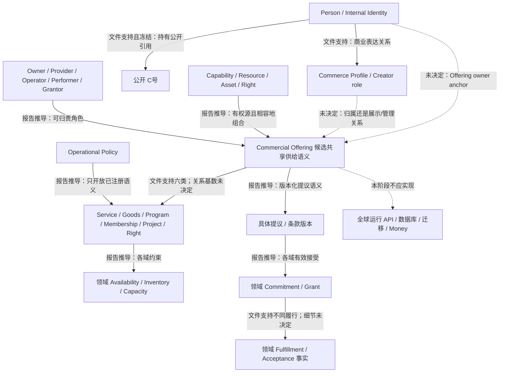

# PCI-ENG-020-C4-A — Global Commercial Supply Definition Research & Founder Decision Package

> 状态：研究完成，等待 Main Controller 审阅及 Founder 逐项裁决。不是 Frozen Architecture。
> 任务日期：2026-11-17；Git 基线采集时钟：2026-11-16T19:53:14.593Z。两者分别记录，不反推历史批准日期。
> 唯一交付：本报告。不修改既有文档、代码或数据，不 Commit、不 Push。
> 本文 F01–F11 是待决议题编号，不是新的 FD 批准编号。

## 阅读方法与证据等级

本文的源文档代号 S01–S16、外部参考 L01–L02、代码证据 E01 起，均在附录给出精确路径、章节和行号。表内的代号继承该定位，便于不重复长路径。行号针对本次工作区，不能用旧报告行号替代当前原文。

| 标记                     | 本报告中的含义                            |
| ------------------------ | ----------------------------------------- |
| `[FROZEN DECISION]`      | 已有具名批准；只在批准范围内成立          |
| `[CURRENT CONTRACT]`     | 当前 VS-01 合同及正式修订，不代表全球终局 |
| `[SOURCE DOCUMENT]`      | 战略/架构原文支持，不自动产生实现授权     |
| `[ENGINEERING FACT]`     | 当前源码的静态事实；不是运行测试通过      |
| `[RESEARCH / REFERENCE]` | 研究、Proposed ADR 或外部参考；不提升权威 |
| `[INFERENCE]`            | 本文从资料及案例推导的结论                |
| `[RECOMMENDATION]`       | 待批准建议，没有在本任务实施              |
| `[OPEN / UNKNOWN]`       | 证据不足或需要 Founder/专业验证           |

`[FROZEN DECISION]` 用户本次指令确认 C3-E-R1 已通过，文档基线冻结，C3-D 作为研究成果接收。C3-E Register 的 C3E-CF-10/11/12/27 仍明确保留全球分类、ownership、库存/承诺和架构决策。C3-D 的 A/B/C 是 Capability-centric / Offering-centric / Domain-extensible 视角；**不是本报告 A/B/C 的三个架构模型**。接受 C3-D 不能证明已经批准本报告 Model B。（S14 §6、§14；S16 §7.2）

研究顺序：重读原始战略及相关权威文件 → 外部制度参考 → 形成下述全局概念、六案例及模型比较初稿 → 最后做有限源码兼容检查。源码证据只放在附录兼容分析，不反向定义供给本体。未开展 225 份文档治理或 C3-C 的重复全仓审计。

# Part I — Research Findings

## 1. Executive Summary

`[RECOMMENDATION]` 将 **Global Commercial Supply** 定义为：商业主体在可归责、具有相应权源并受条件约束的基础上，向市场组织和表达的可供给价值集合。它首先是全局概念，不预设一个 Supply 实体或数据库根对象。**Commercial Offering** 是其中可识别、可持续引用的对外供给提议；具体承诺和履约仍由业务领域解释。（S01:72–106；S03:8–23、145–181；本报告 §2–3）

`[INFERENCE]` 个人能力、实物、内容及许可都可以形成供给，但“可描述”不等于“有权提供”。全球模型必须同时解释经营主体资格、来源使用/处分权限、客户接受后条款效力三个不同问题，不能用一个 `approved` 覆盖。来源组合必须能追踪权利链、限制、责任主体和失效影响。（L01；L02；§5）

`[RECOMMENDATION]` 条件性优先研究 **Model B：共享供给语义外壳 + 领域模型**。共享稳定引用、可归责的角色和提议版本追溯；不共享一套 Request、库存、承诺或 Fulfillment 状态机。若案例证明共享外壳必须持续协调跨域交易，退回 **Model C 的领域模型 + 共享投影**。Model A 可用于一个内部一致的领域，但目前没有证据支持把六类领域都纳入一个大聚合。（Part II）

`[OPEN / UNKNOWN]` 六类类型是否完整/互斥、Capability 是否必需、Offering owner anchor、全局关联基数、何种证据足以允许公开，以及平台在具体辖区的法定义务均未解决。本报告提供可选择方案和反例，不替 Founder 决策。（F01–F11）

`[CURRENT CONTRACT]` VS-01 仍是受控 Service Request 切片：Capability/Template 门禁、原 Confirm/Decline、独立履约确认、限定 Appearance 和 Creator BFF 安全边界继续有效。没有授权支付、统一库存、自动履约、全球权利登记、公共市场或新类型运行。（S07 修订；S09–S10；S16 C3E-CF-04/06/14/24/29）

## 2. 全球供给定义及成立条件（RQ-01）

`[SOURCE DOCUMENT]` Thesis 把个人商业碎片化问题放在“个人商业基础设施”层，不把 PCI 限定为预约、票务、Link-in-bio 或 Marketplace；Vision 区分切入口和终局；Core Abstraction 将商业资产组织为可理解、可供给的 Product，且明确不是所有产品都经过 Calendar。（S01:9–48、110–128；S02:11–20、99–113；S03:145–181、238–266）

`[RECOMMENDATION]` 一个可解释的 Offering 至少应回答以下语义问题；这是概念完整性，不是本轮强制 DTO 字段：

1. **提供什么**：可识别的结果、使用机会、访问权益或许可范围，以及适用条件。
2. **谁对外负责**：提供主体、对外条款主体、授权操作者；实际履行者可能不同。
3. **凭什么能提供**：相应能力、可控制资源、资产或权利来源及其限制。
4. **何时/以何种限额可供给**：没有时间约束也是一种明确情形；不强迫建立 Calendar。
5. **客户怎样行动**：询问、提交意向、申请、接受提议等，不能从按钮名推出法律效果。
6. **接受了什么、如何知道结果**：具体条款版本及承诺和履约事实的可追溯性；不必所有领域都签相同 Contract。

`[INFERENCE]` 同一个人“会拍摄”并不是完整供给；“两小时拍摄，交付十张处理照片，限定地点和用途”才有明确提议。一个自有数字作品也可形成下载商品或限定使用许可，不必为了满足既有服务代码先虚构“创作能力”记录。后一结论是全球候选语义，**不取消当前 VS-01 的 Capability 必需规则**。（S03:27–60；S05:283；C3E-CF-11）

## 3. Canonical Vocabulary 候选比较（RQ-01）

| 术语模型                                                                                             | 关系及收益                                         | 主要代价                                                       | 判断                            |
| ---------------------------------------------------------------------------------------------------- | -------------------------------------------------- | -------------------------------------------------------------- | ------------------------------- |
| V1：Product/Offer/Offering 全部同义                                                                  | 一个名字覆盖全部，接近当前宽泛产品语言             | 无法清楚表达持续供给与某次条款提议；Product 容易被误读为 Goods | `[INFERENCE]` 简单但跨域歧义大  |
| V2：Commercial Offering 为持续供给；Product 为商业产品语言；具体 Proposal/Terms 与 Commitment 分语义 | 供给引用稳定、客户接受的条款可追溯；不要求三个实体 | 需要明确术语表及版本责任                                       | `[RECOMMENDATION]` 首选，待 F01 |
| V3：Product 为全局核心，Offering 为渠道销售包装，Offer 为客户报价                                    | 适合一个商品多渠道、多个报价                       | 服务/权利/项目会被迫经过三级包装，暂无需求证据                 | `[OPEN / UNKNOWN]` 暂不默认     |

`[RECOMMENDATION]` V2 中：

- **Commercial Supply**：供给集合/能力体系；不是新的生命周期实体。
- **Commercial Offering / Offering**：同一概念的全称与简称，不创建两个对象。
- **Product**：对客户可理解的价值产品化结果；保留 S03 的广义含义，不等于实物 Goods，也不新增重复对象。
- **Offer**：S04 六类 Offer 的历史上位术语可保留别名；如未来要专指可接受的具体提议，须 F01 明确命名及迁移规则。目前不能把旧文档中的每个 Offer 都解释成法律要约。
- **Service**：以活动/服务结果为承诺的领域类型，不是所有供给的通用后缀。
- **Proposal / Terms version**：在特定范围、时点、对象和条件下可被接受的条款语义；是否需独立版本对象未知。
- **Commitment**：经该领域有效接受机制形成的责任/权益事实；不是所有 Request 自动升级后的统一状态。

`[RESEARCH / REFERENCE]` CISG 官方概述说明其适用范围中的合同由 offer/acceptance 形成，同时合同效力和财产所有权效果不在公约范围。它既不适用于所有服务，也不能证明 PCI 的 Publish 或 Confirm 自动成立同一种合同。这里仅以其制度边界支持“术语/技术状态不等于全球法律效果”，不把 CISG 当作 PCI 全局准据法。（L02）

## 4. Capability / Resource / Asset / Right（RQ-02）

下表是 `[RECOMMENDATION]` 的概念分类。依据 S03 商业资产/能力/时间/库存的不同语义、S04 六类型、S11–S13 Proposed 分析及 L01。分类表达**角色和关注点**，不要求互斥分类、更不要求四张表。

| 维度      | Capability                                  | Resource                           | Asset                                                 | Right                                            |
| --------- | ------------------------------------------- | ---------------------------------- | ----------------------------------------------------- | ------------------------------------------------ |
| 本体      | 主体创造/组织/交付某种价值的能力            | 在活动中可部署或受约束的输入       | 可识别、可控制且承载价值的事物/成果；不是会计确认结论 | 对特定对象、行为和范围的权能/许可                |
| 持有/控制 | 能力主体；公司组织能力不同于员工个人能力    | 控制者/调度者可不是所有者          | 所有者、保管者、运营者可能不同                        | 权利人、被许可人、可转授权人不同                 |
| 独立存在  | 可先于某项供给存在                          | 工具、场地、时间额度可独立安排     | 文件、设备、作品可独立于供给                          | 权利可先于供给存在，也可在授权后形成             |
| 组合/复用 | 可用于指导、课程、项目等多个提议            | 可共享，但受同时占用/配额约束      | 同一资产可销售、出租、展示或许可；权源须分别允许      | 可支持多项非排他许可；排他权存在冲突             |
| 消耗/转移 | 服务会消耗产能，不是卖出人的能力本身        | 时段占用、材料耗用、设备归还       | 实物可转移/耗损；数字复制不必消耗原件                 | 使用额度可消耗；转让/许可/再许可不相同           |
| 权属依据  | 真实能力、代表权限及必要职业资格            | 合法控制、租用/借用/调度权限       | 所有权或其他合法处分/使用基础                         | 原始取得、转让、许可链、法定许可/例外等适用依据  |
| 支持证据  | 声明、履历、作品、适用执照与核验范围        | 租约、场地许可、设备控制证明       | 来源记录、采购/交接、创作与权利材料；单项材料不必充分 | 授权文本、范围、期限、地域、许可对象、转授权权限 |
| 生命周期  | 能力描述可变；资质可失效                    | 可用、占用、维护、退回             | 可移转、损毁、版本变更                                | 期限、撤销条件、终止和争议依制度/条款            |
| 失效影响  | 重新评估未来供给和合法履行                  | 防止新增不可实现承诺，处理现有占用 | 新供给停用/替换不能抹去原承诺                         | 重新核实新授予与既有授予各自效果，不自动一律取消 |
| 涉及领域  | Service、Program、Project，亦可参与其他类型 | 所有类型，具体资源不同             | Goods、Right、Project、内容型 Program/Membership      | 所有类型的供给权源；Right 型还将其作为承诺标的   |

`[INFERENCE]` Resource 与 Asset 的区别是“部署与约束”相对“可识别价值载体”，不是有形/无形。一台摄影机是 Asset，拍摄期间又充当 Resource；一段受版权保护的视频是内容 Asset，其可授予的使用范围是 Right；该 Right 也可能被某制度或主体视为资产。**不因重叠而混成 Creator Capability，也不强迫复制身份。**

`[SOURCE DOCUMENT]` S04 的 Capability 采取较广的资源表达；S03 另区分能力、时间、影响力、库存。C3E-CF-10/11 已登记这个张力。`[RECOMMENDATION]` 研究词汇使用窄义 Capability，保留“价值来源”作为上位词，避免能力目录承担物权/许可含义；这是 F02/F03 待裁决建议，不能静默替换原文。

必须保持以下区别：**Self-declared Capability ≠ Verified Qualification；Asset Description ≠ Ownership Proof；Right Description ≠ Legal Authority to Grant**。`[CURRENT CONTRACT]` 受控 Catalog 选择与自我声明不等于认证（S09:94–109）；`[RESEARCH / REFERENCE]` WIPO 也区分作者、权利人和授权使用，互联网公开不等于进入公有领域（L01）。

## 5. 合法形成供给的规则（RQ-03）

### 5.1 三条不同判断线

| 判断线        | 要回答的问题                                     | 不能替代它的事实                               | 建议的记录粒度                                                   |
| ------------- | ------------------------------------------------ | ---------------------------------------------- | ---------------------------------------------------------------- |
| 主体资格      | 谁实际经营/代表谁；该地该行业是否需要资格        | 有账号、持有 C号、目录可选                     | 声明主体、代表关系、资格种类、适用范围/有效期、核验事实          |
| 来源权限      | 对资产/资源/作品拥有什么使用、处分或再许可权     | 上传了文件、持有实物、能编辑 Offering          | 来源及版本、授权链、用途/地域/期限/排他/数量限制及依据           |
| 承诺/授予效力 | 客户接受了哪些条款；谁承担何种义务；授予是否生效 | 点击 Request、Publish、支付字段或生成 Grant ID | 条款与接受证据、主体、适用条件及生效机制；具体法律效果待辖区确认 |

`[RECOMMENDATION]` 这些是三类可追溯事实，不是一套全球法务表结构或三种新状态。Evidence submitted、人工 reviewed、第三方 verified 也必须保留来源、对象、时间、范围、结论与限制；“审查通过”不能扩张到未检查事项。（S09:215–229；L01–L02）

### 5.2 形成门槛与组合约束

`[RECOMMENDATION]` 概念上的形成流程为：**界定承诺 → 识别责任主体 → 识别关键来源及权源 → 求出共同允许的使用范围 → 检查能力/容量/排他冲突 → 按已开放政策处理证据 → 发布明确提议 → 在接受时再次核验动态约束 → 留存承诺与履行事实**。它是分析顺序，不增加当前 VS-01 必需步骤。

| 情形                             | 最低需要解释的权源/组合规则                                   | 不可推出的结论                       |
| -------------------------------- | ------------------------------------------------------------- | ------------------------------------ |
| 个人能力 Service                 | 提供者实际能力、主体代表权限、当地适用职业要求；时间/地点条件 | 自述擅长即获得专业认证               |
| 自有实物 Goods                   | 识别标的、处分或销售权限、交付责任；自有只是可能依据          | 物品存在即有权销售；统一全球消费规则 |
| 数字内容 Goods                   | 内容版本、允许复制/分发/使用范围；素材及第三方权利            | 有文件即持版权；下载即取得所有版权   |
| 知识产权 Right                   | 可授予权利、权利人/代理、再许可、对象/用途/地域/期限/排他     | 声称原创即可授予任意权利             |
| 项目/技术资产                    | 既有技术与新成果边界、工具许可、交付验收与成果权利            | 接受项目即转让所有背景知识产权       |
| Capability + Time                | 服务能力及可用产能；跨供给占用同一人时的冲突                  | Calendar 事件即业务承诺              |
| Capability + Equipment / Tool    | 工具合法使用且可用；设备所有者和操作者角色清楚                | 租用设备即允许转租/出售              |
| Capability + Content             | 内容可用于该授课/分发目的；讲师权利与内容权利分别解释         | 允许教学展示即允许学员下载转售       |
| Asset + Right                    | 对同一标的的持有、使用、复制、处分分别核验                    | 购买实物即获得作品复制许可           |
| Capability + Resource + Asset    | 所有关键依赖可用，约束相容；合作者授权与责任明确              | 每项分别合法就必然允许组合用途       |
| Goods + 安装 Service             | 商品交付与安装条件/责任分开；组合接受和部分失败可解释         | 商品收到即安装完成                   |
| Knowledge + Program / Membership | 教学结果/访问权益、内容权源、持续访问期间及退出条件           | 有知识即有权承诺全部内容永久免费     |

`[INFERENCE]` 共同允许范围不总是简单取最小日期或数值。某素材允许非商业教学但工具只允许个人使用，不能仅各自“有效”就支持收费企业培训；排他范围也可能按地域/领域重叠。需要解释权源之间是否相容，必要时拒绝组合或取得新授权。

`[RECOMMENDATION]` 不要求披露所有生活背景、每件通用工具或每项知识来源；要求识别**对合法提供、实际可用、排他/稀缺、责任和交付结果有实质影响的来源**。材料公开范围和内部受限证据应分开；证据中可能包含隐私及合同秘密，保留与访问政策尚未设计。

### 5.3 共享、失效和历史承诺

| 变化                         | Draft / 未来公开                   | Published / 接受新动作                                   | 已提交意图                               | 已成立承诺/既有授予                                          |
| ---------------------------- | ---------------------------------- | -------------------------------------------------------- | ---------------------------------------- | ------------------------------------------------------------ |
| 来源不存在/关键授权未证实    | 可保留草稿声明；不把它显示为已核验 | 依风险及必要证据规则阻断或限定开放，政策不能豁免法律义务 | 接受前补核验；不能据旧页面直接形成新承诺 | 保留原事实并评估法律/履行影响，不伪造“当时已审核”            |
| 来源到期/撤销/设备不可用     | 新版本需替代来源或缩小提议         | 防止新增无权或无法执行的承诺                             | 明确当前条件变化，必要时重新征求接受     | 不自动一律取消，也不默认仍可合法履行；按条款、法律和领域处理 |
| 排他或稀缺额度被另一供给占用 | 草稿可共存，不意味着容量可重复消费 | 公开展示可滞后；接受必须以权威约束为准                   | 意图不是默认库存锁                       | 跨供给原子冲突保护；并发不能产生两个互斥有效承诺             |
| Policy 收紧                  | 新定义/证据要求明确版本            | 区分停止新发布、停止新请求和安全停用                     | 是否适用旧政策需明确生效规则             | 不覆盖历史条款；紧急限制及存量履行处置需独立规则             |

上述是 `[RECOMMENDATION]` 的最低可解释性要求，不是已批准迁移或新状态机。**新活动受限 ≠ 历史事实删除；保留历史 ≠ 保证继续履行合法。**（S10:19–27；S12–S13 Proposed；C3E-CF-12/17/18）

### 5.4 司法辖区与平台责任

`[RESEARCH / REFERENCE]` L01 是 WIPO 国际制度概览：多数伯尔尼成员国家版权自动保护；作者/雇主权属及例外因国而异，许可范围重要，没有可据此查询全部版权的全球注册库。它支持“无注册证不必然无权；有登记/文件不自动证明全部权利链”，不提供具体中国、美国或欧盟案件结论。

`[RESEARCH / REFERENCE]` L02 是 UNCITRAL 对 CISG 的官方概览，限于其适用条件下的国际货物买卖，并说明消费者销售/服务等排除及效力/物权边界。不能将其直接用于本报告的地陪、会员或所有数字许可。

`[OPEN / UNKNOWN]` 本轮没有针对某地导游资质、教育许可、数字内容消费者权益、平台服务者法定义务或知识产权链做法律调查，也无实际合同/持证材料。六个案例的“可以提供”均以相应权源和当地规则得到确认作为前提，不能解读为经营许可。

`[RECOMMENDATION]` PCI 可以记录、收集支持材料、标注核验范围并按政策限制动作；不应因发布/审核而表示完成全部权属担保。平台不自动成为实际服务方或保证交付，但**产品免责声明不能免除适用强制法或平台自己作出的合同承诺**。平台究竟承担何种角色由 F10、业务选择和辖区专业审查共同决定，不能由一个技术状态产生。（S07:775–838；L01–L02）

## 6. Ownership、Identity 与 Creator（RQ-04）

`[FROZEN DECISION]` Decision 29 批准 C号归 Internal Identity 持有，稳定公开引用且不作凭据；它只解决持码对象，不解决全球 Offering owner。已批准的 Identity 与 Profiles 关系也不决定 Offering 的数量和归属。（S08:9–17；S16:104、111；C3E-CF-05/11）

| 角色/概念                   | 回答的问题                                  | 不得混同                               |
| --------------------------- | ------------------------------------------- | -------------------------------------- |
| Account                     | 谁能登录、用何授权执行动作                  | 商业资产所有者或合同主体               |
| Internal Identity           | PCI 内部稳定身份与公开商业引用锚点          | 一项业务供给的最终 owner 决定          |
| Commerce Profile            | 在某商业语境下怎样对外表达身份              | 所有实际权利/义务归属                  |
| Creator                     | 当前产品中的供给侧角色/历史名称             | 全球所有参与方共用的法律人格           |
| Commercial Provider         | 谁向客户提供这项价值并对外说明              | 一定拥有所有输入资产                   |
| Offering Owner              | 谁持有/控制供给定义及治理责任，具体含义待决 | Asset Owner、Rights Holder、实际履行者 |
| Asset Owner / Rights Holder | 谁拥有标的资产/相关权利                     | 编辑页面的操作者                       |
| Operator / Manager          | 谁受委托创建、编辑、发布、管理              | 自动有权签约或转授权                   |
| Contracting Party           | 谁在具体条款下承担义务/取得权利             | 自动等于发布账号                       |
| Performer                   | 谁实际履行活动                              | 默认有权使用所有资源                   |
| Grantor / Beneficiary       | 谁有权授予；谁取得特定利益/权益             | 收益接收人必然有再许可权               |

表为 `[RECOMMENDATION]` 的角色分离；S11 Proposed ADR 支持区分，但不批准新的 ownership anchor。

`[INFERENCE]` A 拥有设备，B 经营安装业务，C 提供安装服务：A→B 的使用授权不能替代 B→C 的操作委托，B 对客户的承诺不能被 C 的登录动作隐式转移。多主体可以参与一个提议；是否由一个对外责任主体组织、还是多个明确当事人分别承诺，需要 F04/F05，而不是把 A/B/C 都写成同一个 Creator。

`[RECOMMENDATION]` 全球候选模型保留一 Identity 多 Profile、多类型展示的语义可能性；创建者、发布者、持有人、履行者分角色可追溯。**不在此决定多方共持 Offering 或默认 1:N/N:M 的落库关系。** 旧 `creatorId` 按原版本及原命名空间保留，未来映射需证据和授权，不得直接重命名为 global owner ID。Identity Ownership ≠ Offering Ownership ≠ Asset/Right Ownership。（S04:158–231、661–718；C3E-CF-11）

## 7. 六类供给的行为差异（RQ-05）

`[SOURCE DOCUMENT]` Product Direction 明列 Service、Goods、Program、Membership、Project、Right，并分别讨论承诺/履约；同时没有冻结六套 API/状态机。（S04:303–373）以下两表为据此形成的 `[INFERENCE]`，价格仅研究条款语义，不授权货币流程。

| 类型       | 承诺/必要领域结构                                                    | 来源                              | 价格或条款                             | Availability                 | Inventory / Capacity                             |
| ---------- | -------------------------------------------------------------------- | --------------------------------- | -------------------------------------- | ---------------------------- | ------------------------------------------------ |
| Service    | 在约定范围提供活动/服务；内容、提供者、交付约定                      | 能力、工具、场地、时间及相应权源  | 每次/时长/范围或另行约定，不必即时付款 | 现场时间或异步交付窗口       | 人员时段、并行工作量、设备占用；不都是 Calendar  |
| Goods      | 交付特定规格/数量实物或数字内容；标的与版本、交付及使用条件          | 实物/内容 Asset、分发权、物流资源 | 单位/套装或内容使用条款；不是服务时长  | 可发货/下载期间              | 实物数量、许可证额度；数字文件不自动无限合法授权 |
| Program    | 组织一组有结构的活动/学习经历；目标、内容序列、参与条件              | 教学能力、内容、设施              | 按项目/期次/席位等语义                 | 批次/周期或自主学习窗口      | 班级席位、讲师负载；录播不必有班次               |
| Membership | 在期间内提供约定访问/参与权益；范围、期间、进入退出规则              | 内容、访问权、持续服务能力        | 期间/权益条款，不假定自动续费          | 权益有效期间；不等于事件排期 | 可有限名额或服务配额；不能将访问权一律当库存件数 |
| Project    | 按约定范围产生定制结果；范围、里程碑/验收、变更与成果权利            | 能力、背景技术、资源及新成果      | 范围/阶段/变更条款；不能只用固定单价   | 起止/阶段窗口或异步产能      | 团队负载、关键资源；不是一条时段                 |
| Right      | 对特定对象/用途授予有界权利；对象、授予权限、范围、期限/地域、排他性 | 作品/技术 Asset、上游权利链       | 使用范围、数量、期限、排他/再许可条款  | 授予/使用期限                | 非排他可重复；排他是范围冲突，不是普通库存减一   |

| 类型       | Customer Action → Commitment                                     | Fulfillment                           | 支持证据                                        | Lifecycle / 退出及存量                      | 平台责任界限                         |
| ---------- | ---------------------------------------------------------------- | ------------------------------------- | ----------------------------------------------- | ------------------------------------------- | ------------------------------------ |
| Service    | 请求/协商→提供者依规则接受；当前仅 VS01 Confirm/Decline 语义已定 | 实际服务与域内确认事实分开            | 请求、决定、服务/客户反馈；履约码确认是工具事实 | 停止新请求不删除已确认请求                  | 记录确认不保证服务质量/实际发生      |
| Goods      | 选择规格数量/接受销售条件→依规则成立交付责任                     | 发货、送达、接受/数字可获取各不相同   | 规格条款、交付/访问记录                         | 下架不自动免除已成立交付义务                | 系统发送下载链接不证明无侵权或已消费 |
| Program    | 报名/申请→入选/入学承诺，未必即时录取                            | 提供课程/参与机会；完成与能力认证另议 | 参与记录、内容/课程交付、完成证明范围           | 停招与终止既有班次不同                      | 参与证明不自动专业认证或学习效果保证 |
| Membership | 申请/接受权益条款→激活权益，具体条件待定                         | 持续可访问/可参与；不是一次终结       | 权益范围与期间、访问/服务可用事实               | 停止新加入≠取消存量期间；续期独立           | 不能把活动点击当全部权益已兑现       |
| Project    | 需求讨论/提议接受→范围化承诺                                     | 阶段交付及约定验收，不是统一 Done     | 版本化范围、提交物、验收/异议事实               | 暂停新项目不抹去在途工作；变更要可追溯      | 系统接受记录不替代专业质量判定       |
| Right      | 申请/接受许可条款→按生效条件产生 Grant                           | 有效授予/开放使用，持续义务可能存在   | 权源链、接受、授予范围与期间                    | 停售许可不必终止已授予权；到期影响依条款/法 | Grant ID 不是权利真实性司法认定      |

`[OPEN / UNKNOWN]` 六类是研究范围，不是被证明完备互斥的本体分类。数字课程可售为 Goods、组织为 Program 或提供持续访问 Membership；同一个文件格式不决定承诺类型。Project 可包含服务和成果许可。租赁、捐赠等边界没有在本轮得到分类批准，不能据此新增第七类型。（C3E-CF-10/34）

## 8. 组合、Inventory、Commitment、Fulfillment 边界

`[RECOMMENDATION]` 判断组合形态先问：客户是否一次接受一个整体结果、谁负责各部分、能否单独履行/拒绝、部分失败如何处理。如果一个责任主体承诺一个不可分结果，可研究复合 Offering；如果只是相互推荐且分别接受，用关联 Offering；如果责任主体/接受/履行可独立，应保留独立承诺，即便共同展示。不能以“页面放一起”决定聚合边界。

`[INFERENCE]` Inventory 表达可承诺数量/份额/权利范围的约束，Capacity 表达交付产能，Availability 表达可用条件；Calendar 只是部分时间表达/视图。这四者有交集而不相等。异步项目消耗产能、非排他许可受授权范围限制、设备安装同时消耗数量和人力；用同一个 slot 状态无法完整表达。（S03:62–75、122–143、251–266；S04:332–373；S12 Proposed）

`[RECOMMENDATION]` 两个 Offering 引用同一资源/排他权时，需要共享的权威冲突判断，在成立承诺时防止双重占用；具体锁、事务、预留和补偿机制要等领域用例确定。单独验证每个 Offering 或仅靠异步事件更新，不能证明没有同时许诺冲突。不能为了研究复用而现在建通用 Inventory 表。

`[CURRENT CONTRACT]` 当前 Request Submitted→Confirmed/Declined 是创作者决定；Fulfillment Code 在新 Request 生成，履约确认要求已 Confirmed 并独立记录结果；Confirm ≠ Fulfilled。该实现可以保留追溯理念，不能用于证明 Goods/Project/Right 都应扫描同一代码完成。（S07:775–838）

`[RECOMMENDATION]` 全球语义区分意图、有效接受的具体承诺、实际履行、接受/确认及争议。并非每类都需要一个显式 Request 或签名 Contract；也不将这些事实压成一个线性的万能状态机。（S13 Proposed；F08）

## 9. Code / Domain / Operational Policy（RQ-06）

| 事项           | Code Abstraction                                | Domain Rules                             | Operational Policy                        |
| -------------- | ----------------------------------------------- | ---------------------------------------- | ----------------------------------------- |
| 稳定引用与版本 | 引用解析、类型注册、版本编解码和兼容错误        | 引用所指的业务事实、何时产生新提议       | 开放已支持版本的条件                      |
| 字段/扩展      | 已注册 schema、结构校验、类型化读写、持久化边界 | 字段的业务含义、相互约束和命令行为       | 只能在已注册能力中选用有界参数/证据要求   |
| 来源组合       | 身份/引用/权限机制和事务承载                    | 权源相容、角色权限、不得超额授予等不变量 | 何类主体/来源组合可开放，需要何种审查     |
| Inventory/排他 | 并发、持久化原子性、冲突响应                    | 不超额/不重复排他承诺、释放/终止含义     | 已支持策略的限额/窗口；不能允许违反不变量 |
| 接受/履行      | 命令执行、幂等、错误与事件记录                  | 什么动作形成何种承诺/授予、履行/验收语义 | 是否暂允许该类新动作、额外审查门槛        |
| 停用与存量     | 读取版本、快照/追溯技术及恢复机制               | 历史事实不改写、既有义务的合法处理       | 新旧供给分层生效、紧急限制和治理流程      |
| Creator 编辑器 | 同一有效类型定义的编解码与可用动作呈现          | 服务端权威校验；不信任浏览器资格计算     | 展示当前有效配置/理由/版本，不另算规则    |

该矩阵为 `[RECOMMENDATION]`，以 S09–S10 的受控发布、S14 分层研究为依据，**没有冻结动态表单引擎或统一配置协议**。

明确回答：Admin **不能**开放代码尚不理解的类型，不能靠配置创造新字段语义、生命周期或交易动作。新增类型需要足够的类型契约、编解码、领域命令/不变量、授权、并发/持久化语义、错误和验收覆盖；多少模块/代码量仍未知。同一已注册类型可以研究地区/行业/Provider 不同政策，但不允许政策扩大权利或关闭不变量。领域资格、法律权源不能化约为运营开关。Policy 变化必须说明对新供给、待处理意图、既有承诺的差异，不能全表重算覆盖历史。（F09；C3E-CF-16/18）

## 10. 六个业务模式端到端压力测试

以下是 `[INFERENCE]` 的**桌面概念压力测试**：样例来自任务列出的现实商业模式，但没有访谈具体经营者、创建真实供给或验证真实合同。不把下列“通过条件”写成已运行 PASS。共同依据 S03 的组合价值、S04 六类型和 L01/L02 的权源/制度边界。

### T01 地陪：现场陪同 Service + 数字路线 Goods

假设同一提供者有现场陪同能力，持有自编路线内容并对其中地图/图片拥有所需使用权；当地资格尚未核实。形成“半日现场陪同”和“路线文件下载”两个可独立接受的提议。客户先看主体、范围、日期和内容使用条件，再分别请求陪同或接受数字内容条款；陪同占用人员时间，下载不占该时段。

陪同确认追溯其条款，数字内容追溯文件版本/使用权限；实际陪同与文件可下载分别构成履行证据。地图素材授权到期后，必须评估新分发和已授予访问各自范围，不能只把两项都置为 Declined。两个陪同提议共享同一人员时间时，两个并发接受不能重复占用。

**反例/模型压力**：强制每项先建相同 Capability 会迫使数字内容虚构能力依赖；万能 Confirmed 无法说明下载完成。A 需两套履行/冲突扩展；B 可共用主体/引用但分别处理；C 可独立运行但须关联同一商业身份。**待验证**：路线使用条款、当地资格、客户是否需要组合购买；不引入实际 checkout。

### T02 培训讲师：Service + Program + Goods + Membership

假设讲师可合法教授并使用课程材料，四种提议分别是一次指导、20 席团体课程、固定版本录播下载、六个月内容库访问。客户分别选择指导范围、班次、文件版本、权益期间；选择文件不等于加入班级，加入会员不自动取得一对一服务。

成立机制各自解释：指导接受、入班确认、内容条款接受、权益激活。容量分别是讲师时间、班级席位、内容分发权限和会员服务配额；同一讲师的班课与指导仍有交叉冲突。证据分别是服务事实、课程参与、文件交付、期间内权益可用。停止招生不自动终止在读；会员退出与一节课结束不能共用终态。

**反例/模型压力**：按媒体文件分类会把同一课程错误地固定成 Goods；全部库存当“剩余名额”无法解释非稀缺内容和持续权益。B 的共享外壳不能缓存另一份会员有效状态；C 需要统一展示但不能统一完成按钮。**待验证**：入学/退出条款、是否持续服务、许可期与会员期是否相容；无自动续费授权。

### T03 普通商家：规格化 Goods + 安装 Service

假设经营方有商品处分权限，安装人员具备适用能力，场地允许安装。提议说明商品规格数量与安装范围/条件。若客户可单独购货或安装，分别接受；若经营方承诺“安装可用的整体结果”，研究一个组合提议下可分别追踪的责任，但不在本报告决定聚合数。

客户接受时需同时满足实物数量和安装产能；商品送达不代表安装完成。并发最后一件库存与最后一安装窗口时，不得出现双方均承诺但只锁了一种来源的隐含成功。缺货或现场不适配时，保留已接受内容并按明确条款处理部分失败，不能把它当作简单页面下架。

**反例/模型压力**：A 容易把发货/安装合并状态；B 必须证明跨域接受的原子或可解释的分阶段机制；不能只靠共享 ID 就宣布解决。C 分开承诺较清楚但组合体验成本高。**待验证**：责任主体、可分性、部分失败和替代安排；支付退款只是未来合同问题，不实现。

### T04 技术人员：诊断 Service + 定制 Project + 标准工具 Goods / Right

假设技术人员有诊断能力，可使用背景代码和工具。先提供诊断服务；诊断后客户另行接受定制项目范围；另有标准工具下载或特定软件许可。诊断请求不能自动接受尚未明确的项目，拿到程序文件不能自动取得修改/再分发权。

项目依据范围版本/里程碑接受，消耗异步团队产能；工具按文件版本交付或按许可范围授予。客户提出新需求需能辨认原承诺与变更，验收提交物不能重写上游背景 IP 权属。若上游工具授权撤回，分别检查新项目、在途使用和既有客户许可，不统一删除。

**反例/模型压力**：统一时段 Request 不足以表达范围变更与背景/成果权利；A 扩展开始承担不相容状态。B 必须允许领域独立保有验收真值；C 能自治但跨项目与许可追溯需共享接口。**待验证**：成果归属、验收主体、工具分发/再许可权和开源义务。

### T05 知识产权提供者：Right + 作品 Asset + Grant

假设 A 持有作品相关权利，B 仅被授权销售中国地区一年非排他展示许可，C 为客户。来源是作品及 A→B 授权链；Offering 承诺的对象是使用权，而不是作品文件所有权。客户查看用途/地域/期限及再许可限制，接受相应条款后才按约定产生授予事实；收到预览图不构成许可。

“非排他中国展示”不能被界面扩成全球独占改编。两个销售入口同时处理同一排他地域/用途区间时需要权威冲突保护。授权链到期不能直接推断已授予许可继续/终止，必须检查上游是否允许该存续；保留条款版本、授权和接受证据，平台不能用 Grant ID 证明 A 从未侵权。

**反例/模型压力**：Right 同时作为来源和客户结果，需要区分 authority 与 Grant；普通库存减一不能表达地域/用途重叠。B 是否有价值取决于共享语义能否足够薄；A 风险最大；C 是在权利复杂度无法共享时的保守方案。**待验证**：实际权利链、辖区、排他作用域和证据充分性。（L01）

### T06 混合经营：同一 Identity、多 Profile、多供给类型及 A/B/C

假设一个 Identity 下不同商业 Profile 展示 Goods、Service、Program；A 拥有设备，B 经营课程和安装业务，C 实际授课/安装。客户从稳定商业引用进入展示，但需知道这次提议的对外责任主体及适用条款，不能把相同 C号理解为所有资产都归该 Identity。

B 的 Operator 在授权范围发布；A 提供设备使用权；C 提供活动和能力。商品交付、课程席位及安装时间分别形成承诺/履行事实。Operator 离职后撤销管理权限不能删除原承诺；Profile 改名/下线不能改变既有合同主体；同一设备用于课程和安装时需跨供给检查冲突。

**反例/模型压力**：把 `creatorId` 当全球法律 owner 会折叠至少三个角色；把一个 Profile 限制一个类型没有文件依据。A/B/C 都必须回答角色授权与跨域资源冲突，不能由模型名称自动解决。**待验证**：多个主体是否可共同承担一个提议、谁是对外责任人、历史 Creator 映射；不使用真实账户或迁移数据。

# Part II — Architecture Model Comparison

## 11. 三模型的可证伪比较

以下整体为 `[INFERENCE]`，以 T01–T06 的不同承诺/来源/角色约束检验。候选结构均不等于新表、API 或批准聚合边界。

| 比较项           | A Universal Offering Aggregate                            | B Shared Envelope + Domain Aggregates                  | C Domain-first Supply Models                       |
| ---------------- | --------------------------------------------------------- | ------------------------------------------------------ | -------------------------------------------------- |
| 共享核心         | 在一个聚合中维护供给身份、条款和各域扩展                  | 共享身份/角色引用/提议追溯及公开投影，领域维护行为真值 | 领域拥有供给，通过共同接口/投影关联身份            |
| 复杂度           | T02 持续会员与一次指导、T05 授予冲突使根命令膨胀          | 复杂度留在域内，但需清楚定义共享/领域的写入责任        | 域内清楚，跨域搜索/分发/客户追溯需适配             |
| 多来源组合       | 同一根方便表达，跨 Offering 共享来源仍需外部权威          | 可统一来源引用，但相容和占用由有权领域判断             | 各域明确来源，跨域共享资源协议成本更高             |
| ownership/rights | 容易用单 owner 过度概括，仍可设计角色但需限制             | 共享角色可追溯；不得把外壳 owner 当所有资产 owner      | 更贴近领域，但统一对外责任信息需规范               |
| 事务与生命周期   | 单根内更新方便；无法因此解决其他根/资源的并发             | T03 组合接受有跨边界难题；外壳不得第二次决定履行状态   | 独立承诺易界定，整体结果保证须额外协调             |
| 类型扩展         | 每个新域可能修改根逻辑；JSON 可容纳数据但不能证明行为正确 | 注册类型及领域合同，兼容外壳版本，避免空扩展框架       | 可先验证新领域，再适配共同引用；重复实现风险       |
| Policy           | 单入口方便，但易让配置变成新业务语言                      | 对已注册类型作有界开放，领域不可变约束保持             | 每域消费同一政策意图，避免解释漂移需要合同         |
| VS01 兼容        | 若强行统一容易改写 Request/creatorId/履约                 | 可以保留 VS01 域及标识，未来适配；不是本轮迁移         | 原域最容易原样保留，但后续统一体验成本高           |
| 维护成本         | 早期少对象，后期规则组合与回归面可能很大                  | 多一层版本/投影一致性成本，换取领域变更隔离            | 新域自治，重复分发/角色/追溯能力成本随类型增加     |
| 关键未知         | 全球共有不变量是否足够；是否真需要同一事务根              | 共享外壳是否有独立写入/生命周期必要；投影滞后如何处理  | 共享引用能否满足统一体验；跨域一致性是否重复造轮子 |

## 12. 推荐、适用条件与反证

`[RECOMMENDATION]` 优先选择 B 作为**下一轮概念验证候选**：S01–S04 支持共同商业身份、分发与供给表达，T01/T02 又要求不同承诺行为；B 比 A 更容易保留领域语义，比纯 C 更明确要求统一可追溯供给。这个推荐沿用 C3-D 的“供给核心”研究假设，但增加合法权源、条款版本和跨供给冲突反例。

B 成立需要验证：共享部分确有至少两个领域共同使用的稳定语义；领域对自己的资格/承诺/履行拥有唯一权威；外壳没有复制另一份可独立变更的业务状态；源资源/权利的并发约束有明确权威；投影陈旧时公开展示不被当作接受命令的授权。**不先决定外壳是否是可写实体、领域对象个数或同步事务方式。**

`[RECOMMENDATION]` 如果 T03/T05 表明共享外壳承担大量类型分支、不能说明谁决定命令，或只是为统一数据库外观而存在，则以 C 为备选：保留领域供给，只共享引用/角色词汇/投影合同。A 可保留为单一领域内部实现方案；只有证明共同生命周期与事务不变量后，才进一步讨论更广的统一聚合。

`[OPEN / UNKNOWN]` 当前没有流量、维护成本、真实供给主体访谈或跨域事务原型数据，不能给模型性能排名/工期，也不能宣称 B 已被证明是最终正确架构。推荐的证据强度是文档一致性和反例可解释性，而非运行验证。

# Part III — Proposed Global Conceptual Model

## 13. 概念关系图：研究示意，不是 Frozen Architecture

图中“文件支持”只表示已有文档支持该语义；其中明确已批准的持码关系另标“冻结”。所有边都不是数据库外键或关系基数。

来源：I/CN 为 S08，Identity/Profile 为 S04 与 S16 有界批准；六类型及不同履行为 S04:303–373。SRC/角色/版本为本文 §4–8 推导，非新 FD。图中的 Grant 仅在相应许可领域适用。

## 14. 概念关系矩阵

下表为 `[INFERENCE]` / `[RECOMMENDATION]`。**独立概念不等于独立对象；独立生命周期可能性不等于新增状态机；可 M:N 不等于已冻结关联基数。**

| 概念                       | 独立概念                       | 独立生命周期               | 可多对多关联？                           | Offering 来源？                | 全球核心？                         | 未决内容                               |
| -------------------------- | ------------------------------ | -------------------------- | ---------------------------------------- | ------------------------------ | ---------------------------------- | -------------------------------------- |
| Person / Identity          | 人/主体与内部身份语义需分清    | 身份生命周期独立于单项供给 | 参与角色可能多方；不得据此改已批身份关系 | 间接，承载主体/能力            | 身份引用是候选共享语义             | 主体种类、全局 owner、法律人格映射     |
| Commerce Profile / Creator | 展示上下文与当前角色不完全同义 | 可独立变更展示/权限        | 多供给展示有可能；最终 ownership 未定    | 间接                           | 引用/角色候选；未必共享 owner 对象 | Profile 与 Creator 兼容、管理/归属区别 |
| Capability                 | 是                             | 能力与资格可变             | 可支持多个供给，多能力可组合             | 是，但必需性待决               | 来源语义候选；非统一 Catalog       | 广/窄义，是否强制关联                  |
| Resource                   | 是，部署视角                   | 可用/占用/维护             | 可能共享且竞争                           | 是，受控制条件约束             | 来源引用候选；约束在领域           | 与 Asset 重叠、共享冲突权威            |
| Asset                      | 是，价值载体视角               | 可独立转移/版本化          | 可能支撑多种提议                         | 是，但描述不证明权限           | 来源语义候选                       | 物理/内容/技术分类及身份表示           |
| Right                      | 是，权限/权源                  | 可能到期/终止              | 可多来源授权、多次授予，受限制           | 是；也可能为客户获得结果       | 权源语义候选，Grant 在领域         | 是否与 Asset 共模、排他作用域          |
| Commercial Offering        | 是，候选持续供给               | 可能独立定义/发布          | 可多来源/多角色；与领域对象基数未定      | 不适用                         | 候选共享供给语义                   | 是否共享实体/仅接口，owner             |
| Product / Offer            | 术语含义需区分，不默认两个实体 | 未必独立                   | 不据词汇推导关系                         | 不适用                         | 产品语言/提议语义候选              | F01 词汇及版本表达                     |
| Inventory / Capacity       | 是但不等同                     | 某些约束独立于供给         | 可跨多个供给共同约束                     | 约束来源可用量，不一定是价值源 | 共用概念，类型行为在领域           | 时间/数量/排他是否共模                 |
| Commitment                 | 是，责任/权益事实              | 因类型而异                 | 一提议多次接受、组合责任均可能           | 不适用                         | 追溯语义候选，行为非统一           | 成立机制、组合关系、合同适用           |
| Fulfillment                | 是，履行事实集合               | 可与承诺决定不同步         | 分批/多阶段/持续事实可能                 | 不适用                         | 追溯语义候选，判断在领域           | 证据/验收/争议、实际履行与系统确认     |
| Policy                     | 是，开放/治理条件              | 版本与生效独立             | 可作用多类型/主体/来源                   | 不适用                         | 治理边界共享，不定义领域意义       | 生效版本、存量和紧急处理               |

## 15. 形成流程、角色及责任的联合视图

`[RECOMMENDATION]` 把 §4 的来源分类、§5 的合法形成流程、§6 的角色关系、§7 的类型行为和 §9 的三层责任作为同一概念模型的五个视图：

| 形成阶段       | 主要角色                                     | 输入/依据                            | 应得出的事实                   | 不应自动得到的事实               |
| -------------- | -------------------------------------------- | ------------------------------------ | ------------------------------ | -------------------------------- |
| 组织价值       | Provider、Source Owner/Controller            | 能力、资产、资源和权源范围           | 可解释的供给及关键依赖         | 有资格经营、来源已验证           |
| 定义提议       | Offering 持有人、Operator、Contracting Party | 责任分工、结果、领域条件             | 可理解的条款版本/客户动作      | 所有角色由 Creator 一人承担      |
| 审查与开放     | 有权限的治理角色                             | 领域合法性约束、政策、材料及审查事实 | 在有效范围内允许动作及理由     | 完整合法性担保或新增领域能力     |
| 客户行动       | Customer/请求方及有权接受者                  | 具体提议、当前约束                   | 领域意图或已成立承诺           | 所有点击即合同/授权              |
| 履行及确认     | Performer、Provider、Grantor、受益人         | 原承诺、来源范围和履行证据           | 对应领域的履行/授予/接受事实   | 收款、完成服务、权利清洁一并成立 |
| 变化与存量处理 | 原责任主体、有权治理者                       | 来源变化、政策版本、既有条款         | 对未来与存量分别处理且保留历史 | 回写原条件或自动统一取消         |

本模型尚未决定表数量、一个 Offering 包含几个 Domain Aggregate、证据系统或任何法律模块。未来 Creator 编辑器可呈现同一有效定义，但不拥有第二套权源/发布/库存规则。

# Part IV — Founder Decision Package

## 16. 决策顺序与范围

`[RECOMMENDATION]` 先裁决 F01–F04 的术语/来源/归责方向，再结合 F05/F10 的合法性和平台角色约束，评估 F06–F09 的领域/技术边界，最后选择 F11 的最小验证。可以只批准进一步研究，不必一次冻结全部模型。

本节每项都列出 11 个裁决字段。除已有约束外均为待决；选择一个研究候选不等于批准数据库、代码或实际运营。下述 A/B/C 选项只在各 F 项内有效，与 Part II 的模型编号不混用。

## F01 — Canonical Vocabulary

1. **问题定义**：Product、Offering 和 Offer 是否同义，如何区别持续供给、具体提议与承诺，避免重复实体。
2. **相关权威文件**：S03 §Product（145–181）、S04 六类 Offer（303–373）、S14 §4；冲突 C3E-CF-10/27（S16）。
3. **已经冻结的约束**：`[CURRENT CONTRACT]` 当前 Service Offering 及 Request 术语继续有效；研究不得改既有合同。
4. **当前未知**：客户是否需要可接受的多版本报价；“Offer”跨语言和法律语境可理解性尚未访谈。
5. **候选及关系差异**：A 全部同义；B Offering 为持续供给、Product 为广义产品语言、Proposal/Terms 与 Commitment 分语义；C Product→渠道 Offering→客户 Offer 固定三级。
6. **利弊**：A 词少但条款追溯模糊；B 保留语义但需术语纪律；C 适合多渠道商品但给其他类型强加层次。
7. **推荐及理由**：`[RECOMMENDATION]` B，既容纳 S03 产品化，也通过 T01/T05 区分内容与许可提议；不强制三个实体。
8. **体验影响**：客户能分清看见的服务/内容与自己接受的具体条款；前端无需显示全部研究词汇。
9. **数据影响**：未来需可追溯供给与条款版本；Product/Offer 别名不自动新增数据模型。
10. **选错的迁移成本**：若先把所有 Offer 当法律提议，历史页面/Request 可能被错误赋义；若先建三级，则后续要合并重复标识与关联。
11. **Founder 最终选择**：选择 A/B/C 或保留待验证；若选 B，明确 Offer 保留历史上位别名，还是未来专用于 Proposal。未答复前本文不改 Canonical Vocabulary。

## F02 — Capability 是否全球必需

1. **问题定义**：资产/权利主导的供给是否必须先建立 Creator Capability；这与能力是否真实是不同问题。
2. **相关权威文件**：S03:27–60、238–249；S05:266–283；S09:94–137；C3E-CF-06/11。
3. **已经冻结的约束**：`[CURRENT CONTRACT]` VS01 的受控 Capability/Template 发布链保留，不用全球研究绕过当前门禁。
4. **当前未知**：现实提供者怎样组织来源，哪些类型确需资格与能力证明；零 Capability 的全局基数未批准。
5. **候选及关系差异**：A 所有 Offering 必有 Capability；B 需有适当价值/权源基础，Capability 由领域决定，资产/权利可主导；C 用广义 Capability 包含所有来源。
6. **利弊**：A 复用服务链却制造虚假能力记录；B 准确但增加来源分类和资格规则；C 表面统一却模糊资产/权利和个人技能。
7. **推荐及理由**：`[RECOMMENDATION]` B 作为验证方向，T01 数字路线和 T05 IP 许可无需先伪造个人技能。是否真正允许无 Capability，仍由 Founder 裁决。
8. **体验影响**：提供者按实际供给填来源，不被迫填写无意义能力；服务资格要求仍清楚。
9. **数据影响**：有可能支持不同来源组合，不再默认全球唯一 capabilityIds 入口；具体关联结构待决。
10. **选错的迁移成本**：A/C 可能积累难以分辨的伪能力/权源；B 若过度放宽会丢失必要资格关联，后补审核成本高。
11. **Founder 最终选择**：是否原则上允许 Asset/Right 主导的供给无显式 Capability 关联；选 A/B/C，并明确当前 VS01 不随之改变。

## F03 — Resource / Asset / Right 分类

1. **问题定义**：四类来源是互斥实体还是可重叠语义；Right 如何同时表达上游授权与下游授予结果。
2. **相关权威文件**：S03:8–23、62–143；S04:303–373；S12 §5–6 Proposed；L01；C3E-CF-10/12。
3. **已经冻结的约束**：`[FROZEN DECISION]` C号不是权属证明；`[CURRENT CONTRACT]` Catalog 自我声明不是认证。
4. **当前未知**：不同资产类别的身份、版本、控制证据及许可链细节；不能从术语直接选统一存储。
5. **候选及关系差异**：A 四类互斥来源；B 以能力/部署输入/价值载体/授权范围区分可重叠角色；C 全部视作 Asset 子类。
6. **利弊**：A 容易分类但摄影机/版权出现重复；B 贴近 T03/T05 但需防止同一来源重复计数；C 简洁却可能把能力及人的时间财产化。
7. **推荐及理由**：`[RECOMMENDATION]` B，区分 Right authority、Right Offering 和 Grant 三种语义角色，不预设三实体或所有权转让。
8. **体验影响**：同一来源可以描述不同合法用途；界面不把“上传资产”显示为“已验证所有权”。
9. **数据影响**：可能需要可复用来源引用、范围/版本和角色；是否 Asset/Right 共模保持未决。
10. **选错的迁移成本**：互斥分类将造成标的重复与权源链断裂；过度统一可能难以恢复许可范围和来源身份。
11. **Founder 最终选择**：选 A/B/C；是否接受“重叠角色、权源与授予结果分语义”作为后续验证前提，暂不裁定表关系。

## F04 — Offering ownership anchor

1. **问题定义**：供给归属、展示、管理和履行分别由谁承担，是否需要统一全局 owner。
2. **相关权威文件**：S08:9–19；S04:158–231、661–718；S11 §7/§22 Proposed；S16:104–111、C3E-CF-05/11。
3. **已经冻结的约束**：`[FROZEN DECISION]` Identity 持 C号且可有多个 Profile；历史 ID namespace 保留；不把 ADR003 全份当已批准。
4. **当前未知**：Provider 是否可为组织、多人共同供给的对外责任及共同 ownership 需求，均无实证。
5. **候选及关系差异**：A Identity 持供给、Profile 展示；B Profile 持供给、Identity 上溯；C 独立可归责的 Provider/商业主体角色持供给，Identity/Profile 通过具名关系参与。
6. **利弊**：A 稳定但易越过品牌/业务隔离；B 接近 ADR 候选但易把展示调整变成 ownership 变更；C 能解释 A/B/C 多主体却可能引入不必要的新主体层。
7. **推荐及理由**：`[RECOMMENDATION]` 先采用 C 的**责任角色分析**，不据此建 Provider 实体；用 T06 验证后再选 A/B/C 的最终 anchor。当前证据不足以批准唯一 owner 或多 owner。
8. **体验影响**：客户看到实际责任主体，操作者权限与履行者清楚；不要求用户理解内部 ID。
9. **数据影响**：需保留历史 creatorId 与归属语境；可能区分创建/发布/持有/履行角色，基数不定。
10. **选错的迁移成本**：错误 owner 会污染授权、历史责任及客户追溯；不能靠字段重命名修正既有法律事实。
11. **Founder 最终选择**：是否只批准角色分离并暂缓 anchor；若现在选择 A/B/C，需同时说明单一/共同责任和 Profile 变更含义，不能只答“沿用 C号”。

## F05 — 合法组合、共享及权源证明

1. **问题定义**：哪些来源必须识别，何种证据允许公开/接受，跨供给共享与来源失效怎样处理。
2. **相关权威文件**：S09:94–109、215–229；S10:19–27；L01/L02；C3E-CF-12/17/19/34。
3. **已经冻结的约束**：`[CURRENT CONTRACT]` 自我声明不是认证；当前政策仍有效；无权增加全球法务/审核产品或删除历史。
4. **当前未知**：各辖区/类型所需资格、证据充分性、第三方验证能力和关键来源清单。
5. **候选及关系差异**：A 所有来源自声明即可；B 对关键来源作声明/材料/审查/第三方验证分层，按领域和风险确定开放门槛；C 所有供给必须外部完整确权。
6. **利弊**：A 成本低但无法处理授权链/高风险；B 可限制证据范围且有可解释门槛，但需要政策与专业输入；C 可能无法实现且误承诺“完整证明”。
7. **推荐及理由**：`[RECOMMENDATION]` B；先识别决定合法性/稀缺/责任的关键依赖，分开资格、来源权限和条款效力。不能以风险分层豁免适用法律。
8. **体验影响**：用户知道提交了什么、哪些事项核验过、为何动作受限；非所有证据向公众展示。
9. **数据影响**：潜在证据范围、授权链、版本、有效期和审查事实；不是一个全局 approved，也不先建关联表。
10. **选错的迁移成本**：追溯不充分时无法补证历史权限；过度收集导致隐私/运营负担；错误自动撤销可能破坏既有权利。
11. **Founder 最终选择**：选 A/B/C；明确未充分证明时的公开原则、需要优先专业核实的辖区/类型，以及失效后存量不得自动统一取消的边界。

## F06 — 六类型与领域规则

1. **问题定义**：六类型是固定互斥分类、可组合领域，还是由通用配置表达的一组标签。
2. **相关权威文件**：S04:303–373；S03:238–266；S14 §4–6；C3E-CF-10/27。
3. **已经冻结的约束**：`[SOURCE DOCUMENT]` 六类型是明确研究范围；`[CURRENT CONTRACT]` 当前只实施具名切片；无新类型开放授权。
4. **当前未知**：类型是否完备、组合接受/部分失败的真实需求及领域对象边界。
5. **候选及关系差异**：A 六个互斥标签+共用行为；B 按承诺结果注册类型行为，跨型先辨复合/关联/独立承诺；C 六个完全独立产品系统。
6. **利弊**：A 易展示但无法解释会员持续义务/权利范围；B 可复用身份与分发且保留领域，协调复杂；C 自治但重复体验与基础能力。
7. **推荐及理由**：`[RECOMMENDATION]` B，T02/T04 证明内容/职业不能决定供给类型；结合 Part II Model B，并保留 Model C 反证退路。
8. **体验影响**：客户按结果理解产品，组合条款明确；不增加一个无业务解释的“第七类”。
9. **数据影响**：类型化结构和版本语义可能需要独立领域模型，既不预建六表也不采用万能 JSON。
10. **选错的迁移成本**：共享终态会丢失持续/分阶段履行事实；完全分裂将导致统一引用和客户关系难整合。
11. **Founder 最终选择**：是否选择 B 作为下一研究方向；是否同意六类暂不声明完备互斥，并明确架构模型仍须案例验证。

## F07 — Availability / Inventory / Capacity

1. **问题定义**：什么约束可以共享，哪些必须按时间、数量、产能和权利范围分域。
2. **相关权威文件**：S03:62–75、122–143、251–266；S04:332–373；S12 §5–6/§11 Proposed；C3E-CF-12。
3. **已经冻结的约束**：`[CURRENT CONTRACT]` VS01 描述性 Availability/Appearance 不变成日历或锁库存；历史 Reservation 不批量转换。
4. **当前未知**：各类型是否稀缺、跨供给资源归谁管、并发接受一致性和预留的必要性。
5. **候选及关系差异**：A 全部转时间 slot/统一数量；B 共用“限制可承诺量”的语义与引用，领域保有不同约束；C 每域完全独立容量，无共享机制。
6. **利弊**：A 实现外观统一但错把排他权当数量；B 能解释 T03/T05，但必须解决跨域权威；C 简单隔离但共享人员/设备可能被重复承诺。
7. **推荐及理由**：`[RECOMMENDATION]` B，先验证一个跨供给资源的竞争案例；Inventory、Capacity、Availability、Calendar 不互作别名。
8. **体验影响**：用户看见实际可用条件而非虚假“库存”；接受冲突返回明确结果而非迟到的成功撤销。
9. **数据影响**：可能有共享约束来源和领域预留事实；不冻结统一资源表、锁或事务实现。
10. **选错的迁移成本**：丢失排他作用域/异步容量后难还原；错误承诺可能无法仅靠数据迁移补救。
11. **Founder 最终选择**：选 A/B/C；是否批准下一步研究跨供给约束权威，且哪些最小稀缺来源优先验证。

## F08 — Request / Commitment / Fulfillment 追溯

1. **问题定义**：意图、条款接受、责任成立、实际履行及确认如何关联而不统一状态机。
2. **相关权威文件**：S07:43–73 及775–838修订；S04:344–373；S13 §6/§8/§10/§13 Proposed；C3E-CF-04/12。
3. **已经冻结的约束**：`[CURRENT CONTRACT]` 当前 Confirm/Decline 与 Fulfillment Confirmation 分离并保留；不能让研究取消履约码/QR。
4. **当前未知**：各域成立承诺的条款/主体、是否需显式 Request/Contract、验收与争议关系。
5. **候选及关系差异**：A 所有类型复用 Request→Confirm→Fulfilled；B 共用引用/版本/事实追溯，成立和履行各域定义；C 每域独立且不提供共同追溯。
6. **利弊**：A 快但扭曲持续会员/项目/许可；B 保留事实而需定义跨域语义接口；C 最自治但客户难理解关联结果。
7. **推荐及理由**：`[RECOMMENDATION]` B，T04 的范围变更、T05 的 Grant 不能用扫描服务码替代。语义区分不强制建立通用 Commitment 实体。
8. **体验影响**：客户能看清“请求已收”“已接受什么”“何项已交付”，不把确认按钮误作全部完成。
9. **数据影响**：保留原请求、提议版本、决策及履行事实的关联，不重命名旧状态或合并两种 Fulfillment。
10. **选错的迁移成本**：一旦只存统一 done 就无法还原授予/交付/接受差异；重新解释历史 confirmed 可能构成责任误报。
11. **Founder 最终选择**：选 A/B/C；是否同意不同域可以不经过同一种 Request/Contract，同时保留共同追溯语义。

## F09 — Code / Domain / Policy 权限

1. **问题定义**：哪些变化是开放配置，哪些属于新业务语义必须实现并批准。
2. **相关权威文件**：S09:113–174；S10:10–45；S14 §7；S15 §5–7；C3E-CF-16/18/19。
3. **已经冻结的约束**：`[CURRENT CONTRACT]` 当前受控发布和身份隔离继续；Admin 没有创造全新交易类型的授权。
4. **当前未知**：类型注册最小合同、可配置参数边界、政策版本对存量的准确生效规则。
5. **候选及关系差异**：A 配置能新增行为/字段/状态；B 代码注册结构与机制、Domain 固定业务意义、Policy 开放有界范围；C 所有政策变化都写死代码。
6. **利弊**：A 表面灵活但形成不可审计的业务语言；B 可以治理且边界需维护；C 规则明确但普通地区/主体开放也要发版。
7. **推荐及理由**：`[RECOMMENDATION]` B，符合本报告 §9；Catalog requiredFields 存在不等于已实现可执行动态字段系统。
8. **体验影响**：Creator 根据同一有效定义看到字段和可用动作，API 保持权威；受限理由一致。
9. **数据影响**：定义/政策/业务事实的版本关联需要可追溯；不得配置直接改写旧承诺。
10. **选错的迁移成本**：配置行为失控后难判断历史规则；全部写死则后续迁出政策需大量回归并避免语义漂移。
11. **Founder 最终选择**：选 A/B/C；若 B，是否明确禁止 Admin 新增未注册语义，并指定后续哪一领域验证版本与存量影响。

## F10 — 平台资格、权属及法律角色

1. **问题定义**：PCI 对声明、材料、审查、第三方验证、实际服务和权利授予分别扮演什么角色。
2. **相关权威文件**：S01:91–128；S07:775–838；S09:94–109；L01/L02；C3E-CF-19/34。
3. **已经冻结的约束**：`[CURRENT CONTRACT]` 当前确认工具不自动承担实际服务交付保证；本轮无真实经营、资金或全球法律模块授权。
4. **当前未知**：目标辖区和服务类型的强制法义务、平台介入程度、核验机构可用性、声明责任与证据保存期限。
5. **候选及关系差异**：A 仅记录声明、不承诺审查；B 在限定事项上记录/审查并标明范围，仍不承诺完整合法性；C 成为权属/交付保证方。
6. **利弊**：A 运营负担低但不满足所有风险/强制义务；B 可解释但需真实治理能力；C 增加客户信任承诺同时显著改变商业责任，未获授权。
7. **推荐及理由**：`[RECOMMENDATION]` B 的有限角色作为研究方向；何种业务可采用 A 取决于专业核实。不能用“基础设施”或条款免责消灭法定义务。
8. **体验影响**：明确“自声明”“已检查哪些材料”和“未验证什么”，避免误导认证标识和平台担保。
9. **数据影响**：审查/验证事实需范围、机构/操作者、时间和版本；不能只存 approved，更不在本轮新建法务数据模块。
10. **选错的迁移成本**：误称认证可能难以纠正外部信赖；承担担保后不能仅通过字段迁移撤回责任；过度材料收集有隐私成本。
11. **Founder 最终选择**：选角色 A/B 或另行研究 C；指定先验证的辖区/行业、平台承诺边界和所需专业输入。选择不等于获得当地经营许可。

## F11 — 下一阶段最小模型验证

1. **问题定义**：用哪个最小例子最有效地证伪全局假设，同时不提前构建通用平台。
2. **相关权威文件**：S01:161–170；S02:179–203；S03:288–306；S14:514–518研究局限；本报告 T01–T06。
3. **已经冻结的约束**：`[FROZEN DECISION]` C3-D 研究接受不是开发授权；本轮不能新增运行产品、迁移或真实交易。
4. **当前未知**：真实经营者如何组合、客户接受的粒度、权源材料是否可获得，以及现有词汇是否被理解。
5. **候选及关系差异**：A T01 地陪+路线，两个独立提议共主体；B T03 商品+安装，一个组合结果/两个责任维度；C T05 内容资产+有限授权，检验源权利与 Grant。
6. **利弊**：A 最小且对比服务/数字商品，但不能充分检验排他；B 检验组合与共享容量但跨域较大；C 最能检验无能力来源和权利链，但法律输入最多。
7. **推荐及理由**：`[RECOMMENDATION]` 先 A 做真实主体访谈及脱敏条款桌面验证，加入“内容授权到期”和“同一人时间竞争”两个反例；再以 C 做权利边界挑战。不是立刻做 UI/API。
8. **体验影响**：检验用户能否分清两类结果、责任和接受行为，避免先建难懂的来源编辑器。
9. **数据影响**：只需研究样例/术语与事实追溯草图，不需要业务数据库或全局 ID 迁移。
10. **选错的迁移成本**：若只验证单一服务会强化既有偏差；若过早实现 C/B 会固化法律/组合假设。先桌面验证可降低沉没成本。
11. **Founder 最终选择**：选择 A/B/C 及所需访谈/专业输入范围，明确下一单元仍是研究还是另行授权原型。未经新指令，不启动任何一项。

# Part V — Explicit Non-Decisions

## 17. 本报告没有冻结的内容

以下均为 `[OPEN / UNKNOWN]`，没有因为写入推荐或 Mermaid 而获准：

- 最终数据库对象、表数量、通用 Offering 表、统一证据表或新的 Provider 实体。
- Offering 与 Domain Aggregate 的 cardinality、聚合数、跨域事务/锁/补偿实现。
- Capability 是否全球强制关联，或是否允许零关联；当前 VS01 规则不变。
- Identity/Profile/Creator 与 Offering 的最终 owner anchor、基数、共同持有/转让机制。
- Asset 与 Right 是否统一模型、权源与 Grant 的持久化方案。
- Inventory、Capacity、Availability 与 Calendar 的共享运行范围。
- 六类型的完整 API、DTO、状态机、用户入口或动态表单引擎。
- Request/Commitment/Contract 是否对应独立对象，以及普遍必经顺序。
- Payment、Settlement、Refund、交易执行、自动续费及真实资金能力。
- 全球法律合规模块、第三方核验或平台权属/交付担保。
- 全球 Offering 的实施、历史迁移、部署或试点授权。

`[CURRENT CONTRACT]` Appearance 仍是限定模板的可选描述性信息；不是库存、自动排期、数值价格或请求方认证。Fulfillment Code/QR/Creator Confirmation、BFF、Session、原 Confirm/Decline 含义均保留。退役应用不重新成为开发目标。（S07 修订；S16 C3E-CF-04/14/23/24）

## 18. 需后续补充的证据

| 缺口                                | 当前不能得出的结论                          | 对后续裁决的影响                         |
| ----------------------------------- | ------------------------------------------- | ---------------------------------------- |
| 六模式的真实主体/客户访谈及脱敏条款 | 市场需求、概念可理解性、组合购买习惯已验证  | F01/F04/F06/F11 仍需实证                 |
| 特定司法辖区、业务资格和权源材料    | 任一案例已获经营许可或平台完整合规          | F05/F10 先限定辖区再核实                 |
| 代表权限及 A/B/C 实际合作安排       | 同一 Creator 能代表全部主体                 | F04 anchor 不宜直接实现                  |
| 跨供给稀缺/排他并发原型             | Model B 已解决事务和一致性                  | F07/F08 架构假设待证伪                   |
| 实际历史数据库盘点                  | 真实历史数据完整、全部无重复 owner/孤儿关联 | 没连接任何数据库；未来单独授权           |
| 全类型运行验证及维护成本            | B 性能更好、成本更低、生产可用              | 只能给条件性架构推荐                     |
| 配置版本与存量影响的完整实现证明    | 当前 Admin 已能安全表达所有 Policy          | 沿用 C3E-CF-16/18/19，不以本研究关闭缺陷 |

# 附录 A — 最后进行的有限代码与历史兼容检查

## A.1 静态事实与可复用语义

以下源码检查在 Part I–III 概念初稿完成后进行。**仅检查列出的文件/函数，不重做全仓审计，不执行用例，不连接数据库。** `[ENGINEERING FACT]` 仅代表静态可见；可复用建议为 `[RECOMMENDATION]`，不代表直接复用代码已获授权。

| 历史/当前概念               | 本次查到的工程事实                                                                                                                           | 值得保留的语义                                   | 不能推广为全球原则                                      |
| --------------------------- | -------------------------------------------------------------------------------------------------------------------------------------------- | ------------------------------------------------ | ------------------------------------------------------- |
| Creator / Capability（E01） | Capability/CommerceIdentity 持 creatorId，能力关联校验同 owner；目录引用可选兼容历史                                                         | 原授权边界、原命名空间及能力声明                 | creatorId 就是全球所有者；目录项能证明资格              |
| Offering（E02/E03/E04）     | capabilityIds、可选 templateId、描述性 availability、可选 Appearance；发布校验 title/description/capability/availability/requestInstructions | 领域校验、明确错误、稳定引用、服务端权威发布条件 | 六类都需要能力/时间/请求说明；Appearance 是通用价格结构 |
| Appearance 更新（E02/E03）  | 省略保留已有，提供完整对象替换；严格对象合同且无 null 清除                                                                                   | 可选扩展的向后兼容及旧客户端保留语义             | 任意 JSON 字段都能成为业务类型                          |
| Service Policy（E04/E05）   | Catalog/Template 含风险/状态/开放/版本，应用取快照评估；requiredFields 是字段元数据                                                          | 规则与当前开放范围分离、理由/版本回传            | Admin 可以创造新领域语义；auto_approved 是法律认证      |
| Request（E06/E07）          | 输入联系人/联系方式/请求说明；状态 draft/submitted/confirmed/declined；决定条件写入；已交给 Contract 的请求拒绝普通决定                      | 意图、终态决定与并发冲突、客户结果追溯           | 一套 Request 等于商品购买、许可授予或所有 Commitment    |
| Reservation（E08）          | capacity 固定 1，slot 起止、hold TTL；confirm 带 orderId 和服务快照                                                                          | 稀缺时间、限期预留、快照、重排历史               | 所有供给都有 slot 或必须先 Reservation 后 Order         |
| Contract（E09）             | performanceDate/location/duration/headcount 等场景化范围；ScopeVersion、AcceptanceFact；accept 与 form 分开                                  | 版本化条款、接受者及时间、明确转换               | 已有通用 IP 许可模型；所有未来承诺必须产生同样 Contract |
| Fulfillment Code（E07/E10） | 新 Request 生成码；匹配 action/creator/confirmed、拒绝已用/过期；条件写入支持并发保护                                                        | 决策与履约确认分离、证据关联、重复/冲突明确      | 扫码事实自动证明所有实际服务/权利完全交付               |
| Paid Commerce（E11）        | PaidServiceOrder 三来源之一、服务快照；Payment/Fulfillment/Settlement 等状态与证据分别存在                                                   | 来源追溯、金额/外部事实/履行相区分的历史安全语义 | 历史实现授权当前 Money 或六类型都用 PaidServiceOrder    |
| 持久化定义（E12）           | service_offerings 保有 creatorId/capabilityIds/templateId/typed Appearance/policy；Request 独立字段                                          | 历史标识、原始可选值与数据解释必须保留           | Schema 结构证明全局本体，或证明真实数据已经兼容         |

## A.2 不得破坏的路径与后续研究约束

`[RECOMMENDATION]` 未来若获授权验证新模型，必须保留旧 Creator/Offering/Request 标识和原归属含义、历史 C号稳定性、已形成的 Confirmed/Declined 与履约结果、Reservation 的时间/TTL/快照/重排事实、Contract 的版本及接受事实、Paid Commerce 的源单/金额/外部证据关系。不能以新 owner/type/通用 done 覆盖历史语义。

`[ENGINEERING FACT]` E07 中 Contract 已接管请求会阻止普通 Confirm/Decline，说明历史分支已有不同流程权威；E11 中一个 Order 恰有一种来源约束是该历史模型的不变量，不能据此冻结全球 Offering→Commitment 基数。当前两个 Fulfillment 表达分别关联 Request Code 与 Paid Order，应保留区别，不能因为名称相同自动合并。

`[RESEARCH / REFERENCE]` C3E-CF-29 要求保留历史合法 VS02 语义，但不扩展本阶段资金能力；C3E-CF-15/16/17/18/19 的既有工程/治理缺口继续未闭合，本报告没有修复或重验。C3E-CF-05 的持码决策亦不授权迁移历史 owner。

`[OPEN / UNKNOWN]` 未运行测试、未盘点行数/历史数据、未验证数据库约束实际部署或运行时并发。没有“真实历史数据未受影响/已兼容”的结论；本轮只能证明工作区文件保全及没有执行数据写入。代码不存在不否定某商业类型的价值；代码存在不等于全局能力批准。

# 附录 B — 证据索引与权威冲突

## B.1 项目原文

以下以本次读取的原文为依据，未修改来源。三份战略原文已重新完整读取；其余按研究相关章节核实；C3-D 完整报告及 ADR 的来源复核包含研究技能要求的只读辅助研究。原文中的未来方向、Proposed 或 Frozen 字样均须通过 Register 的有界解释，不能单看标题升级权限。

| ID  | 精确来源及可点击定位                                                                                                                                                                                                                                                   | 章节、行号与支持范围                                                                                                                                                                               | 证据性质/限制                                                                                                     |
| --- | ---------------------------------------------------------------------------------------------------------------------------------------------------------------------------------------------------------------------------------------------------------------------- | -------------------------------------------------------------------------------------------------------------------------------------------------------------------------------------------------- | ----------------------------------------------------------------------------------------------------------------- |
| S01 | [docs/01_Strategy/01_Project_Thesis.md](D:/codeSpace/PersonalCommerceInfrastructure/docs/01_Strategy/01_Project_Thesis.md:72)                                                                                                                                          | §1 9–48 碎片化；§2.3–3 72–106 独立主体；§4 110–128 非日历/票务/Marketplace；§5–7 130–170 价值链与假设；§9 192–196                                                                                  | `[SOURCE DOCUMENT]` 战略依据；假设不是市场实证                                                                    |
| S02 | [docs/01_Strategy/02_Vision_and_Endgame.md](D:/codeSpace/PersonalCommerceInfrastructure/docs/01_Strategy/02_Vision_and_Endgame.md:11)                                                                                                                                  | §1 11–20 wedge/终局；§3 99–113 未来基础设施；§4–6 117–175 商业身份/关系；§7–8 179–203 假设与阶段                                                                                                   | `[SOURCE DOCUMENT]` 不把终局当当前实施承诺                                                                        |
| S03 | [docs/01_Strategy/03_Core_Abstraction.md](D:/codeSpace/PersonalCommerceInfrastructure/docs/01_Strategy/03_Core_Abstraction.md:145)                                                                                                                                     | §1 8–23 资产到供给；§2 27–60 能力、62–75 异步时间、122–143 库存、145–181 Product；§4–5 238–266 组合/非全日历；§7–8 288–306 原则/未知                                                               | `[SOURCE DOCUMENT]` 147：“Product 是面向购买者表达的交易提议”；181 明言不是已确认数据库模型                       |
| S04 | [docs/01_Strategy/05_Personal_Commerce_Infrastructure_Product_Direction.md](D:/codeSpace/PersonalCommerceInfrastructure/docs/01_Strategy/05_Personal_Commerce_Infrastructure_Product_Direction.md:303)                                                                 | §1 14–47 权威；§6–7 158–231 Identity/Profile；§9 274–301；§10 303–330 广义能力/六类/共享表达；§11–12 332–373 库存及不同承诺；§18–19 554–617 方向/切片；§22–23 661–718 叙事/ID隔离，788–877历史兼容 | `[SOURCE DOCUMENT]` 305 的广义 Capability 与 318“不是六套彼此割裂的产品 domain”必须保留；373 不冻结 API/DB/状态机 |
| S05 | [docs/07_Product_Architecture/16_Product_Architecture.md](D:/codeSpace/PersonalCommerceInfrastructure/docs/07_Product_Architecture/16_Product_Architecture.md:266)                                                                                                     | §2 34–90；§5 248–365 关系/异步供给，283 必需至少一个 Capability；§6 432–520 动作/引用/不预建；§12–14 736–791 范围与问题                                                                            | `[SOURCE DOCUMENT]` mandatory 关联不能静默删除；全球张力按 C3E-CF-11 交 Founder                                   |
| S06 | [docs/07_Product_Architecture/17_Core_Product_Objects.md](D:/codeSpace/PersonalCommerceInfrastructure/docs/07_Product_Architecture/17_Core_Product_Objects.md:184)                                                                                                     | §4 184–202能力声明、212–241服务供给、272最小Availability、411意图/419确认非支付/470非履约；§5 519归属；DEV082 691–717目录/政策；DEV083 730–732                                                     | `[CURRENT CONTRACT]` 切片对象及修订；原已确认非履约，后续履约工具并不推翻此区别                                   |
| S07 | [docs/07_Product_Architecture/20_MVP_PRD_VS01.md](D:/codeSpace/PersonalCommerceInfrastructure/docs/07_Product_Architecture/20_MVP_PRD_VS01.md:775)                                                                                                                     | §1 12–41实现合同优先级；§2 43–73原链；§3 116–145排除；DEV082/083 695–773；FD-020-BD-01 775–838；FD-020-C3-BD-01 841–888                                                                            | `[CURRENT CONTRACT]` / `[FROZEN DECISION]` 后追加修订优先，不能复活旧退休结论                                     |
| S08 | [docs/07_Product_Architecture/29_Identity_Owned_Commerce_Reference_Decision.md](D:/codeSpace/PersonalCommerceInfrastructure/docs/07_Product_Architecture/29_Identity_Owned_Commerce_Reference_Decision.md:9)                                                           | 决策 9–19；冲突处理23–26：Identity持一个稳定C号、多Profile、不作凭据/权属证明，保留历史号码                                                                                                        | `[FROZEN DECISION]` DEV-061，只替代持码归属，不替代全局供给 owner                                                 |
| S09 | [docs/07_Product_Architecture/34_Controlled_Capability_Service_Publishing_Decision.md](D:/codeSpace/PersonalCommerceInfrastructure/docs/07_Product_Architecture/34_Controlled_Capability_Service_Publishing_Decision.md:94)                                            | §4 94–109 Catalog/声明/认证、113–137模板；§5 154–174权限/政策；§6 215–229审查证据；§7–8 246–269排除/验收                                                                                           | `[CURRENT CONTRACT]` DEV-082 当前受控服务范围                                                                     |
| S10 | [docs/07_Product_Architecture/35_Database_Managed_Capability_Service_Catalog_Decision.md](D:/codeSpace/PersonalCommerceInfrastructure/docs/07_Product_Architecture/35_Database_Managed_Capability_Service_Catalog_Decision.md:10)                                      | §1 10–15有效目录；§2 19–27生命周期；§3–4 31–45权限/版本/导入；§5 49–56验收                                                                                                                         | `[CURRENT CONTRACT]` DEV-083；存量/retired实现缺口按Register，不以配置创建新域                                    |
| S11 | [docs/07_Product_Architecture/21_ADR_003_Commerce_Object_Ownership_and_Identity_Anchoring.md](D:/codeSpace/PersonalCommerceInfrastructure/docs/07_Product_Architecture/21_ADR_003_Commerce_Object_Ownership_and_Identity_Anchoring.md:131)                             | 3 Proposed；§2–3 23、47–52角色；§7 131–148 Offer owner候选；§19 403历史债务；§22 469–475批准边界                                                                                                   | `[RESEARCH / REFERENCE]` 仅具名局部身份决定生效，Profile owner不是本轮已批结论                                    |
| S12 | [docs/07_Product_Architecture/21_ADR_004_Availability_Inventory_Reservation_Boundary.md](D:/codeSpace/PersonalCommerceInfrastructure/docs/07_Product_Architecture/21_ADR_004_Availability_Inventory_Reservation_Boundary.md:84)                                        | §5 84–138库存/数量/产能；§6 140–150共享；§11 336起特定推荐顺序；§20 538–544边界                                                                                                                    | `[RESEARCH / REFERENCE]` 不升级通用库存或全域 Reservation 顺序                                                    |
| S13 | [docs/07_Product_Architecture/21_ADR_005_Commerce_Commitment_Composition_and_Lifecycle.md](D:/codeSpace/PersonalCommerceInfrastructure/docs/07_Product_Architecture/21_ADR_005_Commerce_Commitment_Composition_and_Lifecycle.md:242)                                   | §2–3 56–70语义/基数；§6 242–263；§8 304起Contract；§10 378起Fulfillment；§13 470起变更；§21 679–685批准边界                                                                                        | `[RESEARCH / REFERENCE]` 当前Proposal不是全球已批统一关系/状态机                                                  |
| S14 | [docs/09_Engineering_Governance/PCI-ENG-020-C3-D-Thesis-Led-Personal-Commerce-Abstraction-Review.md](D:/codeSpace/PersonalCommerceInfrastructure/docs/09_Engineering_Governance/PCI-ENG-020-C3-D-Thesis-Led-Personal-Commerce-Abstraction-Review.md:196)               | §1 9主推荐/13未知；§4–6 132–244概念/旧模型；§7 246–256分层；§11 333–359 Appearance；§12 361–384兼容；§14 403–418待决；§15.4 514–516局限                                                            | `[RESEARCH / REFERENCE]` 已接受并冻结的研究；其建议不是 `[FROZEN DECISION]` 架构                                  |
| S15 | [docs/09_Engineering_Governance/PCI-ENG-020-C3-C-Project-Wide-Capability-Service-Policy-Synchronization.md](D:/codeSpace/PersonalCommerceInfrastructure/docs/09_Engineering_Governance/PCI-ENG-020-C3-C-Project-Wide-Capability-Service-Policy-Synchronization.md:311) | §2–3 69–101概念；§5–7 152–230机制/政策；§11 311–326硬编码边界；§12 327–517缺口；§13 518–531历史风险；§15–17 543–573建议/未知                                                                       | `[RESEARCH / REFERENCE]` 当前服务切片分析不升级全球本体，不重做此审计                                             |
| S16 | [docs/09_Engineering_Governance/PCI-ENG-020-C3-E-Project-Documentation-Baseline-and-Freeze-Register.md](D:/codeSpace/PersonalCommerceInfrastructure/docs/09_Engineering_Governance/PCI-ENG-020-C3-E-Project-Documentation-Baseline-and-Freeze-Register.md:99)          | §3 决策索引99–114，研究接收160–168，ADR边界174–183；§7.2 314–347 Conflict Registry                                                                                                                 | 权威入口；本任务用户指令确认R1通过/基线冻结。引用既有冲突，不重写它们                                             |

## B.2 冲突与本任务的处理

| 既有 Conflict ID              | 本研究受影响之处                                            | 本次处理                                    |
| ----------------------------- | ----------------------------------------------------------- | ------------------------------------------- |
| C3E-CF-05                     | C号 owner 与 Offering owner 混同                            | 引用Decision29的替代范围，F04不套用持码结论 |
| C3E-CF-06 / 10 / 11           | 广义能力、受控Catalog、六类型、必需关联/owner不同轴         | F01–F04/F06提供候选，不改原文或规则         |
| C3E-CF-07 / 08 / 12           | Proposed ADR和局部批准、库存/承诺边界                       | 明示参考等级，不冻结全份ADR或基数           |
| C3E-CF-04 / 14                | 履约保留、Appearance限定                                    | 以正式PRD修订为当前合同，研究不退役/扩展    |
| C3E-CF-15 / 16 / 17 / 18 / 19 | Template适用性、requiredFields、retired、公开门禁、审查缺口 | 仅引用风险，不修复、不关闭、不新增后台      |
| C3E-CF-26 / 27 / 28           | 服务切片/研究建议/候选决策被升级                            | 模型A/B/C重新比较；F编号保持待决            |
| C3E-CF-29                     | 历史PaidCommerce与当前Money排除                             | 保留历史语义，明确没有新Money授权           |
| C3E-CF-34                     | 市场/法律假设当已验收                                       | 案例标概念测试，外部来源限定制度范围        |

## B.3 外部原始机构来源

本次通过 gstack browse 的真实页面读取核实以下来源，浏览器运行目录在仓库外。没有用搜索摘要代替正文。网站没有仓库行号，以下给出可定位的问题/章节和具体支持范围；没有引用未能读取的页面为已验证证据。

| ID / 来源                                                                                                 | 实际阅读定位与内容                                                                                                                        | 能支持什么                                                                                                                                | 不能支持什么                                                                                                     |
| --------------------------------------------------------------------------------------------------------- | ----------------------------------------------------------------------------------------------------------------------------------------- | ----------------------------------------------------------------------------------------------------------------------------------------- | ---------------------------------------------------------------------------------------------------------------- |
| L01 [WIPO — Copyright FAQ](https://www.wipo.int/en/web/copyright/faq-copyright)                           | 页面 HTTP 200；“What is copyright?”、保护对象、经济/精神权利、注册、版权归属、licensing、互联网作品/公有领域及 national exceptions 等 FAQ | `[RESEARCH / REFERENCE]` 表达与思想不同；通常作者原始权利与雇佣例外；使用许可范围；多数伯尔尼体系自动保护；网上可得不等于无权利；各国差异 | 不能给任何具体素材清洁权属证明；不是普遍要求逐件注册/付费许可；公有领域、法定例外/开放许可等可能构成其他使用依据 |
| L02 [UNCITRAL — CISG overview](https://uncitral.un.org/en/texts/salegoods/conventions/sale_of_goods/cisg) | 页面 HTTP 200；“Purpose”“Why is it relevant?”“Key provisions”及适用范围说明；合同成立、国际货物、排除及效力/物权范围                      | `[RESEARCH / REFERENCE]` 在公约适用的国际货物买卖中区分提议/接受、交付及其他法律事项；适用条件不能忽略                                    | 不能覆盖所有国内/消费交易、服务或许可；不能把PCI Publish/Confirmed直接认定成全球统一法律状态                     |

**法律事实与设计推论分离**：L01/L02 描述制度和适用边界；§5 的记录粒度、分层证据、来源组合检查是 PCI 产品设计建议；特定经营资格、权利链效力、消费者及平台义务为 `[OPEN / UNKNOWN]`。实际情形必须在指定司法辖区结合条款及专业材料确认。

读取限制：copyright.gov/title17/92chap2.html 返回403；uscode.house.gov 的 title17-section202 路径返回404；legislation.gov.uk/ukpga/1988/48/section/90 返回437。因此未用这些页面作为本报告法律结论的已核实来源。没有把一个国家的规则推广到全球。

## B.4 当前代码证据

以下全部为 `[ENGINEERING FACT]` 的静态证据，没有运行测试或证明真实数据现状。

| ID  | 精确文件定位                                                                                                                                                                                                                                                                              | 本次核实位置与内容                                                                                     |
| --- | ----------------------------------------------------------------------------------------------------------------------------------------------------------------------------------------------------------------------------------------------------------------------------------------- | ------------------------------------------------------------------------------------------------------ |
| E01 | [modules/creator-commerce-identity/commerce-identity.ts](D:/codeSpace/PersonalCommerceInfrastructure/modules/creator-commerce-identity/commerce-identity.ts:14)                                                                                                                           | 14–30能力/Creator身份字段；70–85能力同owner关联                                                        |
| E02 | [modules/service-offering/offering.ts](D:/codeSpace/PersonalCommerceInfrastructure/modules/service-offering/offering.ts:27)                                                                                                                                                               | 4–24状态/元数据；27–50类型；63–82创建；85–138更新保留；148–154非法日期；215–269发布条件和状态转换      |
| E03 | [contracts/api/v1/service-offering-contracts.ts](D:/codeSpace/PersonalCommerceInfrastructure/contracts/api/v1/service-offering-contracts.ts:31)                                                                                                                                           | 31–55严格Appearance；86–103响应及missingPublishConditions；113–128输入/省略保留无清除                  |
| E04 | [applications/service-offering/offering-use-cases.ts](D:/codeSpace/PersonalCommerceInfrastructure/applications/service-offering/offering-use-cases.ts:391)                                                                                                                                | 391–427身份/能力归属；429–460读取快照并评估政策/记录版本                                               |
| E05 | [modules/service-policy/catalog.ts](D:/codeSpace/PersonalCommerceInfrastructure/modules/service-policy/catalog.ts:108)                                                                                                                                                                    | 108–136目录/模板、requiredFields元数据；348–407模板匹配/开放/风险门禁和auto_approved结果               |
| E06 | [modules/customer-request/commerce-action.ts](D:/codeSpace/PersonalCommerceInfrastructure/modules/customer-request/commerce-action.ts:3)；[contracts/api/v1/customer-request-contracts.ts](D:/codeSpace/PersonalCommerceInfrastructure/contracts/api/v1/customer-request-contracts.ts:54) | Domain 3–25状态与输入；API 29–51公开供给、54–61请求、63–90结果/独立履约码                              |
| E07 | [applications/customer-request/customer-request-use-cases.ts](D:/codeSpace/PersonalCommerceInfrastructure/applications/customer-request/customer-request-use-cases.ts:218)                                                                                                                | 214–220保存请求/生成码；359–384 Contract接管检查和条件终态写入；434–451结果文案及履约码关联            |
| E08 | [modules/reservation/reservation.ts](D:/codeSpace/PersonalCommerceInfrastructure/modules/reservation/reservation.ts:3)                                                                                                                                                                    | 3–47状态/固定capacity1/快照/历史；76–111hold/到期；114–143确认及order关联                              |
| E09 | [modules/contract-commerce/contract.ts](D:/codeSpace/PersonalCommerceInfrastructure/modules/contract-commerce/contract.ts:4)                                                                                                                                                              | 4–55状态/表演范围/版本/接受事实；70–96版本/事实创建；99–168提议/接受/成立的差异                        |
| E10 | [applications/fulfillment/confirm-fulfillment-use-case.ts](D:/codeSpace/PersonalCommerceInfrastructure/applications/fulfillment/confirm-fulfillment-use-case.ts:46)                                                                                                                       | 46–74格式/匹配；77–94owner及confirmed；96–120已用/过期及条件写入分支；条件能力存在不替代数据库并发测试 |
| E11 | [modules/paid-commerce/money-domain.ts](D:/codeSpace/PersonalCommerceInfrastructure/modules/paid-commerce/money-domain.ts:40)                                                                                                                                                             | 11–27分离状态；40–75Order快照/不同来源/Fulfillment；139–174恰一来源及服务条款约束                      |
| E12 | [database/schema/creator-identity.ts](D:/codeSpace/PersonalCommerceInfrastructure/database/schema/creator-identity.ts:23)                                                                                                                                                                 | 23–32能力；34–71Offering和typed Appearance；73–79分发；94–106Request持久化字段。只读源码，未连接DB     |

# 附录 C — 验证、Git 与保全

## C.1 开始基线

| 项目              | 开始记录                                                |
| ----------------- | ------------------------------------------------------- |
| Branch            | `codex/pci-eng-015-b-r2-persistence-closure`            |
| HEAD              | `2d99af0c0db8b7b626816e8f1e3d82143e68841f`              |
| Parent            | `884c025d21e1b3668bb7014599b1afdacc332c24`              |
| Subject           | `feat: add scoped creator appearance management`        |
| Index / staged    | 空                                                      |
| 已有 tracked 修改 | 4 文件，详见下表                                        |
| 已有 untracked    | 52 文件，逐文件SHA256在C.3保全                          |
| 原始文件清单      | 1,429 个 tracked及非ignored未跟踪文件，开始逐文件SHA256 |

| 继承的 tracked 修改                                | 开始 numstat               | 本轮权限                         |
| -------------------------------------------------- | -------------------------- | -------------------------------- |
| `AGENTS.md`                                        | 9 additions / 0 deletions  | 不修改                           |
| `docs/08_Execution/21_Prototype_Execution.md`      | 87 additions / 0 deletions | 保留V1等原未提交内容，不追加台账 |
| `docs/08_Execution/25_Project_Control_Baseline.md` | 31 additions / 0 deletions | 不修改                           |
| `docs/README.md`                                   | 11 additions / 0 deletions | 不修改                           |

本任务显式“只新增一个报告”优先于通常更新 Execution Ledger 的规则，因此本轮全部研究结果、证据和验证只记录在本文。工作区外临时基线用于比对，不另创建仓库证据文件。历史证据的哈希列举只是保全记录，不作为本轮浏览器/业务验收成果。

## C.2 验证方法与边界

文档变更使用仓库现有 Prettier，仅对本报告格式化/检查；检查本报告本地引用路径和行号存在、F01–F11每项11字段、六案例、三模型、五部分、证据等级和明确未决内容；检查 Mermaid 关系标注和 Markdown 链接。若未运行 Mermaid 渲染器，不声称完成渲染验收。

业务测试、Typecheck、Lint、Production Build、Browser业务流程和PostgreSQL测试**不执行**：没有业务代码变化，且本任务禁止连接数据库、创建供给或启动功能开发。官方资料浏览只是研究，不是PCI产品验收；历史测试不复用为本轮PASS。

结束验证结果将在下面记录实际执行输出摘要。保全检查覆盖Git跟踪及非ignored未跟踪文件；未对ignored依赖、缓存或整个磁盘作无变化证明。

## C.3 历史未跟踪文件保全清单

以下52项为开始与本轮结束校验一致的SHA256；路径相对于 `D:/codeSpace/PersonalCommerceInfrastructure/`。不是本轮新增成果。

展开52个历史未跟踪文件

| 既有路径                                                                                                    | SHA256（开始 = 结束）                                              |
| ----------------------------------------------------------------------------------------------------------- | ------------------------------------------------------------------ |
| `docs/09_Engineering_Governance/PCI-ENG-020-B1-V1-Creator-Session-Browser-Verification.md`                  | `78F67309AF35F991E86966ADC8B5827085727EEC496326D8FF8A583D42866519` |
| `docs/09_Engineering_Governance/PCI-ENG-020-C3-A-Service-Offering-Appearance-Product-Review.md`             | `69AE1CAAB35E4B39336435A165453388C52B1FC46746D14650D886A250326A71` |
| `docs/09_Engineering_Governance/PCI-ENG-020-C3-C-Project-Wide-Capability-Service-Policy-Synchronization.md` | `044BF5EE53E4632A9A4E9211660FB8D4EF2E9C195458E7C8F933FD6F4F90F4BC` |
| `docs/09_Engineering_Governance/PCI-ENG-020-C3-D-Thesis-Led-Personal-Commerce-Abstraction-Review.md`        | `705ACF07F1614A5EB43BD02D5926DB19D7945621F5847C78E6AC9450BC4768F0` |
| `docs/09_Engineering_Governance/PCI-ENG-020-C3-E-Execution-and-Verification-Report.md`                      | `857B6F6BDF10ABBAB87BA8B229C078BEFD01985D5F72C843B2D12BB304C9DA2B` |
| `docs/09_Engineering_Governance/PCI-ENG-020-C3-E-Project-Documentation-Baseline-and-Freeze-Register.md`     | `D29E6E9EE69F07E784D7E79870E3A2EAD9BE298D382DD1A04321E17A6D4CCC81` |
| `docs/09_Engineering_Governance/PCI-ENG-020-C3-E-R1-Review-Corrections-and-Evidence-Verification-Report.md` | `A45C4D7F65C7ADEE6C383E5B6CA34934BD8337EC590DFC72A2EDB4F833293282` |
| `docs/09_Engineering_Governance/evidence/PCI-ENG-018-C-browser-1794765242183.json`                          | `8931E17D3B75FB0EE22A1642F3D45A3979E9A44530689D7A30E1E1EB7192D891` |
| `docs/09_Engineering_Governance/evidence/PCI-ENG-018-C-pci-018c-fe2a13caaa-postgres.json`                   | `20829DF2AD918DFB5F07D357B132D743D85DA5F19D63E244758F8E288FFFCB8F` |
| `docs/09_Engineering_Governance/evidence/PCI-ENG-018-F-DIAG-pci-018br1-337a364339-postgres.json`            | `B47F260667607CA44FBD61EC5E43F454A846215D1581151CC4B5B159004E8D6F` |
| `docs/09_Engineering_Governance/evidence/PCI-ENG-018-F-DIAG-pci-018br1-4a2ce985fd-postgres.json`            | `74663ADCAA4B44FAC682B52D13644D85C42D0F22650D0F3C04575849ED8B71BF` |
| `docs/09_Engineering_Governance/evidence/PCI-ENG-018-F-browser-1794769509313.json`                          | `7C3DB0C3CEACDFC6A2F370957D195AD12D7D1E6D165373F1FE33213F2B94EAFE` |
| `docs/09_Engineering_Governance/evidence/PCI-ENG-018-F-browser-1794773018211.json`                          | `5366813F2E12D7B67D93404FD446D05B4F992276FF8C45D7AB69A1FF44EB3E7F` |
| `docs/09_Engineering_Governance/evidence/PCI-ENG-018-F-pci-018br1-05d01b93ed-postgres.json`                 | `832D876E067487D04D7AB7BA1B7A7E18852C233ADAB46BE10FBB1AB35DF61132` |
| `docs/09_Engineering_Governance/evidence/PCI-ENG-018-F-pci-018br1-261a5b01e7-postgres.json`                 | `FA48E5B3E3AC14B0BFD39794912710550A86887C088AAEA54C24C7FCC880C82F` |
| `docs/09_Engineering_Governance/evidence/PCI-ENG-018-F-pci-018br1-88325bb7ad-postgres.json`                 | `9F1C395A2235C9C5D6CC92F935B6527EB7EAC9BD6A22B76C600189AD49985AC5` |
| `docs/09_Engineering_Governance/evidence/PCI-ENG-018-F-pci-018br1-95f451891e-postgres.json`                 | `15256F6DF66746480BBC7919098D2461066D93C470033267907AB46DF4FEB53F` |
| `docs/09_Engineering_Governance/evidence/PCI-ENG-018-F-pci-018br1-bda4fc68a0-postgres.json`                 | `3069E59EEF912CDD939DFB549BD6E2C74ABBBF9EA6CDF1EE5CE135A71E5C5D4D` |
| `docs/09_Engineering_Governance/evidence/PCI-ENG-019-A-browser-1794773709139.json`                          | `84834E98FB34277D5F4F1B5D40C99DF3AC4FE6DC930373B323285D24AF454BC7` |
| `docs/09_Engineering_Governance/evidence/PCI-ENG-019-A-browser-1794774432903.json`                          | `85D7C9B8741FDCA5C073DD8B7C6015F3EE3767316D495DFD100BDC3822954F0B` |
| `docs/09_Engineering_Governance/evidence/PCI-ENG-019-A-browser-1794774802255.json`                          | `07E20E9F9C57C3CA2C579B124C399D24B02054E76E17E52A3551DF5A3DF67F82` |
| `docs/09_Engineering_Governance/evidence/PCI-ENG-019-A-browser-1794775162327.json`                          | `5B3010BE9463B706AC6629CFF34F1AEE1EA0AEA326A6893CAE4C219622C11B26` |
| `docs/09_Engineering_Governance/evidence/PCI-ENG-019-A-pci-019a-2169684f96-postgres.json`                   | `FC12E0BCDDC93A6852E0B129AEC5A609F85BD8912BCDA39A9600AF56D35B09DE` |
| `docs/09_Engineering_Governance/evidence/PCI-ENG-019-A-pci-019a-6732148954-postgres.json`                   | `56EF1BEDD8CD363226970E8094859F4A72BBA3034CC94ED3B68501B532548E02` |
| `docs/09_Engineering_Governance/evidence/PCI-ENG-019-A-pci-019a-7c55830c05-postgres.json`                   | `32C3721E0F3B4C6AC39A47AA53419300552D80ABE5F550BD1B0D3E4591A431F1` |
| `docs/09_Engineering_Governance/evidence/PCI-ENG-019-A-pci-019a-95d7b3691c-postgres.json`                   | `AB6E15D51A280FC280288ABF7A41BA8551D58D1928824AB13831614B89409D72` |
| `docs/09_Engineering_Governance/evidence/PCI-ENG-019-A-pci-019a-aedbc1eeb5-postgres.json`                   | `167628D660946BA254B2F1B234C5E00EDD6AD846A1276A26D72BF46BE00473DD` |
| `docs/09_Engineering_Governance/evidence/PCI-ENG-019-A-pci-019a-bfe0f3ad43-postgres.json`                   | `0C25FFB081A04438DA1E9E398A75255E8811F700A5DE78351A892567BBF6740E` |
| `docs/09_Engineering_Governance/evidence/PCI-ENG-019-A-pci-019a-c719862fc4-postgres.json`                   | `DFEB3E2654EEDD4B0AB2ED4EF9CDD2BA62A50FA4704B104494F25597BCE8B032` |
| `docs/09_Engineering_Governance/evidence/PCI-ENG-019-A-pci-019a-f3d731b8dc-postgres.json`                   | `79039858E28730630D8D0123648DEEFDFBA4EB1A3CB63C0EF4F14C140F189BEF` |
| `docs/09_Engineering_Governance/evidence/PCI-ENG-020-B1-V1-20261116/01-authenticated-dashboard.png`         | `4B1FAC25B3B5CC45CB293D4AA59A4F9BB6A194B44462F4FBF4E90EB14D8063E9` |
| `docs/09_Engineering_Governance/evidence/PCI-ENG-020-B1-V1-20261116/02-fulfillment-confirmed.png`           | `8225B11D3F22525E00A240F94952366113805A0E16ABC9098BECA786F537042B` |
| `docs/09_Engineering_Governance/evidence/PCI-ENG-020-B1-V1-20261116/03-logout-login-screen.png`             | `9FB9D49BA48D8061E34355805096D33F48B71BD75FA2CDF17C41E0758023AFB0` |
| `docs/09_Engineering_Governance/evidence/PCI-ENG-020-B1-V1-20261116/README.md`                              | `727543D8410D699971CC9A077DEEBEFE9C005A61A9AB9177DE7E604004637CD7` |
| `docs/09_Engineering_Governance/evidence/PCI-ENG-020-B1-V1-20261116/baseline.json`                          | `50CAA610E0862CC7A1BDBB260FA56A623F95AE72EB51DF08EA5767DC98CBED25` |
| `docs/09_Engineering_Governance/evidence/PCI-ENG-020-B1-V1-20261116/browser-context-storage.json`           | `FED0F22AE068AE460EEA9C8FB290DD023F9249CC98CF80712AE5FC38A4F839C6` |
| `docs/09_Engineering_Governance/evidence/PCI-ENG-020-B1-V1-20261116/browser-fetch-audit.json`               | `769D589D914094EDA9BD916BCB561AFFDDCFC4C36591A9485053A187E5E1D6D6` |
| `docs/09_Engineering_Governance/evidence/PCI-ENG-020-B1-V1-20261116/browser-observations.json`              | `6D81FB6EF1E0DACE40D747011C59BA1DD2E03FA1064AF522C2931166B3B9C8C9` |
| `docs/09_Engineering_Governance/evidence/PCI-ENG-020-B1-V1-20261116/browser-probe.js.txt`                   | `BCB3296FB2A54C571956A6C3B1A25F428663A662861223B0187D3767A53B5C2E` |
| `docs/09_Engineering_Governance/evidence/PCI-ENG-020-B1-V1-20261116/cleanup.json`                           | `F62A73D81004F1B74996442CC6E55CDE2B168FC71D8ECDF2C516E4FC4ED58D91` |
| `docs/09_Engineering_Governance/evidence/PCI-ENG-020-B1-V1-20261116/db-events.jsonl`                        | `56FAF030C21E89BB34F2F3ED9D8942103736E9282F64F0D38500B3CBC4F5DD06` |
| `docs/09_Engineering_Governance/evidence/PCI-ENG-020-B1-V1-20261116/db-verification-harness.mjs.txt`        | `21E18BCD68EBE39622731CCE513CDD48AA6A25DC5119AB002807E47E5C53233F` |
| `docs/09_Engineering_Governance/evidence/PCI-ENG-020-B1-V1-20261116/fetch-audit.js.txt`                     | `29542C4EAAFD76AE7FE52BD30097B2F48855AC10732A29143573F60F3A978F4C` |
| `docs/09_Engineering_Governance/evidence/PCI-ENG-020-B1-V1-20261116/git-final.json`                         | `0CAAAA0BFEB218BC685AA40E215EEFACBF36B629A163824D1328016C636F336E` |
| `docs/09_Engineering_Governance/evidence/PCI-ENG-020-B1-V1-20261116/http-probes.jsonl`                      | `1B3E3BD85D11309233F6B720F00E0F78E7ECAAAC43C5D4524DFC1D0EC2E2645F` |
| `docs/09_Engineering_Governance/evidence/PCI-ENG-020-B1-V1-20261116/http-verification-harness.mjs.txt`      | `1DE25F6A04DC94BF4E12E85BC0E5FD4F1C904D54810E991D46F977CC15BC1D7C` |
| `docs/09_Engineering_Governance/evidence/PCI-ENG-020-B1-V1-20261116/manifest.json`                          | `D4476CDBDC99936B025D34E63356FEED364193D63251D5B7534A878B3D09A9DC` |
| `docs/09_Engineering_Governance/evidence/PCI-ENG-020-B1-V1-20261116/network-responses.redacted.jsonl`       | `B703C9703CC9AA4F3E45152A7146C30E6BA80018DA4E31B229E5612D62D82CFF` |
| `docs/09_Engineering_Governance/evidence/PCI-ENG-020-B1-V1-20261116/runtime-api.redacted.jsonl`             | `DF3E78CC3353333E4589B1D0776ABC52BF4F1364F1DB9E780FA53FAB72AC70D4` |
| `docs/09_Engineering_Governance/evidence/PCI-ENG-020-B1-V1-20261116/runtime-web.redacted.log.txt`           | `D40B015E1EF02D6D6EE566A10CAE755F77A9E2D4019C3357748C171FF5BA305D` |
| `docs/09_Engineering_Governance/evidence/PCI-ENG-020-B1-V1-20261116/token-leak-scan.json`                   | `1C7FDB9D469831C8CD55CE18EF90047D13568368919437C7651786C086FEF9A2` |
| `docs/09_Engineering_Governance/evidence/PCI-ENG-020-B1-V1-20261116/validation.json`                        | `5CC5A5A688B06F9E6FC3E4C8F8AD47C2839BE59A424EF2FEDC48EC259ABD0EFA` |

## C.4 本轮实际验证结果与结束状态

| 验证                               | 实际结果                                                                     | 限制                                                         |
| ---------------------------------- | ---------------------------------------------------------------------------- | ------------------------------------------------------------ |
| 仅报告 Prettier 格式化及 `--check` | PASS，使用仓库已安装工具和配置                                               | 未格式化任何旧文档                                           |
| 文档完整性脚本                     | PASS：5 Parts、6案例、11决策且每项11字段、8类证据标记、16项目来源/12代码索引 | 结构检查不替代产品裁决                                       |
| 本地引用检查                       | PASS：29个可点击本地文件引用，路径存在且起始行号有效                         | 正文内容已在研究中读核；路径检查本身不证明观点               |
| Mermaid/Markdown 静态检查          | 图包含文件支持/报告推导/未决定/不应实现四种标记；无冲突标记及行尾空白        | 未运行Mermaid渲染器，不声称渲染验收                          |
| `git diff --check`                 | PASS；命令对现有tracked差异检查无错误                                        | 新报告未跟踪，另以Prettier和行尾空白脚本检查                 |
| 原文件SHA256复核                   | PASS：原1,429个文件全部一致，缺失/改写0                                      | 覆盖tracked和非ignored untracked，不宣称扫描ignored依赖/缓存 |
| Git范围                            | 唯一新增是本报告；4个继承tracked差异及numstat原样；index空；untracked 52→53  | 没有纳入/提交历史证据                                        |
| HEAD / Branch / Parent / Subject   | 与C.1完全一致                                                                | 无Commit/Push/Reset/Clean/Stash/覆盖式Checkout               |
| 业务/数据库/真实流程验证           | NOT RUN（本轮无代码变更且禁止业务数据库/真实数据操作）                       | 不把研究案例、旧测试或外部网页浏览算作业务PASS               |

最终仍在 `codex/pci-eng-015-b-r2-persistence-closure`，HEAD 为 `2d99af0c0db8b7b626816e8f1e3d82143e68841f`；Parent 为 `884c025d21e1b3668bb7014599b1afdacc332c24`，Subject 为 `feat: add scoped creator appearance management`。本任务没有新增 Commit。

开始基线保存在仓库外临时文件 `E:/User/jihx/AppData/Local/Temp/pci-c4a-baseline-e3b449a1-d632-48ed-9309-a83482f30d24.json`，含开始状态与逐文件SHA256；本文C.1/C.3保留审阅所需Git及历史未跟踪清单。最终唯一新增交付路径为 `docs/09_Engineering_Governance/PCI-ENG-020-C4-A-Global-Commercial-Supply-Definition-Research-and-Founder-Decision-Package.md`。

## C.5 最终状态

`PCI-ENG-020-C4-A = GLOBAL COMMERCIAL SUPPLY DEFINITION RESEARCH COMPLETED — AWAITING MAIN CONTROLLER / FOUNDER REVIEW`

由 Main Controller 先审阅，再由 Founder 对 F01–F11 逐项裁决。本报告完成不代表全球Offering架构冻结、生产就绪、部署或外部试点获批；未经后续明确授权，不开始全球Offering重构、新类型实现或迁移。

# Founder Decision Addendum — FD-C4A-R1-01

> Founder 决策日期：2026-11-17；登记任务：`PCI-ENG-020-C4-A-FD-R1-SYNC`。
> 当前状态：`C4-A = RESEARCH ACCEPTED / F01-F04 FROZEN / F05-F11 OPEN`。
> Authority：Founder Decision；`FROZEN / ACCEPTED — CONCEPTUAL DECISIONS ONLY`。
> Implementation Authorization：`NOT GRANTED`。

本附录是原报告交付后的正式裁决登记。原 Part I–V、附录 A–C、研究建议、Git基线和验证记录全部原样保留；
原“AWAITING MAIN CONTROLLER / FOUNDER REVIEW”及F01–F04待决描述是当时交付状态，不代表本附录之后的当前状态。
不得把本附录写回原研究结论，或把研究模型描述成Founder原始意见。

原始来源为Founder在主控会话中的正式 `FD-C4A-R1-01` 裁决；本轮同步附件承接执行。
完整决定的独立权威引用点为
[FD-C4A-R1-01 — Global Commercial Supply Foundation Decisions](../07_Product_Architecture/36_Global_Commercial_Supply_Foundation_Decisions.md)。
索引见[Control Baseline §14](../08_Execution/25_Project_Control_Baseline.md#14-fd-c4a-r1-01--global-commercial-supply-foundation-decisions)，
同步证据见[FD-R1-SYNC报告](PCI-ENG-020-C4-A-FD-R1-SYNC-Founder-Decision-Repository-Synchronization-Report.md)。

| 子项         | Founder 最终裁决                                    | 冻结范围                                                                                                                                                                                                                 | 仍未决定                                                                              |
| ------------ | --------------------------------------------------- | ------------------------------------------------------------------------------------------------------------------------------------------------------------------------------------------------------------------------ | ------------------------------------------------------------------------------------- |
| FD-F01 / F01 | 采纳候选 B                                          | Commercial Supply为概念集合；Commercial Offering/Offering为同一持续供给概念；Product保留广义语言且不等于Goods；Proposal/Terms Version与Offering分开；Commitment依领域有效接受形成；历史Offer保留原语境，不追溯作法律要约 | 实体数、持久化、版本模型、API；未来Offer专指具体提议须另定                            |
| FD-F02 / F02 | 采纳候选 B                                          | 全球Offering不强制显式Capability关联；Asset/Right可依领域规则作为主要来源；不得取消实际能力、资格、执照、合法权源、交付能力或责任主体                                                                                    | 各领域关联/资格/发布规则和数据结构；VS01受控Capability/Template链不变                 |
| FD-F03 / F03 | 采纳候选 B                                          | 窄义Capability；Value Source为上位分析概念；Capability/Resource/Asset/Right为可重叠语义视角；Upstream Right Authority、Right-type Offering/Proposal、Grant分开                                                           | 四实体/四表并非必需；Asset/Right共模、权利链及Grant实现未定                           |
| FD-F04 / F04 | 采纳候选 C 的责任角色分析方向，暂缓最终Owner Anchor | Provider、Offering Owner、Asset Owner/Rights Holder、Operator/Manager、Contracting Party、Performer、Grantor、Beneficiary可分别解释；同主体可兼任；保留C号/Identity/Profile与历史creatorId边界                           | 不批准独立Provider实体；owner anchor、基数、共同归属/转让/委托/继承及法律责任结构未定 |

F01 的候选B不等于Part II的Model B；F04的候选C不等于批准Model C。
**C4-A Model B仍只是下一轮概念验证候选，未成为最终架构。**
F01–F04不授权共享可写Offering、Schema/API/DTO/事件/状态机/事务、库存统一、迁移、全球法务、第三方确权、平台担保或任何工程实施。

### 本附录之后仍开放的议题

| 议题                                                        | 当前状态           |
| ----------------------------------------------------------- | ------------------ |
| F05 — Legal Combination, Sharing and Source Rights Evidence | OPEN / NOT DECIDED |
| F06 — Six Supply Types and Domain Rules                     | OPEN / NOT DECIDED |
| F07 — Availability / Inventory / Capacity                   | OPEN / NOT DECIDED |
| F08 — Request / Commitment / Fulfillment                    | OPEN / NOT DECIDED |
| F09 — Code / Domain / Policy                                | OPEN / NOT DECIDED |
| F10 — Platform Eligibility, Rights and Legal Roles          | OPEN / NOT DECIDED |
| F11 — Minimum Validation Instance                           | OPEN / NOT DECIDED |

下一轮优先联动F05/F10，再进入F06–F09，最后F11。该顺序不是启动授权；本同步完成后停止，等待Main Controller验收和另行指令。
C3-D、C3-E/R1冻结基线及VS-01合同保持有效；没有覆盖原始研究、扩大产品行为或进行Commit/Push。
