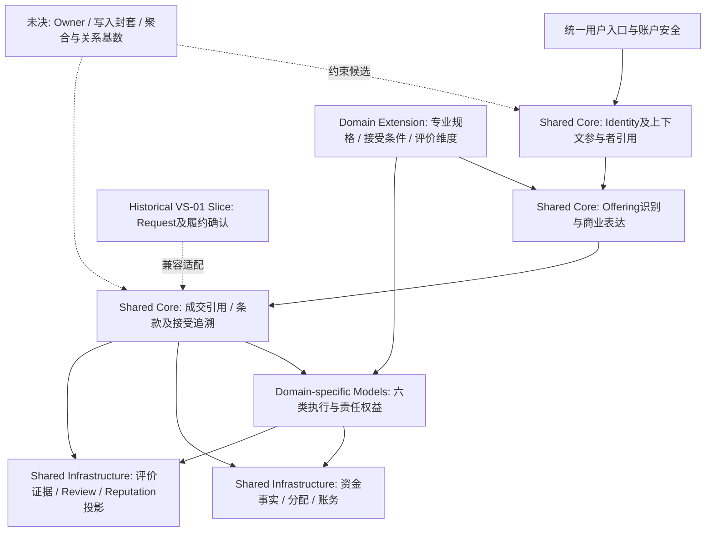
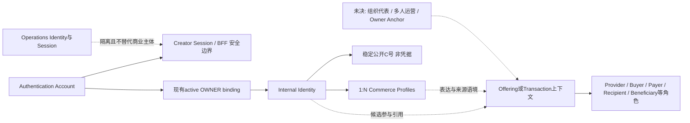
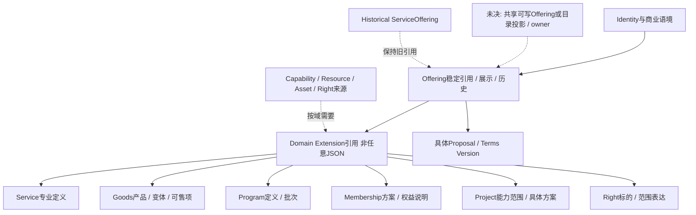
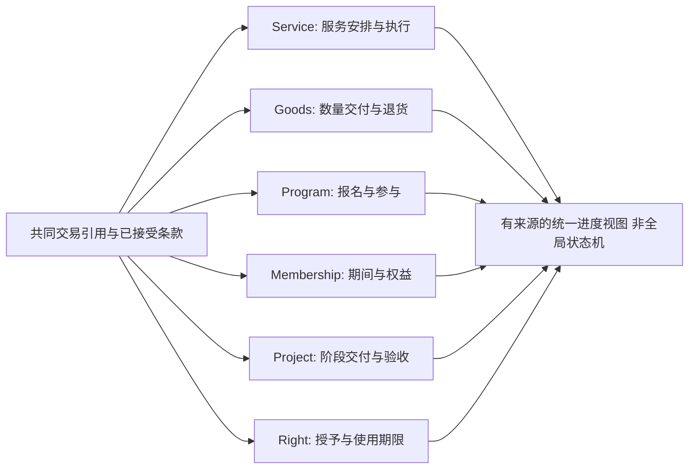
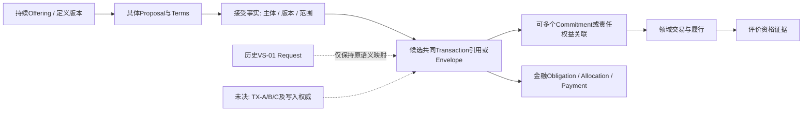
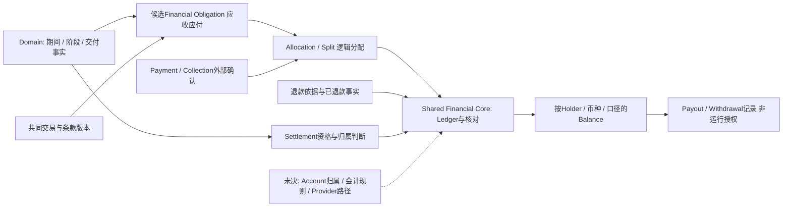
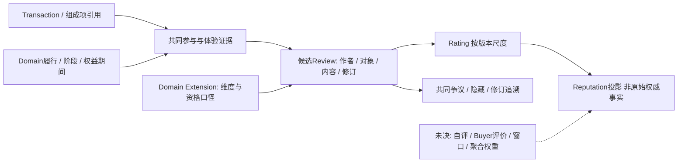
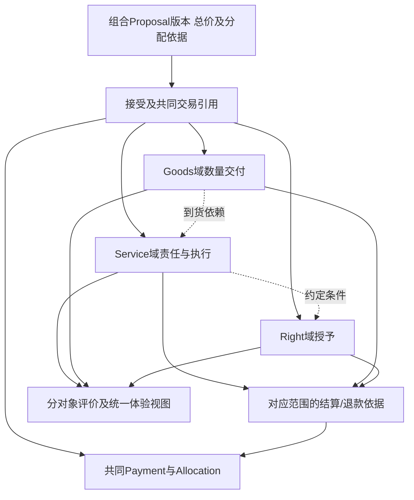
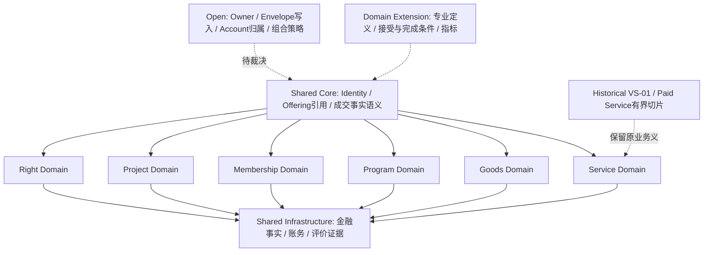
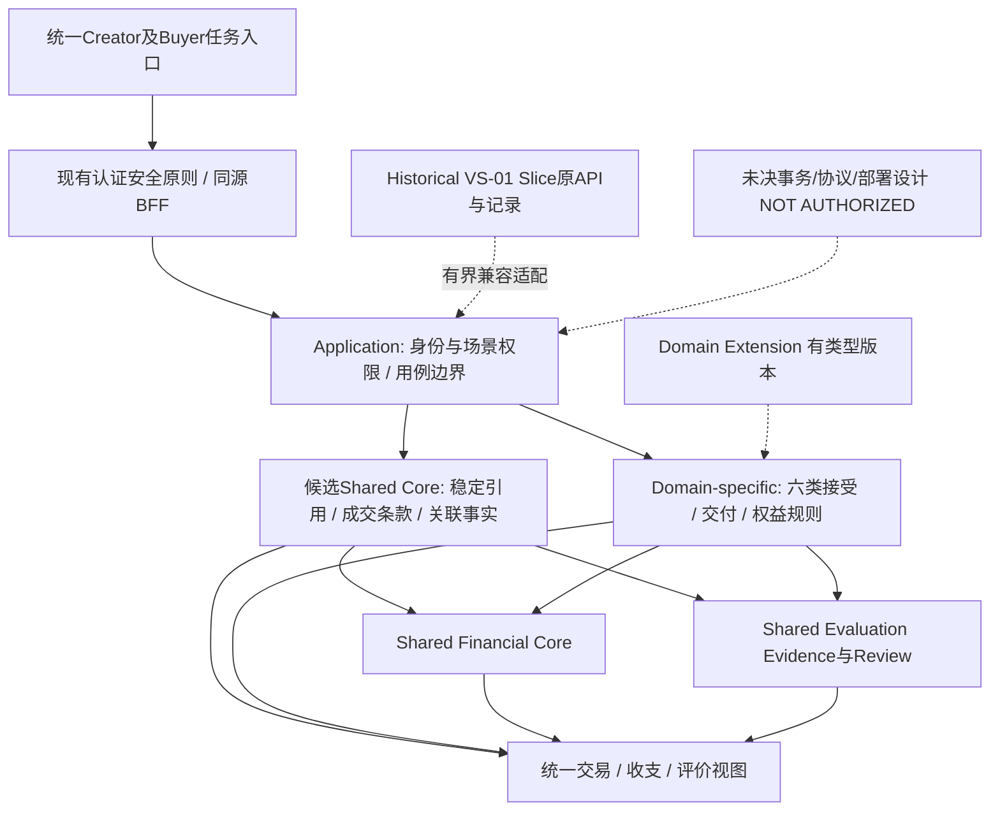

# PCI-ENG-020-C5 — Global Commercial System Abstraction & Shared Transaction Infrastructure Research and Founder Decision Package

> 研究日期：2026-11-17。性质：GLOBAL PRODUCT DOMAIN RESEARCH / SYSTEM ABSTRACTION / ARCHITECTURE DECISION PREPARATION。
> 全部架构模型：**PROPOSED / NOT FOUNDER APPROVED**。工程实施：**NOT AUTHORIZED**。
> 本轮依据C5直接授权研究，不修改F01–F04、既有产品合同或历史研究；不建立FD Record、不修改Decision Index。

## 1. Executive Findings

**[Research Finding] PCI应统一“参与者连续性、供给与成交引用、接受条款的历史、资金事实及评价证据”，而不是统一六类供给的业务状态。** 同一人通过同一认证体系进入不同商业语境；同一交易入口能展示多个领域组成项；资金只记一次，评价沿真实参与记录追溯。摄影完成、货物签收、课程参与、会员有效、项目验收和权利授予仍由对应领域解释。共同入口及统一账务不要求所有业务在同一个聚合中写入。

**[Founder Decision]** FD-C4A-R1-01只冻结F01–F04：Offering统一概念、Proposal/Terms与Commitment分离、全球Capability非必需、价值来源与责任角色分开。Offering最终Owner Anchor、实体数量和统一订单均未定（S01）。**[Current Contract]** VS-01 Request决策及附加履约确认保持原义；既有Provider-neutral Paid Service/Money实现是另一个有界切片，不能忽略，也不能提升为全球模型（S04、S07–S09）。

**[Research Finding]** 六类共同内核是“有类型且可追溯的关联”，至少包括：谁在什么语境、对哪个供给/版本、接受什么条款、形成哪些责任/权益、对应哪些履行事实、资金如何分配、评价针对哪段体验。不是把全部业务塞进通用JSON或 `status=completed`。

**[Recommendation]** 在完成本文六类及15个交易场景比较后，优先验证 **SYS-B的窄共享内核 + TX-B交易封套**，并以 **TX-C/SYS-C作为保留领域写入权威的可行替代**。推荐的必要条件是共享层只拥有经证明稳定的共同事实，各领域拥有自己的接受/履行规则；同一事实只有一个写入权威。若共享封套需编排每一次上课、权益使用或项目变更才能保持正确，应退回引用/投影边界，而非继续扩大核心。此推荐不是预选Model B、不是最终聚合决定。

**[Recommendation]** 资金采用共同资金事实、分配与可追溯账务原则；不预定“一Identity一个钱包”。评价共用作者、对象、参与证据、修订与争议框架，由领域解释评价资格和维度。路线优先“保留旧切片 → 异质场景证明共同协议 → 提取真实共享能力”，不先把VS-01强行迁成全球Order。

**[Open Question]** Founder需决定12组概念方向（§16），包括共享层写入职责、交易/Commitment边界、账户归属、组合失败语义和最小验证场景。当前真实多人代办、代付、跨类型条款、分配及评价样本不足；本报告的数值/流程是明确假设，不是产品批准或真实资金证据。

**[Current Contract — 本轮授权边界]** C4-B仅保留为历史材料。S2/P2没有正式Founder批准，曾表达的选择不形成FD；本报告不继续法律/平台合规研究、不回写C4-B。C5明确授权本文讨论交易、资金、评价与领域抽象；这不批准此前开放议题的答案，也不自动启动实施。

## 2. Global Commercial System Definition

### 2.1 概念地图与统一的含义

**[Candidate Model]** 图中方框是职责，不是实体、服务、数据库或部署单元。金融Account与登录Account无共享生命周期；Transaction关联关系不自动意味着一个Order、一次Payment或一次Commitment。

### 2.2 哪些值得独立保存

| 概念                                 | 研究判断及持久化理由                                                                        | 非决策                                          |
| ------------------------------------ | ------------------------------------------------------------------------------------------- | ----------------------------------------------- |
| Identity、Account、Profile           | [Current Contract] 已有独立身份/安全/表达职责，见S02/S03/C01–C05                            | 不新增自然人/组织全局实体，不靠邮箱合并身份     |
| Commercial Supply、Product           | [Founder Decision] 概念集合/价值表达；无需因术语独立建对象                                  | 不加Supply或Product重复主对象                   |
| Offering                             | [Founder Decision] 持续可识别供给；[Research Finding] 历史引用需稳定，领域专业定义可独立    | 是否共享可写实体、owner/基数未定                |
| Proposal、Terms Version              | [Research Finding] 必须能还原被接受内容；协商场景需独立修订历史，固定零售可用不可变成交快照 | 不要求所有零售先创建独立Proposal实体            |
| Acceptance / Commitment              | [Founder Decision] 有效接受及责任事实分开；[Research Finding] 不同时间、主体和对象需可追溯  | 可是事实记录/领域对象，不强制全局Commitment聚合 |
| Order / Transaction Reference        | [Candidate Model] 持续售后、资金和关联需要稳定身份；纯索引或可写交易封套待比较              | 不固定Order=合同或一单一承诺                    |
| Participation / Allocation           | [Research Finding] 简单只读关联可内嵌；独立变更/异议/结算时需要保留历史                     | 不由“关联有名字”推出新表                        |
| Payment / Ledger / Refund / Review   | [Research Finding] 独立外部结果、冲正/修订及审计历史不能只留最新布尔值                      | 不决定最终表、会计科目、退款运行机制            |
| Balance / Reputation / Global Status | [Candidate Model] 带来源和口径的投影，不能覆盖原始事实                                      | 不成为可随意写的余额/信誉或万能状态             |

## 3. Shared Core vs Domain-specific Boundaries

| 能力         | 六类全部共享什么                               | 多类共享或领域专属什么                                              | 连接方式与权威边界                                          |
| ------------ | ---------------------------------------------- | ------------------------------------------------------------------- | ----------------------------------------------------------- |
| 身份与参与者 | 持续主体引用、认证、上下文关联                 | 组织管理、代理、Buyer/Payer/Recipient等关系须单独授权               | 安全主体鉴别 → 场景授权；角色不会反向创建重复账号           |
| 供给         | 稳定引用、展示、版本追溯、分发入口             | SKU、课程批次、会员方案、里程碑、权利范围                           | 有类型的领域定义引用；共同目录不执行所有发布规则            |
| 交易         | 关联供给、参与者、接受版本、金额/币种和历史    | 预约、报名、续期、变更接受、权利生效                                | 共同交易引用及事实协议；具体有效接受由域说明                |
| 可获得性     | 可理解的可购买/不可购买结果和原因              | Service时间、Goods数量、Program席位；Membership/Right常非可耗尽库存 | 可共享真正同一资源的约束来源；不共享万能available布尔真相   |
| 资金账务     | Payment事实、分配、退款事实、账务与对账        | 周期应收、阶段应收、释放条件、分润依据                              | 域提出有依据的业务应收/可释放事实，资金层独立验证处理并回报 |
| 评价         | 作者、评价对象、参与证据、版本、争议、投影来源 | 服务体验、商品质量、参与过程、持续权益、阶段成果、授权交付          | 领域资格证据+有版本维度；不把所有评分直接平均               |
| 履行         | 共用证据引用、当事人可见进度与关联             | 服务完成、分批签收、出勤、权益生效、验收、Grant                     | 域事实形成共同可读摘要，不引入全球强制完成状态              |

以上除明确标注现合同者均为 **[Research Finding / Candidate Model]**。共享基础设施意味着同一语义能力不重复建设六份，不代表六域必须调用相同业务命令。

**反过度抽象约束 [Recommendation]**：不用超级Offering存所有字段；不以无类型JSON掩盖验证；不将 `Membership.active` 翻成 `Order.fulfilled`；不把Asset持有解释成Capability；不让一个Aggregate拥有供给、支付、权益和评价；不因`id`/`status`同名就合并对象；也不允许各域独立建六套账户、Payment账本和评价证据制度。

## 4. Global Identity & Commercial Participants

### 4.1 现有基础与全球候选

**[Current Contract]** Account负责认证；Internal Identity是持久PCI主体及授权锚；Commerce Profile是其商业表达，1 Identity:N Profiles；C号归Identity且是公开稳定引用，不是登录凭据或权属证明（S02/S03）。**[Code Evidence]** 当前绑定只有OWNER、一个Account最多一个active OWNER绑定；Profile运行模型有DRAFT/ACTIVE/SUSPENDED/ARCHIVED。`modules/identity-infrastructure/identity-contract.ts`的较窄类型不能代替当前`modules/commerce-profile`完整运行模型（C01–C04）。

### 4.2 十个问题的回答

| 问题                                        | 结论与限制                                                                                                                                                      |
| ------------------------------------------- | --------------------------------------------------------------------------------------------------------------------------------------------------------------- |
| 1 谁代表自然人/组织主体？                   | [Research Finding] Internal Identity提供稳定PCI引用，不自动证明现实主体唯一性或组织身份；组织/团队表示与成员代表关系[Open Question]，不可仅加type枚举宣称已支持 |
| 2 谁登录？                                  | [Current Contract] Authentication Account与Session；不能用Profile/C号登录替代认证                                                                               |
| 3 跨类型角色如何成立？                      | [Candidate Model] 同一Identity在具体供给/交易中承担角色，可同时卖Goods、提供Service和购买别人的Program，不新建六种用户                                          |
| 4 永久属性还是上下文？                      | [Recommendation] Buyer/Seller/Organizer/Payer等以参与上下文解释；专业资格或可执行权限是另外的约束，不是角色名自动授予                                           |
| 5 Profile是什么？                           | [Current Contract] 商业自我表达；[Candidate Model] 可作为经营语境入口；不自动是合同主体、所有者或独立财务账户                                                   |
| 6 个人拥有、团队运营可否？                  | [Founder Decision] 角色可分离；[Open Question] 具体委托授权、多用户治理及owner未定。当前OWNER绑定不冒充团队权限                                                 |
| 7 Buyer/Payer/Recipient/Beneficiary同人吗？ | [Research Finding] 非必然，见T12代付、T03代报名；分别记录谁接受、谁付款、谁获得权益，不把付款人自动写为客户                                                     |
| 8 一人可多角色吗？                          | [Candidate Model] 可兼任，但每项权限独立判断；同单自交易/利益冲突不能因不同Profile绕过，见T13                                                                   |
| 9 如何避免重复身份？                        | [Recommendation] 共享已有身份引用和明确绑定；游客联系人与未来账户关联需要验证/授权，不按相同邮箱自动迁移或合并                                                  |
| 10 账号与商业权限分开？                     | [Current Contract] BFF验Session，Application再验身份/对象归属；[Candidate Model] 新域继续此分层，不能让Buyer/Operator角色替代有效Session或复用Operations身份    |

同一登录者有多个个人/商业表达的产品体验可以研究，但“个人Profile”是否独立类型未批准。多用户协作、组织/团队和代办应在同一参与者体系下表达，不要求所有人拥有同一Identity；共享管理也不要求合并各人的身份。

## 5. Global Commercial Supply Model

**[Founder Decision]** Offering是持续供给，Proposal是具体时点的提议；不要求所有Offering关联Capability。**[Candidate Model]** 可共享发现/管理入口、稳定标识、业务类型定位、表达与领域定义引用、明确负责方的引用；专业可售规则不由标题/描述推导。最终Owner不列为已冻结全局必填字段。

**[Research Finding]** Goods产品定义、规格/变体和SKU可售项并非必然三对象；需要按价格、库存、交付独立性区分。Program持续定义与某批报名不同；Membership方案与某人的有效会员资格不同；Project公开范围与成交后的具体项目不同；Right Offering与实际Grant不同。Service模板只能表达已注册Service含义，不能用增加template或appearanceType方式实现其他五域。

## 6. Six Supply Types & Domain Model Matrix

以下矩阵均为 **[Research Finding / Candidate Model]**，是目标模型对比，不是现已实现。六类名称来自C5授权和S05；并未裁决其在全部现实商业中的互斥或穷尽性。

| 维度              | Service                  | Goods                 | Program               | Membership                 | Project                 | Right                       |
| ----------------- | ------------------------ | --------------------- | --------------------- | -------------------------- | ----------------------- | --------------------------- |
| 商业价值          | 活动/服务结果            | 商品及交付            | 结构化参与过程        | 持续资格/访问权益          | 有范围的成果            | 指定范围使用权益            |
| Provider          | 服务提供者               | 卖方                  | 组织者                | 运营者                     | 承接/组织方             | 有权授予方                  |
| Offering          | 服务定义                 | 产品/变体/可售项      | 计划/批次             | 方案/等级                  | 项目服务范围            | 标的/可授范围               |
| Terms             | 时间地点、服务范围、取消 | 规格数量、交付、退货  | 周期场次、资格、退出  | 周期、续期、权益、暂停     | 范围、阶段、验收、变更  | 地域期限、用途、次数、排他  |
| Customer          | 购买者/接受服务者        | Buyer/Recipient可分   | Buyer/Participant可分 | Buyer/Member可分           | 委托方/验收人           | Buyer/Beneficiary可分       |
| Quantity / Scope  | 次数、时长、结果         | 单位与规格数量        | 席位/报名人数/阶段    | 资格期限/人数/额度         | 成果范围/里程碑         | 权利范围/使用量，不一定件数 |
| Availability      | 时段与履行能力           | 库存/预售与交付能力   | 席位、批次、资格      | 开放资格/权益资源          | 接单能力与协商范围      | 可授范围/排他约束           |
| Price             | 固定/按范围报价          | 变体单价×数量及调整   | 批次/阶段收费         | 周期/等级费                | 总价/阶段/变更价        | 一次/分期/持续许可费        |
| Commitment        | 按有效接受形成服务责任   | 数量交付与对价责任    | 参与资格及组织责任    | 特定期间权益/付费责任      | 已接受范围/阶段责任     | 有效授予/使用及费用责任     |
| Fulfillment       | 服务执行证据             | 发货/签收/退货        | 场次参与/活动执行     | 激活/访问/权益使用         | 交付物与阶段验收        | Grant生效/交付访问/使用     |
| Completion        | 服务完成判断             | 项目/批次交付判断     | 参与/结业与退出       | 期满不是所有交易“结束”     | 阶段/最终验收           | 授予完成不等于使用期结束    |
| Financial Trigger | 预约应收、完成可结算     | 订单应收、交付/退货   | 报名/阶段应收、退出   | 每期应收、续期/调整        | 预付款、验收、尾款      | 授予费、期间费/使用量       |
| Review            | 具体服务与Provider       | 商品与配送分开        | 组织者及参与体验      | 时间窗口内会员体验         | 阶段/最终交付           | 授予办理/实际使用体验       |
| Lifecycle         | 待约/执行/完成/取消      | 待发/部分发/签收/退货 | 报名/参与/退出/结业   | 未生效/有效/暂停/到期/终止 | 提议/执行/阶段接受/变更 | 提议/授予/有效/届满/终止    |

### 6.1 六类端到端推演

所有流程是 **[Candidate Model]**，不是批准的规范事件名或状态机。付款时点/退款/结算取决于接受条款和后续决策。

1. **Service摄影**：摄影师以某Profile发布范围与时间条件 → 客户选择/协商时段及取消条款 → 形成被接受服务安排与应收 → 付款事实与预约确认分开 → 摄影执行 → 按条款确认完成 → 结算释放判断 → 客户评价这次服务及提供者。预约前/后取消要分别判断资源释放与退款；当前VS-01无需付款的Request继续独立存在。关键反例：完成摄影不等于客户已付全部款。
2. **Goods相机配件**：卖方定义产品、规格/变体及可售项 → 客户选择2件型号A、1件型号B → 保存价格/交付快照并接受 → 支付与库存承诺关联 → 分批发货和签收 → 一件退货 → 针对该件/分配金额退款 → 商品质量与配送体验分开评价。SKU变化不能重写旧订单规格；不为Goods伪造服务时间与履约码。
3. **Program摄影训练营**：组织者定义计划、场次/阶段、批次及报名要求 → 企业Buyer为3名Participant报名 → 各参与人资格与参加关系确认 → 报名或阶段收费 → 出勤/活动开展 → 一人退出按条款调整权益与退款 → 其余完成/结业 → 每人按真实参与范围评价。共同批次不意味着所有学员共享一笔订单。
4. **Membership创作社群**：运营者发布等级、周期和权益 → Buyer为自己或指定Member接受一期方案 → 付款与权益激活分别有事实 → 使用权益 → 暂停或取消未来续期 → 已付期间如何继续依条款 → 续期形成新的期间金额/条款关联 → 每期或合理窗口形成体验评价。取消续费不自动退款、不自动撤销已享权益；“永久订单active”不能代替各期记录。
5. **Project品牌拍摄**：承接方与客户协商需求/报价 → 接受范围版本、三里程碑和验收人 → 预付款 → 分阶段提交成果、接受/返工 → 有效变更增加范围和价款 → 部分履行与未完成取消分别记载 → 阶段应收/尾款、结算与退款按对应范围 → 阶段/最终评价。单次`fulfilled`无法解释M1接受、M2返工、M3取消。
6. **Right数字素材使用**：权利供给者说明对象版本、用途地域期限与条件 → Buyer为Beneficiary接受指定条款 → 一次或分期许可费义务 → 授予及权益生效 → 访问/下载仅是履行或使用证据 → 持续许可费/使用限制依域解释 → 届满或终止保留已发生历史 → 评价授予办理和使用体验，不声称评价证明权属。授予完成、资金结清、期限届满是三个时间。

### 6.2 独立生命周期如何共用进度

**[Recommendation]** 界面可共享“待我操作、资金摘要、各项进度”，但须显示语义与来源，不能由`paid=true`推成所有项完成，也不能从局部失败覆盖整笔交易的已成立事实。

## 7. Shared Transaction / Order Infrastructure

### 7.1 术语与不变量

| 概念             | 研究解释                                                                                | 不能等同                            |
| ---------------- | --------------------------------------------------------------------------------------- | ----------------------------------- |
| Proposal / Terms | [Founder Decision] 具体提议与条款版本；可供多个具体主体接受                             | 持续Offering、当前页面最新版        |
| Request          | [Current Contract] VS-01客户意图；[Research Finding] 全球可存在咨询/申请/询价等不同入口 | Transaction或全部Commitment         |
| Acceptance       | [Research Finding] 谁对哪个版本以哪种有效方式接受的事实                                 | 按钮点击或付款总是有效接受          |
| Order            | [Candidate Model] 对已确定或正在成立的采购事项的业务记录/工作边界                       | 必然单一合同/付款/承诺              |
| Transaction      | [Candidate Model] 可追溯商业交换及关联上下文；必须与Financial Transaction区分           | 数据库事务、Request、一次资金流水   |
| Commitment       | [Founder Decision] 有效接受机制形成的责任或权益事实                                     | Order天然一对一或全局统一实体       |
| Fulfillment      | [Research Finding] 对具体义务的执行/交付过程及事实                                      | 全部完成、资金结清                  |
| Completion       | [Research Finding] 某个明确范围按规则达到完成条件                                       | 永久不可再退货/异议、所有关联项完成 |
| Cancellation     | [Research Finding] 对未来执行/未完成范围的取消事实与效果                                | 删除历史或必然全额退款              |
| Refund           | [Research Finding] 有业务依据的退款安排及实际资金退回事实，二者分开                     | 取消、账务修正、历史从未发生        |

**[Research Finding]** 共同不变量：接受内容可还原；参与角色可解释；金额、币种、数量/范围有单位与版本；同一外部资金事实不能因重试重复入账；部分履行/退款能归属于具体范围；取消不删历史；跨域协调不能通过伪造领域成功完成。这里只提出业务不变量，不定义事件Schema或原子锁。

### 7.2 三个交易候选（先定义，后经§7.3检验）

| 维度         | TX-A Universal Order                | TX-B Shared Transaction Envelope + Domain Transaction Objects | TX-C Domain Orders + Shared Reference / Projection |
| ------------ | ----------------------------------- | ------------------------------------------------------------- | -------------------------------------------------- |
| 统一程度     | 一个业务Order管全部项               | 共同成交事实/参与者/引用，域交易独立                          | 共同身份与关联、域Order写入权威、全局视图          |
| 领域独立性   | 扩展受核心生命周期牵制              | 专业过程独立，需明确共同事实唯一写入                          | 最强，必须约束协议避免六套不同含义                 |
| 跨类型       | 单单易展示，异步/持续类型使核心膨胀 | 组合成交可集中，履行拆开                                      | 需显式交易组/组合提议，否则仅拼屏                  |
| 资金关联     | 单Order路径简单，多承诺时仍需分配   | 资金关联封套与组成责任；不允许双重金额权威                    | 统一资金引用各域订单/组成项，需共同分配语义        |
| 评价关联     | 可统一入口，必须保留子项证据        | 封套定位、领域参与决定资格                                    | 投影定位及域证据一致性更重要                       |
| 多Provider   | 不能继续使用单seller字段            | 角色按组成项/承诺分开                                         | 各域Provider明确，组级责任需另述                   |
| 部分履行退款 | 单状态会丢失事实，必须引入分项      | 分项事实与共同金额归集                                        | 域处理、金融统一协调，组级展示防过时               |
| 历史解释     | 快照简单但全局模式变更冲击大        | 封套版本与域版本分别可追溯                                    | 保存域命名空间/版本，投影可重建                    |
| 扩展         | 小型一次性交付好；领域分歧加剧时弱  | 共享语义稳定时好；核心越权时退化TX-A                          | 新域侵入低；标准治理差会分裂                       |
| VS-01成本    | 高，容易强造旧Order/价格/Buyer      | 中，可先兼容映射，但不强写伪成交                              | 较低，旧Request仅作为历史来源引用                  |

**[Candidate Model]** “Envelope”必须说明它是否只保存共同接受事实或还决定接受；本报告不把一个空包装当架构答案。TX-C也须共用金融和评价，不是六套闭环。TX-A并非原则上错误：若所有项共享接受、取消和责任边界，可作为某一有界订单域；没有证据把这种条件推广六类。

### 7.3 十五个交易压力测试

全部是 **[Research Finding / Candidate Model]**；T01–T15不是自动测试或真实交易，每项明确十个维度。币种示例CNY，不授权收费。

#### T01 — 单Service、单Provider、单Buyer

| 维度         | 分析                                               |
| ------------ | -------------------------------------------------- |
| Offering关系 | 一个摄影Offering，具体时段在成交条件中             |
| 参与者       | 甲Provider/Performer；乙Buyer/Payer/Recipient      |
| 交易边界     | 一次服务采购；预约与取消是其专业过程               |
| 成交条款     | 2小时拍摄、时间地点、600元、取消/完成条件快照      |
| 订单关系     | 可一个订单，不证明全球必定一单一对象               |
| Commitment   | 服务义务与付款义务可分别解释；保存一次有效接受来源 |
| 领域履约     | 服务执行与完成证据，不强制Goods/Right同样扫码      |
| 资金关联     | 订金/尾款可能两笔；不能假设只有一个Payment         |
| 评价关联     | 乙针对本次服务及甲；资格由实际参与支持             |
| 历史记录     | 改档、取消与补款保留；TX-A可适用此简单范围         |

#### T02 — 多Goods组成同一订单

| 维度         | 分析                                               |
| ------------ | -------------------------------------------------- |
| Offering关系 | 三个可售项，规格/变体和数量不同                    |
| 参与者       | 同一卖方甲、Buyer乙、Recipient丙可能不同           |
| 交易边界     | 一次采购，交付可分批                               |
| 成交条款     | 每项规格/数量、金额、运费与退货条款快照            |
| 订单关系     | 一个Goods订单含多项；发货批次不是订单数量          |
| Commitment   | 交付义务可按项/批明确，非每SKU必建独立聚合         |
| 领域履约     | 部分发货、签收、退货及换货分别追溯                 |
| 资金关联     | 支付可合并，退款必须归项及原支付分配               |
| 评价关联     | 商品本身与配送分开；不能复制一次总体评分到三个商品 |
| 历史记录     | SKU后来更名仍能显示原规格；TX-A须具备分项语义      |

#### T03 — 一个Program多名参与者

| 维度         | 分析                                                   |
| ------------ | ------------------------------------------------------ |
| Offering关系 | 一计划一批次，三席位                                   |
| 参与者       | 企业Buyer/Payer甲、组织者乙、学员丙丁戊                |
| 交易边界     | 统一采购三席位；每人报名/资格/出勤不同                 |
| 成交条款     | 批次、阶段、名单替换、退出退款、共900元                |
| 订单关系     | 一采购订单与三参与记录；不同买方另买不因同批合单       |
| Commitment   | 组织责任与三个参与权益，颗粒度由实际独立变更决定       |
| 领域履约     | 一人退出不让另外两人自动退出                           |
| 资金关联     | 付款方不等于评价者；300元席位退款需要分配依据          |
| 评价关联     | 学员按实际参加阶段评价；企业采购体验另定对象           |
| 历史记录     | 原名单、替换授权、出勤不被最新订单覆盖；TX-B/C更易隔离 |

#### T04 — Membership持续生效及续期

| 维度         | 分析                                                     |
| ------------ | -------------------------------------------------------- |
| Offering关系 | 同一方案持续存在，各期间采用明确版本                     |
| 参与者       | 运营者甲、Buyer乙、Member丙，付款者可乙                  |
| 交易边界     | 一次开通与后续各期续费可关联，但金额/接受依据各自存在    |
| 成交条款     | 每月100元、权益、续期依据与取消效果；不默认授权自动扣款  |
| 订单关系     | 候选为期间订单关联持续会员关系；或主协议下周期交易，待选 |
| Commitment   | 已付期间权益与未来收费授权分开；非一个永久未完成义务     |
| 领域履约     | 有效/暂停/到期与权益使用；取消续期不抹掉本期使用         |
| 资金关联     | 各期应收/Payment引用同一金融基础，失败不伪造续期成功     |
| 评价关联     | 丙按体验期间评价/更新，不每次扣费自动刷一条五星          |
| 历史记录     | 价格/等级调整不重算旧期；TX-A单终态难适配                |

#### T05 — Project分阶段履行与支付

| 维度         | 分析                                                   |
| ------------ | ------------------------------------------------------ |
| Offering关系 | 项目服务Offering导向具体范围版本                       |
| 参与者       | 承接甲、客户乙、阶段验收代表丙、实际团队丁             |
| 交易边界     | 一个项目采购，里程碑独立接受/应收                      |
| 成交条款     | 12000元，预付3000、M1接受4000、最终5000；变更另接受    |
| 订单关系     | 主采购关联阶段交易/义务，不预设每阶段必须一Order       |
| Commitment   | 范围及阶段义务按版本，M2变更不改变已验M1               |
| 领域履约     | 交付、返工、阶段接受、最终接受分别记录                 |
| 资金关联     | 多笔Payment与对应应收分配，接受不等于款到              |
| 评价关联     | 阶段与最终评价避免统计重复；针对团队/主体有明确对象    |
| 历史记录     | 报价、变更、验收人授权和收付款逐项保留；TX-B/C均可候选 |

#### T06 — Right一次授予

| 维度         | 分析                                                      |
| ------------ | --------------------------------------------------------- |
| Offering关系 | 素材使用权Offering指向标的版本                            |
| 参与者       | Grantor甲、Buyer/Payer乙、Beneficiary丙                   |
| 交易边界     | 一次许可交易，使用期一年                                  |
| 成交条款     | 用途/地域/期限/排他范围及1200元许可费快照                 |
| 订单关系     | 交易记录关联授予记录；Grant不是订单别名                   |
| Commitment   | 授予/使用及费用责任按接受机制解释                         |
| 领域履约     | 授予、激活、使用记录、到期/终止独立                       |
| 资金关联     | 一次许可费可单付或分期，不用付款成功替代Grant             |
| 评价关联     | 授予办理和实际使用体验，不评“已证明全球权属”              |
| 历史记录     | 授予时版本与后来公开Offering变化分开；单fulfilled含义不足 |

#### T07 — Service + Goods组合销售

| 维度         | 分析                                                          |
| ------------ | ------------------------------------------------------------- |
| Offering关系 | 安装服务与设备两个供给，可由组合提议销售                      |
| 参与者       | 设备卖方甲、安装Provider乙、Buyer丙                           |
| 交易边界     | 同次接受套餐，交付与安装有依赖而非相同生命周期                |
| 成交条款     | 总1000元，设备700/安装300的接受分配；未到货不能安装           |
| 订单关系     | 单封套两域项，或交易组关联两域订单                            |
| Commitment   | 设备交付与安装至少可区分；是否整体不可分须条款决定            |
| 领域履约     | 设备签收不完成安装，安装失败也不使签收事实消失                |
| 资金关联     | 支付1000，安装取消按接受分配退款300；不得事后随意折价         |
| 评价关联     | 设备质量、配送、安装分别评价并可有组合协调体验                |
| 历史记录     | 两方责任、组成版本、取消/退款关联；检验TX-B/C共享是否实质成立 |

#### T08 — Program + Membership

| 维度         | 分析                                                 |
| ------------ | ---------------------------------------------------- |
| Offering关系 | 训练营加三个月社群权益，持续方案与批次不同           |
| 参与者       | 组织者甲、运营者乙、Buyer丙、Participant/Member丁    |
| 交易边界     | 套餐接受后产生参与关系及期间权益                     |
| 成交条款     | 营期、权益起算、退出、折扣分配、续期是否另接受       |
| 订单关系     | 组合封套/组关联Program报名和Membership期间交易       |
| Commitment   | 活动组织与持续权益分开；会员不因课程结业自动消失     |
| 领域履约     | 出勤/退出与权益激活/到期各有事实                     |
| 资金关联     | 一笔可分配两项；部分退出按条款处理不可按天凭空推算   |
| 评价关联     | 活动体验及会员体验窗口分开，重叠人不重复贡献信誉权重 |
| 历史记录     | 组合折扣、激活时间与续期保持；挑战通用完成日期       |

#### T09 — Project + Goods + Right

| 维度         | 分析                                                               |
| ------------ | ------------------------------------------------------------------ |
| Offering关系 | 品牌项目、实体样品、最终图像许可三组成项                           |
| 参与者       | 项目甲、商品卖方乙、Grantor丙、客户丁、受益机构戊                  |
| 交易边界     | 组合目标可共同接受，采购、验收和授予边界不同                       |
| 成交条款     | 范围版本、样品数量、许可范围与生效依赖、金额分配                   |
| 订单关系     | 候选一个交易封套/组关联三域记录，不能仅存projectId                 |
| Commitment   | 项目成果、样品交付、指定范围授予各可追溯；不由订单行数机械决定数量 |
| 领域履约     | 样品签收、项目验收、Grant生效分别完成                              |
| 资金关联     | 预付/阶段/授权费分配；许可未生效不可假定全结算                     |
| 评价关联     | 项目交付、样品、授予体验及总体协作区分                             |
| 历史记录     | 内容标的版本及验收范围变化追溯，不重写已授权益；核心膨胀压力最大   |

#### T10 — 同单多个Provider

| 维度         | 分析                                                 |
| ------------ | ---------------------------------------------------- |
| Offering关系 | 同型或异型多个供给，不能只保留第一个seller           |
| 参与者       | Buyer甲；Provider乙丙；Operator丁不自动参与收入      |
| 交易边界     | 单次客户体验可对应多个责任主体，需明确谁承担组合责任 |
| 成交条款     | 各提供者范围、价格/折扣、取消和协调责任              |
| 订单关系     | 主交易关联多责任项；按Provider拆子订单只是候选       |
| Commitment   | 按接受主体和责任范围形成，可一组或多项，待条款       |
| 领域履约     | 各自完成事实，不互相覆盖                             |
| 资金关联     | Payee份额、手续费承担及退款追溯；不是把总额等分      |
| 评价关联     | 对实际Provider分别评价，不能全部评分归发布账号       |
| 历史记录     | Provider替换、分配修订须有依据；单creatorId模型不足  |

#### T11 — 部分履行、取消与退款

| 维度         | 分析                                                          |
| ------------ | ------------------------------------------------------------- |
| Offering关系 | 已接受A/B/C三项或数量范围                                     |
| 参与者       | Buyer甲及各责任方，Payer可能他人                              |
| 交易边界     | A完成、B取消、C待履行；不以一个refunded覆盖整笔               |
| 成交条款     | 原1000元，A400/B300/C300；退款依据及不可退部分明确            |
| 订单关系     | 共同记录保留组成状态与摘要；非拆单即可自动解决                |
| Commitment   | B的未履行责任解除/补救按有效变更，A事实不撤回                 |
| 领域履约     | 各域提交具体范围进度，必要的退货另有事实                      |
| 资金关联     | 退款300仍需确认原款与分配余额，Payment失败/退款待处理独立显示 |
| 评价关联     | A可评价实际体验，B可评价取消过程，不能伪装为已体验C           |
| 历史记录     | 原始付款、后续退款/账务调整完整保留；余额口径可重建           |

#### T12 — Buyer与Payer分离

| 维度         | 分析                                                            |
| ------------ | --------------------------------------------------------------- |
| Offering关系 | 任一或组合供给                                                  |
| 参与者       | Buyer甲接受条款，关联主体乙付款，Recipient/Beneficiary丙        |
| 交易边界     | 采购责任与付款授权不是同一关系                                  |
| 成交条款     | 谁欠款、谁允许代付、退款去向/通知可见性须明确                   |
| 订单关系     | 一商业采购可关联乙的Payment，非把buyerId覆盖成乙                |
| Commitment   | 甲/提供者义务，乙是否承担责任需具体约定；付款事实本身不代替接受 |
| 领域履约     | 给丙的服务/权益由域确认                                         |
| 资金关联     | 金融Account Holder与Payer/Payee分别记；不因代付共享全部私有数据 |
| 评价关联     | 甲采购体验、丙使用体验；乙不能仅付款就评未参加的服务            |
| 历史记录     | 授权/分配/退回依据保留，身份关系变化不改历史参与者              |

#### T13 — 用户购买自己另一商业空间的供给

| 维度         | 分析                                                         |
| ------------ | ------------------------------------------------------------ |
| Offering关系 | 同Identity下两个Profile，或本人代表的另一独立主体            |
| 参与者       | 登录者同人不必真实责任主体同一；不同Profile也不必独立双方    |
| 交易边界     | 须辨识内部转移/测试/真实关联方交易，不默认为第三方成交       |
| 成交条款     | 是否允许、费用和披露需要产品决定，本轮不放行也不新增禁止规则 |
| 订单关系     | 若保留内部记录需明确性质，不能冲入普通销售统计               |
| Commitment   | 不从两个Profile自动推定双方有效承诺                          |
| 领域履约     | 仍可记录实际活动，但不能冒充外部验收                         |
| 资金关联     | 不为显示收入循环制造付款；未来关联方账务另定                 |
| 评价关联     | 不得用换Profile绕过自评识别；具体限制等待裁决                |
| 历史记录     | 角色/关联关系按时点保留；S08明确内部自买自卖非真实商业验收   |

#### T14 — Proposal改版后的历史交易

| 维度         | 分析                                                          |
| ------------ | ------------------------------------------------------------- |
| Offering关系 | 持续Offering从v1改到v2                                        |
| 参与者       | 原接受方与后来新Buyer分开                                     |
| 交易边界     | 已接受v1不受单方页面修改影响；有效变更另留事实                |
| 成交条款     | 原价/范围/版本完整保留，不能只保存可变URL                     |
| 订单关系     | 新交易引用v2，旧记录仍引用v1快照/版本                         |
| Commitment   | 原责任依被接受范围，变更接受有自己的来源                      |
| 领域履约     | 按实际版本验收，不拿最新规格拒绝旧交付                        |
| 资金关联     | 旧分配/费率版本不重算；差价形成调整依据                       |
| 评价关联     | 评价旧规格/旧阶段并注明语境，不能误归新版商品缺陷             |
| 历史记录     | 修订链、接受者和时间必须可还原；C12已有有界版本经验非全球方案 |

#### T15 — 一次购买多个独立Commitment

| 维度         | 分析                                                             |
| ------------ | ---------------------------------------------------------------- |
| Offering关系 | 一组摄影、打印、照片许可，也可单供给产生多期权益                 |
| 参与者       | 同或不同Provider，Buyer与受益人按项区分                          |
| 交易边界     | 一次接受/采购体验，责任在不同时间/范围成立或履行                 |
| 成交条款     | 触发条件、依赖、独立取消及责任主体明确                           |
| 订单关系     | 一个显示订单不要求一个Commitment；多订单也可共享一次提议         |
| Commitment   | 可分别解释的服务、商品与授权责任，不能按一个paid生成统一承诺     |
| 领域履约     | 服务完成、打印交付、许可激活独立                                 |
| 资金关联     | 一款多分配或多笔款同采购，退款/结算按对应义务追溯                |
| 评价关联     | 每个实际体验有资格记录，组级评价不得重复放大信誉                 |
| 历史记录     | 原提议到各接受/承诺/履行/金额/评价链条完整；证明Order≠Commitment |

### 7.4 场景之后的判断与交易图

**[Research Finding]** T01/T02不能单独证明全球TX-A；T03/T12否定永久Customer身份/单buyer付款模型；T04/T05否定单Payment和单终态；T07–T11/T15要求组成范围与分配，T14要求历史条款独立。TX-B与TX-C都能满足，但成本落点不同：前者需要共同事实写入规则，后者需要统一协议与权威投影。

**[Recommendation]** 优先用TX-B窄封套验证T07/T12/T14，TX-C同时作为对照；只有共同接受/分配/历史需要集中写入的证据成立才赋予封套业务职责，不为统一界面建超级Order。

## 8. Shared Financial Infrastructure

### 8.1 概念边界

**[Current Contract]** S07的真实资金路径仍Pending；S08/S09允许有界Provider-neutral Money模型，不证明真实支付验收。当前代码已有Payment、Settlement、Ledger、Wallet、Withdrawal而非资金能力全空（C13–C15）。以下全球扩展均为 **[Candidate Model / Research Finding]**。

| 概念                  | 含义 / 权威事实                               | 与其他概念的关系                                      |
| --------------------- | --------------------------------------------- | ----------------------------------------------------- |
| Financial Account     | 某主体在特定账务/币种/责任范围的归集位置      | 不等于登录Account、银行账户或自动托管钱包；归属待决定 |
| Payment               | 为清偿义务发生的支付安排/尝试及确认结果       | 可以多次尝试/分期；不能只有订单paid布尔               |
| Collection            | 收款侧发生的接收/归集事实                     | 不应与Payer指令和到账混同，是否独立对象看清算事实     |
| Financial Obligation  | 谁应向谁付多少、因何事、何时到期              | Receivable/Payable是相应方视角，未收款仍可存在        |
| Financial Transaction | 一项资金处理事实及其外部/内部引用             | 区别Commercial Transaction和数据库transaction         |
| Ledger / Ledger Entry | 按口径记录有依据的账务变动与历史              | 不是Payment API响应，也不是领域履约状态               |
| Balance               | 指定主体、币种、账户、时点及可用口径的投影    | 不能跨币种相加，不能由领域直接改数                    |
| Fee                   | 依据交易/支付/结算及版本规则的费用义务/记录   | 明确承担者、收取方、退款时是否返还                    |
| Revenue / Entitlement | 获得对价权益与会计收入确认分别解释            | 收款≠收入确认≠可提现；正式会计政策不由本报告冻结      |
| Refund                | 业务退款依据、退款请求与已退资金事实关联      | 账本以追加调整反映；退款失败不能记已退                |
| Settlement            | 商业账务的归属/释放判断与支付机构结算分别引用 | S09现有Settlement明确非银行清算；不偷换同名词         |
| Payout / Withdrawal   | 对外支付动作与用户提现意图可分                | 借现有Withdrawal经验，不假定每类交易都需用户提现      |
| Allocation / Split    | 款项、义务、组成项、Payee份额之间的可追溯分配 | 逻辑分配不等于已经真实分账/转账                       |

### 8.2 十二个关键问题

| 问题                             | 候选回答                                                                                             |
| -------------------------------- | ---------------------------------------------------------------------------------------------------- |
| 用户一套共用Account？            | 共用金融基础设施与统一视图有必要；不必物理一个账户。主体、币种、责任/结算目的可能要求多个归集单元    |
| 账户属谁、是否Identity一对一？   | Account Holder需明确；Identity可提供引用但不裁决资产/责任所有权；个人/组织/多Profile不等价于一一开户 |
| Payer/Payee/Beneficiary/Holder？ | 可不同，T12/T03；授权、应收与权益接受分别追溯                                                        |
| 一Order多Payment？               | 需要表达T01订尾款、T05阶段、T04期间；现有唯一orderId约束不能直接提升全球                             |
| 一Payment多交易/履行项？         | 需支持合并付款/分配的候选；每笔确认金额不能被多个域重复花费                                          |
| Payment Transaction vs Entry？   | 必须分开，支付确认可产生多条分配/费用/账务事实；重复通知不可重复记账                                 |
| Refund属哪层？                   | 有业务依据、资金处理结果及账务反映三层关联；不是仅改Ledger，也不是仅改Order                          |
| Fee关联？                        | 保存计算依据/承担者/版本/分配范围，退款费用政策另外决定                                              |
| 多Provider收入？                 | 接受条款或分配约定确定份额；不按发布账号或项数自动分配                                               |
| Membership周期？                 | 域产生期间义务/续期依据，共用Payment/Ledger；不在所有域复制订阅收费系统                              |
| Project验收与分期？              | 验收可触发应收或释放资格，不证明款到账；每阶段对应义务和已分配资金                                   |
| 独立且关联？                     | 业务事实、应收/应付、支付凭证、分配、账务记录、结算判断具有共同引用和独立效力；回调不能代造领域验收  |

### 8.3 六类触发差异与资金不变量

| 类型       | 应收/付款与后续结算                      | 取消/退款含义                               |
| ---------- | ---------------------------------------- | ------------------------------------------- |
| Service    | 预约订金/尾款；完成事实可作为结算条件    | 释放时段与退款是不同事实，完成后争议另处理  |
| Goods      | 订单收费；发货/签收依政策触发释放        | 退货、验收退货、退款分别追溯数量金额        |
| Program    | 报名费、阶段费；参与/阶段开展作为条件    | 退出一人不等于整批退款                      |
| Membership | 每期应收/续费；权益期间与收入口径分开    | 暂停/取消续期/本期退款不同；不默认按日退款  |
| Project    | 预付款、里程碑应收、尾款；验收与款到独立 | 已接受阶段、未完成范围、变更费用分别处理    |
| Right      | 一次、分期、期间/使用量许可费            | 授予/终止与已付款返还非同义，不自创自动退款 |

**[Research Finding]** 统一的是金额精度、币种、原始凭证、去重、分配和账务追溯；收费时间表及结算条件由领域/接受条款表达。共同金融层必须核验分配总额不超已确认可分配金额、累计退款不超可退原款、同一份额不重复结算，按币种保持守恒。未定手续费、税、折扣、汇率和舍入规则；不能把缺失规则默认为零。

**[Candidate Model 数值反例]** T07支付CNY1000，接受分配Goods700+Service300；安装取消退300，商品700仍已交付。若已向安装方释放收入，需另记待追回/抵扣安排而非修改原支付金额；平台费是否回退另看原规则。多笔Payment覆盖同项时，退款还须定位实际来源和可退余额。该例只证明分配层必要，不批准实际分账或负余额追偿。

### 8.4 三种金融候选

| 模型                                                     | 优点                                             | 失败条件/代价                                                        | 与六域关系                                                 |
| -------------------------------------------------------- | ------------------------------------------------ | -------------------------------------------------------------------- | ---------------------------------------------------------- |
| FIN-A Shared Financial Account + Ledger                  | 全局主体/币种账务与余额一致，可统一收入/提现视图 | 未确定账户责任边界就建一个钱包会混同资金与身份；过早成为全套会计系统 | 领域提交义务/履行依据，公共账本不能决定所有释放条件        |
| FIN-B Shared Transaction-linked Financial Records        | 先按交易关联Payment/退款/分配，兼容现有记录容易  | 只有流水没有跨交易应收/余额/守恒，难支持收入、Payout和续期归集       | 适合作为渐进证据层，不能作为最终账务全部替代               |
| FIN-C Domain Financial Subledger + Shared Financial Core | 域应收/阶段/期间语义清楚，共用真正资金账本/对账  | 若各subledger各记一次真实款/余额，会双记并分裂；跨域调账更复杂       | Subledger只拥有业务义务明细；共同Core拥有共享资金/账务事实 |

**[Recommendation]** 采用“共同金融核心+领域义务明细”的概念方向，结合FIN-A/FIN-C优点；FIN-B可作兼容过渡。不是同时建设三套账本；账户归属/分录模型及是否双重记账须下一正式决策。现有Creator Earnings Ledger是收益事件账，不能未经验证宣称完整全球总账或双重记账。

## 9. Shared Review / Reputation Infrastructure

### 9.1 共同事实与领域差异

**[Research Finding]** Review是有作者、对象、语境和历史的评价内容；Rating是某个版本尺度上的测量；Reputation是选择证据、权重和时间口径得到的投影。三者不同，不把一个五星直接写进所有关联主体永久信誉。

| 问题 / 对象          | 候选结论                                                                                                                    |
| -------------------- | --------------------------------------------------------------------------------------------------------------------------- |
| 1 是否必须真实交易？ | 推荐区分“经交易/参与证据支持的评价”与其他反馈；若允许非交易反馈须显式标记，不混入verified交易信誉；不能只凭付款证明实际体验 |
| 2 一单多Review？     | 可以按组成项、Provider、参与人、阶段/期间形成不同评价，不能用数量扩大同一体验权重                                           |
| 3 多Provider？       | 分别关联实际提供者和其责任范围；组合协调体验另有对象                                                                        |
| 4 Goods？            | 产品/变体质量与履约配送分开；退款者也可能有真实体验                                                                         |
| 5 Service？          | 本次执行体验与Provider评价有来源关联，但不是两份独立事实                                                                    |
| 6 Program？          | 组织者、批次/课程及实际参与过程；Buyer为企业不代表它参加了全部课程                                                          |
| 7 Membership？       | 按体验窗口/期间评价与修订，长期关系不等于每月付款都新评价                                                                   |
| 8 Project？          | 阶段交付与最终项目评价可并存，聚合口径防重复                                                                                |
| 9 Right？            | 评价授予办理、交付/访问与实际使用体验；评分不验证权属或改变Grant                                                            |
| 10 多种Reputation？  | 同一Review可供多个带规则的投影使用，保留来源与对象，避免重复权重和跨域无条件平均                                            |
| 11 领域维度？        | 域定义可解释且有版本的维度/适用资格；配置只能在已定义含义内变化，不由运营新增业务语义                                       |
| 12 Buyer评价？       | 可研究实际协作/付款配合体验，但须证据、可见性和反报复规则；不批准通用Buyer信用分                                            |

**[Recommendation]** 评价资格引用交易组成项及真实参与/履行证据，不仅一个orderId。修改需保留版本，删除/隐藏区别公开呈现与证据保存；争议处置记录理由与可申诉方向，具体期限/规则待产品决定。终止会员、退款或删除Offering不能无痕改写评价证据；历史私有数据不可因统一信誉默认公开。

### 9.2 架构比较

| 方向                                                         | 共享程度                                         | 优点                                   | 失败条件                                                 |
| ------------------------------------------------------------ | ------------------------------------------------ | -------------------------------------- | -------------------------------------------------------- |
| REV-A Global Review + Domain Dimensions                      | 作者/对象/证据/版本/处置共同，维度与资格由域解释 | 统一体验、追溯与防重复，新增域复用基础 | 若核心要求所有评价同一星级/完成门槛则失效                |
| REV-B Domain Reviews + Shared Reputation Projection          | 域评价写入独立，信誉统一汇总                     | 最大限度保留阶段/持续体验差异          | 证据/修订/争议制度重复，单个源被多次汇入；跨域比较不一致 |
| REV-C Shared Evidence & Moderation Protocol + Domain Records | 共同证据与处置协议，域内容独立                   | 比REV-A更少内容耦合，比REV-B更强治理   | 协议过薄会退化成六套，过厚又变REV-A                      |

**[Recommendation]** 优先REV-A窄共同模型，领域扩展有类型/版本；若Member持续体验、Project验收争议无法共用内容生命周期，采用REV-C。当前未发现实际交易Review模块，不能把Policy `review_required`、UI二次确认review或Appearance当作客户评价（C16）。

## 10. Cross-domain Composition & Transactions

### 10.1 五种组合不要求同边界

| 组合层   | 示例及边界                                                               |
| -------- | ------------------------------------------------------------------------ |
| 供给组合 | 可长期销售的设备+安装Package；不是每次同购都需新Offering                 |
| 提议组合 | 针对客户把项目+样品+使用权组合报价，可有总价/折扣                        |
| 交易组合 | 一次接受/结账形成关联交易组；不等于一合同/一Provider                     |
| 履约组合 | 两项交付顺序依赖、共同验收或独立完成由条款及领域决定                     |
| 资金组合 | 一次付款分配多项、分期覆盖一项、分Provider释放；不等于真实资金同一所有者 |

**[Research Finding]** 十个组合问题的回答：组合销售不必一个Offering；可以研究Bundle/Package且有独立价格，但须保存组成版本、折扣与分配依据；组成供给仍有自己的定义生命周期，成交后的履行不随下架消失；订单可分别履行；部分失败应保留各项事实并按组合条款决定整体验收/补救；部分退款必须有金额范围与原付款来源；多Provider使用共同分配且不默认均分；评价可分别和组级存在但不能重复信誉；Commitment数量按责任、接受主体和可独立变化范围解释，不能从Bundle/Order行数推导。

### 10.2 额外组合与失败反例

| 组合               | 独立性 / 协调要求                                                                |
| ------------------ | -------------------------------------------------------------------------------- |
| Project + Goods    | 样品已签收不等于设计验收；交付延误可能影响阶段，应留共同依赖引用                 |
| Project + Service  | 咨询活动可先完成但项目最终未验；同一Performer不合并两种完成事实                  |
| Right + Goods      | 物品交付与使用授权范围分开，不从买到物品推定全部内容权利                         |
| Right + Program    | 课件访问许可与培训参与不同；退出Program不默认撤销全部既授使用权                  |
| 多Offering商业方案 | 可一次Proposal接受，持续Offering不必互相合并；重复使用同一来源不在此设计统一库存 |

**[Recommendation]** 共同协调仅负责解释关联、依赖和未解决事项，领域保持成功/失败判定权。部分接受或支付成功但某域不能成立时，呈现“哪些已成立、哪些未成立、资金待处理”，不能自动把全部域回滚为从未发生。全有或全无、补偿及一致性边界是后续工程研究，不在此设计分布式工作流或锁。

## 11. Architecture Model Comparison

### 11.1 模型重新定义及跨研究映射

| 本轮模型                                                 | 确切含义                                                     | 与旧模型关系                                                        |
| -------------------------------------------------------- | ------------------------------------------------------------ | ------------------------------------------------------------------- |
| SYS-A Universal Commercial Aggregate                     | 统一供给/交易业务聚合承担主要不变量，专业字段受控扩展        | C4-A A只讨论供给聚合，本轮扩大到系统职责；不是同一个已批准方案      |
| SYS-B Shared Commercial Core + Domain Aggregates         | 共同身份/供给与成交语义、金融/评价基础；领域聚合拥有专业过程 | 与C4-A B供给Envelope有交集，但不因此确定TX-B、金融Account或共享写入 |
| SYS-C Domain-first + Shared Infrastructure / Projections | 域定义与域交易更独立，共同身份、交易引用、金融与评价证据连接 | 与C4-A C相近但仍须统一金融和交易体验；不能退回六套商业系统          |

C3-D的Capability-Centric / Offering-Centric / Domain-Extensible是另一分类轴；C4-B的S/P是治理建议而非系统架构。本文TX-A/B/C、FIN-A/B/C、REV-A/B/C、SYS-A/B/C、路线A/B/C互不自动绑定。

### 11.2 系统模型比较

| 维度           | SYS-A                          | SYS-B                                    | SYS-C                                  |
| -------------- | ------------------------------ | ---------------------------------------- | -------------------------------------- |
| 全局抽象一致性 | 强但易把词一致误当行为一致     | 稳定共同语义一致、专业意义保留           | 依共同协议和投影治理                   |
| 六域覆盖       | 持续权益/阶段项目需大量例外    | 通过域模型覆盖，不能只加枚举             | 原生覆盖好，接入成本需控制             |
| 领域隔离       | 弱、核心改动波及各域           | 较强，共同不变量变更仍跨域               | 最强，但并非独立基础设施               |
| 共享交易       | 集中但粒度容易过大             | Envelope/协议与域交易互联                | 引用/组及统一入口，需一致解释          |
| 资金/评价共享  | 容易接一Order，复杂项仍需分配  | 公共金融和评价接共同事实及域证据         | 必须共用同一金融权威，评价依协议       |
| 跨类型组合     | 单聚合方便展示、难处理独立后果 | 组合协调可明确，不默认全局原子           | 域独立，跨域协调/视图成本较高          |
| 生命周期       | 易污染万能status               | 多状态共存、摘要有来源                   | 原生状态完整，摘要一致性需维护         |
| 扩展           | 领域相似时低成本，异质时陡增   | 公共协议稳定时可扩                       | 新域低侵入，标准化不能省略             |
| 复杂度         | 早期少对象，长期分支/耦合高    | 边界设计和协调较复杂                     | 协议、投影、查询与运维复杂             |
| 一致性/事务    | 逻辑“大事务”不能涵盖外部付款   | 共同事实与域事实各有权威，跨界结果需解释 | 域一致性明确，投影延迟不得驱动越权决策 |
| VS-01兼容      | 重写风险最高                   | 通过有界适配保留旧义                     | 侵入最低，仍需明确历史数据定位         |
| 渐进迁移       | 较差                           | 可按能力逐步提取                         | 可先接异质域再收敛                     |
| 长期成本       | 超级聚合维护/回归成本大        | 稳定核心治理成本                         | 协议漂移/重复领域接入成本              |

### 11.3 失败条件与条件性结论

**[Research Finding]** SYS-A若把T04有效会员、T05阶段验收、T06已授予统一为fulfilled，失去业务意义；若不断把这些移出聚合，它已趋近SYS-B。SYS-B若每个场次/使用记录都必须修改核心、或同一价格/接受版本在Core和域各自编辑，则存在超级核心或双真相，推荐不成立。SYS-C若无法在T07/T09展示一次完整采购并按同一付款分配退款，或各域重复记余额/信誉，违反本任务统一目标。

**[Recommendation]** 优先SYS-B的窄共同事实与领域聚合方向，并保留SYS-C为共同写入边界不稳定时的候选。不是“永远选中间项”：若目标域实际全是同接受/同取消的一次性交付，SYS-A可以适用该有界范围；若新域接入只需要引用与投影且共同成交事实无需独立写入，SYS-C更诚实。选择需要Founder决定并经§16场景证伪，而非现在创建任何聚合。

## 12. VS-01 Current System Audit

### 12.1 审计方式与拓扑

**[Code Evidence]** 本轮只读Domain/Application/Contract/API/Repository/Creator Web及相关测试代码，准确证据见§18。测试代码存在只证明已有断言，不证明本轮运行通过。全局能力缺失是限定检索范围内未发现对应完整实现，不将名字或页面存在当作链路完成。

**[Current Contract]** `apps/api` ACTIVE/SHARED_BACKEND，`apps/web-v2` ACTIVE/CREATOR_WEB，`apps/admin-web` ACTIVE/OPERATIONS_ADMIN_WEB；`apps/web`、`apps/api-mock` RETIRED（S10）。API是组合/传输入口，Application负责用例编排及授权，Domain负责业务状态/不变量，Repository负责实际持久化，Creator UI/BFF分别负责交互与同源会话安全。Admin不是全球商业系统的主体入口，本轮不扩建Admin。

A=已有跨域语义可复用基础（不等于全球流程已完整）；B=保留为VS-01或已有有界服务领域切片；C=需有证据地解耦；D=目标全局能力缺失；E=证据不足。B包含另行批准的有界Paid Service等相邻切片，不把它们错误归入无支付VS-01合同。

| 当前能力                                            | 分类                                      | 当前设计/业务含义及证据                                                                                     | 目标定位与必须保留 / 迁移影响                                                                                    |
| --------------------------------------------------- | ----------------------------------------- | ----------------------------------------------------------------------------------------------------------- | ---------------------------------------------------------------------------------------------------------------- |
| Account绑定与Identity                               | A，组织代表D                              | OWNER绑定、服务端由Account解析Identity，active唯一；C01/C02                                                 | 复用主体连续性；多角色不新建六账户；组织/团队不能用OWNER扩名冒充，旧account/identity ID不改                      |
| Commerce Profile                                    | A，运行类型并存C                          | `modules/commerce-profile`含DRAFT及展示资料；较窄foundation contract另存；C03                               | 1 Identity:N Profiles保留；不要统一类型时丢生命周期或字段；不据Profile归属推全球Offering owner                   |
| C-number                                            | A                                         | Identity永久公开引用、ASSIGNED/NOT_ASSIGNED；S03/C04                                                        | 跨域商业引用基础，不凭码授权；保留已签发集合及原所有者，不造新号码空间                                           |
| Creator / CommerceIdentity                          | B/C                                       | creatorId、Service Capability列表及资料/发布态；C05                                                         | 保留服务命名空间；后续以映射关联参与者，不能rename为globalOwnerId或删除旧Profile语义                             |
| Creator Session/BFF                                 | A（安全机制），新场景授权D                | 同源API、HttpOnly Cookie、PG加密凭据、CAS、上游撤销确认；C06                                                | 保持B1-V2可靠注销和失败重试；新域授权另论证，不恢复浏览器Token或直连私有API                                      |
| Operations Identity                                 | A（隔离原则）                             | 独立principal/account/session及权限白名单；C07                                                              | 不复用为Customer/Provider；管理权限不成为商业所有权                                                              |
| Capability/Catalog/Template                         | B/C                                       | 受控服务目录、政策状态及发布校验；C05/C08                                                                   | VS01原门禁保留；全球类型需独立注册语义，不能把Goods等伪装Template；不取消真实资格要求                            |
| Service Offering                                    | B/C                                       | 单creatorId、capabilityIds、availability描述、requestInstructions及四状态；C08                              | 保留旧ID/发布规则/历史内容；未来共享表达不复制其全部必需字段；领域到共享引用需显式命名空间                       |
| Appearance                                          | B                                         | 可选完整对象、限定活动出席模板；普通更新省略保留；C08/C09/S04                                               | 不是Price、Program、Calendar或Review；保留旧对象及只读兼容，不强迁为新域                                         |
| Customer联系人                                      | B/C，全球Buyer参与D                       | contactName/contactMethod，未包含统一Account/Identity绑定；C10                                              | 保留游客请求；未来关联须验证/用户授权，不能通过邮箱合并旧客户或制造登录账号                                      |
| Request / Confirm / Decline                         | B                                         | draft/submitted/confirmed/declined；归属Creator仅submitted可决策；C10/C11                                   | 不将历史confirmed追溯解释为全球已付款Order/Commitment；终态及规范事件原义保持                                    |
| Fulfillment Code / Creator Confirmation             | B                                         | 新请求生成90天FC码，confirmed才可核销；码及履约状态独立于决策；C11                                          | 保留已有结果和码；不是所有Goods/Right必须使用的履行机制，也不证明服务由平台交付                                  |
| QR                                                  | B（用途）/A（生成机制可复用）             | public QR API按符合格式的FC文本生成图像；确认时再验对象/Creator/状态；C11                                   | 图像不是验真或Grant凭证；不把QR生成成功当交易成功；保留原入口                                                    |
| Reservation / Contract                              | B/C                                       | 服务时段预约；活动Scope版本、buyer接受事实、单order关联；C12                                                | 真实已有有界机制，不是全球预约/Project域；复用“版本与接受分开”经验，保留旧条款来源                               |
| PaidServiceOrder                                    | B/C                                       | 单Creator/Customer/Offering，exactly-one Action/Reservation/Contract来源，服务快照；C13                     | 历史source与snapshot不得填成新统一语义；未来组合/代付/多承诺不能靠新枚举解决                                     |
| Payment / Settlement / Ledger / Wallet / Withdrawal | B/C，统一全球金融D                        | CNY bigint、Payment=订单全价，数据库Payment/Fulfillment/Settlement各order唯一；Ledger按creator归集；C13/C14 | 有界金额/追加历史原则可复用；多笔/分配/币种/Holder需解耦。不能原地改唯一约束就宣称支持分期，也不将模拟款变真实款 |
| Provider事实与真实资金门禁                          | A（原则）/B（当前适配范围）/E（现实运行） | 去重/观察/安全门禁代码存在；realMoneyEnabled、环境、Founder引用及live配置需满足；C15                        | 共用可信资金事实原则；当前环境实际资金状态未运行核实，禁止宣称真实收款/提现已通过                                |
| Review / Rating / Reputation                        | D                                         | 检索modules/applications/contracts/schema/web-v2无客户交易评价模型；命中主要policy review及UI review；C16   | 未来共用证据/对象/维度；不将审核、Appearance或确认Dialog当评价历史                                               |
| 全局交易/参与视图                                   | C/D                                       | 当前Creator请求/已确认列表、服务订单与各域专用记录；C10/C13/C17                                             | 统一读入口可渐进研究，不能将guest Request强做已成交Order；新读层须保留私有权限                                   |
| Frontend / BFF / API分层                            | A（结构）/B（当前流程）                   | 同源Client+catch-all BFF，API注册各有界用例；C06/C17/C18                                                    | 复用安全边界与共享组件；新域体验按任务差异，页面 `/o`、hook名Order不证明全球订单存在                             |

### 12.2 核心事实链追踪

**[Code Evidence]** 公共Offering → `SubmitCustomerRequestUseCase`创建联系人和submitted Action、同时保存FC码 → Creator列表查询 → `DecideCustomerRequestUseCase`调用归属/状态校验并记录对应事件 → Result按token显示决策及码 → Creator核销检查code/action/owner/confirmed/过期/已用 → Repository条件更新码。该链有既有测试断言，**本轮NOT RUN**（C10/C11/T01E）。

**[Code Evidence]** 现有Paid Service链与上述FC链不是同一对象：`PaidServiceOrder`/`Payment`/`Fulfillment`/`Settlement`存在独立状态，Payment创建金额取整单快照，Settlement引用order/payment/fulfillment；PG唯一约束体现有界一对一。原本已将资金与服务事实分开，但不足以表达T04/T05/T10/T11的全局多期、分项关系（C13/C14）。

**[Research Finding]** 同名不等于同义：Identity基础合同与当前Profile模型、Service Request的FulfillmentCode和Paid Commerce Fulfillment、Policy review与客户Review、C号与Result Token、领域Order与页面`/o/[token]`都必须分辨。迁移应明确原始命名空间/版本及来源，不依据名字批量合并。

### 12.3 测试证据评价

| 静态审阅证据                | 现有断言覆盖                                                            | 本轮结果                                       |
| --------------------------- | ----------------------------------------------------------------------- | ---------------------------------------------- |
| T01E Request/决策/FC测试    | 创建码、重复请求、越权/重复终态、并发决策、invalid code/state及并发核销 | NOT RUN；仅阅读断言                            |
| T02E Identity/Profile测试   | Account解析、跨身份隔离、明确Profile选择、生命周期、重新授权            | NOT RUN                                        |
| T03E BFF/session测试        | 同源/CSRF/Session、注销重试及上游撤销相关测试                           | NOT RUN；不复用历史Browser报告冒充本轮安全验收 |
| T04E Appearance/Service测试 | 普通更新保留、合同校验、限定模板、表单回显与渲染                        | NOT RUN                                        |
| T05E Money测试              | 现有Provider-neutral状态/用例/API、real-money门禁                       | NOT RUN；非六类全球金融验收                    |

当前测试有价值的是保护原切片契约；没有证据表明T01–T15目标场景已经运行实现。旧retired-reference-client Browser测试不能升级为活动Creator Web现状证据。

## 13. Global Target Architecture

### 13.1 六域与共享核心关系

### 13.2 建议目标职责而非部署架构

**[Candidate Model]** 此图可在模块化单体中实现，也可能后来分服务；本轮不选微服务或数据库。关键是共享语义的唯一事实源、领域独立授权/不变量和统一体验。一个用户无需切换六套账户/支付体系，但仍可能看到六种不同的履行步骤；统一不是隐藏必要业务差异。

**[Recommendation]** 后续验证共同协议至少能回答：哪个领域声明何范围的接受/履行事实、依据版本是什么、哪个主体可执行下一步、资金/评价可引用什么、重复/迟到/失败如何被解释。暂不制定DTO、事件名、状态枚举或事务锁。共同摘要须有来源及更新时间；安全/退款决策不得仅依赖可能滞后的投影。

## 14. Gap Analysis

| 差距                   | 业务影响与具体缺少                                                           | 所需研究/授权顺序                                   | 保留的历史                                         |
| ---------------------- | ---------------------------------------------------------------------------- | --------------------------------------------------- | -------------------------------------------------- |
| G01 多角色/参与者      | 代付、代报名、多Provider不能只靠customerId/creatorId；缺上下文关联和权限语义 | 先参与者/代表/隐私原则，再按批准场景验证            | Account绑定、Identity/Profile/C号不改义            |
| G02 全球供给表达       | Service必需Capability/availability描述不能表达SKU/期间/Grant范围             | 定义专业模型与共同引用职责；Owner另决               | 原Offering ID、模板/政策和Appearance保留           |
| G03 共同成交历史       | 缺全局版本/接受/组成引用；Contract仅有界服务版本                             | 先TX-B/C共同事实职责及T14；后具体接口               | Request confirmed不是已成交订单；旧快照不可补造    |
| G04 多项多方组合       | 现有Order单Offering/单Provider及独立子过程不足                               | 先组合条款、分配、部分失败语义                      | 不拆写旧订单/改原creatorId                         |
| G05 多笔/部分资金      | Payment整单、order唯一；缺全球部分支付/退款分配                              | 金融职责/金额归属→模拟业务实例→另行工程授权         | 旧Payment/Ledger/Settlement关联及simulation标签    |
| G06 金融归集口径       | Creator收益投影不是全局主体账户、应收应付或总账                              | 决定Holder、币种、账户用途及账务原则                | 不重算历史收入或混合不同币种                       |
| G07 五类专业执行       | 无完整Goods/Program/Membership/Project/Right交易生命周期                     | 先异质场景验证核心，逐域授权                        | 不把Contract=Project、Appearance=Program、FC=Grant |
| G08 统一Review         | 无交易评价证据、对象与期间/阶段模型                                          | 评价资格与维度→REV方向→实施单元                     | 原审核记录不转换为客户评价                         |
| G09 统一查询体验       | 缺跨类型买卖视图/历史读取与关联隐私规则                                      | 引用/权限先行，读侧兼容可先验证                     | 私有数据仍经BFF及服务端授权                        |
| G10 现实数据与运行证据 | 当前研究未核实际历史数据库、外部资金及跨类型样本                             | 获取另行授权的非生产样本/运行验证；真实资金另有Gate | 本轮不宣称历史数据盘点或生产就绪                   |

**[Research Finding]** 可以直接保留的A类基础主要是身份连续性、安全隔离及可追溯/金额/Port原则；并不意味着现有Service业务对象均可升级全球。C类有明确耦合点与目标职责，不以“未来重构”代替分析；D类不能靠文档或配置声称已实现。

## 15. Evolution & Migration Roadmap

### 15.1 三路线比较

| 维度       | 路线A Big-bang                     | 路线B Shared Core Extraction           | 路线C Parallel Domain Expansion        |
| ---------- | ---------------------------------- | -------------------------------------- | -------------------------------------- |
| 数据兼容   | 一次重写风险最高，易补造历史       | 保留旧存储/语义，逐项验证共享映射      | 新域并行，旧记录不强迁，需关联协议     |
| 身份连续性 | 新全局owner易误改已有ID            | 复用已有Account/Identity，代表关系另审 | 共用身份而非给新域新账户               |
| 历史订单   | 全量转新模型可能丢source/服务条款  | 保持旧订单命名空间与快照               | 统一视图要识别旧/新版本，不能仅拼ID    |
| 资金记录   | 重算/切换风险高                    | 先只读核对再授权迁移；避免双写金额真相 | 必须共用金融事实，不许新域建第二钱包   |
| 历史履约   | 容易把FC改成统一fulfilled          | 保留原决策和核销事实                   | 新域完成独立，旧FC可继续用             |
| API / BFF  | 大批客户端及权限同时变化           | 保留接口与BFF，按有界适配演进          | 新域入口接同一安全体系，不绕过BFF      |
| 前端       | 一次替换，回归范围大               | 先共同查询/导航再逐域流程              | 用真实异质流程检验统一体验             |
| 迁移/中断  | 最高，回退可能丢新事实             | 可分阶段核验，仍需事实源切换设计       | 旧业务中断低，重复模型及标准漂移风险   |
| 授权边界   | 需完整模型/迁移/恢复批准，现不具备 | 每次提取均需具体实施授权               | 非Service域与所有资金/评价实现单独授权 |

### 15.2 条件性演进顺序

**[Recommendation]** 组合路线B+C：先用异质业务验证真正共享事实，再提取共享能力。不是先建全部平台模块，也不是直接启动非Service实现。

1. **概念裁决阶段**：Main Controller审阅§16，Founder明确共享职责、参与者、交易/金融/评价原则和验证场景；Owner/实体数等可继续开放。出口是有界决策，不是代码。
2. **静态业务样本阶段**：以Service+Goods组合、Buyer≠Payer、提议改版及部分退款作为主候选；再用Membership续期/Project阶段反证。记录各事实归属与历史查询，比较TX-B/C。不访问真实资金，未授权前不新增代码样例。
3. **兼容设计阶段**：若另获授权，明确旧ID/新引用命名空间、旧API/新读视图、被接受条款来源、权限与历史未知标记。缺历史条款必须标未知，不能从当前Offering补造过去成交。
4. **共同能力验证阶段**：仅提取已被两个异质场景证明共用的身份/关联/金融证据/评价基础；域专业执行保持独立。共同资金权威只能一个，切换须比较原笔数/金额/币种/来源，不双写两套余额。
5. **有界领域扩展阶段**：每个新域先有产品规则与验收再实施；业务接受、履行、退款、评价资格不通过运营配置临时发明。单元通过并不表示六类整体完成。
6. **迁移和运行阶段**：只有独立授权后设计备份/恢复、非生产验证、差异核对、兼容窗口和切换退出条件；真实支付/生产/外部试点必须独立Gate，研究或模拟通过不替代。

各阶段都需能停在旧系统继续工作的位置；研究阶段不选最终存储、双写机制、事务锁或分布式补偿实现。已有资金事实不能简单通过回退代码恢复，未来迁移方案必须保全切换后新事实。

## 16. Founder Decision Packages

以下D01–D12仅本报告研究条目编号，**不是FD编号**。所有推荐均 **PROPOSED / NOT FOUNDER APPROVED**；每项冻结边界只描述“若将来批准可冻结什么”，不表示现在生效。

### D01 — 全局系统定义

- **问题/业务原因/场景**：统一什么才能让同一人经营六类供给？T01–T15显示仅共用登录或页面不够。
- **候选差异及利弊**：六套闭环+门户，专业独立但重复资金/身份；万能单商业对象，集中但失去持续权益/阶段差异；共同事实基础+领域过程，满足统一但需治理边界。
- **推荐/主要风险**：第三项；风险是只做空封套、实质仍六套或超级核心。
- **可冻结/未决/工程影响**：可冻结统一身份、成交追溯、金融/评价基础及专业过程独立原则；模块/聚合/部署未决；后续工程必须证明共同事实真实复用。

### D02 — 身份与商业参与者

- **问题/原因/场景**：Buyer、Payer、Recipient等不能被一个customerId吞并；T03/T10/T12/T13。
- **候选差异及利弊**：永久用户角色简单但多身份；上下文角色引用共享Identity更准确但授权复杂；全面先建Party/组织体系能力广但过早。
- **推荐/风险**：上下文参与者方向，复用现有Identity；风险是把参与角色误当操作权或现实主体唯一证明。
- **可冻结/未决/影响**：可冻结Account/Identity/Profile区分、角色可兼任/分离和禁止隐式合并；组织代表、共同管理、最终Owner与实体未决；新域用例需明确对象/操作权限。

### D03 — 六类共享与领域边界

- **问题/原因/场景**：T04会员有效、T05阶段验收、T06Grant不应统一完成。
- **候选差异及利弊**：Service模板扩枚举最省但失义；领域专业模型+共同协议保真但增加明确边界；六域完全独立简单分工但重复基础。
- **推荐/风险**：第二项；风险是无类型扩展/不受控配置演化成业务语言。
- **可冻结/未决/影响**：可冻结六类必须保留专业定义/履行/生命周期；具体领域对象、完整分类及协议未决；每域实施需独立合同和验收。

### D04 — Offering全局表达

- **问题/原因/场景**：统一经营货架如何覆盖SKU、方案、阶段与授权？T02/T04/T09/T14。
- **候选差异及利弊**：共享可写Offering主对象统一但易双真相；统一目录/引用投影侵入小但更新治理更多；共享稳定引用与有界共同表达、专业定义独立介于两者。
- **推荐/风险**：先验证第三项的实际写入职责；不足则采用投影方向，风险是“共同表达”不断扩大。
- **可冻结/未决/影响**：F01已冻结持续Offering概念不可重开；可新增共同引用与版本追溯原则，Owner/持久化未决；禁止把legacy creatorId直接改义。

### D05 — 交易/订单抽象方向

- **问题/原因/场景**：一次购买如何关联多个域与一笔款？T07–T12/T15。
- **候选差异及利弊**：TX-A统一写入简单但多周期/多责任难；TX-B共同事实集中、域独立但边界复杂；TX-C低侵入但协议/投影治理重。
- **推荐/风险**：窄TX-B对照TX-C验证；风险为Core/Domain重复拥有条款或金额。
- **可冻结/未决/影响**：可冻结共同交易引用、历史接受及参与/金额追溯要求；Order聚合、写入权威、状态与基数待验证；未裁决前不建统一订单系统。

### D06 — Commitment与Order

- **问题/原因/场景**：T04/T05/T15证明一次采购多个独立责任，T14修改需要新接受依据。
- **候选差异及利弊**：一单一承诺简单但含糊；责任事实可多项、按领域解释更准确但查询复杂；全局独立Commitment聚合统一但过早。
- **推荐/风险**：第二项；风险为把每订单行自动当独立合同/Commitment。
- **可冻结/未决/影响**：可冻结Order不等于Payment/Commitment、历史条款不可静默改写；责任颗粒度/实体/有效接受机制未决；保护旧Request confirmed原义。

### D07 — 金融与账务边界

- **问题/原因/场景**：代付、分期、合并付款、部分退款需要共同资金事实；T05/T07/T10–T12。
- **候选差异及利弊**：FIN-A共同账户账本有全局核对但归属未定；FIN-B交易流水易接但不足账务；FIN-C域义务明细+共同Core保真但容易双账。
- **推荐/风险**：共同金融事实/账务，域拥有义务及触发依据；风险为统一钱包混合责任和币种、重复入账。
- **可冻结/未决/影响**：可冻结资金/账务/履行分离、分配守恒、追加纠错、余额投影；Account Holder、会计/费率/汇率/真实Provider路径未决；不批准真实款或改现有唯一约束。

### D08 — Review与Reputation

- **问题/原因/场景**：T03/T04/T05/T10/T13的体验者、窗口和自评不同。
- **候选差异及利弊**：REV-A共同Review+域维度统一追溯；REV-B域Review+统一信誉最独立但重复治理；REV-C证据/处置协议共享较灵活但标准易过薄。
- **推荐/风险**：优先REV-A窄模型，REV-C作反证备选；风险为跨域平均和同一体验重复权重。
- **可冻结/未决/影响**：可冻结证据、对象/作者、Rating/Review/Reputation分离及版本追溯；评价资格/窗口/自评/Buyer评价/删除申诉规则未决；不以当前policy review作为基础数据迁移。

### D09 — 组合交易

- **问题/原因/场景**：T07–T11/T15要求共同采购但独立交付、取消和金额归属。
- **候选差异及利弊**：全部合并一个Offering简单但抹独立性；关联供给/提议/交易/履行/资金五层清晰但协调复杂；只提供多个独立链接无法保证统一体验。
- **推荐/风险**：五层可不同边界；风险是组合总价无分配或默认全有全无。
- **可冻结/未决/影响**：可冻结组成版本/责任/分配可追溯、局部失败不删除其他事实；Bundle对象、整体接受/退款策略与协调实现未决；以后按具体组合合同实施。

### D10 — Core与领域聚合职责

- **问题/原因/场景**：需要同时避免超级聚合与六套独立基础设施；T09是最强反例。
- **候选差异及利弊**：SYS-A集中但长期耦合；SYS-B共享内核及域聚合平衡但治理成本高；SYS-C独立性强但跨域关联易碎片化。
- **推荐/风险**：条件性SYS-B、用SYS-C对照；若共同Core必须理解每次权益使用则推荐失败。
- **可冻结/未决/影响**：可冻结单事实权威、专业规则由域负责、金融/评价不重复六份；聚合数、服务拓扑、事务边界未决；不是选择微服务或Envelope表。

### D11 — VS-01兼容与演进

- **问题/原因/场景**：C01–C18已有身份、Request/FC及Paid Service历史不能被研究重写。
- **候选差异及利弊**：路线A一次重构统一快但风险最高；路线B提取共享保旧但可能抽象仍Service化；路线C异质扩展验证好但可能重复。
- **推荐/风险**：B+C先实例证伪后提取；风险为隐藏双写、旧历史补造或以retired客户端作为当前目标。
- **可冻结/未决/影响**：可冻结身份/号码/旧条款与状态连续、命名空间保留、先验证后迁移；实际迁移工具/数据映射/切换未决；每步须有单独授权及可核验退出条件。

### D12 — 下一最小验证场景

- **问题/原因/场景**：不能用一个单Service再次证明Service可用；需要最低成本暴露核心差异。
- **候选差异及利弊**：Service+Goods（T07）检验跨域交付/退款、较易解释；Membership续期（T04）检验时间/多次收费但跨域弱；Project+Goods+Right（T09）覆盖最广但复杂难定位失败。
- **推荐/风险**：先选择T07叠加T12代付和T14版本变更作为静态主实例，T04/T05作为反例；风险是只验证一次性交易而误判全六类。
- **可冻结/未决/影响**：可冻结下一研究实例和所需验证问题；是否编写原型/代码/数据库验证须新任务授权，金融仅概念/获批测试环境；不将本建议视为已启动下一研究或原F11已裁决。

## 17. Explicit Non-Decisions

- F01–F04保持原冻结范围，未修改、扩张或重解释为实体设计；C4-B S2/P2未批准，不建对应FD。
- SYS/TX/FIN/REV与演进路线均PROPOSED / NOT FOUNDER APPROVED；本报告研究到相关开放问题，不批准原F05–F11任何答案。
- 不决定最终Owner Anchor、关系基数、全局Provider/Party/Asset/Right/Grant实体、数据库表或迁移、API/DTO/事件/状态机、锁、分布式编排或部署结构。
- 不变更VS-01、Capability/Template政策、Appearance限定范围、Creator Confirm/Decline、FC/QR、Session/BFF/上游撤销或身份隔离。
- 不建立统一Order、金融账户、Review、六类业务模块；不启用收费、退款、提现或自动履约；不将财务概念研究当现实资金控制授权。
- 不决定全球法律/经营模式，不开展监管、市场/竞品研究，不把产品责任角色当法律结论。

`ENGINEERING IMPLEMENTATION = NOT AUTHORIZED`

`PRODUCTION = NOT AUTHORIZED`

`EXTERNAL_PILOT = NOT AUTHORIZED`

`REAL_MONEY_ENABLED = false`

## 18. Evidence Index

### 18.1 权威及解释规则

`Founder Decision`=正式冻结决定；`Current Contract`（亦即任务所称Existing Contract）=当前有界合同；`Code Evidence`=本轮静态代码事实；`Research Finding`=本文场景推导；`Candidate Model`=尚未批准的候选；`Recommendation`=建议；`Open Question`=未知。模型、流程图和场景均不自称Founder批准。代码行号为本轮未改文件的位置，章节用于复核；旧正文须与后续明确修订合读。

| ID  | 来源及位置                                                                                                                                                                                                                          | 本轮支持范围                                                                 |
| --- | ----------------------------------------------------------------------------------------------------------------------------------------------------------------------------------------------------------------------------------- | ---------------------------------------------------------------------------- |
| S01 | [FD36](../07_Product_Architecture/36_Global_Commercial_Supply_Foundation_Decisions.md) §2–7，L26、40、56、84、114、135                                                                                                              | F01–F04概念、Owner未定及实施未授权                                           |
| S02 | [Account Binding Decision25](../07_Product_Architecture/25_Account_Identity_Binding_and_Private_Surface_Decision_Package.md) §2–3，L37、83、101                                                                                     | Account/Identity/Profile与OWNER绑定；原Profile持C号段已被S03取代，不单读旧图 |
| S03 | [Identity-owned C号Decision29](../07_Product_Architecture/29_Identity_Owned_Commerce_Reference_Decision.md) L9、13、17、45                                                                                                          | 1 Identity:N Profiles、公开码安全/不可变、ASSIGNED/NOT_ASSIGNED              |
| S04 | [VS-01 PRD](../07_Product_Architecture/20_MVP_PRD_VS01.md) FD-020-BD-01 L775、FD-020-C3-BD-01 L841                                                                                                                                  | Request与履约确认分开；限定Appearance及更新保留                              |
| S05 | [Project Thesis01](../01_Strategy/01_Project_Thesis.md) §3–7；[Product Direction05](../01_Strategy/05_Personal_Commerce_Infrastructure_Product_Direction.md) 六类型§10、最新§24 L878                                                | 统一个人商业方向、六类供给、后续F01–F04解释；本轮C5直接授权是研究范围来源    |
| S06 | [C3-E Register](PCI-ENG-020-C3-E-Project-Documentation-Baseline-and-Freeze-Register.md) §1–2 L8–80、§7.2冲突登记                                                                                                                    | 权威层级、历史冻结、Proposed不可升级；C3-E/R1原文不修改                      |
| S07 | [Money Flow33](33_Money_Flow_Decision.md) §2 L30、§6 L232、§12 L687、§13 L717                                                                                                                                                       | 中国启动约束/未知项、Provider-neutral可研究、真实路径Pending/未选择          |
| S08 | [Paid Service PRD35](35_VS02_Paid_Service_PRD.md) §1 L14、§2 L70、§3                                                                                                                                                                | 既有有界Paid Service合同；D-MCL-GATE-01不等于真实资金批准；自买自卖非验收    |
| S09 | [Money Model34](34_Commerce_Pattern_Settlement_and_Wallet_Model.md) L225、304、374、389、434、488                                                                                                                                   | 履约不直接改余额、Settlement非银行清算、追加账本、Balance投影及冻结/开放边界 |
| S10 | [Control25](../08_Execution/25_Project_Control_Baseline.md) L227–231、§14 L878                                                                                                                                                      | 活动/退役应用与F01–F04登记，不能被研究覆盖                                   |
| S11 | [C4-A](PCI-ENG-020-C4-A-Global-Commercial-Supply-Definition-Research-and-Founder-Decision-Package.md) §1 L29、§8 L203、Founder Addendum L797；[C3-D](PCI-ENG-020-C3-D-Thesis-Led-Personal-Commerce-Abstraction-Review.md) §6.1 L198 | 历史模型分类轴不同、原研究不是本轮架构批准                                   |
| S12 | [Engineering Governance22](22_Engineering_Governance.md) §3–6；[AGENTS](../../AGENTS.md)                                                                                                                                            | 产品合同/代码边界、最近有效验证及Execution追加                               |

### 18.2 当前代码与测试

| ID   | 代码位置                                                                                                                                                                                                                                                                                                                                                                                                                          | 直接支持的事实 / 限制                                                                                                       |
| ---- | --------------------------------------------------------------------------------------------------------------------------------------------------------------------------------------------------------------------------------------------------------------------------------------------------------------------------------------------------------------------------------------------------------------------------------- | --------------------------------------------------------------------------------------------------------------------------- |
| C01  | [Account membership](../../modules/account-identity-membership/account-identity-membership.ts) L3–18、35；[schema](../../database/schema/account-identity-membership.ts) L6–27                                                                                                                                                                                                                                                    | OWNER唯一角色，active account唯一；不证明团队管理                                                                           |
| C02  | [CurrentUserIdentity](../../applications/account-identity-membership/current-user-identity-service.ts) L21–43；[context](../../applications/core/identity-profile-context.ts) L50–124；[authorization](../../applications/core/identity-profile-authorization-policy.ts) L61–129                                                                                                                                                  | 服务端绑定解析、对象归属及生命周期授权；不从Creator角色自动授权                                                             |
| C03  | [Identity](../../modules/identity/identity.ts) L3–9；[CommerceProfile](../../modules/commerce-profile/commerce-profile.ts) L3–20、22–44；[foundation contract](../../modules/identity-infrastructure/identity-contract.ts) L26–47                                                                                                                                                                                                 | 运行Profile DRAFT与较窄合同不同，身份无自然人/组织完整关系字段                                                              |
| C04  | [Reference Service](../../applications/canonical-commerce-reference/identity-commerce-reference-service.ts)；[Legacy adapter](../../applications/legacy-subject-mapping/legacy-compatibility-adapter.ts) L25–49、79–105                                                                                                                                                                                                           | 号码服务与旧主体映射职责；准确产品边界以S03为准                                                                             |
| C05  | [Creator CommerceIdentity](../../modules/creator-commerce-identity/commerce-identity.ts) L4–29；[Service Catalog](../../modules/service-policy/catalog.ts) L1–30、397                                                                                                                                                                                                                                                             | creatorId/Capability/政策是已有服务切片，不是全球参与者/Review                                                              |
| C06  | [Creator BFF](../../apps/web-v2/app/api/[...path]/route.ts) L34–57、87–100、172、299–351、376–423；[Session Store](../../apps/web-v2/lib/server/creator-session-store.ts) L41、84、134–182；[API Client](../../apps/web-v2/lib/api/client.ts) L6–7、50–65                                                                                                                                                                         | Origin/CSRF、HttpOnly、server AES-GCM、PG/CAS及只有上游revoked/already_revoked才本地成功；同源请求                          |
| C07  | [Operations contract](../../modules/operations-identity/operations-identity-contract.ts) L1–73                                                                                                                                                                                                                                                                                                                                    | 独立身份/会话类型及permission白名单，不用于Creator登录                                                                      |
| C08  | [Offering Domain](../../modules/service-offering/offering.ts) L4–51、85–140、215–264；[Offering Use Cases](../../applications/service-offering/offering-use-cases.ts)                                                                                                                                                                                                                                                             | 单Creator服务模型、发布条件、四状态、Appearance省略保留；非全球供给完成                                                     |
| C09  | [Appearance helper](../../apps/web-v2/lib/service-offering-appearance.ts) L24–89；[Service Form](../../apps/web-v2/features/creator-onboarding/components/service-form.tsx) L73–104、405–441；[Public rendering](../../apps/web-v2/components/commerce/appearance-info.tsx)                                                                                                                                                       | 真实字段及限定template/capability、历史只读与提交路径；不产生Program/Calendar                                               |
| C10  | [Commerce Action](../../modules/customer-request/commerce-action.ts) L3–24、26–82；[Request Use Cases](../../applications/customer-request/customer-request-use-cases.ts) L187–220、284–324、335–451                                                                                                                                                                                                                              | 联系人/请求状态、码生成、Creator查询/结果；无全局Buyer Account                                                              |
| C11  | [Decision](../../modules/commerce-decision/commerce-decision.ts) L5–30；[FC Domain](../../domain/fulfillment-code.ts) L27–60、123–148；[Confirm Use Case](../../applications/fulfillment/confirm-fulfillment-use-case.ts) L40–157；[PG FC](../../adapters/persistence/postgres/postgres-fulfillment-code-repository.ts) L95–108；[HTTP Request](../../adapters/transport/http/customer-request-routes.ts) L172、200、228、288–306 | Creator终态决策、90天码、确认条件、原子pending更新和QR仅编码，不是认证/付款                                                 |
| C12  | [Reservation](../../modules/reservation/reservation.ts) L3–40；[Contract](../../modules/contract-commerce/contract.ts) L4–55、72–145；[schema](../../database/schema/paid-commerce.ts) L45–205                                                                                                                                                                                                                                    | 有界时段/预留、活动Scope版本/接受及Order引用，非完整Program/Project                                                         |
| C13  | [Money Domain](../../modules/paid-commerce/money-domain.ts) L3–129、139–215、261、375、693；[Use Cases](../../applications/paid-commerce/paid-commerce-use-cases.ts) L474–569                                                                                                                                                                                                                                                     | CNY bigint、单来源Order、全价Payment、分离状态、收益/Wallet；部分支付不是现有完整能力                                       |
| C14  | [Paid schema](../../database/schema/paid-commerce.ts) L13–41、209–325；[PG repository](../../adapters/persistence/postgres/postgres-paid-commerce-repository.ts)                                                                                                                                                                                                                                                                  | Payment/Fulfillment/Settlement order唯一、按creator账本与提现；持久化不是Memory-only，但本轮未连DB                          |
| C15  | [Activation Guard](../../applications/paid-commerce/real-money-activation-guard.ts) L4–44；[Provider fact policy](../../applications/paid-commerce/provider-fact-application-policy.ts)；[schema receipts](../../database/schema/paid-commerce.ts) L332–400                                                                                                                                                                       | 真实操作门禁与事实去重/观察边界；不证明当前环境资金状态                                                                     |
| C16  | 检索 `modules/ applications/ contracts/ database/schema/ apps/web-v2/`，词 `review / rating / reputation`，并核对文件目录                                                                                                                                                                                                                                                                                                         | 未发现全球交易评价实体/用例；命中catalog review、policy preview、UI review。否定结论限定上述范围，不声称未来/外部系统无评价 |
| C17  | [Creator requests hook](../../apps/web-v2/features/creator-dashboard/api/use-creator-requests.ts) L4–73；[Result hook](../../apps/web-v2/features/order-fulfillment/api/use-order-result.ts)；[Public Result page](<../../apps/web-v2/app/(public)/o/[token]/page.tsx>)                                                                                                                                                           | 当前服务Request/结果入口及查询；命名含order不等于全局订单                                                                   |
| C18  | [API composition](../../apps/api/src/create-api-server.ts) L431–466；[API治理](../../apps/api/AGENTS.md)；[Application README](../../applications/README.md)                                                                                                                                                                                                                                                                      | API注册Paid/Reservation/Contract及有条件local simulation；README早期“尚无用例”属历史，实际以代码为准                        |
| T01E | [Request tests](../../tests/application/customer-request-use-cases.test.ts) L134、240、487、550；[FC tests](../../tests/fulfillment-code.test.ts) L172、253、332、347                                                                                                                                                                                                                                                             | 现有业务断言静态审阅，NOT RUN                                                                                               |
| T02E | [Current Identity tests](../../tests/application/current-user-identity.test.ts) L13、45；[Authorization tests](../../tests/application/identity-profile-authorization-policy.test.ts) L80–165；[PG private foundation](../../tests/persistence/private-identity-foundation-postgres.integration.test.ts)                                                                                                                          | 身份隔离及持久化测试存在，NOT RUN                                                                                           |
| T03E | [BFF tests](../../apps/web-v2/app/api/[...path]/route.test.ts)；[Upstream revocation tests](../../tests/integration/creator-session-revocation.integration.test.ts)；[Logout recovery](../../apps/web-v2/lib/auth/logout-recovery.test.ts)                                                                                                                                                                                        | 会话/注销测试代码存在，NOT RUN                                                                                              |
| T04E | [Appearance API](../../tests/integration/offering-appearance.integration.test.ts)；[Contract](../../tests/contracts/offering-appearance-contract.test.ts)；[Service Form tests](../../apps/web-v2/features/creator-onboarding/components/service-form.test.tsx)                                                                                                                                                                   | 合同/表单断言存在，NOT RUN                                                                                                  |
| T05E | [Money Domain tests](../../modules/paid-commerce/money-domain.test.ts)；[Paid use cases](../../tests/application/paid-commerce-use-cases.test.ts)；[Paid API](../../tests/integration/paid-commerce-api.test.ts)；[Activation tests](../../tests/application/real-money-activation-guard.test.ts)                                                                                                                                 | 有界资金及门禁断言存在，NOT RUN，非全球/真实款通过                                                                          |

### 18.3 研究结论与证据对应

| 结论                              | 已有依据                    | 场景推导              | 建议/未知                    |
| --------------------------------- | --------------------------- | --------------------- | ---------------------------- |
| 统一身份不统一商业角色            | S01–03/C01–07               | T03/T10/T12/T13       | D02；组织代表/owner未定      |
| 共同Offering不采用Service字段全集 | S01/S04–05/C08–09           | 六类矩阵、T02/T04/T06 | D03/D04；共享写入未定        |
| Order/Commitment/Payment分开      | S01/S08–09/C10/C12–14       | T04/T05/T07–15        | D05/D06；TX-B/C待验证        |
| 共用资金账务与域触发分开          | S07–09/C13–15               | T05/T07/T11/T12       | D07；账户/会计/分配规则未定  |
| 共用评价证据及差异维度            | 当前C16缺完整实现           | T03–T06/T10/T13       | D08；没有已冻结Review合同    |
| 五类组合边界不同                  | F01/F04、现有有界source限制 | T07–T11/T15           | D09；Bundle/一致性未定       |
| 窄Core+域模型条件性推荐           | S01/S11，不以旧B自动批准    | SYS/TX反例及15例      | D10；失败条件§11.3           |
| 渐进保留历史                      | S03/S04/S06、C01–18         | T14及历史Request反例  | D11/D12；真实数据/实施待授权 |

## 19. Research Limitations & Execution Evidence

### 19.1 研究完成范围和未知

十九部分、六类十四维矩阵、六条端到端流程、十五交易十维压力测试、资金三模型/评价三模型/系统三模型/交易三模型、组合及迁移比较、十二决策包均已形成。图共十张，涵盖用户要求的九类模型视图；均为候选，不能当数据库图使用。

**[Open Question]** 缺真实跨类型合同与参与样本、代付/多人管理的明确规则、商品退货/会员期间/项目变更/权利使用的批准合同、费用/币种/分配/财务确认口径、评价资格/维度/删除争议规则。没有市场验证、真实资金数据、生产或共享DB盘点。准确的历史数据库兼容性仍待独立调查，不能由静态Schema断言历史数据安全。

本轮不需要外部市场、竞品或法律资料，未开展外部网页检索。使用research技能开展内部一手证据调查；并行子任务因消息内容不可见未提供可用新结果，故主体证据由主代理直接检索和阅读完成，未把不可见消息当证据。

### 19.2 新采样Git基线与本轮文件边界

| 项目                  | C5开始时独立采样                                                                                              |
| --------------------- | ------------------------------------------------------------------------------------------------------------- |
| 时间                  | 2026-11-16T22:35:08.751Z（UTC，工具采样原值）；任务记录日期2026-11-17，二者分别保留，不据任务日期改写采样时间 |
| Branch                | `codex/pci-eng-015-b-r2-persistence-closure`                                                                  |
| HEAD                  | `2d99af0c0db8b7b626816e8f1e3d82143e68841f`                                                                    |
| Parent                | `884c025d21e1b3668bb7014599b1afdacc332c24`                                                                    |
| Subject               | `feat: add scoped creator appearance management`                                                              |
| Tracked modifications | 8项：AGENTS、Strategy03/05、Architecture16、Objects17、Execution21、Control25、docs/README                    |
| Untracked             | 56个，按NUL分隔 `git ls-files --others --exclude-standard -z` 文件数，不按折叠目录行数                        |
| Index                 | 空，无staged变更                                                                                              |
| 保护基线              | 1,433个tracked及未忽略untracked文件，逐文件保存SHA-256和原字节至仓库外临时基线                                |

本轮交付完整清单只有：

1. 本报告 `docs/09_Engineering_Governance/PCI-ENG-020-C5-Global-Commercial-System-Abstraction-and-Shared-Transaction-Infrastructure-Research-and-Founder-Decision-Package.md`（新建）。
2. `docs/08_Execution/21_Prototype_Execution.md`（仅追加C5执行登记，原有V1/C4-A/C4-B及其他内容字节保留）。

原8项diff统计分别为+9/+22/+18/+22/+25/+123/+79/+26，删除均0；不属于本轮成果。保护基线 `E:/User/jihx/AppData/Local/Temp/pci-c5-baseline.json` 是本轮重新采样，不照搬C4-B。FD36、C4-A/C4-B、C3-D/C3-E/R1和全部历史证据均包含在保护范围。

### 19.3 验证矩阵

文档验证实际执行结果如下。自动检查脚本及完整JSON输出保存在仓库外 `E:/User/jihx/AppData/Local/Temp/pci-c5-verify.cjs`、`pci-c5-verification.json`；下表保留可审阅结果。未对历史文件整体格式化。

| 文档验证          | 结果及方法                                                                                                                                                                                |
| ----------------- | ----------------------------------------------------------------------------------------------------------------------------------------------------------------------------------------- |
| Prettier          | PASS；报告全文及Execution21新增片段分别通过仓库Prettier配置检查，历史台账不参与重排                                                                                                       |
| Markdown结构      | PASS；Prettier Markdown AST解析成功；19个主章节连续；六类型14维矩阵、T01–T15各10维、D01–D12条目完整                                                                                       |
| Mermaid结构       | PASS（有限）；10个图块、flowchart方向及节点括号检查通过；未执行图形渲染验收，不宣称已检查浏览器排版                                                                                       |
| 内部相对链接      | PASS；从Markdown AST提取报告及新增台账的75处本地链接，全部目标存在；含括号/方括号路径正确解析，无新增锚点链接                                                                             |
| 术语与Founder引用 | PASS（人工复核）；区分Offering/Proposal/Commitment、Order/Payment、Review/审核、登录Account/Financial Account、FC/Paid Fulfillment；FD36的F01–F04仅原范围，S2/P2明确未批准，D01–D12不是FD |
| 结论与证据        | PASS（静态范围）；12项文档依据、18项代码依据、5组测试依据及§18.3对应矩阵；候选、建议与现合同/代码分层，未用测试存在证明运行通过                                                           |
| Git diff check    | PASS；`git diff --check`无空白错误；Git提示既有LF/CRLF归一化设置，不改变逐字节保护结果                                                                                                    |
| 基线及范围        | PASS；1,433个基线文件中1,432个SHA-256不变，Execution21原始字节为结束文件的完整前缀；唯一新增路径为本报告                                                                                  |
| Git身份与Index    | PASS；Branch/HEAD/Parent不变，Index空；8项tracked修改仍在，56个既有untracked全部保留，新增报告后57个                                                                                      |

报告格式化和结果登记后再次执行同一检查；最终输出 `errors: []`。保护索引见§19.4–19.5。人工复核是有范围的文档审查，不是全球模型或产品验收。

| 运行验证                              | 结果及原因                                                            |
| ------------------------------------- | --------------------------------------------------------------------- |
| 单元/集成/API/Creator Web测试         | NOT RUN；任务只读审计及文档研究，不把历史结果或测试文件存在当本轮PASS |
| 数据库/迁移/真实历史数据              | NOT RUN；未连接数据库，未执行迁移或盘点                               |
| Typecheck / ESLint / Production Build | NOT RUN；无TS/业务代码/配置变更                                       |
| 产品Browser验收                       | NOT RUN；无产品运行改动，不以场景推演替代E2E                          |
| Payment / Refund / Payout实际操作     | NOT RUN / NOT AUTHORIZED                                              |

没有业务代码、Schema/Migration、API/DTO/Event/Domain Entity、运行配置或认证修改；没有Commit/Push、Reset/Clean/Stash/覆盖Checkout/Restore或历史改写；没有新增FD或更新SSOT/Decision Index。无产品行为变化，因此不新造DEV偏差。

`PCI-ENG-020-C5 = RESEARCH COMPLETED / AWAITING MAIN CONTROLLER REVIEW`

提交报告及执行登记后停止，等待Main Controller审阅和Founder反馈，不自动启动下一研究或工程实施。

### 19.4 继承的未跟踪文件保护索引

以下56项均在C5开始前存在，仅作为保护证据，不纳入本轮新增交付。SHA-256经结束时逐项核对一致。其余tracked文件亦参与全量基线比对，Execution21按原字节前缀验证。

| 既有文件路径                                                                                                                                         | SHA-256（前后相同）                                                |
| ---------------------------------------------------------------------------------------------------------------------------------------------------- | ------------------------------------------------------------------ |
| `docs/07_Product_Architecture/36_Global_Commercial_Supply_Foundation_Decisions.md`                                                                   | `ba8c4053eaf9a2ad6f55c73df726dec215a7e313e265257182a796ebf5b10a55` |
| `docs/09_Engineering_Governance/PCI-ENG-020-B1-V1-Creator-Session-Browser-Verification.md`                                                           | `78f67309af35f991e86966adc8b5827085727eec496326d8ff8a583d42866519` |
| `docs/09_Engineering_Governance/PCI-ENG-020-C3-A-Service-Offering-Appearance-Product-Review.md`                                                      | `69ae1caab35e4b39336435a165453388c52b1fc46746d14650d886a250326a71` |
| `docs/09_Engineering_Governance/PCI-ENG-020-C3-C-Project-Wide-Capability-Service-Policy-Synchronization.md`                                          | `044bf5ee53e4632a9a4e9211660fb8d4ef2e9c195458e7c8f933fd6f4f90f4bc` |
| `docs/09_Engineering_Governance/PCI-ENG-020-C3-D-Thesis-Led-Personal-Commerce-Abstraction-Review.md`                                                 | `705acf07f1614a5eb43bd02d5926db19d7945621f5847c78e6ac9450bc4768f0` |
| `docs/09_Engineering_Governance/PCI-ENG-020-C3-E-Execution-and-Verification-Report.md`                                                               | `857b6f6bdf10abbab87ba8b229c078befd01985d5f72c843b2d12bb304c9da2b` |
| `docs/09_Engineering_Governance/PCI-ENG-020-C3-E-Project-Documentation-Baseline-and-Freeze-Register.md`                                              | `d29e6e9ee69f07e784d7e79870e3a2ead9be298d382dd1a04321e17a6d4ccc81` |
| `docs/09_Engineering_Governance/PCI-ENG-020-C3-E-R1-Review-Corrections-and-Evidence-Verification-Report.md`                                          | `a45c4d7f65c7adee6c383e5b6ca34934bd8337ec590dfc72a2edb4f833293282` |
| `docs/09_Engineering_Governance/PCI-ENG-020-C4-A-FD-R1-SYNC-Founder-Decision-Repository-Synchronization-Report.md`                                   | `d8d5c732b14f0f48beeb84d391d511576a04c65e748b94e2d49fd1dabd97e2cf` |
| `docs/09_Engineering_Governance/PCI-ENG-020-C4-A-Global-Commercial-Supply-Definition-Research-and-Founder-Decision-Package.md`                       | `4499ea18bbb7de31366ffc2143698794bc43479336c70395d33df32e597b515d` |
| `docs/09_Engineering_Governance/PCI-ENG-020-C4-B-Global-Source-Rights-Combination-and-Platform-Eligibility-Research-and-Founder-Decision-Package.md` | `58635030c331d91714c75b466fb31e220dbcd01b5248b147bf33caa0ba545800` |
| `docs/09_Engineering_Governance/evidence/PCI-ENG-018-C-browser-1794765242183.json`                                                                   | `8931e17d3b75fb0ee22a1642f3d45a3979e9a44530689d7a30e1e1eb7192d891` |
| `docs/09_Engineering_Governance/evidence/PCI-ENG-018-C-pci-018c-fe2a13caaa-postgres.json`                                                            | `20829df2ad918dfb5f07d357b132d743d85da5f19d63e244758f8e288fffcb8f` |
| `docs/09_Engineering_Governance/evidence/PCI-ENG-018-F-DIAG-pci-018br1-337a364339-postgres.json`                                                     | `b47f260667607ca44fbd61ec5e43f454a846215d1581151cc4b5b159004e8d6f` |
| `docs/09_Engineering_Governance/evidence/PCI-ENG-018-F-DIAG-pci-018br1-4a2ce985fd-postgres.json`                                                     | `74663adcaa4b44fac682b52d13644d85c42d0f22650d0f3c04575849ed8b71bf` |
| `docs/09_Engineering_Governance/evidence/PCI-ENG-018-F-browser-1794769509313.json`                                                                   | `7c3db0c3ceacdfc6a2f370957d195ad12d7d1e6d165373f1fe33213f2b94eafe` |
| `docs/09_Engineering_Governance/evidence/PCI-ENG-018-F-browser-1794773018211.json`                                                                   | `5366813f2e12d7b67d93404fd446d05b4f992276ff8c45d7ab69a1ff44eb3e7f` |
| `docs/09_Engineering_Governance/evidence/PCI-ENG-018-F-pci-018br1-05d01b93ed-postgres.json`                                                          | `832d876e067487d04d7ab7ba1b7a7e18852c233adab46be10fbb1ab35df61132` |
| `docs/09_Engineering_Governance/evidence/PCI-ENG-018-F-pci-018br1-261a5b01e7-postgres.json`                                                          | `fa48e5b3e3ac14b0bfd39794912710550a86887c088aaea54c24c7fcc880c82f` |
| `docs/09_Engineering_Governance/evidence/PCI-ENG-018-F-pci-018br1-88325bb7ad-postgres.json`                                                          | `9f1c395a2235c9c5d6cc92f935b6527eb7eac9bd6a22b76c600189ad49985ac5` |
| `docs/09_Engineering_Governance/evidence/PCI-ENG-018-F-pci-018br1-95f451891e-postgres.json`                                                          | `15256f6df66746480bbc7919098d2461066d93c470033267907ab46df4feb53f` |
| `docs/09_Engineering_Governance/evidence/PCI-ENG-018-F-pci-018br1-bda4fc68a0-postgres.json`                                                          | `3069e59eef912cdd939dfb549bd6e2c74abbbf9ea6cdf1ee5ce135a71e5c5d4d` |
| `docs/09_Engineering_Governance/evidence/PCI-ENG-019-A-browser-1794773709139.json`                                                                   | `84834e98fb34277d5f4f1b5d40c99df3ac4fe6dc930373b323285d24af454bc7` |
| `docs/09_Engineering_Governance/evidence/PCI-ENG-019-A-browser-1794774432903.json`                                                                   | `85d7c9b8741fdca5c073dd8b7c6015f3ee3767316d495dfd100bdc3822954f0b` |
| `docs/09_Engineering_Governance/evidence/PCI-ENG-019-A-browser-1794774802255.json`                                                                   | `07e20e9f9c57c3ca2c579b124c399d24b02054e76e17e52a3551df5a3df67f82` |
| `docs/09_Engineering_Governance/evidence/PCI-ENG-019-A-browser-1794775162327.json`                                                                   | `5b3010be9463b706ac6629cff34f1aee1ea0aea326a6893cae4c219622c11b26` |
| `docs/09_Engineering_Governance/evidence/PCI-ENG-019-A-pci-019a-2169684f96-postgres.json`                                                            | `fc12e0bcddc93a6852e0b129aec5a609f85bd8912bcda39a9600af56d35b09de` |
| `docs/09_Engineering_Governance/evidence/PCI-ENG-019-A-pci-019a-6732148954-postgres.json`                                                            | `56ef1bedd8cd363226970e8094859f4a72bba3034cc94ed3b68501b532548e02` |
| `docs/09_Engineering_Governance/evidence/PCI-ENG-019-A-pci-019a-7c55830c05-postgres.json`                                                            | `32c3721e0f3b4c6ac39a47aa53419300552d80abe5f550bd1b0d3e4591a431f1` |
| `docs/09_Engineering_Governance/evidence/PCI-ENG-019-A-pci-019a-95d7b3691c-postgres.json`                                                            | `ab6e15d51a280fc280288abf7a41ba8551d58d1928824ab13831614b89409d72` |
| `docs/09_Engineering_Governance/evidence/PCI-ENG-019-A-pci-019a-aedbc1eeb5-postgres.json`                                                            | `167628d660946ba254b2f1b234c5e00edd6ad846a1276a26d72bf46be00473dd` |
| `docs/09_Engineering_Governance/evidence/PCI-ENG-019-A-pci-019a-bfe0f3ad43-postgres.json`                                                            | `0c25ffb081a04438da1e9e398a75255e8811f700a5de78351a892567bbf6740e` |
| `docs/09_Engineering_Governance/evidence/PCI-ENG-019-A-pci-019a-c719862fc4-postgres.json`                                                            | `dfeb3e2654eedd4b0ab2ed4ef9cdd2ba62a50fa4704b104494f25597bce8b032` |
| `docs/09_Engineering_Governance/evidence/PCI-ENG-019-A-pci-019a-f3d731b8dc-postgres.json`                                                            | `79039858e28730630d8d0123648deefdfba4eb1a3cb63c0ef4f14c140f189bef` |
| `docs/09_Engineering_Governance/evidence/PCI-ENG-020-B1-V1-20261116/01-authenticated-dashboard.png`                                                  | `4b1fac25b3b5cc45cb293d4aa59a4f9bb6a194b44462f4fbf4e90eb14d8063e9` |
| `docs/09_Engineering_Governance/evidence/PCI-ENG-020-B1-V1-20261116/02-fulfillment-confirmed.png`                                                    | `8225b11d3f22525e00a240f94952366113805a0e16abc9098beca786f537042b` |
| `docs/09_Engineering_Governance/evidence/PCI-ENG-020-B1-V1-20261116/03-logout-login-screen.png`                                                      | `9fb9d49ba48d8061e34355805096d33f48b71bd75fa2cdf17c41e0758023afb0` |
| `docs/09_Engineering_Governance/evidence/PCI-ENG-020-B1-V1-20261116/README.md`                                                                       | `727543d8410d699971cc9a077deebefe9c005a61a9ab9177de7e604004637cd7` |
| `docs/09_Engineering_Governance/evidence/PCI-ENG-020-B1-V1-20261116/baseline.json`                                                                   | `50caa610e0862cc7a1bdbb260fa56a623f95ae72eb51df08ea5767dc98cbed25` |
| `docs/09_Engineering_Governance/evidence/PCI-ENG-020-B1-V1-20261116/browser-context-storage.json`                                                    | `fed0f22ae068ae460eea9c8fb290dd023f9249cc98cf80712ae5fc38a4f839c6` |
| `docs/09_Engineering_Governance/evidence/PCI-ENG-020-B1-V1-20261116/browser-fetch-audit.json`                                                        | `769d589d914094eda9bd916bcb561affddcfc4c36591a9485053a187e5e1d6d6` |
| `docs/09_Engineering_Governance/evidence/PCI-ENG-020-B1-V1-20261116/browser-observations.json`                                                       | `6d81fb6ef1e0dace40d747011c59ba1dd2e03fa1064af522c2931166b3b9c8c9` |
| `docs/09_Engineering_Governance/evidence/PCI-ENG-020-B1-V1-20261116/browser-probe.js.txt`                                                            | `bcb3296fb2a54c571956a6c3b1a25f428663a662861223b0187d3767a53b5c2e` |
| `docs/09_Engineering_Governance/evidence/PCI-ENG-020-B1-V1-20261116/cleanup.json`                                                                    | `f62a73d81004f1b74996442cc6e55cde2b168fc71d8ecdf2c516e4fc4ed58d91` |
| `docs/09_Engineering_Governance/evidence/PCI-ENG-020-B1-V1-20261116/db-events.jsonl`                                                                 | `56faf030c21e89bb34f2f3ed9d8942103736e9282f64f0d38500b3cbc4f5dd06` |
| `docs/09_Engineering_Governance/evidence/PCI-ENG-020-B1-V1-20261116/db-verification-harness.mjs.txt`                                                 | `21e18bcd68ebe39622731cce513cdd48aa6a25dc5119ab002807e47e5c53233f` |
| `docs/09_Engineering_Governance/evidence/PCI-ENG-020-B1-V1-20261116/fetch-audit.js.txt`                                                              | `29542c4eaafd76ae7fe52bd30097b2f48855ac10732a29143573f60f3a978f4c` |
| `docs/09_Engineering_Governance/evidence/PCI-ENG-020-B1-V1-20261116/git-final.json`                                                                  | `0caaaa0bfeb218bc685aa40e215eefacbf36b629a163824d1328016c636f336e` |
| `docs/09_Engineering_Governance/evidence/PCI-ENG-020-B1-V1-20261116/http-probes.jsonl`                                                               | `1b3e3bd85d11309233f6b720f00e0f78e7ecaaac43c5d4524dfc1d0ec2e2645f` |
| `docs/09_Engineering_Governance/evidence/PCI-ENG-020-B1-V1-20261116/http-verification-harness.mjs.txt`                                               | `1de25f6a04dc94bf4e12e85bc0e5fd4f1c904d54810e991d46f977cc15bc1d7c` |
| `docs/09_Engineering_Governance/evidence/PCI-ENG-020-B1-V1-20261116/manifest.json`                                                                   | `d4476cdbdc99936b025d34e63356feed364193d63251d5b7534a878b3d09a9dc` |
| `docs/09_Engineering_Governance/evidence/PCI-ENG-020-B1-V1-20261116/network-responses.redacted.jsonl`                                                | `b703c9703cc9aa4f3e45152a7146c30e6ba80018da4e31b229e5612d62d82cff` |
| `docs/09_Engineering_Governance/evidence/PCI-ENG-020-B1-V1-20261116/runtime-api.redacted.jsonl`                                                      | `df3e78cc3353333e4589b1d0776abc52bf4f1364f1db9e780fa53fab72ac70d4` |
| `docs/09_Engineering_Governance/evidence/PCI-ENG-020-B1-V1-20261116/runtime-web.redacted.log.txt`                                                    | `d40b015e1ef02d6d6ee566a10cae755f77a9e2d4019c3357748c171ff5ba305d` |
| `docs/09_Engineering_Governance/evidence/PCI-ENG-020-B1-V1-20261116/token-leak-scan.json`                                                            | `1c7fdb9d469831c8cd55ce18ef90047d13568368919437c7651786c086fef9a2` |
| `docs/09_Engineering_Governance/evidence/PCI-ENG-020-B1-V1-20261116/validation.json`                                                                 | `5cc5a5a688b06f9e6fc3e4c8f8ad47c2839be59a424ef2fedc48ec259abd0efa` |

### 19.5 继承的tracked修改与结束状态

| 既有修改路径                                                                | 开始时相对HEAD增/删 | C5保护结果                       |
| --------------------------------------------------------------------------- | ------------------- | -------------------------------- |
| `AGENTS.md`                                                                 | +9 / -0             | SHA-256与开始时一致              |
| `docs/01_Strategy/03_Core_Abstraction.md`                                   | +22 / -0            | SHA-256与开始时一致              |
| `docs/01_Strategy/05_Personal_Commerce_Infrastructure_Product_Direction.md` | +18 / -0            | SHA-256与开始时一致              |
| `docs/07_Product_Architecture/16_Product_Architecture.md`                   | +22 / -0            | SHA-256与开始时一致              |
| `docs/07_Product_Architecture/17_Core_Product_Objects.md`                   | +25 / -0            | SHA-256与开始时一致              |
| `docs/08_Execution/21_Prototype_Execution.md`                               | +123 / -0           | 原字节完整前缀保留，只追加C5条目 |
| `docs/08_Execution/25_Project_Control_Baseline.md`                          | +79 / -0            | SHA-256与开始时一致              |
| `docs/README.md`                                                            | +26 / -0            | SHA-256与开始时一致              |

结束时Branch、HEAD、Parent与§19.2相同，Index仍空；仍为8项tracked修改，untracked为57个（原56个+本报告）。新增路径只有本报告，既有文件仅Execution21出现本轮追加。未Commit/Push；全量保护检查不只比较Git diff，因原有未提交及未跟踪内容本身也必须保留。
