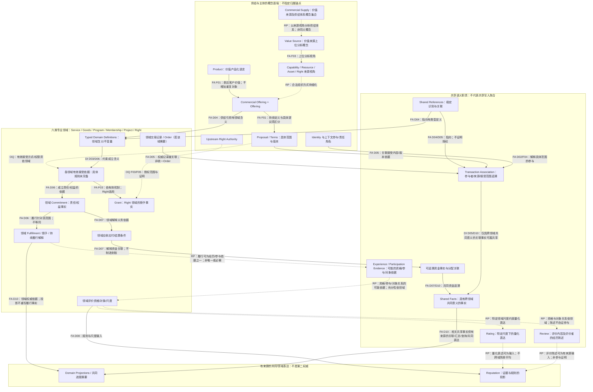

# PCI-ENG-020 — Core Concept Relationships and Commercial Process

> 日期：2026-11-17。WP-04；概念图，不是数据模型、模块图或生命周期。

## 1. 图例与权威边界

来源编号见[索引](PCI-ENG-020-Global-Conceptual-Source-Authority-Index.md)。实线表示已有批准原则支撑的语义关系，标注 `FA`（FOUNDER APPROVED）或 `DI`（DIRECT INFERENCE）；虚线标注 `RP`（RESEARCH PROPOSAL）或 `OQ`（OPEN QUESTION）。方向表示“解释、支撑、指向、形成依据”等语义方向，不是时序、调用、写入、外键或数量关系。边上的限定词与图外说明共同约束解释。

边界框是观察范围，不是部署/数据库边界。共享与领域都可引用同一来源；Shared Core 写入权和实体数不在图中。

## 2. 核心语义关系图

图中领域有效接受还需具体领域规则，不能读作所有 Proposal 必须点击同一按钮或生成同一种 Commitment。履行事实只是 Experience / Participation Evidence 的可能来源之一，不是所有领域唯一或必需的评价资格依据；具体资格、对象关系及证据充分性仍由领域决定。Review 是评价陈述，不自证实际参与；Rating 是特定尺度量化表达；Reputation 是基于相应证据及规则的声誉表达。图中的细化为 RP，Experience / Participation Evidence 仅为分析性概念用语，不创设全局实体、评价制度或已经发生的评价事实。Order 指向关联表示领域记录可被关联，不要求先建 Order 才能有任何关系。

Commitment 表达依有效接受机制及其范围形成的责任或权益事实；Grant 表达 Right 领域符合相应领域条件后形成的授权事实（FA：S04 F01/F03、S07 D06），不自动转移所有权或证明完整权利链。两者关系为 **OPEN QUESTION**，见 [OQ-B06](PCI-ENG-020-Global-Conceptual-Open-Questions.md)；不预设继承、包含、完全独立或统一生命周期，也不要求每个领域另造 Grant。

Shared Facts 具有跨领域共同意义，不仅限于关联索引或追溯信息，包含 D07 的共享资金事实与账务追溯；关联存在不自动意味着有跨领域共同意义，外部来源也不自动属于 Shared Facts。Domain Projections 可基于权威 Domain Facts（图中履行仅为一例）和相关 Shared Facts 进行有来源的关联、汇总、查询和共同表达；不能创造或改写领域成立、责任或履行事实，不能成为第二个独立可编辑的领域真相（FA：S07 D07、S08 D10；DI：来源和投影权威分开）。

图中没有 Money → Fulfillment、Reference → Ownership、Projection → Domain Success 的边：这些推导被 S04/S07/S08 明确排除。没有 Identity → Offering Owner 的确定边，因为 F04 的最终 Owner Anchor 未裁决。图中的确立关系不决定基数、事件、接口或存储。

## 3. 过程关系不是统一时序

| 关系/问题 | 普遍约束 | 领域差异或可不适用项 | 证据 |
| --- | --- | --- | --- |
| 来源 → Offering | 来源描述、能力、权能须分清；引用不证明合法性 | 哪种来源必须显式关联、是否可组合尚待领域定义 | FA：S04 F02–F04；OQ：F05/F10 |
| Offering → Proposal | 持续供给与具体接受内容分开 | 提议表达方式、接受版本语义不同，不强制独立对象 | FA：S04 F01；RP：具体表达 |
| Proposal → 接受 → 责任 | 责任须依领域有效机制解释 | Request、付款、点击、授予条件并非全球统一接受方式 | FA：S07 D06；OQ-A02 |
| Transaction Association → 领域记录 | 关联供给/角色/接受依据；不夺取领域权威 | 是否称 Order、何时建立记录、具体数量均未定 | FA：S07 D05；AD：技术关联 |
| Commitment → Fulfillment | 区分责任成立与履行事实 | 单次、分批、多阶段、持续权益、有界授权各不同 | FA：D06；RP：S03 §7、S05 §6 |
| 资金 ↔ 业务范围 | 实际资金和义务、分配分别解释 | 资金可先于/重叠/晚于履行，也可不适用于当前 VS-01 | FA：D07；DI：无全局先后关系 |
| 经历/参与依据、Review、Rating 与 Reputation | 参与依据与评价陈述分开；量化尺度与声誉规则不互代，投影不创设经历 | 资格/证据充分性、评价窗口及阶段/期间尺度依领域；不是统一必经链，没有评价就保持缺失 | FA：D08；RP：词义细化；OQ-B04 |
| 共同进度 → 展示 | 只能是有来源的范围摘要 | 不替代领域完成或用总状态清除局部事实 | FA：D09/D10 |

**DIRECT INFERENCE（D05–D10）**：部分事实可在交易前已有，例如来源依据和持续 Offering；具体接受依据可能在交易形成时确定；履行、付款、变化、评价可能交错。全局语义不提供统一起点/终点，因此不能把研究起点箭头链实现成六类必经流程。

## 4. 跨领域关系的五层边界

**FOUNDER APPROVED（S07 D09）**：供给、提议、交易、履行、资金是五个可不同的观察边界。**RESEARCH PROPOSAL**：解释组合时将下面问题并列回答，不用某一层反推其他层：

| 观察层次 | 要说明的概念关系 | 不能据此推出 |
| --- | --- | --- |
| 供给 | 哪些持续供给/来源被共同表达 | 必有一个 Bundle 或一个 Owner |
| 提议 | 接受内容的组成版本和整体/局部依赖 | 同页就共同接受；全部可拆或全部不可拆 |
| 交易 | 哪些采购和领域记录属于同一上下文 | 一个统一 Order、一个签约方 |
| 履行 | 谁对哪个责任范围负责、哪些变化相互影响 | 一项失败让所有已履行事实从未存在 |
| 资金 | 哪些真实资金与哪些范围关联、分配依据为何 | 共付一次就只有一个责任；取消即已退款 |

**DIRECT INFERENCE**：局部变更既不能抹除其他已成立事实，也不能忽略条款约定的关联后果。“保留事实”与“后续责任不受影响”不是同一句话。历史更正应可说明新旧依据；具体撤销、退款、补救是否合法有效是领域解释/待决概念，不在本轮制造结论。

## 5. 仍未确定的关系

**OPEN QUESTION**：有效接受主体和授权依据、领域边界重叠的判别、组合依赖与金额分配冲突、来源变化对责任的后果。**ARCHITECTURE DEFERRED**：引用如何存储/解析、版本保存、协议、协调和投影更新。详见[未决清单](PCI-ENG-020-Global-Conceptual-Open-Questions.md)。

本图只表达概念与语义依赖，没有执行 D12 的指定场景或九项判据；不存在本轮模拟成交/资金/履行/评价结果。
