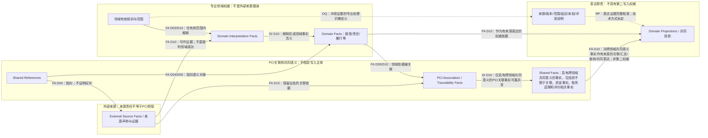

# PCI-ENG-020 — Facts Provenance and Domain Authority

> 日期：2026-11-17。WP-05；概念事实模型与图，不指定 Shared Core 写入权。

## 1. 分类方法与来源

**FOUNDER APPROVED（[S08 / D10](../07_Product_Architecture/39_C5_D10_D12_Founder_Decisions.md) §2）**：Shared References、Shared Facts、Domain Facts、Domain Projections 保持区分；外部来源事实、PCI 关联追溯事实、领域解释和共同投影不能混为一谈。事实原始来源不自动拥有所有领域解释权，专业解释权也不意味着可以改写来源。

**RESEARCH PROPOSAL（对 D10 的综合）**：七类并非七个排他容器。用三个观察轴区分：来源出处、语义解释范围、表达用途。External Source Facts 回答“谁签发什么依据”；PCI Association Facts 回答“PCI 建立了什么关联”；Domain Interpretation Facts 回答“按哪个领域规则，这意味着什么”。Shared References 是指向能力；Shared/Domain Facts 是事实语义范围；Projections 是有来源表达。交叉使用不增加真实事实数量。

来源编号及证据标签见[来源索引](PCI-ENG-020-Global-Conceptual-Source-Authority-Index.md)。此处的“产生/关联/解释/投影”是概念职责，不是写入服务、数据库拥有者或授权矩阵的实现。

## 2. 事实来源与解释关系图

图中实线 `FA` 为批准原则，`DI` 为直接推论；虚线 `RP/OQ` 为候选解释或未知处理边界。箭头不是接口、事件流、复制或调用；没有数据存储和事务含义。

**DIRECT INFERENCE（D07/D10）**：外部提供“到账”依据可以被关联，但不能单独证明某领域的履行或权益授予；领域对其业务效果的解释不是第二次到账。PCI 关联也不是修改外部机构账本。来源材料可能不完整或相互冲突，保留来源不等于证明来源必真。

Shared Facts 的来源可以是外部、PCI 或领域；来源出处、PCI 关联与跨领域共同意义是不同观察维度。具有跨领域共同意义的 PCI 关联事实可以作为 Shared Facts，普通关联本身不自动成为 Shared Facts，外部来源事实也不自动属于 Shared Facts；两类概念不合并，共享职责不是统一事实生产者或全局业务裁决者（FA：S07 D07、S08 D10；DI：来源与共同意义分开）。

## 3. 七类事实与职责矩阵

下表前四列贯彻已批准的分离原则（S06 D03/D04、S07 D05–D09、S08 D10）；具体表达建议为 RESEARCH PROPOSAL，详细可见性/争议规则为 OPEN QUESTION。没有决定新字段或接口。

| 类别 | 事实/语义是什么；来源产生者 | 谁负责关联与追溯（概念） | 谁解释其含义 | 谁可形成投影；怎样说明来源/版本/延迟/未知 | 冲突时不得做什么 |
| --- | --- | --- | --- | --- | --- |
| External Source Facts | PCI 外部来源签发的证据或声称，例如资金变化/交付材料的来源记录；真实性范围依来源证据，不凭空确认为最终事实 | PCI 对其引用、采用范围和关系承担关联说明责任；来源仍负责自己的原记录 | 原来源解释其签发内容；专业领域解释对其责任/权益有何意义 | 获准表达者可引用；注明来源声明、依据范围及获知时点/版本差异；缺失保持未知 | 不静默改写外部记录，不把不可达视为不存在，不把来源声称视为平台担保 |
| PCI Association / Traceability Facts | PCI 建立“哪些来源、角色、接受范围、领域记录被关联”的事实；可由 PCI 活动独立产生 | 建立该关联的 PCI 语境须保留依据和变更关系；不指定 Shared Core 独占 | 对关联本身作解释；被关联的领域内容仍由领域权威解释 | 可形成共同关系视图；说明关联依据/范围和修正来源；不将关系创建时间冒充原业务发生时间 | 不用关联把未接受变为已接受，不把同一资金关联复制为两次到账 |
| Domain Interpretation Facts | 按领域有效规则对来源/动作/条件作出的成立、责任、履行或变化解释 | 负责该领域语义的范围关联来源和规则依据 | 相应专业领域；规则版本与适用范围不能从最新版倒推旧事实 | 可形成领域及共同摘要；指出解释依据/规则语境，未知或争议保留 | 不跨领域代判成功，不用平台汇总覆写领域事实，不补造历史接受 |
| Shared References | 稳定指向某个有命名空间/类型语境的对象或事实；不是权利本身 | 负责该引用语义的范围维持指向解释；实现/解析责任未定 | 所指对象的权威解释业务意义；引用只能说明其指向 | 引用可以进入各种获准表达；同时保留类型/历史语境，无法确定指向时不假配 | 不推断所有权、资格、授权或认证；不将旧 creatorId 改成 globalOwnerId |
| Shared Facts | 具有跨领域共同意义的事实，包括但不限于关联、资金事实、账务追溯和评价相关事实；来源可外部、PCI 或领域，不将所有关联或外部来源事实自动归为共享 | 在共同语义范围内保留来源和关联依据；并非全部由一个 Core 生产 | 共同事实解释与领域业务解释分工，不夺取领域成立/结算/评价尺度 | 共同摘要或领域视图可采用；说明哪些是来源事实、哪些是分配/推导，不隐藏延迟 | 不以共享为由强制统一 Order/Commitment，不将来源事实改写为所有领域成功 |
| Domain Facts | 依领域规则具有权威意义的事实，如接受、责任、阶段验收、期间权益、Grant | 专业领域保持范围、出处和变化语义；被共同关联不丢权威 | 专业领域保持最终业务含义，不能由共享展示替代 | 领域/共同投影都可引用；说明领域和版本/范围、与来源记录时间的区别 | 不把一领域确认挪用为另一领域完成，不用总失败抹去局部既成事实 |
| Domain Projections | 引用和汇总有权威来源的 Domain Facts 及相关 Shared Facts，形成有依据的关联、领域查询和共同表达；共同进度不是第二份权威事实 | 投影表达须保留采用事实的来源、规则及解释范围；不是第二个独立可编辑的领域真相 | 解释“展示了哪些范围”，不能创造或重写领域成立、责任或履行事实，不能重新裁决底层事实 | 领域/共同表达者只在获准范围呈现；标出依据、观察范围、延迟/未知/冲突，而非虚假确定值 | 不独立编辑成另一权威，不将过时/缺项推成未发生，不把预测标为已完成 |

## 4. 不完整、时间和变化

| 情况 | 由批准原则得到的边界 | 候选表达与仍未定义事项 |
| --- | --- | --- |
| 未知/缺失 | DIRECT INFERENCE：没有依据不能补造事实（D10/D11/D12） | RP：区分未知、不适用、未获知；不能一律填零、未付款或失败。实际可见性/措辞未定 |
| 延迟 | DIRECT INFERENCE：共同投影不得越过已知来源宣布领域成功（D10） | RP：说明采用资料的观察范围与滞后可能；刷新/同步技术 ARCHITECTURE DEFERRED |
| 版本变化 | DIRECT INFERENCE：持续 Offering 更新不重写已接受内容；未知历史不补造（F01/D09/D11） | RP：区分原条件、变化依据、当前解释；不决定版本实体/存储 |
| 来源冲突 | FOUNDER APPROVED：领域保持专业解释、共享不独占事实（D10） | OQ：何种证据足以裁决及谁可提出异议仍需定义；不能简单“最新覆盖” |
| 更正/撤回 | DIRECT INFERENCE：后续变化须保留已成立事实及可追溯性（D07/D09） | RP：说明修正关系与影响范围；法律消灭/退款后果依领域，不规定技术修正策略 |
| 历史不完整 | FOUNDER APPROVED：VS-01 未知信息不补造（D11） | 不从现有邮箱、页面价目、Creator 或码状态反推旧角色、成交、付款或真实交付 |

## 5. 来源/领域权威的具体边界

**DIRECT INFERENCE（D06–D10）**：领域拥有“解释某项证据对其义务意味着什么”的权威，不等于拥有修改真实资金、外部签发文件或其他领域记录的权力；外部机构签发证据，也不因此决定全部商业条款的履行结果。共享引用使证据可达，不提升其证明力度。

**CURRENT CONTRACT（S10，S08 D11）**：VS-01 Fulfillment Code 确认是具体工具事实；QR 只传递码；Request confirmed 与 code fulfilled 分开。共同模型不得将该事实投影为收款、平台履行保证或通用客户评价。日志、界面或政策 review 字样不能生成真实 Review。

本模型没有给任何主体新增读取私人资料、跨域共享个人信息或公开评价的权限。如何在可追溯与最小可见之间表达，是 [OQ-B03/B04](PCI-ENG-020-Global-Conceptual-Open-Questions.md)，不是隐含的全局数据共享授权。

## 6. 结论的实际限度

七类可通过不同语义视角共同成立，不能据此证明冲突处理已经完备。所有投影建议是概念表达要求，不是元数据 Schema。未执行 D12、业务运行、外部证据核验或真实资金操作。完整不确定项见[未决登记](PCI-ENG-020-Global-Conceptual-Open-Questions.md)；整体解释见[主模型](PCI-ENG-020-Global-Conceptual-Model.md)。
